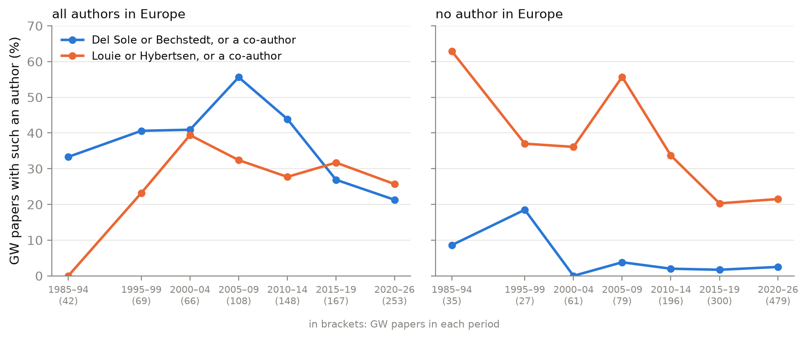
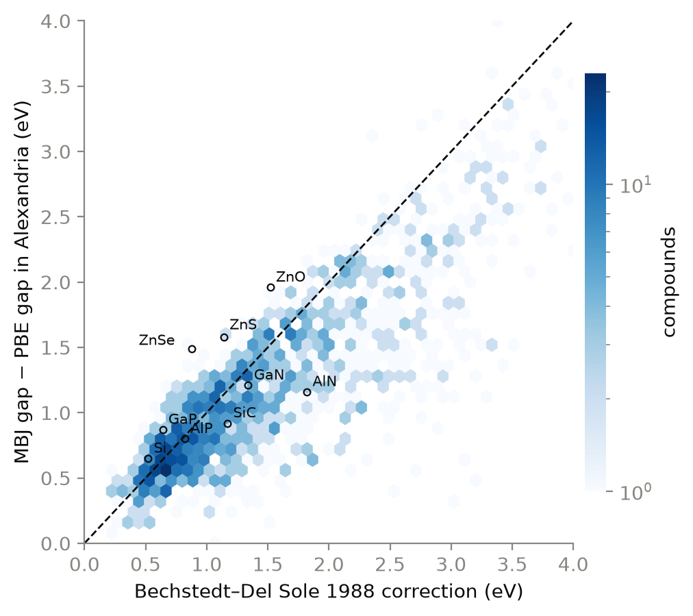

# GWΓ: Del Sole, Reining and Godby, 1994

*A Paper and its People · no. 1 (pilot) · draft*

R. Del Sole, L. Reining, R. W. Godby, "GWΓ approximation for electron self-energies in
semiconductors and insulators", *Phys. Rev. B* **49**, 8024 (1994).
doi:10.1103/PhysRevB.49.8024

Every entry of A Material a Day quotes a PBE band gap and adds that it is too small.
How much too small, and why a calculation that leaves out most of many-body theory can
fix it, are questions a small group of people in Europe worked on from the late 1980s.
This piece is about one of their papers: four pages on silicon, from 1994, which asked
why the GW approximation works at all.

## 1. The problem as it stood

By the late 1980s density-functional theory gave good structures and bad gaps. Bechstedt
and Del Sole put the size of the problem plainly in 1988: local-density gaps of
semiconductors and insulators are 25–50 % too small (C, Si, AlP, GaP, MgO), and for GaAs
and Ge "the underestimation is nearly total" [2].

The fix was Hedin's GW approximation of 1965: replace the exchange-correlation potential
by a self-energy built from the one-electron Green's function G and the screened Coulomb
interaction W. Hybertsen and Louie (1985, 1986) and Godby, Schlüter and Sham (1986,
1988) had shown that it gives the gaps of real semiconductors [1].

Two problems remained. The first was cost: a full GW calculation of the late 1980s was
feasible only for simple crystals. The second was justification. Hedin's equations
contain a third ingredient, the vertex Γ, and GW sets it to one. Hedin had motivated
that by starting from the Hartree approximation. But practical calculations start from
the LDA, which is a far better starting point, and use "the best G and the best W" one
can compute. As the 1994 paper puts it, this "best G, best W philosophy lacks a rigorous
justification" [1]. Worse, Mahan and Sernelius had shown for the electron gas that
improving W alone, without the matching vertex in the self-energy, makes results worse.

## 2. Before the paper: Rome and Jena

The 1994 paper is the third step of a programme Del Sole had been running with Friedhelm
Bechstedt for six years.

**1988, the gap in closed form [2].** Bechstedt, in Jena, and Del Sole, in Rome, wrote
the gap correction as the difference between the screened exchange of the semiconductor
and that of an electron gas with the same density. With a model dielectric function and
tight-binding p orbitals it became an analytic formula. The formula needs the valence
electron density, the electronic dielectric constant ε∞, and the size of the orbitals at
the top of the valence band. Their Table I gives 0.57 eV for Si, 0.41 eV for Ge and
4.90 eV for LiF. The paper notes that "the most important variation of the gap
correction from material to material is due to the change in the static electronic
dielectric constant". The manuscript was received in November 1987. Bechstedt's address
on it is "DDR-6900 Jena, German Democratic Republic". This was a collaboration across
the Iron Curtain, two years before it came down.

**1992–1993, GW made cheap [3, 4].** With Giancarlo Cappellini and Lucia Reining they
turned this into a working method: a model dielectric function with one fitted
parameter, nearly the same for Si, Ge, GaAs and ZnSe. The model extends an older one by
Bechstedt and Enderlein (1979). They added a treatment of dynamical screening and local
fields that earlier simplified schemes had left out. The result matched full GW
calculations to within 0.1 eV for Si, AlAs and GaAs (0.2 eV for one gap of GaAs). It
took "2 s of Cray Y-MP CPU time" per k-point, "at least two orders of magnitude" less
than full GW [3]. By then Bechstedt's address reads "D-6900 Jena, FRG".

The 1988 paper also contains, in passing, the observation the 1994 paper would test. Its
conclusions say the simple model works because "local-field and dynamical-screening
effects, which have been neglected here, cancel each other to a large extent" [2].

## 3. The paper

Del Sole signed it from two addresses: Tor Vergata, and CECAM in Orsay, the European
centre for atomic and molecular computation. Reining, his first PhD student, was at
CECAM and at the Laboratoire des Solides Irradiés of the École Polytechnique. Godby was
at the Cavendish Laboratory in Cambridge, and the calculations used the GW code of Godby
and Needs. The acknowledgements thank Bechstedt and Lars Hedin for discussions.

**The idea.** Start Hedin's iteration from the LDA exchange-correlation potential instead
of from zero. The first iteration then already contains a vertex, and it can be solved:
the self-energy keeps the GW form, Σ = iGW̃, but with an effective interaction W̃ that
screens like an electron *feeling* the induced charge, exchange and correlation included,
rather than a test charge. The authors call this GWΓ.

**The test.** Silicon (LDA gap 0.52 eV), computed three ways with everything else equal:
- **GW-RPA:** no vertex anywhere. This is standard GW.
- **GW + K_xc:** the vertex in W only, as some had proposed.
- **GWΓ:** the vertex in both W and Σ.

**What they found** (quasiparticle minus LDA, eV, from their Table I):

| | GW-RPA | vertex in W only | GWΓ |
|---|---|---|---|
| minimum gap | 0.63 | 0.59 | 0.66 |
| direct gap at Γ | 0.64 | 0.56 | 0.65 |
| valence bandwidth | −0.56 | −1.01 | −0.48 |
| valence-band maximum | −0.36 | −0.44 | +0.01 |
| conduction-band minimum | +0.27 | +0.14 | +0.67 |

- **Gaps:** plain GW and full GWΓ give practically the same gaps. The vertex in W and the
  vertex in Σ cancel. Adding it to W alone narrows the gaps by about 0.13 eV and worsens
  the bandwidth, so "this approach should therefore be avoided".
- **Absolute energies:** these do change. In GWΓ the top of the valence band moves up by
  10 meV instead of down by about 0.4 eV, so the whole band structure shifts. The
  authors suggest that this could matter for band offsets at interfaces.

The answer to "why does GW work?" was therefore half of one. The vertex corrections are
real, but for energy differences they cancel; for absolute positions they do not.

## 4. What it changed

The paper has been cited 170 times (OpenAlex). That is modest. Its argument travelled
further than its citation count, because it became the standard explanation for the
success of plain GW.

- **The cancellation, in optics (1997) [5].** Bechstedt, Tenelsen, Adolph and Del Sole
  found the same compensation for optical spectra. The dynamical self-energy removes
  about 25 % of the weight of the quasiparticle peaks, which spectra do not show, and
  dynamical vertex corrections give it back. It is the same argument for two-particle
  excitations: a correction that looks large is undone by its partner.
- **The Bethe–Salpeter equation (1998) [6].** Albrecht, Reining, Del Sole and Onida
  computed the excitonic effects in the absorption of silicon from first principles,
  starting from a quasiparticle band structure. It is Del Sole's most cited paper (961
  citations in OpenAlex).
- **A better vertex (2005) [7].** Bruneval, Sottile, Olevano, Del Sole and Reining built
  the vertex from time-dependent density-functional theory, explicitly to go beyond the
  local-density vertex of 1994. They note that the earlier cancellation had been shown
  "for bulk silicon but using a vertex derived from a local approximation".
- **Absolute positions (2014) [8].** Grüneis, Kresse and co-workers found that GW
  predicts ionization potentials of semiconductors and insulators poorly. Agreement with
  experiment came only with vertex corrections in the self-energy. They cite the 1994
  paper. This is the half of the 1994 result that said absolute energies move.
- **The cancellation, quantified (2024) [9].** Thirty years on, Förster and Bruneval
  (Bruneval is the first author of the 2005 paper) returned to the question with non-local vertices on
  molecules and silicon clusters. They write that the claim of cancellation "is mostly
  based on past calculations using vertex corrections within the crude local-density
  approximation", cite the 1994 paper among the first demonstrations, and find that
  the two vertices "essentially compensate", with conclusions they extrapolate to solids.

Del Sole did not consider the question closed. The memorial written by Palummo, Onida
and Reining records that one of his main regrets in his last months was not being able
to continue working "on the GWΓ approach to find new schemes for introducing vertex
diagrams in the self-energy calculations" [10].

## 5. The people

**Rodolfo Del Sole (1944–2011).** Everything in this paragraph is from the memorial [10].
- **Early years:** born in Rome on 19 June 1944. He read Latin and Greek without a
  dictionary at the Liceo Visconti and studied physics at La Sapienza. His 1969 thesis,
  on the Franz–Keldysh effect, was proposed by Franco Bassani and Gianfranco Chiarotti.
- **Career:** professor at Camerino from 1976, then a year at Xerox in Palo Alto with
  D. J. Chadi (1980–81). In 1985 Chiarotti asked him to help build the physics
  department of the University of Rome Tor Vergata, then just founded. He headed its condensed-matter
  theory group, was Director of the Department (2002–2008), and retired on 1 June 2011.
- **Work:** much of it was on the optics of surfaces, above all Si(111)(2×1). He was
  "one of the fathers of the EPIOPTICS community" of surface optics, and one of the key
  forces in founding the European Theoretical Spectroscopy Facility (ETSF) in 2008.
- **Students and collaborators:** his first PhD student in Tor Vergata, in 1987, was
  Lucia Reining, who came from Aachen "because she wanted to work with him". The
  memorial lists among the people he trained Annabella Selloni, Giovanni Bachelet,
  Patrizia Monachesi, Olivia Pulci, Cecilia Noguez, Valerio Olevano and Letizia Chiodo.
  It describes him as "very shy and modest".
- **Death:** he had cancer for the last decade of his life, kept working through the
  therapies, and died on 11 September 2011.

**Friedhelm Bechstedt.** In this draft he appears through his papers: Jena throughout,
from the Friedrich-Schiller-Universität of the GDR in 1988 to the Institut für
Festkörpertheorie und Theoretische Optik by 1997. The model dielectric function of
1993 extends one he had published with Enderlein in 1979 [4]. OpenAlex lists 818 works
under his name, from quasiparticles and optics of bulk semiconductors to surfaces and
two-dimensional materials. No biographical source on him was found in this search.

> *[Miguel: your account of the two of them and of the community they built goes here,
> in your words and signed.]*

**Two founders, one community.** Miguel's view, which led to this piece, is that Del Sole
and Bechstedt are the two people most of European GW can be traced back to, without
being famous outside the field. Their publication records support that view:
- **A long collaboration:** OpenAlex lists 27 joint papers, from the 1988 gap formula to
  a 2012 paper on excitons in silicane and germanane. The subjects run through the model
  dielectric function, quasiparticles at surfaces, surface optics with the Berlin
  experimentalists, and the Bethe–Salpeter equation for surfaces.
- **The European literature sits close to them.** Of the GW papers whose authors are all
  in Europe, 33–56 % in each five-year period up to 2014 have an author who is Del Sole,
  Bechstedt, or someone who published with one of them (229 and 637 people). For papers
  with no author in Europe the share is 0–19 %. The same measure built on Louie and
  Hybertsen gives roughly the mirror image over the same periods: 0–39 % in Europe,
  34–63 % elsewhere (Figure 1).
- **The bridges:** the co-authors through whom this runs most often in 2005–2014 are
  Rohlfing, Reining, Rubio, Bruneval, Kresse, Blügel, Schindlmayr, W. G. Schmidt,
  Furthmüller and Olevano. Bechstedt himself appears on 17 of those papers.
- **Since 2014:** the share falls to 27 % and then 21 %, as the field grows and the
  first generation retires.

<picture>
  <source media="(prefers-color-scheme: dark)" srcset="fig1_dark.png">
  
</picture>

*Figure 1. GW papers (title or abstract names the method; at most 30 authors) with an
author who is one of the named people or has published with one of them. Co-authorship
is not supervision: this measures where the literature sits, not who trained whom.*

## 6. Today: the 1988 formula on 1,475 compounds

The 1988 formula was derived for diamond and zinc-blende crystals, and it needs only
three numbers. Alexandria has two of them for thousands of compounds: the valence
electron density, from the structure, and ε∞, from PBE. It also has, for 4,515 phases on
the hull, both a PBE gap and an MBJ gap. MBJ is a potential built to give gaps close to
measured ones, and a large benchmark found it among the most accurate functionals for gaps [11]. So MBJ minus PBE is a database-wide estimate of the correction the
1988 paper set out to compute.

**How we applied it.**
- **Check first:** our implementation of the formula reproduces the paper's Table I for
  Si and Ge exactly. For diamond it gives 1.75 eV against 1.60, and for α-Sn 0.21
  against 0.24.
- **Generalising:** to go beyond the tetrahedral crystals we set the polarity to zero
  and took the orbital radius from the volume per atom. We kept compounds of s- and
  p-block elements (and Zn, Cd, Hg) with a PBE gap above 0.5 eV: 1,475 phases.
- **No fitting:** no parameter was adjusted.

**Result (Figure 2).** The formula and the MBJ correction correlate with r = 0.85. The
median difference is 0.22 eV, and three corrections in four agree within 0.5 eV.
- **Large corrections:** the formula overshoots; a line through the origin has slope 0.77.
- **Zinc compounds:** ZnO, ZnS and ZnSe sit above the line. The model counts only s and
  p electrons and has no 3d shell.
- **What carries the signal:** 1/ε∞ alone correlates with r = 0.81, which is what the
  1988 paper said: ε∞ carries most of it.

An analytic formula from 1987, built from a model dielectric function and Slater orbitals
for two dozen tetrahedral semiconductors, predicts the gap corrections of 1,475 compounds
with a median error of 0.22 eV.

<picture>
  <source media="(prefers-color-scheme: dark)" srcset="fig2_dark.png">
  
</picture>

*Figure 2. The gap correction of Bechstedt and Del Sole (1988), computed from
Alexandria's PBE ε∞ and the valence electron density, against the MBJ minus PBE gap of
the same compound. Dashed: equality. Circles: tetrahedral binaries.*

## 7. How this was made, and its limits

- **Figure 1:** `network.py` reproduces it (`pull`, `analyse`, `figures`; numbers in
  `network.json`).
  - *Corpus:* OpenAlex works whose title or abstract contains "GW calculations", "GW
    approximation", "GW method", "G0W0", "GW self-energy" or "GW quasiparticle". That
    gives 3,263 works, of which 2,774 articles, preprints and reviews with at most 30
    authors were kept.
  - *Region:* a paper is European when every listed affiliation is in Europe. 855 are,
    1,178 have no European author, and 741 mixed or unrecorded ones are left out.
  - *Caveats:* OpenAlex splits Del Sole over three author records, and all three are
    used; it may merge or split other people too. The phrase search misses GW papers
    that do not name the method in the abstract.
- **Figure 2:** `today.py` reproduces it (numbers in `today.json`).
  - *Generalisation:* the formula is used outside the structures it was derived for.
    The polarity and orbital radii are simplified as described above.
  - *Inputs:* PBE overestimates ε∞, and MBJ is a model of the gap, not a measurement.
- **Reading:** all ten papers cited below were read in full except where marked.

## Sources

1. R. Del Sole, L. Reining, R. W. Godby, *Phys. Rev. B* 49, 8024 (1994).
   doi:10.1103/PhysRevB.49.8024 — *full text.*
2. F. Bechstedt, R. Del Sole, "Analytical treatment of band-gap underestimates in the
   local-density approximation", *Phys. Rev. B* 38, 7710 (1988).
   doi:10.1103/PhysRevB.38.7710 — *full text.*
3. F. Bechstedt, R. Del Sole, G. Cappellini, L. Reining, "An efficient method for
   calculating quasiparticle energies in semiconductors", *Solid State Commun.* 84, 765
   (1992). doi:10.1016/0038-1098(92)90476-P — *full text.*
4. G. Cappellini, R. Del Sole, L. Reining, F. Bechstedt, "Model dielectric function for
   semiconductors", *Phys. Rev. B* 47, 9892 (1993). doi:10.1103/PhysRevB.47.9892 — *full text.*
5. F. Bechstedt, K. Tenelsen, B. Adolph, R. Del Sole, "Compensation of dynamical
   quasiparticle and vertex corrections in optical spectra", *Phys. Rev. Lett.* 78, 1528
   (1997). doi:10.1103/PhysRevLett.78.1528 — *full text.*
6. S. Albrecht, L. Reining, R. Del Sole, G. Onida, "Ab initio calculation of excitonic
   effects in the optical spectra of semiconductors", *Phys. Rev. Lett.* 80, 4510 (1998).
   doi:10.1103/PhysRevLett.80.4510 — *abstract and introduction (arXiv:cond-mat/9803194).*
7. F. Bruneval, F. Sottile, V. Olevano, R. Del Sole, L. Reining, "Many-body perturbation
   theory using the density-functional concept: beyond the GW approximation", *Phys. Rev.
   Lett.* 94, 186402 (2005). doi:10.1103/PhysRevLett.94.186402 — *abstract and
   introduction (arXiv:cond-mat/0504565).*
8. A. Grüneis, G. Kresse, Y. Hinuma *et al.*, "Ionization potentials of solids: the
   importance of vertex corrections", *Phys. Rev. Lett.* 112, 096401 (2014).
   doi:10.1103/PhysRevLett.112.096401 — *abstract; that it cites [1] is from OpenAlex.*
9. A. Förster, F. Bruneval, "Why does the GW approximation give accurate quasiparticle
   energies? The cancellation of vertex corrections quantified", *J. Phys. Chem. Lett.*
   (2024). doi:10.1021/acs.jpclett.4c03126 — *full text (arXiv:2410.17843v2),
   introduction and conclusions read.*
10. M. Palummo, G. Onida, L. Reining, "In memoriam of Professor Rodolfo Del Sole",
    *Phys. Status Solidi B* 249, 1092 (2012). doi:10.1002/pssb.201240123 — *full text.*
11. P. Borlido, J. Schmidt, A. W. Huran *et al.*, "Exchange-correlation functionals for
    band gaps of solids: benchmark, reparametrization and machine learning", *npj Comput.
    Mater.* (2020). doi:10.1038/s41524-020-00360-0 — *abstract.*
12. OpenAlex, https://openalex.org, queried 13 October 2026 — *publication records and
    citation counts.*

---
*Drafted by Claude (Anthropic) and reviewed by Miguel Marques.*
