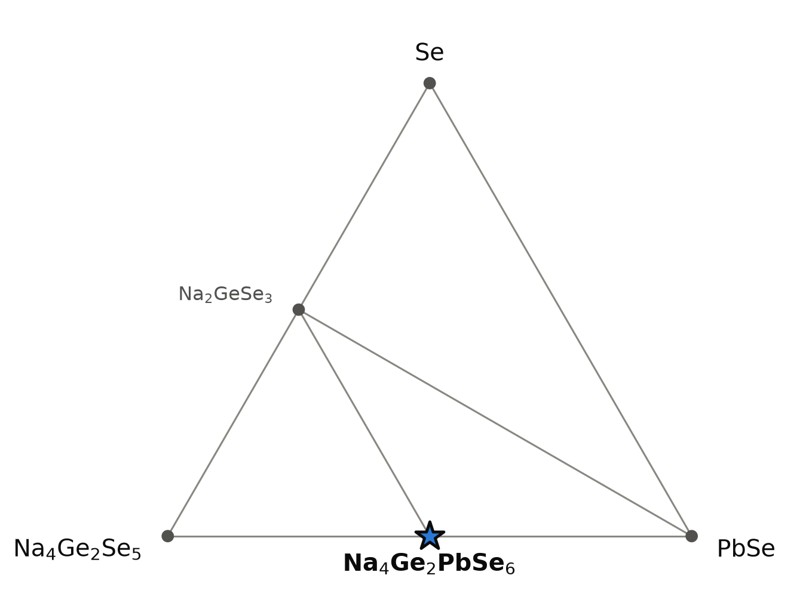
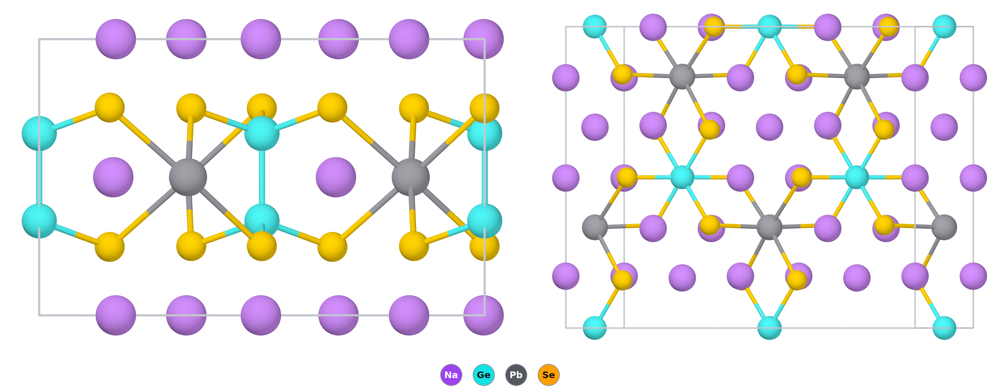

# Na₄PbGe₂Se₆ — a rock-salt superstructure with Ge–Ge dumbbells

*A Material a Day · entry 3 · 12 October 2026 · status: **predicted, no report found; close relatives are published***

> **In one paragraph.** Na₄PbGe₂Se₆ is a computed selenide in which every octahedral hole
> of a close-packed selenium lattice is filled: by sodium, by lead, or by a Ge–Ge
> dumbbell. The dumbbell and its six selenium neighbours form the ethane-like
> [Ge₂Se₆]⁶⁻ anion, with germanium formally trivalent. The sulfide Na₈Pb₂[Ge₂S₆]₂ and the
> selenosilicate Na₈Pb₂[Si₂Se₆]₂ were made in 1997 [1]; that paper names five further
> members of the family as seen by Raman and powder diffraction, and this one is not among
> them. We found no report of the selenogermanate. It is computed to be a semiconductor
> with light electrons, 15 meV/atom below its competitors, which is inside the error of
> such calculations. The computed cell has no inversion centre, but the published
> relatives are centrosymmetric because sodium and lead share one site at random, and the
> same should be expected here. The obvious synthesis is the one published for the
> relatives, from the sodium chalcogenide and the elements at 850 °C; the calculation
> adds a route in which lead metal is both the reductant and the cation source.

Everything below is computed unless a reference is given. **Hazards:** lead and selenium
compounds are toxic, and sodium selenide releases H₂Se on contact with moisture.

## 1. Identity

| | |
|---|---|
| Formula | Na₄PbGe₂Se₆, also written Na₈Pb₂[Ge₂Se₆]₂ |
| Alexandria id | `agm020240419` |
| Space group | C2 (no. 5), Z = 2, as computed with Na and Pb ordered; the published relatives are C2/m (no. 12) with Na and Pb disordered [1] |
| Cell (PBE) | a = 7.215 Å, b = 12.479 Å, c = 8.121 Å, β = 107.25° |
| Volume, density | 349.2 ų per formula unit, 4.37 g cm⁻³ |
| Formation energy | −0.786 eV/atom (PBE) |

The cell is metrically close to hexagonal: b/a = 1.730 ≈ √3, and the primitive cell has
a = b = 7.207 Å with γ = 119.93°. The CIF is [`Na4Ge2PbSe6.cif`](Na4Ge2PbSe6.cif).

**Calibration on the two published relatives** (single crystals at 23 °C [1]; computed
cells from the same database and structure type):

| | a (Å) | b (Å) | c (Å) | β (°) | V (ų) |
|---|---|---|---|---|---|
| Na₈Pb₂[Ge₂S₆]₂ measured | 6.839 | 11.783 | 7.744 | 107.00 | 596.7 |
| Na₈Pb₂[Ge₂S₆]₂ PBE | 6.904 (+1.0 %) | 11.924 (+1.2 %) | 7.815 (+0.9 %) | 107.1 | 614.9 (+3.1 %) |
| Na₈Pb₂[Si₂Se₆]₂ measured | 7.070 | 12.214 | 7.969 | 107.29 | 657.1 |
| Na₈Pb₂[Si₂Se₆]₂ PBE | 7.154 (+1.2 %) | 12.373 (+1.3 %) | 8.041 (+0.9 %) | 107.4 | 679.2 (+3.4 %) |

PBE is about 1 % long on every axis and 3 % large in volume, and gets β right. Applied
to this entry, the cell to expect in an experiment is near a = 7.13, b = 12.33,
c = 8.05 Å, β = 107.3°, V ≈ 677 ų and 4.5 g cm⁻³.

## 2. Where it sits

<picture>
  <source media="(prefers-color-scheme: dark)" srcset="phase_diagram_dark.png">
  
</picture>

Four elements again, so the diagram is a section. No plane spanned by elements and
binary compounds passes through Na₄PbGe₂Se₆ without cutting tie lines, because germanium
is trivalent here and no binary germanium selenide is. The section that works has a
ternary corner: Na₄Ge₂Se₅–PbSe–Se. Every tie line shown is also one of the full
four-element hull.

| phase | position | energy below the corners (meV/atom) |
|---|---|---|
| Na₄Ge₂Se₅ | corner | 0 |
| PbSe | corner | 0 |
| **Na₄PbGe₂Se₆** | midpoint of the Na₄Ge₂Se₅–PbSe edge | 15 |
| Na₂GeSe₃ | midpoint of the Na₄Ge₂Se₅–Se edge | 18 |

- **The compound is a 1 : 1 adduct of PbSe and Na₄Ge₂Se₅**, both of which already
  contain the ingredients: Na₄Ge₂Se₅ is itself a Ge³⁺ selenide. Its only neighbours in
  the full hull are those two and Na₂GeSe₃.
- **Towards selenium, germanium oxidises.** Adding Se to Na₄Ge₂Se₅ gives Na₂GeSe₃ with
  Ge⁴⁺. A selenium-rich batch will therefore lose the Ge–Ge bond and with it the target.

## 3. Structure

*Left: one slab seen along a. The layer that holds Pb, Na and the upright Ge₂ dumbbells
lies between two layers of sodium only. Right: the same slab seen from above; each
dumbbell is end-on, at the centre of its six selenium atoms. Only the Ge–Ge, Ge–Se and
Pb–Se bonds are drawn; the Na–Se contacts are left out for clarity.*

| site | Wyckoff | coordination |
|---|---|---|
| Na (×4) | 2a, 2a, 2a, 2b | 6 Se at 3.03–3.18 Å (octahedron) |
| Pb | 2b | 6 Se at 3.12–3.15 Å (octahedron) |
| Ge | 4c | 3 Se at 2.39 Å and 1 Ge at 2.455 Å (tetrahedron) |
| Se (×3) | 4c | 1 Ge + 4 Na + 1 Pb, or 1 Ge + 5 Na |

- **A filled rock-salt arrangement.** Selenium is close-packed and every octahedral
  hole is occupied. Per six selenium atoms there are six holes: four take Na⁺, one
  takes Pb²⁺ and one takes a Ge₂ pair.
- **The [Ge₂Se₆]⁶⁻ anion.** Two GeSe₃ pyramids joined by a Ge–Ge bond of 2.455 Å in a
  staggered, ethane-like arrangement. It is the germanium analogue of the [P₂Se₆]⁴⁻
  unit of the MPSe₃ layered compounds.
- **Layer order.** Layers containing only sodium alternate with layers containing
  sodium, lead and the dumbbells. Lead atoms are 7.21 Å apart on a triangular net.
- **Lead is in a regular octahedron,** with six nearly equal Pb–Se distances, as in
  PbSe itself: the 6s² pair is not stereochemically active.
- **No inversion centre in the computed cell, and the reason is the cation order.**
  The symmetry stays C2 at any tolerance we tried up to 0.3 Å. In the published
  structures [1] the space group is C2/m and there are three cation sites: two hold
  sodium only, and the third, in the plane that bisects the Ge–Ge bond, holds sodium
  and lead at random, half each. That site is fourfold in C2/m. Putting lead on two of
  its positions and sodium on the other two splits it into the two 2b sites of C2 and
  removes the inversion centre: this is the computed cell. The calculation has to
  choose an order; the crystals, grown from 850 °C, did not.
- **A second arrangement** of the same building blocks (`agm020354057`, also C2) lies
  11 meV/atom higher. The gap between the two stored arrangements is 12–14 meV/atom
  for the two published lead compounds and 1.4 meV/atom for Na₈Sn₂[Ge₂S₆]₂, where the
  experiment finds tin spread over two of the three cation sites (26.5 % and 23.5 %)
  and lead on one [1]. We have not checked which sites the second arrangement uses, so
  this is a suggestive agreement and no more.
- **Bond lengths.** Measured Ge–Ge is 2.395 Å in the lead sulfide and 2.393 Å in the tin
  sulfide, and Si–Si is 2.343 Å in the selenosilicate; the computed 2.455 Å here is for
  a different anion and probably 1–2 % long. The mixed Na/Pb site of the selenosilicate
  has six Se at 3.07–3.10 Å (mean 3.086 Å), beside 3.12–3.15 Å computed here for an
  all-lead site: about 1.5 % longer.

**The family.** Eighty-nine compounds of this structure type are in the database, of
the general formula A₄M[T₂Q₆] with A = Na, K; M = Mg, Ca, Sr, Ba, Cd, Sn, Pb, Eu; T = Si,
Ge, Sn; Q = S, Se, Te. For the sodium lead members:

| | S | Se | Te |
|---|---|---|---|
| Si | 35 | 40 (published [1]) | 34 |
| Ge | 32 (published [1]) | **15** (this entry) | 7 |
| Sn | −23 | −18 | |

Depth below the competing phases, meV/atom, PBE; negative means above the hull. The
published members are the deepest of their rows, the tin compounds are not stable, and
this entry sits in between.

Reference [1] also names five related phases indicated by Raman spectroscopy and
powder diffraction, without cells: Na₈Sn₂[Ge₂Se₆]₂, K₈Pb₂[Ge₂S₆]₂, K₈Sn₂[Ge₂S₆]₂,
K₈Pb₂[Ge₂Se₆]₂ and K₈Sn₂[Ge₂Se₆]₂. Of the eight combinations of Na or K, Pb or Sn and
S or Se, seven are therefore reported or indicated, and the one that is missing is
the sodium lead selenogermanate of this entry. The paper does not say whether it was
attempted.

## 4. Properties

### Electronic structure

| | value | comment |
|---|---|---|
| Band gap, PBE (eV) | 1.32 (indirect), 1.32 (direct) | PBE underestimates: by 0.56 eV for the lead sulfide and 0.44 eV for the tin sulfide (below). The same offset puts this gap at 1.8–1.9 eV, which would make the compound dark red |
| Band gap, machine-learned (eV) | 1.41 | A screening estimate of the PBE-level gap |
| Magnetism | none | closed shells |

Across the family the PBE gap falls from sulfide to telluride and from silicon to
germanium: Na₄PbSi₂S₆ 2.34, Na₄PbGe₂S₆ 1.87, Na₄PbSi₂Se₆ 1.95, Na₄PbGe₂Se₆ 1.32,
Na₄PbGe₂Te₆ 1.01 eV. No MBJ or hybrid gap is available.

**Measured gaps of the relatives** (optical absorption of single crystals [1]):

| | measured (eV) | colour | PBE (eV) | PBE − measured |
|---|---|---|---|---|
| Na₈Pb₂[Ge₂S₆]₂ | 2.43 | yellow-orange | 1.87 | −0.56 (−23 %) |
| Na₈Sn₂[Ge₂S₆]₂ | 2.06 | ruby red | 1.62 | −0.44 (−21 %) |
| Na₈Pb₂[Si₂Se₆]₂ | not measured | red-orange | 1.95 | |

PBE reproduces the order and most of the step from lead to tin (0.25 eV computed,
0.37 eV measured). The measured crystals are cation-disordered and the computed cells
ordered, so part of the offset may be the disorder. The authors assign the gap to
charge transfer from the chalcogen valence band to a Pb- or Sn-based conduction band,
which agrees with the light electron mass below.

### Charge transport (constant relaxation time)

| | electrons | holes |
|---|---|---|
| Conductivity mass at 300 K (mₑ) | 0.30 | 1.15 |
| Density-of-states mass (mₑ) | — | 2.4 |
| Seebeck coefficient at 300 K, 10¹⁹ cm⁻³ (μV/K) | −177 | +404 |
| Seebeck coefficient at 300 K, 10²⁰ cm⁻³ (μV/K) | −102 | +202 |

- **Light electrons, heavy holes.** A conductivity mass of 0.3 mₑ is in the range of
  ordinary semiconductors. The conduction band of a Pb²⁺ selenide is built from Pb 6p
  states, which explains the low mass; the valence band is selenium-based and flatter.
- **Branch-point energy:** 0.67 eV above the valence band in a 1.32 eV gap, that is,
  at mid-gap. Neither carrier type is favoured.
- Nothing is known about the scattering time, so these are not mobilities.

### Dielectric and optical

Not in the dielectric table. The computed cell has no inversion centre, so
piezoelectricity and second-harmonic generation would be allowed in it; neither was
computed, and neither should be expected from crystals with the C2/m average
structure of the published relatives (section 3). The magnesium analogues of this
family are in the database as well.

### Mechanical (machine-learned)

| bulk modulus | shear modulus | Young's modulus |
|---|---|---|
| 25 GPa | 12 GPa | 28 GPa |

A soft solid, comparable to rock salt, as expected for a sodium-rich selenide.

### Measured on the relatives, with no computed counterpart here

- **Melting:** Na₈Pb₂[Ge₂S₆]₂ melts incongruently at 802 °C and Na₈Sn₂[Ge₂S₆]₂ at
  709 °C (differential thermal analysis [1]).
- **Raman:** two strong sharp lines at 197 and 286 cm⁻¹ (lead sulfide) and 192 and
  283 cm⁻¹ (tin sulfide); the authors tentatively assign the upper one to the Ge–Ge
  stretch. In a selenide the lines will lie lower. This is the quickest test for the
  [Ge₂Se₆]⁶⁻ unit in a product.
- **Stability in air and water:** the sulfides survive water and common solvents and
  show some decomposition only after several weeks in air. The selenosilicate also
  survives water but its surface decomposes partly in air overnight.

### Not computed

Phonons (not in our lattice-dynamics set), dielectric tensor, nonlinear optical
coefficients, defects.

## 5. Is it stable?

| calculation | depth below the competing phases (meV/atom) |
|---|---|
| PBE | 15.1 |
| PBE (MP settings) | 15.6 |

The two tables agree to half a meV, which is reassuring about consistency and says
nothing about accuracy. There is no calorimetric benchmark for selenides in our set;
for sulfides the scatter is about 80 meV/atom. **Fifteen is well inside that, so
stability is not established by the calculation.**

The argument for the compound is chemical: the same structure exists with sulfur in
place of selenium and with silicon in place of germanium [1], and this member is
computed to be as stable as the published ones to within a factor of two or three.

Two things from [1] bear on this. The crystals are disordered on the Na/Pb site, which
adds a configurational entropy of R ln 2 per mixed site that the 0 K number leaves out
and that favours the compound at the growth temperature. And among the eight
combinations the authors list (section 3) this is the only one absent, which is
consistent with its being the shallowest of the lead germanium members in the
calculation but proves nothing: the paper does not say it was tried.

## 6. How to make it

Reaction energies at 0 K, meV per atom of the whole charge.

| route | charge | ΔE | comment |
|---|---|---|---|
| A | PbSe + Na₄Ge₂Se₅ | −16 | Fewest reagents and least driving force, but Na₄Ge₂Se₅ must be made first |
| **B** | **Pb + 2 Na₂GeSe₃** | **−85** | Lead metal reduces Ge⁴⁺ to Ge³⁺ and becomes the Pb²⁺ of the product. Nothing to separate |
| C | 2 Na₂Se + PbSe + 2 Ge + 3 Se | | The direct route from binaries and elements. The published syntheses of the relatives are of this kind, with lead as the metal and germanium and chalcogen in excess (below) |
| D (metathesis) | 3 Na₂Se + PbCl₂ + 2 Ge + 3 Se → target + 2 NaCl | −341 | Clean in the calculation; NaCl is inert towards the product |
| E (metathesis) | Na₄Ge₂Se₆ + PbCl₂ | −122 | **Fails:** gives PbSe + GeSe₂ + 2 NaCl. A Ge⁴⁺ precursor has nothing to reduce it |

- **Route B is the one we would try.** It is a redox reaction in which the reductant
  ends up in the product. Na₂GeSe₃ is a Ge⁴⁺ selenide and easier to prepare and handle
  than a Ge³⁺ precursor.
- **Routes D and E together make the point about metathesis here:** it works only if
  the charge carries the reducing equivalents (elemental germanium), because the
  target contains a Ge–Ge bond that salt exchange alone cannot create.
- **Selenium balance decides the outcome** (section 2): excess selenium oxidises
  germanium and gives Na₂GeSe₃ + PbSe; too little leaves PbSe and germanium.

**How the relatives were made [1].** All three from the sodium chalcogenide and the
elements, handled under nitrogen, held three days and cooled slowly:

| product | charge as printed | hold | cooled to | yield |
|---|---|---|---|---|
| Na₈Pb₂[Ge₂S₆]₂ | 4 Na₂S + 2 Pb + 5 Ge + 9.5 S | 850 °C | 450 °C over 80 h | 62 % on Pb, single phase |
| Na₈Sn₂[Ge₂S₆]₂ | 2 Na₂S + 2 Sn + 5 Ge + 5 S | 750 °C | 350 °C | about 30 %, with SnS₂ and Ge |
| Na₈Pb₂[Si₂Se₆]₂ | 2 Na₂Se + 2 Pb + 5 Si + 9.5 Se | 850 °C | 450 °C | 30 %, single phase |

- **Germanium is in excess on purpose:** 5 Ge for the 4 the formula needs, which the
  authors say suppresses PbS. The lead sulfide charge carries one Ge and 1.5 S beyond
  the formula, that is, an excess that is itself at the Ge³⁺ ratio. This agrees with
  the computed warning that surplus chalcogen costs the Ge–Ge bond.
- **The product is isolated by washing with water,** in which the rest of the charge
  dissolves. The hull has no way of proposing this; it works because the quaternary
  compounds tolerate water.
- **Route B was not used.** The published syntheses start from the elements, so lead
  is oxidised by the chalcogen and germanium never passes through Ge⁴⁺. Route C is the
  hull's version of the published charge; route B remains our untested suggestion.
- **The selenogermanate by analogy:** 4 Na₂Se + 2 Pb + 5 Ge + 9.5 Se at 850 °C for
  three days, cooled to 450 °C over 80 hours, washed with water. This is a
  transcription of the sulfide recipe, not a published one.

**In practice (a proposal).**

- **Container:** evacuated silica ampoule, carbon-coated for safety against sodium.
  Silica, alumina, boron nitride and graphite are inert towards the product in the
  calculation. Calcium oxide is not.
- **Temperature:** 750–850 °C for three days, then slow cooling to 350–450 °C, as for
  the relatives [1]. Our first draft proposed 600–750 °C; the published syntheses run
  hotter, above the incongruent melting point of the lead sulfide (802 °C), and grow
  the crystals on cooling. Neither is a computed window. PbSe (melting point 1078 °C)
  is the refractory component.
- **Flux:** all alkali chlorides, bromides and iodides are inert towards the compound
  in the calculation, so a NaCl-based or NaI-based flux is admissible, and the NaCl
  from route D does no harm. KF and K₂CO₃ exchange sodium for potassium. MgCl₂ and
  CaCl₂ destroy it.
- **Atmosphere:** none. With oxygen the computed products are sodium germanates, PbSe
  and sodium polyselenides (−637 meV/atom). Load the charge in a glovebox: Na₂Se is
  the moisture-sensitive reagent. The product may be more forgiving, since the
  selenosilicate survives water and tarnishes in air only overnight [1].

**Powder pattern.** Strongest computed lines, Cu Kα:

| 2θ (°) | 11.41 | 14.69 | 16.10 | 25.01 | 29.15 | 39.82 | 43.46 |
|---|---|---|---|---|---|---|---|
| hkl | 001 | 110 | 11-1 | 130 | 131 / 20-2 | 13-3 / 202 | 33-1 / 060 |
| I | 35 | 20 | 14 | 19 | 100 | 27 | 42 |

- **Lines of PbSe** (rock salt, a ≈ 6.12 Å) with a second sodium germanium selenide:
  the selenium content is off, or the compound does not form.
- **The 001 line at 11.4°** (d ≈ 7.76 Å) is the repeat of the sodium and
  lead/germanium layers. It is present with or without Na/Pb order within the layer,
  so it identifies the structure type, not the C2 cell.
- **Expect every line slightly higher in angle** than listed: the PBE cell is about
  1 % long (section 1), which moves 001 to about 11.5° and the strongest line to about
  29.5°.

## 7. What it might be good for

Nothing here is an existing application.

- **A semiconductor with a gap near the visible** and light electrons, built from
  abundant sodium; lead and selenium are the obvious objections.
- **Nonlinear optics, only if the cations order.** The computed cell would allow
  second-harmonic generation, but the published relatives are centrosymmetric on
  average (section 3), which forbids it. This use depends on an ordered crystal that
  nobody has shown, for instance from growth at lower temperature.
- **A tunable family.** With 89 computed members and the gap moving from 1.0 to 2.3 eV
  across the sodium lead series alone, the structure type is a platform for choosing a
  gap by composition: the measured step from lead to tin in the sulfide is already
  0.37 eV [1]. Europium members are published and magnetic [2]. The authors of [1] saw
  the family as a class that could grow as large as the M₂P₂Q₆ compounds; they name no
  application.

## 8. How this could be wrong

- **Stability is not resolved** (section 5).
- **The real symmetry is probably higher.** The calculation finds C2 at 0 K with Na
  and Pb ordered. Both published lead relatives are C2/m with Na and Pb mixed half and
  half on one site [1], and a crystal of this compound grown the same way should be
  expected to be the same. Everything that depends on the missing inversion centre
  then goes. Whether the order of the computed cell can be reached at all is open: we
  have no energy for the disordered state.
- **The gap is a PBE gap.** Spin–orbit coupling on lead, which is not included, lowers
  the conduction band and partly offsets the PBE underestimate.
- **The gap and the masses are those of the ordered cell.** Random Na/Pb occupation
  will blur the Pb-based conduction band edge; the electron mass of 0.30 mₑ is the
  number most exposed to this.
- **The list of related phases in [1] was read from a poor scan.** We read the first
  of the five as Na₈Sn₂[Ge₂Se₆]₂. If it is Na₈Pb₂[Ge₂Se₆]₂, this compound has been
  indicated since 1997 and the status of this entry changes. A person should check
  the printed page (p. 126, end of section 3.1).

## 9. Literature

**Searched (OpenAlex, Crossref, web), 8 October 2026:** `Na8Pb2(Ge2Se6)2`,
`Na8Pb2[Ge2Se6]2`, `Na4PbGe2Se6`; "sodium lead selenogermanate Ge2Se6 ethane-like";
"quaternary thiostannates and thiogermanates Na8Pb2[Ge2S6]2"; "Na4MgM2Se6 nonlinear
optical".

**Result:** the sulfide and the selenosilicate are published [1]; no report of the
selenogermanate was found. Reference [1], read in full, gives cells for three
compounds and names five more as indicated by Raman and powder diffraction (section
3); Na₈Pb₂[Ge₂Se₆]₂ is in neither list as we read it. The potassium phases are
attributed there to a manuscript in preparation, which we have not traced. A check
against ICSD by a person is still owed.

1. G. A. Marking, M. G. Kanatzidis, "The ethane-like [Ge₂S₆]⁶⁻ and [Si₂Se₆]⁶⁻ ligands
   bound to main-group metals in Na₈Pb₂[Ge₂S₆]₂, Na₈Sn₂[Ge₂S₆]₂ and Na₈Pb₂[Si₂Se₆]₂",
   *J. Alloys Compd.* **259**, 122–128 (1997). doi:10.1016/s0925-8388(97)00038-8 —
   *full text read (a scanned copy; some subscripts are hard to make out).*
2. A. Choudhury, K. Ghosh, F. Grandjean *et al.*, "Structural, optical, and magnetic
   properties of Na₈Eu₂(Si₂S₆)₂ and Na₈Eu₂(Ge₂S₆)₂", *J. Solid State Chem.* (2015).
   doi:10.1016/j.jssc.2015.02.006 — *title and metadata only.*

## 10. Provenance

- **Data:** Alexandria database, tables `energy_runs_pbe` (structure, properties),
  `energy_runs_pbe_mp` (reaction energies), `el_transport_pbe`.
- **Tools:** the reaction-route code of this group, pymatgen, POV-Ray; machine-learned
  moduli from a graph neural network.
- **Authorship:** drafted by Claude (Anthropic) from those tools; reviewed by
  Miguel Marques. Corrections are welcome as issues on this repository.
