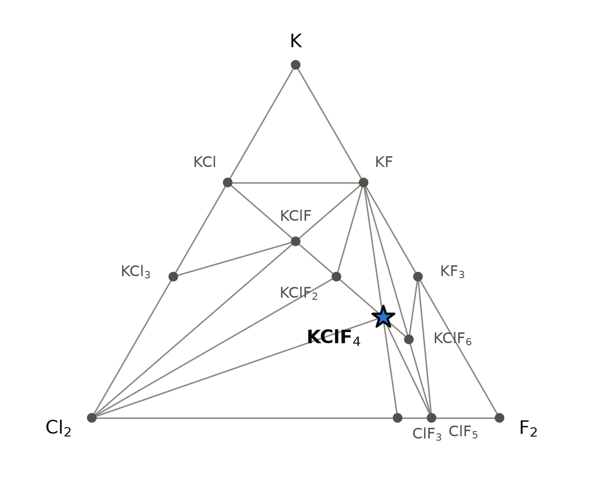
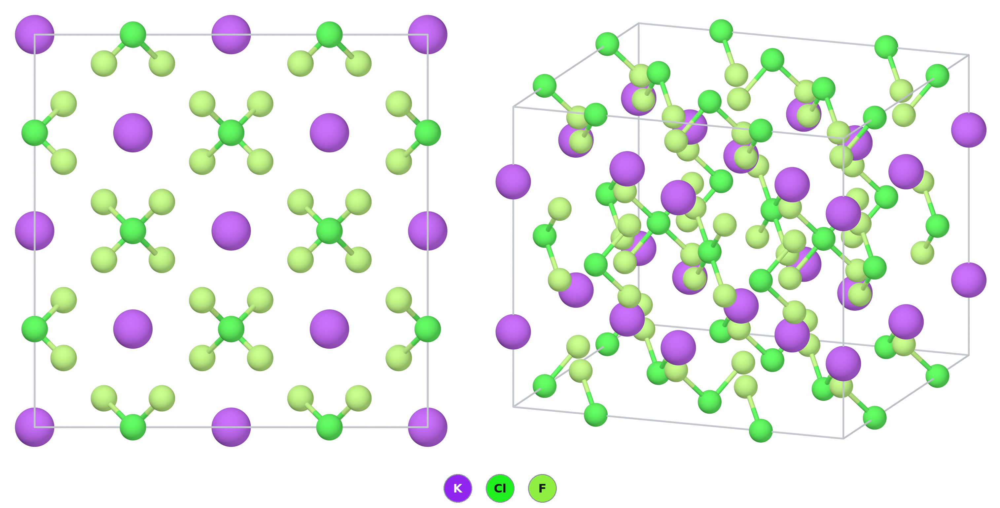

# KClF₄ — potassium tetrafluoridochlorate(III), chlorine trifluoride held in a salt

*A Material a Day · entry 4 · 13 October 2026 · status: **known** (probably first made around 1950; single-crystal structure 2020)*

> **In one paragraph.** KClF₄ is the salt K⁺[ClF₄]⁻: potassium fluoride that has taken up
> one molecule of chlorine trifluoride. Its anion is the square-planar ClF₄⁻ of the
> textbooks, with chlorine in the +3 state and two lone pairs above and below the plane.
> The compound is known. It is made by stirring KF in liquid ClF₃ at 50–100 °C, and that
> is also the first route our hull proposes. The conversion stops near half in both
> published preparations, and the product starts to decompose at about 200 °C. The
> calculation gets the anion right (Cl–F bond 2 % long, angles exact) and the packing
> wrong: the PBE cell is 9 % too large in volume, well outside the usual 0.5–2 % per
> axis. The compound is a violent oxidiser and fluorinating agent. Nothing here is a
> recipe to try without a fluorine laboratory.

Computed numbers come from the Alexandria database; measured numbers carry a reference.

## 1. Identity

| | computed (PBE) | measured, 100 K [1] |
|---|---|---|
| Formula | KClF₄ | K[ClF₄] |
| Alexandria id | `agm002148009` | |
| Space group | I4/mcm (no. 140), Z = 4 | I4/mcm, Z = 4 |
| a (Å) | 6.241 | 6.0372(3) |
| c (Å) | 10.973 | 10.7566(6) |
| Volume (ų per cell) | 427.4 | 392.05(4) |
| Density (g cm⁻³) | 2.34 | 2.55 |
| Structure type | K[BrF₄] | K[BrF₄] [1] |
| Formation energy | −1.459 eV/atom | |

- **The cell is too large.** a is 3.4 % long, c is 2.0 % long, the volume 9.0 % too big.
  With Materials-Project settings the cell is 6.216 × 10.962 Å, 8.0 % too big.
- **This is not a wrong structure.** The site set and the anion geometry match
  (section 3). The error is in the weak contacts between potassium and the anions,
  which PBE without a dispersion correction underbinds. The authors of [1] saw the same
  with a hybrid functional, at half the size: their PBE0 cell was 4 % too large.
- The measurement is at 100 K and the calculation at 0 K, so thermal expansion does not
  explain the difference.
- **A pycnometric density exists, for a mixture.** The 1964 product, KClF₄·0.8KF,
  measured 2.58 g cm⁻³ at 25 °C by displacement of a perfluorinated ether [4]. That is
  1 % above the X-ray density of the pure salt and 10 % above the PBE one. It is not a
  clean test: 44 % of the potassium in that sample was still KF.

The CIF is [`KClF4.cif`](KClF4.cif); all numbers are in [`structure.json`](structure.json).

## 2. Where it sits

<picture>
  <source media="(prefers-color-scheme: dark)" srcset="phase_diagram_dark.png">
  
</picture>

The K–Cl–F triangle at 0 K (PBE table). The corners Cl₂ and F₂ are the molecular
solids. KClF₄ lies on the line that joins KF to ClF₃, at the 1 : 1 point.

| phase | formation energy (eV/atom) | what it is |
|---|---|---|
| KF | −2.711 | rock salt |
| KCl | −1.951 | rock salt |
| ClF₃ | −0.632 | molecular solid; the reagent of [1, 4] |
| ClF₅ | −0.600 | molecular solid |
| **KClF₄** | −1.459 | K⁺[ClF₄]⁻ |
| KClF₂ | −1.692 | K⁺[ClF₂]⁻ in the calculation |
| KClF₆ | −1.190 | K⁺[ClF₆]⁻ in the calculation |
| KClF | −1.828 | not checked |
| KF₃ | −1.499 | a polyfluoride; see below |
| KCl₃ | −1.006 | a polychloride; not checked |

- **Neighbours.** KClF₄ has tie lines to KF, ClF₃, ClF₅, Cl₂, KClF₂ and KClF₆.
- **The hull holds phases we would not trust.** KF₃ is on the computed hull, in PBE
  and in SCAN. Alkali polyfluorides have so far been obtained only under cryogenic
  conditions by matrix isolation [1]. The first workers on these salts made the same
  assignment: fluorinated KCl was read as a polyfluoride in 1950–52 and later shown to
  be a fluoridochlorate mixed with fluoride [1, 2, 3]. The Materials-Project-settings
  hull adds the polychlorides KCl₇ and KCl₁₁.
- We did not search the literature for KClF, KClF₂, KClF₆ or KCl₃ as potassium salts.
  The [ClF₂]⁻ anion is known with organic cations [5].

## 3. Structure

*Left: seen down the c axis. Each cross is two square anions stacked along c and turned
by 90°; no anion lies flat in this view. Right: an oblique view, in which the planar
ClF₄⁻ units are seen edge-on and face-on. Only the Cl–F bonds are drawn.*

| site | Wyckoff | x, y, z (PBE) | x, y, z (measured [1]) | neighbours (PBE; measured) |
|---|---|---|---|---|
| K | 4a | 0, 0, ¼ | ½, ½, ¼ | 8 F at 2.790 Å; 2.704 Å |
| Cl | 4d | 0, ½, 0 | ½, 0, ½ | 4 F at 1.836 Å; 1.7982(6) Å |
| F | 16l | 0.6474, 0.1474, 0.3819 | 0.6492, 0.1492, 0.3820 | 1 Cl, 2 K |

The computed fluorine position is given in the setting of [1]. The measured K–F
distance is calculated here from the coordinates of [1].

- **The anion is square-planar.** Four fluorine atoms at 1.836 Å, F–Cl–F angles of
  89.8° and 90.2°, and 180° across. The measured angles are 89.79(4)° and 90.21(4)° [1].
  The Cl–F bond is 2.1 % longer than measured.
- **The planes stand upright.** Every ClF₄⁻ plane contains the c axis. Anions that
  follow each other along c are turned by 90° [1].
- **Potassium** sits in a square antiprism of eight fluorine atoms from four anions.
  Each fluorine bonds to one chlorine and touches two potassium atoms.
- **The packing is that of CsCl.** Each chlorine has eight potassium neighbours at the
  corners of a cube and the reverse [1].
- **Polymorphs.** Three other packings of the same anion lie within 6 meV/atom in PBE:
  C2/m at +0.9, C2/c at +3.6 and P4/mbm at +5.6. These differences mean nothing at this
  level of theory. Experiment finds I4/mcm at 100 K [1], which is also the lowest here.

### The family

Lowest computed structure of each alkali tetrafluoridohalogenate (PBE table), and its
depth below the other phases of its hull.

| | Cl | Br | I |
|---|---|---|---|
| Li | 8 meV above the hull | C2/c, 34 | — |
| Na | I4̄m2, 16 | C2/c, 69 | 6 meV above the hull |
| K | **I4/mcm, 101** | I4/mcm, 77 | I4/mcm, 17 |
| Rb | P2₁/c, 95 | I4/mcm, 71 | I4/mcm, 22 |
| Cs | C2/c, 43 | I4/mcm, 64 | I4/mcm, 12 |

- **The potassium salt is the deepest of the chlorine row**, and lithium does not bind
  ClF₃ at all in the calculation.
- **Depth is not ease of formation.** The energy of MF + ClF₃ → MClF₄ (0 K,
  Materials-Project-settings hull) beside the conversion of MF found after about one
  hour in ClF₃ at 100 °C [4]:

  | M | Li | Na | K | Rb | Cs |
  |---|---|---|---|---|---|
  | ΔE (meV/atom) | 0 | −33 | −136 | −155 | −174 |
  | conversion [4] | no reaction | no reaction | 56.5 % | 85.2 % | 91.0 % |

  The order is the same in both rows. Sodium is the one disagreement: the calculation
  binds ClF₃ by 33 meV/atom, the experiment finds nothing. The class error is
  27 meV/atom, and the 0 K energy leaves out the entropy of ClF₃, so a margin of 33 is
  not resolved. Conversion is also a matter of rate and of the solubility of the
  fluoride, not only of energy.
- **Rb[ClF₄] and Cs[ClF₄] are measured in C2/c**, in the Li[AuF₄] type [1]. The database
  agrees on the space group for caesium. For rubidium it puts a P2₁/c structure lowest
  and a C2/c structure 2.4 meV/atom higher, which is no disagreement at this accuracy.
  The structure matcher does not identify either C2/c structure with the Li[AuF₄]
  entry of the database; we did not compare the coordinates with [1] by hand.

## 4. Properties

### Electronic structure

| | value |
|---|---|
| PBE gap | 3.39 eV indirect, 3.43 eV direct |
| Machine-learned gap | 3.44 eV |
| Measured | not found; the crystals are colourless [1] |

PBE underestimates gaps, so the real gap is larger. No MBJ or SCAN gap exists for this
structure. Colourless crystals fit a gap above 3 eV and say no more than that.

### Dielectric response

| | ⊥ c | ∥ c | average |
|---|---|---|---|
| ε∞ | 2.12 | 2.45 | 2.23 |
| refractive index, √ε∞ | 1.46 | 1.57 | 1.49 |

| Born effective charge | smallest | largest | mean |
|---|---|---|---|
| K | 1.24 | 1.40 | 1.30 |
| Cl | 0.73 | 3.69 | 2.66 |
| F | −2.11 | −0.36 | −0.99 |

- ε∞ is the electronic part only. It is not the static dielectric constant.
- The chlorine charge is strongly anisotropic: large in the plane of the anion, small
  across it, as expected for a planar unit with lone pairs on both faces.
- The structure has an inversion centre, so there is no piezoelectric response.
- These numbers belong to the PBE cell, which is 9 % too large. A denser real crystal
  should have a somewhat higher refractive index.

### Charge transport

| | value |
|---|---|
| Density-of-states mass, electrons | 2.5 mₑ |
| Density-of-states mass, holes | 36 mₑ |
| Branch-point energy | 0.18 eV above the valence-band maximum |

The valence band is nearly flat: its states sit on separate anions. The Seebeck
coefficient at 300 K and 10¹⁹ cm⁻³ is −376 µV/K for electrons and +649 µV/K for holes.
These are the numbers of any wide-gap insulator and do not make a thermoelectric.

### Mechanical (machine-learned)

| bulk modulus | shear modulus | Young's modulus |
|---|---|---|
| 19 GPa | 14 GPa | 24 GPa |

Screening estimates from three separate graph neural networks. They are not mutually
consistent (19 and 14 GPa imply a Young's modulus near 33 GPa). They agree on a soft
salt. No measured value was found.

### Lattice dynamics

Phonons are not in our calculations. Measured Raman bands of K[ClF₄] [1]:

| mode | measured (cm⁻¹) | PBE0, from [1] (cm⁻¹) |
|---|---|---|
| Cl–F stretch, in phase | 515 | 530, 529 |
| Cl–F stretch, out of phase | 416 | 424 |
| scissoring | 272, 265 | 275, 263 |

### Magnetism

None. All shells are closed.

### Not computed

Phonons, elastic constants, the dissociation pressure of ClF₃ over the salt, any
finite-temperature free energy.

### Measured and not computed

| | value | reference |
|---|---|---|
| Onset of decomposition | about 200 °C, for KClF₄·0.77KF | [4] |
| Same for the caesium salt | none after several hours at 300 °C | [4] |
| Density of KClF₄·0.8KF, 25 °C | 2.58 g cm⁻³ | [4] |

Reference [4] gives no method, atmosphere or products for the decomposition.

## 5. Is it stable?

Yes, by a margin larger than the error of the method.

| question | PBE table | Materials-Project settings |
|---|---|---|
| Distance above the hull | 0 | 0 |
| Depth below the other hull phases | 101 meV/atom (KClF₂ + KClF₆) | 108 meV/atom (KF + KCl₁₁ + KClF₆) |
| KF + ClF₃ → KClF₄ | −134 meV/atom | −136 meV/atom |

- **Both hulls agree** that the compound is stable. They disagree on what it competes
  with, and in both cases the competitors are phases of doubtful reality (section 2).
- **The number to trust is the third row.** It is the reaction used to make the
  compound, between two well-known substances. It corresponds to about 0.8 eV per
  formula unit against solid ClF₃ at 0 K.
- **If off-hull phases are allowed to compete,** the depth in the PBE table falls to
  75 meV/atom, against a hypothetical KClF₃ plus KClF₆.
- **Error of the class.** Computed and measured formation enthalpies of halides differ
  by +1 meV/atom on average with a scatter of 27 meV/atom. All three margins are larger.
  The calibration set contains no interhalogen compound, so the class error is borrowed.
- **SCAN does not test this structure.** The SCAN table holds only a different I4/mcm
  arrangement of KClF₄ (potassium on 4c, `agm002209720`), which lies 78 meV/atom above
  the entry's structure in PBE. That arrangement is 19 meV/atom below its SCAN
  competitors.
- **Stable at 0 K is not stable in a bottle.** The 0 K energy leaves out the entropy
  of gaseous ClF₃, which favours dissociation on heating. The measured onset of
  decomposition is about 200 °C [4]. We did not compute a temperature to put beside it.

## 6. How to make it

### What is done

- **Solvolysis of KF in liquid ClF₃** [1, 4]. Reference [4] is the first report of this
  route. The two preparations side by side:

  | | 1964 [4] | 2020 [1] |
  |---|---|---|
  | Vessel | 500 ml nickel reactor, shaken | PFA (fluoropolymer) tube |
  | KF | not stated | 12.3 mg |
  | ClF₃ : KF (mol) | 8 | 17 |
  | Temperature, time | 100 °C, about 1 h | about 50 °C, 2 h |
  | Work-up | excess distilled off, pumped at room temperature to constant weight | excess pumped off |
  | Conversion of KF | 56.5 % | about 45 % (21.2 mg isolated, 31.9 mg expected) |
  | Product | white, KClF₄·0.8KF | colourless, with KF |

  Both conversions are from the gain in weight; the second is calculated here from the
  masses in [1]. Neither preparation gave the pure salt. Chemical analysis of the 1964
  product found 14.7 % Cl and 46.7 % F, against 18.2 % and 46.5 % for KClF₄·0.8KF [4]:
  fluorine fits, chlorine is 3.5 points low.
- **It also forms at room temperature.** KF in a 1 : 1 mixture of ClF₃ and BrF₅ gave
  KClF₄·KF at 25 °C and KClF₄·0.7KF at 100 °C, and no hexafluorobromate, although
  RbF and CsF gave the hexafluorobromate from the same mixture [4].
- **Direct fluorination of KCl** was probably the first preparation [1, 2]. Later work
  used high pressure or temperature [1, 4].
- **Purifying the ClF₃** [4]: distilled under vacuum through NaF pellets at 100 °C to
  take out HF, then fractionated trap to trap from −78 °C to remove F₂, Cl₂ and ClF.
- **Handling.** In [1]: a Monel line passivated with fluorine and ClF₃, PFA vessels
  passivated with fluorine, argon glove box, ClF₃ stored over NaF. In [4]: copper
  tubing, Monel valves and traps, nickel reactors, products removed in a nitrogen
  dry box.

### What the calculation proposes

Reaction energies at 0 K, meV per atom of the whole charge (Materials-Project-settings
hull).

| route | charge | ΔE | comment |
|---|---|---|---|
| A | KF + ClF₃ → KClF₄ | −136 | First of 139 exact routes. The route in use [1, 4]; 45–57 % conversion in practice. |
| B | ⅓ KCl + ⅔ KClF₆ → KClF₄ | −148 | Needs KClF₆, which we have not shown to exist. |
| C | KCl + ClF₃ → 0.71 KClF₄ + 0.18 KF + chlorine | −223 | ClF₃ fluorinates the chloride first. The hull books the chlorine as "KCl₁₁". |
| D | KCl + 2 F₂ → KClF₄ | open system | See the fluorine window below. |

- **Route A matches practice,** and it is the first route in our ranking (fewest
  reagents, then least driving force). The hull says the reaction goes to completion.
  Practice stops near half conversion in one to two hours [1, 4], which is a statement
  about rate, not about the energy.
- **Metathesis fails, and should.** KBF₄ + ClF₃ gives no reaction: ClF₃ does not take
  fluoride from BF₄⁻. CsClF₄ + KF gives no reaction: caesium keeps the anion. The
  compound is a fluoride adduct, and only a free fluoride donor makes it.
- **HF undoes it.** KClF₄ + HF goes to KH₄F₅ + ClF₃ at −5 meV/atom. The margin is far
  too small to resolve, but the direction agrees with experiment: HF displaces ClF₃
  from the tetrafluoridochlorates, and HF-adduct bands of KF appear in the spectra when
  the ClF₃ is not HF-free [1]. With HF as the solvent the salt does not form at all:
  ClF₃ added to KF dissolved in anhydrous HF at room temperature gave solvated
  bifluorides with no chlorine in them [4].

### The window

- **Temperature.** The usual lower bound, the Tammann temperature of KF (290 °C), does
  not apply: the reaction runs in liquid ClF₃ in a closed vessel, at 50 °C [1] and at
  100 °C [4], and at 25 °C in a mixture with BrF₅ [4]. The upper bound is the
  decomposition of the product, which starts at about 200 °C [4]. Both ends are
  measured; neither is computed.
- **Fluorine potential.** The hull keeps KClF₄ for a fluorine chemical potential
  between −1.46 and −0.80 eV per atom. Below, it loses fluorine to KF and chlorine.
  Above, the hull moves to KClF₆ and then to polyfluorides. Fluorine gas at 1 bar and
  200 °C delivers −0.18 eV, above the window. Taken literally this says direct
  fluorination overshoots. Practice says it gives fluoridochlorate(III) [1, 3]. We
  read the upper end of the window as an artefact of the fluorine-rich phases on this
  hull, not as a prediction.

### What it tolerates

| inert in the calculation | reacts |
|---|---|
| KF, NaF, LiF, nitrogen | every metal tested, including Ni, Cu, Fe, Al, Mo, W, Ag, Au, Pt |
| | every oxide tested: Al₂O₃, SiO₂, MgO, CaO, ZrO₂, Y₂O₃, TiO₂ |
| | graphite (→ CF₄ + KCl), SiC, BN, AlN, Si₃N₄ |
| | water, hydrogen, CO₂; oxygen weakly (−35 meV/atom) |
| | KCl, NaCl and every other chloride, bromide and iodide tested |

- **Nothing ordinary contains it.** The metals of the vacuum line survive because a
  fluoride film forms and stops the reaction, which is what passivation means; the
  hull sees only the reaction (Ni: −922 meV/atom, to NiF₂ and KCl). The film is not
  perfect: the rubidium and caesium salts made in nickel reactors came out pink, which
  the authors put down to traces of Rb₂NiF₆ and Cs₂NiF₆. The potassium salt was
  white [4].
- **Glass fails, as computed.** With an alkali fluoride present, ClF₃ attacked Pyrex
  reactors at once and the solid recovered was the alkali hexafluorosilicate, by X-ray
  diffraction [4].
- **Fluorides are the safe contacts,** in line with the fluoropolymer vessels of [1]
  and the NaF scrubbers of [1, 4]. NaF is inert in the experiment too: it does not
  react with ClF₃ at 100 °C [4].
- **Water.** The computed reaction with water is downhill by 166 meV/atom. References
  [1, 4] report that these salts react violently with water. Hydrolysis is reported to
  give mainly chlorate (work cited in [4], not retrieved here).

### Powder pattern

Cu Kα. First row: the measured cell and coordinates of [1], pattern calculated here.
Second row: the PBE cell, shifted to lower angle because the cell is too large.

| hkl | 110 | 112 | 200 | 211 | 220 | 204 | 312 |
|---|---|---|---|---|---|---|---|
| 2θ (°), cell of [1] | 20.81 | 26.66 | 29.59 | 34.24 | 42.34 | 45.16 | 50.74 |
| 2θ (°), PBE cell | 20.12 | 25.91 | 28.61 | 33.12 | 40.90 | 43.95 | 49.06 |
| I | 9 | 100 | 17 | 32 | 14 | 32 | 23 |

- **Lines of KF:** the conversion is incomplete, as in [1] and [4]. Expect them.
  Neither a larger excess (17 against 8) nor a higher temperature (100 against 50 °C)
  removed them.
- **Lines of KHF₂ or higher HF adducts:** HF in the ClF₃, or moisture.

### Hazards

ClF₃, F₂ and the tetrafluoridochlorates are potent oxidative fluorinating agents. They
are stable only under rigorously anhydrous conditions and react vigorously to
explosively with water and with organic material [1]. The salts charred wood and
ignited paper on contact, liberated iodine from iodide solutions and reacted
explosively with common organic solvents [4]. The ammonium analogue is worse: NH₄F and
liquid ClF₃ exploded on warming, below 0 °C [4]. ClF₃ is toxic and corrosive.
This chemistry belongs in a laboratory built for elemental fluorine.

## 7. What it is used for

- **A fluorinating agent in solid form.** Salts of [ClF₄]⁻ with organic cations have
  been evaluated as fluorinating agents: diphenyl disulfide is taken to PhSF₅ and
  carbon monoxide to COF₂ [5]. That work used soluble ammonium salts, not KClF₄.
- **A source of fluorine for hot reactions, proposed for its heavier relatives.**
  Reference [4] suggests the rubidium and caesium tetrafluorochlorates as laboratory
  fluorine sources for high-temperature reactions where liquid ClF₃ is inconvenient,
  because they survive to about 300 °C. This is a suggestion by analogy with KBrF₄,
  with no experiment behind it, and the potassium salt is left out: it starts to
  decompose 100 °C lower.
- **For KClF₄ itself we retrieved no application.** Its place in the literature is as
  the simplest salt of the ClF₄⁻ anion, and as the compound behind a 1950 dispute over
  whether alkali polyfluorides exist [1, 2, 3].

## 8. How this could be wrong

- **The cell.** The PBE volume is 9 % too large. Every property that depends on density
  (dielectric constants, moduli, the powder pattern) carries that error.
- **The hull around it.** KF₃, KCl₃, KCl₇, KCl₁₁, KClF and KClF₆ shape the competing
  assemblage and both ends of the fluorine window. If they are artefacts, the depth of
  101–108 meV/atom and the window are not physical. The KF + ClF₃ energy does not
  depend on them.
- **No SCAN check** of the entry's structure exists.
- **Molecular references.** ClF₃, Cl₂ and F₂ enter as 0 K molecular solids computed
  without dispersion. Their real state at the reaction temperature is liquid or gas.
- **The class error is borrowed** from simple halides.
- **The gap** is a PBE gap with no better functional beside it.
- **Machine-learned moduli** are extrapolations for a molecular salt of this kind.
- **The measured decomposition and density** belong to a mixture with KF (KClF₄·0.8KF),
  not to the pure salt, and the decomposition is one sentence in [4] without a method.

## 9. Literature

**Searched (OpenAlex, Crossref, web), 8 October 2026:** "potassium tetrafluorochlorate
KClF4 crystal structure"; "tetrafluoridochlorates(III) A[ClF4] A = K, Rb, Cs synthesis
crystal structure"; "alkali metal tetrafluorochlorates(III) chlorine trifluoride
potassium fluoride reaction"; "KBrF4 crystal structure square planar tetrafluorobromate
neutron diffraction"; "Whitney MacLaren Fogle Hurley solid alkali metal
tetrafluorochlorates"; "KClF4 fluorinating agent tetrafluorochlorate thermal
decomposition"; "Bode Klesper Fluorierung Kaliumchlorid Tetrafluorochlorat"; "potassium
tetrafluorochlorate KClF4 thermal decomposition temperature dissociation pressure".

**Result:** the compound, its structure and route A are published, with an onset of
decomposition near 200 °C and a density of the KF-containing product [4]. No measured
gap or modulus was found.

1. B. Scheibe, S. I. Ivlev, A. J. Karttunen, F. Kraus, "Synthesis and Characterization
   of the Tetrafluoridochlorates(III) A[ClF₄] (A = K, Rb, Cs)", *Eur. J. Inorg. Chem.*
   2020, 1319–1324. doi:10.1002/ejic.202000106 — *full text read (open-access copy,
   Aalto University repository).*
2. H. Bode, E. Klesper, "Über fluoraktive Stoffe", *Z. Anorg. Allg. Chem.* 267, 97
   (1952). doi:10.1002/zaac.19522670111 — *abstract read.*
3. H. Bode, E. Klesper, "Über fluoraktive Stoffe", *Z. Anorg. Allg. Chem.* 313, 161
   (1961). doi:10.1002/zaac.19613130306 — *abstract read.*
4. E. D. Whitney, R. O. MacLaren, C. E. Fogle, T. J. Hurley, "Solvolysis Reactions in
   Chlorine Trifluoride and Bromine Pentafluoride: Preparation of the
   Tetrafluorochlorates and Hexafluorobromates of Potassium, Rubidium, and Cesium",
   *J. Am. Chem. Soc.* 86, 2583 (1964). doi:10.1021/ja01067a013 — *full text read.*
5. P. Pröhm, J. R. Schmid, K. Sonnenberg *et al.*, "Improved Access to Organo-Soluble
   Di- and Tetrafluoridochlorate(I)/(III) Salts", *Angew. Chem. Int. Ed.* (2020).
   doi:10.1002/anie.202006268 — *abstract read.*

## 10. Provenance

- **Data:** Alexandria database, tables `energy_runs_pbe`, `energy_runs_pbe_mp`,
  `energy_runs_scan`; measured structure from [1]; preparation, conversion, density
  and decomposition from [4].
- **Tools:** the reaction-route code of this group, pymatgen, POV-Ray; machine-learned
  moduli and gap from graph neural networks.
- **Authorship:** drafted by Claude (Anthropic) from those tools; reviewed by
  Miguel Marques. Corrections are welcome as issues on this repository.
