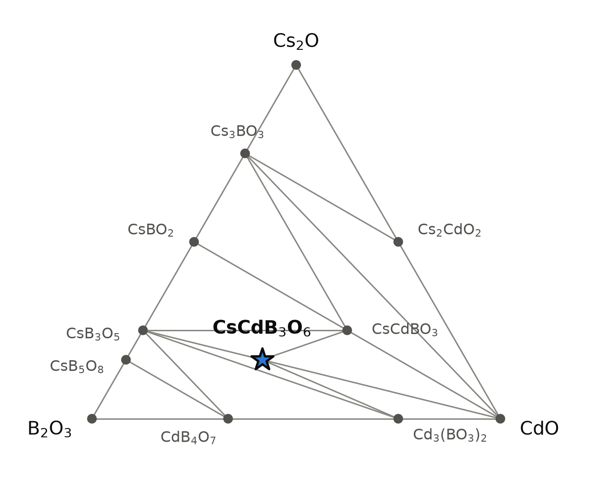
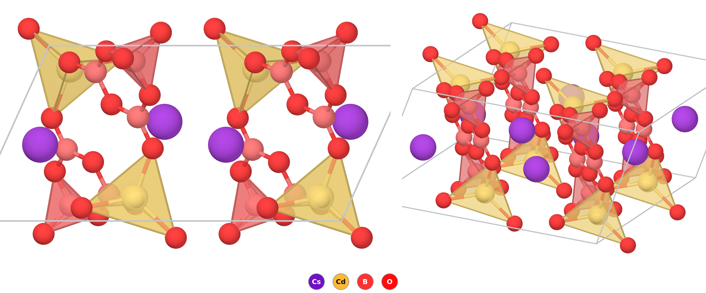

# CsCdB₃O₆ — a caesium cadmium borate predicted with edge-sharing BO₄ tetrahedra

*A Material a Day · entry 5 · 14 October 2026 · status: **predicted, no report found***

> **In one paragraph.** CsCdB₃O₆ is a colourless insulating borate that we could not
> find in the literature; its potassium and rubidium relatives KCdB₃O₆ and RbCdB₃O₆
> are known. The database holds two structures for it, 5 meV/atom apart. The lower one
> is the KZnB₃O₆ type, the first borate structure made at ambient pressure in which two
> BO₄ tetrahedra share an edge. The higher one is the corner-sharing structure, with
> B₃O₆ rings and five-coordinate cadmium, that the potassium and rubidium compounds
> adopt. The compound lies 6 meV/atom below its neighbours CsB₃O₅, CsCdBO₃ and
> Cd₃(BO₃)₂. Both margins are a tenth of the error this method carries for oxides, so
> the calculation says that a compound of this composition is plausible and cannot say
> which structure it takes. Experiment leans against the structure of this entry: the
> group that made KZnB₃O₆ tried the alkali metals from lithium to caesium with zinc
> and cadmium and found no second member of the type. The obvious route is the one
> published for both KZnB₃O₆ and RbCdB₃O₆: carbonate, oxide and boric acid, fired in
> air at 400–500 °C and then at 750 °C. Cadmium compounds are toxic.

Every number below is computed unless a reference is given.

## 1. Identity

| | |
|---|---|
| Formula | CsCdB₃O₆ (stored as CsCd(BO₂)₃) |
| Alexandria id | `agm018287390` |
| Space group | P1̄ (no. 2), Z = 2 |
| Cell (PBE) | a = 7.279, b = 7.420, c = 7.572 Å; α = 63.36°, β = 77.03°, γ = 73.58° |
| Volume per formula unit | 174.2 ų |
| Density | 3.56 g cm⁻³ |
| Structure type | KZnB₃O₆ |
| Formation energy | −2.174 eV/atom |
| PBE gap | 3.53 eV (indirect), 3.59 eV (direct) |

The CIF is [`CsCd(BO2)3.cif`](<CsCd(BO2)3.cif>). No Wikipedia page on the compound was
found.

## 2. Where it sits

<picture>
  <source media="(prefers-color-scheme: dark)" srcset="phase_diagram_dark.png">
  
</picture>

The Cs₂O–CdO–B₂O₃ section of the Cs–Cd–B–O system at 0 K (PBE table). All phases of
this section have every element in its usual oxidation state. Twelve phases of the
section are on the hull, two of them quaternary.

| phase | energy below the corner oxides (meV/atom) | note |
|---|---|---|
| **CsCdB₃O₆** | −235 | P1̄, this entry; 6 meV/atom below its neighbours |
| CsCdBO₃ | −290 | cubic, P2₁3; 18 meV/atom below its neighbours |
| CsB₃O₅ | −279 | neighbour |
| CsBO₂ | −409 | |
| Cs₃BO₃ | −393 | |
| CsB₅O₈ | −202 | |
| Cd₃(BO₃)₂ | −73 | neighbour |
| CdB₄O₇ | −91 | |
| Cs₂CdO₂ | −86 | |
| CdO | 0 | neighbour |

- **Four tie lines:** to CsB₃O₅, CsCdBO₃, Cd₃(BO₃)₂ and CdO.
- **It lies on the line CdO–CsB₃O₅**, at 1 : 1. The reaction
  CdO + CsB₃O₅ → CsCdB₃O₆ releases only 6.5 meV/atom.
- **Competitors:** ¼ Cd₃(BO₃)₂ + ¼ CsCdBO₃ + ¾ CsB₃O₅, 5.5 meV/atom higher on the
  `pbe_mp` hull.
- **Both quaternaries are shallow.** Neither margin is a verdict (section 5).

## 3. Structure

*A 2 × 2 × 1 block seen along a (left) and in an oblique view (right). CdO₄ tetrahedra
are yellow, BO₄ tetrahedra red; the three-coordinate boron atoms are drawn as balls
with their bonds. Cs–O contacts are not drawn.*

All eleven atoms of the formula unit sit on general positions (2i).

| site | neighbours | role |
|---|---|---|
| Cs | 9 O at 2.96–3.50 Å | fills the cavities |
| Cd | 4 O at 2.15, 2.19, 2.22, 2.29 Å | tetrahedron; two of them share an edge |
| B1 | 4 O at 1.456, 1.466, 1.512, 1.516 Å | tetrahedron; shares an edge with its inversion image |
| B2 | 3 O at 1.343, 1.389, 1.419 Å | triangle |
| B3 | 3 O at 1.364, 1.376, 1.409 Å | triangle |
| O1 | 2 B (tetrahedral) + 1 Cd | the shared edge of the two BO₄ |
| O2, O3, O5 | 2 B each | bridges inside the borate group |
| O4 | 1 B + 1 Cd | terminal on B2 |
| O6 | 1 B + 2 Cd | the shared edge of the two CdO₄ |

- **A finite [B₆O₁₂]⁶⁻ group.** Two B₃O₃ rings, each of two BO₃ triangles and one BO₄
  tetrahedron, are joined through the tetrahedra, which share an O···O edge. The group
  is centrosymmetric and does not polymerise.
- **The shared edge is short and the ring is strained.** The two oxygen atoms of the
  edge are 2.17 Å apart, against 2.44–2.48 Å for the other edges of the tetrahedron;
  the O–B–O angle across it closes to 91°, and the two boron atoms face each other at
  2.12 Å. The B–O bonds into the shared edge are the longest in the structure (1.51 and
  1.52 Å).
- **Cadmium does the same.** Two CdO₄ tetrahedra share an edge to give a Cd₂O₆ pair
  with Cd···Cd = 3.44 Å and an O–Cd–O angle of 80° across the edge.
- **This is the KZnB₃O₆ structure.** KZnB₃O₆ was the first borate with edge-sharing
  BO₄ tetrahedra obtained without high pressure [1, 2], and is described with the same
  two units, B₆O₁₂ and Zn₂O₆, with nine-coordinate potassium in the larger of two
  kinds of tunnel [1, 3]. The motif is otherwise known from high-pressure borates
  [1, 4].
- **The computed edge is slightly more open than the measured ones.** In KZnB₃O₆ and
  the high-pressure borates the O–B–O angle across the shared edge is 92.0–94.4° and
  the B···B distance 2.04–2.10 Å [1]; here they are 91° and 2.12 Å. PBE gives 2.11 Å
  for KZnB₃O₆ itself, so most of the difference is the functional, not the caesium
  compound.

### How good the calculation is for this structure type

Measured cell of KZnB₃O₆ (single crystal, 298 K [1]) beside the PBE cell of the same
table. The two cells are matched through their angles; the atomic coordinates of [1]
are in a deposited file that was not read.

| | measured [1] | PBE | difference |
|---|---|---|---|
| a (Å) | 6.753 | 6.958 | +3.0 % |
| b (Å) | 6.911 | 6.935 | +0.3 % |
| c (Å) | 7.045 | 7.130 | +1.2 % |
| α, β, γ (°) | 63.39, 72.58, 69.13 | 63.70, 73.62, 69.69 | up to +1.0° |
| Volume (ų) | 270.8 | 285.9 | +5.6 % |
| Density (g cm⁻³) | 2.856 | 2.706 | −5.3 % |
| Zn–O (Å) | 1.887–2.048 | 1.916–2.064 | +0.02 to +0.03 |

- **The error is anisotropic:** most of it is along one axis. KZnB₃O₆ also expands
  along a single direction on heating [3]; whether the two directions are the same
  was not checked.
- **Applied to CsCdB₃O₆,** the same error puts the real volume of the P1̄ structure
  near 165 ų per formula unit and its density near 3.75 g cm⁻³.

### The other structure

A monoclinic structure of the same composition (`agm018327151`, C2/c, Z = 8) lies
5.2 meV/atom higher.

| | P1̄ (this entry) | C2/c |
|---|---|---|
| Borate group | B₆O₁₂, two edge-sharing BO₄ | BO₃ triangles only |
| Cd coordination | 4 (2.15–2.29 Å) | 5 (2.19–2.43 Å) |
| Cs coordination | 9 | 10 |
| Volume per formula unit (ų) | 174.2 | 167.0 |
| Density (g cm⁻³) | 3.56 | 3.72 |
| PBE gap (eV) | 3.53 | 3.64 |
| Energy (meV/atom) | 0 | +5.2 |

- **The edge-sharing structure is the less dense one,** by 4 %. That is the opposite
  of the high-pressure borates, where edge sharing comes with compression.
- **RbCdB₃O₆ is reported in C2/c** [5], and KCdB₃O₆ has the same structure [1, 5]
  (its own paper, *Acta Crystallogr. C* 65, i42 (2009), is cited by both and was not
  retrieved). The measured structure has planar B₃O₆ rings of three BO₃ triangles,
  CdO₅ trigonal bipyramids that share edges in zigzag chains along [101], and RbO₁₀
  polyhedra [5].
- **The stored C2/c structures are that structure.** The PBE structure of RbCdB₃O₆
  (`agm005288924`) matches the published coordinates atom by atom, and the C2/c
  structure of CsCdB₃O₆ matches it with caesium in place of rubidium.

Measured RbCdB₃O₆ (single crystal, 296 K [5]) beside PBE:

| | measured [5] | PBE | difference |
|---|---|---|---|
| a (Å) | 7.357 | 7.494 | +1.9 % |
| b (Å) | 13.315 | 13.488 | +1.3 % |
| c (Å) | 12.702 | 12.935 | +1.8 % |
| β (°) | 106.71 | 105.09 | −1.6° |
| Volume (ų) | 1191.7 | 1262.4 | +5.9 % |
| Density (g cm⁻³) | 3.637 | 3.434 | −5.6 % |
| Cd–O (Å) | 2.146–2.357 | 2.190–2.429 | +0.03 to +0.08 |
| B–O (Å) | 1.302–1.404 | 1.329–1.413 | +0.01 to +0.03 |
| Optical gap (eV) | 4.2 | 3.70 | −0.5 |

- **PBE overestimates the volume of both structure types by the same amount,** 5.6 %
  for the edge-sharing type and 5.9 % for the corner-sharing one. Corrected for it,
  the C2/c structure of CsCdB₃O₆ would have about 158 ų per formula unit and a
  density near 3.9 g cm⁻³.

### The family

Depth below competitors in `energy_runs_pbe`, meV/atom. A positive number in the last
column is the energy of the C2/c structure above the P1̄ one.

| compound | KZnB₃O₆ type (P1̄) | C2/c above P1̄ | experiment |
|---|---|---|---|
| KZnB₃O₆ | on the hull, 11.9 deep | not in the table | P1̄, edge-sharing [1–3] |
| RbZnB₃O₆ | on the hull, 5.5 deep | not in the table | tried, nothing identified [1] |
| KMgB₃O₆ | on the hull, 1.6 deep | | |
| RbMgB₃O₆ | on the hull, 4.4 deep | | |
| KMnB₃O₆ | on the hull, 13.1 deep | | |
| RbMnB₃O₆ | on the hull, 0.1 deep | | |
| CsMnB₃O₆ | 9.6 above the hull | | |
| KCdB₃O₆ | on the hull, 10.6 deep | +8.8 | C2/c, corner-sharing [1, 5] |
| RbCdB₃O₆ | on the hull, 11.2 deep | +6.1 | C2/c, corner-sharing [5] |
| **CsCdB₃O₆** | on the hull, 5.9 deep | +5.2 | tried, nothing identified [1]; no report found |

- **For the three cadmium compounds the calculation prefers the edge-sharing
  structure,** by 5 to 9 meV/atom. For the two that have been made, the measured
  structure is the other one.
- **The substitutions have been tried.** The authors of [1] report experiments on
  XYB₃O₆ with X = Li, Na, K, Rb, Cs and Y = Zn, Cd. They found no second compound of
  the KZnB₃O₆ type, and the only compound they identified was KCdB₃O₆, in C2/c. The
  conditions are not given, and one sentence covers all the combinations, so how
  thoroughly the caesium cadmium composition was explored cannot be told from it.
  RbCdB₃O₆ was not identified there either and was made four years later [5].
- **Their calculation agrees with ours where both exist.** For KZnB₃O₆ they find the
  edge-sharing structure lower in energy than the KCdB₃O₆ type (GGA, relaxed cells),
  and explain it by zinc being poorly coordinated in the latter [1]. Cadmium accepts
  five neighbours, which removes that penalty.
- **That is a disagreement within the error,** not a prediction that the experiments
  are wrong. It does mean the ranking of the two structures of CsCdB₃O₆ should not be
  trusted, and that the C2/c structure is the more likely one (section 8).
- **No CsZnB₃O₆ or CsMgB₃O₆** of this formula type is within 60 meV/atom of the hull.

## 4. Computed properties

### Electronic

- **Gap:** 3.53 eV indirect and 3.59 eV direct in PBE; a graph neural network gives
  3.57 eV. No MBJ or SCAN calculation exists for this structure.
- **How far off:** PBE underestimates gaps. For RbCdB₃O₆ in its C2/c structure the same
  table gives 3.70 eV (indirect; 3.72 eV direct). The measured absorption edge of the
  powder, from diffuse reflectance, is at about 295 nm, or 4.2 eV [5]: PBE is 0.5 eV,
  or 12 %, too low. The authors' own LDA calculation gives a direct gap of 3.97 eV
  [5]. The same shift would put CsCdB₃O₆ near 4 eV in either structure, a colourless
  solid.

### Dielectric response

| | |
|---|---|
| ε∞, principal values | 2.41, 2.67, 2.76 |
| ε∞, average | 2.61 |
| Refractive index (from ε∞) | 1.62 |
| Born charges (mean) | Cs +1.32, Cd +2.22, B +2.14, O −1.66 |
| Piezoelectric response | zero by symmetry |

- ε∞ is the electronic part only. It is not the static dielectric constant, which was
  not computed. PBE tends to overestimate ε∞ because it underestimates the gap.
- The principal values correspond to refractive indices of 1.55, 1.63 and 1.66, a
  spread of 0.11 (electronic part, zero frequency, PBE). For comparison, the
  birefringence calculated for RbCdB₃O₆ in the C2/c structure is 0.065 at 532 nm,
  attributed to its coplanar B₃O₆ rings [5]. Neither number has been measured.
- The Born charges of boron are very anisotropic (principal values from 0.44 to 3.40),
  as expected for a planar BO₃ group: small along the normal, large in the plane.

### Charge transport (PBE bands, constant relaxation time)

| | electrons | holes |
|---|---|---|
| Density-of-states mass (mₑ) | 1.06 | 7.3 |
| Seebeck coefficient at 10¹⁹ cm⁻³, 300 K (µV/K) | −250 | +507 |

- The branch-point energy is 0.82 eV above the valence-band maximum, far from both
  band edges: the compound would resist doping of either sign.
- The large Seebeck coefficients describe a wide-gap insulator with flat valence
  bands, not a thermoelectric.

### Mechanical (machine-learned)

Bulk modulus 49 GPa and shear modulus 22 GPa, from a graph neural network: a soft
solid, as expected with a third of the volume taken by caesium. The same tool returns a
Young's modulus of 37 GPa, which is not consistent with the other two for an isotropic
solid, so it is not used here.

### Not computed

Phonons (neither structure of this composition is among the group's
density-functional perturbation theory runs, so dynamical stability is untested),
elastic constants, the static dielectric constant, thermal expansion, defect energies,
melting behaviour.

## 5. Is it stable?

Marginally, and inside the error.

| table | status | depth below competitors (meV/atom) |
|---|---|---|
| `energy_runs_pbe` | on the hull | 5.9 |
| `energy_runs_pbe_mp` | on the hull | 5.5 |
| `energy_runs_scan` | not in the table | |

- **Both PBE hulls agree,** to within 0.4 meV/atom.
- **The error is ten times the margin.** Computed and measured formation enthalpies of
  oxides scatter by 65 meV/atom (median deviation, 82 compounds) around a bias of
  +5 meV/atom. A margin of 6 meV/atom is not resolved. The honest statement is that
  CsCdB₃O₆ and the mixture CsB₃O₅ + CsCdBO₃ + Cd₃(BO₃)₂ are degenerate in this
  calculation.
- **The structure is not resolved either.** 5.2 meV/atom separates the two candidates,
  and the family table shows the calculation ranking them against experiment for the
  rubidium compound.
- **What speaks for the compound** is the family: the potassium and rubidium members
  exist [1, 5], and the calculation gives all three cadmium compounds similar margins.
- **The reference oxide is poor.** Computed B₂O₃ is 154 meV/atom more negative than
  the measured enthalpy. Errors of this kind largely cancel between borates, but not
  between a borate and B₂O₃ itself.

## 6. How to make it

### What the calculation proposes

Reaction energies at 0 K, meV per atom of the whole charge, on the `pbe_mp` hull.
There are 68 exact routes of up to three reagents; none uses only catalogue reagents,
because Cs₂O is not one.

| route | charge | ΔE | comment |
|---|---|---|---|
| A | CdO + CsB₃O₅ → CsCdB₃O₆ | −6.5 | First in our ranking (fewest reagents, least driving force); the margin is unresolved |
| B | CsCdBO₃ + B₂O₃ → CsCdB₃O₆ | −76 | Needs the other quaternary first |
| C | CsBO₂ + CdO + B₂O₃ → CsCdB₃O₆ | −86 | Metaborate route |
| D | ½ Cs₂O + CdO + 1½ B₂O₃ → CsCdB₃O₆ | −234 | The oxides; what a carbonate and boric acid charge becomes once CO₂ and H₂O have left |
| E (metathesis) | CdCl₂ + 3 CsBO₂ → CsCdB₃O₆ + 2 CsCl | −91 | Clean in the calculation |

- **Route D in practice** is ½ Cs₂CO₃ + CdO + 3 H₃BO₃, the charge used for KZnB₃O₆
  and for RbCdB₃O₆ with the cations changed [1, 5]. Tested on the closed composition, with CO₂ kept in, the
  calculation gives ½ CdCO₃ + ½ CsB₃O₅ + ½ CsCdB₃O₆: at 0 K the carbonate holds on to
  half the cadmium. Computed carbonates are too stable by about 154 meV/atom, and CO₂
  leaves an open furnace, so this is a statement about a sealed tube, not about the
  preparation.
- **Route A says the last step has almost no driving force.** If CdO and CsB₃O₅ form
  first, nothing pushes them to react further. Good mixing matters more than
  temperature.
- **Favourable is not fast.** These are 0 K energies.

### What was published for the analogues

| | KZnB₃O₆ [1] | RbCdB₃O₆ [5] |
|---|---|---|
| Charge | K₂CO₃, ZnO, H₃BO₃, stoichiometric | Rb₂CO₃, CdO, H₃BO₃, stoichiometric |
| First step | 500 °C, 12 h | 400 °C, 10 h |
| Anneal | 750 °C, 24 h, after regrinding | 750 °C, 48 h, several regrindings |
| Atmosphere, container | air; not stated | not stated; platinum |
| Product | single-phase white powder | RbCdB₃O₆ with a little Cd₃(BO₃)₂ |
| On heating | melts congruently near 800 °C | endotherm at 779 °C; decomposes before it melts (already decomposed at 790 °C) |
| Crystals | melt at 820 °C, cooled to 600 °C at 1 °C/h | from a charge Rb₂CO₃ : CdO : H₃BO₃ = 4 : 1 : 6 in platinum: 750 °C for 10 h, then 700 to 660 °C at 3 °C/h |

- **The published route is route D,** the carbonate and boric acid form of the oxide
  route, for both compounds. Route A, first in our ranking, is not the one either
  group used: it needs a ternary borate made beforehand and has almost no driving
  force.
- **The impurity is the computed neighbour.** The Cd₃(BO₃)₂ that accompanies
  RbCdB₃O₆ [5] is, for the caesium compound, one of the three phases the hull places
  next to the product.
- **A melt will not do for the cadmium compounds.** RbCdB₃O₆ melts incongruently, so
  its crystals were grown from an excess of rubidium borate [5]. The same charge with
  caesium lies, at 0 K, in the triangle CsBO₂–CsCdBO₃–Cs₃BO₃, which does not contain
  the target: in the calculation a caesium-rich flux gives CsCdBO₃, so the flux
  composition cannot simply be copied.

### In practice

- **Charge:** Cs₂CO₃ : CdO : H₃BO₃ = 1 : 2 : 6, ground together. Cs₂CO₃ is hygroscopic
  (general knowledge), so weigh it dry.
- **Firing window.** The lower end is about 850 K, half the melting point of CdO, the
  most refractory reagent. The upper end is where the product decomposes or melts,
  which is not known. KZnB₃O₆ melts near 1073 K [1, 3] and RbCdB₃O₆ decomposes at
  1052 K [5]; both were annealed at 1023 K. With the larger cation a lower limit is
  possible. Decompose the charge slowly at 670–770 K for 10 h, then anneal with
  regrinding, starting near 950 K and going up to 1020 K only if the reaction is
  incomplete. Allow 48 h: the rubidium compound was given that long [5].
- **Atmosphere:** air. In chemical potential the compound is the stable phase from
  μ(O) = −3.07 eV up to −0.06 eV. The upper limit is set by caesium polyoxides in the
  database, which take 14 meV/atom in pure oxygen at 0 K; that is inside the error
  and those phases are doubtful.
- **Stoichiometry matters more than atmosphere.** The window in μ(Cs) is 2.3 eV wide,
  but excess B₂O₃ reacts with the product (−33 meV/atom, to Cd₃(BO₃)₂ + CsB₃O₅ +
  CdB₄O₇). Do not add extra boric acid to compensate for loss.
- **Container:** platinum, gold or silver are inert in the calculation, and so is
  zirconia. Alumina (−10 meV/atom), silica (−11) and magnesia (−9) react, but by
  less than the error; alumina is probably acceptable for a first test, platinum is
  safe and is what was used for RbCdB₃O₆ [5].
- **Storage:** water reacts by 4 meV/atom (to Cd(OH)₂ and hydrated caesium borates)
  and CO₂ by 50 (to CdCO₃ and CsB₅O₈). Neither number is outside the error.
  KZnB₃O₆ is reported stable in air and water [1]; nothing is reported for the
  cadmium compounds, so keep the product dry until its behaviour is known.

### Metathesis

Tested on three charges.

- **Works on paper:** CdCl₂ + 3 CsBO₂ → CsCdB₃O₆ + 2 CsCl, −91 meV/atom. CsCl shares
  a tie line with the product, so the salt does not attack what it leaves behind, and
  it washes out with water. CsBO₂ has to be made first.
- **Fails with lithium metaborate:** CdCl₂ + CsCl + 3 LiBO₂ goes to CsCdCl₃ + 3 LiBO₂
  (−15 meV/atom). The borate does not exchange at all.
- **Fails with sodium metaborate:** CdCl₂ + CsCl + 3 NaBO₂ goes to NaCl, CsCl, sodium
  borates and the chloride borate CsCd₂BO₃Cl₂ (−36 meV/atom). Sodium keeps the borate.
- **Fluxes.** CsCl, NaF, LiF, Na₂CO₃, Li₂CO₃ and Na₂WO₄ are inert to the product.
  Potassium and rubidium salts exchange the alkali ion (KCl gives KCdB₃O₆ + CsCl,
  −9 meV/atom); LiCl, MgCl₂ and CaCl₂ decompose it (−50 to −71).
- **Exchange is observed in this structure type.** In molten LiNO₃ more than half of
  the potassium of KZnB₃O₆ is replaced by lithium with the borate network intact,
  and further exchange gives Li₂B₄O₇; in NaNO₃ there is hardly any exchange [1].
  Nitrate melts were not among the fluxes tested here.

### Powder pattern

Computed, Cu Kα, PBE cells. PBE cells of this family are too long by 0.3 to 3.0 % along
the axes (section 3), so measured lines will lie at higher angles: by up to about 0.5°
near 2θ = 25° for the C2/c structure, and by amounts that depend strongly on hkl for
the P1̄ one.

| 2θ (°), P1̄ | 16.25 | 17.29 | 19.40 | 24.29 | 24.66 | 25.37 | 25.69 | 26.74 |
|---|---|---|---|---|---|---|---|---|
| hkl | 111 | 101 | 101̄ | 012 | 121 | 111̄ | 200 | 11̄1 |
| I | 70 | 27 | 25 | 100 | 71 | 63 | 98 | 57 |

| 2θ (°), C2/c | 13.81 | 14.73 | 22.91 | 23.91 | 24.52 | 25.27 | 28.02 |
|---|---|---|---|---|---|---|---|
| hkl | 111̄ | 021 | 130 | 200 | 202̄ | 132̄ | 004 |
| I | 51 | 21 | 59 | 40 | 42 | 87 | 100 |

- **A line near 13.8° and the strongest line near 28°:** the corner-sharing C2/c
  structure formed, not the one of this entry.
- **CdO with CsB₃O₅:** the last step did not happen; regrind and anneal longer.
- **Cd₃(BO₃)₂ with CsB₃O₅ or CsB₅O₈:** too much boron, or caesium was lost.
- **CsCdBO₃:** too little boron.

### Hazards

Cadmium compounds are toxic and carcinogenic; CdO dust and any fume from the hot
charge must not be inhaled, so weigh and fire in a hood and treat all waste as cadmium
waste. Natural caesium is not radioactive. Boric acid is classified as toxic for
reproduction. These are general statements, not retrieved for this entry.

## 7. What it could be good for

Candidates only; nothing has been measured on this compound, and neither paper on the
analogues demonstrates a use.

- **A test of the edge-sharing motif.** If the compound forms in the P1̄ structure it
  would extend the KZnB₃O₆ family to cadmium and caesium. If it forms in C2/c, it
  adds a third case where PBE ranks the two structures the wrong way.
- **Thermal expansion.** KZnB₃O₆ expands along a single direction between 298 and
  1013 K, attributed to rotations of rigid B₆O₁₂ and Zn₂O₆ groups driven by the
  potassium vibrations [3]. A member with a heavier, larger cation in the cavities
  is a natural comparison.
- **Birefringence, if it forms in C2/c.** The authors of [5] propose RbCdB₃O₆ as a
  birefringent material on the strength of a calculated value of 0.065 at 532 nm.
  The caesium compound in the same structure has the same parallel B₃O₆ rings.
- **Ion exchange is unlikely.** Potassium in KZnB₃O₆ can be exchanged for lithium
  [1]; caesium is too large to be expected to move the same way.
- **Not a nonlinear optical crystal.** Both candidate structures are centrosymmetric.

## 8. How this could be wrong

- **The compound may not form.** 6 meV/atom against 65 meV/atom of scatter is no
  margin. The mixture of CsB₃O₅, CsCdBO₃ and Cd₃(BO₃)₂ is as likely in this
  calculation.
- **It has been looked for.** The substitution experiments of [1] included caesium
  and cadmium and identified no compound. That is one sentence without conditions,
  and RbCdB₃O₆ escaped the same experiments, so it is weak evidence; it is still
  evidence against.
- **The structure is probably the other one.** The calculation ranks P1̄ below C2/c
  for KCdB₃O₆ and RbCdB₃O₆ as well, against the measured structures [1, 5], and no
  second member of the KZnB₃O₆ type was found in [1].
- **PBE may favour the open structure.** The P1̄ structure is 4 % less dense than
  C2/c. PBE overestimates the measured volume by 5.6 % for KZnB₃O₆ [1] and by 5.9 %
  for RbCdB₃O₆ [5], so the volume error is the same for both types and does not by
  itself explain the ranking; a functional that underbinds this much may still
  favour the less dense structure in energy.
- **No phonons.** Dynamical stability of neither structure has been tested by us.
- **The phase diagram is incomplete.** A caesium cadmium borate Cs₂Cd₃B₁₆O₂₈ appears
  in a materials database listing that we saw only through a search summary; it is
  not in the Alexandria tables, and other real phases with large cells may be missing
  too. Missing competitors can only make the compound less stable than computed.
- **Caesium polyoxides.** The oxygen-rich limit rests on CsO₈ and CsO₁₂ entries that
  are probably not real compounds.
- **The paper on KCdB₃O₆ was not read.** That it has the C2/c structure of RbCdB₃O₆
  rests on the statements of [1] and [5]; the stored structure of the rubidium
  compound was checked against the published coordinates, that of the potassium
  compound was not. The supporting information of [1] and [5] was not read either.
- **Firing temperatures are by analogy** with KZnB₃O₆ and RbCdB₃O₆; the thermal
  behaviour of the caesium cadmium compound is unknown.

## 9. Literature

**Searched (OpenAlex, Crossref, web), 11 October 2026:** "CsCdB3O6" (no hits);
"CsCdB3O6" OR "CsCd(BO2)3" cesium cadmium borate (web; nothing on this compound);
"cesium cadmium borate crystal structure synthesis" (nothing on this compound);
"A2O-CdO-B2O3 system alkali cadmium borates ACdB3O6 (A = K, Rb, Cs)" (no hits);
"KCdB3O6 RbCdB3O6 borate crystal structure"; "KCdB3O6 potassium cadmium borate";
"KCdB3O6 borate crystal structure" (web); "KZnB3O6 edge-sharing BO4 tetrahedra
ambient pressure"; "Stable oxoborate with edge-sharing BO4 tetrahedra synthesized
under ambient pressure"; "CsCdBO3 caesium cadmium borate"; "Cs2Cd3B16O28 cesium
cadmium borate synthesis structure" (nothing relevant).

**Result:** no report of CsCdB₃O₆ was found. This is a statement about these
searches, not about the compound. The potassium and rubidium analogues are published,
so a report of the caesium one would not be surprising, and a check of the structural
databases by a person is owed. The nearest thing to a report is negative: [1]
mentions substitution experiments that included caesium and cadmium and identified
no compound, and [5], which lists alkali cadmium borates in its introduction, names
no caesium one.

1. S. Jin, G. Cai, W. Wang *et al.*, "Stable Oxoborate with Edge-Sharing BO₄
   Tetrahedra Synthesized under Ambient Pressure", *Angew. Chem. Int. Ed.* 49, 4967 (2010).
   doi:10.1002/anie.200907075 — *full text read; the supporting information was not.*
2. Y. Wu, J. Yao, J. Zhang *et al.*, "Potassium zinc borate, KZnB₃O₆", *Acta
   Crystallogr. E* (2010). doi:10.1107/S1600536810015175 — *abstract read.*
3. Y. Lou, D. Li, Z. Li, S. Jin, X. Chen, "Unidirectional thermal expansion in
   edge-sharing BO₄ tetrahedra contained KZnB₃O₆", *Sci. Rep.* 5, 10996 (2015).
   doi:10.1038/srep10996 — *pages 1–4 of the full text read.*
4. J. Li, W. Chen, Y.-Z. Lan *et al.*, "Recent Progress in Crystalline Borates with
   Edge-Sharing BO₄ Tetrahedra", *Molecules* 28, 5068 (2023).
   doi:10.3390/molecules28135068 — *abstract read.*
5. A. Jiao, H. Wu, S. Pan *et al.*, "Synthesis, structure, and characterization of a
   new rubidium cadmium borate: RbCdB₃O₆", *J. Alloys Compd.* 588, 514 (2014).
   doi:10.1016/j.jallcom.2013.11.037 — *full text read; the supporting information
   was not.*

## 10. Provenance

- **Data:** Alexandria database, tables `energy_runs_pbe` and `energy_runs_pbe_mp`.
  Reaction energies, contact reactions and chemical-potential windows come from the
  hull and reaction table built on `pbe_mp`; the two tables agree on this compound to
  within 0.4 meV/atom. The compound is not in `energy_runs_scan`.
- **Tools:** the reaction-route code of this group, pymatgen, POV-Ray; machine-learned
  moduli and gap from graph neural networks.
- **Authorship:** drafted by Claude (Anthropic) from those tools; reviewed by
  Miguel Marques. Corrections are welcome as issues on this repository.
