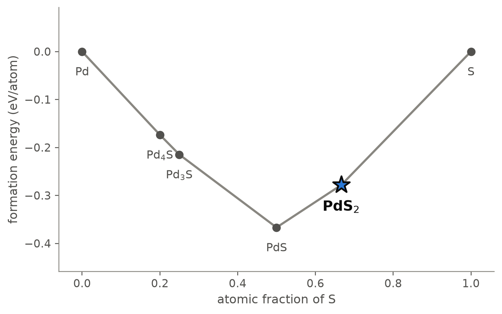
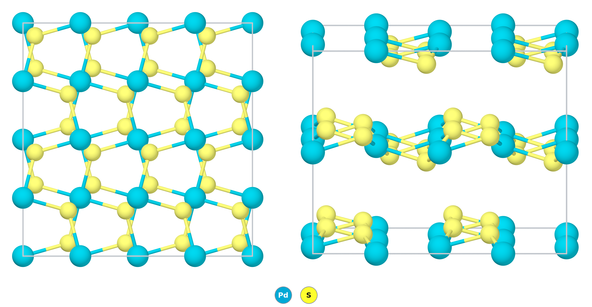

# PdS₂ — a layered disulfide of square-planar palladium and S–S pairs, and a test of how well a functional holds layers together

*A Material a Day · entry 6 · 15 October 2026 · status: **known** (made by 1936, structure reported in 1957)*

> **In one paragraph.** Palladium disulfide is a layered semiconductor. Each palladium
> atom sits at the centre of a square of four sulfur atoms, the sulfur atoms are bonded
> in pairs, and together they form puckered sheets tiled by pentagons, stacked along
> c. It is the sulfur-rich end of the Pd–S system and gives its name to the structure
> type that PdSe₂ shares. Under pressure it becomes a metal near 7 GPa, turns into the
> pyrite structure near 16 GPa, and superconducts up to 8 K. The calculations get the
> sheets right, to better than 1 % in a and b and 2 % in the Pd–S bond length, and get
> the stacking wrong: PBE, which has no van der Waals attraction, puts the layers 17 %
> too far apart, and the computed band gap follows the layer spacing from 0.75 eV to
> zero, against a measured 0.7–0.8 eV. The compound is on the hull by 34 meV/atom
> against PdS + S, a margin smaller than the error that sulfides carry; that it exists
> is known from experiment, not from this number. It is made from PdCl₂ and excess
> sulfur at 450 °C; heating PdS with sulfur for six months did not finish the reaction.

Computed numbers come from the Alexandria database; measured numbers carry a reference.

## 1. Identity

| | computed (PBE) | computed (PBEsol) | measured |
|---|---|---|---|
| Formula | PdS₂ | | PdS₂ [1,2] |
| Alexandria id | `agm002181903` | | |
| Space group | Pbca (no. 61), Z = 4 | Pbca | Pbca ("probable", from powder photographs) [1] |
| a (Å) | 5.486 | 5.456 | 5.460 [1,2] |
| b (Å) | 5.579 | 5.530 | 5.541 [1,2] |
| c (Å) | 8.811 | 7.356 | 7.531 [1,2] |
| Cell volume (ų) | 269.7 | 221.9 | 227.8 [1,2] |
| Density (g cm⁻³) | 4.20 | | 4.833 by pycnometry (Biltz and Laar, quoted in [1,2]); 4.97 from the measured cell |
| Structure type | PdS₂ (the prototype; PdSe₂ is isostructural) | | [1] |
| Formation energy | −0.278 eV/atom | | |

- **In the plane** PBE is 0.5 % (a) and 0.7 % (b) too long, and PBEsol 0.1 and 0.2 %
  too short.
- **Across the layers** PBE is 17 % too long and PBEsol 2.3 % too short. Neither
  functional contains dispersion; PBEsol lands near the measured value because it
  overbinds in general, not because it describes the interaction between the layers.
- Every PBE number below that depends on the volume (density, dielectric constant,
  moduli, gap) is computed for a crystal whose layers are too far apart.
- **The measured structure is a powder structure.** The cell comes from a powder
  photograph taken with iron radiation, of a sample annealed at 450 °C [2]; the space
  group is called "probable" and the sulfur position was found by trial and error
  against the line intensities [1]. No single crystal of PdS₂ was available. The
  pycnometric density is 2.8 % below the X-ray density, which gives 3.88 formula
  units per cell where the structure has 4 [2].

Wikipedia has a page on the compound:
[Palladium disulfide](https://en.wikipedia.org/wiki/Palladium_disulfide).
The CIF is [`PdS2.cif`](PdS2.cif); all numbers are in [`structure.json`](structure.json).

## 2. Where it sits

<picture>
  <source media="(prefers-color-scheme: dark)" srcset="phase_diagram_dark.png">
  
</picture>

The Pd–S system at 0 K (PBE table). Four compounds are on the hull.

| phase | at.% S | formation energy (eV/atom) | note |
|---|---|---|---|
| Pd | 0 | 0 | fcc |
| Pd₄S | 20 | −0.174 | |
| Pd₃S | 25 | −0.215 | |
| PdS | 50 | −0.367 | the deepest phase; a second PdS structure lies 4 meV/atom higher |
| **PdS₂** | 66.7 | −0.278 | |
| S | 100 | 0 | |

- **Neighbours.** PdS on the palladium side, sulfur on the other. PdS₂ lies 34 meV/atom
  below the line joining them.
- **What is measured.** The X-ray study of the system found five intermediate phases:
  Pd₄S, "Pd₂.₈S", "Pd₂.₂S", PdS and PdS₂ [2]. Pd₄S, PdS and PdS₂ are on the computed
  hull. An earlier claim of Pd₃S₄ was not confirmed there, and a vapour-pressure study
  quoted in [2] found no compound between PdS and PdS₂; the hull has none either.
- **Pd₁₆S₇ and Pd₃S.** "Pd₂.₂S" is cubic with a = 8.9300 Å and a measured cell content
  of 30.7 Pd and 13.9 S [2], which is Pd₁₆S₇ (32 and 14). It was found in slowly
  cooled samples as well as quenched ones. "Pd₂.₈S" appeared only in samples quenched
  from 580 and 600 °C [2], so it is a high-temperature phase; we take it to be the
  computed Pd₃S. PBE puts Pd₃S on the 0 K hull and Pd₁₆S₇ 0.8 meV/atom above it, the
  reverse of the measurement, and Materials-Project settings put Pd₁₆S₇ on the hull.
  A difference of 0.8 meV/atom is not resolved, so this is not a failure of PBE, only
  a reminder of what the hull cannot decide.
- **PdS₂ is the sulfur-richest compound** of the system in PBE and in the measured
  phase list [2]. With Materials-Project settings a phase of composition PdS₁₁ also
  appears on the hull; see section 5.

## 3. Structure

*Left: one cell seen along c, 2 × 2 in the plane; the pentagons are rings of two
palladium and three sulfur atoms. Right: seen along the layers, with c vertical. The
picture uses the PBE cell, so the gap between the layers is drawn wider than it is.*

| site | Wyckoff | x, y, z | neighbours (PBE) |
|---|---|---|---|
| Pd | 4b | 0, 0, ½ | 4 S at 2.33–2.34 Å (square); next S at 3.43 Å, in the adjacent layers |
| S | 8c | 0.895, 0.389, 0.571 | 1 S at 2.105 Å, 2 Pd at 2.33 and 2.34 Å |

| | computed (PBE) | measured [1] | difference |
|---|---|---|---|
| S position, in the setting of [1] (Pd at 0, 0, 0) | 0.105, 0.111, 0.429 | 0.107, 0.112, 0.425 | within 0.004 |
| Pd–S (Å) | 2.332, 2.341 | 2.30 | +1.6 % |
| S–S (Å) | 2.105 | 2.13 as quoted; 2.05 from the listed position | −1 % or +3 % |
| Pd to the next S, in the adjacent layers (Å) | 3.43 | 3.28 as quoted; 3.31 from the listed position | +4 to 5 % |

- **The fractional coordinates agree to 0.004,** closer than a trial-and-error powder
  structure can claim. The agreement in z is partly fortuitous: z is a fraction of c,
  and c is 17 % too long in PBE.
- **The measured S–S distance is uncertain by about 0.1 Å.** The paper quotes 2.13 Å;
  the position it lists gives 2.05 Å when we recompute it with the listed cell, and
  the authors themselves note that small errors in the parameters move such a distance
  a great deal [1]. The PBE value lies between the two. The Pd–S distance does not
  have this problem: the listed position gives 2.298 and 2.304 Å.

- **Square-planar palladium.** Four sulfur neighbours in a plane, the coordination
  expected for a d⁸ ion. The palladium is Pd²⁺ and the anion is the disulfide pair
  S₂²⁻, as in pyrite; the name "palladium(IV) sulfide" does not describe the bonding.
- **Sulfur pairs.** Each sulfur is bonded to one sulfur and two palladium atoms. The
  S–S bond crosses the mid-plane of the layer, which is what puckers it.
- **Pentagons.** Seen from above, a layer is a tiling of five-membered Pd₂S₃ rings, the
  pattern for which PdSe₂ and PdS₂ are discussed as "pentagonal" two-dimensional
  materials [5].
- **Relation to pyrite.** The structure is usually described as pyrite stretched along
  one axis until the two axial Pd–S contacts of the octahedron are broken. In the
  measured cell c/a is 1.38; a cubic pyrite would have 1. The high-pressure
  behaviour (section 4) is this distortion being undone.
- **Polymorphs.** Two monoclinic structures of the same composition lie 1.0 and
  2.6 meV/atom above the Pbca structure in PBE, and SCAN reverses the order of the
  first pair by 1.1 meV/atom. Differences of this size are not resolved. We did not
  analyse how those structures differ from the Pbca one; the next structure is
  62 meV/atom higher.
- **The family.** PdSe₂ has the same Pbca structure as its lowest entry in the
  database, with a PBE gap of 0.60 eV. PtS₂ and PtSe₂ take CdI₂-like layered
  structures with octahedral platinum instead, and the lowest NiSe₂ entry is a metal. The database has
  no cubic pyrite-type PdS₂ at ambient pressure.

## 4. Properties

### Electronic structure

| | indirect gap (eV) | direct gap (eV) |
|---|---|---|
| PBE, PBE cell (c = 8.81 Å) | 0.75 | 1.36 |
| modified Becke–Johnson, PBE cell | 1.03 | 1.68 |
| SCAN, PBEsol cell (c = 7.36 Å) | 0.06 | 0.96 |
| PBEsol, PBEsol cell | 0.00 | |
| machine-learned, PBE cell | 0.61 | |

- **The gap depends on the layer spacing more than on the functional.** On the
  over-expanded PBE cell the compound is a semiconductor with a gap near 1 eV; on the
  PBEsol cell, whose c is 2.3 % below the measured one, the gap is closed or nearly
  so. The measured cell lies between the two, close to the PBEsol end.
- **Experiment agrees with the trend.** PdS₂ is a semiconductor at ambient pressure and
  becomes metallic near 7 GPa without a change of structure [3]. Pressure mainly
  squeezes the layers together, which is what the two computed cells differ by.
- **The measured gap is 0.7–0.8 eV** [7], from the temperature dependence of the
  resistivity of a polycrystalline sample, read as ρ ∝ exp(ΔE/2kT). It is an activation
  energy and not an optical gap, and the paper gives neither the temperature range nor
  the preparation of the sample.

  | | gap (eV) | against 0.7–0.8 measured |
  |---|---|---|
  | PBE, PBE cell | 0.75 | agrees, on a cell whose c is 17 % too long |
  | modified Becke–Johnson, PBE cell | 1.03 | 0.2 to 0.3 too large, same cell |
  | SCAN, PBEsol cell | 0.06 | 0.7 too small |
  | PBEsol, PBEsol cell | 0.00 | a metal where the compound is a semiconductor |

- **The agreement of PBE is a cancellation of two errors.** On a cell close to the real
  one (the PBEsol cell, c 2.3 % short) the semi-local functionals close the gap almost
  completely; the expanded PBE cell opens it again by about the right amount. No
  calculation we have gives the right gap on the right cell.
- **The same holds for PdSe₂:** 0.4 eV measured [7], 0.60 eV in PBE on its PBE cell.
  The measured gap falls from PdS₂ through PdSSe (0.65 eV) to PdSe₂ [7].
- Non-magnetic in every table, and the PdS₂-type compounds are diamagnetic in
  experiment [7]. Spin-orbit coupling is not included.

### Dielectric response (PBE cell)

| ε∞ (principal values) | average | refractive index |
|---|---|---|
| 3.9, 13.4, 13.5 | 10.3 | 3.2 |

- **Strongly anisotropic:** two large values and one small. By the shape of the
  structure the small one belongs to the stacking direction; the output does not label
  the axes.
- **The small value is too small.** It is computed with the layers 17 % too far apart.
- ε∞ is the electronic part only, not the static dielectric constant. The Born
  charges are small (principal values from −0.9 to +0.1 for Pd and −0.3 to +1.2 for S)
  and partly of the "wrong" sign, the mark of covalent bonding. The structure is
  centrosymmetric, so there is no piezoelectric response.

### Charge transport (PBE bands, PBE cell)

| | electrons | holes |
|---|---|---|
| Density-of-states mass (mₑ) | 3.5 | 2.1 |
| Conductivity mass (mₑ) | 1.0 | 1.7 |
| Seebeck coefficient at 300 K, 10¹⁹ cm⁻³ (µV/K) | −462 | +398 |
| Seebeck coefficient at 300 K, 10²⁰ cm⁻³ (µV/K) | −263 | +215 |

- Constant-relaxation-time numbers on the band structure of the expanded cell. They
  are not a statement about thermoelectric performance.
- **Measured:** the polycrystalline sample of [7] was n-type, with a Seebeck
  coefficient near 240 µV/K in magnitude and a resistivity near 100 Ω cm at room
  temperature, the latter extrapolated from higher temperature. The magnitude is that
  of the computed electron column near 10²⁰ cm⁻³, but the carrier density of the
  sample is not given, so this is not a test. PdSSe and PdSe₂ were p-type there.
- The branch-point energy lies 0.16 eV below the valence-band maximum.

### Mechanical (machine-learned, PBE cell)

| bulk modulus | shear modulus | Young's modulus |
|---|---|---|
| 21 GPa | 17 GPa | 40 GPa |

Screening estimates from a graph neural network. They describe a very soft solid,
which is what a stack of weakly bound layers is, but the softness is exaggerated by
the expanded cell. We did not retrieve a measured modulus.

### Under pressure (measured)

| pressure | what happens | reference |
|---|---|---|
| about 7 GPa | semiconductor becomes metal, structure unchanged | [3] |
| about 16 GPa | transition to the pyrite-type structure | [3] |
| 37.4 GPa | superconducting T_c reaches its maximum, 8.0 K | [3] |
| 11.5 GPa, 1523 K, quenched | palladium-deficient Pd₀.₉₄S₂, still Pbca, c = 7.202 Å (4.4 % shorter), with part of the palladium oxidised to Pd⁴⁺ | [4] |

Our high-pressure survey finds a monoclinic PdS₂ structure on the 25 GPa hull, where
experiment finds pyrite. We did not check whether that structure is a distorted
pyrite, and the database has no pyrite-type entry to compare with.

### Not computed

Phonons of this structure (the group's lattice-dynamics set holds four other
arrangements of the same composition, none of them this one), elastic constants,
anything with a dispersion correction, spin-orbit coupling, the superconductivity of
the high-pressure phase.

## 5. Is it stable?

It exists, and the calculation is consistent with that without being able to prove it.

| table | competitors | depth (meV/atom) |
|---|---|---|
| PBE (`energy_runs_pbe`) | PdS + S | 34 |
| SCAN (`energy_runs_scan`), lowest PdS₂ entry | | 29 |
| Materials-Project settings (`pbe_mp`) | PdS + "PdS₁₁" | 77 |
| Materials-Project settings, against PdS + S | PdS + S | 201 |

- **The class error is larger than the margin.** For the eleven sulfides with a
  measured formation enthalpy in our comparison, the computed values scatter by
  83 meV/atom (median absolute deviation) around a bias of −10. A depth of 34 meV/atom
  is not resolved against that.
- **The two tables disagree, and we think we know why.** With Materials-Project
  settings PdS₂ is 201 meV/atom below PdS + S, six times the PBE value, and a
  sulfur-rich "PdS₁₁" appears on the hull. Both are what one would expect from the
  fitted sulfur correction of that scheme being applied to sulfur–sulfur bonded
  compounds as if they were sulfides. This is our reading; we did not test it. Until it
  is tested, PdS₁₁ should be treated as suspect and the PBE number as the better one.
- **Missing physics, with a known sign.** Without dispersion the layers are barely
  bound in PBE, so the layered compound is penalised against the three-dimensional
  PdS. A dispersion correction would deepen PdS₂; by how much, we did not compute.
- **Temperature works against it.** The competitor includes elemental sulfur, which is
  a liquid above 115 °C and a vapour above 445 °C. A shallow compound that
  decomposes into a volatile element has a ceiling temperature. Consistent with that, an
  attempt to grow sulfide crystals by transport in sulfur vapour gave PdS whiskers,
  and its authors attribute the absence of PdS₂ to "its low temperature of
  stability" [6].

## 6. How to make it

### What is done

- **Bulk, as published [2].** Palladium dichloride and an excess of sulfur, four days
  at 450 °C in an evacuated silica tube; the excess sulfur is washed out with carbon
  disulfide. The product is a black crystalline powder whose powder photograph shows
  no PdS. The authors call it "supposedly pure". They took the method from earlier
  work on PdSe₂, and PdS₂ had been made from PdCl₂ and sulfur by 1936 (Biltz and Laar,
  quoted in [2]; we did not retrieve that paper).
- **What did not work [2].** Heating the components together was "not entirely
  successful": PdS treated with excess sulfur for six months at temperatures between
  300 and 500 °C still showed PdS lines beside those of a second phase, probably PdS₂.
- **The selenide for comparison.** PdSe₂ gave small crystals after fifty days at
  650 °C [2]; the mixed compound PdSSe was made by sintering pressed powders at
  500 °C [7].
- **Films.** Thin films are made by depositing palladium and heating it in sulfur
  vapour. The phase obtained depends on the sulfur supply: one review reports Pd₄S, PdS
  and PdS₂ in turn as the temperature at which the sulfur vapour is activated rises
  from 550 to 600 to 700 °C [5]. Films up to two inches across and few-layer films
  stable in air for 22 months are reported there [5].
- **High pressure.** 11.5 GPa and 1523 K gives the palladium-deficient variant [4].

### What the calculation proposes

Reaction energies at 0 K, meV per atom of the whole charge, from the reaction table
built with Materials-Project settings. Given section 5, the absolute values of the
sulfur-rich routes are probably too negative; the ranking is what to read.

| route | charge | ΔE | comment |
|---|---|---|---|
| A | PdS + S → PdS₂ | −201 | Fewest reagents and least driving force among routes with real reagents. PBE gives −34 for the same reaction |
| B | Pd + 2 S → PdS₂ | −601 | The elements; the only route whose reagents are both manufactured |
| C (metathesis) | PdCl₂ + Na₂S + S → PdS₂ + 2 NaCl | −557 | Clean in the calculation |
| D (metathesis) | PdCl₂ + Na₂S₂ → PdS₂ + 2 NaCl | −469 | Clean; the disulfide anion is delivered ready-made |
| E (metathesis) | K₂PdCl₄ + K₂S₂ → PdS₂ + 4 KCl | −280 | Clean; the mildest of the three |
| F (exchange) | PdCl₂ + FeS₂ | −43 | Fails: stops at PdS₂ + PdS + iron chloride with pyrite left over |
| G (published [2]) | PdCl₂ + 4 S | −271 | Does not reach PdS₂ in the calculation: ends at ⅔ "PdS₆Cl₂" + ⅓ PdCl₂ |

- **Ten exact routes exist.** Five use "PdS₁₁" as the sulfur source and are not
  listed, for the reason given in section 5; three more combine sulfur with a
  palladium-rich sulfide (Pd₁₆S₇, Pd₃S, Pd₄S) and lie between A and B.
- **The first route of the ranking is the one that fails in practice.** Route A,
  PdS + S, is downhill by 34 (PBE) or 201 meV/atom and was not complete after six
  months at 300 to 500 °C [2]. Route B has the same last step if it passes through
  PdS. Favourable is not fast: both must push sulfur into PdS that has already
  formed. Route B does work for thin films, where the diffusion length is
  nanometres [5].
- **The published route is not reproduced, and we think the calculation is at fault.**
  Route G needs the chlorine to leave. In the laboratory it presumably leaves as
  volatile sulfur chlorides (our inference: [2] does not name the by-product). The
  0 K hull has no vapour, and it keeps the chlorine in a solid of composition PdS₆Cl₂
  that is on the hull by 78 meV/atom with Materials-Project settings and 29 meV/atom
  above it in PBE. That is the pattern of PdS₁₁ in section 5, and we treat the phase
  as suspect for the same untested reason. S₂Cl₂ as a solid is 52 meV/atom above the
  same hull.
- **What the published route has that A and B lack** is a palladium source that is
  not PdS: the sulfide forms from the chloride in liquid sulfur, with a volatile
  by-product. This is our reading of why it works; [2] offers none.
- **Metathesis works on paper.** Routes C to E reach PdS₂ and a salt that washes out
  with water, and NaCl and KCl do not react with the product in the calculation.
  Route D is the natural one for a compound that contains S₂²⁻, and like the
  published route it does not need PdS to form first. We did not search for whether
  it has been tried.
- **Route F fails** because pyrite holds its sulfur more tightly than palladium does.

### In practice

- **Reagents:** PdCl₂ and sulfur in excess, as published [2]. Starting from PdS and
  sulfur is too slow to be useful [2].
- **Container:** an evacuated, sealed silica tube [2]. Silica, alumina and graphite do
  not react with PdS₂ in the calculation.
- **Temperature and time:** 450 °C for four days [2]. Sulfur is liquid above 115 °C,
  so the chloride reacts in a melt.
- **Lower end of the window.** Not established. PdS + S was tried from 300 °C upwards
  without completing [2]; nothing we read reports the chloride route below 450 °C.
- **Upper end of the window.** Set by the loss of sulfur to PdS, not by melting. The
  calculation cannot give the temperature, and [2] reports no decomposition
  temperature. The sulfur-vapour experiments of [6], run with the charge at several
  hundred degrees, ended at PdS. Keep the sulfur in excess and cool under sulfur.
- **Work-up:** wash out the excess sulfur with carbon disulfide [2].
- **Sulfur potential.** PdS₂ is the stable phase over a window 0.34 eV wide in the
  chemical potential of sulfur, bounded below by PdS.

### What it tolerates

| inert in the calculation | reacts |
|---|---|
| SiO₂, Al₂O₃, ZrO₂, MgO, TiO₂, BN, AlN, Si₃N₄, graphite | oxygen (→ PdS + SO₂), hydrogen (→ PdS + H₂S) |
| NaCl, KCl and the other alkali halides, CaCl₂, MgCl₂, carbonates, sulfates, B₂O₃ | nitrate melts, PbO, CaO, molybdates and tungstates |
| water, CO₂, nitrogen | every metal tested, including Pt, Au (−21 meV/atom) and Ag (−9); palladium itself (→ 2 PdS) |

- **It gives sulfur to anything that will take it.** Each reaction with a metal ends at
  PdS plus the other metal's sulfide. No metal container or contact is inert at 0 K;
  for gold and silver the driving force is within the error.
- **Oxidation is downhill** by 790 meV/atom, yet films are reported to survive in air
  for months [5]. Favourable is not fast.

### Powder pattern

Cu Kα. The PBE cell puts the 002 line at 20.2°; with the measured c of 7.531 Å it
falls at 23.6°. Use the measured cell for indexing: every line with l ≠ 0 moves. The
second pattern below is computed by us from the measured cell and sulfur position
[1]; the last row is the intensity observed on the original photograph, taken with
iron radiation, on the paper's own scale [1].

| hkl | 002 | 111 | 020 | 200 | 022 | 202 | 113 | 131 | 311 |
|---|---|---|---|---|---|---|---|---|---|
| 2θ (°), PBE cell | 20.16 | 24.91 | 32.09 | 32.65 | | 38.67 | 38.33 | | |
| I, PBE cell | 100 | 51 | 19 | 20 | | 22 | 32 | | |
| 2θ (°), measured cell | 23.63 | 25.78 | 32.31 | 32.81 | 40.42 | 40.83 | 42.88 | 53.79 | 54.45 |
| I, measured cell | 100 | 74 | 28 | 29 | 28 | 28 | 38 | 31 | 28 |
| I observed [1] | 52 | 44 | 25 | 26 | 20 | 20 | 27 | 29 | 26 |

- **The two strongest lines are observed weaker than computed,** relative to the rest.
  The authors put this down to the response of the film, extinction and absorption [1].

- **Lines of PdS:** not enough sulfur, or too hot.
- **Lines of sulfur:** the excess was not removed; it sublimes away or dissolves in CS₂.
- **Lines of Pd₄S or Pd₁₆S₇:** the sulfur never reached the metal.

### Hazards

Sulfur in a sealed ampoule reaches about 10 atmospheres near 640 °C [6]; ampoules
burst. The chloride route leaves the chlorine in the tube, presumably as sulfur
chlorides, which are corrosive and give HCl and SO₂ with moist air: open the tube in
a fume hood. Contact with acids or hydrogen gives H₂S, and roasting in air gives SO₂.
Carbon disulfide, used to wash out the sulfur [2], is toxic and highly flammable.

## 7. What it is used for

- **A two-dimensional semiconductor in development.** PdS₂ belongs to the group-10
  dichalcogenides studied for electronics and optoelectronics; wafer-scale films, growth
  at temperatures compatible with silicon back-end processing, and alloy films
  PdS₂ₓSe₂₍₁₋ₓ₎ of continuously tunable composition are reported [5]. PdSe₂ is the
  more developed member of the pair.
- **Pulsed lasers.** A PdS₂ saturable absorber has been used to Q-switch an Er:YAP
  laser, with 525 ns pulses at 93 kHz [5].
- **A model system under pressure,** for how a layered semiconductor turns into a
  pyrite-type superconductor [3].
- **A case study in crystal chemistry.** The 1965 survey of the nickel-group
  chalcogenides uses PdS₂ to show how the preference of d⁸ Pd²⁺ for square-planar
  coordination stretches pyrite into a layered semiconductor [7]. That paper reports
  no application.
- We found no bulk commercial use.

## 8. How this could be wrong

- **The stacking.** PBE has no dispersion. The c axis, the density, the gap, ε∞ along
  c and the moduli are all affected, and the entry's PBE numbers for them describe a
  crystal that is 18 % too large.
- **The gap.** It runs from 1.0 eV to zero across the calculations we have. The one
  that matches the measured 0.7–0.8 eV does so on the wrong cell, and the measured
  value is itself an activation energy from one polycrystalline sample of 1965 [7].
- **The measured structure** is from powder photographs, with the sulfur position
  found by trial and error; its S–S distance is uncertain by about 0.1 Å [1].
- **The hull distance** is smaller than the scatter of sulfide formation enthalpies,
  and the two tables differ by a factor of six for the same reaction.
- **PdS₁₁ and PdS₆Cl₂.** We call both suspect on an argument, not on a test.
- **The published synthesis** is one paragraph of [2], with no yield and no analysis
  of the product beyond its powder photograph. The by-product and the reason the
  chloride route succeeds where PdS + S fails are our inference.
- **The identification of "Pd₂.₈S" with the computed Pd₃S** is ours; its structure was
  not determined in [2].
- **The polymorphs** within 3 meV/atom were not examined, and the high-pressure entry
  of our survey was not compared with the pyrite structure that is measured.

## 9. Literature

**Searched (OpenAlex, Crossref), 11 October 2026:** "The crystal structure of PdSe2 and
PdS2 Grønvold Røst"; "On the sulfides, selenides and tellurides of palladium";
"PdS2 palladium disulfide high pressure pyrite superconductivity"; "palladium
disulfide PdS2 synthesis single crystal band gap layered semiconductor"; "Pd-S phase
diagram palladium sulfur PdS2 decomposition temperature"; "PdS2 monolayer pentagonal
electronic structure thermoelectric"; "Hulliger electrical properties of some
nickel-group chalcogenides"; "PdS2 thin films sulfurization of palladium optical band
gap measured"; "layered PdS2 few-layer growth air stability Raman field-effect
transistor"; "PdS2 bulk crystals synthesis sealed ampoule". The last three found no
measured bulk gap and no bulk synthesis we could read; references 1, 2 and 7 were
then read in full from copies supplied by the reviewer.

1. F. Grønvold, E. Røst, "The crystal structure of PdSe₂ and PdS₂", *Acta Cryst.* 10,
   329 (1957). doi:10.1107/S0365110X57000948 — *full text read; cell also in COD
   entry 2310589.*
2. F. Grønvold, E. Røst, "On the sulfides, selenides, and tellurides of palladium",
   *Acta Chem. Scand.* 10, 1620 (1956). doi:10.3891/acta.chem.scand.10-1620 —
   *full text read (page images).*
3. M. A. ElGhazali *et al.*, "Pressure-induced metallization, transition to the
   pyrite-type structure, and superconductivity in palladium disulfide PdS₂",
   *Phys. Rev. B* 100, 014507 (2019). doi:10.1103/PhysRevB.100.014507 — *abstract read.*
4. E. Selb *et al.*, "Crystal structures of the high-pressure palladium dichalcogenides
   Pd₀.₉₄₍₁₎S₂ and Pd₀.₈₈₍₁₎Se₂ comprising exceptional Pd^IV oxidation states",
   *Z. anorg. allg. Chem.* (2017). doi:10.1002/zaac.201700140 — *abstract read.*
5. X. Ma, L. Zhang, W. Xu, A. T. S. Wee, "Growth, phase engineering, and emerging
   applications of Pt- and Pd-based transition metal chalcogenides", *Nano Research*
   19, 94909175 (2026). doi:10.26599/NR.2026.94909175 — *sections on PdS₂ read.*
6. D. A. Chareev *et al.*, "Growth of transition metal sulfides by sulfuric vapor
   transport and liquid sulfur: synthesis and properties", arXiv:2112.15333 (2021).
   doi:10.48550/arXiv.2112.15333 — *pages 1–4 read.*
7. F. Hulliger, "Electrical properties of some nickel-group chalcogenides",
   *J. Phys. Chem. Solids* 26, 639 (1965). doi:10.1016/0022-3697(65)90140-X —
   *full text read.*

Quoted through [1] and [2] and not retrieved, so not cited for a number of our own:
W. Biltz and J. Laar, *Z. anorg. allg. Chem.* 228, 257 (1936), for the density and the
earlier preparation.

## 10. Provenance

- **Data:** Alexandria database, tables `energy_runs_pbe`, `energy_runs_pbe_mp`,
  `energy_runs_scan` and `energy_runs_ps` (PBEsol); the measured cell and sulfur
  position from [1] and [2].
- **Tools:** the reaction-route code of this group, pymatgen, POV-Ray; machine-learned
  moduli and gap from graph neural networks.
- **Authorship:** drafted by Claude (Anthropic) from those tools; reviewed by
  Miguel Marques. Corrections are welcome as issues on this repository.
