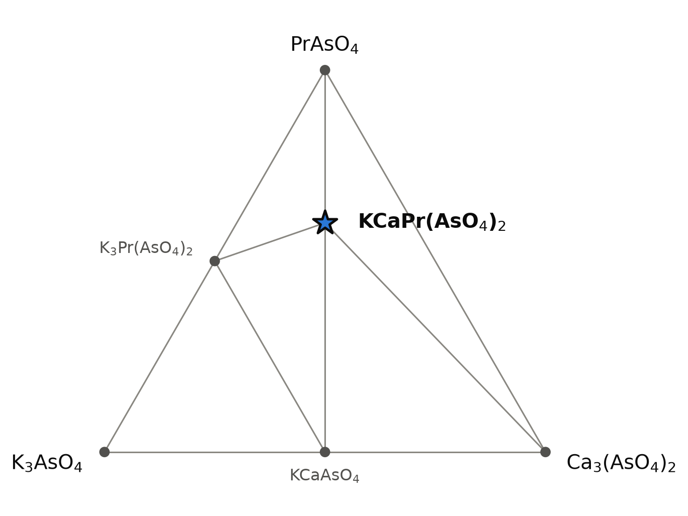
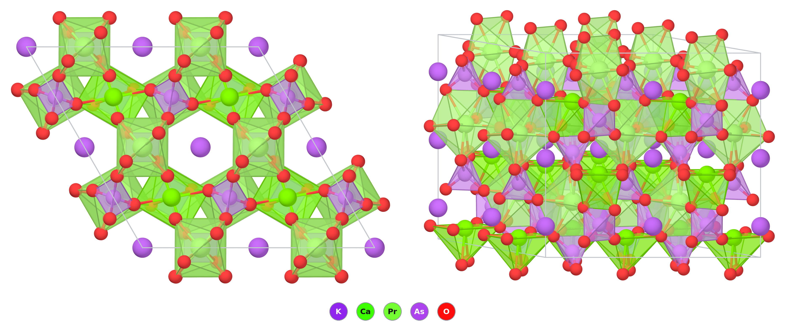

# KCaPr(AsO₄)₂ — a potassium calcium praseodymium arsenate in the KCaNd(PO₄)₂ structure

*A Material a Day · entry 7 · 16 October 2026 · status: **predicted, no report found***

> **In one paragraph.** KCaPr(AsO₄)₂ is an insulating orthoarsenate for which we found
> no report. Its phosphate relative KCaNd(PO₄)₂ is known and gives the structure its
> name: chains of alternating cations and tetrahedra along a hexagonal axis, with
> potassium in the channels between them. A paper on the phosphates lists arsenates
> among the members of the family and cites work we could not retrieve, so a report of
> this compound may well exist. The compound lies on the line between KCaAsO₄ and PrAsO₄
> and is 11 meV/atom below that mixture in one table and 5 meV/atom in the other. Both
> margins are far inside the error this method carries for oxides, so the calculation
> says the compound is plausible and no more. The stored structure has calcium and
> praseodymium ordered along the chains; in the measured phosphate calcium and neodymium
> are mixed on one site and the cell has half the height. The stored phosphate cell is
> 0.4 % long in a, 1.1 % in c and 1.9 % large in volume. The route is the one published
> for the phosphate: carbonates, the rare-earth oxide and the ammonium salt, a slow
> first step at 400 °C and firings at about 1050 °C in air, with arsenic loss as the
> unknown. Arsenates are toxic and carcinogenic.

Every number below is computed unless a reference is given.

## 1. Identity

| | |
|---|---|
| Formula | KCaPr(AsO₄)₂ |
| Alexandria id | `agm010924429` |
| Space group | P6₂ (no. 171), Z = 3; chiral, the mirror image is P6₄ |
| Cell (PBE) | a = 7.205 Å, c = 13.773 Å |
| Volume per formula unit | 206.4 ų |
| Density | 4.01 g cm⁻³ |
| Structure type | KCaNd(PO₄)₂, in an ordered version with twice the measured c axis (section 3) |
| Formation energy | −2.199 eV/atom |
| PBE gap | see section 4: the stored value (zero) is an artefact of the open 4f shell |

The CIF is [`KCaPr(AsO4)2.cif`](<KCaPr(AsO4)2.cif>). No Wikipedia page on the compound
was found.

## 2. Where it sits

<picture>
  <source media="(prefers-color-scheme: dark)" srcset="phase_diagram_dark.png">
  
</picture>

The orthoarsenate section K₃AsO₄–Ca₃(AsO₄)₂–PrAsO₄ of the K–Ca–Pr–As–O system at 0 K
(PBE table). Every phase in it has As⁵⁺ in an isolated AsO₄ tetrahedron. The whole
five-element system has 64 phases on the hull; six of them lie in this section.

| phase | energy below the corner arsenates (meV/atom) | note |
|---|---|---|
| **KCaPr(AsO₄)₂** | −45 | this entry; 11 meV/atom below its neighbours |
| KCaAsO₄ | −62 | neighbour |
| K₃Pr(AsO₄)₂ | −42 | neighbour |
| PrAsO₄ | 0 | corner, neighbour |
| Ca₃(AsO₄)₂ | 0 | corner |
| K₃AsO₄ | 0 | corner |

- **It lies on the line KCaAsO₄–PrAsO₄**, at 1 : 1. These two are its competitors:
  KCaAsO₄ + PrAsO₄ → KCaPr(AsO₄)₂ releases 11.4 meV/atom in `energy_runs_pbe` and
  5.3 meV/atom on the `pbe_mp` hull.
- **Three tie lines in the full hull:** to KCaAsO₄, PrAsO₄ and K₃Pr(AsO₄)₂.
- **Two lines of the picture are not tie lines of the full hull.** On
  Ca₃(AsO₄)₂–KCaPr(AsO₄)₂ and Ca₃(AsO₄)₂–PrAsO₄ the equilibrium leaves the plane.
  On the `pbe_mp` hull a further orthoarsenate, KCa₁₀(AsO₄)₇, is stable on the calcium
  side; it is not in this picture.
- **Nothing else quaternary or quinary is near.** No other compound containing all of
  K, Ca, Pr and As is within 60 meV/atom of the hull.

## 3. Structure

*A 2 × 2 × 1 block seen along c (left) and from the side (right). PrO₈ polyhedra are
pale green, CaO₈ bright green, AsO₄ tetrahedra violet. Potassium (purple) is drawn as a
bare ball; its eight K–O contacts (2.90–3.11 Å) are left out for clarity.*

| site | Wyckoff | position | neighbours |
|---|---|---|---|
| K | 3a | 0, 0, 0.818 | 8 O at 2.90–3.11 Å |
| Ca | 3b | 0, ½, 0.073 | 4 O at 2.37 Å, 2 at 2.68 Å, 2 at 2.94 Å |
| Pr | 3b | 0, ½, 0.584 | 4 O at 2.37–2.39 Å, 4 at 2.64–2.66 Å |
| As1 | 3b | 0, ½, 0.827 | 4 O at 1.72 Å |
| As2 | 3b | 0, ½, 0.338 | 4 O at 1.72 Å |
| O1–O4 | 6c | general | each bonded to one As |

- **Chains along c.** Calcium, praseodymium and both arsenic atoms sit on the same
  twofold axis, in the order Ca – As2 – Pr – As1 – Ca. Neighbours along the chain are
  3.35 to 3.65 Å apart, and each tetrahedron shares an O···O edge with the eight-fold
  polyhedron above and below it.
- **The chains are linked sideways.** Every oxygen of a tetrahedron also bonds to a
  cation of a neighbouring chain, which makes the short (2.37–2.39 Å) bonds; the long
  ones are those of the shared edges.
- **Potassium fills hexagonal channels** between the chains, on the 6₂ screw axis,
  one atom every c/3 = 4.59 Å.
- **Praseodymium is the more regular of the two.** Its eight oxygen atoms fall into
  two close groups. Calcium has four near neighbours and four that are loosely held, as
  if the site were made for the larger ion.
- **The order doubles the cell.** Ca and Pr are 0.51 c apart and As1 and As2 0.49 c
  apart, so a cell of half the height would hold the same framework with one mixed
  (Ca, Pr) site and half-occupied potassium sites. The stored structure is the ordered
  version.
- **The measured phosphate is the disordered half cell.** The single-crystal study of
  KCaNd(PO₄)₂ found space group P6₂22 (or P6₄22) with c = 6.397 Å, one site shared
  1 : 1 by Nd and Ca, and potassium on a channel site that is half occupied; neither
  occupancy moved from one half when refined [1]. The authors note that ordered
  potassium would double c and that no such long-range order was seen [1]. The stored
  structure is that doubled cell, with the cations ordered as well.
- **A relative of rhabdophane.** The structure is that of hexagonal LnPO₄, usually
  obtained hydrated, with potassium in the large tunnel along c [1]; a later paper calls
  the family alkali-bearing rhabdophanes [2]. Thermal analysis of KCaNd(PO₄)₂ showed no
  water [1].

### Calibration on the measured phosphate

The stored KCaNd(PO₄)₂ (`agm003246026`, P6₄, the same ordered arrangement) beside the
measured crystal [1]. The measured cell holds 1.5 formula units and the stored one 3.

| | measured [1] | computed (PBE) | difference |
|---|---|---|---|
| a (Å) | 7.033(5) | 7.060 | +0.4 % |
| c (Å) | 6.397(5) | 12.932 = 2 × 6.466 | +1.1 % |
| Volume per formula unit (ų) | 182.7 | 186.1 | +1.9 % |
| Density (g cm⁻³) | 3.74(2) measured, 3.757 from the cell | 3.689 | −1.4 %, −1.8 % |
| (Nd,Ca)–O, four short (Å) | 2.363 | Nd 2.39, Ca 2.38–2.39 | +1 % |
| (Nd,Ca)–O, four long (Å) | 2.580 | Nd 2.55–2.58, Ca 2.62–2.68 | Nd −1 to 0 %, Ca +1 to +4 % |
| K–O (Å) | 2.894, 2.988 | 2.85–3.12, mean 2.95 | mean +0.4 % |
| P–O (Å) | 1.555 | 1.55–1.56 | within 0.003 Å |

- **The cell is 0.4 % long in a and 1.1 % in c.** If the arsenate is off by the same
  amounts, its measured cell would be near a = 7.18 Å and c = 6.81 Å in the half-cell
  description (13.63 Å doubled). This is an estimate carried over from the phosphate.
- **Order shows in the long bonds only.** The calculation gives calcium longer
  shared-edge bonds than neodymium; the experiment sees one averaged site.
- A second measured member, CsCaLa(PO₄)₂, has a = 7.217 and c = 6.414 Å [2]. It is not
  in `energy_runs_pbe`, so it is not compared.

### The family

Depth below competitors in `energy_runs_pbe`, meV/atom; all are on the hull in the same
structure.

| Ln | KCaLn(PO₄)₂ | KCaLn(AsO₄)₂ | KSrLn(AsO₄)₂ | RbSrLn(AsO₄)₂ |
|---|---|---|---|---|
| La | 17.1 | 7.8 | 16.3 | 26.2 |
| Pr | 19.5 | **11.4** | 15.8 | 21.2 |
| Nd | 24.2 | 17.5 | 22.0 | 25.5 |
| Sm | 27.2 | 16.4 | 16.6 | 20.2 |
| Tb | 21.6 | 5.8 | | |
| Y | 19.1 | 0.7 | | |

- **Phosphates are deeper than arsenates,** by about 10 meV/atom for the same cations.
  The phosphates are the ones whose preparation we read [1, 2]. The family is given in
  [2] as M(I)M(II)M(III)(XO₄)₂ with M(I) = K, Rb, Cs, M(II) = Ca, Sr, M(III) a rare
  earth and X = P, As or V, so arsenate members have been reported; which ones, we
  could not check (section 9).
- **Larger cations help the arsenates.** Replacing Ca by Sr, and K by Rb, deepens the
  lanthanum compound from 8 to 26 meV/atom. With the small Y³⁺ the calcium arsenate
  is at the edge of the hull.
- **None of these margins is resolved** (section 5). The table shows a trend, not a
  list of compounds that exist.
- Numbers for Pr, Nd, Sm and Tb come from calculations with an open 4f shell and are
  less reliable than those for La and Y.

## 4. Computed properties

### Electronic

- **The stored gap is an artefact.** `energy_runs_pbe` gives a metal with a moment of
  2 µ_B per praseodymium (6 µ_B per cell): PBE places the partly filled 4f² shell at
  the Fermi level. A real Pr³⁺ arsenate is an insulator with localised 4f electrons.
- **The f-free analogue.** KCaLa(AsO₄)₂ (`agm010922247`, same structure) has a PBE gap
  of 3.73 eV indirect and 3.76 eV direct.
- **Two independent checks agree with the analogue.** The `pbe_mp` table gives
  3.64 eV for the praseodymium compound itself, with no moment, which is what one
  expects if the 4f electrons are kept out of the valence there (we have not checked
  those settings). A graph neural network gives 3.73 eV.
- **How far off:** PBE underestimates gaps of oxides, usually by a third or more
  (general knowledge). No measured gap of a related arsenate was retrieved. The
  compound should be transparent to visible light apart from the sharp 4f–4f lines of
  Pr³⁺, which give its salts a green colour (general knowledge).
- No MBJ or SCAN calculation exists for either compound.

### Dielectric response (KCaLa(AsO₄)₂)

| | |
|---|---|
| ε∞, principal values | 3.08, 3.08, 3.28 |
| ε∞, average | 3.15 |
| Refractive index (from ε∞) | 1.78 |
| Born charges (mean) | K +1.26, Ca +2.62, La +4.16, As +3.29, O −1.83 |

- ε∞ is the electronic part only. It is not the static dielectric constant, which was
  not computed. PBE tends to overestimate ε∞ because it underestimates the gap.
- **The structure is chiral and non-centrosymmetric,** so piezoelectricity and optical
  activity are allowed. The computed clamped-ion piezoelectric tensor is small; the
  ionic part, usually the larger, was not computed.

### Charge transport (KCaLa(AsO₄)₂, PBE bands, constant relaxation time)

| | electrons | holes |
|---|---|---|
| Density-of-states mass (mₑ) | not fitted | 9.0 |
| Seebeck coefficient at 10¹⁹ cm⁻³, 300 K (µV/K) | −211 | +517 |

- The branch-point energy is 1.97 eV above the valence-band maximum, at mid-gap: the
  compound would resist doping of either sign.
- The valence band is flat (oxygen 2p states of isolated tetrahedra). The large Seebeck
  coefficients describe a wide-gap insulator, not a thermoelectric.
- For the praseodymium compound the transport table reflects the spurious 4f metal and
  is not quoted.

### Mechanical (machine-learned)

Bulk modulus 65 GPa, shear modulus 29 GPa, Young's modulus 77 GPa, from a graph neural
network on the stored structure. The three are mutually consistent for an isotropic
solid. Screening estimates only.

### Magnetism

Pr³⁺ carries two 4f electrons. The stored calculation is ferromagnetic by construction;
the ordering, if any, was not studied. The nearest praseodymium atoms are about 5.8 Å
apart and connected only through AsO₄ groups, so a paramagnet down to low temperature is
the reasonable expectation (general knowledge, not computed).

### Not computed

Phonons (the compound is not among the group's density-functional perturbation theory
runs, so dynamical stability is untested), elastic constants, the static dielectric
constant, the energy of Ca/Pr disorder, defect energies, melting behaviour.

## 5. Is it stable?

Marginally, and inside the error.

| table | status | depth below KCaAsO₄ + PrAsO₄ (meV/atom) |
|---|---|---|
| `energy_runs_pbe` | on the hull | 11.4 |
| `energy_runs_pbe_mp` | on the hull | 5.3 |
| `energy_runs_scan` | not in the table | |

- **The two tables disagree by a factor of two.** They treat the praseodymium 4f
  shell differently (section 4). For the lanthanum compound, where there is no 4f
  electron, they agree: 7.8 and 7.6 meV/atom.
- **The error is several times the margin.** Computed and measured formation
  enthalpies of oxides scatter by 65 meV/atom (median deviation, 82 compounds) around a
  bias of +5 meV/atom. No arsenate is among the measured compounds. Neither 11 nor
  5 meV/atom is resolved: KCaPr(AsO₄)₂ and the mixture KCaAsO₄ + PrAsO₄ are degenerate
  in this calculation.
- **Disorder would help.** If calcium and praseodymium mix on the chain sites, the
  configurational entropy lowers the free energy of the compound at the firing
  temperature and does nothing for the two ordered competitors. This is an argument,
  not a number.
- **The competitor may be in the wrong structure.** The lowest PrAsO₄ in both tables is
  the zircon type (I4₁/amd). The monazite type is absent from `energy_runs_pbe` and is
  14 meV/atom higher in `pbe_mp`; for LaAsO₄ it is 6 meV/atom higher. If the real
  PrAsO₄ is monazite, the calculation ranks the two the wrong way round, again within
  the error.
- **What speaks for the compound** is the family: the phosphates exist [1–3],
  arsenate members are reported according to [2], and all the arsenates with large
  cations come out on the hull with similar margins.
- **The experiment agrees that the last step is weak.** In the phosphates the
  compound forms from the two ternary phosphates and the reaction stops short of
  completion (section 6) [2].

## 6. How to make it

### What the calculation proposes

Reaction energies at 0 K, meV per atom of the whole charge, on the `pbe_mp` hull.
There are 29 exact routes of up to three reagents. None uses only catalogue reagents.

| route | charge | ΔE | comment |
|---|---|---|---|
| A | KCaAsO₄ + PrAsO₄ → KCaPr(AsO₄)₂ | −5.3 | First in our ranking (fewest reagents, least driving force); the margin itself, unresolved |
| B | ⅓ K₃AsO₄ + ⅓ Ca₃(AsO₄)₂ + PrAsO₄ | −22 | The three corner arsenates |
| C | KAsO₃ + CaO + PrAsO₄ | −88 | Metaarsenate as the potassium and arsenic source |
| D | KPrO₂ + CaAs₂O₆ | −188 | Two reagents, both to be made first |
| E | ½ K₂O + CaO + ½ Pr₂O₃ + As₂O₅ | −421 | The oxides; what a carbonate and arsenate charge becomes once CO₂, NH₃ and H₂O have left |

- **Route E is the practical one**, and almost all of its energy is spent making
  KCaAsO₄ and PrAsO₄. Route A says the last step has almost no driving force: if the
  two ternary arsenates form first, nothing pushes them to react further. Intimate
  mixing matters more than temperature.
- **With CO₂ kept in, the carbonate wins.** ½ K₂CO₃ + CaCO₃ + ½ Pr₂O₃ + As₂O₅ in a
  closed system goes to CaCO₃, KPr(CO₃)₂, CaAs₂O₆, K₂CaAs₂O₇ and PrAsO₄
  (−155 meV/atom). Computed carbonates are too stable by about 154 meV/atom and CO₂
  leaves an open furnace, so this is a statement about a sealed tube.
- **Favourable is not fast.** These are 0 K energies.

### In practice

No preparation of this compound was found. The phosphate analogue has two published
procedures, both read in full.

| | charge | treatment | result |
|---|---|---|---|
| [1] | (NH₄)₂HPO₄, K₂CO₃, CaCO₃, Nd₂O₃, stoichiometric, pressed into discs | several hours at 400 °C, then twice 48 h at 1050 °C with grinding in between | KCaNd(PO₄)₂ powder; crystals by recrystallisation at 1600 °C in a sealed platinum tube and slow cooling |
| [2] | CaCO₃, ½ Nd₂O₃, the alkali nitrate, 2 (NH₄)₂HPO₄, ground under acetone, dried at 100 °C | 18 h in air, 1050 °C for KCaNd(PO₄)₂ (900 to 1000 °C for the caesium compounds) | mostly the hexagonal phase, with minor phases that include KCaPO₄; mass loss 30.3 % against 31.0 % expected |
| [2] | KCaPO₄ + NdPO₄, each made first (1200 and 1400 °C, 6 h) | 6 h at 1100 °C | the hexagonal phase with small amounts of both reagents left |

- **The published mechanism is route A.** Thermal analysis with mass spectrometry of
  the caesium charge shows NdPO₄ (monazite) forming near 420 °C and the carbonate
  decomposing last, above 650 °C, to give CsCaPO₄; the quaternary phosphate forms
  above 800 °C from these two [2]. The grains have a core of NdPO₄, a layer of the
  alkali calcium phosphate and crystals of the product outside, in the potassium
  samples too [2]. The arsenate analogue of that last step is
  KCaAsO₄ + PrAsO₄, the route the calculation ranks first and gives 5 to 11 meV/atom.
- **The reaction does not finish.** For CsCaNd(PO₄)₂ after 18 h at 1000 °C the yield
  was 77.6 % at most, measured through the caesium that washes out [2]. The authors
  put it down to the stability of monazite [2]. Long firings with regrinding, as in
  [1], are the answer on offer.
- **Charge for the arsenate:** ½ K₂CO₃ + CaCO₃ + ⅙ Pr₆O₁₁ + 2 (NH₄)₂HAsO₄ per formula
  unit, the charge of [1] with arsenic for phosphorus. Pr₆O₁₁ is the usual commercial
  oxide; the extra oxygen leaves on reaction (general knowledge). The sodium rare-earth
  arsenates Na₃Ln(AsO₄)₂ (Ln = La, Pr, Nd) were made from the same kind of charge at
  800 °C [4]. The rare-earth oxides were fired at 1000 °C for 3 h before weighing in
  [2], to remove hydroxide and carbonate.
- **Firing window.** First step: several hours at 400 °C [1], so that ammonia, water
  and CO₂ leave. Lower end of the reaction step: 800 °C, where the phosphate begins to
  form [2] and where the sodium arsenates were made [4]. Upper end for the phosphate:
  1050 to 1100 °C in the open [1, 2]; no loss of mass was seen up to 1200 °C, and at
  1200 °C and above CsCaPO₄ loses caesium and phosphorus and leaves Ca₃(PO₄)₂ [2].
  Upper end for the arsenate: unknown. Arsenic oxides are more volatile than
  phosphorus oxides (general knowledge), neither loss nor melting was computed, and a
  calcium arsenate M₃(AsO₄)₂ is reported as a second phase in arsenate members of the
  family [2, citing work not retrieved]. Start at 800 to 900 °C and raise the
  temperature only while the mass stays constant.
- **Atmosphere:** air. In chemical potential the compound is the stable phase from
  μ(O) = −3.04 eV up to −0.01 eV. A reducing atmosphere takes As⁵⁺ to As³⁺:
  hydrogen reacts by −70 meV/atom, to PrAsO₃ and hydrogen arsenates.
- **Stoichiometry.** The window in μ(K) is 2.5 eV wide. Excess CaO reacts with the
  product (−16 meV/atom, to Pr₂O₃, KCa₁₀(AsO₄)₇ and KCaAsO₄), inside the error.
- **Container:** platinum, gold and silver are inert in the calculation, as are
  zirconia, silica and magnesia. Platinum is what was used for the phosphate [1, 2].
  Alumina reacts by −4 meV/atom, which is inside the
  error. Carbon, and metals such as Al, Ti, Zr, Ta and Fe, reduce the arsenate.
- **Storage:** water is inert in the calculation. CO₂ reacts by −32 meV/atom on paper,
  less than the carbonate error.

### Metathesis

Tested on three charges.

- **Works on paper:** PrCl₃ + CaCl₂ + 2 K₃AsO₄ → KCaPr(AsO₄)₂ + 5 KCl, −200 meV/atom.
- **Works on paper, with less salt:** PrCl₃ + KCaAsO₄ + K₃AsO₄ → KCaPr(AsO₄)₂ + 3 KCl,
  −156 meV/atom.
- **Fails with sodium arsenate:** PrCl₃ + CaCl₂ + KCl + 2 Na₃AsO₄ goes to 5 NaCl +
  KCl + NaCaAsO₄ + PrAsO₄ (−123 meV/atom). Sodium takes the calcium arsenate and the
  quinary compound never forms.
- **The salt matters afterwards too.** KCl, KBr, KI, K₂SO₄ and KNO₃ share a tie line
  with the product, so a potassium salt can serve as a flux and washes out with water.
  NaCl decomposes the product (−24 meV/atom, to NaCaAsO₄ + PrAsO₄ + KCl), as do LiCl
  (−36) and CaCl₂ (−35). Keep sodium out.
- A large driving force is poor selectivity: the metathesis may stop at PrAsO₄ and
  KCaAsO₄, which is route A again.

### Powder pattern

Computed, Cu Kα, PBE cell. The stored phosphate cell is 0.4 % long in a and 1.1 % in c
(section 3), so measured lines will lie at slightly higher angles.

| 2θ (°) | 14.19 | 15.59 | 24.07 | 24.71 | 25.56 | 28.61 | 29.63 | 36.09 | 46.69 |
|---|---|---|---|---|---|---|---|---|---|
| hkl | 100 | 101 | 103 | 110 | 111 | 200 | 104 | 114 | 214 |
| I | 38 | 33 | 8 | 10 | 10 | 100 | 74 | 25 | 48 |

- **Lines with odd l (101 at 15.6°, 103, 111)** exist only because of the doubled c
  axis. If they are missing and the rest fits, the compound formed with Ca and Pr mixed
  and potassium disordered in the channels. That is the expected outcome: the
  phosphate crystal showed no doubling [1]. In the half cell the other lines keep
  their positions and l is halved (104 becomes 102).
- **PrAsO₄ with KCaAsO₄:** the last step did not happen, or the compound is not stable;
  regrind and anneal longer before concluding.
- **K₃Pr(AsO₄)₂ or K₂CaAs₂O₇:** too much potassium, or arsenic was lost.
- **KCa₁₀(AsO₄)₇ with PrAsO₄:** too little potassium.
- **Ca₃(AsO₄)₂:** the phase reported beside arsenate members of the family [2]. In the
  phosphates the matching Ca₃(PO₄)₂ comes from loss of alkali and phosphorus at the
  grain surface [2].
- The strongest lines of monazite overlap those of the hexagonal phase in the
  phosphates [2]; if PrAsO₄ forms as monazite the same may hold here.

### Hazards

Arsenic(V) compounds are toxic and carcinogenic. Arsenates of potassium and ammonium are
soluble, which makes them more dangerous than the product. Firing can release arsenic
oxide vapour: weigh and fire in a hood, trap the exhaust, and treat all residues and
wash water as arsenic waste. These are general statements, not retrieved for this entry.

## 7. What it could be good for

Candidates only; nothing has been measured.

- **A host for lanthanide luminescence.** The phosphate KCaLa(PO₄)₂ is studied as an
  Eu²⁺-activated phosphor whose emission is tuned through structural disorder [3].
  The structure of KCaNd(PO₄)₂ was determined to interpret its optical properties, in
  work on neodymium phosphors for microlasers; cation sites of neighbouring chains
  are 4.11 Å apart [1]. An arsenate host has a lower-energy lattice vibration than a
  phosphate (general knowledge), which changes non-radiative losses. The toxicity of arsenic makes a practical use unlikely.
- **A host for large alkali ions.** The caesium phosphate CsCaNd(PO₄)₂ was studied
  as a form in which to immobilise radioactive caesium, and the leftover soluble
  CsCaPO₄ was the obstacle [2]. This says the channel takes K, Rb and Cs; it is not a
  use for an arsenate.
- **A test of cation order.** Ca²⁺ and Nd³⁺ are mixed in the phosphate, where both
  have a radius of 1.12 Å in eightfold coordination [1]. Whether Ca²⁺ and Pr³⁺ order
  in the arsenate is a clean question for diffraction (the odd-l lines above).
- **A chiral, non-centrosymmetric oxide.** Piezoelectricity and optical activity are
  allowed by symmetry; neither was computed beyond the small clamped-ion term.

## 8. How this could be wrong

- **The compound may not form.** 5 to 11 meV/atom against 65 meV/atom of scatter is no
  margin. The mixture KCaAsO₄ + PrAsO₄ is as likely in this calculation, and the
  phosphate analogue is reported to compete with monazite [2].
- **The 4f shell.** The two PBE tables give different depths for the praseodymium
  compound and the same depth for the lanthanum one. The lanthanum numbers (8 meV/atom)
  are the safer guide.
- **It may already be known.** Arsenates are listed among the members of this family
  in [2]. We could not retrieve the papers it cites for them and do not know whether
  the potassium calcium praseodymium member is among them.
- **Order versus disorder.** The database holds one ordered arrangement. The measured
  phosphate is disordered, with Nd and Ca on one site, half-occupied potassium sites
  and a cell of half the height [1]. The arsenate is likely to be the same. The energy
  of the stored structure is then that of one ordered configuration of a disordered
  crystal, and the depth below the competitors leaves out the entropy of mixing.
- **The cell is too large.** For the phosphate of this structure the stored cell is
  0.4 % long in a, 1.1 % in c and 1.9 % large in volume (section 3) [1]. Arsenates may
  be worse. For K₂CaAs₂O₇, a neighbour in the same chemical system,
  the measured cell is a = 9.222, b = 5.835, c = 14.698 Å, V = 760.9 ų [5]. The stored
  P2₁/c structure `agm003252005` has 9.427, 5.941 and 14.913 Å and 800.4 ų: the axes
  are 1.5 to 2.2 % too long and the volume 5.2 % too large. The monoclinic angle was
  not compared, and a second stored structure of the same composition lies 0.1 meV/atom
  away. Expect the volume of the real cell of KCaPr(AsO₄)₂ to be smaller than quoted
  by 2 to 5 %.
- **The firing temperatures are those of phosphates.** An arsenate may lose arsenic
  or melt below 1050 °C.
- **No phonons.** Dynamical stability has not been tested.
- **The oxygen-rich limit rests on KO₈,** a potassium polyoxide entry that is probably
  not a real compound.
- **Arsenic volatility is not in the calculation.** A charge that loses arsenic oxide
  moves off the composition whatever the hull says.
- **Reference [4] was read as an abstract only,** and reference [3] by its title.

## 9. Literature

**Searched (OpenAlex, Crossref, web), 11 October 2026:** "KCaPr(AsO4)2 potassium calcium
praseodymium arsenate" (no hits); "KCaPr(AsO4)2" (nothing on this compound);
"KCaPr(AsO4)2" OR "KCaLa(AsO4)2" OR "KCaNd(AsO4)2" OR "KSrLa(AsO4)2" arsenate (web;
nothing on any of them); "double arsenates potassium calcium rare earth KCaLn(AsO4)2
synthesis structure" (no hits); "rare earth arsenates alkali alkaline earth hexagonal
rhabdophane structure KCaLn(AsO4)2"; "rare earth arsenate rhabdophane-type hexagonal
AsO4 K Ca lanthanide double arsenate solid state" (web; phosphates only); "K3Ln(AsO4)2
potassium rare earth double arsenates"; "Les orthoarséniates doubles de terres rares et
de potassium calcium KCaLn(AsO4)2" (nothing relevant); "KCaNd(PO4)2"; "KCaNd(PO4)2
crystal structure hexagonal"; "KCaNd(PO4)2 crystal structure hexagonal P6222" (web);
"KCaLn(PO4)2 rhabdophane-type double phosphates potassium calcium lanthanide";
"KSrNd(PO4)2 OR KCaLa(PO4)2 OR KSrLa(PO4)2 hexagonal orthophosphate luminescence";
"praseodymium arsenate PrAsO4 crystal structure monazite zircon lanthanide
orthoarsenates" (no hits); "rare earth orthoarsenates LnAsO4 monazite zircon structure
types" (nothing relevant); "El Jouhari Daoudi Parent Le Flem arsenates rhabdophane
potassium calcium rare earth" and "El Jouhari Daoudi 1983 Comptes Rendus arséniates
doubles KCaLn(AsO4)2 alcalin alcalino-terreux terre rare" (the two papers named below
were not found; the first query returned [6]). Wikipedia: the formula, "potassium
calcium praseodymium arsenate", "KCaNd(PO4)2", "potassium calcium neodymium phosphate"
(no page).

**Result:** no report of KCaPr(AsO₄)₂ was found. This is a statement about these
searches, not about the compound, and there is a lead that we could not follow.
Reference [2] gives the family as M(I)M(II)M(III)(XO₄)₂ with X = P, As or V, and
mentions a calcium or strontium arsenate found as a second phase in the arsenate
members. For these it cites N. El Jouhari and A. Daoudi, *C. R. Acad. Sci. Paris*
297 (II), 803 (1983), and N. El Jouhari, A. Daoudi, C. Parent and G. Le Flem, *Eur. J.
Solid State Inorg. Chem.* 30, 297 (1993). Neither was found by the searches and
neither was read, so which arsenates they contain is not known to us. The same group
solved KCaNd(PO₄)₂ [1] and made rare-earth double arsenates [4]. A report of this
compound would not be surprising, and a check of those two papers and of the
structural databases by a person is owed.

1. M. Vlasse, P. Bochu, C. Parent *et al.*, "Structure determination of calcium
   neodymium potassium double phosphate CaKNd(PO₄)₂", *Acta Crystallogr. B* 38,
   2328 (1982). doi:10.1107/S0567740882008735 — *full text read.*
2. L. Campayo, F. Audubert, D. Bernache-Assollant, "Synthesis study of alkaline-bearing
   rare earth phosphates with rhabdophane structure", *Solid State Ionics* 176,
   2663 (2005). doi:10.1016/j.ssi.2005.07.007 — *full text read.*
3. W. Xie, X. Miao, L. Zhang *et al.*, "Tunable photoluminescence in Eu²⁺-activated
   KCaLa(PO₄)₂ phosphor through structural disorder", *J. Lumin.* (2025).
   doi:10.1016/j.jlumin.2025.121292 — *title only; the text could not be retrieved.*
4. C. Parent, R. Salmon, G. Le Flem, ChemInform abstract on the preparation and X-ray
   study of the sodium rare-earth double arsenates Na₃Ln(AsO₄)₂ (Ln = La, Pr, Nd),
   *Chemischer Informationsdienst* (1978). doi:10.1002/chin.197828005 — *abstract
   read.*
5. R. Faggiani, C. Calvo, "Crystal structure of CaK₂As₂O₇ and CdK₂P₂O₇", *Can. J.
   Chem.* 54, 3319 (1976). Cell from the Crystallography Open Database, entry 1527359,
   https://www.crystallography.net/cod/1527359.html — *database record read, not the
   paper.*
6. C. Parent, P. Bochu, A. Daoudi *et al.*, "Nd³⁺, Eu³⁺, and Gd³⁺ ions as local probes
   in the NaₓSr₃₋₂ₓLnₓ(PO₄)₂ and KCaLn(PO₄)₂ rare earth phosphates", *J. Solid State
   Chem.* (1982). doi:10.1016/0022-4596(82)90228-6 — *metadata only; listed because its
   title shows that the KCaLn(PO₄)₂ series was studied beyond neodymium.*

## 10. Provenance

- **Data:** Alexandria database, tables `energy_runs_pbe` and `energy_runs_pbe_mp`.
  Reaction energies, contact reactions and chemical-potential windows come from the
  hull and reaction table built on `pbe_mp`; the two tables give depths of 11.4 and
  5.3 meV/atom for this compound and the entry quotes both. The compound is not in
  `energy_runs_scan`. Gap, dielectric and transport numbers are those of the lanthanum
  analogue `agm010922247`. The calibration cell is that of `agm003246026` in
  `energy_runs_pbe`.
- **Tools:** the reaction-route code of this group, pymatgen, POV-Ray; machine-learned
  moduli and gap from graph neural networks.
- **Authorship:** drafted by Claude (Anthropic) from those tools; reviewed by
  Miguel Marques. Corrections are welcome as issues on this repository.
