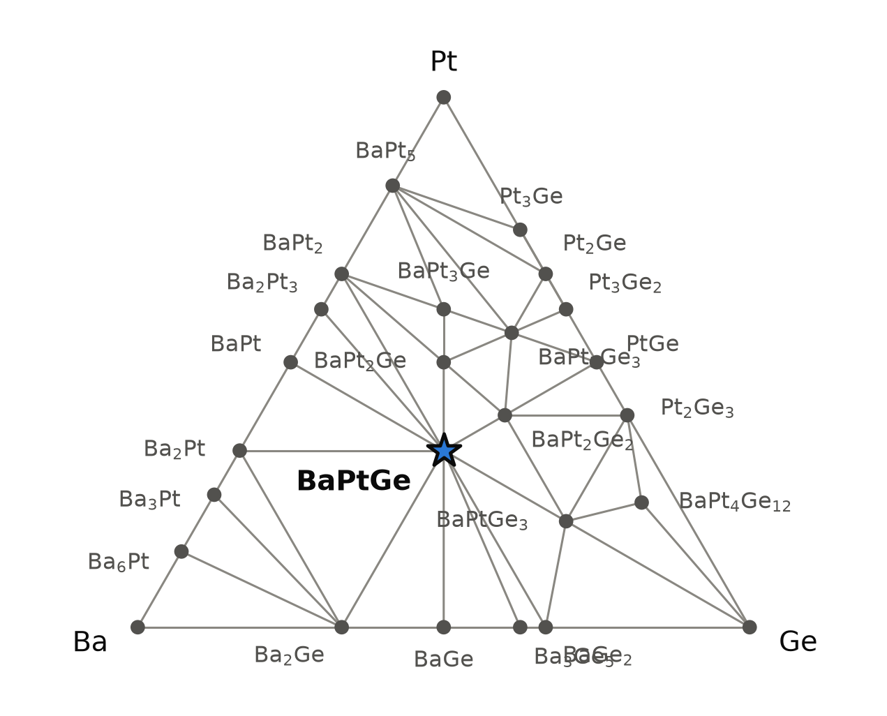
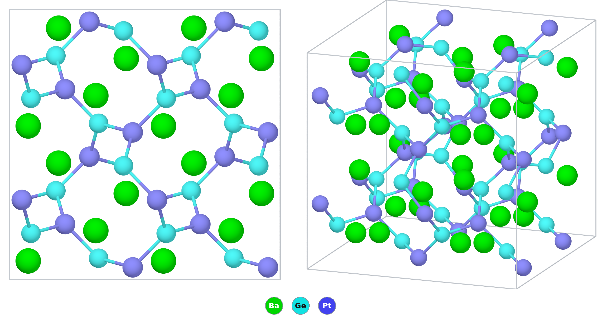

# BaPtGe — a chiral cubic germanide whose lattice vibrations have been measured for their handedness

*A Material a Day · entry 8 · 19 October 2026 · status: **known** (structure reported in 1992)*

> **In one paragraph.** BaPtGe is a metallic compound of barium, platinum and germanium
> with the cubic LaIrSi structure: platinum and germanium alternate on a
> three-dimensional net in which every atom has three neighbours, and barium fills the
> channels. The net has no mirror plane and no inversion centre, so a crystal is either
> left- or right-handed. That handedness is why the compound is studied: in 2021 its
> phonons were measured by inelastic X-ray scattering and found to carry the chiral
> character that symmetry predicts. In the calculations it is the deepest phase of the
> Ba–Pt–Ge system, 171 meV/atom below its competitors, and nothing else of this
> composition comes within 90 meV/atom. The computed cell is 1.4 % too long. The main
> caveat is practical: the compound contains barium metal chemistry throughout, so it
> is made and kept under inert gas. The original report melted the elements together
> by induction under argon in a water-cooled copper boat, which is the last of the
> exact routes in our ranking.

Computed numbers come from the Alexandria database; measured numbers carry a reference.

## 1. Identity

| | computed (PBE) | measured |
|---|---|---|
| Formula | BaPtGe (stored as BaGePt) | BaPtGe [1] |
| Alexandria id | `agm003210906` | |
| Space group | P2₁3 (no. 198), Z = 4 | P2₁3 [1] |
| a (Å) | 6.838 | 6.747 [1] |
| Volume per formula unit (ų) | 79.9 | 76.8 [1] |
| Density (g cm⁻³) | 8.42 | 8.76 (from the measured cell) |
| Structure type | LaIrSi (ordered ternary variant of SrSi₂) | LaIrSi [1] |
| Appearance | | silvery, metallic lustre [1] |
| Formation energy | −0.917 eV/atom | |
| Valence electrons per formula unit | 16 | |

PBE overestimates the cell edge by 1.35 % and the volume by 4.1 %, the usual direction
for this functional and at the upper end of its usual size. The measured cell is
a = 674.7(1) pm, from a Rietveld refinement of a Guinier powder pattern taken with
molybdenum radiation (profile R = 5.62 %) [1]. The CIF is
[`BaGePt.cif`](BaGePt.cif). No Wikipedia page on the compound was found.

## 2. Where it sits

<picture>
  <source media="(prefers-color-scheme: dark)" srcset="phase_diagram_dark.png">
  
</picture>

The Ba–Pt–Ge system at 0 K (PBE table). Twenty-six phases are on the hull, seven of
them ternary. BaPtGe sits at the centre of the triangle and has tie lines to eleven
other phases, which is why an off-composition sample can contain so many different impurities.

| phase | formation energy (eV/atom) | depth below competitors (meV/atom) | note |
|---|---|---|---|
| **BaPtGe** | −0.917 | 171 | P2₁3, this entry |
| BaPt₂Ge₂ | −0.773 | 37 | C2/c in the database |
| BaPt₂Ge | −0.791 | 13 | P2₁/m |
| BaPt₃Ge | −0.694 | 4 | Cmcm |
| BaPtGe₃ | −0.652 | 94 | I4mm; measured structure in [5] |
| BaPt₅Ge₃ | −0.635 | 43 | Cmcm |
| BaPt₄Ge₁₂ | −0.373 | 0.04 | Im3̄ |
| BaPt | −0.804 | 47 | binary neighbour |
| BaGe | −0.621 | 71 | binary neighbour |
| Ba₂Pt, Ba₂Pt₃, BaPt₂, Ba₂Ge, Ba₃Ge₅, BaGe₂ | | | the other binary neighbours |

- **It is the most stable composition in the system** by formation energy per atom,
  and by a wide margin the deepest ternary.
- **Its competitors are BaGe + BaPt + BaPt₂Ge₂.** A sample that misses the 1 : 1 : 1
  ratio lands in one of the eleven three-phase fields around it.
- **The shallow ternaries are not verdicts.** BaPt₃Ge (4 meV/atom) and BaPt₄Ge₁₂
  (0.04 meV/atom) are on the hull by less than any error this method has.

## 3. Structure

*Left: a 2 × 2 × 2 block seen along a cube axis. Right: the same block in an oblique
view. Only the Pt–Ge bonds are drawn. The four-membered "squares" on the left are
helices seen end-on, not rings.*

| site | Wyckoff | x = y = z | neighbours |
|---|---|---|---|
| Ba | 4a | 0.138 | 1 Pt at 3.23 Å, 3 Pt at 3.48 Å, 1 Ge at 3.50 Å, 3 Ge at 3.57 Å |
| Pt | 4a | 0.410 | 3 Ge at 2.462 Å, then 4 Ba |
| Ge | 4a | 0.842 | 3 Pt at 2.462 Å, then 4 Ba |

- **Three atoms, three parameters.** All three elements sit on the threefold axes of
  the cube, each with one free coordinate. With the cell edge, four numbers fix the
  structure.
- **Measured positions.** The refinement gives x = 0.138(1) for Ba, 0.410(1) for Pt
  and 0.844(2) for Ge [1]. The computed values agree with the first two to the last
  digit and differ by 0.002 for germanium, one standard deviation. With the measured
  cell and positions the Pt–Ge distance is 2.43 Å, about 0.01 Å uncertain; the
  computed 2.462 Å is 1.4 % longer, the same excess as the cell edge. The measured
  barium shell is 1 Pt at 3.18 Å, 3 Pt at 3.43 Å, 1 Ge at 3.44 Å and 3 Ge at 3.54 Å.
- **Ordered.** A refinement with platinum and germanium mixed over the two net sites
  gave a considerably worse fit [1].
- **A three-connected net.** Every platinum has three germanium neighbours at 2.46 Å
  and every germanium three platinum neighbours. There are no Pt–Pt and no Ge–Ge
  bonds. The net is the one silicon forms in SrSi₂, with the two kinds of atom
  alternating [2, 4].
- **Barium in the cavities.** Each barium has eight net atoms around it between 3.2 and
  3.6 Å, four platinum and four germanium. The usual description is
  a polyanionic [PtGe] network that takes electrons from the barium atoms in its
  cavities [4]; with 16 valence electrons per formula unit the compound is
  nevertheless a metal (section 4).
- **Chiral.** P2₁3 has only rotations and screw axes. The net is built from helices
  that all turn the same way, and a crystal of the opposite hand is equally stable.
  The database holds one hand; the two cannot be told apart by energy or by powder
  diffraction.
- **Polymorphs.** Four other structures of this composition are in the PBE table. The
  nearest, a hexagonal one (P6₃/mmc), is 127 meV/atom higher.

### The family

The LaIrSi type has 23 known representatives among aluminides, gallides, silicides,
germanides, phosphides and arsenides, all with 16 or 17 valence electrons [4]. In the
database (PBE), for the alkaline-earth and europium compounds with platinum:

| compound | lowest structure in the database | LaIrSi-type cell a (Å), computed | measured | computed − measured |
|---|---|---|---|---|
| BaPtSi | LaIrSi type, 224 meV/atom deep | 6.704 | LaIrSi type, 6.633 (from the cell volume quoted in [1]) | +1.1 % |
| **BaPtGe** | LaIrSi type, 171 meV/atom deep | 6.838 | LaIrSi type, 6.747 [1] | +1.35 % |
| BaPtSn | LaIrSi type, 73 meV/atom deep | 7.196 | | |
| SrPtGe | LaIrSi type, 115 meV/atom deep | 6.683 | LaIrSi type, 6.602 [1] | +1.2 % |
| EuPtGe | Pnma (TiNiSi type); LaIrSi type 19 meV/atom higher | 6.566 | LaIrSi type, 6.551 [1], 6.546 [2] | +0.2 %, +0.3 % |
| CaPtGe | Pnma (TiNiSi type); LaIrSi type 51 meV/atom higher | 6.514 | TiNiSi type [1] | see below |

- **The barium compounds prefer this structure most strongly,** and the preference
  fades as the cation shrinks, until the orthorhombic TiNiSi type takes over at
  calcium. The original report finds the same: EuPtGe, SrPtGe and BaPtGe have the
  LaIrSi type (powder patterns, Rietveld refinement), and CaPtGe the TiNiSi type
  (single crystal) [1].
- **CaPtGe, measured and computed.** The measured cell is a = 7.169, b = 4.409,
  c = 7.438 Å [1]; the computed one is 7.228, 4.459, 7.486 Å, longer by 0.8, 1.1 and
  0.6 %, and 2.6 % larger in volume. In this structure each platinum has four
  germanium neighbours instead of three (three at 2.56 to 2.57 Å and one at 2.70 Å),
  and the packing is denser: the measured cell of CaPtGe is 7 % smaller than that of
  CaPtSi, although germanium is the larger atom [1].
- **EuPtGe is a disagreement.** Both the powder refinement [1] and a later study [2]
  find the LaIrSi type; the database puts the TiNiSi type 19 meV/atom lower. Europium
  has an open 4f shell, PBE handles it poorly, and 19 meV/atom is inside that
  uncertainty. The computed cell of the LaIrSi form is within 0.3 % of the measured
  ones.
- **The cell error grows with the cation.** For the three LaIrSi-type compounds
  without 4f electrons that have a measured cell here, PBE is 1.1 to 1.35 % long,
  most for BaPtGe.

## 4. Properties

### Electronic

A non-magnetic metal in PBE and in SCAN, with no gap. The density of states at the
Fermi level stored in the database is 3.0 (PBE) and 2.7 (SCAN), in the database's
units for the 12-atom cell. A bonding analysis of the structure type describes its
members as weakly metallic, with a small density of states at the Fermi level [4].
Measured for the europium analogue: a room-temperature resistivity of 145 µΩ cm [2].
The original report is a structural one: it describes the samples as silvery and
metallic and measures no physical property [1]. No transport measurement on BaPtGe
was found.

The calculations do not include spin-orbit coupling, which is large for platinum. It
will not change the energies in section 2 much, but it splits bands in a crystal
without inversion symmetry, and any statement about the Fermi surface needs it.
Dielectric and semiconductor transport quantities do not apply to a metal.

### Lattice dynamics

**Not in our phonon calculations.** Neither this structure nor any other of this
composition is among the group's density-functional perturbation theory runs, so there
is no computed dispersion, no test of dynamical stability and no electron-phonon
coupling from us.

**Measured.** The phonons of BaPtGe were mapped on a crystal by inelastic X-ray
scattering at the Advanced Photon Source, together with density-functional
calculations by the same authors [3]:

- **What was calculated.** The dispersion is plotted from 0 to about 25 meV, with no
  unstable branch. The article does not state the functional or the cell used.
- **The node.** Near 6 meV at the zone centre there is a doubly degenerate mode, mostly
  platinum motion, which the authors identify as a twofold quadruple Weyl node: two
  bands only, with Chern numbers +4 and −4. Such a crossing needs a chiral cubic
  crystal and time-reversal symmetry. The same dispersion has a threefold crossing
  at the zone centre and a fourfold one at the zone corner R, each with Chern
  number 2.
- **What was measured.** Spectra up to 15 meV along the cube edge, the face diagonal
  and the body diagonal through the reflection (0 3 3), with an energy resolution of
  about 1.4 meV. Read from the figures, the branch that carries the node stays between
  about 5.5 and 7 meV along all three lines, a second group of modes lies between
  about 9 and 13 meV, and the acoustic branch rises below both.
- **Agreement.** The measured peak positions follow the calculated ones for all three
  branches; the authors call the agreement excellent, and the differences visible in
  the figures are of the size of the resolution.
- **The handedness.** A calculation that keeps only the real part of the atomic
  displacements reproduces most of the intensity of the 6 meV mode along the cube
  edge and the face diagonal, but gives a small fraction of the measured intensity
  along the body diagonal. Along that direction the intensity comes from the
  imaginary part, that is, from platinum atoms moving on closed loops, clockwise for
  one band and anticlockwise for the other.

The article gives no lattice parameter, no measurement temperature and no transport
or thermodynamic data, so it adds nothing to the comparison in section 1. That its
calculated dispersion is stable and agrees with the measured one is the evidence that
the structure is dynamically stable.

### Superconductivity (machine-learned estimate only)

A graph neural network that reads only the structure gives λ = 0.55, ω_log = 105 K and
T_c = 1.9 K. This is a screening estimate, not a calculation, and we found no report of
superconductivity in BaPtGe, for or against. Two lanthanum members of the structure
type, LaRhSi and LaIrSi, are superconductors [6, 7].

### Mechanical (machine-learned)

| bulk modulus | shear modulus | Young's modulus |
|---|---|---|
| 65 GPa | 23 GPa | 59 GPa |

Screening estimates from a graph neural network. They describe a soft solid for a
platinum compound, as expected when a third of the atoms are barium. No measured value
was found.

### Not computed

Phonons and electron-phonon coupling, elastic constants, spin-orbit effects, optical
activity, anything that depends on which hand the crystal has.

## 5. Is it stable?

Yes, by every measure available here.

| table | depth below competitors (meV/atom) |
|---|---|
| `energy_runs_pbe` | 171 |
| `energy_runs_pbe_mp` | 171 |
| `energy_runs_scan` | 244 |

- **Both hulls agree:** on the hull in `energy_runs_pbe` and in `pbe_mp`, with the same
  depth to within 1 meV/atom. SCAN makes it deeper.
- **The error.** Our table of measured formation enthalpies has no entry for any phase
  in this system and no class for polar intermetallics, so there is no class error to
  quote. The classes that are tabulated scatter by tens of meV/atom up to about 100;
  171 meV/atom is larger than that, and the three functionals agree on the sign.
- **Nothing competes at this composition:** the nearest other structure is
  127 meV/atom higher (PBE).
- **Experiment agrees.** The compound forms from the melt of the elements and its
  structure has been refined [1], and a crystal good enough for inelastic X-ray
  scattering has been studied [3].

## 6. How to make it

### What is done

The original report [1] made all four compounds MPtGe (M = Ca, Eu, Sr, Ba) the same
way:

- **Charge:** the elements in the 1 : 1 : 1 ratio, at most 1 g per batch because of
  the platinum content.
- **Melting:** by induction under argon in a water-cooled copper boat, which was
  loaded and emptied inside a glovebox with circulating purified argon.
- **Homogenising:** the button was turned over after cooling and melted again,
  several times. No anneal is described.
- **Control:** the melt does not wet the copper, so the composition was checked by
  weighing the button against the charge.
- **Characterisation:** powder sealed in 0.2 mm glass capillaries in the glovebox;
  Guinier patterns with molybdenum radiation, from 8 to 48° in 2θ.

The report gives no temperature, no melting point and no yield, and does not say
whether the compound melts congruently. A second route is published for the
isostructural europium compound: the elements in a sealed tantalum tube at 1170 K [2].
The phonon study [3] used a single crystal but has no section on how it was grown;
its Supplemental Material, which we did not have, is cited there only for the theory.

### What the calculation proposes

Reaction energies at 0 K, meV per atom of the whole charge. There are 561 exact routes
of up to three reagents.

| route | charge | ΔE | comment |
|---|---|---|---|
| A | BaGe + BaPt₂Ge → 2 BaPtGe | −183 | First in our ranking (fewest reagents, then least driving force); needs a ternary that is itself not available |
| B | BaPt + Ge → BaPtGe | −398 | Through the platinide |
| C | BaGe + Pt → BaPtGe | −492 | Through the Zintl phase; the natural two-step route |
| D | Ba + PtGe → BaPtGe | −581 | Barium into a pre-melted platinum germanide |
| E | Ba + Pt + Ge → BaPtGe | −891 | The elements; the only route from catalogue reagents, and the published one [1] |
| F (metathesis) | Ba₂Ge + PtCl₂ → BaPtGe + BaCl₂ | −1296 | Clean in the calculation |
| G (metathesis) | 4 Ba + PtCl₂ + GeO₂ → BaPtGe + BaO + Ba₂Cl₂O | −1455 | Clean, but four barium for one product |

- **Route E is the published route** [1], and also the practice for the europium
  analogue [2]. It is last among the exact routes in our ranking, as the elements
  always are: the ranking prefers a small driving force, and a melt on a cold hearth
  does not need one.
- **Route C is the one to try where melting is not available.** BaGe is made by
  melting the elements; adding platinum powder then releases 492 meV/atom without
  free barium metal in the second step, which is the step that needs the higher
  temperature. It is our proposal, not a published procedure.
- **Favourable is not fast.** These are 0 K energies. Platinum melts near 2040 K and
  germanium near 1210 K (textbook values, not retrieved); barium melts at 1000 K, so
  above that temperature every route runs through a barium-containing liquid.

### In practice

- **Charge:** Ba : Pt : Ge = 1 : 1 : 1, weighed in an argon glovebox.
- **Container:** the published synthesis has none in the usual sense: a water-cooled
  copper boat, which the melt does not wet [1]. Copper is inert towards BaPtGe in the
  calculation as well. For a reaction below the melting point, a welded tantalum or
  niobium tube inside an evacuated silica jacket is the standard for such compounds
  and what was used for EuPtGe [2]. In the calculation
  tantalum is not quite inert (−31 meV/atom, to Ta₃Pt + Ba₂Ge + Ta₃Ge) and niobium less
  so (−67). Molybdenum and tungsten are inert, and so are MgO, CaO, Y₂O₃, BeO, BN, AlN,
  SiC and graphite. **Not** alumina (−45, BaAl₂O₄ forms), zirconia, or bare silica
  (−97, BaSiO₃ forms).
- **Window:** from the melt, none is needed [1]. In a tube the lower end is set by
  diffusion in platinum, the upper end by the container: 1170 K worked for the
  europium compound [2]. As a function of chemical
  potential the compound is tolerant: it remains the stable phase over 1.5 eV in
  μ(Ba), 1.1 eV in μ(Ge) and 1.25 eV in μ(Pt).
- **Atmosphere:** argon [1] or vacuum. The compound reacts in the calculation with oxygen
  (−1011 meV/atom, to barium germanates and platinum-rich germanides), with CO₂
  (−439), with hydrogen (−172, to BaPtH₄ + BaPtGe₃), with water (−142, barium
  hydroxide among the products) and with nitrogen (−109, to BaN₂ and a nitridogermanate).
  Nitrogen is not an inert gas here.

### Metathesis

Tested on four charges.

- **Works on paper:** Ba₂Ge + PtCl₂ (route F) gives BaPtGe and BaCl₂ only, and BaCl₂
  shares a tie line with the product, so the salt does not attack what it leaves
  behind. NaCl, KCl, RbCl, CsCl, the alkali fluorides, bromides and iodides are inert
  too, and could serve as a diluent. The reaction releases 1.3 eV/atom and would need
  one.
- **Fails with magnesium as the reductant.** BaCl₂ + PtCl₂ + Mg₂Ge goes to
  BaCl₂ + MgCl₂ + MgPtGe, and BaCl₂ + PtCl₂ + GeO₂ + 4 Mg to the same with MgO:
  magnesium does not reduce barium chloride, and takes the place of barium in the
  product.
- **Salts of small cations run the reaction backwards.** CaCl₂ (−87, to CaPtGe +
  BaCl₂), LiCl (−29) and MgCl₂ (−183) exchange with the product. Do not use them as a
  flux.
- **A hydride route fails:** BaH₂ + Pt + Ge goes to BaPtH₄ + BaPtGe₃ with only a quarter
  of the barium ending in BaPtGe.

### Powder pattern

Computed, Cu Kα, PBE cell. With the measured cell every line moves to higher angle, by
about 0.4° at 32°. The published pattern was taken with molybdenum radiation, where
the same lines fall at less than half these angles, and is given only as a figure [1].

| 2θ (°) | 18.35 | 22.52 | 29.20 | 32.06 | 39.54 | 49.90 | 53.61 | 55.40 |
|---|---|---|---|---|---|---|---|---|
| hkl | 110 | 111 | 210 | 211 | 300 | 321 | 400 | 410 |
| I | 19 | 16 | 84 | 100 | 19 | 62 | 17 | 20 |

- **BaPt₂Ge₂ or BaPt₂Ge beside it:** barium was lost, to the container or as vapour.
- **BaGe or Ba₂Ge beside it:** platinum has not finished reacting; anneal longer.
- **Barium germanates or carbonate:** air got in.

### Hazards

Barium metal reacts with water and air. Soluble barium compounds are toxic, and this
compound yields them on contact with moisture in the calculation, so it is handled as
a toxic, air-sensitive solid. The original work kept the products in a glovebox and
sealed the powders in capillaries, without saying how fast they react in air [1]. PtCl₂ in route F is a sensitiser. Nothing here is
radioactive.

## 7. What it is used for

No application. BaPtGe is a model compound for one question: what a chiral crystal
structure does to lattice vibrations.

- **Why it was first made.** As structural chemistry: the equiatomic germanides sit
  between the Zintl phases MGe₂ and the Laves phases MPt₂, and the question was
  whether the three-connected net known from the silicides survives with germanium.
  It does for Eu, Sr and Ba, and not for Ca [1].
- **Chiral phonons.** It is the compound in which the twofold quadruple Weyl phonon
  was observed [3], and it is cited as an example in a 2025 survey of Weyl phonons [8].
- **Why this compound.** The structure is simple (twelve atoms, three sites), and the
  mode of interest lies low, near 6 meV, and is mostly platinum motion [3].
- **Proposed, not shown.** The authors suggest the compound as a place to look for an
  intrinsic thermal Hall effect carried by phonons, which scales with the Chern
  number of the node [3]. No such measurement was found.
- A superconducting or thermoelectric use would be speculation: no measurement of
  either was found.

## 8. How this could be wrong

- **The published synthesis is brief.** It gives the method but no temperature, no
  melting behaviour and no yield [1], and the phonon study [3] does not describe the
  growth of its crystal. How a crystal of BaPtGe is grown is not in anything we read.
- **The measured structure is a powder refinement** with a profile R of 5.62 % and
  positions good to 0.001 to 0.002 [1]. The agreement of the computed positions is
  within that; it is not a test at single-crystal precision.
- **The BaPtSi cell in the family table is derived** from a cell volume quoted in
  [1], whose own source we did not read.
- **Phonon energies are read from figures.** The article [3] tabulates none; the
  numbers in section 4 are good to about 0.5 meV.
- **No phonons from us.** Dynamical stability is taken from the published measurement
  and calculation [3], not from our own.
- **The superconducting T_c is a machine-learned number** with nothing measured beside
  it. It should not be repeated as a prediction.
- **No spin-orbit coupling** in any energy or density of states quoted here.
- **The other ternaries of the system** are in the diagram as the database has them.
  Only BaPtGe₃ was checked against a measured structure [5]; the shallow ones may not
  exist, and real phases with large cells may be missing.
- **No class error.** The margin of 171 meV/atom is compared with the scatter of other
  chemical classes, since none is tabulated for intermetallics of this kind.
- **The platinum reference.** In `energy_runs_pbe` the lowest platinum entry is a
  tetragonal cell 9 meV/atom below face-centred cubic platinum. Formation energies of
  platinum compounds inherit a share of that; for BaPtGe it is at most 3 meV/atom and
  does not touch the depth, which is measured against compounds.
- **Container reactivity** is computed for bulk equilibrium at 0 K. Tantalum tubes are
  used routinely for such compounds; the calculation says only that the reaction is
  slightly downhill.

## 9. Literature

**Searched (OpenAlex, Crossref, arXiv), 11 October 2026:** "Ternäre Phasen MPtGe
(M = Ca, Eu, Sr, Ba) im LaIrSi- und im TiNiSi-Typ"; "BaPtGe"; "BaPtGe LaIrSi-type
chiral cubic P213"; "BaPtGe ternary germanide physical properties"; "barium platinum
germanide equiatomic crystal structure"; "BaPtSi BaPtGe superconductivity
noncentrosymmetric LaIrSi structure" (nothing on BaPtGe); "SrPtGe EuPtGe BaPtSi
LaIrSi-type electronic structure chiral" (no hits); "EuPtGe LaIrSi-type magnetic
properties"; "LaIrSi-type structure superconductivity LaRhSi LaIrSi
noncentrosymmetric"; "BaPtSi SrPtSi LaIrSi type three-connected net SrSi2 ternary
variant".

**Result:** the compound is known. No report of its transport, magnetic or
superconducting properties was found; that is a statement about these searches.

1. J. Evers, G. Oehlinger, K. Polborn, B. Sendlinger, "Ternäre Phasen MPtGe (M = Ca,
   Eu, Sr, Ba) im LaIrSi- und im TiNiSi-Typ", *J. Alloys Compd.* 182, 23 (1992).
   doi:10.1016/0925-8388(92)90593-X — *full text read (a letter of seven
   pages, in German). The cell agrees with Crystallography Open Database entry
   1527354.*
2. R. Pöttgen *et al.*, "Magnetic, electrical and ¹⁵¹Eu
   Mössbauer properties of EuPtGe", *J. Mater. Chem.* 6, 635 (1996).
   doi:10.1039/JM9960600635 — *abstract read.*
3. H. Li, T. Zhang, A. Said *et al.*, "Observation of a chiral wave function in the
   twofold-degenerate quadruple Weyl system BaPtGe", *Phys. Rev. B* 103, 184301 (2021).
   doi:10.1103/PhysRevB.103.184301 — *full text read; the Supplemental Material
   was not available.*
4. S. F. Matar, R. Pöttgen, M. Nakhl, "Electronic structure and chemical bonding in
   LaIrSi-type intermetallics", *Z. Naturforsch. B* (2017).
   doi:10.1515/znb-2016-0230 — *abstract read.*
5. R. Demchyna, Yu. Prots, W. Schnelle *et al.*, "Crystal structures of (barium,
   europium) platinum trigermanium, Ba₁₋ₓEuₓPtGe₃ (x = 0, 0.27, 1)", *Z. Kristallogr.
   NCS* (2006). doi:10.1524/ncrs.2006.0002 — *abstract read.*
6. B. Chevalier, P. Lejay, A. Cole *et al.*, "Crystal structure, superconducting and
   magnetic properties of new ternary silicides LaRhSi, LaIrSi and NdIrSi", *Solid
   State Commun.* (1982). doi:10.1016/0038-1098(82)91252-2 — *title only.*
7. T. Shang, J. Zhao, L.-H. Hu *et al.*, "Discovery of nodal-line superconductivity in
   chiral crystals", *Adv. Mater.* (2025). doi:10.1002/adma.202511385 — *abstract read.*
8. T. Zhang, S. Murakami, H. Miao, "Weyl phonons: the connection of topology and
   chirality", *Nat. Commun.* (2025). doi:10.1038/s41467-025-58913-0 — *abstract
   read; that BaPtGe is discussed there is inferred from the search hit on its name.*

## 10. Provenance

- **Data:** Alexandria database, tables `energy_runs_pbe`, `energy_runs_pbe_mp`,
  `energy_runs_scan`. Reaction energies and contact reactions come from the hull and
  reaction table built on `pbe_mp`; the two PBE tables agree on this compound to within
  1 meV/atom. Measured cell and positions from [1].
- **Tools:** the reaction-route code of this group, pymatgen, POV-Ray; machine-learned
  moduli and T_c from graph neural networks.
- **Authorship:** drafted by Claude (Anthropic) from those tools; reviewed by
  Miguel Marques. Corrections are welcome as issues on this repository.
