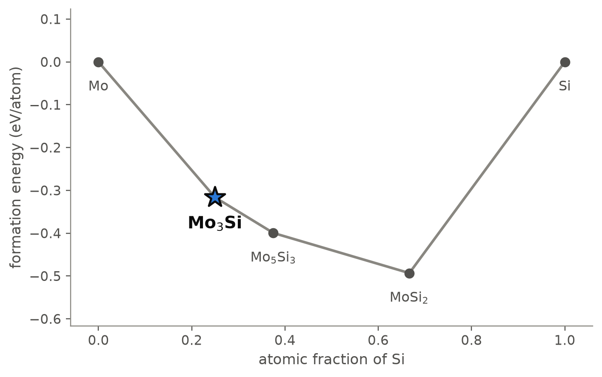
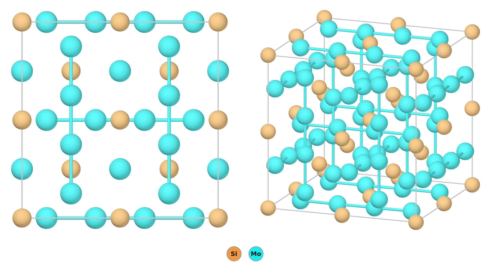
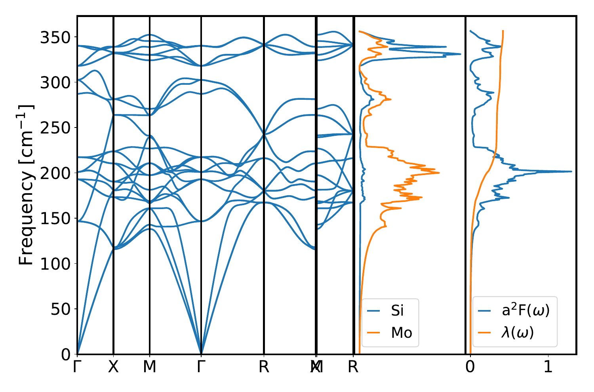

# Mo₃Si — an A15 silicide that superconducts below 2 K and stays solid to 2025 °C

*A Material a Day · entry 9 · 20 October 2026 · status: **known** (structure reported in 1954)*

> **In one paragraph.** Mo₃Si has the A15 structure of the classic superconductors Nb₃Sn
> and V₃Si: three sets of straight molybdenum chains running through a body-centred
> cubic lattice of silicon. It is the molybdenum-rich end of the Mo–Si system and one of
> the three phases of the Mo–Si–B alloys developed for use beyond nickel superalloys.
> It is a superconductor, but a weak one. Our electron-phonon calculation gives a
> coupling λ = 0.42 and a critical temperature of 1.6 K; the measured value is 1.30 K
> in the paper that found the superconductivity, on a sintered sample, and 1.7 K in a
> later compilation. It is made by arc melting the elements and annealing at 1600 °C;
> the 1954 sample was sintered from the powders at about 1500 °C. The calculations
> get the cell right to 0.5 % and place the compound firmly on the hull, but they
> treat it as a line compound, which it is not: the real phase is silicon-poor,
> single-phase at 23 to 24 at.% Si, and a sample examined at atomic resolution was
> not even cubic, with an incommensurate modulation on a slightly distorted A15 cell.

Computed numbers come from the Alexandria database and from our lattice-dynamics
calculations; measured numbers carry a reference.

## 1. Identity

| | computed | measured |
|---|---|---|
| Formula | Mo₃Si (25 at.% Si) | single-phase at 23–24 at.% Si after annealing [1]; 23.9 at.% Si by atom probe in a stoichiometric melt [8] |
| Alexandria id | `agm003264320` | |
| Space group | Pm3̄n (no. 223), Z = 2 | Pm3̄n by X-ray and neutron powder diffraction [2]; monoclinic (2/m) or lower by convergent-beam electron diffraction, with incommensurate satellites [8] |
| a (Å) | 4.905 (PBE); 4.863 (PBEsol) | 4.886–4.913 [2]; a = b = 4.898, c = 4.966, γ ≈ 90.5° by electron diffraction [8] |
| Density (g cm⁻³) | 8.89 (PBE) | |
| Structure type | A15, Cr₃Si | |
| Formation energy | −0.316 eV/atom (PBE) | |
| Upper limit | not computed | peritectic, L + Mo(ss) ↔ Mo₃Si, at 2025 °C [1] |

The four measured cells in the Crystallography Open Database span 4.886 to 4.913 Å;
PBE lands inside that range and PBEsol 0.5 % below it. The CIF is [`SiMo3.cif`](SiMo3.cif).

## 2. Where it sits

<picture>
  <source media="(prefers-color-scheme: dark)" srcset="phase_diagram_dark.png">
  
</picture>

The Mo–Si system at 0 K (PBE table). Three compounds are on the hull, and they are the
three known molybdenum silicides.

| phase | at.% Si | formation energy (eV/atom) | structure |
|---|---|---|---|
| Mo | 0 | 0 | bcc |
| **Mo₃Si** | 25 | −0.316 | A15 |
| Mo₅Si₃ | 37.5 | −0.399 | W₅Si₃ type, I4/mcm |
| MoSi₂ | 66.7 | −0.493 | C11b, I4/mmm |
| Si | 100 | 0 | diamond |

Mo₃Si lies 50 meV/atom below the line joining Mo and Mo₅Si₃ (PBE), 65 in SCAN and 69
with Materials-Project settings.

## 3. Structure

*Left: seen along a cube axis. Right: an oblique view. Only the short Mo–Mo contacts are
drawn, to show the chains.*

| site | Wyckoff | x, y, z | neighbours |
|---|---|---|---|
| Si | 2a | 0, 0, 0 | 12 Mo at 2.742 Å (icosahedron) |
| Mo | 6c | ¼, 0, ½ | 2 Mo at 2.453 Å, 4 Si at 2.742 Å, 8 Mo at 3.004 Å |

- **Silicon** sits on a body-centred cubic lattice, each atom inside an icosahedron of
  twelve molybdenum atoms.
- **Molybdenum** forms three families of straight chains, along x, y and z, on the
  faces of the cube. They do not intersect.
- **The chains are tight.** The Mo–Mo distance along a chain is 2.453 Å, a/2, which is
  10 % shorter than in molybdenum metal (2.725 Å). This is the defining feature of the
  A15 type and the origin of the sharp structure in its electronic density of states.
- **Nothing else is close in energy.** Among the eighteen other structures of this
  composition in the database, the nearest is 166 meV/atom higher.
- **The ideal A15 is an idealisation.** Gulec *et al.* [8] examined an arc-melted
  ingot weighed in at exactly 3 : 1 (0.34 % mass loss over five remelts) by atom-probe
  tomography, aberration-corrected STEM and electron diffraction. Atom probe gives
  Mo/Si = 3.18, or 23.88 at.% Si, homogeneous on the scale of the tip. Electron
  diffraction shows weak extra reflections that A15 symmetry forbids, some
  commensurate and some incommensurate with the main lattice, and convergent-beam
  patterns give at most monoclinic 2/m symmetry rather than Pm3̄n. The main
  reflections index on a pseudo-cubic cell with a = b = 4.898 Å, c = 4.966 Å and
  γ ≈ 90.5° (the angle is printed γ in one place and β in another). Z-contrast images
  show different intensities on molybdenum columns that are equivalent in the ideal
  structure, which the authors read as molybdenum on silicon sites. The
  stored structure, and everything computed from it here, is the ideal cubic one.
  Its edge, 4.905 Å, is close to the mean of the measured pseudo-cubic edges
  (4.92 Å); the difference is in the symmetry, not the size.

## 4. Properties

### Lattice dynamics and superconductivity

<picture>
  <source media="(prefers-color-scheme: dark)" srcset="phonons_dark.png">
  
</picture>

*Phonon dispersion, phonon density of states by element, and the Eliashberg function
α²F(ω) with the cumulative coupling λ(ω). Quantum ESPRESSO, density-functional
perturbation theory, PBEsol.*

| | computed (PBEsol) | measured |
|---|---|---|
| Dynamical stability | stable; no imaginary modes | |
| Top of the phonon spectrum | 355 cm⁻¹ (44 meV) | |
| Electron-phonon coupling λ | 0.42 | |
| Logarithmic average frequency ω_log | 293 K | |
| T_c, Allen–Dynes, μ* = 0.10 | 1.6 K | 1.30 K, sintered specimen, mid-point of the magnetic transition at zero field [3]; 1.7 K in a compilation (see below) |
| T_c for μ* = 0.12, 0.14, 0.16 | 1.0, 0.6, 0.3 K | |
| Zero-point energy | 43 meV/atom | |

- **A weak-coupling superconductor**, and the calculation says why. The silicon modes
  form a separate band at the top of the spectrum (320–355 cm⁻¹); the molybdenum modes
  below 300 cm⁻¹ carry most of the coupling, with the largest contribution near
  200 cm⁻¹. No soft mode is present.
- **Two measured values are in circulation.** Hardy and Hulm found the
  superconductivity in 1954, in a survey of about eighty transition-metal compounds
  down to 1.20 K, and gave 1.30 K [3]; many of the silicide results had been
  reported briefly the year before (*Phys. Rev.* 89, 884 (1953), cited in [3] and
  not retrieved). Our compilation of measured critical
  temperatures lists 1.7 K and attributes it to a textbook table, which we have not
  seen.
- **How the 1.30 K was measured [3].** The specimen was a sintered one. The drop of
  the magnetic permeability was recorded with a pick-up coil in several measuring
  fields (26 Oe for the published curve), and T_c is the mid-point of that drop
  extrapolated to zero field; below 4.2 K the temperature comes from the vapour
  pressure of the helium bath. The transition is sharp: in the published curve the
  effective permeability falls from 1 to about 0.2 within roughly 0.1 K (our reading
  of the figure). It is also only 0.1 K above the lowest temperature of the bath, and
  the curve ends without a plateau below it, so the mid-point rests on a transition
  that was not followed to its end. The paper defines the mid-point as the
  temperature at which the permeability is halfway between 1 and its
  low-temperature limit, and for Mo₃Si that limit was not reached.
- **How sharp, and how certain [3].** The broadening that comes from the shape of
  the specimen alone is put at less than T_c/40, which is 0.03 K here. No
  uncertainty is stated for temperatures below 4.2 K (1949 vapour-pressure scale);
  the 0.01 K quoted in the paper is for the gas thermometer between 4.2 and 13.9 K.
  The authors found the silicides and germanides sharper than the carbides and
  nitrides and put this down to their narrower ranges of composition.
- **Is it the bulk phase?** A magnetic test can be dominated by a thin
  superconducting skin on the grains. The paper names three specimens in which
  that could not be excluded (Ta₂B, "Nb₂Ge", "Ta₂Ge", all with free metal); Mo₃Si
  is not one of them, and the paper describes molybdenum itself as normal down to very low temperatures.
- **What [3] does not give for Mo₃Si:** a lattice parameter, a chemical analysis or
  the silicon content of the A15 phase, an upper critical field. The structure was
  checked by X-ray powder diffraction, and the paper says its cells agree with
  earlier work for the most part without listing this one; most specimens of the
  survey held less than 0.1 % of metallic impurities by spectrographic analysis.
- **The calculation is 0.3 K (26 %) above the first and 0.1 K below the second.** The
  result moves from 1.6 to 0.3 K across the usual range of the Coulomb parameter μ*,
  and 1.30 K falls between the values for μ* = 0.10 and 0.12. That is as close as an
  isotropic estimate with a chosen μ* can be expected to come, and it cannot say
  which measurement is the better one.
- **Why Nb₃Sn reaches 18 K and Mo₃Si does not** is a matter of electron count: with
  one more electron per transition-metal atom the Fermi level sits away from the peak
  in the density of states that the chains produce. This is the textbook explanation;
  we did not compute the comparison. The same survey shows the pattern among the
  silicides and germanides of this structure: V₃Si 17.1 K, V₃Ge 6.01 K, Mo₃Ge 1.43 K,
  Mo₃Si 1.30 K, and Cr₃Si, with the electron count of Mo₃Si, not superconducting down
  to 1.20 K [3]. Four intermetallic compounds of the same structure tested there,
  Ti₃Pt, Ti₃Au, V₃Co and Mo₃Zr, were also normal down to 1.20 K.
- A graph-neural-network estimate from the structure alone gives λ = 0.40,
  ω_log = 284 K and T_c = 3.2 K: the right coupling, twice the critical temperature.

### Electronic and magnetic

A non-magnetic metal in PBE and in SCAN. Dielectric and semiconductor transport
quantities do not apply.

### Mechanical (machine-learned)

| bulk modulus | shear modulus | Young's modulus |
|---|---|---|
| 250 GPa | 135 GPa | 335 GPa |

Screening estimates from a graph neural network. No measured elastic constants were
retrieved, so the moduli are not calibrated here. The one mechanical comparison
available is indirect: Chen's empirical relation between hardness and the two moduli
gives 14 GPa from these numbers, and the measured Vickers microhardness is
HV 0.5 = 1336 ± 87, which is 13.1 GPa [1]. The 8 % difference is well inside what
either the relation or the moduli can claim.

### Measured mechanical behaviour [1]

| | measured |
|---|---|
| Vickers microhardness, single phase, 500 g load | 1336 ± 87 HV, the same for 23, 24 and 25 at.% Si and before and after 100 h at 1600 °C |
| The same, Mo₃Si grains in a two-phase Mo–15 at.% Si alloy | 1201 ± 217 HV (the molybdenum solid solution beside it: 702 ± 45 HV) |
| Fracture toughness at room temperature | about 3 MPa m^½ (earlier work, quoted in [1]) |
| Creep stress exponent, compression | 4.6 at 1093 °C; 1.3 at 1300 °C |
| Apparent activation energy of creep at 300 MPa, 1050–1350 °C | 542 kJ/mol |

- **Hard and brittle, also when hot.** Every creep specimen failed in a brittle manner.
- **The creep exponent changes with temperature.** The value at 1093 °C is read as
  dislocation climb and the value at 1300 °C as diffusion creep; the authors offer
  both as assumptions, since the dislocation structure was not examined.
- **The activation energy is close to that of interdiffusion in Mo₃Si,** 502 kJ/mol
  (quoted in [1]).
- **Its place among the phases of the alloys:** Mo₃Si creeps more slowly than the
  molybdenum solid solution and than the multiphase Mo–Si–B alloys, and faster
  than Mo₅SiB₂.

### Not computed

Elastic constants, the upper critical field, anisotropy of the superconducting gap,
any finite-temperature property (melting, creep), any property of the
off-stoichiometric phase or of the modulated structure seen in [8].

## 5. Is it stable?

Yes. The depth below Mo + Mo₅Si₃ is 50 to 69 meV/atom depending on the functional,
the phonons are stable, and no competing structure comes within 160 meV/atom.

Experiment agrees on the main point. Mo₃Si is a stable phase of the Mo–Si diagram up
to 2025 °C, where it decomposes peritectically into liquid and the molybdenum solid
solution; the eutectic with Mo₅Si₃ lies at 2020 °C and 26.4 at.% Si, and Mo₅Si₃ melts
congruently at 2180 °C (assessed diagram, as reproduced in [1]). The calculation is
at 0 K and says nothing about these temperatures.

What the calculation misses is the composition. It treats Mo₃Si as a line compound at
25 at.% Si. In arc-melted buttons [1]:

| batch (at.% Si) | as cast | after 100 h at 1600 °C |
|---|---|---|
| 23 | Mo₃Si only | Mo₃Si only |
| 24 | Mo₃Si with Mo₅Si₃ at the grain boundaries | Mo₃Si only |
| 25 | Mo₃Si, Mo₅Si₃ and some eutectic | Mo₃Si with less Mo₅Si₃; no eutectic |

Energy-dispersive X-ray analysis of the Mo₃Si phase gave about 23 at.% Si in every specimen.
Earlier studies quoted there put the single-phase field near 24 at.% Si, or between
22.3 ± 0.3 and 23.6 ± 0.6 at.% Si. The real phase is therefore silicon-poor by one to
two atomic per cent, and the stoichiometric composition of the database is just outside
its measured range. A silicon-poor A15 phase would normally mean molybdenum on some
silicon sites. That is not shown by [1], but it is what [8] found: in Z-contrast
images, molybdenum columns that are equivalent in the ideal structure differ in
intensity, and DFT (PBE) supercells of 512 atoms with molybdenum substituted at random
on silicon sites, Mo₃.₁₃Si among them, lie within 0.01 eV/atom of the hull. Those
supercells are not in our database. The authors leave open what drives the
incommensurate modulation.

## 6. How to make it

### What is done

Mo₃Si is made by melting the elements and annealing at high temperature. The
single-phase samples of [1] were made as follows:

- **Charge:** high-purity molybdenum and silicon at Mo–23 at.% Si, in buttons of
  about 5 g.
- **Melting:** arc melting on a water-cooled copper hearth under high-purity argon,
  after melting a zirconium getter; each button was remelted five times.
- **Annealing:** 100 h at 1600 °C in flowing argon. At 23 at.% Si the button is
  already single-phase as cast; at 24 at.% Si the anneal is what removes Mo₅Si₃.
- **Coarse-grained two-phase material** (Mo–15 at.% Si, molybdenum solid solution in a
  Mo₃Si matrix) was grown by crucible-free zone melting of a pressed rod of the
  elemental powders in helium, at 60 mm/h.

The specimen in which the superconductivity was found was made differently [3]:

- **Sintering:** compressed pellets of molybdenum and silicon powders, heated for
  several hours at about 1500 °C in a resistance furnace, on alumina boats, under a
  slight overpressure of pure helium.
- **Check:** X-ray powder diffraction. No annealing time, density or composition is
  given for Mo₃Si. Many silicides of the survey were also arc-melted, with nearly the
  same superconducting results in most cases; the paper does not say whether Mo₃Si
  was one of them.

In Mo–Si–B alloys
it forms together with the molybdenum solid solution and Mo₅SiB₂, by melting or by
mechanical alloying followed by sintering at about 1500 °C [4, 5]. As a thin film it
appears when sputtered Mo–Si films exceed 81 % molybdenum or are grown hot [6].

### What the calculation proposes

Reaction energies at 0 K, meV per atom of the whole charge.

| route | charge | ΔE | comment |
|---|---|---|---|
| A | 4 Mo + Mo₅Si₃ → 3 Mo₃Si | −69 | Least driving force; the reaction that removes Mo₅Si₃ from a silicon-rich batch |
| B | 5 Mo + MoSi₂ → 2 Mo₃Si | −136 | Uses the commercial silicide (heating-element material) as the silicon source |
| C | 3 Mo + Si | −325 | The route in use |
| D (thermite) | 3 MoO₃ + SiO₂ + 11 Mg → Mo₃Si + 11 MgO | −1369 | Clean in the calculation; violently exothermic |
| E (metathesis) | 3 MoCl₅ + Mg₂Si + 5.5 Mg → Mo₃Si + 7.5 MgCl₂ | −1071 | Clean in the calculation; the salt washes out |

- **Route C matches practice,** and it is the last of the three exact routes in our
  ranking (fewest reagents, then least driving force). The ranking prefers routes
  through other silicides; a furnace operator prefers the elements. It is done both
  ways: from the melt [1], and in the solid state, from the powders in several hours
  at about 1500 °C [3].
- **Route A is observed, as the second step of route C.** A button cast at 24 at.% Si
  contains Mo₅Si₃, and 100 h at 1600 °C removes it [1]: the reaction of Mo₅Si₃ with
  the molybdenum-rich matrix, to which the table gives −69 meV/atom. Practice also
  differs from the table in the charge, which is weighed at 23 or 24 at.% Si and
  not at 25.
- **Routes D and E** are the low-temperature alternatives a hull can offer for a
  refractory intermetallic: both reach Mo₃Si with a by-product that is removed by
  leaching. They are self-propagating reactions and need dilution or a controlled
  ignition; the product would be a fine powder, not a dense body. We did not search
  for whether either has been tried for this compound.
- **Kinetics dominate.** Molybdenum melts at 2623 °C and the activation energy of
  interdiffusion in Mo₃Si is 502 kJ/mol (both as quoted in [1]), which is why dense
  single-phase material is made from the melt and annealed at 1600 °C. Even 100 h at
  that temperature does not bring a 25 at.% Si button to a single phase. Powders
  react faster: several hours at about 1500 °C gave a specimen that showed the A15
  phase by X-ray diffraction and a sharp superconducting transition [3], though
  nothing is reported on its minor phases.

### What it tolerates

| inert in the calculation | reacts |
|---|---|
| Al₂O₃, ZrO₂, MgO, CaO, Y₂O₃, SiO₂, BN, AlN, Si₃N₄, graphite | oxygen (→ SiO₂ + Mo), nitrogen (→ Si₃N₄ + molybdenum nitrides), CO₂ |
| Mo, Cu, Ag, Au | Pt, Ir, Pd, Rh (silicide formation); Ti, Zr, Ta, Nb, Ni, Co, Fe, Al |
| | Si (→ Mo₅Si₃ + MoSi₂), SiC (→ MoSi₂ + C) |

- **Oxygen takes the silicon first.** The computed reaction with a little oxygen is
  Mo₃Si + 2 O → SiO₂ + 3 Mo. This selective oxidation is the principle behind the
  silica-based protective scales of Mo–Si–B alloys [4]; the calculation does not
  contain the volatile MoO₃ that makes the intermediate-temperature range a problem.
- **Not platinum.** Platinum-group crucibles and thermocouples in contact with Mo₃Si
  form silicides. Oxide ceramics and molybdenum itself are the safe choices.
- **Alumina and helium, in practice.** The sintered specimens of [3] sat on alumina
  boats at about 1500 °C under helium, which agrees with the first row of the table.
- **Silicon-rich neighbours consume it.** A specimen of the phase then written
  Mo₃Si₂ contained Mo₃Si as an impurity, enough to make it appear superconducting,
  and prolonged annealing removed the superconductivity, which the authors put down
  to the removal of the Mo₃Si [3]. That fits the table's reaction with silicon-rich
  material.

### Powder pattern

Computed, Cu Kα, PBE cell:

| 2θ (°) | 25.68 | 36.64 | 41.15 | 45.29 | 65.97 | 69.04 |
|---|---|---|---|---|---|---|
| hkl | 110 | 200 | 210 | 211 | 222 | 320 |
| I | 22 | 15 | 100 | 31 | 15 | 21 |

- **Lines of bcc molybdenum** (110 near 40.5°): the batch is silicon-poor beyond the
  homogeneity range.
- **Lines of Mo₅Si₃:** the batch is at 25 at.% Si, or at 24 and not yet annealed.
  Weigh in 23, or 24 followed by 100 h at 1600 °C [1].

- **The reverse case is hidden.** The pattern of the phase then written Mo₃Si₂
  contains all the lines of Mo₃Si, so a little Mo₃Si in a silicon-rich batch went
  unnoticed by X-ray diffraction and was found only through its superconductivity [3].

The measured pattern of the 23 at.% Si button shows only the A15 lines [1]. Neither
[1] nor [3] gives a refined cell, so the measured cells in section 1 remain those of
[2].

## 7. What it is used for

- **Ultra-high-temperature structural alloys.** Mo–Si–B alloys, built from a
  molybdenum solid solution, Mo₃Si and Mo₅SiB₂, are candidates to replace nickel-based
  superalloys in gas turbines, on the strength of their melting point,
  high-temperature strength and oxidation resistance [1, 4]. The superalloys run at
  about 1100 °C, with hot spots near 1200 °C, which is some 90 % of their melting
  point [1]. In the three-phase alloy the solid solution supplies the toughness and
  the two intermetallics the creep and oxidation resistance: the alloys reach
  7–15 MPa m^½, and up to 21 with a continuous molybdenum network, against about 3 for
  Mo₃Si alone and a target of 20; their creep strength at 1200 °C and 2 × 10⁻⁸ s⁻¹ is
  50–190 MPa against a target of 250 MPa (all as reviewed in [1]). Low
  room-temperature toughness and oxidation at intermediate temperature are the open
  problems [4]. Some alloy designs now try to suppress Mo₃Si in favour of Mo₅Si₃ [5].
- **Input to alloy models.** The single-phase creep laws of [1] were measured to feed
  simulations of turbine blades made of these alloys, which need the behaviour of
  each phase separately.
- **Superconducting films.** The technologically important Mo–Si superconductor is the
  amorphous alloy, used in single-photon detectors with a critical temperature up to
  8 K; crystalline Mo₃Si is the phase to avoid there [6].
- **As a superconductor in its own right** Mo₃Si is of interest mainly as the
  low-T_c member that tests the understanding of the A15 family.

## 8. How this could be wrong

- **Stoichiometry and symmetry.** Everything computed is for ideal cubic Mo₃Si; the
  real phase is silicon-deficient (section 5), and the one sample studied at atomic
  resolution is non-cubic and incommensurately modulated [8]. The phonons, the
  electron-phonon coupling and the T_c are therefore those of the ideal structure;
  that it has no soft mode says nothing about the modulated one. The 23 at.% Si quoted for the phase is an
  energy-dispersive analysis, for which [1] gives no uncertainty.
- **The agreement in T_c is not a prediction to 0.1 K.** The Allen–Dynes formula is
  isotropic and the Coulomb parameter is chosen, not computed.
- **The measured T_c is not settled by what we read.** The 1.30 K of [3] is a 1954
  value taken 0.1 K above the lowest temperature of the apparatus, on a sintered
  sample whose silicon content and cell are not reported, with a mid-point that
  depends on a low-temperature limit the curve did not reach. In that paper 0.1 % of iron
  lowers the T_c of V₃Si by nearly 1 K; no such test was made on Mo₃Si. The 1.7 K of
  our compilation comes from a textbook table we have not seen; the DOI the compilation
  attaches to it belongs to a paper on PdTe₂ [7], which was read in full and does not
  mention Mo₃Si. Two values 0.4 K apart may both be right for their samples, given
  that the composition of the phase varies.
- **The hardness comparison** rests on an empirical relation applied to machine-learned
  moduli; its agreement with experiment is not a test of either.
- **Two functionals are mixed:** phonons in PBEsol, energies in PBE.
- **Routes D and E** ignore the heat they release and the gases a real charge evolves.

## 9. Literature

**Searched (OpenAlex, Crossref), 8 October 2026:** "Mo3Si A15 superconductivity
transition temperature"; "Mo3Si off-stoichiometry A15 mechanical properties
oxidation"; "Mo-Si-B alloys Mo3Si Mo5SiB2 review". **11 October 2026:** "Mo3Si
superconducting transition temperature A15"; "superconducting silicides and germanides
Hardy Hulm"; "Rosales Schneibel Stoichiometry and mechanical properties of Mo3Si"
(no record of that paper returned; it is quoted here only through [1]).

1. O. Kauss *et al.*, "Temperature resistance of Mo₃Si: phase stability, microhardness,
   and creep properties", *Metals* 11, 564 (2021). doi:10.3390/met11040564 —
   *full text read.*
2. H. Nowotny, R. Machenschalk, R. Kieffer *et al.*, "Untersuchungen an
   Silizidsystemen", *Monatsh. Chem.* 85, 241 (1954), a = 4.886 Å; three later
   determinations give 4.889, 4.893 and 4.913 Å — *cells from COD entries 1538778,
   1539541, 1539176 and 4031680.*
3. G. F. Hardy, J. K. Hulm, "The superconductivity of some transition metal
   compounds", *Phys. Rev.* 93, 1004 (1954). doi:10.1103/PhysRev.93.1004 —
   *full text read.*
4. Y. Kong *et al.*, "Review of research progress on Mo–Si–B alloys", *Materials* 16,
   5495 (2023). doi:10.3390/ma16155495 — *abstract read.*
5. T. Yang, X. Guo, "Effects of Nb content on the mechanical alloying behavior and
   sintered microstructure of Mo–Nb–Si–B alloys", *Metals* 9, 653 (2019).
   doi:10.3390/met9060653 — *abstract read.*
6. S. Grotowski *et al.*, "Optimizing the growth conditions of superconducting MoSi
   thin films for single photon detection", *Sci. Rep.* (2025).
   doi:10.1038/s41598-025-86303-5 — *abstract read.*
7. Amit, Y. Singh, "Heat capacity evidence for conventional superconductivity in the
   type-II Dirac semimetal PdTe₂", *Phys. Rev. B* 97, 054515 (2018).
   doi:10.1103/PhysRevB.97.054515 — *full text read. It is about PdTe₂ (T_c = 1.7 K)
   and contains nothing on Mo₃Si; listed only because our compilation attaches its
   DOI to the Mo₃Si value.*
8. A. Gulec, X. Yu, M. Taylor, J. H. Perepezko, L. Marks, "Direct observation of
   incommensurate structure in Mo₃Si", *Acta Cryst.* A72, 660 (2016).
   doi:10.1107/S2053273316012286 — *full text read; added on 21 October 2026, after a
   reader pointed us to it.*

## 10. Provenance

- **Data:** Alexandria database, tables `energy_runs_pbe`, `energy_runs_pbe_mp`,
  `energy_runs_scan`; the group's phonon and electron-phonon calculations (Quantum
  ESPRESSO, PBEsol); measured cells from the Crystallography Open Database; the
  group's compilation of measured critical temperatures.
- **Tools:** the reaction-route code of this group, pymatgen, POV-Ray; machine-learned
  moduli and T_c from graph neural networks; hardness from the moduli by the
  empirical relation of Chen *et al.*, H = 2 (k²G)^0.585 − 3 with k = G/B.
- **Authorship:** drafted by Claude (Anthropic) from those tools; reviewed by
  Miguel Marques. Corrections are welcome as issues on this repository.
