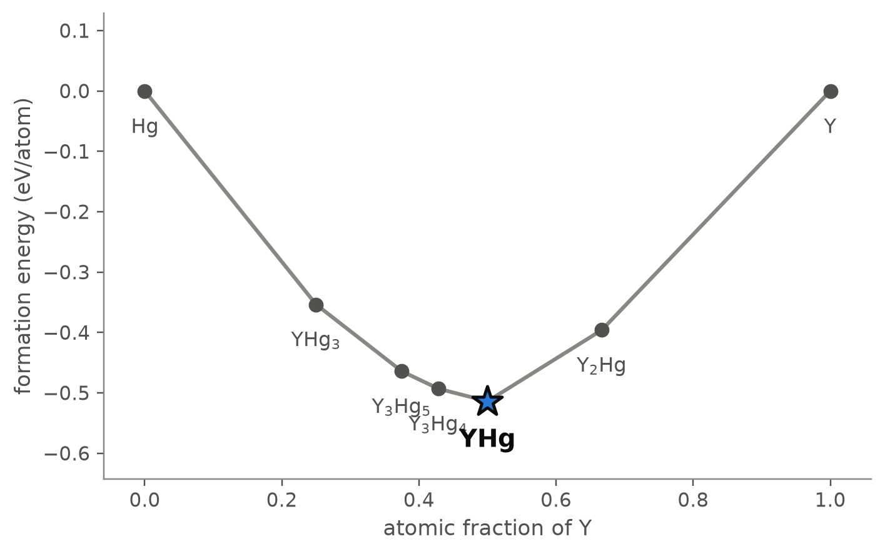
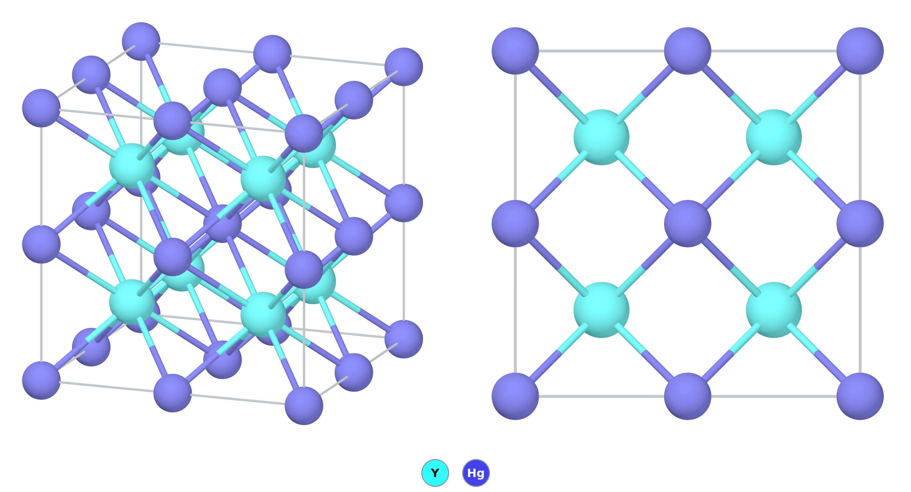
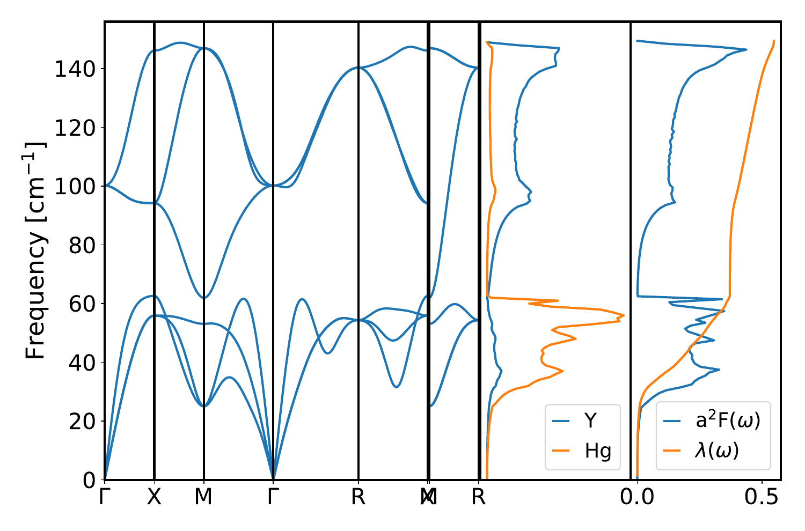

# YHg — a caesium-chloride-type mercuride of yttrium

*A Material a Day · entry 10 · 21 October 2026 · status: **known** (structure reported in 1962, 1963 and 1964)*

> **In one paragraph.** YHg is the 1 : 1 compound of yttrium and mercury. It has the
> caesium chloride (B2) structure: two interpenetrating simple cubic lattices, each atom
> at the centre of a cube of eight of the other kind. Three powder studies from 1962 to
> 1964 give a cubic cell of 3.677 to 3.682 Å, and the assessed phase diagram names it the
> most stable compound of the system. In the calculation YHg is the deepest point of the
> Y–Hg hull, 50 meV/atom below its neighbours, and its phonons are stable. PBE gets the
> cell 1.3 % too long and PBEsol 0.5 % too short, the same as for the other f-free
> mercurides of this type (1.0 to 1.8 % long in PBE). The computed formation energy,
> −0.51 eV/atom, is almost twice the −0.28 eV/atom derived from vapour-pressure
> measurements. The electron-phonon calculation gives a coupling λ = 0.53 and a critical
> temperature of about 1 K; we found no measurement of superconductivity in YHg. The
> calculated Y–Hg diagram does not match the assessed one: of the five compounds on the
> computed hull only YHg and YHg₃ are known, the reported YHg₂ falls just above it, and
> the calculation puts a compound, Y₂Hg, on the yttrium side, where none was found. YHg was
> first made from filed yttrium and mercury in sealed silica ampoules at about 550 °C; at
> atmospheric pressure it gives off mercury at 625 °C. Mercury and its vapour are toxic,
> and the rare-earth mercurides decompose in air.

Computed numbers come from the Alexandria database and from our lattice-dynamics
calculations; measured numbers carry a reference.

## 1. Identity

| | computed | measured |
|---|---|---|
| Formula | YHg | |
| Alexandria id | `agm001191397` | |
| Space group | Pm3̄m (no. 221), Z = 1 | Pm3̄m [1, 2, 4] |
| a (Å) | 3.729 (PBE); 3.661 (PBEsol); 3.666 (PBEsol cell of the phonon run) | 3.682 [1]; 3.677 [2]; 3.679 (1964, the value the assessment prefers) [4] |
| Y–Hg distance (Å) | 3.229 (PBE) | 3.186 (from a = 3.679 Å) |
| Density (g cm⁻³) | 9.27 (PBE) | |
| Structure type | CsCl (B2) | CsCl [1, 2, 4] |
| Formation energy (eV/atom) | −0.514 (PBE); −0.481 (Materials-Project settings) | −0.278 ± 0.022 (enthalpy, Y + liquid Hg, from vapour pressures at 429–505 °C) [4] |
| Homogeneity range | | within ±0.5 at.% [4] |
| Stability at 1 atm | | decomposes to α-Y + Hg vapour at 625 °C [4] |

The three measured cells agree to 0.005 Å; all are Debye–Scherrer powder films. Against
3.679 Å, PBE is 1.3 % too long and PBEsol 0.5 % too short: the usual pattern for the two
functionals. The same PBE error runs through the f-free members of the family:

| | ScHg | CaHg | YHg | LuHg | LaHg | BaHg |
|---|---|---|---|---|---|---|
| a, PBE (Å) | 3.528 | 3.794 | 3.729 | 3.649 | 3.918 | 4.206 |
| a, measured (Å) | 3.480 [2] | 3.758 [2] | 3.679 [4] | 3.607 [8] | 3.864 [8] | 4.133 [2] |
| PBE error | +1.4 % | +1.0 % | +1.3 % | +1.2 % | +1.4 % | +1.8 % |

YHg sits in the middle of that range, so nothing about its cell is unusual. The
error is larger for the mercury-richer phases: the stored PBE cell of YHg₃ is 1.8 % long
in a and 3.2 % in c against the single-crystal values a = 6.5443(5) Å, c = 4.8732(4) Å
[3], and the AlB₂-type cell of YHg₂ is 3.5 % long in a (4.946 against 4.779 Å) but
within 0.2 % in c (3.478 against 3.471 Å) [4]. The CIF is [`YHg.cif`](YHg.cif). No
Wikipedia page on the compound was found.

## 2. Where it sits

<picture>
  <source media="(prefers-color-scheme: dark)" srcset="phase_diagram_dark.png">
  
</picture>

The Y–Hg system at 0 K (PBE table). Seven phases are on the hull:

| phase | at.% Y | formation energy (eV/atom) | structure (database) | reported? |
|---|---|---|---|---|
| Hg | 0 | 0 | | |
| YHg₃ | 25 | −0.354 | Mg₃Cd type, P6₃/mmc | yes [2, 3, 4] |
| Y₃Hg₅ | 37.5 | −0.464 | Cmcm, 16 atoms | no [4] |
| Y₃Hg₄ | 42.9 | −0.493 | R3̄, 14 atoms | no [4] |
| **YHg** | 50 | −0.514 | CsCl | yes [1, 2, 4] |
| Y₂Hg | 66.7 | −0.396 | Pnma, 12 atoms | no: "no compound richer in Y than YHg" [4] |
| Y | 100 | 0 | | |

YHg lies 50 meV/atom below the line joining Y₃Hg₄ and Y₂Hg, and the minimum of the
hull falls exactly on it.

**The calculated diagram and the assessed one disagree.** The 1995 assessment of the
system [4], built on X-ray, metallographic, vapour-pressure and thermal-analysis work
from 1962 to 1966, lists four compounds, each with a homogeneity range within ±0.5 at.%:
YHg (CsCl type), YHg₂ (AlB₂ type), YHg₃ (Ni₃Sn type, the same arrangement as the Mg₃Cd
type of the database) and Y₁₁Hg₄₅ (Sm₁₁Cd₄₅ type, stable only below 70 °C). Against that
list:

- **YHg and YHg₃ agree.** Both are on the computed hull in the reported structures.
- **YHg₂ is just off the hull.** The lowest computed YHg₂, a hexagonal 6-atom cell, is
  3.1 meV/atom above the hull, and the reported AlB₂-type cell 24.5 above. It is above
  only because of the computed Y₃Hg₅: against YHg + YHg₃ alone the 6-atom cell is 17
  meV/atom below the tie line. The measured enthalpies [4] put YHg₂ 48 meV/atom below
  YHg + YHg₃ (section 5), though the assessment says they should be treated with caution.
- **Y₃Hg₅ and Y₃Hg₄ are not reported**, and they fall in the narrow composition range
  between YHg and YHg₂ where the experiments found no other phase.
- **Y₂Hg is the sharpest disagreement.** The calculation puts it 53 meV/atom below
  Y + YHg. The assessment found no compound richer in yttrium than YHg, and the 1963
  study, whose yttrium-rich charges were weighed at 3 : 1, saw YHg beside free yttrium
  and Y₂O₃ after annealing at about 550 °C [2]. Those were powder films of samples
  annealed once; a slow reaction or a phase forming only at lower temperature is not
  excluded, but no evidence for Y₂Hg exists.
- **Y₁₁Hg₄₅ is not in the database**: its 448-atom cubic cell has not been computed.

We did not check whether compounds of the Y₃Hg₅, Y₃Hg₄ or Y₂Hg types are known in other
rare-earth–mercury systems. The margins involved, 17 to 53 meV/atom, are below the
scatter of the computed formation energies of mercury compounds (section 5), so the
calculation can be wrong about all of them without being unusually wrong.

## 3. Structure

*Left: a 2 × 2 × 2 block, oblique view. Right: the same block along a cube axis. Only
the Y–Hg contacts are drawn.*

| site | Wyckoff | x, y, z | neighbours |
|---|---|---|---|
| Hg | 1a | 0, 0, 0 | 8 Y at 3.229 Å (cube), 6 Hg at 3.729 Å |
| Y | 1b | ½, ½, ½ | 8 Hg at 3.229 Å (cube), 6 Y at 3.729 Å |

- **Each atom sits in a cube of the other.** The structure is a body-centred cubic
  lattice with yttrium and mercury ordered on its two sublattices.
- **Charge goes from yttrium to mercury.** The stored Bader charges are +1.52 on Y and
  −1.52 on Hg (DDEC6 ±1.05). The single-crystal study of YHg₃ finds the same direction
  of transfer by a different partition, +1.59 on Y [3].
- **The only competing structure is close.** An orthorhombic CsCl-derivative, Cmcm with
  4 atoms (the CrB/TlI family), is 28 meV/atom higher in PBE, 30 with Materials-Project
  settings and 16 in SCAN. Every other YHg structure in the PBE table is more than 115
  meV/atom higher; the Materials-Project table holds two more, in Pnma (47) and Pbcm
  (72), which the PBE table does not have.
- **The family.** Mercurides of the CsCl type sit on the hull for most of the rare
  earths and for Mg, Ca, Ba, Li, Sc and Ac (all `energy_runs_pbe`, prototype
  `AB_cP2_221_a_b`, space group 221). The computed cell grows with the size of the
  partner: ScHg 3.528, LuHg 3.649, YHg 3.729, LaHg 3.918, BaHg 4.206 Å, each 1.0 to
  1.8 % above the measured cell (section 1). Measured cells of the CsCl-type mercurides
  of every rare earth from La to Lu are tabulated in [8]; across the trivalent ones they
  shrink linearly with the ionic radius, with europium and ytterbium standing out as
  divalent. Among the
  non-magnetic members, the depth below the neighbours ranges from 24 (MgHg) through 41
  (LaHg), 46 (CaHg), 50 (YHg) and 56 (ScHg) to 114 meV/atom (LuHg).

## 4. Properties

### Lattice dynamics and superconductivity

<picture>
  <source media="(prefers-color-scheme: dark)" srcset="phonons_dark.png">
  
</picture>

*Phonon dispersion, phonon density of states by element, and the Eliashberg function
α²F(ω) with the cumulative coupling λ(ω). Quantum ESPRESSO, density-functional
perturbation theory, PBEsol, on the PBEsol cell (a = 3.666 Å).*

| | computed (PBEsol) | measured |
|---|---|---|
| Dynamical stability | stable; no imaginary modes | |
| Top of the phonon spectrum | 148 cm⁻¹ (18 meV) | |
| Electron-phonon coupling λ | 0.53 | |
| Logarithmic average frequency ω_log | 85 K | |
| T_c, Allen–Dynes, μ* = 0.10 | 1.3 K | none found |
| T_c for μ* = 0.12, 0.14, 0.16 | 1.0, 0.7, 0.5 K | |

- **A soft lattice.** The mass ratio splits the spectrum: mercury carries the acoustic
  branches below about 63 cm⁻¹ and yttrium the optic branches from 62 to 148 cm⁻¹.
- **The heavy atom carries the coupling.** About 0.38 of the total λ = 0.53 (read
  from the figure) is collected below 63 cm⁻¹, in the mercury-dominated branches; the
  yttrium modes add the rest. The low ω_log is why a moderate coupling still gives only about 1 K.
- **Nothing to compare with.** The table of measured critical temperatures that sits
  beside our calculations has no entry for YHg, and our searches found no measurement.
  The nearest measured number is YHg₃, which becomes superconducting at 1.0 ± 0.1 K in
  specific heat and resistivity [3]. A measurement on YHg would test this estimate
  directly.
- **The estimate is isotropic** and the Coulomb parameter μ* is chosen, not computed.
- A graph-neural-network estimate from the structure alone gives λ = 0.53,
  ω_log = 85 K and T_c = 1.2 K. Agreement to the second digit suggests this
  calculation was in its training data, so it is not an independent check.

### Electronic

A non-magnetic metal in PBE, SCAN and MBJ (all three gaps zero). The density of states
at the Fermi level stored in the database is 1.75, in the range of the other
non-magnetic B2 mercurides (ScHg 1.76, CaHg 1.82, LaHg 2.54, LuHg 1.39). Gap,
dielectric and Seebeck quantities do not apply to a metal and are not quoted; the
transport tables are in `properties.json`.

### Mechanical (machine-learned)

| bulk modulus | shear modulus | Young's modulus | B/G |
|---|---|---|---|
| 65 GPa | 29 GPa | 75 GPa | 2.2 |

Screening estimates from a graph neural network; YHg is not in the database's table of
computed elastic constants. B/G above about 1.75 is the empirical (Pugh) sign of a
ductile metal. Several B2 compounds of yttrium and the rare earths, YAg and YCu among
them, are ductile at room temperature [5]; whether YHg is has, as far as we found,
not been measured, and an empirical ratio from predicted moduli does not settle it. A
2012 first-principles study of the elastic constants of YHg and its neighbours YCd,
YIn, YAu and YTl exists [6]; we read only its title.

### Not computed

Elastic constants by DFT, spin–orbit effects on the bands and phonons, the anisotropy
of the superconducting gap, any finite-temperature property (melting, vapour pressure
of mercury over the compound), defects and off-stoichiometry.

## 5. Is it stable?

On both hulls, with the same margin: 50.0 meV/atom below Y₃Hg₄ + Y₂Hg in PBE and 49.9
with Materials-Project settings. SCAN, evaluated at the PBEsol geometry, puts it 133
meV/atom below its neighbours. The phonons are stable.

**How much that margin is worth.** The calorimetric survey has no Y–Hg compound.
Mercury puts YHg in the "heavy p-block / noble" class, where computed formation
enthalpies disagree with measured ones by a median of 332 meV/atom with a scatter of
116 meV/atom (nine compounds). The scatter alone is twice the margin, so the
calculation does not settle the stability of YHg against its neighbours on its own.

**A measurement of the Y–Hg enthalpies exists**, outside the survey: vapour-pressure
measurements over yttrium amalgams (1965, tabulated in [4]) give, per mole of atoms and
from liquid mercury,

| | measured ΔH (kJ/mol) | measured (meV/atom) | computed, PBE (meV/atom) | computed − measured |
|---|---|---|---|---|
| YHg | −26.8 ± 2.1 | −278 ± 22 | −514 | −236 |
| YHg₂ | −26.2 ± 1.3 | −272 ± 13 | −424 (lowest cell) | −152 |
| YHg₃ | −19.0 ± 1.1 | −197 ± 11 | −354 | −157 |

The measured values are enthalpies over 284–505 °C, not at 0 K; referring them to solid
mercury moves them by about 10 meV/atom. With Materials-Project settings YHg comes out at
−481 meV/atom, 203 below the measurement. So the calculation binds every Y–Hg compound
by 150 to 240 meV/atom more than the measurement, the size of the class error above. The
assessment itself warns that these measured values should be treated with caution: they
are distinctly less exothermic than the lanthanide analogues suggest, and they make YHg
and YHg₂ almost equal in enthalpy although YHg survives to higher temperature [4]. Part
of the gap may therefore lie in the measurement.

What matters for the hull is the difference between neighbours, and there the two
disagree too: the measured enthalpies put YHg₂ 48 meV/atom below YHg + YHg₃, the
calculation 17 (and, with Y₃Hg₅ present, 3 above the hull). Both say YHg₂ should exist;
they differ by about 30 meV/atom, inside either error bar.

**What does settle it** is experiment: YHg was made and its structure determined three
times [1, 2, 4], and the assessment calls it the most stable compound of the system, the
last to give up mercury on heating (625 °C at 1 atm, against 530 °C for YHg₂ and 500 °C
for YHg₃) [4]. The experiment confirms the compound and leaves the calculation's three
extra neighbours (section 2), Y₂Hg above all, as the open question. The mercury
reference energy, which is unreliable with Materials-Project settings, does not enter
the margin: the competitors of YHg are two intermetallics, and the two PBE tables agree
to 0.1 meV/atom.

## 6. How to make it

### What is done

**As published for YHg** [2]:

- **Charge:** filed yttrium and mercury, weighed 3 : 1 in the yttrium-rich samples.
- **Container and heating:** sealed silica (quartz) ampoules, annealed at about 550 °C.
- **What happens:** the metals combine with considerable release of heat. The high
  reactivity of yttrium shifted the composition away from the weighed one.
- **Product:** YHg identified by powder X-ray film, beside free yttrium and Y₂O₃; the
  paper gives no yield or analysis.

The 1962 preparation [1] we know only from its database record. For the rare-earth
mercurides of the same type, fine metal powder was heated with mercury in closed
containers and gave homogeneous products; two were analysed as ErHg₁.₀₄ and TmHg₁.₀₁
[8]. Yttrium dissolves in liquid mercury only slightly: about 0.2 at.% at 150 °C, 1 at.%
at 284 °C and 2 at.% at 450 °C [4].

The most recent synthesis in the system, of YHg₃ single crystals, shows how yttrium
amalgams are handled today [3]:

- **Charge:** yttrium pieces and mercury, 5 : 95 by mass (excess mercury as a flux).
- **Container:** a tantalum tube, closed by arc welding inside an argon glovebox
  (H₂O and O₂ below 0.1 ppm), with the free volume kept small (about 5 cm³ for 10 g)
  so that no mercury is lost.
- **Heating:** to 500 °C, then cooling at 10 or 2 °C per hour; the excess mercury is
  removed by centrifuging at room temperature through an alumina strainer.
- **Handling:** the crystals decompose within minutes in air; every step is done in
  argon.

Combining the two, a 1 : 1 charge in sealed tantalum under argon, held below 625 °C,
should give YHg without the oxide seen in 1963; that is our inference, not a reported
procedure.

### What the calculation proposes

Reaction energies at 0 K, meV per atom of the whole charge. The eight closed routes all
use two reagents.

| route | charge | ΔE | comment |
|---|---|---|---|
| A (rank 1) | Y₂Hg + Y₃Hg₄ → 5 YHg | −50 | the two hull neighbours; neither is among the reported phases |
| B | 2 Y₂Hg + YHg₃ → 5 YHg | −131 | through the reported YHg₃ |
| C (rank 8) | Y + Hg → YHg | −481 | the elements; the only route from bottled reagents |
| D (metathesis) | YCl₃ + Hg + 3 Li → YHg + 3 LiCl | −349 | clean in the calculation |
| E (metathesis) | YF₃ + Hg + 1.5 Ca → YHg + 1.5 CaF₂ | −348 | clean in the calculation |
| F (metathesis) | 2 YCl₃ + 2 HgCl₂ + 10 Na → 2 YHg + 10 NaCl | −675 | clean; most of the energy goes into NaCl |
| G (metathesis) | YCl₃ + Hg + 1.5 Mg | −79 | **fails**: YMgHg₂ + Mg₂Hg + MgCl₂, two thirds of the YCl₃ unreacted |

- **Route C is the one to use.** The ranking (fewest reagents, then least driving force)
  puts it last because it is the most exothermic, but routes A and B need phases that
  are not reported or not available, and every synthesis we read, of YHg and of the
  other amalgams, starts from the metals [2, 3, 8]. The calculation's choice and the
  published practice agree.
- **Both ends of the window.** Mercury melts at −39 °C and boils at 357 °C; yttrium
  melts at 1526 °C. Bulk diffusion through solid yttrium (its Tammann temperature,
  about 630 °C) would need more heat than a mercury charge can take without a pressure
  vessel, but the solid need not diffuse into itself: it reacts with liquid mercury,
  and the published syntheses ran at about 550 °C (YHg [2]) and 500 °C (YHg₃ [3]).
  The top of the window is set by mercury loss: at 1 atm of mercury vapour YHg
  decomposes to α-yttrium and vapour at 625 °C [4]. A sealed tube with little free
  volume holds the mercury in and raises that limit, at the cost of pressure, which
  rises steeply above 357 °C. The 0 K hull cannot see this limit; it is entropy of the
  vapour.
- **The composition window.** At 1000 °C the chemical-potential window over which YHg
  stays within 25 meV/atom of the lowest assemblage is 0.72 eV in μ_Y and 0.71 eV in
  μ_Hg. The measured homogeneity range is narrow, within ±0.5 at.% [4], so small
  weighing errors give YHg plus a little of a neighbour, not a shifted composition. On
  the yttrium side that neighbour is yttrium metal in experiment [2, 4] and Y₂Hg in the
  calculation.
- **Metathesis works on paper but not in the wash.** Lithium, sodium and calcium
  reduce the halides cleanly to YHg and a salt; magnesium does not, because it forms
  its own mercurides and YMgHg₂ instead (route G). The salt cannot be washed out with
  water: the calculation gives −435 meV/atom for YHg + H₂O, and the related YHg₃
  decomposes in moist air [3]. LiCl, NaCl and CaF₂ are all inert to YHg at 0 K, so
  they could serve as a flux, but separation would need a dry solvent or distillation.
  Lithium and sodium also form amalgams of their own; at equilibrium the charge ends
  as YHg and the salt, but a real reaction may stall at those amalgams. We did
  not search for whether any of these routes has been tried.

### What it tolerates

| inert in the calculation | reacts |
|---|---|
| Ta, Nb, Mo, W, Fe, Cr, Ti, Zr | O₂ (→ Y₂O₃ + HgO), N₂, H₂, H₂O, CO₂ |
| Y₂O₃ | Al₂O₃ (−87, → Y₃Al₅O₁₂ + Al + Hg), MgO (−79), ZrO₂ (−112), SiO₂ (−283), CaO, BeO, BN, AlN, SiC, Si₃N₄, graphite (−12) |
| LiCl, NaCl, KCl, RbCl, CsCl, CaCl₂, BaCl₂, LiF, NaF, NaBr, KBr, NaI, KI | KF, MgCl₂, carbonate, sulfate, nitrate and borate fluxes |
| | Pt, Pd, Au, Ag, Cu, Ni, Co, Ir, Rh, Ru, Al, Si, Sn, Zn, Pb |

- **Tantalum is right.** The calculation puts tantalum, niobium, molybdenum, tungsten
  and iron on tie lines with YHg, and tantalum is what is used [3, 8].
- **Silica is not.** The 1963 preparation used sealed silica ampoules at about 550 °C
  and found Y₂O₃ in its samples [2]. The calculation has SiO₂ reacting with YHg (−283
  meV/atom). The paper does not say where the oxide came from; oxide on the filings is
  as likely a source as the ampoule.
- **Not alumina, hot.** Alumina reacts with YHg in the calculation, and so does every
  common oxide ceramic except yttria. The alumina strainer of [3] is used at room
  temperature only.
- **Not the noble metals.** Gold, silver, copper and the platinum metals all react; no
  gold seals or platinum thermocouples in contact.

### Powder pattern

Computed, Cu Kα, PBE cell:

| 2θ (°) | 23.87 | 34.00 | 41.97 | 48.85 | 55.08 | 60.86 |
|---|---|---|---|---|---|---|
| hkl | 100 | 110 | 111 | 200 | 210 | 211 |
| I | 16 | 100 | 6 | 18 | 8 | 38 |

With the measured cell (3.679 Å) the strongest line, 110, falls at 34.45°, not 34.00°;
the 1963 film has it at sin²θ = 0.0874, 2θ = 34.4° [2]. The 100, 111 and 210 lines are
the superstructure lines of the ordered B2 arrangement. On that film the 100 line was
seen as weak and 111 as very weak, matching the intensities calculated for the ordered
structure, and the authors took the odd and even reflections as direct confirmation of
it [2]. For the rare-earth mercurides in general, X-ray intensities barely distinguish
ordered from disordered, and neutron diffraction on TbHg settled it in favour of order
[8]. The estimated intensities of 1963 (110 very strong, 211 strong, 200 and 100 weak)
follow the computed ones above.

- **Extra lines of YHg₃ or YHg₂:** the batch is mercury-rich, or mercury was not all
  taken up.
- **Lines of yttrium or of a yttrium-rich phase (Y₂Hg in the calculation):** mercury
  was lost from the tube.
- **Y₂O₃ lines:** oxygen got in, as in the 1963 samples [2].

### Hazards

Mercury is toxic, above all as vapour, and a sealed tube heated above 357 °C is under
pressure; above 625 °C YHg itself gives off mercury vapour [4]. YHg₃ decomposes within
minutes in air [3], and the CsCl-type mercurides of the rare earths decompose in air
[8], releasing mercury.
Glovebox handling, a containment vessel for the heating and mercury-safe waste
disposal are needed.

## 7. What it is used for

We found no use for YHg. It is of interest as a member of the large family of B2
rare-earth intermetallics, some of which are unusually ductile [5], and as a reference
compound in a system whose phase diagram is still incomplete [3, 4]. The CsCl-type
mercurides served in the 1960s as a series in which to measure the size of the rare-earth
atoms, their cells shrinking regularly with the trivalent ionic radius [8]. Rare-earth amalgams,
yttrium's among them, were prepared electrolytically in the 1930s, and some were
decomposed by heat to obtain the metals [7]; we read only the title of that work.

## 8. How this could be wrong

- **The hull of this system is uncertain.** The class error (116 meV/atom of scatter)
  is larger than the margin (50 meV/atom), and the calculation proposes three
  compounds that the assessed diagram does not have [4], one of them (Y₂Hg) where
  experiment found none. YHg itself is confirmed by experiment; its neighbours in the
  calculation are probably not the real ones, and route A depends on them.
- **The measured enthalpies are old and doubted.** They come from vapour pressures at
  284–505 °C (1965), and the assessment itself questions them [4]. The comparison in
  section 5 shows that the calculation and the measurement differ by 150–240 meV/atom,
  not which of the two is wrong.
- **The 1962 paper was not read** [1]; its cell comes from the database record and the
  assessment [4], which agree. The 1964 cell that the assessment prefers is known to us
  only from its table.
- **The measured cells are from powder films** read in kX units and converted (1963), so
  the 0.005 Å spread between them is the honest uncertainty, not the ±0.003 Å quoted for
  the lanthanide series [8].
- **The critical temperature is untested.** No measurement was found. The estimate is
  isotropic, with a chosen μ*, on a PBEsol cell 0.4 % smaller than the measured one.
- **Two functionals are mixed:** phonons in PBEsol, energies in PBE.
- **Metathesis and air sensitivity:** the routes D–F ignore the solubility of the
  alkali metals in mercury and the problem of separating the salt; the air sensitivity
  of YHg is inferred from the calculation, from YHg₃ and from the lanthanide
  mercurides, not measured on YHg.

## 9. Literature

**Searched (OpenAlex, Crossref, arXiv), 18 October 2026:** "YHg yttrium mercury
intermetallic compound" (one relevant hit, [3]); "Die Kristallstrukturen von ScHg,
ScHg3, YCd, YHg und YHg3" ([2]); "Hg-Y phase diagram yttrium-mercury system" ([4]);
"rare earth mercury compounds RHg CsCl type" ([8]); "ductile B2 rare earth
intermetallic compounds YAg YCu" ([5]); "YHg superconductivity OR electronic structure
CsCl yttrium mercuride" (only [3]); "first-principles rare earth mercury intermetallics
RHg B2 elastic ductility" (nothing); "YHg elastic properties first principles" ([6]);
"yttrium amalgam" (electrolytic preparation of rare-earth amalgams, 1934, and vapour
pressures over yttrium amalgams, 1965; titles only); "ScHg YHg LuHg CsCl-type mercury
compounds electronic structure" (only [3]). Papers [2], [4] and [8] were obtained and
read in full afterwards. No report of a measured critical temperature or elastic
constant of YHg was found; its formation enthalpy and decomposition temperature are
known from the work assessed in [4], which we did not read at first hand.

1. G. Bruzzone, A. F. Ruggiero, "Struttura di alcuni composti intermetallici
   dell'ittrio", *Atti Accad. Naz. Lincei, Rend. Cl. Sci. Fis. Mat. Nat.* 33, 312
   (1962), a = 3.682 Å — *Crystallography Open Database entry 1523310,
   https://www.crystallography.net/cod/1523310.html; database record read, and the
   cell as tabulated in [4]; not the paper.*
2. E. Laube, H. Nowotny, "Die Kristallstrukturen von ScHg, ScHg₃, YCd, YHg und YHg₃",
   *Monatsh. Chem.* 94, 851 (1963). doi:10.1007/BF00902359 (Crystallography Open
   Database entry 1538589) — *full text read.*
3. K. Witthaut, Y. Prots, N. Zaremba *et al.*, "Chemical and physical properties of
   YHg₃ and LuHg₃", *ACS Org. Inorg. Au* 3, 143 (2023). doi:10.1021/acsorginorgau.2c00048
   — *full text read (open copy in PubMed Central, PMC10251501).*
4. C. Gumiński, "The Hg-Y (mercury-yttrium) system", *J. Phase Equilib.* 16, 277
   (1995). doi:10.1007/BF02667314 — *full text read.* The 1964 cell, the 1965
   vapour-pressure enthalpies and the decomposition temperatures are quoted from its
   tables; the original papers (Kirchmayr 1964; Kirchmayr and Jangg 1965; Kirchmayr and
   Lugscheider 1966) were not retrieved.
5. K. A. Gschneidner Jr *et al.*, "A family of ductile intermetallic compounds",
   *Nature Mater.* 2, 587 (2003). doi:10.1038/nmat958 — *abstract read.*
6. S. S. Chouhan, G. Pagare, M. Rajagopalan *et al.*, "First principles study of
   structural, electronic, elastic and thermal properties of YX (X = Cd, In, Au, Hg and
   Tl) intermetallics", *Solid State Sci.* (2012).
   doi:10.1016/j.solidstatesciences.2012.05.005 — *metadata only.*
7. E. E. Jukkola, L. F. Audrieth, B. S. Hopkins, "Observations on the rare earths. XLI.
   Electrolytic preparation of rare earth amalgams. 3. Amalgams of lanthanum,
   neodymium, cerium, samarium and yttrium. Metallic lanthanum, neodymium and cerium by
   thermal decomposition of their amalgams", *J. Am. Chem. Soc.* 56, 303 (1934).
   doi:10.1021/ja01317a010 — *metadata only.*
8. A. Iandelli, A. Palenzona, "Atomic size of rare earths in intermetallic compounds.
   MX compounds of CsCl type", *J. Less-Common Met.* 9, 1 (1965).
   doi:10.1016/0022-5088(65)90028-7 — *full text read.* It covers the lanthanides,
   not yttrium.

## 10. Provenance

- **Data:** Alexandria database, tables `energy_runs_pbe`, `energy_runs_pbe_mp`,
  `energy_runs_ps` and `energy_runs_scan` (SCAN at the PBEsol geometry), and
  `energy_runs_mbj` for the gap; the group's phonon and electron-phonon calculations
  (Quantum ESPRESSO, PBEsol); measured cells, enthalpies and phase relations from the
  Crystallography Open Database and from [2], [4] and [8].
  Reaction energies, contact reactions and chemical-potential windows come from the
  hull and reaction table built on `pbe_mp`.
- **Tools:** the reaction-route code of this group, pymatgen, POV-Ray; machine-learned
  moduli and T_c from graph neural networks.
- **Authorship:** drafted by Claude (Anthropic) from those tools; reviewed by
  Miguel Marques. Corrections are welcome as issues on this repository.
