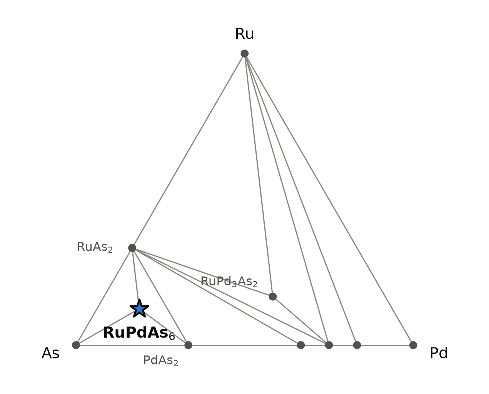
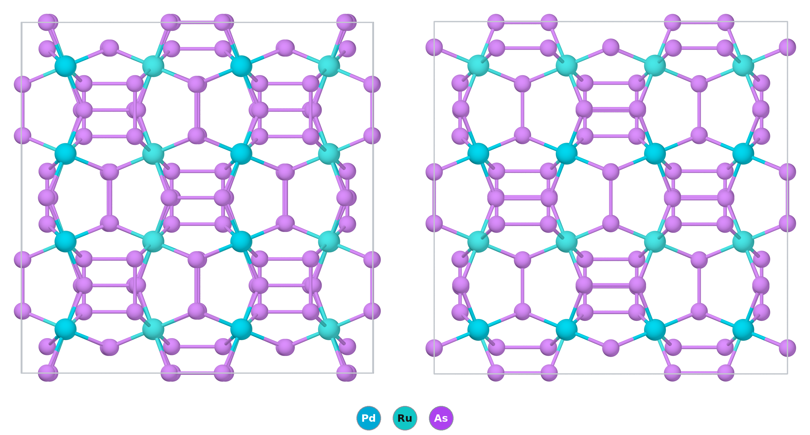

# RuPdAs₆ — a skutterudite arsenide in which ruthenium and palladium share the work of cobalt

*A Material a Day · entry 11 · 22 October 2026 · status: **predicted, no report found** (the antimonide Ru₀.₅Pd₀.₅Sb₃ is known)*

> **In one paragraph.** RuPdAs₆ is the arsenide of the skutterudite family, CoAs₃, with
> the cobalt replaced half by ruthenium and half by palladium. Ruthenium has one
> electron fewer than cobalt's group and palladium one more, so the pair counts like
> two cobalt atoms; the same trick gives the known antimonide Ru₀.₅Pd₀.₅Sb₃, a cubic
> skutterudite measured as a narrow-gap semiconductor. In the calculation the arsenide
> is a framework of corner-sharing MAs₆ octahedra around square As₄ rings, with the
> ruthenium and the palladium ordered in alternating columns, and it lies 23 meV/atom
> below PdAs₂ + RuAs₂ + As, less than the error that this class of compound carries.
> We found no report of it. If it exists it should be made the way the antimonide and
> the binary arsenides were, from the elements in an evacuated silica tube held for
> days to weeks at 600–900 °C; the ordering of the two metals is the least certain
> part, because a furnace may well give a random distribution instead, and the ordering
> adds no line to an X-ray powder pattern.

Computed numbers come from the Alexandria database; measured numbers carry a reference.

## 1. Identity

| | computed (PBE) | expected from the family |
|---|---|---|
| Formula | RuPdAs₆ (stored as As₆PdRu; Ru₀.₅Pd₀.₅As₃ in the notation of [1]) | |
| Alexandria id | `agm069759364` | |
| Space group | C2/m (no. 12), Z = 4 | Im3̄ if Ru and Pd are disordered, as in the antimonide [1] |
| Cell (C2/m) | a = 12.183, b = 8.625, c = 8.618 Å, β = 134.92° | |
| Pseudo-cubic cell | 8.627 × 8.625 × 8.618 Å, one angle 90.10° | a ≈ 8.50–8.56 Å (see below) |
| Volume per formula unit | 160.3 ų | |
| Density | 6.81 g cm⁻³ | |
| Structure type | skutterudite (CoAs₃), with Ru and Pd ordered on the metal site | |
| Formation energy | −0.286 eV/atom | |

- **The cell is cubic in all but name.** The C2/m cell holds 32 atoms, exactly one
  cubic skutterudite cell; re-expressed in cubic axes it has edges equal to 0.1 % and
  angles within 0.1° of 90°. The lower symmetry comes only from the ordering of Ru and
  Pd.
- **How long PBE makes such cells.** For the binary arsenides and Fe₀.₅Ni₀.₅Sb₃
  measured by Kjekshus and Rakke [3], for the antimonide of the same pair [1], and for
  Fe₀.₅Ni₀.₅As₃ as listed in [1]; the mixed compounds are compared with the same
  ordered C2/m cell as RuPdAs₆, in its pseudo-cubic edge:

  | compound | PBE a (Å) | measured a (Å) | PBE too long by |
  |---|---|---|---|
  | CoAs₃ | 8.269 | 8.2055 [3] | 0.8 % |
  | RhAs₃ | 8.569 | 8.4507 [3] | 1.4 % |
  | IrAs₃ | 8.590 | 8.4673 [3] | 1.5 % |
  | FeNiAs₆ / Fe₀.₅Ni₀.₅As₃ | 8.313 | 8.256 (listed in [1]) | 0.7 % |
  | FeNiSb₆ / Fe₀.₅Ni₀.₅Sb₃ | 9.158 | 9.0904 [3] | 0.7 % |
  | RuPdSb₆ / Ru₀.₅Pd₀.₅Sb₃ | 9.426 | 9.298 [1] | 1.4 % |

  Applying the same 0.7–1.5 % to RuPdAs₆ gives a cubic edge of about 8.50–8.56 Å,
  close to RhAs₃, the binary it is derived from. That is an estimate, not a
  measurement. The 4d and 5d compounds (Rh, Ir, Ru–Pd) sit at the long end.

No Wikipedia page is about this compound. The CIF is [`As6PdRu.cif`](As6PdRu.cif)
(the database's C2/m cell); all numbers are in [`structure.json`](structure.json).

## 2. Where it sits

<picture>
  <source media="(prefers-color-scheme: dark)" srcset="phase_diagram_dark.png">
  
</picture>

The Ru–Pd–As system at 0 K (PBE table). The three unlabelled points on the As–Pd edge
are, from left to right, Pd₂As, Pd₃As and Pd₅As.

| phase | formation energy (eV/atom) | note |
|---|---|---|
| As | 0 | |
| **RuPdAs₆** | −0.286 | 22.8 meV/atom below PdAs₂ + RuAs₂ + As |
| PdAs₂ | −0.318 | pyrite type |
| RuAs₂ | −0.383 | marcasite type |
| RuPd₃As₂ | −0.331 | the only other ternary on the computed hull; not examined |
| Pd₂As, Pd₃As, Pd₅As | −0.363, −0.352, −0.261 | |
| Pd, Ru | 0 | |

- **Neighbours.** RuPdAs₆ sits in the arsenic-rich corner, inside the triangle
  PdAs₂–RuAs₂–As, which it splits into three. It shares a tie line with each of the
  three.
- **The arsenic-richest phase containing both metals.** Every other ternary entry of
  the system is poorer in arsenic, and apart from RuPd₃As₂ all lie 97 meV/atom or more
  above the hull.
- **Only one arrangement of Ru and Pd was computed.** The database holds no other
  ordering of this composition, so the calculation does not say whether this ordering
  is the best one, only that it is below the binaries.

## 3. Structure

*A 2 × 2 × 2 block of the pseudo-cubic cell, seen along two cubic axes. Ruthenium is
turquoise, palladium blue (the two colours are close: in the left view the palladium
atoms are the first and third columns), arsenic violet. The rectangles are the As₄
rings; the large empty octagons are the cages that filled skutterudites put a cation
in.*

| site (C2/m) | Wyckoff | neighbours (PBE) |
|---|---|---|
| Ru | 4e | 6 As at 2.446–2.459 Å (octahedron) |
| Pd | 4f | 6 As at 2.513–2.527 Å (octahedron) |
| As (four sites) | 4i, 4i, 8j, 8j | 2 metals and 2 As: one As at 2.52–2.53 Å, one at 2.60–2.61 Å |

- **The skutterudite framework.** Each metal sits in an octahedron of arsenic, the
  octahedra share corners and are tilted so strongly that the arsenic atoms meet in
  near-square As₄ rings (sides 2.52 and 2.60 Å). The ring is the defining unit of the
  type: formally [As₄]⁴⁻, which leaves the metal with an average charge of +3, as for
  cobalt in CoAs₃.
- **The bonds, calibrated.** Kjekshus and Rakke measured the bond lengths of the binary
  arsenides [3]; PBE on the same compounds:

  | compound | M–As, PBE / measured (Å) | As–As short, PBE / measured | As–As long, PBE / measured |
  |---|---|---|---|
  | CoAs₃ | 2.345 / 2.337 | 2.512 / 2.478 | 2.626 / 2.560 |
  | RhAs₃ | 2.466 / 2.434 | 2.515 / 2.468 | 2.600 / 2.569 |
  | IrAs₃ | 2.473 / 2.441 | 2.507 / 2.456 | 2.614 / 2.574 |
  | RuPdAs₆ | Ru 2.45, Pd 2.52 / — | 2.52 / — | 2.60 / — |

  PBE makes the metal–arsenic bonds 0.3–1.3 % too long and the As–As bonds 1.2–2.6 %
  too long. The difference between the two ring sides, which [3] found constant at
  0.10 ± 0.02 Å across the family, is 0.08 Å in RuPdAs₆ (0.09–0.11 Å for the PBE
  binaries). The mean metal–arsenic distance, 2.49 Å, is 0.02 Å longer than PBE gives
  RhAs₃.
- **Why ruthenium and palladium.** Ruthenium is in group 8 and palladium in group 10.
  As formal ions, Ru²⁺ and Pd⁴⁺ both have six d electrons, the count of Co³⁺ and Rh³⁺
  in the binary skutterudites, so the pair keeps the electron count of the parent.
  This is bookkeeping: the computed charges on all atoms are within 0.2 e of zero. In
  the antimonide the microprobe found a composition shifted from the ideal one (Ru
  12.0, Pd 10.5, Sb 77.5 at.%, against 12.5/12.5/75), and [1] proposed that about half
  the ruthenium becomes Ru⁴⁺ to compensate; the later X-ray absorption study found
  Ru²⁺ and Ru⁴⁺ in about equal amounts [2].
- **The ordering.** The eight metal sites of a cubic cell form a simple cubic lattice
  with an edge of half the cell. In the stored structure the palladium atoms form
  straight chains along one cubic axis, and the ruthenium atoms the chains between
  them: each metal has two neighbours of its own kind (along the chain) and four of the
  other, all at 4.31 Å. The palladium octahedra are 0.07 Å larger than the ruthenium
  ones.
- **The family.** The same C2/m arrangement is on the PBE hull for 22 compositions,
  almost all a group-8 metal paired with a group-10 metal: FeNiAs₆, FePdAs₆, OsPdAs₆,
  OsPtAs₆, RuPtAs₆, NiOsAs₆ among the arsenides, the antimonides of the same pairs,
  FeNiP₆. For the group-8/group-10 pairs the depths below the binaries run from 16 to
  50 meV/atom, and each antimonide is deeper than the arsenide of the same pair
  (RuPdSb₆ 37, RuPdAs₆ 23). The one pair of the same
  group, IrRhAs₆, is 0.9 meV/atom deep, which is what an ordering of two
  interchangeable metals should give. Three members are reported, all as cubic
  skutterudites without detected order: Ru₀.₅Pd₀.₅Sb₃ [1,2], Fe₀.₅Ni₀.₅Sb₃ [3,4], and
  one arsenide, Fe₀.₅Ni₀.₅As₃, which [1] lists with a = 8.256 Å from a 1962 paper we
  have not retrieved. We did not check the others.

## 4. Computed properties

### Electronic structure

| | indirect gap (eV) | direct gap (eV) |
|---|---|---|
| PBE | 0.02 | 0.05 |
| machine-learned, PBE cell | 0.00 | |

- **A semimetal or a very narrow-gap semiconductor in PBE.** No MBJ, SCAN or PBEsol
  calculation of this compound is in the database.
- **The antimonide calibrates it.** PBE gives RuPdSb₆ (same ordering) a gap of
  0.14 eV, against about 0.6 eV for the real Ru₀.₅Pd₀.₅Sb₃ [1], four times more. If
  PBE errs by a similar amount here, the arsenide would be a semiconductor with a gap of
  some tenths of an eV. That is an inference by analogy, and the measured value is
  itself an estimate: the slope of the Hall coefficient above 500 K, on p-type samples
  with 1.75 × 10²⁰ holes cm⁻³ [1].
- Non-magnetic in PBE. Spin–orbit coupling is not included.

### Dielectric response and transport

The dielectric table has no entry for this compound. The transport table gives Seebeck
coefficients that change sign with direction and carrier type, the signature of a band
gap too small for one carrier to dominate; we do not quote them. Effective masses and
the branch point were not computed.

### Mechanical (machine-learned, PBE cell)

| bulk modulus | shear modulus | Young's modulus |
|---|---|---|
| 116 GPa | 93 GPa | 159 GPa |

Screening estimates from a graph neural network. The antimonide calibrates them. [1]
measured sound velocities of 3.91 km s⁻¹ (longitudinal) and 2.39 km s⁻¹ (shear) on a
hot-pressed pellet of density 7.41 g cm⁻³ (96 % of the X-ray density); from these,
by our arithmetic:

| Ru₀.₅Pd₀.₅Sb₃ | bulk | shear | Young's |
|---|---|---|---|
| from the sound velocities of [1] | 57 GPa | 42 GPa | 102 GPa |
| machine-learned, ordered PBE cell | 86 GPa | 41 GPa | 126 GPa |
| off by | +51 % | −3 % | +24 % |

The pellet's porosity lowers the measured values somewhat, but not by half. The shear
modulus is matched; the bulk modulus is not. For the arsenide, read the shear modulus
as the more trustworthy number. For scale, the Young's modulus of CoSb₃ measured by
ultrasound and nano-indentation is 148 GPa [6]; the arsenide, with shorter bonds,
would be expected to be stiffer than the antimonide.

### Not computed

Phonons (the group's lattice-dynamics set has neither this compound nor the antimonide),
elastic constants, the dielectric tensor, other orderings of Ru and Pd, the disordered
alloy, anything with spin–orbit coupling.

## 5. Is it stable?

| table | competitors | depth (meV/atom) |
|---|---|---|
| PBE (`energy_runs_pbe`) | PdAs₂ + RuAs₂ + As | 22.8 |
| Materials-Project settings (`pbe_mp`) | the same | 19.9 |
| PBEsol, SCAN | not computed | |

- **On both hulls, and the two agree to 3 meV/atom.**
- **The margin is not resolved.** Our comparison of computed and measured formation
  enthalpies contains no arsenide. The nearest classes scatter by 83 meV/atom (sulfides,
  median absolute deviation) and 116 meV/atom (heavy p-block and noble-metal compounds).
  A margin of 20–23 meV/atom is smaller than either. The hull says the compound is
  plausible; it cannot say that it is stable.
- **The family supports it, with the same caveat.** Twenty-two members of the ordered
  family are on the PBE hull, the antimonide of the same pair exists [1], and so does
  one arsenide of the family, Fe₀.₅Ni₀.₅As₃ (computed 43 meV/atom deep). That the
  antimonide is computed deeper (37 meV/atom) than the arsenide is a reason to expect
  the arsenide to be harder to make, not impossible.
- **Ordered or disordered.** A random distribution of Ru and Pd gains configurational
  entropy. For an ideal mixture of two metals on the metal site this is kT ln 2 per
  metal atom, about 13 meV per atom of RuPdAs₆ at 900 K (our arithmetic). Whether the
  ordered structure survives at the synthesis temperature depends on how far it lies
  below the disordered one, which was not computed. The antimonide was indexed cubic,
  Im3̄ [1], and was made at 870 K, below the 920 K at which it decomposes. As section 6
  explains, its powder pattern could not have shown this ordering, so whether it is
  ordered is open.
- **Favourable is not fast.** All of this is 0 K thermodynamics.

## 6. How to make it

### What the calculation proposes

Reaction energies at 0 K from the reaction table (Materials-Project settings), meV per
atom of the whole charge. Twelve exact routes exist; the first three by R6 (fewest
reagents, then least driving force), the elements, and the metatheses:

| route | charge | ΔE | comment |
|---|---|---|---|
| A | PdAs₂ + RuAs₂ + 2 As | −20 | first by R6; the decomposition read backwards, so it gives no selectivity beyond the margin of section 5 |
| B | ½ Pd₂As + RuAs₂ + 3½ As | −72 | |
| C | ⅓ Pd₃As + RuAs₂ + 3⅔ As | −81 | |
| D | Ru + Pd + 6 As | −288 | the elements; the only route whose reagents are all bought |
| E (metathesis) | PdCl₂ + RuCl₃ + 5 NaAs + As | −717 | clean: RuPdAs₆ + 5 NaCl |
| F (metathesis) | PdCl₂ + RuCl₃ + 5/3 Li₃As + 13/3 As | −683 | clean: RuPdAs₆ + 5 LiCl |
| G (metathesis) | PdCl₂ + RuCl₃ + 5/6 Mg₃As₂ + 13/3 As | −648 | clean: RuPdAs₆ + 2.5 MgCl₂ |

- **Metathesis works on paper.** All three charges end at the target and a chloride,
  and NaCl, LiCl and MgCl₂ share tie lines with RuPdAs₆, so the salt neither attacks the
  product nor needs to leave before it forms; it washes out with water. The driving
  forces are thirty times the margin, which is poor selectivity by R6, and the alkali
  arsenides are air-sensitive and not bought. We did not search for whether such a
  route has been tried on any skutterudite.
- **No reservoir route is needed:** closed routes exist.

### How the relatives were made

| compound | charge | container | schedule | source |
|---|---|---|---|---|
| Ru₀.₅Pd₀.₅Sb₃ | Ru (99.997 %), Pd (99.9 %), Sb (99.9999 %) powders, stoichiometric, cold-pressed into pellets | silica ampoule, evacuated to 10⁻⁵ Torr | 8 days at about 870 K, regrind, 4 more days at 870 K; then hot-pressed in graphite at 770 K, 4 h | [1] |
| CoAs₃ | the elements, stoichiometric, As 99.9999 % | evacuated, sealed silica | 3 weeks at 800 °C, crush, 1 more week, cool to room temperature over 2 weeks | [3] |
| RhAs₃, IrAs₃ | the same | the same | the same at 900 °C | [3] |

- **The antimonide** came out single phase by X-rays and microprobe, but Pd-poor and
  Sb-rich (12.0/10.5/77.5 at.%). It decomposes at 920 ± 10 K (DTA); held above that in
  silica it loses antimony towards Ru₀.₅Pd₀.₅Sb₂ [1]. Its measured cell is 1.4 % shorter
  than PBE (section 1).
- **The hull agrees with the practice.** The route used for all of these is the
  elements in a sealed tube, route D in the table above, the only one whose reagents
  are all bought. Nobody started from the binaries (route A) or from a metathesis.

### In practice (our proposal for the arsenide; no published synthesis of it was found)

- **Reagents:** ruthenium powder, palladium powder and arsenic in the ratio
  1 : 1 : 6, cold-pressed into pellets as in [1], with a few per cent of excess
  arsenic. Starting from pre-made PdAs₂ and RuAs₂ (route A) is an alternative that
  keeps the arsenic pressure lower.
- **Container:** an evacuated, sealed silica ampoule. Silica, alumina, graphite and
  boron nitride share tie lines with the target. Platinum does not (−222 meV/atom, to
  PtAs₂), nor do tantalum, niobium or any of the metals tested.
- **Upper end of the window.** Arsenic sublimes at 887 K (614 °C), so the charge works
  against arsenic vapour, and the pressure in the ampoule rises with temperature. The
  antimonide decomposes at 920 K [1], while the binary arsenides were annealed for weeks
  at 800–900 °C [3]; no decomposition temperature of the arsenide is known. The arsenic-poor limit is set by PdAs₂ + RuAs₂: in the calculation
  the target is the phase obtained from μ_As = −0.18 eV (relative to solid arsenic)
  upwards, and the window is open on the arsenic-rich side. Excess arsenic is safe;
  loss of arsenic is what destroys it.
- **Lower end.** The Tammann temperature of ruthenium is 1304 K, far above any
  sensible firing temperature, so bulk diffusion through ruthenium will not do the
  work; arsenic vapour reaching the metal surfaces must. Expect the binaries RuAs₂ and
  PdAs₂ to form first and the slow step to be their reaction with each other.
- **A plausible schedule** is slow heating through 600 °C, one to two weeks at about
  600 °C (the 870 K of the antimonide), regrinding and annealing again. If PdAs₂ and
  RuAs₂ remain, raise the temperature in steps towards the 800 °C used for CoAs₃,
  checking each step by X-rays for the binaries, the sign that the compound is above
  its decomposition. Each temperature is borrowed from [1] or [3]; none has been
  tried on this composition.
- **Ordering.** If the Ru–Pd order of the calculation exists, a long anneal at the low
  end of the window is the only way to approach it.

### What it tolerates

| inert in the calculation | reacts |
|---|---|
| SiO₂, Al₂O₃, ZrO₂, MgO, BN, AlN, Si₃N₄, SiC, graphite | oxygen (→ PdAs₂ + RuAs₂ + As₂O₃, −721 meV/atom), hydrogen, nitrogen (weakly) |
| Au, Ag, Cu | Pt, Ti, Zr, Nb, Ta, Mo, W (weakly), Co, Ni, Fe, Ru, Pd, Rh, Ir |
| alkali halides, CaCl₂, MgCl₂, BaCl₂, carbonates, B₂O₃, borax, Na₂WO₄ | nitrate melts, Na₂MoO₄ and Na₂SO₄ (weakly) |

### Powder pattern

Cu Kα, PBE cell. The pattern is that of a cubic skutterudite; the reflections are
indexed below in the pseudo-cubic cell.

| hkl (cubic) | 200 | 220 | 310 | 420 | 422 |
|---|---|---|---|---|---|
| 2θ (°), PBE cell | 20.6 | 29.3 | 32.8 | 47.1 | 51.9 |
| relative I | 34 | 23 | 100 | 44 | 27 |

- **With the expected cell** (8.50–8.56 Å) every line moves up by about 1 %: the
  strongest to near 33.2°. The measured pattern of the antimonide [1] has the same
  strongest line, 310.
- **The ordering adds no line.** The ordered cell keeps the body-centred lattice of the
  cubic one: every reflection of the computed pattern falls on a reflection allowed in
  Im3̄ (we checked to 70°). The ordering only changes the intensities of lines already
  there, by an amount set by the two electrons between Ru (44) and Pd (46), and splits
  them by less than 0.1°. This is why the cubic indexing of all 31 lines of the
  antimonide [1] does not settle whether Ru and Pd order there. Deciding would need
  neutrons, anomalous scattering near an absorption edge, or a local probe.
- **Lines of PdAs₂ (pyrite) and RuAs₂ (marcasite):** arsenic lost, or the binaries did
  not react with each other.
- **Lines of arsenic:** the excess, which can be sublimed off below the firing
  temperature.
- **Only RuAs₂ with a palladium arsenide richer in Pd:** far too little arsenic.

### Hazards

Arsenic and its compounds are toxic and carcinogenic. Work in a fume hood and weigh in a
glovebox or under extraction. A sealed ampoule containing arsenic is under pressure
above 600 °C and can burst; heat it in a protective container. Heating in air gives
volatile As₂O₃, and contact with hydrogen or reducing acids can give arsine, which is
acutely lethal. Ruthenium and palladium are expensive, not hazardous in
this form.

## 7. What it is good for

Predicted compound: candidates only.

- **A thermoelectric candidate, by family.** Skutterudites are studied as
  thermoelectrics, and the antimonide of the same pair was made for that purpose [1].
  At room temperature its lattice thermal conductivity is 16.4 mW cm⁻¹ K⁻¹, against 98
  for p-type CoSb₃ and 160 for IrSb₃, but its samples could not be brought below
  1.75 × 10²⁰ holes cm⁻³, the Seebeck coefficient was 14 µV K⁻¹, and ZT reached only
  0.02 at 800 K [1]. Whether the arsenide shares the low thermal conductivity is not
  known, and its computed gap is too small for us to quote a Seebeck coefficient.
- **A test of valence-compensated substitution in arsenides.** The family table holds
  some twenty such pairings on the PBE hull; one arsenide, Fe₀.₅Ni₀.₅As₃, is listed
  as made [1]. This one is a clean test because its antimonide counterpart is known
  and characterised.

## 8. How this could be wrong

- **The margin** of 20–23 meV/atom is smaller than the error of any chemical class it
  resembles, and there is no arsenide in our calibration set.
- **The ordering.** Only one arrangement of Ru and Pd was computed. The real compound,
  if it forms, may be disordered, and the disordered alloy's energy is not known.
  X-ray powder data cannot tell the two apart, here or in the antimonide. Calculations of this kind have predicted
  order in a skutterudite before (IrₓRh₁₋ₓSb₃ [5]); whether it is seen in a sample is a
  separate question.
- **The gap.** PBE gives 0.02 eV; by analogy with the antimonide the real gap may be
  ten times larger, but nothing here computes it.
- **The hull may be missing a phase.** The Ru–Pd–As system is barely studied; any
  ternary we do not have, or a binary computed in the wrong structure, would move
  the margin.
- **The synthesis** in section 6 borrows its temperatures from the antimonide [1] and
  the binary arsenides [3]; none has been tried on this composition.
- **The composition** may drift, as the antimonide's did (Pd-poor, pnictogen-rich [1]).
- **"No report found"** rests on literature searches and on two lists: the 1974 survey
  of skutterudite arsenides and antimonides [3] has no Ru–Pd compound, and the table of
  ternary skutterudites in [1] (1996) has Fe₀.₅Ni₀.₅As₃ but no Ru–Pd arsenide. A check
  in a crystal-structure database by a person is still owed.

## 9. Literature

**Searched (OpenAlex, Crossref, arXiv), 18 October 2026**, with the number of hits:
"Ru0.5Pd0.5As3 skutterudite" (10, none relevant); "Ru0.5Pd0.5As3" (10, none);
"ruthenium palladium arsenide skutterudite RuPdAs6" (10, none);
"PdRuAs6 OR RuPdAs6 OR RuPdSb6 ordered skutterudite" (27, none on this compound; [5]);
"Ru-Pd-As ternary system phase equilibria arsenide" (20, none on Ru–Pd–As);
"mixed transition metal skutterudite arsenide Ru Pd As3 synthesis" (10, none);
"skutterudite arsenides isoelectronic substitution group 8 group 10 transition metals
TAs3" (0); "Ru0.5Pd0.5Sb3 arsenic substitution As skutterudite Ru Pd" (0);
"Fe0.5Ni0.5Sb3 Fe0.5Pd0.5Sb3 skutterudite valence compensated" (0);
"Caillat Borshchevsky Fleurial skutterudite arsenides IrAs3 RhAs3 preparation
properties" (0); "Ru0.5Pd0.5Sb3 skutterudite thermoelectric" (3; [1,2]);
"electronic structure Ru0.5Pd0.5Sb3 first principles ordering skutterudite" (1, not
relevant); "Kjekshus Rakke compounds with the skutterudite type crystal structure"
(20; [3,4]). **No report of RuPdAs₆ or Ru₀.₅Pd₀.₅As₃ was found.**

1. T. Caillat, J. G. Kulleck, A. Borshchevsky *et al.*, "Preparation and
   thermoelectric properties of the skutterudite-related phase Ru₀.₅Pd₀.₅Sb₃",
   *J. Appl. Phys.* 79, 8419 (1996). doi:10.1063/1.362516 — *full text read.*
2. G. S. Nolas, V. G. Harris, T. M. Tritt *et al.*, "Low-temperature transport
   properties of the mixed-valence semiconductor Ru₀.₅Pd₀.₅Sb₃", *J. Appl. Phys.*
   (1996). doi:10.1063/1.363707 — *abstract read.*
3. A. Kjekshus, T. Rakke, "Compounds with the skutterudite type crystal structure.
   III. Structural data for arsenides and antimonides", *Acta Chem. Scand.* 28a, 99
   (1974). doi:10.3891/acta.chem.scand.28a-0099 — *full text read. Its cells of CoAs₃,
   RhAs₃ and IrAs₃ are also in the Crystallography Open Database (9016286, 9015095,
   9016517).*
4. A. Kjekshus, D. G. Nicholson, T. Rakke, "Compounds with the skutterudite type
   crystal structure. II. The ¹²¹Sb Mössbauer effect in CoSb₃, (Fe₀.₅Ni₀.₅)Sb₃, RhSb₃,
   and IrSb₃", *Acta Chem. Scand.* 27, 1315 (1973).
   doi:10.3891/acta.chem.scand.27-1315 — *metadata only.*
5. X. Shi *et al.*, "Solid solubility of Ir and Rh at the Co sites of skutterudites",
   *J. Appl. Phys.* (2007). doi:10.1063/1.2749490 — *abstract read; a DFT study that
   finds IrₓRh₁₋ₓSb₃ ordered rather than random.*
6. C. Recknagel *et al.*, "Application of spark plasma sintering to the fabrication of
   binary and ternary skutterudites", *Sci. Technol. Adv. Mater.* (2007).
   doi:10.1016/j.stam.2007.06.007 — *abstract read.*

## 10. Provenance

- **Data:** Alexandria database, tables `energy_runs_pbe` and `energy_runs_pbe_mp`;
  measured cells, bond lengths and syntheses from [1] and [3]. The moduli of the
  antimonide from its sound velocities and the check of the powder pattern for
  ordering reflections are our arithmetic.
- **Tools:** the reaction-route code of this group, pymatgen, POV-Ray; machine-learned
  moduli and gap from graph neural networks.
- **Authorship:** drafted by Claude (Anthropic) from those tools; reviewed by
  Miguel Marques. Corrections are welcome as issues on this repository.
