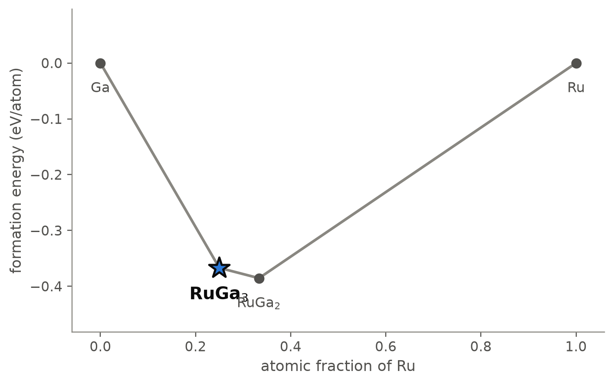
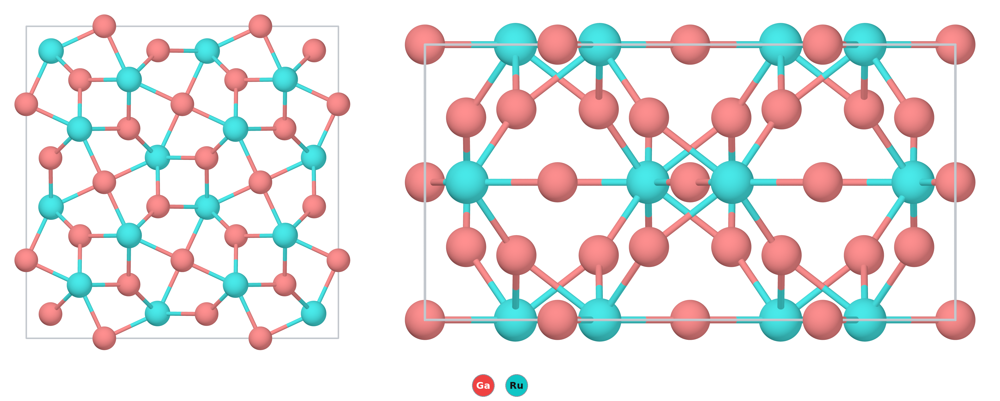

# RuGa₃ — an intermetallic compound of ruthenium and gallium that is a semiconductor

*A Material a Day · entry 12 · 23 October 2026 · status: **known** (single crystals reported in 2002)*

> **In one paragraph.** RuGa₃ is made of two metals, but it is not a metal. It crystallises in
> the tetragonal FeGa₃ structure, in which pairs of ruthenium atoms sit in cages of gallium,
> and a gap of about half an electronvolt opens between bonding and antibonding
> ruthenium–gallium states. Single crystals were grown from a gallium flux and their
> structure refined in 2002, and resistivity, optical and thermoelectric measurements
> followed. In the calculation RuGa₃ is on the Ru–Ga hull in all three functionals, 74 to
> 91 meV/atom below gallium and RuGa₂. PBE puts the cell 1.0 to 1.2 % too long and gives an
> indirect gap of 0.53 eV, against 0.33 eV from the temperature dependence of the
> resistivity in two studies and about 0.6 eV from optical spectra. The calculation
> agrees with what is done in practice: RuGa₃ is the phase that sits in equilibrium with
> liquid gallium, which is why a gallium flux gives it, at 800 to 1000 °C, below the
> measured decomposition into RuGa₂ and melt at about 1080 °C. The main caveat is the
> thermodynamic one: the calorimetric survey we use has no intermetallic class, so we
> cannot put an experimental error bar on the 78 meV/atom margin.

Computed numbers come from the Alexandria database; measured numbers carry a reference.

## 1. Identity

| | computed | measured |
|---|---|---|
| Formula | RuGa₃ (stored as Ga3Ru) | |
| Alexandria id | `agm003220384` | |
| Space group | P4₂/mnm (no. 136), Z = 4 | P4₂/mnm [1, 2] |
| a (Å) | 6.535 (PBE); 6.532 (PBE, Materials-Project settings); 6.443 (PBEsol) | 6.4729 [1, 2]; 6.4731 [7]; 6.4734 [8] |
| c (Å) | 6.786 (PBE); 6.775 (MP settings); 6.658 (PBEsol) | 6.7062 [1, 2]; 6.7054 [7]; 6.7058 [8] |
| Volume (ų) | 289.9 (PBE); 276.4 (PBEsol) | 280.98 [2] |
| Density (g cm⁻³) | 7.11 (PBE) | 7.334 (from the X-ray cell) [2] |
| Structure type | FeGa₃ | FeGa₃ [2] |
| Formation energy | −0.367 eV/atom (PBE) | none found |

PBE is 0.96 % long in a and 1.19 % in c, 3.2 % in volume; PBEsol is 0.46 % and 0.72 %
short, 1.6 % in volume. That is the usual pattern of the two functionals. The three
measured cells, from flux-grown crystals, from crystals ground and sintered, and from
polycrystals made from a stoichiometric charge, agree to 0.0005 Å. Single-crystal
refinement finds both gallium sites and the ruthenium site fully occupied, so the
compound is stoichiometric within the error [8]. The CIF is [`Ga3Ru.cif`](Ga3Ru.cif). No
Wikipedia page on the compound was found.

## 2. Where it sits

<picture>
  <source media="(prefers-color-scheme: dark)" srcset="phase_diagram_dark.png">
  
</picture>

The Ru–Ga system at 0 K (PBE table). Four phases are on the hull:

| phase | at.% Ru | formation energy (eV/atom) | structure (database) | reported? |
|---|---|---|---|---|
| Ga | 0 | 0 | | |
| **RuGa₃** | 25 | −0.367 | FeGa₃ type, P4₂/mnm | yes [1, 2] |
| RuGa₂ | 33.3 | −0.385 | Fddd, 6-atom cell (TiSi₂ type) | yes, identified by powder diffraction [3] |
| Ru | 100 | 0 | | |
| RuGa (above hull) | 50 | −0.269 | CsCl type | yes, a = 3.01 Å [4] |

RuGa₃ lies 77.9 meV/atom below the line joining gallium and RuGa₂. The minimum of the hull
is at RuGa₂, not at RuGa₃.

**One reported phase is off the hull.** RuGa in the CsCl structure was reported in 1963
[4], and it forms during ball-milling of ruthenium with liquid gallium [3]; the calculation
puts it 19.7 meV/atom above the hull in PBE and 15.0 with Materials-Project settings,
against a mixture of RuGa₂ and ruthenium. The computed cell, 3.029 Å, is 0.6 % longer than
the measured 3.01 Å [4]. A margin of 15 to 20 meV/atom is within what the hull resolves
between computed numbers, and a CsCl phase with some disorder may be stabilised by entropy
at the temperature it was made; the calculation cannot tell which. The 2021 study we read
says that the full Ga–Ru diagram "has not been evaluated yet" and names RuGa₃, RuGa₂ and
RuGa as the known compounds [3].

## 3. Structure

*Left: a 2 × 2 × 1 block seen down the c axis. Right: the same block seen along a. Only
Ru–Ga contacts up to 2.7 Å are drawn; the Ru–Ru pair at 2.94 Å is left out.*

| site | Wyckoff | x, y, z | neighbours (PBE) | measured [2] |
|---|---|---|---|---|
| Ru | 4f | 0.159, 0.841, ½ | 2 Ga at 2.459, 2 Ga at 2.487, 4 Ga at 2.600 Å; 1 Ru at 2.937 Å | 2.435, 2.459, 2.574; Ru 2.911 Å |
| Ga1 | 4c | 0, ½, ½ | 2 Ru at 2.459 Å (linear); 4 Ga at 2.941 Å | 2.435; 2.916 Å |
| Ga2 | 8j | 0.345, 0.655, 0.235 | 1 Ru at 2.487, 2 Ru at 2.600 Å; 1 Ga at 2.870, 2 Ga at 2.941 Å | 2.459, 2.574; 2.832, 2.916 Å |

The free coordinates agree with the single-crystal refinements to 0.001 (Ru x 0.3411
against 0.3410 in the setting of [2, 8]; Ga2 x 0.1552 and z 0.2649 against 0.1547 to
0.1548 and 0.2640 to 0.2642), so every PBE distance is long by 0.9 to 1.3 %, the scaling
of the cell. The refinement of [8] finds the Ga1 atom vibrating more along two directions
than the third and refines it as split over four nearby positions, a local distortion the
ideal structure does not have.

- **Ruthenium comes in pairs.** Each ruthenium has eight gallium neighbours and one
  ruthenium, 2.94 Å away (2.91 Å measured, against 2.65 Å in the metal [2]); the two
  atoms of a pair share their gallium cages. In the top view the two atoms of a pair sit
  on opposite corners of a small square of Ru–Ga bonds (gallium above and below, seen in
  projection); the Ru–Ru contact itself is not drawn.
- **Gallium bridges the pairs.** Ga1 links two ruthenium atoms of different pairs in a
  straight line; Ga2 bonds to three ruthenium atoms and pairs with another Ga2 at 2.87 Å.
  The framework is three-dimensional; there are no layers.
- **Charge goes to ruthenium.** The stored Bader charges are −0.90 to −0.92 on Ru and +0.30
  on Ga (DDEC6 −0.66 and +0.21 to +0.25). Ruthenium is the more electronegative of the two.
- **No competing structure is close.** The next RuGa₃ structure in the PBE table is a
  Cmcm cell 89 meV/atom higher (91 with Materials-Project settings); an Imm2 cell is 177
  to 191 meV/atom higher in the three functionals that have it.
- **The family.** Thirteen compounds of the same type and space group are in
  `energy_runs_pbe`. Those with eight valence electrons on the transition metal and
  gallium or indium are semiconductors in PBE and on the hull: FeGa₃ (gap 0.48 eV, 190
  meV/atom below its neighbours), RuGa₃ (0.53 eV, 78), OsGa₃ (0.81 eV, 263) and RuIn₃
  (0.36 eV, 133). The cobalt-group members CoGa₃, CoIn₃, RhIn₃ and IrIn₃ are on the hull
  and metallic, as is NiCd₃; RhGa₃, IrGa₃ and ReGa₃ are 18 to 25 meV/atom above it. The
  2002 study gives the same split from experiment: FeGa₃ and RuGa₃ are semiconducting,
  CoGa₃ is metallic, and the extra electron of cobalt puts the Fermi level above the gap
  [2].

## 4. Properties

### Electronic

| | gap (eV) |
|---|---|
| PBE, indirect / direct | 0.53 / 0.81 |
| PBEsol (on its own, smaller cell) | 0.36 / 0.77 |
| SCAN (at the PBEsol cell) | 0.65 / 1.00 |
| graph-neural-network estimate | 0.61 |
| earlier calculations: LDA at its own cell [2]; full-potential LAPW [7] | about 0.3; 0.38 |
| measured, activation energy of the resistivity above 450 to 520 K [7, 8] | 0.33 |
| measured, optical conductivity [5] | about 0.6 |

- **Two measured numbers, a factor of two apart.** Two groups find the same slope in the
  resistivity at high temperature, 0.33 eV, one on single crystals and sintered powder
  [8], one on sintered polycrystals [7]. In [7] the fit is ρ = ρ₀ exp(Δ/k_BT), and the
  authors read Δ ≈ 0.33 eV as close to the whole gap, with the Fermi level near the
  conduction band; had it sat at mid-gap the same slope would mean a gap of 0.66 eV. The
  optical number, about 0.6 eV from spectra between 0.22 and 14 μm [5], is from an abstract.
  The resistivity of the 2002 crystals below room temperature is not activated and gave
  no gap [2].
- **PBE is 0.2 eV above the transport number and 0.07 eV below the optical one.** Part of
  that comes from the cell: the gap grows with volume here, 0.36 eV in the PBEsol cell
  (1.6 % small) and 0.53 eV in the PBE cell (3.2 % large). Interpolating linearly in volume
  between the two, which we did not compute, puts PBE at the measured cell near 0.42 eV,
  close to the 0.38 eV that [7] computed. The gap of RuGa₃ is a hybridisation gap between
  ruthenium d states and gallium p states [2], not a gap between an anion band and a
  cation band, and PBE is nearer the measured value than it usually is for ionic
  insulators; we take that as an observation on this family, not a rule.
- **The sister compound** RuIn₃: single-crystal conductivity gives 0.455 eV along [110]
  and 0.513 eV along [001] [9], and polycrystals an activation energy of 0.19 eV [7]; the
  PBE gap of RuIn₃ is 0.36 eV.
- No gap from the MBJ functional is stored for RuGa₃.

### Dielectric response

The database gives ε∞ = 20.4 (19.3 along c, 21.0 in the plane) and a refractive index of
4.5. The Born effective charges are anomalous: −6.3 to −9.0 on ruthenium (mean −7.5) and
+1.2 to +3.8 on gallium, far from the static charges above. Large dynamical charges of
this kind are typical of small-gap covalent compounds, in which a displacement moves a
lot of electron density. ε∞ is the electronic screening only; the static constant would
add the lattice part, which was not computed. Nothing is piezoelectric (the structure is
centrosymmetric).

### Charge transport

| | electrons | holes |
|---|---|---|
| density-of-states mass (m₀) | 2.45 | 1.96 |
| Seebeck at 10¹⁹ cm⁻³, 300 K (μV/K) | −338 | +263 |
| Seebeck at 10²⁰ cm⁻³, 300 K (μV/K) | −164 | +103 |

Rigid-band Boltzmann transport on the PBE bands, constant relaxation time. The gap
between the band edges used there is 0.40 eV, and the branch-point energy lies 0.21 eV
above the valence-band maximum, close to mid-gap.

At 10¹⁸ cm⁻³ electrons the calculation gives −530 μV/K at 300 K, +48 at 600 K and +150 at
900 K: the sign turns as holes are excited across the gap.

**Measured.** Sintered polycrystals are n-type at room temperature, with a Hall density of
2.4 × 10¹⁸ cm⁻³, a mobility of 10 cm² V⁻¹ s⁻¹ and a resistivity of 0.27 Ω cm at 300 K; the
Seebeck coefficient is −546 μV/K at 373 K and turns positive near 500 K, reaching more
than +200 μV/K at high temperature [7]. A second group finds −480 μV/K at 164 K and
+307 μV/K at 609 K, with the change at 468 K, in single crystals and sintered powder alike
[8]. Both full texts therefore give the change from negative to positive, as do the
earlier hot-pressed samples replotted in [7]; the 2003 abstract [6] reads the other way,
and its own data we have not seen. The calculation puts the sign change in the same place:
at the measured density, interpolating between 10¹⁸ and 10¹⁹ cm⁻³, it gives about
−460 μV/K at 300 K, within 20 % of the measured value at 373 K, and positive values by
600 K. The holes being lighter in the calculation (1.96 against 2.45 m₀) fits the
authors' reading that light holes take over [7]. This is a rigid-band, constant-τ
comparison, and the measured density is a room-temperature Hall number from a single-band
formula.

Below room temperature a flux-grown crystal shows a sharp Seebeck extremum of about
−700 μV/K at 38 K and a thermal conductivity above 500 W m⁻¹ K⁻¹ at its low-temperature
peak; in sintered material the peak conductivity is ten times lower and the Seebeck
extremum is gone; the authors
attribute the Seebeck peak to phonon drag [8]. At high temperature the lattice thermal
conductivity of polycrystals is about 3.0 W m⁻¹ K⁻¹ [7]. The figure of merit ZT reaches
0.18 at 945 K in hot-pressed samples [6], 0.13 at 973 K [7] and 0.08 at 845 K [8] in
sintered ones; Hall densities of 10¹⁷ to 10¹⁸ cm⁻³ are reported in [6].

### Mechanical (machine-learned)

| bulk modulus | shear modulus | Young's modulus | B/G |
|---|---|---|---|
| 112 GPa | 67 GPa | 154 GPa | 1.7 |

Screening estimates from a graph neural network on the PBE structure; no measured elastic
constant was found. The one measured elastic quantity is a Debye temperature of 360 K from
sound velocities [7]. From these moduli and the PBE density, the average sound velocity
gives 386 K (our estimate, the standard Debye formula), 7 % high.

### Not computed

Phonons and lattice dynamics (RuGa₃ is not among the group's lattice-dynamics
calculations), the static dielectric constant, spin–orbit effects on the bands, defects
and the dopants that set the measured carrier density, and any finite-temperature
property, including the decomposition at about 1080 °C [8].

## 5. Is it stable?

On all hulls, with similar margins: 77.9 meV/atom below Ga + RuGa₂ in PBE, 74.2 with
Materials-Project settings and 91.2 in SCAN (at the PBEsol geometry). The tables agree
(spread 0.0 meV/atom on the hull distance).

**How much that margin is worth.** The calorimetric survey behind these tools has classes
for oxides, halides, nitrides, carbides and so on, but none for intermetallics, and it holds
no measured formation enthalpy of any Ru–Ga compound. We therefore have no experimental
error bar for this class. Errors of the same sign largely cancel between RuGa₃ and its
neighbour RuGa₂, which share the same elements and similar bonding; that is an argument,
not a measurement. The 15 to 20 meV/atom by which the reported RuGa sits above the hull
(section 2) is the one sign that the Ru–Ga energetics are not perfect.

**What settles it** is experiment: RuGa₃ has been grown as single crystals from a gallium
flux [2, 8] and made single-phase from a stoichiometric charge [7]. Thermal analysis shows
it forming from ruthenium and gallium from 489 °C and decomposing into RuGa₂ and gallium-
rich melt at 1080 ± 10 °C [8], so its stability is bounded above by a peritectic, not by
melting. That RuGa₂, the minimum of the computed hull, survives to the higher
temperature, 1348 ± 10 °C [8], fits the calculation.

## 6. How to make it

### What is done

Three published procedures, all from the elements:

| | charge (Ru : Ga) | container | heating | product |
|---|---|---|---|---|
| [2] | 1 : 10, pressed pellets | silica ampoule, vacuum | 800 °C for 24 h (200 °C/h up, 20 °C/h down) | crystals up to 1 mm, single phase |
| [8] | 1 : 20 | glassy carbon crucible inside a tantalum container, loaded under argon | 1000 °C, slowly cooled to 500 °C in a Bridgman furnace | crystals large enough to cut 1.4 × 1.9 × 6 mm bars |
| [7] | 1 : 3 | tantalum tube in an evacuated silica ampoule | 800 °C for 24 h, then ground and spark-plasma sintered at 800 °C, 60 MPa, 20 min | single-phase polycrystal, 96 % dense |

In both flux growths the excess gallium was dissolved in hydrochloric acid (3 M in [2])
and the crystals washed with water. Thermal analysis of a 1 : 3 charge [8] shows RuGa₃
forming from 489 °C and decomposing at 1080 °C; after melting and cooling, the product is
RuGa₃ with RuGa₂ beside it. Ball-milling ruthenium powder with liquid gallium at
Ga : Ru = 1 : 1 gives RuGa₂ and then RuGa within an hour, with iron contamination from
the steel balls [3].

### What the calculation proposes

Reaction energies at 0 K, meV per atom of the whole charge.

| route | charge | ΔE | comment |
|---|---|---|---|
| A (rank 1) | RuGa₂ + Ga → RuGa₃ | −74 | the two hull neighbours |
| B (rank 2) | Ru + 3 Ga → RuGa₃ | −382 | the elements; what is done [2, 7, 8] |
| C (metathesis) | RuCl₃ + 3 Ga + 3 Na → RuGa₃ + 3 NaCl | −1020 | clean in the calculation |
| D (metathesis) | RuCl₃ + 3 Ga + 3 Li → RuGa₃ + 3 LiCl | −1034 | clean |
| E (metathesis) | 2 RuCl₃ + 6 GaCl₃ + 24 Na → 2 RuGa₃ + 24 NaCl | −1052 | clean |
| F (reduction) | RuO₂ + 3 Ga + 2 Mg → RuGa₃ + 2 MgO | −1175 | clean |
| G (no reductant) | RuCl₃ + 4 Ga | −477 | **fails**: RuGa₂ + RuGa₃ + GaCl₂, gallium lost to the chloride |

- **Route B is the one to use, in excess gallium.** Ranking by fewest reagents and then
  least driving force puts route A first, but route A needs RuGa₂, which nobody sells,
  and route B from the elements is what has been done, with gallium in excess [2, 8] or
  at the stoichiometric ratio [7].
- **Why a gallium flux works.** The window in the gallium chemical potential is open at
  the top: RuGa₃ stays the stable phase all the way up to pure gallium, because the two
  share a tie line. A charge with a large excess of gallium can therefore only give RuGa₃
  plus gallium, never a gallium-richer compound, since the calculation has none. The window
  closes at the bottom at μ_Ga = −0.40 eV, where RuGa₂ takes over; in μ_Ru it is 1.19 eV
  wide. A gallium-poor charge gives RuGa₂, and the excess of the flux is what keeps it
  away. Both flux growths [2, 8] gave RuGa₃ alone, and the one charge taken above the
  decomposition gave RuGa₂ beside it [8].
- **Both ends of the temperature window.** Gallium melts at 30 °C and boils at about
  2200 °C, so it is liquid over the whole range. Ruthenium melts at 2334 °C; bulk
  diffusion through solid ruthenium (Tammann temperature about 1030 °C) would need more
  heat than a flux synthesis gives, but in a flux the ruthenium dissolves rather than
  diffuses, and in thermal analysis the reaction starts at 489 °C [8]. The top of the
  window is the decomposition of RuGa₃ into RuGa₂ and melt at 1080 °C [8], which the 0 K
  calculation cannot give; the published soaks, 800 and 1000 °C, sit below it.
- **Metathesis works on paper, with a wash.** Sodium or lithium reduce ruthenium
  trichloride in the presence of gallium cleanly to RuGa₃ and a salt (routes C–E), and
  magnesium does the same with RuO₂ (route F). Water is inert to RuGa₃ at 0 K, as are
  NaCl, LiCl and the other alkali halides, so the salt could in principle be washed out.
  Without a reductant (route G) part of the gallium ends as a chloride and the product is
  gallium-poor. These routes are strongly exothermic, which means poor control; we did not
  search for whether any has been tried.

### What it tolerates

| inert in the calculation | reacts |
|---|---|
| Al₂O₃, SiO₂, ZrO₂, MgO, CaO, Y₂O₃, BeO, TiO₂, BN, AlN, Si₃N₄, SiC, graphite | Ta (−166, → Ta₃Ga₂ + TaGaRu₂), Nb (−119), Mo (−58), Zr, Ti |
| W, Cr, Cu, Ag, Sn, Pb, Zn | Pt (−198), Pd (−202), Rh, Ir, Au (−30), Ni, Co, Fe, Al, Si |
| H₂, H₂O | O₂ (→ RuGa₂ + gallium oxide), N₂ (−288, → GaN), CO₂ |
| alkali and alkaline-earth halides, B₂O₃, borax | nitrate, sulfate, carbonate, molybdate and tungstate fluxes, PbO |

- **Silica, carbon or alumina rather than bare tantalum.** Tantalum, the usual container
  for intermetallics, reacts with RuGa₃ in the calculation, and so do niobium and
  molybdenum; silica, graphite and alumina do not. Practice agrees in part: the flux
  growths used a silica ampoule [2] and a glassy carbon crucible inside tantalum [8], and
  the thermal analysis put alumina liners in its tantalum cells to prevent reaction with
  the container [8]. A stoichiometric charge held in a bare tantalum tube at 800 °C for
  24 h gave single-phase RuGa₃ [7], which says nothing about the tube itself; a large
  gallium excess at 1000 °C is the harder case. Tungsten is the one refractory metal on
  a tie line with RuGa₃.
- **No platinum thermocouple in contact.** Platinum, palladium and gold all react.
- **Argon or vacuum.** Oxygen and nitrogen both react in the calculation; hydrogen does
  not.

### Powder pattern

Computed, Cu Kα. Lines above 10 % of the strongest:

| hkl | 101 | 111 | 112 | 202 | 220 | 212 | 301 | 310 | 113 |
|---|---|---|---|---|---|---|---|---|---|
| 2θ (°), PBE cell | 18.85 | 23.29 | 32.74 | 38.24 | 38.98 | 40.75 | 43.64 | 43.80 | 44.60 |
| 2θ (°), measured cell [1] | 19.06 | 23.53 | 33.12 | 38.67 | 39.37 | 41.20 | 44.09 | 44.25 | 45.14 |
| I | 42 | 25 | 20 | 12 | 10 | 100 | 15 | 49 | 11 |

The PBE cell shifts every line by 0.2 to 0.5° to lower angle; index against the measured
cell.

The three measured cells [2, 7, 8] agree, so any of them indexes the pattern.

- **Lines of RuGa₂:** the charge was gallium-poor, gallium was lost, or the charge went
  above 1080 °C [8].
- **Lines of RuGa (CsCl type) or ruthenium:** ruthenium did not fully react; when the
  two are milled, RuGa forms where gallium-poor product meets unreacted ruthenium [3].
- **Lines of Ga₂O₃ or GaN:** air or nitrogen got in.
- **Unreacted gallium** is liquid at room temperature and does not give sharp lines; it
  shows as a broad hump or as droplets on the crystals.

### Hazards

Gallium is of low toxicity but wets and penetrates other metals along their grain
boundaries [3], so it attacks aluminium fittings and some containers. Dissolving the flux
in hydrochloric acid [2, 8] gives off hydrogen. Ruthenium is expensive. Metathesis with sodium or lithium is strongly exothermic and needs an inert
atmosphere.

## 7. What it is used for

We found no use outside research. RuGa₃ is studied as a thermoelectric, with a figure of
merit of 0.08 to 0.18 at 845 to 973 K in undoped polycrystals [6–8]. Rigid-band
calculations put it above 1 at the best carrier density, if the lattice thermal
conductivity could also be brought down to its amorphous limit [7];
a zinc-doped, p-type RuGa₂.₉₂Zn₀.₀₈ reaching 0.21 is reported in [10], which we know
only through [8]. The low power factor between 300 and 600 K, where the Seebeck
coefficient changes sign, is the obstacle in undoped material [8]. It is also one of the reference compounds for the idea that
an intermetallic compound can be a semiconductor when the transition metal and the main
group atom hybridise strongly [2].

## 8. How this could be wrong

- **The stability margin has no experimental error bar** for this class; we do not know
  how far PBE is from calorimetry for Ru–Ga compounds. The reported RuGa sits 15 to 20
  meV/atom above the hull, which shows the energetics are not exact.
- **The gap comparison is loose.** The 0.33 eV is an activation energy, and whether it is
  the gap or half of it depends on where the Fermi level sits, which the papers infer
  rather than measure [7, 8]. The 0.6 eV is an optical number from an abstract [5], and
  an indirect gap would not be expected to match a direct optical onset. The 0.42 eV for
  PBE at the measured cell is a linear interpolation, not a calculation.
- **The Seebeck comparison** uses a room-temperature Hall density obtained with a
  single-band formula, and rigid bands with a constant relaxation time.
- **The 2003 thermoelectric study [6]** is known from its abstract only, and its
  direction of the Seebeck sign change disagrees with the two full texts.
- **No phonons were computed**, so the dynamical stability of the stored structure is not
  checked here; it is supported only by the fact that the compound exists in this
  structure.
- **The metathesis and reduction routes** are thermodynamics at 0 K; they ignore heat
  release, the solubility of sodium in gallium and the separation of the salt.

## 9. Literature

**Searched (OpenAlex, Crossref, arXiv, web), 18 October 2026:** "FeGa3 and RuGa3
semiconducting intermetallic compounds" ([2], [5], [6], [7], an LDA study of the family,
and the FeGa3 literature); "RuGa3 thermoelectric properties" ([6], [7], [8], [10]); "RuGa3
single crystal band gap transport" (nothing beyond these); "Wagner-Reetz RuGa3 single
crystal Seebeck band gap" (only [8], no abstract); "Ga-Ru phase diagram gallium ruthenium
system" ([3]; a handbook entry on Ga–Ru, metadata only); "RuGa3 FeGa3-type optical
conductivity electronic structure" (only FeGa3 work); "RuGa3 gallium ruthenium compound"
(the handbook entry); a web search for the abstract of [2] (found in the Lund University
repository) and for the abstract of [8] (not found). Wikipedia: no page for RuGa3, Ga3Ru,
"ruthenium gallide" or "ruthenium trigallide". The full texts of [2], [7] and [8] were
supplied afterwards and read. No measured formation enthalpy of RuGa₃ was found.

1. U. Häussermann, M. Boström, P. Viklund, Ö. Rapp, T. Björnängen, "FeGa₃ and RuGa₃:
   semiconducting intermetallic compounds", *J. Solid State Chem.* 165, 94 (2002),
   a = 6.4729, c = 6.7062 Å — *Crystallography Open Database entry 1534872,
   https://www.crystallography.net/cod/1534872.html; database record read.*
2. The same paper, doi:10.1006/jssc.2001.9503 — *full text read.*
3. T. F. Grigoreva, E. A. Pavlov, P. A. Vitiaz, N. Z. Lyakhov, "Mechanochemical synthesis
   of intermetallic compounds in the system gallium – ruthenium", *Chimica Techno Acta*
   8, 20218104 (2021). doi:10.15826/chimtech.2021.8.1.04 — *full text read (open access).*
4. W. Jeitschko, H. Holleck, H. Nowotny, F. Benesovsky, *Monatsh. Chem.* 94, 838 (1963),
   RuGa, a = 3.01 Å — *Crystallography Open Database entry 1523920,
   https://www.crystallography.net/cod/1523920.html; database record read.*
5. Yu. V. Knyazev, Yu. I. Kuz'min, "The study of the structure of the electronic states
   of the FeGa₃ and RuGa₃ compounds by optical spectroscopy method", *Phys. Solid State*
   (2017). doi:10.1134/S1063783417110154 — *abstract read.*
6. Y. Amagai, A. Yamamoto, C. H. Lee *et al.*, "Thermoelectric properties of
   semiconducting intermetallic compounds: FeGa₃ and RuGa₃", *MRS Proc.* 793, S8.38
   (2003). doi:10.1557/PROC-793-S8.38 — *abstract read.*
7. Y. Takagiwa, K. Kitahara, Y. Matsubayashi *et al.*, "Thermoelectric properties of
   FeGa₃-type narrow-bandgap intermetallic compounds Ru(Ga,In)₃: experimental and
   calculational studies", *J. Appl. Phys.* 111, 123707 (2012). doi:10.1063/1.4729772 —
   *full text read.*
8. M. Wagner-Reetz, R. Cardoso-Gil, Yu. Prots, W. Schnelle, Yu. Grin, "Thermoelectric
   properties of single- and polycrystalline RuGa₃", *Solid State Sci.* 32, 56 (2014).
   doi:10.1016/j.solidstatesciences.2014.03.016 — *full text read.*
9. D. Bogdanov, K. Winzer, I. A. Nekrasov, T. Pruschke, "Electronic properties of the
   semiconductor RuIn₃", arXiv:cond-mat/0703563 (2007) — *pages 1–3 of the full text
   read.*
10. Y. Takagiwa, Y. Matsuura, K. Kimura, "Effect of carrier-doping on the thermoelectric
    properties of narrow-bandgap (Fe,Ru)Ga₃ intermetallic compounds", *J. Electron.
    Mater.* (2014). doi:10.1007/s11664-014-3008-6 — *metadata only; its ZT is quoted
    from [8].*

## 10. Provenance

- **Data:** Alexandria database, tables `energy_runs_pbe`, `energy_runs_pbe_mp`,
  `energy_runs_ps` (PBEsol) and `energy_runs_scan` (SCAN at the PBEsol geometry), with
  the dielectric and transport tables; measured cells from the Crystallography Open
  Database and the papers cited. Reaction energies, contact reactions and chemical-potential windows come from
  the hull and reaction table built on `pbe_mp`.
- **Tools:** the reaction-route code of this group, pymatgen, POV-Ray; machine-learned
  moduli and gap from graph neural networks.
- **Authorship:** drafted by Claude (Anthropic) from those tools; reviewed by
  Miguel Marques. Corrections are welcome as issues on this repository.
