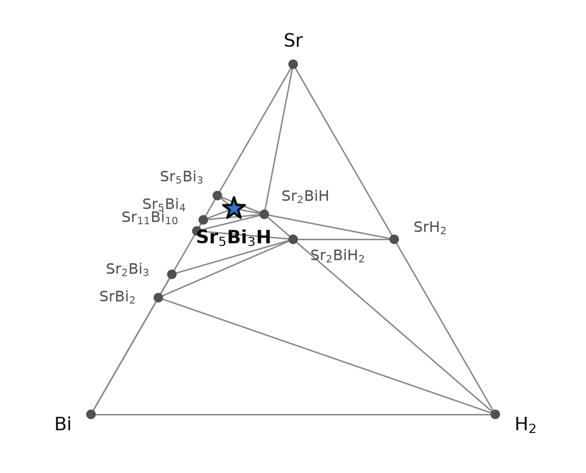
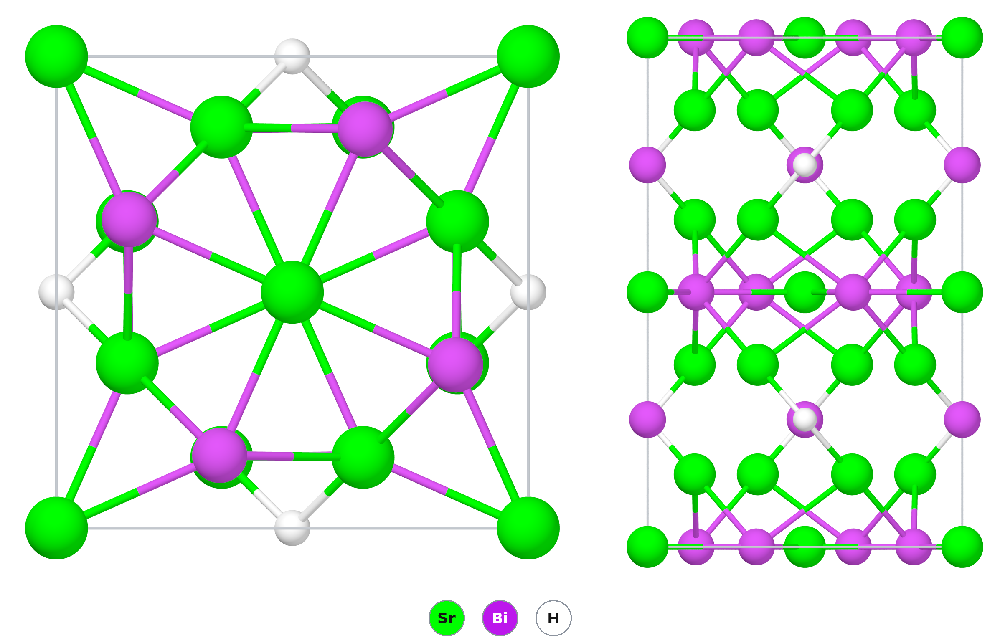

# Sr₅Bi₃H — a strontium bismuthide that needs one hydrogen atom to be a valence compound

*A Material a Day · entry 13 · 26 October 2026 · status: **known** as an orthorhombic hydride (measured cell and synthesis, 1998); the tetragonal structure stored in the database: no report found*

> **In one paragraph.** Five Sr²⁺ give ten electrons and three Bi³⁻ take nine, so Sr₅Bi₃ has one
> electron left over. In the binary that electron sits in empty cavities of the
> structure. A hydride ion can fill the same cavity, and Sr₅Bi₃H is then an
> electron-balanced Zintl compound with a small gap (0.46 eV in PBE). The database stores it in a
> tetragonal cell, a Cr₅B₃-type arrangement with H in a tetrahedron of four Sr. In that cell it is on the
> computed hull, 21 meV/atom (PBE) or 9 meV/atom (Materials-Project settings) below its
> neighbours. Leon-Escamilla and Corbett made Sr₅Bi₃H in 1998 from strontium, strontium hydride
> and bismuth in sealed tantalum, and showed that the orthorhombic "Sr₅Bi₃" reported before was
> this hydride; without hydrogen the same reaction gives hexagonal Sr₅Bi₃. **The main caveat is
> the structure.** The measured phase is orthorhombic (Pnma, Ca₅Sb₃F type). The database has no
> orthorhombic cell for Sr₅Bi₃H, nor for any other A₅Pn₃H or A₅Pn₃F. We built one from the stored
> orthorhombic Sr₅Bi₃ and relaxed it with two machine-learned models. Both put it 30–34 meV/atom
> below the stored tetragonal cell, and its relaxed cell is within 0.6–0.9 % of the measured one on
> every axis. The stored structure is probably not the ground state; a DFT relaxation would settle this.

Computed numbers come from the Alexandria database unless marked as machine-learned; measured
numbers carry a reference.

## 1. Identity

| | computed (stored structure) | measured or reported |
|---|---|---|
| Formula | Sr₅Bi₃H | Sr₅Bi₃Hₓ, x up to about 1 [1] |
| Alexandria id | `agm006417700` | |
| Space group | I4/mcm (no. 140), Z = 4 | Pnma (no. 62), Z = 4 [1] |
| Cell (Å) | a = 9.183, c = 14.863 (PBE) | a = 13.359, b = 10.227, c = 8.873 at 22 °C, hydrogen-rich limit [1] |
| Volume per formula unit | 313.4 ų (+3.4 %) | 303.1 ų [1] |
| Density (g cm⁻³) | 5.65 (−3.3 %) | 5.84, from the measured cell |
| Structure type | Cr₅B₃ type with H in the 4b site (database label `AB3C5_tI36_140_b_ah_cl`) | Ca₅Sb₃F type (formerly β-Yb₅Sb₃), H in a Sr₄ tetrahedron [1] |
| Formation energy | −0.862 eV/atom (PBE); −0.882 (MP settings) | none found |

The stored structure is not the measured one, so only volume and density can be compared
directly: the stored cell is 3.4 % too large per formula unit, about what PBE gives for the
hexagonal binary (section 3). Section 3 compares our orthorhombic model with the measured
cell axis by axis. The CIF of the stored structure is [`Sr5Bi3H.cif`](Sr5Bi3H.cif); the
orthorhombic model is [`Sr5Bi3H_Pnma_model.cif`](Sr5Bi3H_Pnma_model.cif). No Wikipedia
page on the compound was found.

## 2. Where it sits

<picture>
  <source media="(prefers-color-scheme: dark)" srcset="phase_diagram_dark.png">
  
</picture>

The Sr–Bi–H triangle at 0 K (PBE table); the star is Sr₅Bi₃H. Twelve phases are on the hull:

| phase | formation energy (eV/atom, PBE) | structure (database) | reported? |
|---|---|---|---|
| **Sr₅Bi₃H** | −0.862 | I4/mcm, Cr₅B₃ type + H | as Pnma (section 3) [1] |
| Sr₅Bi₃ | −0.877 | P6₃/mcm, Mn₅Si₃ type, metallic | yes, Mn₅Si₃ type, made without hydrogen [6]; the orthorhombic "Sr₅Bi₃" of earlier reports [4] is Sr₅Bi₃H [1] |
| Sr₂BiH | −0.793 | P4/nmm, 8 atoms, gap 0.69 eV | no report found (one search) |
| Sr₅Bi₄ | −0.885 | Cmce | predicted in [4], not listed there as reported |
| Sr₁₁Bi₁₀ | −0.861 | I4/mmm, Ho₁₁Ge₁₀ type | yes [4] |
| Sr₂BiH₂ | −0.679 | I4/mmm, metallic | no report found |
| SrH₂, Sr₂Bi₃, SrBi₂, Sr, Bi, H₂ | | | Sr₂Bi₃ yes [4] |

In PBE, Sr₅Bi₃H lies 20.9 meV/atom below the mixture Sr₅Bi₃ + Sr₂BiH + Sr₅Bi₄ (its
neighbours in the triangle). With Materials-Project settings it lies 8.6 meV/atom below
Sr₅Bi₃ + Sr₂BiH + Sr₁₆Bi₁₁; Sr₁₆Bi₁₁ is a hull phase in that table and has no entry in the
PBE table. Experiment sides with the Materials-Project hull here: Sr₁₆Bi₁₁, not Sr₅Bi₄, is the
strontium-poor phase found beside Sr₅Bi₃H (2–9 %) [1], and hexagonal Sr₅Bi₃ is the one found
beside it when hydrogen runs short [1]. Sr₂BiH was not reported in any of those products. The cubic Sr₄Bi₃
(anti-Th₃P₄ type), whose cell is in the Crystallography Open Database (a = 10.101 Å,
entry 4344124), sits 2.1 meV/atom above the PBE hull.

## 3. Structure

*Left: one cell of the stored I4/mcm structure seen down c. Right: the same cell seen along a.
Sr–H contacts up to 2.7 Å and Sr–Bi contacts up to 3.6 Å are drawn.*

| site | Wyckoff | x, y, z | neighbours (PBE, within 4 Å) |
|---|---|---|---|
| Sr1 | 16l | 0.150, 0.650, 0.358 | 1 H at 2.519; Bi at 3.312, 2 × 3.503, 2 × 3.846 Å |
| Sr2 | 4c | 0, 0, 0 | 4 Bi at 3.478, 2 Bi at 3.716 Å (octahedron) |
| Bi1 | 8h | 0.654, 0.154, ½ | 8 Sr at 3.31–3.50 Å |
| Bi2 | 4a | 0, 0, ¼ | 10 Sr at 3.72–3.85 Å |
| H | 4b | 0, ½, ¼ | 4 Sr at 2.519 Å (tetrahedron) |

- **Isolated anions.** No Bi–Bi distance is shorter than 4 Å, so every bismuth is a
  separate Bi³⁻ surrounded by strontium. Every hydrogen sits alone in a tetrahedron of four
  Sr1 atoms. The stored charges agree with the ionic picture: Bader +1.30 on Sr, −1.86 on Bi,
  −0.79 on H (DDEC6 +1.11, −1.60, −0.65).
- **What the hydrogen does.** The binary Sr₅Bi₃ has one electron per formula unit that
  no anion takes. In the stored orthorhombic Sr₅Bi₃ (`agm003241105`) the electron density
  has four maxima away from the atoms, 0.21 electrons each, in the tetrahedral Sr₄ cavities.
  The PBE cell is spin-polarised (3.9 μB per 32-atom cell). The hexagonal Sr₅Bi₃ has its
  maxima (0.13 electrons) in the octahedral channel along c. This is what an electride
  looks like in these tables. In the hydride the cavity holds H⁻ instead, and the compound
  has a gap and no moment.
- **The reported structure is a different one.** Leon-Escamilla and Corbett showed in 1998
  that all eight A₅Pn₃ phases reported with the orthorhombic β-Yb₅Sb₃ structure, among them
  the orthorhombic "Sr₅Bi₃" of 1978, are hydrides A₅Pn₃H, better described in the Ca₅Sb₃F
  type with H in a tetrahedral cavity of four cations [1]. Sr₅Bi₃H is one of the nine they
  list. Their cells for it are a = 13.359, b = 10.227, c = 8.873 Š(1212.4 ų) at the
  hydrogen-rich limit and 13.393, 10.230, 8.874 Š(1215.8 ų) at the hydrogen-poor one: the
  volume shrinks by 0.28 % with hydrogen, almost all of it along a [1, 6]. That the 1978 cell
  (13.370, 10.233, 8.890 Å) lies inside this range is their argument that the old "binary"
  was the hydride [1]. Hydrogen was not analysed; its content is inferred from the amount
  loaded and the cell, and x = 1 is the assumed upper limit [1, 6].
- **Without hydrogen it is hexagonal.** Strontium freed of hydrogen, or reactions under
  dynamic vacuum, give 95 % Mn₅Si₃-type Sr₅Bi₃, a = 9.6554, c = 7.5321 Å [6]. That phase
  takes up some hydrogen (the cell shrinks by about 0.3 %) before the orthorhombic hydride
  appears; at a load of x = 0.5 the two coexist [1, 6]. Among the nine orthorhombic hydrides,
  Sr₅Bi₃H ranks fifth in stability against hydrogen loss, below Ca₅Bi₃H, Yb₅Bi₃H, Ca₅Sb₃H and
  Yb₅Sb₃H and above Sr₅Sb₃H and the europium pair [1]. A 2024 study of Yb₅Sb₃Hₓ restates the
  family picture [3].
- **The calculation agrees on the binary.** In PBE the hexagonal Sr₅Bi₃ is on the hull and
  the stored orthorhombic Sr₅Bi₃ (without H) 7.9 meV/atom above it, as experiment has it: the
  orthorhombic heavy-atom frame does not form without hydrogen [1]. The PBE hexagonal cell is
  1.3 % long in a and 0.65 % in c, 3.3 % in volume (MP settings: 1.2 %, 0.4 %, 2.8 %). The
  stored orthorhombic Sr₅Bi₃ is 2.3 % long in a against the hydrogen-poor Sr₅Bi₃Hₓ, and
  0.9 % and 1.1 % in b and c, so removing the hydrogen lengthens a in the calculation as well.
- **Our check of the two structures.** The database holds no Pnma cell of Sr₅Bi₃H. None of
  the 31 A₅Pn₃H and A₅Pn₃F entries of its PBE table (A = Ca, Sr, Ba, Eu, Sm; Pn = P, As, Sb, Bi)
  is orthorhombic, and neither is any such entry in the other tables. Even Ca₅Sb₃F, which names the type, is stored only as I4/mcm and P6₃/mcm. We put H
  at the four cavity maxima of the stored Pnma Sr₅Bi₃ and relaxed the result, the stored
  tetragonal cell, the stored hexagonal Sr₅Bi₃H and both binaries with the same
  machine-learned potential (TugaFF):

  | structure | TugaFF energy relative to stored I4/mcm (meV/atom) | DFT, same comparison |
  |---|---|---|
  | Sr₅Bi₃H, I4/mcm (stored) | 0 | 0 |
  | Sr₅Bi₃H, P6₃/mcm (H in the octahedral chain) | +12.3 | +3.0 (MP settings) |
  | **Sr₅Bi₃H, Pnma model** | **−30.2** | not computed |
  | Sr₅Bi₃, Pnma vs P6₃/mcm | +3.7 | +7.9 (PBE) |

  A second model, the graph network that predicts formation energies, gives −0.913 eV/atom for
  the Pnma model and −0.879 for the stored cell, a difference of 34 meV/atom. Where DFT numbers
  exist, the potential is 4–9 meV/atom away from them. The 30 meV/atom is several times that,
  so the Pnma structure is probably lower in PBE too. It is not a DFT result.
- **The model matches the measured cell.** After relaxation the model has a = 13.44, b = 10.31,
  c = 8.96 Å (310.4 ų per formula unit) and H in a Sr₄ tetrahedron at 2.41–2.46 Å. Against
  the measured hydrogen-rich Sr₅Bi₃H [1] that is +0.6 %, +0.85 % and +0.9 % on the three axes
  and +2.4 % in volume, the usual PBE overestimate and less than the 3.3 % of the hexagonal
  binary. The stored tetragonal cell is 3.4 % larger per formula unit than the measured one.
- **The family in the stored structures.** In the PBE table, Sr₅Bi₃H and Ca₅Bi₃H, and the
  fluorides of Ca, Sr and Ba with Sb or Bi, are stored only in the I4/mcm cell. Where both
  cells are stored, the hexagonal one is lower for Ca₅As₃H, Ca₅Sb₃H, Sr₅P₃H, Sr₅Sb₃H, Ba₅Sb₃H
  and Ba₅Bi₃H, by 1.2 to 34 meV/atom, and the I4/mcm one for Sr₅As₃F. None of these comparisons
  includes the orthorhombic structure.
  Corbett's group reports the stuffed Cr₅B₃ arrangement with hydrogen for tetrelides,
  (Ba,Eu,Yb)₅Sn₃H and (Sr,Ba,Eu)₅Pb₃H [2, 6]. For the pnictides the two papers we read know
  only the hexagonal and the orthorhombic hydrides, and we found no report of the tetragonal
  one. They also report Sr₅Bi₃F in the orthorhombic type, a = 13.341, b = 10.278,
  c = 8.932 Å [1], which the database stores only as I4/mcm.

## 4. Computed properties

All numbers are for the stored I4/mcm structure unless stated.

### Electronic

| | gap (eV) |
|---|---|
| PBE, indirect / direct | 0.46 / 0.71 |
| graph-network estimate, stored cell / Pnma model | 0.50 / 0.62 |
| measured | none found |

There is no MBJ, PBEsol or SCAN calculation of Sr₅Bi₃H in the database. PBE usually
underestimates gaps, so the true gap is probably larger; by how much we cannot say without a
measurement. No resistivity or gap of Sr₅Bi₃H was reported [1]. The closest measured analogue
is the fluoride Sr₅Bi₃F in the same structure: 148 mΩ cm at room temperature, with a
temperature coefficient of 0.31 % per K, the least resistive of the four fluorides measured, in samples the
authors think slightly short of fluorine [1]. For Ca₅Bi₃F an earlier measurement cited there
gives a gap of about 0.07 eV [1]. For Yb₅Sb₃H, the full hydride (x = 1) has a room-temperature
resistivity of about 74,000 mΩ cm and a carrier density of about 10¹⁵ cm⁻³, which the authors
read as a semiconductor [3]. None of these is the compound itself, and the PBE gap above belongs
to the tetragonal cell, not the measured structure.

### Dielectric response

ε∞ = 12.5 (12.8 in the plane, 11.7 along c), refractive index 3.5. The Born effective
charges are close to the formal ones: +2.31 on Sr (1.88 to 2.65), −3.29 on Bi (−3.65 to
−3.00) and −1.69 on H (−1.91 to −1.59). The static constant would add the lattice part,
which was not computed. Nothing is piezoelectric (centrosymmetric).

### Charge transport

| | electrons | holes |
|---|---|---|
| density-of-states mass (m₀) | 1.15 | 1.97 |
| Seebeck at 10¹⁹ cm⁻³, 300 K (μV/K) | −309 | +368 |
| Seebeck at 10²⁰ cm⁻³, 300 K (μV/K) | −122 | +172 |

Rigid-band Boltzmann transport on the PBE bands, constant relaxation time. The band-edge gap
used there is 0.45 eV. The branch-point energy lies 0.42 eV above the valence-band maximum,
next to the conduction-band edge. Holes are heavier than electrons, so for the same carrier
density the hole Seebeck coefficient is larger. These are numbers for a doped crystal of the
stored structure. They are not a prediction that the compound is a good thermoelectric.

### Mechanical (machine-learned)

| | bulk modulus | shear modulus | Young's modulus |
|---|---|---|---|
| stored I4/mcm cell | 30 GPa | 19 GPa | 52 GPa |
| Pnma model | 30 GPa | 21 GPa | 54 GPa |

Screening estimates from a graph neural network. A soft solid, as expected for a compound
held together by large Sr²⁺ and Bi³⁻ ions. No measured elastic constant was found.

### Not computed

Phonons and lattice dynamics (Sr₅Bi₃H is not among the group's lattice-dynamics
calculations), spin–orbit coupling (large for bismuth, and it would narrow the gap), the
static dielectric constant, defects and hydrogen vacancies (the reported phase is
Sr₅Bi₃Hₓ with variable x [1]), any DFT calculation of the orthorhombic model, and the
melting or decomposition temperature, which the papers do not give either.

## 5. Is it stable?

**In the stored structure**, Sr₅Bi₃H is on both hulls: 20.9 meV/atom below its neighbours in
PBE and 8.6 meV/atom with Materials-Project settings. The two tables disagree by 12 meV/atom
on the depth, partly because their neighbours differ: Sr₁₆Bi₁₁ is a hull phase only with
Materials-Project settings. There are no PBEsol or SCAN entries to cross-check.

**How much that margin is worth.** The calorimetric survey behind these tools puts bismuth in
its "heavy p-block" class: a mean offset of +332 meV/atom with a scatter (MAD) of 116 meV/atom
over nine compounds. Its bismuth members are the oxide (+448) and the chloride (+469). There
is no measured formation enthalpy of any bismuthide or of any Sr–Bi–H phase. Most of that
offset sits in the Bi–O and Bi–Cl bonds, and it should largely cancel between Sr₅Bi₃H and
its neighbours, which are all strontium bismuthides. That is an argument, not a measurement.
On the face of it, a 9–21 meV/atom margin is far inside a 116 meV/atom scatter. The
calculation does not resolve it.

**The larger uncertainty is the structure.** If the orthorhombic structure is 30 meV/atom
lower, as both machine-learned models say, the hull would move under Sr₅Bi₃H. The compound
would then sit roughly 50 meV/atom below its neighbours, and the stored I4/mcm cell about
30 meV/atom above the hull. The composition would be more stable and the stored structure
metastable.

**What experiment says.** Sr₅Bi₃H forms in the orthorhombic structure and survives two weeks
at 850 °C in a closed container [1], so the composition is at least stable enough to make.
It is not stable against loss of hydrogen: under dynamic vacuum the hexagonal binary forms
instead [1, 6]. A DFT relaxation of the orthorhombic model would give the number the
calculation still owes.

## 6. How to make it

### What is done

Leon-Escamilla and Corbett [1] used distilled strontium freed of hydrogen beforehand (about
12 h at 710 °C in tantalum under high vacuum), SrH₂ made from the metal and H₂ gas, and
bismuth, loaded as Sr₅Bi₃Hₓ in a welded tantalum tube. The tube was sealed inside an
evacuated, flamed silica jacket, heated 2 h at 1100 °C, held 14 days at 850 °C and quenched.
The products, from powder patterns:

| loaded | orthorhombic Sr₅Bi₃H | other |
|---|---|---|
| x = 0 (no hydrogen) | about 3 % | 95 % hexagonal Sr₅Bi₃ |
| x = 0.5 | 55 % | 43 % hexagonal Sr₅Bi₃Hₓ |
| x = 1.0 | 90 % | 9 % Sr₁₆Bi₁₁ |
| x = 2.0 | 97 % | 2 % Sr₁₆Bi₁₁ |

with traces of the oxide Sr₄Bi₂O in all of them [1, 6]. Tantalum lets hydrogen through above
about 550 °C; the silica jacket keeps it in, and its walls even release some as water [1, 6].
Distilled alkaline-earth metals can carry 5–20 atom % hydrogen, which is how the hydride was
long taken for a binary [1].

### What the calculation proposes

Reaction energies at 0 K, meV per atom of the whole charge, on the stored hull (I4/mcm).

| route | charge | ΔE | product |
|---|---|---|---|
| A (R6 rank 1) | ⅐ Sr₅Bi₃ + Sr₂BiH + ⅐ Sr₁₆Bi₁₁ | −8.6 | Sr₅Bi₃H; these are its competitors, so this is the decomposition read backwards |
| **B** | **4.5 Sr + 0.5 SrH₂ + 3 Bi** | **−774** | **Sr₅Bi₃H, single phase** |
| C (metathesis) | 3 Li₃Bi + 4.5 SrCl₂ + 0.5 SrH₂ | −31 | **fails**: 6 LiCl + SrHCl + 3 SrLiBi + SrCl₂ |
| D (metathesis) | 3 Na₃Bi + 4.5 SrCl₂ + 0.5 SrH₂ | −60 | **fails**: NaCl + NaSrBi + SrHCl + Sr₅Bi₃Cl |
| E (metathesis) | 3 Na₃Bi + 4.5 SrI₂ + 0.5 SrH₂ | −78 | **fails**: NaI + NaSrBi + Sr₈Bi₅I + Sr₂BiH |
| F (reduction) | 3 BiCl₃ + 9.5 Sr + 0.5 SrH₂ | −1263 | **fails**: SrCl₂ + SrHCl + Sr₅Bi₃Cl + Sr |

- **No closed route with fewer than three reagents exists.** All 59 routes in the table use
  three phases. The first by fewest reagents and least driving force (A) only reassembles the
  competitors, and none of its three phases is a reagent one can buy.
- **Route B is the published route.** Strontium metal, strontium hydride and bismuth in the
  ratio of the target is exactly the x = 1.0 charge of [1], which gave 90 % of the target. The
  calculation finds it strongly downhill and single-phase; in practice about a tenth went to
  Sr₁₆Bi₁₁, the metal-poorer phase that the authors, in the sister systems, put down to metal
  lost as the oxide A₄Pn₂O [1, 6]. Weighing the hydride sets
  the hydrogen content, which decides between the orthorhombic and hexagonal products [1].
  The best yield (97 %) came with twice the hydrogen of the formula [1].
- **Metathesis fails, and the reason is chemical.** Every salt we tried keeps its halide in the
  product. Chloride takes the place of hydrogen (Sr₅Bi₃Cl), iodide forms Sr₈Bi₅I, and SrHCl
  captures the hydrogen. A halide is a competing interstitial here, not a spectator. The
  title of an early Corbett paper names exactly this, interstitial phases formed when A₅Pn₃
  reacts with halogen [5]; we read only the title.
- **Both ends of the window.** In hydrogen chemical potential the window is 0.81 eV wide
  (−1.15 to −0.34 eV). Under 1 bar of H₂ the calculation places the hydrogen-rich end at about
  800 K: below roughly 530 °C, hydrogen gas would convert Sr₅Bi₃H to Sr₂BiH₂, Sr₂BiH and Sr₁₁Bi₁₀.
  The hydrogen-poor end lies far above any useful temperature. The centre of the window
  corresponds to about 975 K under 1 bar. In the experiment the x = 2.0 charge, with a full
  extra equivalent of hydrogen, gave no Sr₂BiH or SrH₂ in its powder pattern [1]; in a sealed
  jacket at 850 °C the excess can sit as gas, so this does not test the low-temperature end.
  In bismuth the window is 2.1 eV wide; in strontium it is open at the metal-rich end within
  the 25 meV/atom tolerance. So a slight excess of strontium is safer than a deficit, which in
  the PBE table gives Sr₅Bi₄ and Sr₁₁Bi₁₀, and in practice gave Sr₁₆Bi₁₁ [1].
- **Temperature.** Bismuth melts at 271 °C, strontium at 777 °C and boils at 1382 °C. The
  Tammann temperature of strontium is about 250 °C, so the charge should react well below the
  1100 °C of the published synthesis [1], whose long anneal is at 850 °C. No melting or decomposition point of SrH₂ or of Sr₅Bi₃H is on file. The top of the
  window is where hydrogen leaves the tube or the compound, which a sealed jacket delays.

### What it tolerates

| inert in the calculation | reacts |
|---|---|
| Ta, Nb (takes up a trace of H), W, Mo, Fe, Ni, Cu, Ti, Cr | Pt (−121), Pd, Au, Ag, Zn, Sn, Pb, Al, Zr |
| MgO, Y₂O₃, BeO, BN, AlN, SiC, graphite | Al₂O₃ (−19), SiO₂ (−79), ZrO₂ (−34), TiO₂, CaO (slightly) |
| KCl, KBr, KI | NaCl, LiCl, NaF, LiF, KF, NaBr, NaI, CaCl₂, BaCl₂ (halide into the cavities), all oxyanion fluxes |
| argon, vacuum | O₂, N₂, H₂O, CO₂; H₂ at low temperature (above) |

- **Tantalum or niobium tubes; tantalum is what was used [1].** Both are inert at 0 K. Tantalum
  lets hydrogen through above about 550 °C [1, 6], so it needs the sealed silica jacket around
  it; under vacuum the hydrogen leaves and the hexagonal phase forms.
- **Not alumina or silica** in contact with the melt: both react in the calculation.
- **No alkali halide flux except the potassium ones**: the sodium and lithium halides react.

### Powder pattern (stored I4/mcm structure, PBE cell, Cu Kα)

| hkl | 112 | 202 | 213 | 310 | 215 | 314 | 523 |
|---|---|---|---|---|---|---|---|
| 2θ (°) | 18.14 | 22.76 | 28.22 | 30.79 | 37.34 | 39.38 | 57.12 |
| I | 21 | 16 | 100 | 66 | 22 | 16 | 21 |

The compound forms in the orthorhombic structure [1], so these lines are not expected. **A
sample that does show them would be the first report of the tetragonal form we know of.** The
measured orthorhombic cell is in section 1; its pattern is the one to look for.

- **Lines of the hexagonal Mn₅Si₃-type phase**: too little hydrogen, or hydrogen lost through
  the container wall [1, 6].
- **Sr₁₆Bi₁₁** (or, by the PBE table, Sr₅Bi₄ or Sr₁₁Bi₁₀): too little strontium, as seen at
  2–9 % in the published runs [1].
- **Sr₂BiH or SrH₂**: too much hydrogen, by the calculation; not seen at x = 2 [1].
- **Sr₄Bi₂O** (seen in traces [1]), **SrO or Bi**: air or moisture.

### Hazards

Strontium metal and strontium hydride react with water and release hydrogen, and the product
reacts with water and air in the calculation. Handle everything under argon. Bismuth is of
low toxicity. A sealed tube holding a hydride builds up hydrogen pressure on heating.

## 7. What it is good for

We found no use, and the papers we read propose none. The compound is of interest as an
example of how an interstitial hydride ion turns an electride-like binary into a valence
compound, and as a warning: hydrogen carried in by the metal changed the reported structure
of a "binary" from 1978 until the 1990s [1, 6]. For Yb₅Sb₃Hₓ, hydrogen content is used to tune
transport [3].

## 8. How this could be wrong

- **The stored structure is not the measured one.** Sr₅Bi₃H is measured orthorhombic [1], and
  two machine-learned models place an orthorhombic model 30–34 meV/atom below the stored
  tetragonal cell. Without a DFT relaxation of that model, every hull number above is for a
  structure for which we found no report.
- **Hydrogen content.** The measured phase is Sr₅Bi₃Hₓ over a range of x; its hydrogen was
  never analysed, only inferred from the load and the cell, and x = 1 is an assumed limit
  [1, 6]. A calculation at x = 1 describes that limit, not a typical sample.
- **No error bar for the class.** The calorimetric survey has no bismuthide, and its bismuth
  class (oxide, chloride) has a scatter of 116 meV/atom, larger than any margin here.
- **PBE gap without spin–orbit coupling** for a bismuth compound; no hybrid or MBJ check.
- **The metathesis and container results are 0 K thermodynamics**, ignoring hydrogen
  permeation through hot metal, which [1, 3, 6] show matters in practice.

## 9. Literature

**Searched (OpenAlex, Crossref, arXiv, web), 18 October 2026:** "Sr5Bi3H hydride Zintl phase"
(nothing on Sr₅Bi₃H; SrAl₂H₂ and CaSiH work); "hydrogen in polar intermetallics binary
pnictides of divalent metals Mn5Si3-type ternary hydrides" ([6]); "Leon-Escamilla Corbett
hydrogen stabilization A5Pn3H Cr5B3-type tetragonal" ([1], [7], [8], and the tetrelide paper
doi:10.1006/jssc.2001.9144, metadata only); the full title of [1] (not found by the literature
search; found on the web); "Polar intermetallic compounds of the
silicon and arsenic family elements..." ([2], [3]); "Alkaline-earth-metal antimonides and
bismuthides with the A5Pn3 stoichiometry" ([5]); "Widespread interstitial chemistry of
Mn5Si3-type..." ([7]); "Sr5Bi3 strontium bismuthide crystal structure" (nothing on Sr₅Bi₃);
"Sr2BiH strontium bismuth hydride" (nothing); "A5Pn3H Zintl hydride electride interstitial
hydrogen Ca5Sb3H Sr5Sb3H" (nothing relevant); web searches "Sr5Bi3H crystal structure" and
"Sr5Bi3H OR Sr5Bi3Hx Corbett orthorhombic Pnma" ([4] and an index record of [1]); the 1975
paper by its title (not found). Wikipedia: no page for Sr5Bi3H, "strontium bismuthide
hydride", Sr5Bi3, "strontium bismuthide" or Ca5Sb3F. No measured formation enthalpy, melting
point or gap of Sr₅Bi₃H was found, in the searches or in [1] and [6].

1. E. A. Leon-Escamilla, J. D. Corbett, "Hydrogen stabilization. Nine isotypic orthorhombic
   A₅Pn₃H phases (among A = Ca, Sr, Ba, Sm, Eu, Yb; Pn = Sb, Bi) formerly described as binary
   β-Yb₅Sb₃-type compounds", *J. Alloys Compd.* 265, 104 (1998).
   doi:10.1016/S0925-8388(97)00320-4 — *full text read.*
2. E. A. Leon-Escamilla, "Polar intermetallic compounds of the silicon and arsenic family
   elements and their ternary hydrides and fluorides", dissertation, Iowa State University /
   Ames Laboratory (1996). doi:10.2172/432959 — *abstract read.*
3. A. K. Hauble, T. Q. Kimberly, K. M. Ciesielski *et al.*, "β-Phase Yb₅Sb₃Hₓ: magnetic and
   thermoelectric properties traversing from an electride to a semiconductor", *Inorg. Chem.*
   63, 8109 (2024). doi:10.1021/acs.inorgchem.4c00254 — *full text, open access (CC-BY), read
   in the parts on structure, synthesis and transport.*
4. "Systematic global structure search of bismuth-based binary systems under pressure using
   machine learning potentials", arXiv:2511.05188 — *full text, read in the Sr–Bi parts: its
   tables of the reported Sr–Bi phases with their ICSD numbers, including Mn₅Si₃-type and
   Yb₅Sb₃-type Sr₅Bi₃ and the 1975 report of Eisenmann and Deller (Z. Naturforsch. B 30, 66),
   which we did not read.*
5. W.-M. Hurng, J. D. Corbett, "Alkaline-earth-metal antimonides and bismuthides with the
   A₅Pn₃ stoichiometry. Interstitial and other Zintl phases formed on their reactions with
   halogen or sulfur", *Chem. Mater.* 1, 311 (1989). doi:10.1021/cm00003a008 — *title only.*
6. E. A. Leon-Escamilla, J. D. Corbett, "Hydrogen in polar intermetallics. Binary pnictides of
   divalent metals with Mn₅Si₃-type structures and their isotypic ternary hydride solutions",
   *Chem. Mater.* 18, 4782 (2006). doi:10.1021/cm0612191 — *full text read.*
7. J. D. Corbett, E. Garcia, A. M. Guloy *et al.*, "Widespread interstitial chemistry of
   Mn₅Si₃-type and related phases. Hidden impurities and opportunities", *Chem. Mater.* 10,
   2824 (1998). doi:10.1021/cm980223c — *abstract read.*
8. E. A. Leon-Escamilla, J. D. Corbett, "Compounds of alkaline-earth and divalent rare-earth
   metals stabilized by hydrogen impurities. The Yb₅Sb₃ and Mn₅Si₃ structure types for
   pnictides", *J. Alloys Compd.* (1994). doi:10.1016/0925-8388(94)90025-6 — *metadata only.*

## 10. Provenance

- **Data:** Alexandria database, tables `energy_runs_pbe` and `energy_runs_pbe_mp`, with the
  dielectric and transport tables. Reaction energies, contact reactions and chemical-potential
  windows come from the hull and reaction table built on `pbe_mp`. Measured cells are from
  [1] and [6]; the Sr₄Bi₃ cell is from the Crystallography Open Database.
- **Our own calculations:** the orthorhombic model and the comparison in section 3 come from the
  TugaFF machine-learned potential (trained on MatPES PBE data) and the tuga-sp graph networks.
  They are screening numbers, not DFT.
- **Tools:** the reaction-route code of this group, pymatgen, POV-Ray.
- **Authorship:** drafted by Claude (Anthropic) from those tools; reviewed by Miguel Marques.
  Corrections are welcome as issues on this repository.
