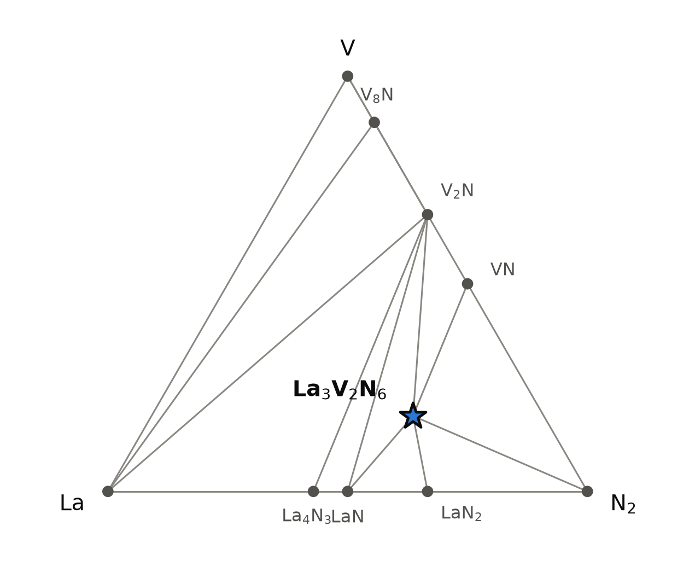
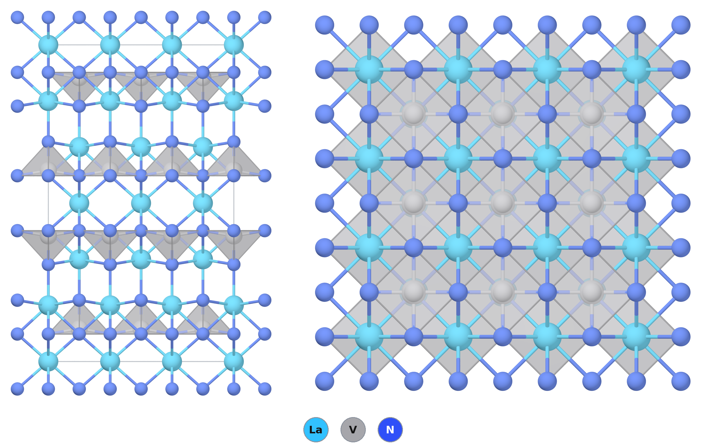
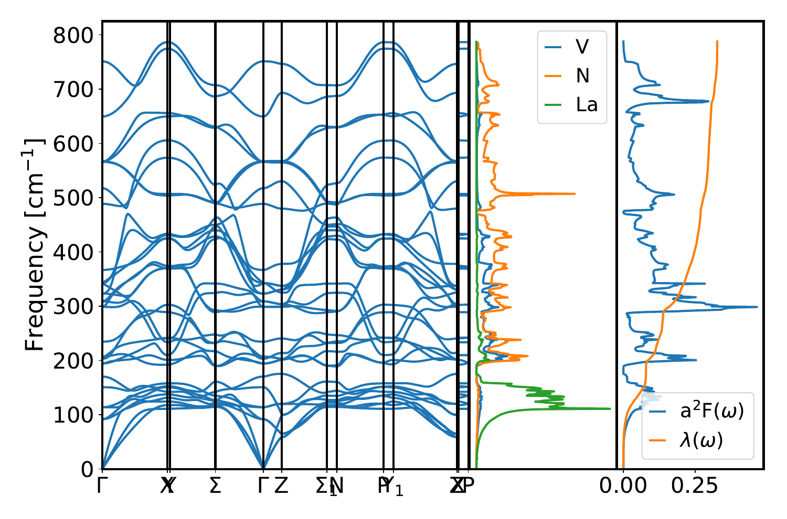

# La₃V₂N₆ — a layered nitride of lanthanum and vanadium, with vanadium in square pyramids

*A Material a Day · entry 14 · 27 October 2026 · status: **known** (structure reported in 2003)*

> **In one paragraph.** La₃V₂N₆ is a ternary nitride of lanthanum and vanadium. Its cell,
> a = 3.905 Å and c = 20.215 Å in I4/mmm at 155 K, was published in 2003, and it belongs to a family of Ln₃T₂N₆ nitrides (T = Nb, Ta)
> reported in 2001 under the title "isotypic to a high Tc cuprate superconductor".
> Double layers of VN₅ square pyramids, base to base, alternate with lanthanum. The
> charges add up only if vanadium sits between +4 and +5. The calculation makes the
> compound a non-magnetic metal, and the measurement agrees: black metallic crystals,
> temperature-independent (Pauli) paramagnetism, and no superconductivity down to 3 K. It
> was grown from the metals in a gallium flux at 1400 °C under flowing nitrogen; at
> 1800 °C only binary nitrides formed. It is on the computed hull in all four energy tables of the database,
> and in the PBE table it is the only ternary La–V–N phase there. The stored margin of 166 meV/atom is measured against binary
> nitrides; the PBE table also holds a computed La₂V₂N₅, not reported as far as we found,
> and against it and LaN the margin is 56 to 64 meV/atom. That is smaller than the scatter
> of computed against measured enthalpies for nitrides (84 meV/atom). PBE gets the a axis
> to 0.2 % and the c axis 1 % short. Phonons computed with PBEsol show no instability and
> a weak electron–phonon coupling (λ = 0.32), giving an isotropic Allen–Dynes Tc below
> 0.4 K. The compound is nitrogen-rich, so it needs nitrogen from the gas: a mixture of LaN
> and VN alone gives only half of it, with V₂N and LaN left over. The largest error of the
> calculation is the apical V–N bond, 3.4 % short in PBE, where the same bond in the
> niobium and tantalum sisters comes out right.

Computed numbers come from the Alexandria database; measured numbers carry a reference.

## 1. Identity

| | computed | measured |
|---|---|---|
| Formula | La₃V₂N₆ (stored as La3(VN3)2) | La₃V₂N₆ [1] |
| Alexandria id | `agm002346908` | |
| Space group | I4/mmm (no. 139), Z = 2 | I4/mmm [1] |
| a (Å) | 3.912 (PBE); 3.912 (PBE, Materials-Project settings); 3.864 (PBEsol) | 3.905 [1] |
| c (Å) | 20.022 (PBE); 20.025 (MP settings); 19.817 (PBEsol) | 20.215 [1] |
| Volume (ų) | 306.4 (PBE) | 308.3 [1] |
| Density (g cm⁻³) | 6.53 (PBE) | 6.49 (from the cell of [1]) |
| Structure type | Ln₃T₂N₆, the La₂CaCu₂O₆ arrangement | isotypic with Ln₃T₂N₆ (T = Nb, Ta) [2] |
| Formation energy | −1.316 eV/atom (PBE) | none found |
| Appearance, magnetism | metal, non-magnetic (PBE) | black metallic crystals; Pauli paramagnet [1] |

The measured cell is from a single crystal at 155 K [1]. PBE is 0.17 % long in a and 0.95 % short in c, 0.6 % small in volume. That is not the usual
pattern: PBE cells are normally a little long in every direction. PBEsol is 1.0 % short in
a and 2.0 % short in c. The c axis is short in PBE for the sister compounds too (section 3).
The CIF is [`La3(VN3)2.cif`](La3%28VN3%292.cif). No Wikipedia page on the compound was
found.

## 2. Where it sits

<picture>
  <source media="(prefers-color-scheme: dark)" srcset="phase_diagram_dark.png">
  
</picture>

The La–V–N system at 0 K (PBE table). Ten phases are on the hull; La₃V₂N₆ is the only one
with both metals.

| phase | formation energy (eV/atom, PBE) | on the hull? | reported? |
|---|---|---|---|
| **La₃V₂N₆** | −1.316 | yes, all four tables | yes [1] |
| La₂V₂N₅ (Pnnm) | −1.237 | 7.5 meV/atom above (PBE); on it with MP settings | no report found (one search) |
| La₂VN₃ (Cmce) | | 4.8 meV/atom above (MP settings) | not searched |
| LaN | −1.324 | yes, in a hexagonal P6₃mc cell; rock salt 11.8 meV/atom above | rock salt is the familiar form |
| LaN₂ | −0.906 | yes | not checked |
| La₄N₃, V₂N, VN, V₈N | | yes | |

La₃V₂N₆ shares tie lines with LaN, LaN₂, VN, V₂N and nitrogen. It sits on the
nitrogen-rich side of the LaN–VN line: 3 LaN + 2 VN has one nitrogen atom fewer than
La₃V₂N₆.

**Two different margins.** The database stores the depth of La₃V₂N₆ below its competitors
as 166 meV/atom (PBE). Recomputing the hull without La₃V₂N₆ gives:

| table | depth (meV/atom) | competing assemblage |
|---|---|---|
| PBE | 63.6 | La₂V₂N₅ + LaN |
| PBE, Materials-Project settings | 56.0 | La₂V₂N₅ + LaN |
| PBEsol | 165.8 | LaN₂ + VN + LaN (La₂V₂N₅ not computed) |
| SCAN (PBEsol cell) | 164.6 | LaVN₃ + VN + LaN (La₂V₂N₅ not computed) |
| PBE, binaries only | 166.0 | LaN₂ + VN + LaN |

The stored PBE number is the margin against binaries; the computed La₂V₂N₅ cuts it by
100 meV/atom. In the two tables that have La₂V₂N₅ the margins agree. La₂V₂N₅ has the same
vanadium valence as La₃V₂N₆ (+4.5) and is a hypothetical structure as far as our one search
went; if it does not exist, the larger margin is the relevant one.

## 3. Structure

*Left: a 3 × 3 × 1 block seen along a; VN₅ square pyramids grey. Right: the same block
seen down c.*

| site | Wyckoff | z | neighbours (PBE) | measured [1] |
|---|---|---|---|---|
| La1 | 2a | 0 | 8 N at 2.616 Å (a cube) | 2.629(5) Å |
| La2 | 4e | 0.177 | 1 N at 2.583, 4 N at 2.668, 4 N at 2.785 Å | 2.518(8), 2.716(5), 2.7765(9) Å |
| V | 4e | 0.397 | 1 N (apex) at 1.808, 4 N (base) at 1.984 Å | 1.873(9), 1.976(2) Å |
| N1 (base) | 8g | 0.087 | 2 V, 4 La | |
| N2 (apex) | 4e | 0.306 | 1 V, 5 La | |

Measured distances are those of the paper's single-crystal refinement at 155 K
(R1 = 0.024, 186 reflections) [1]; the paper labels the apical nitrogen N1 and the basal
one N2, the reverse of the database. The vanadium occupancy was refined and did not
differ significantly from full [1], unlike the tantalum site of La₃Ta₂₋ₓN₆ [2].

- **A double layer of pyramids.** Each vanadium has five nitrogen neighbours: four in a
  square, 0.33 Å below which the vanadium sits, and one at the apex. Pyramids share the
  corners of their bases to make a square VN₂ net; two such nets face each other base to
  base, with the La1 cube between them, and the apices point outward into the La2 layer.
- **The missing anion.** The two vanadium atoms across a double layer are 4.14 Å apart,
  and the place midway between them, where a perovskite would put a shared apical anion,
  is empty. The arrangement is that of the n = 2 Ruddlesden–Popper oxides (Sr₃Ti₂O₇) with
  that anion removed, which is the La₂CaCu₂O₆ structure of the cuprates; La1 takes the
  place of calcium. The 2001 paper on the niobium and tantalum members calls the family
  isotypic to a high-Tc cuprate [2].
- **Valence.** With La³⁺ and N³⁻, vanadium is +4.5: half an electron per vanadium in the d
  shell, shared over the VN₂ nets.
- **Where the calculation is off.** The basal V–N distance agrees with the measured one to
  0.4 %. The apical one is 3.4 % short in PBE (1.808 against 1.872 Å) and the La2–apex
  distance 2.5 % long; the La2 layer sits 0.06 Å farther from the double layer in the
  measured structure. The in-plane bonds are right and the errors are all along c, where
  the cell comes out short. The measured apical bond carries an uncertainty of 0.009 Å
  against a difference of 0.065 Å, so the error is on the side of the calculation.
- **The family.** 37 entries of the same database prototype and space group are on the PBE
  hull. Among the lanthanum compounds La₃Nb₂N₆ (stored depth 142 meV/atom), La₃Ta₂N₆ (139),
  La₃V₂N₆ (166), La₃Ti₂N₆ (51), La₃W₂N₆ (17) and La₃Mo₂N₆ (9) are on it, and La₃Hf₂N₆ (+63),
  La₃Mn₂N₆ (+52) and La₃Zr₂N₆ (+98) above it. Among the vanadium compounds, La, Ce and Ac
  are on the hull, and the smaller Y (+22.5), Ho (+24.5) and Lu (+116) above it, as are Ca
  (+191) and Sr (+209). The stored depths may, as for La₃V₂N₆, leave out computed ternary
  competitors. Experiment marks two of these: Y₃V₂N₆ and Ce₃V₂N₆ did not form under the
  conditions that gave La₃V₂N₆ [1], and no 3:2 phase was found in the Y–Nb, Y–Ta and Ce–Nb
  systems [2]. Y₃V₂N₆ above the hull is consistent with that; Ce₃V₂N₆, on the hull with a
  stored depth of 69 meV/atom, is not, though cerium's 4f shell makes it the least
  reliable of the set and one failed attempt is not proof of absence.
- **The calibration the family gives.** The measured cells of La₃Nb₂N₆ (a = 4.0698,
  c = 20.154 Å, 155 K) and La₃Ta₂N₆ (4.0674, 20.451 Å, 293 K) [2] against PBE (4.107,
  20.119 and 4.088, 20.165 Å): a is 0.9 and 0.5 % long, c is 0.2 and 1.4 % short. A short c
  is common to the family in PBE. The bonds are a sharper test. In La₃Nb₂N₆ PBE gives the
  apical Nb–N as 1.961 Å against 1.955(10) Å measured, and the basal one as 2.081 against
  2.0615(10) Å; in La₃Ta₂N₆ 1.957 against 1.96(3) Å and 2.067 against 2.053(3) Å [2] (our
  distances from the stored PBE structures). So for niobium and tantalum the apical bond
  is right to 0.3 % and the basal one 0.7 to 1 % long, the usual PBE pattern; only for
  vanadium is the apical bond 3.4 % short. That points to the treatment of the vanadium
  3d shell rather than to the structure type. The vanadium compound has an a axis 4 %
  smaller than its niobium and tantalum sisters.

## 4. Properties

### Electronic

PBE gives a metal, with no gap in PBE or in SCAN, and 2.4 states/eV at the Fermi level per
formula unit (the stored primitive cell). The graph-neural-network estimates of the PBE and
the MBJ gap are both zero. No spin polarisation survives in the PBE calculation (total
moment 0). With half a d electron per vanadium in square nets, a metal is the expected
outcome of a band calculation, and the paper's own full-potential GGA calculation found
the same, with the Fermi level in the V d_xy, d_xz and d_yz bands [1].

The measurement agrees. The crystals are black and metallic, and the susceptibility of
about ten crystals (0.3 mg in all, at 10 and 100 Oe) is temperature-independent, which
the authors read as Pauli paramagnetism: no local moments and no magnetic order [1]. No
resistivity was measured. The paper set out to test whether the more contracted 3d
orbitals of vanadium would bring the correlation of the cuprates into this structure;
the answer was a plain metal, like the niobium and tantalum members [1, 2]. No dielectric
or transport table exists for a metal.

### Lattice dynamics and superconductivity

<picture>
  <source media="(prefers-color-scheme: dark)" srcset="phonons_dark.png">
  
</picture>

*Phonon dispersion, phonon density of states by element, and the Eliashberg function
α²F(ω) with the cumulative coupling λ(ω). Quantum ESPRESSO, density-functional
perturbation theory, PBEsol, on the PBEsol-relaxed cell (a = 3.864, c = 19.808 Å).*

| | computed (PBEsol) |
|---|---|
| imaginary modes | none |
| top of the spectrum | 787 cm⁻¹ |
| λ | 0.32 |
| ω_log | 392 K |
| Allen–Dynes Tc, μ* = 0.10 / 0.16 | 0.34 K / 0.007 K |
| zero-point energy | 62 meV/atom |
| graph-neural-network estimate (PBE cell) | λ 0.32, ω_log 380 K, Tc 0.9 K |

- **Dynamically stable** in the harmonic approximation: the stored structure is a minimum.
- Lanthanum vibrates below 170 cm⁻¹; vanadium and nitrogen fill the range above, with the
  nitrogen modes on top.
- **No useful superconductivity.** The coupling is weak and spread over the whole
  spectrum. The Tc is an isotropic Allen–Dynes estimate, below half a kelvin for any
  reasonable μ*; it ignores magnetism and correlation in the vanadium d band, which could
  only make matters worse for a phonon superconductor. The measurement found no
  diamagnetic transition down to 3 K [1], consistent with the estimate but no test of it,
  since 0.34 K is far below 3 K. Among the sisters, some samples of La₃Nb₂N₆ showed a
  diamagnetic transition below 4 K (about 20 % of the volume), which the authors left
  open between superconductivity and an impurity; La₃Ta₂N₆ showed none down to 3 K [2].
- These numbers are PBEsol, on a cell 4 % smaller in volume than the measured one; the
  rest of the entry is PBE.

### Mechanical (machine-learned)

| bulk modulus | shear modulus | Young's modulus | B/G |
|---|---|---|---|
| 163 GPa | 95 GPa | 196 GPa | 1.7 |

Screening estimates from a graph neural network on the PBE structure; no measured elastic
constant was found.

### Not computed

Magnetism beyond the spin-polarised PBE run, correlation in the vanadium d shell (a
Hubbard U or beyond), spin–orbit effects, defects and nitrogen non-stoichiometry, and any
finite-temperature property.

## 5. Is it stable?

On all four hulls (PBE, PBE with MP settings, PBEsol, SCAN). The margins depend on which
competitors a table holds: 63.6 meV/atom (PBE) and 56.0 (MP settings) below La₂V₂N₅ + LaN,
and 158 to 205 meV/atom below the binary nitrides in all four tables (section 2).

**How much that margin is worth.** For nitrides the calorimetric survey behind these tools
finds computed formation enthalpies on average 35 meV/atom too negative, with a scatter of
84 meV/atom (14 compounds). For VN itself the computed value is 223 meV/atom more
negative than the measured one. The margin against binaries is larger than the scatter; the
margin against La₂V₂N₅ + LaN is smaller than it. The second comparison is between two
computed ternary nitrides of the same vanadium valence, where much of the error should
cancel, but that is an argument, not a measurement. What settles the question is
experiment: the compound has been made and its structure refined [1]. The same paper
gives an upper temperature: at 1800 °C under nitrogen only the binary nitrides formed.

## 6. How to make it

### What is done

**La₃V₂N₆ [1].** Lanthanum, vanadium and gallium in the ratio 3:2:9, in a vanadium
crucible, heated in an RF furnace at 1400 °C, first under flowing argon for 12 h and then
under flowing nitrogen for 2 to 3 days. Part of the gallium evaporated. The product was a
mixture of binary nitrides and black metallic platelets of La₃V₂N₆; microprobe analysis
gave La:V close to 3:2 and confirmed nitrogen without quantifying it. At 1800 °C the same
charge gave only binary nitrides, and Y₃V₂N₆ and Ce₃V₂N₆ did not form at 1400 °C. The
crystals were stable in air for at least several days. The gallium is a solvent for the
metals; the authors chose it because GaN is unstable above about 800 °C under 1 atm N₂, so
the flux does not hold on to the nitrogen.

**The niobium and tantalum members [2]** were made the same way at 1600 °C (2 days under
N₂), and also from a Li₃N flux: Ln:T:Li₃N 3:2:10 sealed in tantalum or niobium ampoules,
1030 °C for 60 h, the lithium matrix then dissolved in water to leave air- and
moisture-stable crystals.

**Against the calculation.**

- *Nitrogen from the gas*, as the calculation requires: both published routes supply it,
  from N₂ or from Li₃N. The first-ranked closed routes (A to C below) are not what was done;
  the published route is closest to route D, with the metals in place of the binary
  nitrides and gallium as the medium.
- *The top of the window.* The calculation puts the end of the nitrogen window in 1 bar
  N₂ near 2300 °C; the experiment found binary nitrides at 1800 °C. The estimate is at
  least 500 K too high, as expected from a model that ignores the entropy of the solids.
- *The flux.* At 0 K gallium attacks La₃V₂N₆ mildly (−30 meV/atom, to GaN and LaGa₃),
  and the metals in the 3:2:9 charge go to gallides (La₂VGa₆, V₂Ga, LaGa₂). Neither result
  describes 1400 °C under N₂, where GaN is not stable; the 0 K contact table misses this.
- *The crucible.* At 0 K vanadium metal reduces La₃V₂N₆ (−48 meV/atom, to LaN and V₂N),
  yet a vanadium crucible was used. Under flowing nitrogen at 1400 °C the crucible wall is
  itself nitrided, so the 0 K contact is again not the condition that matters.
- *Water.* The calculation has water decompose the compound (below); the vanadium
  crystals survive air for days, and the niobium and tantalum crystals were washed in
  water. Kinetics protects them; how the vanadium compound fares in water was not reported.

### What the calculation proposes

Reaction energies at 0 K, from the hull built on the Materials-Project-settings table.

| route | charge | ΔE (meV/atom of charge) | comment |
|---|---|---|---|
| A (rank 1) | LaN + La₂V₂N₅ | −56 | La₂V₂N₅ is a computed phase, not a reagent |
| B (rank 2) | 3 LaN₂ + 2 V | −566 | LaN₂ is not a bottle |
| C (rank 5) | 2 LaN + 2 VN + LaN₂ | −158 | the only closed route from the binary nitrides |
| D (gas) | 3 LaN + 2 VN + ½ N₂ | −199 at 0 K; about −110 in 1 bar N₂ at 1000 °C | our arithmetic from the stored formation energies |
| E (no gas) | 3 LaN + 2 VN | −4 | **fails**: ½ La₃V₂N₆ + 1.5 LaN + ½ V₂N |
| F (ammonia) | 1.5 La₂O₃ + V₂O₅ in NH₃ | about −12.5 eV per formula unit | our arithmetic; needs μ_O below −2.9 eV, which NH₃ gives (−4.2 eV at 1000 °C) |

- **The compound needs nitrogen from the gas.** La₃V₂N₆ lies on the nitrogen-rich side of
  every pair of binary nitrides that could be bought, so a closed charge either uses LaN₂
  as the nitrogen carrier (route C) or comes up short (route E, which gives half the target,
  LaN and V₂N). With flowing nitrogen the binaries go to the target (route D): the firing
  window in nitrogen is open at the top, and at 1000 °C it closes only at μ_N = −2.28 eV,
  far below the −0.97 eV of nitrogen gas at 1 bar; the tool puts the end of the window
  in 1 bar N₂ near 2300 °C, an estimate that ignores the entropy of the solids. In the
  experiment the limit lies below 1800 °C (above); a charge in argon or vacuum is a
  different matter again.
- **From the oxides under ammonia** (route F), the usual way to oxide-derived nitrides:
  ammonia sets the oxygen potential low enough to strip all the oxygen, with 1.3 eV to
  spare. The oxide energies here are uncertain in the direction that makes this look
  harder than it is: the calculation overbinds La₂O₃ by 152 meV/atom against calorimetry.
  The reaction energy is per formula unit because the oxygen leaves as water.
- **Both ends of the temperature window.** No melting point of LaN or VN is on file, so
  the tools give no Tammann floor; both are refractory, and a powder reaction between them
  would need a high temperature or a flux, which is why a flux was used [1]. Sodium is on
  a tie line with La₃V₂N₆ (inert in the calculation). The measured top is below 1800 °C
  under nitrogen [1].
- **Metathesis, tested.** 3 LaCl₃ + 2 VCl₄ + 6 Li₃N gives LiCl and 75 % La₃V₂N₆, with LaN,
  V₂N and Li₇VN₄ beside it (−604 meV/atom): the extra lithium reduces part of the vanadium.
  Balancing lithium against chlorine and making up the nitrogen with a little NaN₃ raises
  the yield to 97 %. With Ca₃N₂ instead of Li₃N the yield is 69 %, with Ca₂VN₃ beside it.
  These routes are not practical as written: VCl₄ is a molecular liquid and Li₃N is
  volatile by 1000 °C. Water attacks the product in the calculation, but the sister
  compounds survived a water wash [2], so washing out the salt may work; it has not been
  tried on the vanadium compound. LiCl, NaCl and CaCl₂ are inert towards La₃V₂N₆ in the
  calculation, so a salt melt is a possible medium. A Li₃N flux in a tantalum or niobium
  ampoule, as used for the sisters [2], would not suit: both metals react with La₃V₂N₆
  (below).

### What it tolerates

| inert in the calculation | reacts |
|---|---|
| Mo, W, Fe, Ni, Cu, Co, Cr, Ag, Au, Pd, Rh, Ir, Ru, Sn, Pb, Zn, Na | Ta (−127, → La₃Ta₂N₆ + LaN + V₂N), Nb (−95), V (−48, → LaN + V₂N), Ga (−30), Zr, Ti, Al, Si, Pt (−50) |
| BN, AlN, MgO, CaO, Y₂O₃, BeO, graphite | Al₂O₃ (−104), SiO₂ (−151), ZrO₂ (−72), Si₃N₄ (−40), TiO₂, SiC |
| N₂ | O₂, H₂O (−213, → VN + LaO(OH) + NH₃), CO₂, H₂ |
| alkali halides, CaCl₂, BaCl₂ | MgCl₂, borates, carbonates, sulfates, nitrates, molybdate, tungstate |

- **Boron nitride, molybdenum or tungsten**, not alumina or silica, which react; tantalum
  and niobium react too. The vanadium crucible of the published synthesis [1] is on the
  reacting side at 0 K but served under flowing nitrogen (section above).
- **Dry nitrogen at temperature.** Air and moisture decompose it in the calculation, water
  to vanadium nitride, lanthanum oxide-hydroxide and ammonia. At room temperature the
  crystals last in air for at least several days [1]; fine powder, with far more surface,
  is best kept in a glovebox until its behaviour is known.

### Powder pattern

Computed, Cu Kα, at the measured cell and coordinates [1]. Lines above 10 % of the
strongest:

| hkl | 101 | 006 | 105 | 110 | 116 | 200 | 1 0 11 | 1 1 10 | 215 |
|---|---|---|---|---|---|---|---|---|---|
| 2θ (°) | 23.20 | 26.45 | 31.86 | 32.42 | 42.32 | 46.51 | 55.24 | 56.41 | 57.48 |
| I | 30 | 14 | 100 | 59 | 32 | 31 | 12 | 10 | 37 |

The PBE cell moves the 00l lines up by about 0.3° (006 at 26.71°) and the hk0 lines down
slightly (110 at 32.37°); index against the measured cell.

- **Lines of LaN and V₂N:** too little nitrogen (route E).
- **Lines of La₂O₃, LaO(OH) or a vanadium oxide:** air or moisture got in.
- **Lines of LaN and VN without V₂N:** the reaction under nitrogen did not go to
  completion, or the charge was fired too hot; the published flux product also held
  binary nitrides beside the crystals [1].

### Hazards

Lanthanum and vanadium nitrides react with water and release ammonia; vanadium compounds
are toxic. Li₃N and alkali metals react violently with water, sodium azide is acutely
toxic, and ammonia at high temperature needs a ventilated furnace.

## 7. What it is used for

We found no use. The interest in the family has been fundamental: nitrides that adopt a
cuprate superconductor's structure, made to see whether the structure brings the
electronic behaviour with it [1, 2]. For La₃V₂N₆ it did not: the measured compound is a
Pauli-paramagnetic metal, not superconducting down to 3 K [1], and the calculation gives
no reason to expect phonon-mediated superconductivity (section 4).

## 8. How this could be wrong

- **The measured compound rests on one paper [1].** Its nitrogen content was not measured
  (the microprobe could not quantify it), the crystals were picked from a mixture with
  binary nitrides, the magnetic measurement used 0.3 mg of crystals and went down to
  3 K, and no transport was measured. No later report was found.
- **The margin depends on La₂V₂N₅**, a computed phase not reported as far as we found. Its
  structure has not been checked here; if it is an artefact, the margin is 158 to 205
  meV/atom.
- **Correlation in the vanadium d shell** is not treated. PBE puts the moment to zero and
  the measurement agrees [1]; a calculation with a Hubbard U might put a moment back,
  and would then be the worse description.
- **The apical V–N distance** is 3.4 % short in PBE, seven times the uncertainty of the
  measured bond [1], while PBE gets the same bond right in the niobium and tantalum
  sisters [2]. Why is not settled here.
- **The routes are 0 K thermodynamics**; route D and F energies are our own arithmetic from
  stored formation energies and gas potentials, not tool outputs, and nothing here says
  how fast LaN and VN react.
- **The Tc** is an isotropic Allen–Dynes estimate from PBEsol phonons on a cell 4 % small
  in volume.

## 9. Literature

**Searched (OpenAlex, Crossref, arXiv, web), 25 October 2026:** "La3V2N6 ternary nitride"
([1] and its ChemInform abstract, otherwise unrelated nitride work); "lanthanum vanadium
nitride" (nothing on the compound); "La2V2N5 OR La-V-N ternary nitride synthesis lanthanum
vanadium" (nothing); "La2V2N5" (no hits); "Gál DiSalvo lanthanum nitride vanadium Li3N flux
crystals" (no hits); "lanthanum vanadium nitride La3V2N6 superconductivity magnetic
susceptibility" (nothing on the compound); "Ln3T2N6 lanthanum niobium tantalum nitride
La3Nb2N6 La3Ta2N6 sodium flux" and "ternary nitrides Ln3T2N6 synthesis structure Gál
DiSalvo" (nothing in the indexes); a web search for the family, which found [2] through its
database records. Wikipedia: no page for
La3V2N6, La3(VN3)2, "lanthanum vanadium nitride" or the systematic name. No measured
formation enthalpy of La₃V₂N₆ was found.

1. Z. A. Gál, L. Cario, F. J. DiSalvo, "Synthesis, structure and magnetic properties of the
   ternary nitride La₃V₂N₆", *Solid State Sci.* 5, 1033 (2003).
   doi:10.1016/S1293-2558(03)00135-3 — *full text read.* The structure is also in the
   Crystallography Open Database, entry 1533194,
   https://www.crystallography.net/cod/1533194.html (record read), from which the powder
   pattern was computed.
2. L. Cario, Z. A. Gál, T. P. Braun, F. J. DiSalvo, B. Blaschkowski, H.-J. Meyer,
   "Ln₃T₂N₆ (Ln = La, Ce, Pr; T = Ta, Nb), a new family of ternary nitrides isotypic to a
   high Tc cuprate superconductor", *J. Solid State Chem.* 162, 90 (2001).
   doi:10.1006/jssc.2001.9359 — *full text read.* Its La₃Nb₂N₆ and La₃Ta₂N₆ structures are
   COD entries 1004013 and 1004015 (records read).

## 10. Provenance

- **Data:** Alexandria database, tables `energy_runs_pbe`, `energy_runs_pbe_mp`,
  `energy_runs_ps` (PBEsol) and `energy_runs_scan` (SCAN at the PBEsol geometry); the
  group's phonon and electron–phonon calculations (Quantum ESPRESSO, PBEsol); measured
  cells, distances, synthesis and magnetic data from [1] and [2], with their structures
  in the Crystallography Open Database. Reaction energies, contact reactions and
  chemical-potential windows come from the hull and reaction table built on `pbe_mp`.
- **Tools:** the reaction-route code of this group, pymatgen, POV-Ray; machine-learned
  moduli, gap and coupling from graph neural networks.
- **Authorship:** drafted by Claude (Anthropic) from those tools; reviewed by
  Miguel Marques. Corrections are welcome as issues on this repository.
