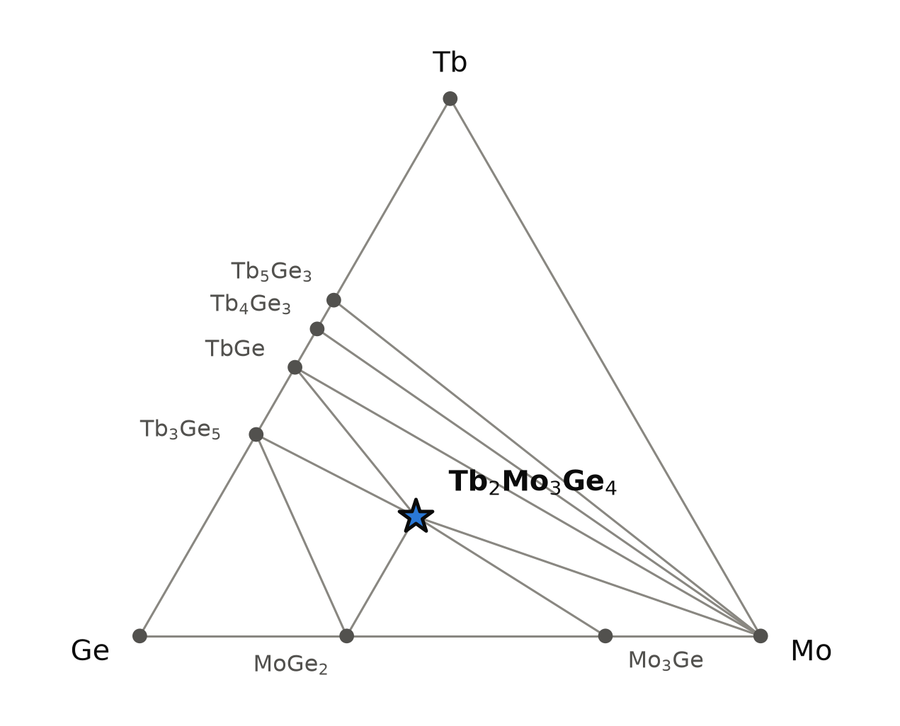
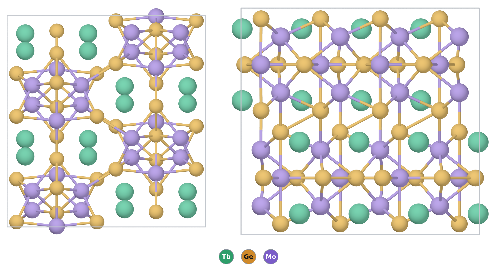

# Tb₂Mo₃Ge₄ — a terbium molybdenum germanide built from MoGe₆ octahedra and Ge₂ pairs

*A Material a Day · entry 15 · 28 October 2026 · status: **known** (made and measured in 1996; the database stores a different arrangement of terbium and molybdenum from the one reported)*

> **In one paragraph.** Tb₂Mo₃Ge₄ is a ternary intermetallic compound of terbium,
> molybdenum and germanium, made in 1996 by arc-melting the elements [1]. It belongs to the
> Gd₅Si₄ family: each molybdenum sits in an octahedron of germanium, the germanium atoms
> come in pairs, and terbium fills the gaps. Of the five metal sites of Gd₅Si₄, three are
> taken by molybdenum and two by terbium, and there are two ways of doing that. The
> measured powder pattern was indexed in the orthorhombic one (Pnma, Ce₂Sc₃Si₄ type) [1];
> the database holds only the monoclinic one (P2₁/c, U₂Mo₃Si₄ type). The stored structure is
> on the Tb–Mo–Ge hull, 36 meV/atom below its neighbours in both PBE tables, and a
> machine-learned potential puts the measured arrangement 14 meV/atom lower still. The
> volume per formula unit agrees with the measured one to 0.4 % (PBE). Terbium carries a
> full Tb³⁺ moment and orders antiferromagnetically at 9 K [1]; the calculation, which tried
> only ferromagnetic order, says nothing about that. The main caveats: the measured
> arrangement has no DFT energy, and the calorimetric survey we use has no class for
> intermetallics.

Computed numbers come from the Alexandria database unless marked as machine-learned;
measured numbers carry a reference.

## 1. Identity

| | computed | measured [1] | off by |
|---|---|---|---|
| Formula | Tb₂Mo₃Ge₄ (stored as Tb2Ge4Mo3) | Tb₂Mo₃Ge₄ | |
| Alexandria id | `agm005676656` | | |
| Space group | P2₁/c (no. 14), Z = 2, 18 atoms per cell (stored) | Pnma (no. 62), Z = 4, 36 atoms per cell | different arrangement |
| a, b, c (Å) | stored cell: 7.013, 7.046, 6.927, β = 109.6° (PBE); 7.006, 7.069, 6.938, β = 109.3° (PBE, Materials-Project settings, 4f in the core) | 6.921(1), 13.149(1), 7.062(2) | not comparable axis by axis |
| a, b, c of the Pnma model (Å) | 6.945, 13.247, 7.055 (machine-learned potential, see section 3) | 6.921, 13.149, 7.062 | +0.3 %, +0.7 %, −0.1 % |
| Volume per formula unit (ų) | 161.25 (PBE); 162.15 (MP settings); 162.27 (Pnma model) | 160.61 | +0.4 %; +1.0 %; +1.0 % |
| Density (g cm⁻³) | 9.23 (PBE) | 9.26 (from the measured cell) | −0.4 % |
| Structure type | U₂Mo₃Si₄ (prototype label A2B3C4_mP18_14_e_ae_2e) | Ce₂Sc₃Si₄ (called an ordered Sm₅Ge₄ type in [1]) | different arrangement |
| Formation energy | −0.506 eV/atom (PBE) | none found | |

The measured cell was refined from room-temperature X-ray powder data with a silicon
standard [1]. The volume per formula unit is the one comparison that does not depend on
the arrangement: PBE is 0.4 % above the measurement, inside the usual 0.5 to 2 % by which
PBE runs long, with the 4f-in-core calculation at 1.0 %. The yttrium analogue, also
measured in Pnma [1] (a = 6.912, b = 13.134, c = 7.067 Å, 160.36 ų per formula unit), is
stored monoclinic (`agm005676098`, 161.20 ų, +0.5 %). The CIF of the stored structure is
[`Tb2Ge4Mo3.cif`](Tb2Ge4Mo3.cif); the Pnma model is
[`Tb2Mo3Ge4_Pnma_model.cif`](Tb2Mo3Ge4_Pnma_model.cif). No Wikipedia page on the compound or
on the structure type was found.

## 2. Where it sits

<picture>
  <source media="(prefers-color-scheme: dark)" srcset="phase_diagram_dark.png">
  
</picture>

The Tb–Mo–Ge system at 0 K (PBE table). Ten phases are on the hull; Tb₂Mo₃Ge₄ is the only
ternary one.

| phase | composition (at.% Tb / Mo / Ge) | formation energy (eV/atom) |
|---|---|---|
| Ge, Mo, Tb | corners | 0 |
| MoGe₂ | 0 / 33.3 / 66.7 | −0.159 |
| Mo₃Ge | 0 / 75 / 25 | −0.146 |
| Tb₃Ge₅ | 37.5 / 0 / 62.5 | −0.703 |
| TbGe | 50 / 0 / 50 | −0.838 |
| Tb₄Ge₃ | 57.1 / 0 / 42.9 | −0.842 |
| Tb₅Ge₃ | 62.5 / 0 / 37.5 | −0.761 |
| **Tb₂Mo₃Ge₄** | 22.2 / 33.3 / 44.4 | −0.506 |

Tb₂Mo₃Ge₄ shares tie lines with MoGe₂, Mo₃Ge, molybdenum, TbGe and Tb₃Ge₅. Its formation
energy is small beside those of the terbium germanides; most of it is the terbium–germanium
bonding, and the molybdenum germanides are weakly bound (−0.15 eV/atom). Two binaries of
the Mo–Ge system are above this hull: Mo₅Ge₃ (W₅Si₃-type cell, I4/mcm) by 41 meV/atom and
MoGe₂ in the MoSi₂ structure by 21 meV/atom; the stored MoGe₂ on the hull is an
orthorhombic Pnma cell.

**The tie line to molybdenum is marginal.** In the PBE table it exists; on the hull with
Materials-Project settings, molybdenum and Tb₂Mo₃Ge₄ react to TbGe and Mo₃Ge by 1.2
meV/atom. That is no difference at all at this accuracy, and it matters for the choice of
container (section 6). If the measured arrangement is lower than the stored one, as the
potential says (section 5), the tie line to molybdenum would be secured.

## 3. Structure

*The measured arrangement (Pnma model, see below): a 2 × 1 × 2 block seen along a (left)
and down c (right). Only Mo–Ge and Ge–Ge contacts up to 2.8 Å are drawn; terbium is shown
as bare balls, which sit in pairs.*

**Two ways to colour one framework.** In the Gd₅Si₄ type the metal atoms form pseudo-cubes
around a metal-centred octahedron of tetrel atoms. In a 2:3:4 compound, two of the five
metal sites go to the rare earth and three to molybdenum, which can happen in two ways
[5]. In the Ce₂Sc₃Si₄ (Sc₂Mo₃Si₄) colouring, Pnma, the rare-earth atoms all occupy one face
of each pseudo-cube and come in close pairs; in the U₂Mo₃Si₄ colouring, P2₁/c, they sit in
pairs on opposite sides. The germanide paper indexed all of Tb, Dy, Ho, Er, Tm, Lu and Y₂Mo₃Ge₄
in Pnma, with good agreement between observed and calculated intensities on atom
parameters taken from U₂Nb₃Ge₄, and found them different from the corresponding silicides,
which take the U₂Mo₃Si₄ type [1]. The database computed terbium only in the monoclinic
colouring.

**The Pnma model.** To have something to compare with, we put terbium on the scandium sites
of the stored Pnma Sc₂Mo₃Ge₄ (`agm003244917`) and relaxed cell and atoms with the
machine-learned potential TugaFF (trained on PBE data). It stays Pnma:

| site | Wyckoff | x, y, z | neighbours (model) |
|---|---|---|---|
| Tb | 8d | 0.009, 0.592, 0.332 | 7 Ge at 2.84–3.02 Å; 1 Tb at 3.40 Å |
| Mo1 | 8d | 0.833, 0.627, 0.842 | 6 Ge at 2.60–2.72 Å (octahedron) |
| Mo2 | 4c | 0.666, ¾, 0.506 | 6 Ge at 2.68–2.76 Å (octahedron) |
| Ge1 | 8d | 0.832, 0.453, 0.047 | 4 Mo; 1 Ge at 2.733 Å; 4 Tb |
| Ge2 | 4c | 0.032, ¾, 0.633 | 6 Mo; 1 Ge at 2.752 Å; 2 Tb |
| Ge3 | 4c | 0.812, ¾, 0.143 | 4 Mo; 1 Ge at 2.752 Å; 4 Tb |

And the stored monoclinic structure (PBE), from which all the computed properties below come:

| site | Wyckoff | x, y, z | neighbours (PBE) |
|---|---|---|---|
| Tb | 4e | 0.443, 0.670, 0.811 | 7 Ge at 2.85–3.03 Å; 4 Mo at 3.29–3.34 Å |
| Mo1 | 2d | 0, ½, ½ | 6 Ge at 2.710–2.724 Å (octahedron) |
| Mo2 | 4e | 0.252, 0.161, 0.750 | 6 Ge at 2.569–2.691 Å (octahedron) |
| Ge1 | 4e | 0.139, 0.454, 0.908 | 4 Mo at 2.59–2.72 Å; 1 Ge at 2.733 Å; 4 Tb |
| Ge2 | 4e | 0.134, 0.863, 0.498 | 5 Mo at 2.57–2.72 Å; 1 Ge at 2.679 Å; 3 Tb |

- **What the two share.** Molybdenum in octahedra of germanium (2.57 to 2.76 Å), no Mo–Mo
  bond (3.03 Å in the model, 3.05 Å in the stored cell, against 2.73 Å in bcc molybdenum in
  the same PBE table), and every germanium with exactly one germanium neighbour at 2.68 to
  2.75 Å. These Ge₂ pairs, including the one linking neighbouring pseudo-cubes, are what
  distinguish the Gd₅Si₄ type from Sm₅Ge₄ [5, 6]; the model has both, so the name "ordered
  Sm₅Ge₄" used in [1] is, as [5] notes for the silicides, strictly a cation-ordered Gd₅Si₄.
- **What differs.** Terbium neighbours. In the model each terbium has a terbium neighbour
  at 3.40 Å; in the stored cell the shortest Tb–Tb distance is 3.47 Å and a Tb–Mo contact
  takes its place, the second-shell difference [5] points to.
- **Charge goes from terbium to germanium** (stored structure). Bader charges are +1.29 on Tb,
  −0.87 and −0.74 on the two germanium sites and +0.20 to +0.24 on Mo (DDEC6: +1.05, −0.76,
  −0.61, +0.12 to +0.25). Molybdenum is nearly neutral.
- **The family.** In the silicides, Sc₂Mo₃Si₄ and Lu₂Mo₃Si₄ are Pnma and Y₂Mo₃Si₄ is
  monoclinic, all by single-crystal or Rietveld refinement, with no Sc/Mo or Lu/Mo mixing
  [5]. That paper's DFT (WIEN2k, PBE with spin–orbit) puts the monoclinic colouring of
  Y₂Mo₃Si₄ lower, by a margin printed as 1.82 eV per formula unit and described as small;
  as printed it would be 200 meV/atom, which does not fit "small", so we do not use the
  number. In `energy_runs_pbe`, 40 compounds with Mo or W and Si or Ge are in the monoclinic
  type. The heavy-rare-earth molybdenum germanides computed are all on the hull in it: Y (30
  meV/atom deep), Tb (36), Dy (35), Ho (31), Er (42), Tm (38). Every one of them that was
  measured, Y, Tb, Dy, Ho, Er and Tm, is Pnma [1]; Sc₂Mo₃Ge₄ is the only germanide stored in
  Pnma. Lu₂Mo₃Ge₄ is reported [1] and not stored; no Gd₂Mo₃Ge₄ is stored or reported.

## 4. Properties

Terbium has an open 4f shell (4f⁸ for Tb³⁺), which plain PBE treats as itinerant bands.
The electronic numbers below are therefore taken from the yttrium analogue Y₂Mo₃Ge₄ where
the 4f states interfere, and we say so each time. All computed properties are for the
stored monoclinic arrangement.

### Electronic

Tb₂Mo₃Ge₄ is a metal in every calculation: PBE gap 0 (smallest direct gap 0.004 eV), the
graph-neural-network gap and MBJ estimate 0, and the Y analogue also metallic in PBE.

| density of states at the Fermi level (states eV⁻¹ per 18-atom cell) | |
|---|---|
| Tb₂Mo₃Ge₄, PBE, 4f as valence | 20.6 |
| Tb₂Mo₃Ge₄, PBE with Materials-Project settings, 4f in the core | 8.9 |
| Y₂Mo₃Ge₄, PBE | 9.1 |
| machine-learned estimate for Tb₂Mo₃Ge₄ | 8.3 |

The extra 11.7 states/eV in the first row are terbium 4f states pinned at the Fermi
level, an artefact of treating the 4f shell as bands; the 4f-in-core calculation and the
yttrium analogue agree on about 9 states/eV per cell, or 0.5 per atom. The measurements
agree on a metal without local moments where there is no 4f shell: Y₂Mo₃Ge₄ and
Lu₂Mo₃Ge₄ show temperature-independent paramagnetism [1] (for Lu, χ = 4.4 × 10⁻⁶ cm³ g⁻¹ at
5 K and 1.4 × 10⁻⁶ at 300 K), and the Sc, Y and Lu molybdenum silicides are poor metals
(residual resistivity ratios 1.28 to 2.63) with no order down to 1.8 K, their DFT Fermi
level in a pseudo-gap of the density of states in both colourings [5]. The resistivity of
Tb₂Mo₃Ge₄ was not measured.

### Magnetism

| | computed (PBE, ferromagnetic only) | measured [1] |
|---|---|---|
| moment | 5.74 μB spin moment per Tb | effective moment 9.77 μB per Tb (free Tb³⁺ ion: 9.72) |
| order | ferromagnetic assumed | antiferromagnetic below T_N = 9 K |
| Curie–Weiss temperature | | θ_p = +4.0 K |
| field response | | metamagnetic transition at 5 kOe (5 K) |

The measured effective moment is that of a free Tb³⁺ ion to 0.5 %, so the 4f shell is
localised and trivalent, which is what the 4f-in-core calculation assumes. The PBE spin
moment cannot be compared with it: it lacks the orbital part, which needs spin–orbit
coupling. Only ferromagnetic order was computed, while the compound orders
antiferromagnetically; the positive θ_p led the authors to propose ferromagnetic terbium
planes coupled antiferromagnetically, and the ordering temperatures across Tb, Dy, Ho and Er
roughly follow the de Gennes factor, the sign of coupling through the conduction electrons
[1]. The magnetic structure was not determined.

### Charge transport

A metal, so the Seebeck table is skipped. For the record, the rigid-band values at 10²⁰
cm⁻³ and 300 K are below 13 μV/K in magnitude for both compounds, with no meaning for a
metal.

### Mechanical (machine-learned)

| bulk modulus | shear modulus | Young's modulus | B/G |
|---|---|---|---|
| 128 GPa | 73 GPa | 201 GPa | 1.75 |

Screening estimates from a graph neural network on the stored PBE structure; no measured
value was found.

### Superconductivity (machine-learned)

The network gives λ = 0.35, ω_log = 194 K and Tc = 0.24 K. That is a screening estimate
for a non-magnetic metal; Tb₂Mo₃Ge₄ orders magnetically at 9 K, so it does not apply.

### Not computed

Phonons (neither Tb₂Mo₃Ge₄ nor Y₂Mo₃Ge₄ is among the group's lattice-dynamics
calculations), the measured Pnma arrangement in DFT, any magnetic order other than
ferromagnetic, spin–orbit coupling, a localised-4f treatment with the moments restored, the
dielectric and transport tables (not stored for these metals), and any finite-temperature
property.

## 5. Is it stable?

The stored structure is on both hulls, with the same margin: **35.7 meV/atom** below its
competitors in PBE and **36.3** with Materials-Project settings. The competing assemblage is
Mo₃Ge with terbium germanides (TbGe and Tb₃Ge₅ in PBE; Tb₃Ge₄ and Tb₃Ge₅ with
Materials-Project settings).

- **The measured arrangement is probably lower.** With the machine-learned potential, both
  colourings relaxed:

  | | Pnma minus P2₁/c, potential (meV/atom) | same, DFT (meV/atom) |
  |---|---|---|
  | Sc₂Mo₃Ge₄ | −25.2 | −23.6 (Materials-Project settings) |
  | Y₂Mo₃Ge₄ | −18.5 | not computed |
  | Tb₂Mo₃Ge₄ | −13.9 | not computed |

  The one case with a DFT answer is reproduced to 1.6 meV/atom, and for Tb and Y the
  potential agrees with the measured structure. One calibration point does not give an error
  bar; machine-learned potentials typically err by more than 10 meV/atom on single
  structures, so the 14 meV/atom for terbium is a direction, not a number. If PBE agreed,
  Tb₂Mo₃Ge₄ would be about 50 meV/atom below its competitors, and the stored structure a
  metastable colouring of the real compound.
- **The two tables agree although they treat the 4f shell differently**, the PBE table as
  valence and the Materials-Project-settings table in the core. Within one structure type
  and with terbium on both sides of the decomposition, the 4f error largely cancels.
- **How much the margin is worth.** The calorimetric survey behind these tools has no class
  for intermetallics or germanides and holds no measured formation enthalpy of any Tb–Ge
  or Mo–Ge compound, so we have no experimental error bar. Its tightest classes scatter by
  27 (halides) and 65 meV/atom (oxides) in mean absolute deviation; if germanides were no
  better, a 36 meV/atom margin would not be resolved by that standard. Here the experiment
  settles it: the compound forms from the melt [1].

## 6. How to make it

### What was done [1]

The elements in stoichiometric amounts (terbium chips, 99.9 %; compacted molybdenum and
germanium powders, 99.9 % and 99.999 %), about 1 g per sample, arc-melted, turned over and
remelted several times at the lowest workable current to keep evaporation losses below
1 mass %. No anneal is reported; the as-cast alloys were characterised by X-ray powder
diffraction. The same was done for Dy, Ho, Er, Tm, Lu and Y; a synthesis of the Yb member
in sealed silica tubes under vacuum gave no 2:3:4 phase.

### What the calculation proposes

Reaction energies at 0 K, meV per atom of the whole charge (Materials-Project-settings hull,
stored structure).

| route | charge | ΔE | comment |
|---|---|---|---|
| A (rank 1) | ⅓ Tb₃Ge₄ + ⅓ Tb₃Ge₅ + Mo₃Ge | −36 | the competing assemblage itself |
| B (rank 2) | ½ TbGe + ½ Tb₃Ge₅ + Mo₃Ge | −38 | |
| C | 2 Tb + 3 Mo + 4 Ge | −531 | the elements: the published route |
| D (metathesis) | 2 TbCl₃ + 1.5 Mg₂Ge + 2.5 Ge + 3 Mo → Tb₂Mo₃Ge₄ + 3 MgCl₂ | −110 | clean in the calculation |
| E (metathesis) | 2 TbCl₃ + 3 CaGe + Ge + 3 Mo → Tb₂Mo₃Ge₄ + 3 CaCl₂ | −225 | clean |
| F (reduction) | 2 TbCl₃ + 6 Li + 4 Ge + 3 Mo → Tb₂Mo₃Ge₄ + 6 LiCl | −401 | clean |

- **Twenty-eight closed routes exist, all with three reagents.** Ranking by fewest reagents
  and then least driving force puts first the assemblage the compound would otherwise
  decompose into (route A), the decomposition read backwards; none of the binary
  germanides is a bottled reagent. The first-ranked route is therefore not the published
  one.
- **The elements, arc-melted, are what was done** (C). Molybdenum melts at 2623 °C, terbium
  at 1356 °C and germanium at 938 °C; bulk diffusion through solid molybdenum (Tammann
  temperature about 1175 °C) would be needed in a solid-state reaction of powders, which is
  why the charge is melted. We had suggested a small germanium excess and an anneal; the
  published synthesis needed neither, with losses under 1 mass % and the ordered phase
  forming on cooling from the melt. The top of an annealing window, a melting or
  decomposition point of Tb₂Mo₃Ge₄, is not known to us.
- **Windows at 1000 °C.** The stored compound stays the stable phase over 0.90 eV in μ_Tb
  (from −1.90 to −1.00 eV) and 0.67 eV in μ_Ge (−0.75 to −0.08 eV). In μ_Mo the window is open
  at the top: excess molybdenum leaves Tb₂Mo₃Ge₄ beside molybdenum metal.
- **Metathesis works on paper.** Terbium chloride with a germanium source and a reductant
  (Mg₂Ge, CaGe or lithium) goes cleanly to Tb₂Mo₃Ge₄ and a chloride (routes D–F), and
  MgCl₂, CaCl₂ and LiCl are all on a tie line with the product. Molybdenum must still be
  brought in from the metal, which needs the same diffusion as route C, and water reacts
  with Tb₂Mo₃Ge₄ in the calculation (−272 meV/atom, to terbium oxide, MoGe₂ and hydride), so
  washing out the salt with water is not obviously harmless at 0 K, whatever the kinetics.

### What it tolerates

| inert in the calculation | reacts |
|---|---|
| W, Cr, Ag, Pb | Ta (−129, → Tb₂Ta₃Ge₄), Nb (−96, → Tb₂Nb₃Ge₄), Ti, Zr |
| MgO, CaO, BeO, BN, AlN, graphite | Mo (−1.2, unresolved), Y₂O₃ (−6.6, unresolved), Al₂O₃ (−43), ZrO₂ (−102), SiO₂ (−198) |
| alkali and alkaline-earth halides | O₂, N₂ (−474), H₂ (−74), H₂O, CO₂ |
| | Pt, Pd, Rh, Ir, Au, Ni, Co, Fe, Cu |

- **Not tantalum or niobium** for any later heat treatment. Both form the corresponding
  Tb₂M₃Ge₄ phase with the compound, and rare-earth niobium silicides and germanides
  RE₂Nb₃X₄ are reported [7]. Tungsten, a tie line, is the refractory metal to use;
  molybdenum is within 1.2 meV/atom of one. Boron nitride, magnesia and graphite are inert.
- **Copper reacts in the calculation** (−38 meV/atom), but a water-cooled copper hearth is
  what arc melting uses, and the contact there is brief and cold.
- **Not silica.** An anneal in a bare silica ampoule is predicted to reduce the silica; wrap
  the button in tungsten foil, or use a BN or MgO liner.
- **Argon, not nitrogen.** Oxygen, nitrogen, hydrogen and water all react in the
  calculation.

### Powder pattern

Computed for the Pnma model with the measured cell, Cu Kα; lines above 25 % of the strongest:

| hkl | 132 | 231 | 113 | 301 |
|---|---|---|---|---|
| 2θ (°) | 35.12 | 35.41 | 41.08 | 41.16 |
| I | 100 | 88 | 30 | 53 |

The stored monoclinic structure gives a different pattern, with its strongest lines at 36.45
and 36.85° (PBE cell), so a powder pattern tells the two colourings apart. Intensities of
the model are only as good as its machine-learned coordinates.

- **Lines of TbGe or Tb₃Ge₅ with Mo₃Ge:** the compound has not formed or has decomposed;
  this is the competing assemblage.
- **Lines of MoGe₂:** germanium in excess (or terbium lost).
- **Lines of Mo₃Ge or molybdenum:** germanium lost in the arc, or molybdenum not dissolved.
- **Lines of Tb₂O₃:** oxygen got in.

### Hazards

Terbium metal and its powders oxidise in air, and fine powders of the rare earths can
ignite; handle under argon. Germanium and molybdenum are of low toxicity. Arc melting
involves high current and ultraviolet light. Terbium is expensive.

## 7. What it is good for

We found no use. The compound was made to look for unusual magnetism and
superconductivity in 2:3:4 silicides and germanides [1], and what was found is a low
antiferromagnetic ordering temperature (9 K) with a metamagnetic transition at a modest
field. The parent RE₅Tt₄ family is studied for magnetic refrigeration [5]; nothing in the
1996 measurements suggests Tb₂Mo₃Ge₄ for that.

## 8. How this could be wrong

- **The database structure is not the measured one.** Every computed property here is for
  the monoclinic colouring; the compound was indexed in the orthorhombic one [1]. The cell
  volume does not care, and the potential's 14 meV/atom says the hull verdict would only get
  stronger, but the measured arrangement has no DFT energy, density of states or moduli.
- **The measured structure is a powder indexing.** The atom positions were taken from
  U₂Nb₃Ge₄ and checked against powder intensities [1], not refined from a single crystal;
  the 1996 paper does not state how phase-pure the samples were.
- **The 4f shell.** PBE puts terbium's 4f states at the Fermi level. The hull margin
  survives the 4f-in-core treatment, but the density of states and magnetism do not, and
  the measured antiferromagnetic order was not computed at all.
- **The stability margin has no experimental error bar** for this class.
- **No phonons were computed**, so the dynamical stability of the stored structure is not
  checked.
- **Container verdicts** are 0 K thermodynamics; a reaction predicted with tantalum may be
  slow, and the molybdenum one is within rounding.

## 9. Literature

**Searched (OpenAlex, Crossref, arXiv, the publisher pages, and a citation search), 25
October 2026:** "Tb2Mo3Ge4" (no hits in OpenAlex; noise in Crossref); "Tb2Mo3Ge4
magnetic" (noise); "Y2Mo3Ge4" (nothing); "R2Mo3Ge4 rare earth molybdenum germanide
Sc2Mo3Si4 type" (nothing); "rare earth molybdenum germanides R2Mo3Ge4 crystal structure"
([1] and its abstracting-service record); "Characterization of the ternary rare earth
molybdenum germanides RE2Mo3Ge4" ([1]); "Le Bihan Noël Hiebl molybdenum germanides
magnetic susceptibility" ([1], [2], [4] and the group-5 analogues [7]); "Sc2Mo3Si4
structure type" ([5]); "U2Mo3Si4 structure type crystal structure" ([3], [4], [6]);
"terbium molybdenum germanium ternary system" and "Tb-Mo-Ge phase diagram isothermal
section" (nothing on this system); "ternary rare earth molybdenum germanides crystal
structure magnetic properties" (nothing relevant); "magnetic properties R2Mo3Ge4 Gd Tb Dy
Ho Er" (nothing). The five works that cite [1] (two handbook chapters, a review of uranium
intermetallics and two structure papers) were listed; none is open. Wikipedia: no page for
Tb2Mo3Ge4, Tb2Ge4Mo3, U2Mo3Si4 or Sc2Mo3Si4. No measured formation enthalpy of Tb₂Mo₃Ge₄
was found.

1. T. Le Bihan, H. Noël, K. Hiebl, P. Rogl, "Characterisation of the ternary rare earth
   molybdenum germanides RE₂Mo₃Ge₄", *J. Alloys Compd.* 232, 142–146 (1996).
   doi:10.1016/0925-8388(95)01890-5 — *full text read (synthesis, cells, magnetic data).*
2. T. Le Bihan, H. Noël, "Magnetic behaviour of the rare earth molybdenum silicides
   RE₂Mo₃Si₄ with the U₂Mo₃Si₄ structure type", *J. Alloys Compd.* (1995).
   doi:10.1016/0925-8388(95)01635-X — *metadata only.*
3. S. Misra, E. Poweleit, G. J. Miller, "On the crystal structure, metal atom site
   preferences and magnetic properties of Nd₅₋ₓErₓTt₄ (Tt = Si or Ge)", *Z. Anorg. Allg.
   Chem.* (2009). doi:10.1002/zaac.200801353 — *abstract read.*
4. A. Szajek, "Electronic and magnetic properties of U-(Mo, W, V)-(Si, Ge) compounds
   crystallizing with U₂Mo₃Si₄-type structure", *Chem. Met. Alloys* 3 (2010).
   doi:10.30970/cma3.0129 — *full text read (open access).*
5. M. B. Nielsen, W. Xie, R. J. Cava, "Ternary rare earth silicides RE₂M₃Si₄ (RE = Sc, Y,
   Lu; M = Mo, W): crystal structure, coloring and electronic properties", *Dalton Trans.*
   45, 3771–3777 (2016). doi:10.1039/C5DT03976B — *full text read.*
6. N.-T. Suen, S. Bobev, "Calcium substitution in rare-earth metal germanides with the
   Gd₅Si₄ type structure", *Z. Anorg. Allg. Chem.* (2022). doi:10.1002/zaac.202200016 —
   *abstract read (Ge₂ dimers in the Gd₅Si₄ type).*
7. T. Le Bihan, K. Hiebl, P. Rogl, "The crystal structure and magnetic behaviour of the
   ternary rare earth compounds RE₂Nb₃X₄ with RE = rare earth and X = Si, Ge", *J. Alloys
   Compd.* (1996). doi:10.1016/0925-8388(95)02170-1 — *metadata only.*

## 10. Provenance

- **Data:** Alexandria database, tables `energy_runs_pbe` and `energy_runs_pbe_mp`;
  Y₂Mo₃Ge₄ (`agm005676098`) as the 4f-free analogue; Sc₂Mo₃Ge₄ (`agm003244917`, Pnma, and
  `agm005676231`, P2₁/c) for the colouring comparison. Reaction energies, contact reactions
  and chemical-potential windows come from the hull and reaction table built on `pbe_mp`.
- **Pnma model:** terbium (or yttrium) on the scandium sites of `agm003244917`, cell and
  atoms relaxed with TugaFF (model v1-matpes-all) to forces below 0.02 eV/Å; the monoclinic
  structures were relaxed the same way for the energy difference.
- **Tools:** the reaction-route code of this group, pymatgen, POV-Ray; machine-learned
  moduli, gap and superconductivity estimate from graph neural networks.
- **Authorship:** drafted by Claude (Anthropic) from those tools; reviewed by
  Miguel Marques. Corrections are welcome as issues on this repository.
