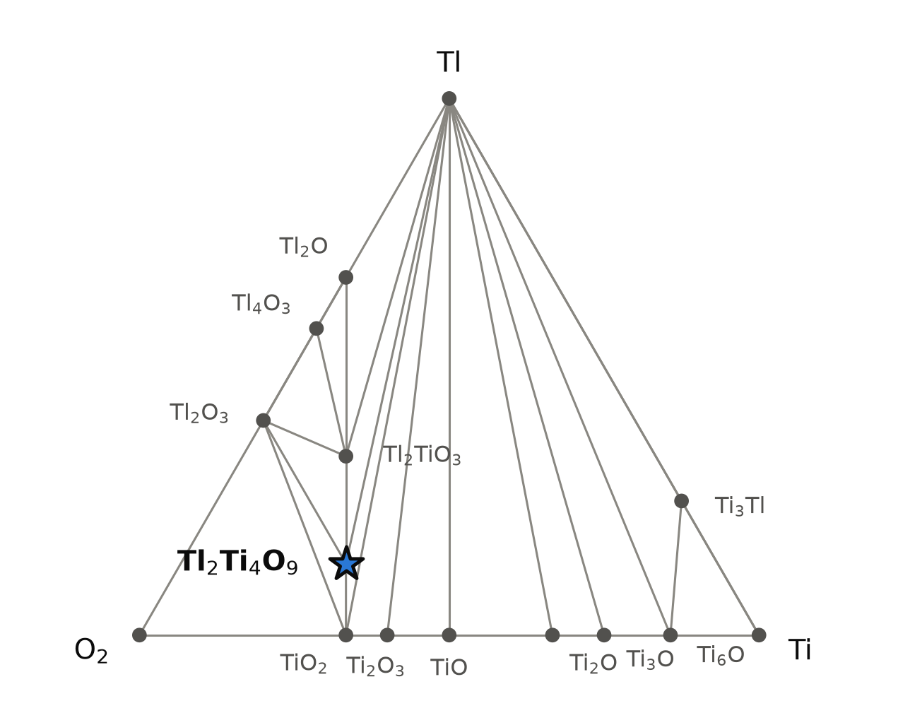
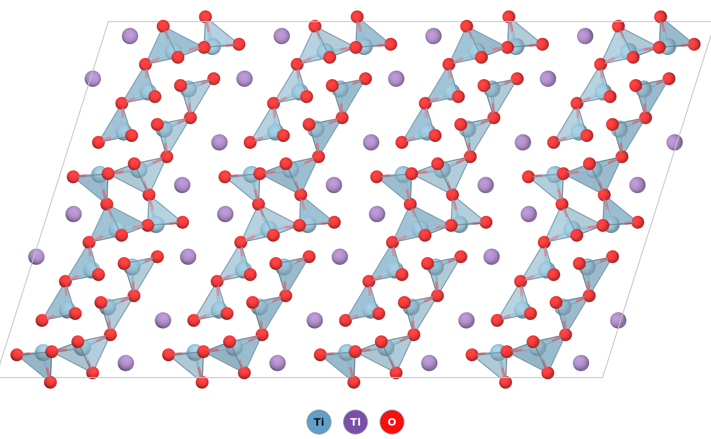

# Tl₂Ti₄O₉ — a thallium(I) titanate with layers of TiO₆ octahedra and Tl⁺ between them

*A Material a Day · entry 16 · 29 October 2026 · status: **known** (made in 1972, structure solved in 1973; abstracts read, full texts not)*

> **In one paragraph.** Tl₂Ti₄O₉ is a thallium(I) titanium(IV) oxide, the thallium
> member of the M₂Ti₄O₉ tetratitanates that also include the potassium, rubidium and
> caesium compounds. Edge- and corner-sharing TiO₆ octahedra form corrugated layers
> 3.8 Å thick along b, and Tl⁺ ions sit between the layers. It was made in 1972 by
> heating TiO₂ with Tl₂CO₃, its structure was solved from single crystals in 1973, and
> in 1978 its ceramics were reported to be ionic conductors, not ferroelectrics. In the
> calculation it is on the Ti–Tl–O hull in all three tables, but only 3 to 6 meV/atom
> below 3 TiO₂ + Tl₂TiO₃, far less than the error of the method. The useful result is the
> cell: PBE makes the stacking axis 4.5 % too long, and PBEsol reproduces the measured
> cell to 0.4 %. Thallium compounds are highly toxic, and thallium(I) oxide volatilises
> when heated.

Computed numbers come from the Alexandria database. Measured numbers carry a reference.

## 1. Identity

| | computed | measured [1] |
|---|---|---|
| Formula | Tl₂Ti₄O₉ (stored as Ti4Tl2O9) | Tl₂Ti₄O₉ |
| Alexandria id | `agm003239593` | |
| Space group | C2/m (no. 12), Z = 4, 60 atoms in the conventional cell | C2/m, Z = 4 |
| a (Å) | 19.827 (PBE) · 18.985 (PBEsol) | 18.98 |
| b (Å) | 3.796 (PBE) · 3.760 (PBEsol) | 3.776 |
| c (Å) | 12.203 (PBE) · 12.048 (PBEsol) | 12.05 |
| β | 107.6° (PBE) · 106.7° (PBEsol) | 106.8° |
| Volume (ų) | 875.5 (PBE) · 823.8 (PBEsol) | 826.7 |
| Density (g cm⁻³) | 5.65 (PBE) | 5.98 (from the measured cell and Z = 4) |
| Structure type | the M₂Ti₄O₉ tetratitanate type (prototype label A2B4C9_mC60_12_2i_4i_9i) | |
| Formation energy | −2.586 eV/atom (PBE) | none found |

The CIF is [`Ti4Tl2O9.cif`](Ti4Tl2O9.cif) (PBE cell). The PBE cell with Materials-Project
settings is almost the same (a = 19.853, b = 3.797, c = 12.206 Å, β = 107.6°). The
measured density is our calculation from the published cell. No Wikipedia page on the
compound or on the thallium titanates was found.

### How far off each cell is

| | a | b | c | β | volume |
|---|---|---|---|---|---|
| PBE | **+4.5 %** | +0.5 % | +1.3 % | +0.8° | **+5.9 %** |
| PBE, Materials-Project settings | +4.6 % | +0.6 % | +1.3 % | +0.8° | +6.1 % |
| PBEsol | +0.03 % | −0.4 % | −0.02 % | −0.1° | −0.4 % |

This comparison is the main result of the entry. PBE normally overestimates cells by 0.5
to 2 %, and b and c are within that range. The a axis is the direction in which the
titanate layers are stacked with thallium between them, and it is 4.5 % too long. PBEsol,
which binds more tightly, gets it right. In PBE the Tl compound's a axis (19.83 Å) is even
longer than that of Rb₂Ti₄O₉ (19.46 Å) in the same structure and table. We have no measured
Rb₂Ti₄O₉ cell to check that ordering against, but it suggests that PBE treats the
Tl⁺–oxygen contacts between the layers too softly. Every PBE number below comes from this
expanded cell.

## 2. Where it sits

<picture>
  <source media="(prefers-color-scheme: dark)" srcset="phase_diagram_dark.png">
  
</picture>

The Ti–Tl–O system at 0 K (PBE table). Fifteen phases are on the hull, and two of them
are ternary oxides.

| phase | composition (at.% O / Ti / Tl) | formation energy (eV/atom) |
|---|---|---|
| O, Ti, Tl | corners | 0 |
| TiO₂ | 66.7 / 33.3 / 0 | −3.034 |
| Ti₂O₃ | 60 / 40 / 0 | −2.887 |
| TiO | 50 / 50 / 0 | −2.554 |
| Tl₂O₃ | 60 / 0 / 40 | −0.659 |
| Tl₄O₃ | 42.9 / 0 / 57.1 | −0.627 |
| Tl₂O | 33.3 / 0 / 66.7 | −0.579 |
| Tl₂TiO₃ | 50 / 16.7 / 33.3 | −1.904 |
| **Tl₂Ti₄O₉** | 60 / 26.7 / 13.3 | −2.586 |

The titanium suboxides Ti₂O, Ti₃O and Ti₆O and the intermetallic Ti₃Tl complete the
list. Tl₂Ti₄O₉ shares tie lines with TiO₂, Tl₂TiO₃, Tl₂O₃ and thallium metal. It sits on
the line from TiO₂ to Tl₂TiO₃, and that pair is what it would decompose into.

**The measured system has more phases than the database.** The 1972 study of the Tl(I)–Ti(IV)–O
system made Tl₂TiO₃, a second phase whose formula is garbled in the indexed abstract,
three forms of Tl₂Ti₃O₇ (α, β and γ) and Tl₂Ti₄O₉, all from TiO₂ and Tl₂CO₃ [2]. In the
database Tl₂Ti₂O₅ is stored only in the K₂Ti₂O₅ structure, 24 meV/atom above the hull,
and Tl₂Ti₃O₇ only as a 12-atom triclinic cell, 61 meV/atom above it. None of the measured
Tl₂Ti₃O₇ structures is stored. Tl₂Ti₃O₇ lies between Tl₂TiO₃ and Tl₂Ti₄O₉, so a correct
structure for it could change the neighbours of Tl₂Ti₄O₉ (section 5).

## 3. Structure

*A 2 × 1 × 2 block seen along the short b axis. TiO₆ octahedra are blue and Tl⁺ ions
purple. The layers are stacked along a (left to right) and run along c (up the page).*

| site | Wyckoff | x, y, z | neighbours (PBE) |
|---|---|---|---|
| Ti1 | 4i | 0.245, 0, 0.168 | 6 O at 1.78–2.28 Å |
| Ti2 | 4i | 0.334, ½, 0.379 | 6 O at 1.79–2.24 Å |
| Ti3 | 4i | 0.369, ½, 0.140 | 6 O at 1.74–2.36 Å |
| Ti4 | 4i | 0.204, 0, 0.396 | 6 O at 1.82–2.20 Å |
| Tl1 | 4i | 0.086, ½, 0.082 | 6 O at 2.84–3.09 Å, five more at 3.42–3.47 Å |
| Tl2 | 4i | 0.008, ½, 0.321 | 7 O at 2.76–3.34 Å |
| O (9 sites) | 4i | | bonded to 1 (one site), 2 (four sites), 3 (one site) or 4 Ti (three sites) |

- **Off-centre octahedra.** Every titanium has six oxygen neighbours, but the bonds range
  from 1.74 to 2.36 Å. Each octahedron has one short bond of 1.74 to 1.82 Å and a long one
  opposite it of 2.20 to 2.36 Å. One oxygen in nine is bonded to a single titanium, at
  1.738 Å. It points into the gap between the layers, where the thallium ions are.
- **How the octahedra connect.** All titanium atoms sit on mirror planes at height 0 or ½
  along b. Along b each octahedron shares a corner with the next, which gives the 3.80 Å
  repeat. Octahedra at heights 0 and ½ share edges with one another (Ti–Ti 3.06 to 3.25
  Å), so each layer is made of edge-sharing blocks joined at corners. The layers are
  corrugated, run parallel to bc and are stacked along a.
- **Thallium between the layers.** Both thallium sites lie between the layers, with six
  or seven oxygen neighbours at 2.76 to 3.34 Å, and a Tl–Tl distance of 3.40 Å. Bader charges are +0.77 on Tl and +2.13 to +2.17 on Ti
  (DDEC6: +0.69 to +0.74 and +2.13 to +2.19), which fits Tl⁺ and Ti⁴⁺.
- **The family.** The same structure, in the same space group, is stored for
  Rb₂Ti₄O₉ (2.9 meV/atom below its competitors in PBE) and Cs₂Ti₄O₉ (16.7). K₂Ti₄O₉, the
  best known member, is stored only in the Materials-Project-settings table, 2.1 meV/atom
  above that hull. K₂Ti₄O₉ is a layered titanate, and the open TiO₂(B) polymorph is
  prepared from it [5, 6]. Whether Tl₂Ti₄O₉ exchanges its thallium in the same way, we did not find.

## 4. Properties

No phonon or electron–phonon calculation exists for this compound. Every electronic number
below is from the PBE structure unless stated, and that cell is 6 % too large (section 1).

### Electronic

| gap (eV) | indirect | direct |
|---|---|---|
| PBE | 2.79 | 2.90 |
| PBEsol (on its own cell) | 2.58 | 2.71 |
| SCAN (on the PBEsol cell) | 2.97 | 3.08 |
| graph-network estimate of the PBE gap | 2.86 | |
| graph-network estimate of the MBJ gap | 3.21 | |

Tl₂Ti₄O₉ is an insulator in every calculation. Semilocal functionals underestimate gaps,
and the MBJ estimate of 3.2 eV is the best guess here, from a model with a typical error
of 0.17 eV. No measured gap or colour was found.

### Dielectric response (PBE, DFPT)

| | value |
|---|---|
| ε∞ (principal values) | 5.10, 5.64, 5.86 |
| ε∞ (average) | 5.53 |
| refractive index (from ε∞) | 2.35 |
| Born charges, Ti (trace/3, average) | +5.11 (largest principal value +6.86) |
| Born charges, Tl | +1.92 |
| Born charges, O | −2.70 (from −1.18 to −5.29) |
| piezoelectric tensor | zero (the structure is centrosymmetric) |

ε∞ is the electronic part only; the static dielectric constant, which includes the lattice
response and which the 1978 measurement concerns [3], is larger and was not computed. The
Born charges are well above the formal charges, +5.1 against +4 for Ti and +1.9 against +1
for Tl. Large anomalous charges on titanium are usual in titanates. The structure has
a centre of inversion, so it cannot be ferroelectric in this form. That fits the 1978 report
that its ceramics show hysteresis loops but are not ferroelectric, and conduct ions
instead [3]. We read only the abstract, so we have no number to compare.

### Charge transport (PBE, rigid band)

Density-of-states masses are 4.7 (electrons) and 4.2 (holes) in units of the free-electron
mass, both heavy. The branch-point energy is 1.31 eV above the valence-band top, near the
middle of the 2.77 eV band-edge gap, so neither n- nor p-type doping is favoured by that
measure. The rigid-band Seebeck coefficients at 300 K and 10²⁰ cm⁻³ are −247 μV/K for
electrons and +232 μV/K for holes; these say nothing about whether the compound can be
doped at all, and it is not a thermoelectric candidate.

### Mechanical (machine-learned)

| bulk modulus | shear modulus | Young's modulus |
|---|---|---|
| 89 GPa | 47 GPa | 109 GPa |

Screening estimates from separate graph networks on the PBE structure; the three are not
mutually consistent (B and G together imply E ≈ 120 GPa). No measured value was found.

### Not computed

Phonons ("phonons not computed": the compound is not among the group's lattice-dynamics
calculations, and no other Tl₂Ti₄O₉ structure is), the static dielectric constant, ionic
conductivity and its migration barriers, spin–orbit coupling (which matters for thallium's
6p states), and any finite-temperature property.

## 5. Is it stable?

On the hull in all three tables, just barely: **3.4 meV/atom** below 3 TiO₂ + Tl₂TiO₃ in
PBE, **3.2** with Materials-Project settings, and **6.1** in SCAN on the PBEsol cell. The
tables agree with each other, and the compound exists [1, 2]. Thermodynamics alone
cannot say more.

- **The margin is not resolved.** In the calorimetric survey behind these tools, oxides
  scatter by 65 meV/atom (mean absolute deviation) against measured formation enthalpies,
  and heavy p-block compounds (nine of them, including Tl, Pb, Bi) by 116 around a bias of
  +332. TiO₂ itself is off by 232 meV/atom in that table. The decomposition into TiO₂ and
  Tl₂TiO₃ keeps every oxidation state, so much of that error should cancel, but we have no
  measured enthalpy of any thallium titanate to say by how much. A margin of 3 to 6
  meV/atom is far below every one of these numbers.
- **The neighbours may be wrong.** The Tl₂Ti₃O₇ forms made in 1972 [2] are not in the
  database. If one of them lies more than a few meV/atom lower than the stored cell, it
  becomes a neighbour of Tl₂Ti₄O₉, and the margin could change sign. Both were made [2],
  which suggests that this does not happen, but making a phase does not prove that it is
  stable.
- **The family.** Rb₂Ti₄O₉ is as shallow (2.9) and Cs₂Ti₄O₉ deeper (16.7); K₂Ti₄O₉ is 2.1
  above the Materials-Project-settings hull and not stored in PBE. All are within the same
  error of the hull, and the potassium compound is a long-known material.

## 6. How to make it

### How it was made

By heating TiO₂ with Tl₂CO₃ [2]; the ratio was varied to reach each phase of the system.
The abstract gives neither the temperature nor the atmosphere. We have not read the full
paper.

### What the calculation proposes

Reaction energies at 0 K, meV per atom of the whole charge (Materials-Project-settings hull).

| route | charge | ΔE | comment |
|---|---|---|---|
| A (rank 1) | 3 TiO₂ + Tl₂TiO₃ | −3.2 | the competing assemblage, read backwards |
| B (rank 2) | 4 TiO₂ + Tl₂O | −42 | the published route once CO₂ has left |
| — | 4 TiO₂ + Tl₂CO₃ (CO₂ kept) | 0 | no reaction while CO₂ stays |
| C | 4 TiO₂ + ⅓ Tl₂O₃ + 1⅓ Tl | −83 | |
| D (metathesis) | 2 TlF + Li₂TiO₃ + 3 TiO₂ → Tl₂Ti₄O₉ + 2 LiF | −25 | clean |
| E (metathesis) | Tl₂SO₄ + BaTiO₃ + 3 TiO₂ → Tl₂Ti₄O₉ + BaSO₄ | −30 | clean |
| F (metathesis) | 2 TlCl + Na₂TiO₃ + 3 TiO₂ | −16 | fails: gives TlCl + Na₂Ti₆O₁₃ + Na₂Ti₂O₅ |

- **The ranking agrees with practice at second place.** Twenty-nine closed routes exist.
  The first by fewest reagents and least driving force is the decomposition read backwards,
  with 3 meV/atom to gain, which is no driving force at all. The second, TiO₂ + Tl₂O, is
  the published carbonate route once CO₂ has gone. With CO₂ kept in the charge nothing
  happens, and CO₂ reacts with the product to give back Tl₂CO₃ and TiO₂ (−33 meV/atom), so
  the CO₂ has to be driven off by heating in an open or flowing system.
- **Metathesis.** Thallium fluoride with lithium titanate (D) and thallium sulfate with
  barium titanate (E) go cleanly to the product and a salt. With thallium chloride and
  sodium titanate (F) the exchange runs backwards: sodium is preferred in the titanate and
  thallium in the chloride. The contact table says the same thing from the other side.
  NaCl, KCl, KBr and RbCl all attack Tl₂Ti₄O₉ and take its thallium, while LiF is inert
  to it. Route D's LiF would have to be washed out of a thallium oxide, and route E's BaSO₄
  cannot be washed out at all, so neither is better than the carbonate in practice.
- **Firing window.** The lower end is set by TiO₂, whose Tammann temperature is 1058 K
  (785 °C). The upper end is set by the thallium oxide. Tl₂O is listed with a melting point of 573 K and a
  boiling point of 773 K (single source each), so at any useful temperature it is a liquid
  or vapour. Thallium(I) oxide volatilises, from Tl₂O, Tl₄O₃ and Tl₂O₃ alike [4], and
  thallium will be lost from an open crucible. A sealed gold tube, which the
  calculation finds inert, is the obvious container. The melting or decomposition
  point of Tl₂Ti₄O₉ itself is not known to us.
- **Oxygen.** Tl₂Ti₄O₉ is the stable phase from μ_O = −3.44 to −1.01 eV at 1000 °C. At the
  oxygen-rich end it is oxidised to Tl₂O₃ and TiO₂ (−142 meV/atom against O₂ at 0 K). In air
  that end corresponds to about 1177 K (904 °C): below it, air would favour thallium(III),
  above it thallium(I). The heavy p-block error of about 330 meV/atom makes this crossing
  uncertain by hundreds of kelvin. Nitrogen and a sealed tube avoid the question.

### What it tolerates

| inert in the calculation | reacts |
|---|---|
| Au, Pt, Ag, Rh, Ir, Ru, Ni, Co, Cu | Ti, Zr, Al, Si, Ta, Nb, Cr, Zn, Sn, Pb, Pd; Fe and Mo by < 1 meV/atom (unresolved) |
| ZrO₂, TiO₂, BeO, BN, graphite | CaO (−76), Y₂O₃ (−51), MgO (−22), Al₂O₃ (−4, unresolved), SiO₂ (−5, unresolved) |
| N₂, H₂O | O₂ (−142), H₂ (−45), CO₂ (−33) |
| LiF, NaF, CsCl, Na₂SO₄, K₂SO₄, Na₂CO₃, Li₂CO₃, NaNO₃, KNO₃ | most other chlorides, bromides and iodides (take the thallium); B₂O₃; PbO |

Gold, platinum or zirconia hold it; alumina and silica are too close to call; magnesia and
lime react.

### Powder pattern

Computed with Cu Kα. The PBE cell puts the lines too low, so they are given here on the
measured cell [1] as well, using the PBE atomic positions. Lines above 30 % of the strongest:

| hkl | 200 | 20̄3 | 401 | 110 | 40̄3 | 310 | 311 | 11̄3 | 31̄3 | 312 | 205 | 020 |
|---|---|---|---|---|---|---|---|---|---|---|---|---|
| 2θ, PBE cell (°) | 9.36 | 21.99 | 22.34 | 23.91 | 24.92 | 27.43 | 29.66 | 32.34 | 33.08 | 33.61 | 42.74 | 47.93 |
| 2θ, measured cell (°) | 9.74 | 22.35 | 23.02 | 24.07 | 25.66 | 27.84 | 30.06 | 32.60 | 33.56 | 34.02 | 43.15 | 48.20 |
| I | 47 | 86 | 53 | 74 | 51 | 85 | 81 | 53 | 100 | 46 | 45 | 48 |

The 200 line, the spacing between layers, moves by 0.4° between the two cells, and the
h00 and h0l lines move most, as section 1 predicts.

- **TiO₂ (rutile or anatase) left over:** thallium lost by evaporation; the most likely
  impurity.
- **A Tl₂Ti₃O₇ form or Tl₂TiO₃:** too much thallium in the charge, or local inhomogeneity.
- **Tl₂O₃:** fired too cold in air.

### Hazards

Thallium and its compounds are highly toxic by ingestion, inhalation and skin contact, and
the dose that harms is small. Thallium(I) oxide volatilises when heated [4]. Handle in a fume cupboard, fire in sealed tubes or with an exhaust that is trapped,
and treat furnace deposits and waste as thallium waste.

## 7. What it is good for

We found no use. The one property study we found reports ionic conduction in its ceramics
[3]; the conducting ion and the conductivity are not in the abstract. Its potassium
analogue K₂Ti₄O₉ is used as a starting material for the TiO₂(B) polymorph [5, 6];
nothing comparable was found for the thallium compound.

## 8. How this could be wrong

- **We read abstracts, not papers.** The structure, synthesis and dielectric papers [1–3]
  are behind publisher walls; the measured cell comes from the indexed abstract of [1] and
  its database record, the route from the abstract of [2]. Firing conditions, the measured
  conductivity and the atomic positions are unread.
- **The PBE cell is 6 % too large,** almost all of it along a. Every PBE property here (gap,
  ε∞, Born charges, masses, moduli) was computed in that expanded cell. The PBEsol gap, on
  the right cell but with a different functional, is 0.2 eV smaller.
- **The hull margin is 3 to 6 meV/atom,** and both the method error and the missing
  Tl₂Ti₃O₇ structures are larger than that.
- **No phonons,** so the dynamical stability of the stored structure is unchecked.
- **The oxygen boundary and the container verdicts** are 0 K thermodynamics with a heavy
  p-block error of hundreds of meV/atom; the volatility of Tl₂O, which decides the
  practice, is not in the calculation at all.

## 9. Literature

**Searched (OpenAlex and Crossref), 25 October 2026:** "Tl2Ti4O9" (six hits: [1], [2], [3],
a Materials Project data record and two potassium titanate papers); "thallium titanate
Tl2Ti4O9 structure" (nothing); "titanates de métaux monovalents thallium Verbaere
Tournoux" (nothing); "thallium(I) titanate synthesis Tl2CO3 TiO2" (nothing); "Tl2O-TiO2
system thallium titanates" ([4]; glass and unrelated work otherwise); "thallium
tetratitanate" (nothing on the thallium compound); "Tl2Ti3O7 thallium trititanate"
(nothing); "ion exchange potassium tetratitanate K2Ti4O9 thallium" (nothing); "K2Ti4O9
crystal structure potassium tetratitanate layered" ([5], [6] and applications of the
potassium compound). Wikipedia: no page for Tl2Ti4O9, thallium titanate, thallium(I)
titanate, thallium tetratitanate or K2Ti4O9. No measured formation enthalpy, melting point
or gap of Tl₂Ti₄O₉ was found.

1. A. Verbaere, M. Tournoux, "Contribution à l'étude des titanates de métaux monovalents.
   Étude structurale de Tl₂Ti₄O₉", *Bull. Soc. Chim. France* 1973, 1237–1241; indexed
   abstract doi:10.1002/chin.197331010 — *abstract read (cell, space group, Z); the same
   cell is in the Crystallography Open Database, entry 1526894.*
2. A. Verbaere, M. Tournoux, the Ti(IV)–O–Tl(I) system, *Bull. Soc. Chim. France* 1972;
   indexed abstract doi:10.1002/chin.197226051 — *abstract read (phases and reagents).*
3. R. Le Bihan, M. Maussion, Ph. Marbeuf, "Study of hysteresis loops and dielectric
   properties of TlTaO₃, TlNbO₃ and Tl₂Ti₄O₉ ceramics", *Ferroelectrics* (1978).
   doi:10.1080/00150197808237412 — *abstract read.*
4. W. L. Holstein, "Thermodynamics of the volatilization of thallium(I) oxide from Tl₂O,
   Tl₄O₃, and Tl₂O₃", *J. Phys. Chem.* 97, 4224–4230 (1993). doi:10.1021/j100118a046 —
   *metadata only (title).*
5. M. Tournoux, R. Marchand, L. Brohan, "Layered K₂Ti₄O₉ and the open metastable TiO₂(B)
   structure", *Prog. Solid State Chem.* (1986). doi:10.1016/0079-6786(86)90003-8 —
   *metadata only (title).*
6. R. Wallenberg, M. Sanati, A. Andersson, "On the transformation mechanism of K₂Ti₄O₉ to
   TiO₂(B) and formation of microvoids", *Microsc. Microanal. Microstruct.* 1, 357 (1990).
   doi:10.1051/mmm:0199000105-6035700 — *abstract read.*

## 10. Provenance

- **Data:** Alexandria database, tables `energy_runs_pbe`, `energy_runs_pbe_mp`,
  `energy_runs_ps` (PBEsol) and `energy_runs_scan`; dielectric and transport tables on the
  PBE structure. Reaction energies, contact reactions and chemical-potential windows come
  from the hull and reaction table built on `pbe_mp`.
- **Tools:** the reaction-route code of this group, pymatgen, POV-Ray; machine-learned
  moduli and gaps from graph neural networks.
- **Authorship:** drafted by Claude (Anthropic) from those tools; reviewed by
  Miguel Marques. Corrections are welcome as issues on this repository.
