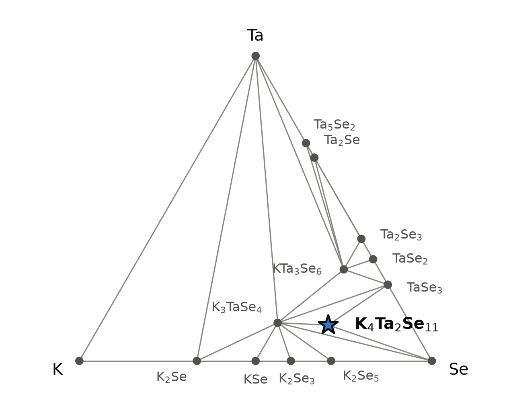
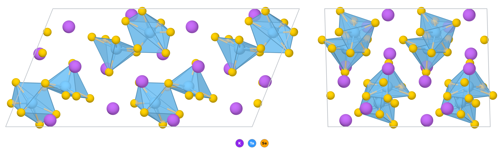

# K₄Ta₂Se₁₁ — a potassium salt of the [Ta₂Se₁₁]⁴⁻ anion, two TaSe₇ bipyramids sharing a face

*A Material a Day · entry 17 · 30 October 2026 · status: **predicted, no report found** (the sulfide K₄Ta₂S₁₁ and the thallium selenide Tl₄Ta₂Se₁₁ are known; both papers read in full)*

> **In one paragraph.** K₄Ta₂Se₁₁ is a potassium tantalum(V) polyselenide built from
> discrete [Ta₂Se₁₁]⁴⁻ anions separated by K⁺ ions. Each anion is two TaSe₇ pentagonal
> bipyramids sharing a face, and holds four Se₂²⁻ pairs and three single Se²⁻. The stored
> structure is the selenium version of triclinic K₄Ta₂S₁₁, which is known, and the same
> anion is known in Tl₄Ta₂Se₁₁. We found no report of the potassium selenide. In the
> calculation it is on the K–Ta–Se hull in both PBE tables, but only 10.6 meV/atom
> (PBE) or 1.2 meV/atom (Materials-Project settings) below its competitors, far less than
> the error of the method, and the two tables do not even agree on what those competitors
> are. A known, slightly selenium-richer potassium tantalum polyselenide, K₁₂Ta₆Se₃₅, is
> missing from both tables. The calculation says K₂Se, Ta and Se in the 2 : 2 : 9 ratio
> react to it alone at 0 K, in a sealed, evacuated silica tube; the thallium salt was made
> from Tl₂Se, Ta and Se in the same ratio at 480–580 °C. A selenium-rich melt is
> predicted to give a different phase. Both measured relatives come out 9–11 % too large
> in volume in PBE, and the sulfide's measured gap, 2.42 eV, is 0.7 eV above its PBE gap,
> so the 1.3 eV PBE gap of the selenide probably stands for about 2 eV. Selenium compounds
> are toxic.

Computed numbers come from the Alexandria database. Measured numbers carry a reference.

## 1. Identity

| | computed (PBE) |
|---|---|
| Formula | K₄Ta₂Se₁₁ |
| Alexandria id | `agm007903709` |
| Space group | P1̄ (no. 2), Z = 2, 34 atoms in the cell |
| a, b, c (Å) | 7.997, 12.146, 12.538 |
| α, β, γ | 68.06°, 86.57°, 84.75° |
| Volume (ų) | 1124.5 (562.2 per formula unit) |
| Density (g cm⁻³) | 4.10 |
| Structure type | triclinic K₄Ta₂S₁₁ type [2] (prototype label A2B4C11_aP34_2_2i_4i_11i) |
| Formation energy | −0.830 eV/atom (PBE) · −1.138 eV/atom (Materials-Project settings) |
| Magnetism | none (Ta⁵⁺, d⁰) |

The CIF is [`K4Ta2Se11.cif`](K4Ta2Se11.cif). With Materials-Project settings the cell is
7.967, 12.123, 12.504 Å, 68.1°, 86.7°, 84.7° (1115.4 ų). No measured cell exists to
compare with. No Wikipedia page on the compound was found.

### How far off the cell may be: the known relatives

| compound | measured cell | PBE cell (same table) | volume, PBE vs measured |
|---|---|---|---|
| K₄Ta₂S₁₁, triclinic [2] | 7.465, 11.441, 11.534 Å; 68.66°, 86.59°, 83.09° (293 K) | 7.626, 11.659, 12.019 Å; 68.9°, 86.3°, 85.5° | 910.7 → 993.1 ų, **+9.0 %** |
| Tl₄Ta₂Se₁₁ [3] | 7.996, 9.159, 13.668 Å; 73.03°, 89.21°, 85.72° (293 K) | 8.393, 9.421, 14.108 Å; 107.1°, 90.1°, 94.1° (another setting) | 954.7 → 1063.2 ų, **+11.4 %** |

The sulfide in the same structure comes out 9 % too large in PBE, with a 2.2 %, b 1.9 %
and c 4.2 % too long; the thallium selenide 11 %, with a 5.0 %, b 2.9 % and c 3.2 % too
long. Both are well beyond the 0.5 to 2 % PBE usually adds. The abstract of [3] gives
b = 9.866 Å, but the table of the same paper gives 9.159 Å, and only 9.159 Å agrees with
the published volume (954.7 ų) and density (7.124 g cm⁻³); we use it. Both cells were
measured at 293 K. The sulfide's volume expansion coefficient, 9.88 × 10⁻⁵ K⁻¹ between
−150 and 90 °C [2], would shrink its cell by about 1.7 % on cooling to −150 °C (our
estimate), so temperature does not explain the excess; at 0 K the error is if anything
larger. If the selenide behaves like its relatives, its real cell is about 10 % smaller
in volume than the one above, and every computed property below was evaluated in that
expanded cell.

## 2. Where it sits

<picture>
  <source media="(prefers-color-scheme: dark)" srcset="phase_diagram_dark.png">
  
</picture>

The K–Ta–Se system at 0 K (PBE table). Fifteen phases are on the hull, three of them
ternary.

| phase | composition (at.% K / Se / Ta) | formation energy (eV/atom) |
|---|---|---|
| K, Se, Ta | corners | 0 |
| K₂Se | 66.7 / 33.3 / 0 | −1.101 |
| KSe | 50 / 50 / 0 | −0.945 |
| K₂Se₃ | 40 / 60 / 0 | −0.801 |
| K₂Se₅ | 28.6 / 71.4 / 0 | −0.593 |
| TaSe₃ | 0 / 75 / 25 | −0.652 |
| TaSe₂ | 0 / 66.7 / 33.3 | −0.809 |
| Ta₂Se₃, Ta₂Se, Ta₅Se₂ | Ta-rich side | −0.754, −0.445, −0.385 |
| K₃TaSe₄ | 37.5 / 50 / 12.5 | −1.144 |
| KTa₃Se₆ (stored as K(TaSe₂)₃) | 10 / 60 / 30 | −0.960 |
| **K₄Ta₂Se₁₁** | 23.5 / 64.7 / 11.8 | −0.830 |

In the PBE table K₄Ta₂Se₁₁ sits in the triangle K₃TaSe₄–TaSe₃–Se and is 10.6 meV/atom
below that assemblage.

**The other table has phases this one lacks.** The hull with Materials-Project settings,
on which the reaction energies in section 6 are computed, also contains K₆Ta₄Se₂₅,
Ta₂Se₉ and KSe₃. None of the first two is stored in the PBE table at all, and KSe₃ is
8.5 meV/atom above the PBE hull. On that hull K₄Ta₂Se₁₁ is only 1.2 meV/atom below
⅓ K₆Ta₄Se₂₅ + ⅔ K₃TaSe₄, and it no longer coexists with selenium: K₄Ta₂Se₁₁ + 4 Se goes
to K₆Ta₄Se₂₅ + KSe₃, −87 meV/atom. Its selenium-rich neighbourhood therefore depends on
which table one reads. We found no report of K₆Ta₄Se₂₅; its rubidium sulfide counterpart
Rb₆Ta₄S₂₅ is known [5].

**A known phase is missing from both tables.** K₁₂Ta₆Se₃₅, a potassium tantalum
polyselenide with infinite anionic chains, has been reported [8] and is cited in [3] with
an average Ta–Se distance of 2.614 Å. Neither PBE table holds it. Its composition
(22.6 / 66.0 / 11.3 at.% K / Se / Ta) is K₄Ta₂Se₁₁ plus two-thirds of a selenium atom, so
it lies between the target and selenium, exactly where the two tables already disagree.
Neither table tests K₄Ta₂Se₁₁ against it, and a small excess of selenium in the charge
could give it instead. With niobium, the potassium and rubidium polyselenides that are
known (K₆Nb₄Se₂₂, K₁₂Nb₆Se₃₅, Rb₁₂Nb₆Se₃₅) are also chains built from Nb₂Se₁₁ units, not
isolated anions [3]; in 2002 no alkali polyselenide with only isolated [M₂Se₁₁]⁴⁻ anions
had been reported [3].

## 3. Structure

*Two cells along b and c. Left, seen along a; right, seen along b. TaSe₇ polyhedra are
blue, Se yellow, K⁺ purple; K–Se contacts are not drawn. Each pair of blue polyhedra
sharing a face is one [Ta₂Se₁₁]⁴⁻ anion.*

| site | Wyckoff | neighbours (PBE) |
|---|---|---|
| Ta1 | 2i | 7 Se: 2.405 (terminal), 2.575–2.685, 2.944 Å |
| Ta2 | 2i | 7 Se: 2.417 (terminal), 2.595–2.686, 2.902 Å |
| K1–K4 | 2i each | 5, 6, 6 and 8 Se at 3.27–3.74 Å |
| Se, 11 sites | 2i each | 2 terminal (1 Ta), 1 bridging (2 Ta), 8 in Se–Se pairs (2.407–2.421 Å) |

- **The anion.** Two tantalum atoms, 3.70 Å apart, share three selenium atoms: one
  single Se²⁻ bridging both (2.637 and 2.686 Å), and one atom from each of two Se₂²⁻
  pairs. Each of those pairs lies side-on on one tantalum and reaches the other with a
  long bond (2.90 and 2.94 Å). Each tantalum also carries one more side-on Se₂²⁻ pair of
  its own and one terminal Se at 2.41 Å, the shortest Ta–Se distance. That makes seven
  neighbours per tantalum, a distorted pentagonal bipyramid, and the two bipyramids share
  a face. The count is 4 Se₂²⁻ + 3 Se²⁻ = −14 against 2 Ta⁵⁺ = +10, hence the 4− charge.
  This matches the anion described for Tl₄Ta₂Se₁₁ (two TaSe₇ bipyramids sharing a face)
  [3] and the bonding described for the sulfide anion in Cs₄Nb₂S₁₁ (two side-on S₂²⁻,
  one bridging and one terminal sulfide, and a long seventh bond) [6]; K₄Ta₂S₁₁ holds
  the tantalum sulfide anion, described with the same connectivity [2].
- **The anion against the measured one.** In Tl₄Ta₂Se₁₁ [3] the same anion has terminal
  Ta–Se 2.410 and 2.413 Å (computed here 2.405 and 2.417, within 0.3 %), ten medium
  bonds of 2.554–2.659 Å (here 2.575–2.686, about 1 % longer), two long bonds of 2.816
  and 2.837 Å (here 2.902 and 2.944, 3–4 % longer), Se–Se 2.360–2.375 Å (here
  2.407–2.421, 2 % longer) and Ta–Ta 3.54 Å (here 3.70, 4.5 % longer). The cation
  differs, so this is not a strict comparison, but the anion comes out close to the
  measured one, the weak bonds stretched most; the 9–11 % volume excess of section 1
  must sit largely in the packing between anions.
- **The charges agree.** Bader charges are +1.71 on Ta and +0.82 to +0.83 on K. The six
  single selenides in the cell carry −0.86 to −0.95, the sixteen paired ones −0.42 to
  −0.56, so the database charges separate the two kinds of selenium as the formula does.
- **Between the anions.** The anions are isolated: the shortest Se–Se contact between
  two anions is 3.43 Å, against 2.41–2.42 Å inside a Se₂ pair, and potassium fills the space between them with five to eight
  selenium neighbours. This is a salt of a molecular anion, not a framework, which fits
  the soft moduli in section 4.
- **Polymorphs.** With Materials-Project settings a second triclinic packing of the same
  anion (`agm007895856`) lies 2.8 meV/atom higher. Its cell (8.54, 9.30, 14.24 Å, 71.7°)
  resembles that of Tl₄Ta₂Se₁₁ rather than of K₄Ta₂S₁₁. That packing is not only the
  thallium one: according to [3], Tl₄Ta₂Se₁₁ is isotypic with the potassium niobium
  sulfoselenides K₄Nb₂S₈.₉Se₂.₁ and K₄Nb₂S₉.₅Se₁.₅, so potassium salts with part of the
  sulfur replaced by selenium already take it. K₄Ta₂S₁₁ also has an orthorhombic form
  (Pca2₁; 13.166, 7.449, 18.000 Å, 3 % denser than the triclinic one) [2]; for the
  selenide that packing has not been computed.
- **The family.** The same structure in the same space group is on the PBE hull for
  K₄Ta₂S₁₁ (10.5 meV/atom deep), K₄Nb₂S₁₁ (14.6) and Rb₄Nb₂S₁₁ (17.3), and under the
  same label for Tl₄Ta₂Se₁₁ (14.6), Tl₄Nb₂Se₁₁ (9.5), Tl₄Ta₂S₁₁ (8.3) and Tl₄Nb₂S₁₁ (8.8).
  The prototype label is shared by Bi₄Ta₂O₁₁ and Bi₄Nb₂O₁₁, which have nothing in
  common with these anions beyond the formula pattern. No other alkali M₂Se₁₁ selenide
  (Rb, Cs; Nb) is stored.

## 4. Computed properties

No phonon or electron–phonon calculation exists for this compound. All numbers are from
the PBE structure, whose cell is probably several per cent too large (section 1).

### Electronic

| gap (eV) | indirect | direct |
|---|---|---|
| PBE | 1.30 | 1.30 |
| PBE, Materials-Project settings | 1.29 | |
| graph-network estimate of the PBE gap | 1.35 | |
| graph-network estimate of the MBJ gap | 1.35 | |

There is no MBJ, SCAN or PBEsol calculation of this compound in the database. The
machine-learned MBJ estimate (typical error 0.17 eV) is no larger than the PBE gap here,
which is unusual and we do not trust it.

| relative | PBE gap (same table) | measured | PBE low by |
|---|---|---|---|
| K₄Ta₂S₁₁, triclinic | 1.72 eV | 2.42(6) eV, diffuse reflectance [2] | 0.70 eV (29 %) |
| K₄Ta₂S₁₁, orthorhombic | not in the PBE table | 2.35(4) eV [2] | |
| Tl₄Ta₂Se₁₁ | 1.12 eV | black crystals; no gap reported [3] | |

The measured sulfide gaps are absorption edges, assigned to ligand-to-metal charge
transfer [2]. If the selenide's PBE gap is low by the same 0.7 eV, or the same 29 %, its
gap is 1.8 to 2.0 eV (our estimate by analogy, not a calculation). The expanded PBE cell
adds uncertainty of its own.

### Dielectric response (PBE, DFPT)

| | value |
|---|---|
| ε∞ (principal values) | 4.45, 4.79, 5.26 |
| ε∞ (average) | 4.83 |
| refractive index (from ε∞) | 2.20 |
| Born charges, Ta (trace/3) | +2.36 (principal values +1.62 to +2.96) |
| Born charges, K | +1.27 |
| Born charges, Se | −0.89 on average (from −2.91 to +1.15) |
| piezoelectric tensor | zero (centrosymmetric) |

ε∞ is the electronic part only; the static dielectric constant was not computed. The
tantalum Born charge is far below the formal +5, as expected when most of the bonding to
selenium is covalent; some selenium principal values are even positive.

### Charge transport (PBE, rigid band)

Density-of-states masses are 4.9 (electrons) and 7.6 (holes) free-electron masses, both
heavy, as for bands made from isolated anions. The branch-point energy is 0.42 eV above
the valence-band top, in the lower third of the 1.29 eV band-edge gap, which by that
measure favours p-type doping. Rigid-band Seebeck coefficients at 300 K and 10²⁰ cm⁻³ are
−262 μV/K (electrons) and +230 μV/K (holes). They say nothing about whether the compound
can be doped, and it is not a thermoelectric candidate.

### Mechanical (machine-learned)

| bulk modulus | shear modulus | Young's modulus |
|---|---|---|
| 14 GPa | 9.4 GPa | 22 GPa |

Screening estimates from graph networks on the PBE structure, not calculations. They are
low, as for a salt of molecular anions, and the expanded PBE cell would make them lower
still. No measured value exists.

### Vibrational fingerprint (measured on the thallium salt)

No phonons were computed for this compound, but the anion's stretching modes are measured
in Tl₄Ta₂Se₁₁ [3]: the terminal Ta=Se stretches at 276 cm⁻¹ (Raman) and 281 cm⁻¹ (far-IR
absorption), and Se–Se stretches of the Se₂²⁻ pairs at 247, 236 and 215 cm⁻¹, with a fourth
tentatively at 196 cm⁻¹. These are properties of the anion and should move little with
the cation, so a Raman spectrum is a quick check, beside the powder pattern, that a
product holds [Ta₂Se₁₁]⁴⁻.

### Not computed

Phonons ("phonons not computed": neither this structure nor any other K₄Ta₂Se₁₁ is among
the group's lattice-dynamics calculations), so the dynamical stability of the stored
structure is unchecked; the static dielectric constant; spin–orbit coupling, which shifts
the Ta 5d bands; the orthorhombic packing; and any finite-temperature property.

## 5. Is it stable?

On the hull in both PBE tables: **10.6 meV/atom** below K₃TaSe₄ + TaSe₃ + Se in PBE, and
**1.2 meV/atom** below ⅓ K₆Ta₄Se₂₅ + ⅔ K₃TaSe₄ with Materials-Project settings. There is no
SCAN or PBEsol entry to cross-check. The two numbers disagree because the tables hold
different competitors (section 2), not because the compound's own energy differs.

- **The margin is not resolved.** In the calorimetric survey behind these tools,
  chalcogenides (eleven compounds, grouped as sulfides) scatter by 83 meV/atom (mean
  absolute deviation) against measured formation enthalpies, with a bias of −10 and a
  90th percentile of 304. Margins of 1 to 11 meV/atom are far below that. No measured
  formation enthalpy exists for any compound in the K–Ta–Se system in these tables.
- **The neighbours are uncertain.** K₆Ta₄Se₂₅ and Ta₂Se₉ are missing from the PBE table;
  which potassium polyselenides are stable differs between tables (K₂Se₅ in one, KSe₃ in
  the other); and the known chain compound K₁₂Ta₆Se₃₅ [8], next to the target in
  composition, is in neither. Any of these could move the margin by more than it is.
- **The family is on the hull too,** at 8 to 17 meV/atom, and salts of the same anion
  with other cations are known compounds [2, 3, 6]. That is the best evidence the anion is a real minimum, and
  it is evidence by analogy only.
- **Polymorphs.** The two packings of the anion are 2.8 meV/atom apart. For the sulfide
  the triclinic form is 12.7 meV/atom below the orthorhombic one with Materials-Project
  settings, whereas the authors who made both expected the orthorhombic one to be more
  stable at low temperature, from its 3 % higher density and an electrostatic (Madelung)
  lattice energy 46 kJ mol⁻¹ larger [2]. Neither is a measurement of the transition, which
  [2] left for later work. Both sulfide polymorphs were made at 400 °C; which one formed
  depended on the composition of the charge (section 6).

## 6. How to make it

No synthesis has been reported. What follows is what the calculation proposes, beside
how the known relatives were made.

### How the relatives were made

- **Orthorhombic K₄Ta₂S₁₁, first route:** K₂S, Ta and S in a 3 : 2 : 5 ratio, 800 °C,
  48 h, cooled at 100 °C h⁻¹ [4], as summarised in [2].
- **Both K₄Ta₂S₁₁ polymorphs, at half the temperature [2]:** K₂S₃, Ta powder and S,
  mixed in a nitrogen glove box, in glass ampoules evacuated to 10⁻⁵ mbar and
  flame-sealed; 400 °C for 6 days, cooled at 2 °C h⁻¹ to 100 °C. The ratio 2 : 1 : 4 gave
  the orthorhombic form; the triclinic form, the structure stored here, came only from
  1.4 : 1.1 : 6.1, a large excess of sulfur, with tantalum powder pretreated by
  ultrasound in DMF. The excess polysulfide was washed out with DMF and ethanol. A
  poorly mixed charge gave K₃TaS₄ beside the product. The authors conclude that 400 °C
  is enough to form and grow the compound.
- **Tl₄Ta₂Se₁₁ [3]:** Tl₂Se, Ta powder and Se in a 2 : 2 : 9 ratio, the ratio of route C
  below with thallium for potassium, sealed in a glass ampoule under argon; put into the
  furnace at 220 °C, heated at 3 K min⁻¹ to 480 °C and held 12 h, then 580 °C for a week,
  the melt shaken once a day; cooled at about 10 K min⁻¹ to 350 °C. The product was
  nearly single-phase (TlSe below 1.5 % by Rietveld refinement); without the hot start,
  TlSe formed (6–8 %) with an unidentified thallium-poorer phase. Tl₄Ta₂Se₁₁ melts
  congruently at 452 ± 2 °C, does not react with water, and reacts slowly with cold
  half-concentrated mineral acids.
- Other potassium and rubidium tantalum selenides, with copper or silver, by the
  reactive-flux method at 773 or 873 K [7].

### What the calculation proposes

Reaction energies at 0 K, meV per atom of the whole charge (Materials-Project-settings hull).

| route | charge | ΔE | product |
|---|---|---|---|
| A (rank 1 of 146) | ⅓ K₆Ta₄Se₂₅ + ⅔ K₃TaSe₄ | −1.2 | K₄Ta₂Se₁₁; the competing assemblage read backwards |
| B (rank 2) | 2 K₂Se + Ta₂Se₉ | −140 | K₄Ta₂Se₁₁ |
| C (from the elements' side) | 2 K₂Se + 2 Ta + 9 Se | −694 | K₄Ta₂Se₁₁ alone |
| D (in excess K₂Se₅) | 2 K₂Se + 2 Ta + 9 Se + 2 K₂Se₅ | −529 | 0.78 K₄Ta₂Se₁₁ + 0.44 K₃TaSe₄ + 3.6 KSe₃ |
| E (metathesis) | 2 TaCl₅ + 7 K₂Se + 4 Se | −430 | K₄Ta₂Se₁₁ + 10 KCl, clean |
| F (metathesis) | 2 TaCl₅ + 5 K₂Se + 2 K₂Se₃ | −341 | K₄Ta₂Se₁₁ + 10 KCl, clean |
| G (metathesis) | 2 K₂TaF₇ + 7 K₂Se + 4 Se | −128 | fails: KF + K₂Se₃ + K₃TaF₈ + K₃TaSe₄ |

- **The route in practice** is C: K₂Se, tantalum powder and selenium weighed in the
  2 : 2 : 9 ratio in a glove box, sealed in an evacuated silica tube (silica is inert to
  the product in the calculation), and heated. It is the potassium version of the
  published Tl₄Ta₂Se₁₁ synthesis [3], which used the same ratio in a glass ampoule and
  gave a nearly pure product, and the selenide counterpart of the first sulfide route
  [4]. Route A has no driving force, and Ta₂Se₉ for route B is not in the PBE table and
  has no availability record.
- **The firing window.** Bulk diffusion through tantalum would need its Tammann
  temperature, 1645 K, which no one uses: the reaction runs through the polyselenide melt
  that forms once selenium melts (494 K). The upper end is set by selenium, which boils
  at 958 K (685 °C), so the sealed tube is under selenium pressure above that. The
  measured relatives formed at 400 °C (both sulfide polymorphs, 6 days [2]), 480–580 °C
  (Tl₄Ta₂Se₁₁, a week [3]) and 800 °C (the sulfide, 48 h [4]); related flux syntheses ran
  at 773–873 K [7]. A firing at 400–580 °C for several days, with slow cooling, is the
  first try these suggest. The thallium salt melts congruently at 452 °C [3]; the
  melting point of the potassium compound, if it forms, is not known, nor is that of
  K₂Se on file.
- **Keep the melt near stoichiometric.** In μ_Se the product is the stable phase only from
  −0.63 to −0.36 eV (at 700 K, 25 meV/atom tolerance). Too much selenium gives K₆Ta₄Se₂₅
  and KSe₃ on this hull; too much K₂Se₅ already pulls part of the tantalum into K₃TaSe₄
  (route D). The selenium-rich verdict depends on phases the PBE table does not hold
  (section 2), so the excess-selenium boundary is the least certain number here; on the
  selenium-rich side the known K₁₂Ta₆Se₃₅ [8] is the likeliest competitor, and neither
  table holds it. This advice runs against how the triclinic sulfide was made, from a
  large excess of polysulfide [2]; the stoichiometric thallium charge [3] is the closer
  precedent. The sulfide's excess flux was washed out with DMF and ethanol [2]; whether
  that leaves a polyselenide intact is untested.
- **Metathesis** works on paper with TaCl₅ (E, F): the KCl it throws off is inert to the
  product in the calculation. In practice TaCl₅ is a molecular solid that boils at 515 K
  and hydrolyses in moist air, and KCl would have to be removed with a solvent that leaves
  a polyselenide intact, which water may not. With K₂TaF₇ (G) the exchange fails: the
  fluoride keeps the tantalum as K₃TaF₈, and KF itself attacks the product (−27 meV/atom).
  Metathesis is no improvement on route C.

### What it tolerates

| inert in the calculation | reacts |
|---|---|
| SiO₂, Al₂O₃, ZrO₂, BeO, BN, Si₃N₄, AlN, graphite | O₂ (−793), CO₂ (−175), N₂ (−46, through a database nitride), H₂ (−8) |
| NaCl, KCl, KBr, KI, NaBr, NaF, LiF | every metal tested, including Ta (−167), Au (−38), Ag (−26), Pt (−109) |
| | MgO (−9), CaO (−149), Y₂O₃ (−79), TiO₂ (−3, unresolved) |
| | KF (−27), CsCl and RbCl (exchange the potassium), carbonates, sulfates, nitrates |

Silica, alumina or graphite-coated silica will hold it; no metal crucible will. Air
oxidises it in the calculation, and the reagents are air-sensitive in any case.

### Powder pattern

Computed with Cu Kα on the PBE cell. The strongest lines:

| hkl | 011 | 100 | 01̄1 | 110 | 101 | 10̄1 | 002 | 022 | 014 | 2̄12 |
|---|---|---|---|---|---|---|---|---|---|---|
| 2θ (°) | 8.69 | 11.11 | 12.83 | 13.14 | 13.30 | 13.65 | 15.24 | 17.42 | 28.74 | 27.50 |
| I | 98 | 26 | 79 | 53 | 100 | 47 | 31 | 26 | 26 | 23 |

If the real cell is several per cent smaller (section 1), every line sits at a slightly
higher angle than listed; the pattern of strong low-angle lines below 18° is what
identifies the phase.

- **K₃TaSe₄:** potassium-rich or selenium-poor charge.
- **K₁₂Ta₆Se₃₅ [8], TaSe₃, or another selenium-richer potassium tantalum selenide:** too
  much selenium.
- **KTa₃Se₆, TaSe₂:** reduced charge, selenium lost to the tube walls or a leak.
- **Unreacted tantalum:** too cold or too short; tantalum powder is slow to dissolve.

### Hazards

Selenium and its compounds are toxic, and hydrogen selenide, which alkali selenides can
release with moisture or acid, is highly toxic. K₂Se and the product are air- and
moisture-sensitive. Work in a glove box, fire only in sealed, evacuated tubes behind a
shield (selenium pressure above 685 °C), and open them in a fume cupboard.

## 7. What it is good for

Nothing has been reported, since the compound has not been, and neither paper on its
relatives reports a use: both are structural and spectroscopic studies [2, 3]. As a
candidate only: it would extend a small family of salts of [M₂Q₁₁]⁴⁻ anions, which are
interesting for their structural chemistry; the authors of [2] suggest such salts as
starting materials for further tantalum polychalcogenides. Its gap, probably near 2 eV,
and heavy masses do not point to any electronic use.

## 8. How this could be wrong

- **The margin is 1 to 11 meV/atom,** against a chalcogenide error of 83 meV/atom and
  competitors that differ between tables, and a known neighbour, K₁₂Ta₆Se₃₅, is in
  neither table. The compound may not be stable at all, or may be stable only in a range
  of temperature. With niobium, potassium polyselenides form chains, not isolated anions
  [3].
- **It may never have been tried, or it may exist under a name we did not search.** A
  failed search is not evidence that it is unknown; a structural-database check by a
  person is owed.
- **The structure is assumed, not found.** The stored structure is the sulfide's
  triclinic packing with selenium in place of sulfur. The real compound, if it exists,
  could take the orthorhombic or the thallium packing, or another one altogether; the
  thallium packing is already taken by potassium niobium sulfoselenides [3].
- **The cell is probably too large.** The two measured relatives come out 9 and 11 % too
  large in PBE, so the properties above were computed in an expanded cell.
- **No phonons,** so the dynamical stability of the stored structure is unchecked.
- **The route is 0 K thermodynamics.** It says the reaction is favourable, not that it
  goes, and the selenium-activity window rests on phases missing from the reference table.

## 9. Literature

**Searched (OpenAlex, with Crossref and arXiv for some), 25 October 2026:** "K4Ta2Se11"
(nothing); "potassium tantalum polyselenide Ta2Se11 dimer" (nothing); "A4M2Q11 niobium
tantalum polychalcogenide molten flux K4Nb2S11" (nothing); "K6Ta4Se25 polyselenide" and
"K6Ta4Se25" (nothing); "tantalum polyselenide potassium" (reviews and unrelated work);
"alkali niobium polyselenide molten salt synthesis" (reviews); "K4Ta2S11" ([2], [4], [6]
and K₄Nb₀.₉₆Ta₁.₀₄S₁₁); "[Ta2Se11]4- anion" ([3], [7]); "Ta2Se11" (only [3]); "alkali
tantalum selenide polyselenide crystal structure Bensch" ([5] and sulfides);
"Rb4Ta2Se11 Cs4Ta2Se11 K4Nb2Se11" (nothing); "polyselenide flux K2Se tantalum selenide
compound synthesis" (nothing on this compound); "K3TaSe4 crystal structure" (nothing);
"K12Ta6Se35 potassium tantalum polyselenide Tougait Ibers" ([8]).
Wikipedia: no page for K4Ta2Se11, potassium tantalum selenide, potassium selenotantalate
or the systematic name. The 2002 paper on Tl₄Ta₂Se₁₁ calls it the first polyselenide with
discrete [M₂Se₁₁]⁴⁻ anions and says that no polyselenide made only of such anions had been
reported [3], which rules out a report before 2002 as far as its authors knew; the 1999
sulfide paper from the same group announces work on the A/Ta/Se systems [2]. A doctoral
thesis on multinary niobium and tantalum chalcogenides (Kiel, 2006) could not be
downloaded and was not read.

1. Alexandria database, entry `agm007903709` (this structure).
2. S. Herzog, C. Näther, W. Bensch, "Dimorphism of K₄Ta₂S₁₁: syntheses, crystal
   structures, and properties of two alkali metal tantalum sulfides", *Z. Anorg. Allg.
   Chem.* 625, 969 (1999). doi:10.1002/(SICI)1521-3749(199906)625:6<969::AID-ZAAC969>3.0.CO;2-O
   — *full text read (both cells at 293 K, synthesis, bond lengths, thermal expansion,
   lattice energies, optical gaps).*
3. C. L. Teske, N. Lehnert, W. Bensch, "On polychalcogenides of thallium with M₂Q₁₁
   groups as a structural building block. II. Tl₄Ta₂Se₁₁: synthesis, crystal structure,
   properties and spectroscopic investigations of the first polyselenide being composed
   of a discrete [Ta₂Se₁₁]⁴⁻ anion", *Z. Anorg. Allg. Chem.* 628, 2651 (2002).
   doi:10.1002/1521-3749(200212)628:12<2651::AID-ZAAC2651>3.0.CO;2-W — *full text read
   (cell, bond lengths, synthesis, melting point, colour, vibrational spectra).*
4. S. Schreiner, L. E. Aleandri, D. Kang, J. A. Ibers, "Solid-state chalcogenide anions of
   tantalum and niobium: synthesis and structures of the Ta₂S₁₁⁴⁻ and Nb₄Se₂₂⁶⁻ anions",
   *Inorg. Chem.* 28, 392 (1989). doi:10.1021/ic00302a003 — *metadata only; the
   synthesis (K₂S + Ta + S, 3 : 2 : 5, 800 °C, 48 h) is from its indexed abstract,
   doi:10.1002/chin.198919033, and is restated in [2].*
5. P. Stoll, C. Näther, I. Jeß et al., "Synthesis, crystal structure and optical
   properties of the […] tantalum polysulfide Rb₆Ta₄S₂₅ and its thermal degradation to
   Rb₆Ta₄S₂₂", *Solid State Sci.* (2000). doi:10.1016/s1293-2558(00)01062-1 —
   *metadata only (title).*
6. K. O. Klepp, G. Gabl, "Preparation and crystal structure of Cs₄Nb₂S₁₁",
   *Z. Naturforsch. B* (1998). doi:10.1515/znb-1998-1021 — *abstract read (the
   [Nb₂S₁₁]⁴⁻ anion, Nb–Nb 3.517 Å).*
7. Y. Wu, C. Näther, W. Bensch, "Low dimensional materials: syntheses, structures, and
   optical properties of Rb₂CuTaS₄, Rb₂CuTaSe₄, RbCu₂TaSe₄, K₃Ag₃Ta₂Se₈, and
   Rb₃AgTa₂Se₁₂", *Z. Naturforsch. B* (2004). doi:10.1515/znb-2004-0910 — *abstract
   read (reactive flux at 773 or 873 K).*
8. O. Tougait, J. A. Ibers, "[…] tantalum polychalcogenides with infinite anionic chains:
   K₁₂Ta₆Se₃₅ and KTaTe₃", *Solid State Sci.* 1, 523 (1999).
   doi:10.1016/s1293-2558(00)80104-1 — *metadata only (title); the average Ta–Se distance
   is as quoted in [3].*

## 10. Provenance

- **Data:** Alexandria database, tables `energy_runs_pbe` and `energy_runs_pbe_mp` (no
  PBEsol or SCAN entry exists for this compound); dielectric and transport tables on the
  PBE structure. Reaction energies, contact reactions and chemical-potential windows come
  from the hull and reaction table built on `pbe_mp`.
- **Tools:** the reaction-route code of this group, pymatgen, POV-Ray; machine-learned
  moduli and gaps from graph neural networks.
- **Authorship:** drafted by Claude (Anthropic) from those tools; reviewed by
  Miguel Marques. Corrections are welcome as issues on this repository.
