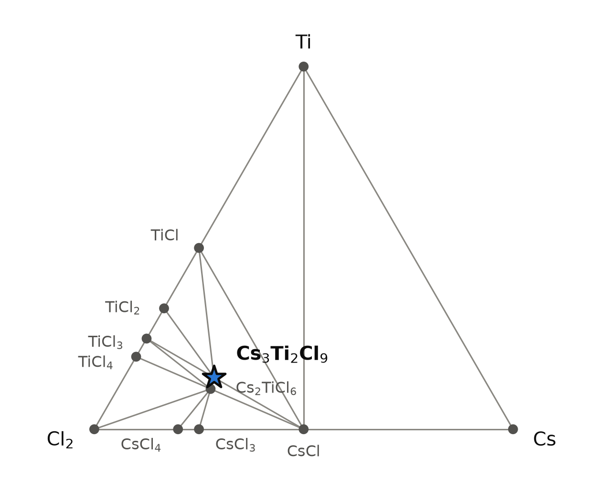
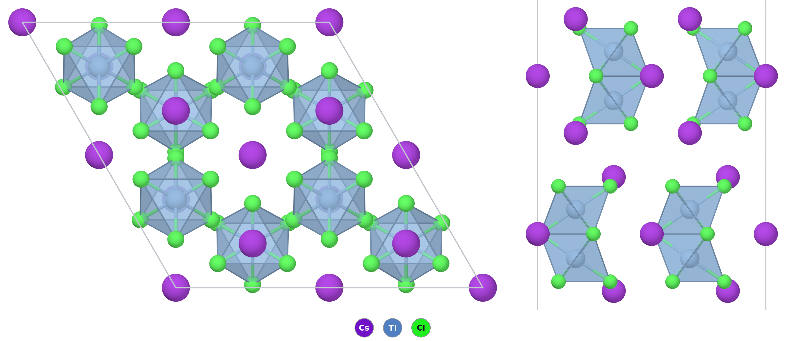

# Cs₃Ti₂Cl₉ — a caesium chlorotitanate(III) built from Ti₂Cl₉ face-sharing double octahedra

*A Material a Day · entry 18 · 2 November 2026 · status: **known** (single-crystal spectroscopy and magnetism 1981; crystal structure 1996; phase-pure synthesis in a 2006 thesis; all read in full)*

> **In one paragraph.** Cs₃Ti₂Cl₉ is a salt of the [Ti₂Cl₉]³⁻ anion, two TiCl₆ octahedra
> sharing a face, with Ti³⁺ (one d electron each) in every octahedron. It is a known
> compound: its structure was solved from single crystals in 1996, and it is made by
> heating TiCl₃ with CsCl in a sealed, evacuated silica ampoule at 705 °C; large single
> crystals grow from the melt. On the computed
> Cs–Ti–Cl hull it is stable in every table, 31 to 46 meV/atom below its competitors, and
> the calculation proposes the same route that is used in practice. The interesting part
> is the electrons. The two Ti³⁺ ions in a dimer are measured to repel each other, 3.22 Å
> apart, and to pair their spins: the ground state is a spin singlet, with the triplet
> about 525 cm⁻¹ (65 meV) above it. The PBE calculation behind this entry has no magnetic
> moment either, but it pulls the ions to 2.83 Å, as if they shared a bond. The other
> database tables turn them into a ferromagnetic metal. None of the stored calculations
> describes the antiferromagnetically coupled pair that is measured, so its computed gap,
> dielectric and transport numbers describe a state the compound is not in. It is air- and
> moisture-sensitive.

Computed numbers come from the Alexandria database. Measured numbers carry a reference.

## 1. Identity

| | computed (PBE, 0 K) | measured [2] (293 K) |
|---|---|---|
| Formula | Cs₃Ti₂Cl₉ | |
| Alexandria id | `agm003237189` | |
| Space group | P6₃/mmc (no. 194), Z = 2, 28 atoms in the cell | P6₃/mmc |
| a, c (Å) | 7.566, 18.169 | 7.3226, 17.9982 |
| Volume (ų) | 900.7 (450.4 per formula unit) | 835.8 |
| Density (g cm⁻³) | 3.00 | 3.23 (our calculation from the measured cell) |
| Structure type | Cs₃Cr₂Cl₉ type [3, 8] (prototype label A2B3C9_hP28_194_f_bf_hk) | |
| Formation energy | −1.829 eV/atom (PBE) · −2.163 eV/atom (Materials-Project settings) | |
| Magnetism | none in this table (see section 4) | antiferromagnetically coupled Ti³⁺ pairs, spin-singlet ground state, triplet ≈ 525 cm⁻¹ higher [3, 4] |
| Colour | | brown crystals [2] |

The CIF is [`Cs3Ti2Cl9.cif`](Cs3Ti2Cl9.cif). The measured cell and atomic positions are
from a single-crystal X-ray study at 293 K (R(F) = 0.022) [2], deposited as COD 8103858.
An earlier, unpublished determination quoted in [4] gives Ti–Ti 3.191 Å and Ti–Cl 2.503
(bridging) and 2.328 Å (terminal), within 0.025 Å of [2]. No Wikipedia page on the
compound was found.

### How far off the structure is: the calibration

The same structure has been relaxed in four ways in the database, and the tables do not
agree on the magnetic state. All distances are our calculation from the stored and
measured coordinates.

| | measured [2] | PBE, no moment (this entry) | PBE, MP settings, ferromagnetic | PBEsol, ferromagnetic |
|---|---|---|---|---|
| a (Å) | 7.3226 | 7.566 (+3.3 %) | 7.511 (+2.6 %) | 7.221 (−1.4 %) |
| c (Å) | 17.998 | 18.169 (+0.9 %) | 18.459 (+2.6 %) | 17.740 (−1.4 %) |
| volume (ų) | 835.8 | 900.7 (+7.8 %) | 901.9 (+7.9 %) | 801.1 (−4.2 %) |
| **Ti–Ti in the dimer (Å)** | **3.215** | **2.829 (−0.39)** | 3.112 (−0.10) | 3.024 (−0.19) |
| Ti–Cl terminal (Å) | 2.348 | 2.384 | 2.368 | 2.338 |
| Ti–Cl bridging (Å) | 2.525 | 2.472 | 2.514 | 2.481 |
| Ti–Cl–Ti angle at the bridge | 79.1° | 69.8° | 76.5° | 75.1° |
| moment per Ti | 0: spin singlet, antiferromagnetically paired [4] | 0 | 1 μB | 1 μB |

- **The volume** is 8 % too large in both PBE tables, much more than the 0.5 to 2 % PBE
  usually adds. The a axis, which is set by the Cs–Cl packing, carries most of it. PBEsol
  is 4 % too small. The measured cell is at 293 K [2] and the computed ones at 0 K, which
  makes the comparison a little worse for PBE and a little better for PBEsol than it
  looks.
- **The dimer is the real miss.** In the real compound the two titanium atoms are pushed
  apart, off the centres of their octahedra and towards the terminal chlorides. The angle
  at the bridging chloride is 79°, well above the 70.5° of two ideal octahedra sharing a
  face. This is the geometry of mutual repulsion, as in Cs₃Cr₂Cl₉ [3]. The PBE structure
  without a moment does the opposite: 2.83 Å and 69.8°, closer than ideal, the geometry of
  a Ti–Ti bond. For comparison, the thesis we read quotes 2.95 Å for the Ti–Ti single
  bonds in Ti₇Cl₁₆ [3]. The ferromagnetic structures land in between and still 0.1 to
  0.2 Å short. Two independent X-ray determinations agree on 3.19 to 3.22 Å [2, 4], so
  the measured distance is not in doubt.
- **The same miss in the relatives.** Rb₃Ti₂Cl₉, measured Ti–Ti 3.146 Å [3], comes out at
  2.816 Å in the PBE table, again with no moment. Cs₃Ti₂Br₉, measured 3.451 Å [3], is
  ferromagnetic in the PBE table and comes out at 3.246 Å.

## 2. Where it sits

<picture>
  <source media="(prefers-color-scheme: dark)" srcset="phase_diagram_dark.png">
  
</picture>

The Cs–Ti–Cl system at 0 K (PBE table). Twelve phases are on the hull, two of them
ternary.

| phase | composition (at.% Cl / Cs / Ti) | formation energy (eV/atom) |
|---|---|---|
| Cl, Cs, Ti | corners | 0 |
| CsCl | 50 / 50 / 0 | −1.960 |
| CsCl₃, CsCl₄ (polychlorides) | 75 / 25 / 0, 80 / 20 / 0 | −1.051, −0.841 |
| TiCl₄ | 80 / 0 / 20 | −1.583 |
| TiCl₃ | 75 / 0 / 25 | −1.607 |
| TiCl₂ | 66.7 / 0 / 33.3 | −1.503 |
| TiCl | 50 / 0 / 50 | −1.168 |
| Cs₂TiCl₆ (Ti⁴⁺) | 66.7 / 22.2 / 11.1 | −1.837 |
| **Cs₃Ti₂Cl₉** (Ti³⁺) | 64.3 / 21.4 / 14.3 | −1.829 |

Cs₃Ti₂Cl₉ shares tie lines with CsCl, Cs₂TiCl₆, TiCl₃, TiCl₂ and TiCl. Its competitor is a
disproportionation: with Materials-Project settings, Cs₃Ti₂Cl₉ lies 46.1 meV/atom below
CsCl + Cs₂TiCl₆ + TiCl₂, a mixture of Ti⁴⁺ and Ti²⁺.

**The neighbourhood differs between tables.** The hull with Materials-Project settings,
on which the reaction energies of section 6 are computed, also holds CsTi₂Cl₇ and
CsTi₄Cl₁₁. CsTi₂Cl₇ is 0.3 meV/atom above the PBE hull and is a known compound, as the
thesis we read records [3]. CsTiCl₃, which that thesis names as the most stable ternary
titanium halide at room temperature, is 23 meV/atom above the PBE hull. Section 8 says
why that matters.

## 3. Structure

*Left, along c: the dimers stand end-on, ringed by caesium. Right, along a: each pair of
blue octahedra sharing a face is one [Ti₂Cl₉]³⁻ anion. TiCl₆ octahedra blue, Cl green, Cs
purple. Two cells along a and b.*

| site | Wyckoff | neighbours (PBE) |
|---|---|---|
| Ti | 4f | 3 Cl at 2.384 Å (terminal), 3 Cl at 2.472 Å (bridging); Ti at 2.829 Å |
| Cs1 | 2b | 12 Cl, 3.637 and 3.786 Å |
| Cs2 | 4f | 12 Cl, 3.652–4.024 Å |
| Cl1 | 6h | bridging, 2 Ti |
| Cl2 | 12k | terminal, 1 Ti |

- **The anion.** Three chlorides bridge two titanium atoms. Each titanium also carries
  three terminal chlorides, so each is octahedral and the two octahedra share a face. In
  the measured structure the terminal bonds are 0.18 Å shorter than the bridging ones
  (2.348 against 2.525 Å). Each titanium sits off the centre of its octahedron, away from
  its partner.
- **The packing.** Caesium and chloride together form close-packed CsCl₃ layers stacked
  in the sequence (hcc)₂, and titanium fills the octahedral holes made only of chloride
  in three successive layers. That is why the dimers line up along c [3]. Both caesium
  sites have twelve chloride neighbours, one cuboctahedral and one anticuboctahedral.
  The dimers are isolated: the next titanium in a neighbouring dimer is more than 7 Å
  away [3].
- **The family.** Cs₃Cr₂Cl₉ gives the type its name [8]. In the PBE table the same label
  and space group are on the hull for Rb₃Ti₂Cl₉ (38 meV/atom deep), K₃Ti₂Cl₉ (3), Tl₃Ti₂Cl₉
  (11), Cs₃Ti₂Br₉ (39), Rb₃Ti₂Br₉ (16) and Cs₃Ti₂I₉ (7), as well as for the V, Cr, Mo, Ru
  and Rh chlorides. Rb₃Ti₂Cl₉, Cs₃Ti₂Br₉ and Rb₃Ti₂Br₉ are known in this type [3].
  K₃Ti₂Cl₉ is known too, but in the lower-symmetry K₃W₂Cl₉ type (P6₃/m) [3], not in the
  P6₃/mmc cell the database holds for it. The thesis we read says no titanium iodide of
  this kind had been made [3].
- **Polymorphs.** The PBE table has one structure of this formula. With
  Materials-Project settings an R3̄c stacking is 9.2 meV/atom higher, and a P3̄m1 one 43.7.

## 4. Computed properties

All numbers below are for the PBE structure without a magnetic moment, which has the
wrong Ti–Ti distance (section 1) and the wrong magnetic state. Read them as properties of
the calculation, not of the compound. No phonon calculation exists.

### Electronic

| gap (eV) | value | magnetic state |
|---|---|---|
| PBE (this table), indirect / direct | 0.37 / 0.40 | no moment |
| PBE, Materials-Project settings | 0 (metal) | ferromagnetic, 1 μB per Ti |
| PBEsol | 0 (metal) | ferromagnetic |
| SCAN | 0 (metal) | ferromagnetic |
| graph-network estimate, PBE gap / MBJ gap | 0.23 / 0.15 | |
| **measured** | no band gap measured. Pair transitions at 800–3000 cm⁻¹ (0.10–0.37 eV, centre ≈ 1600 cm⁻¹) [4]; d–d band at 12 900 cm⁻¹ (π) and 14 200 cm⁻¹ (σ) on single crystals at 300 K (1.60 and 1.76 eV) [4], 14 265 cm⁻¹ (1.77 eV) on powder [3] | spin singlet |

- **Where the 0.37 eV comes from.** With no moment, the two d electrons of a dimer can
  only pair in a Ti–Ti bonding orbital, and the gap opens above it. That is the
  bonded dimer of section 1. With a ferromagnetic moment each titanium keeps one electron,
  and these PBE-type calculations, with no Hubbard U, leave a metal. The real compound is
  neither. Each titanium keeps its electron in the one t₂g orbital that points along the
  Ti–Ti axis, about 1400 cm⁻¹ (0.17 eV) below the other two, and the two electrons pair
  their spins across the face [4]. The measured pair is therefore also a singlet without
  moment, like the PBE state, but an open-shell one, coupled through the bridge without
  pulling the atoms together.
- **Nothing measured checks the computed gap.** The absorption at 0.10–0.37 eV comes from
  transitions within the t₂g levels of the pair, and the band at 1.6–1.8 eV is a d–d
  transition; neither is a band gap. In the visible and near ultraviolet only weak bands
  appear up to 33 000 cm⁻¹ (4.1 eV), several attributed to iron impurities, and the
  authors expect charge transfer above about 28 000 cm⁻¹ (3.5 eV) [4]. The crystals are
  brown [2].
- **No f-free analogue is needed**, but the same problem would hit any d¹ dimer of this
  family. A broken-symmetry calculation with opposite spins on the two titanium atoms
  (and a U on Ti) would be the first test. It is not in the database.

### Dielectric response (PBE, DFPT, structure without moment)

| | value |
|---|---|
| ε∞ (principal values) | 3.48, 3.48, 4.05 |
| ε∞ (average) | 3.67 |
| refractive index (from ε∞) | 1.92 |
| Born charges (trace/3) | Ti +2.71, Cs +1.35, Cl −1.05 |
| piezoelectric tensor | zero (centrosymmetric) |

ε∞ is the electronic part only. In a calculation with a 0.37 eV gap it is set partly by
the Ti–Ti bonding band, so it is probably not the compound's.

### Charge transport

Rigid-band density-of-states masses are 9.4 (electrons) and 5.1 (holes) free-electron
masses, and the computed branch point lies 0.12 eV below the valence-band top. These
describe the bands of the bonded-dimer state. We do not quote the Seebeck coefficients:
the bands they come from are not the compound's.

### Mechanical (machine-learned)

| bulk modulus | shear modulus | Young's modulus |
|---|---|---|
| 8.7 GPa | 5.0 GPa | 12.4 GPa |

Screening estimates from graph networks on the PBE structure, not calculations. They
are very low, as for a soft caesium halide salt, and the 8 % excess volume would lower
them further. No measured value was found.

### Magnetism (measured)

On phase-pure powder, the effective moment is about 1.9 μB per titanium at room
temperature and falls on cooling. χT behaves as for antiferromagnetically coupled Ti³⁺
pairs, and no long-range order is seen [3].

On oriented single crystals (3.8–320 K) [4], both principal susceptibilities fall on
cooling, χ⊥ is larger than χ∥ (difference 410 × 10⁻⁶ cm³ mol⁻¹ at 320 K and 540 × 10⁻⁶
at 100 K), and below about 100 K what remains is an isotropic impurity term, traced to
iron (Fe/Ti = 3–4 × 10⁻³). No magnetic circular dichroism is seen down to 8 K. The
ground state of each pair is a non-magnetic spin singlet.

| quantity | value | how obtained |
|---|---|---|
| singlet–triplet gap | ≈ 525 cm⁻¹ (65 meV); 440 cm⁻¹ fits near 320 K, 630 cm⁻¹ near 120 K | fit of χ∥(T) [4] |
| same, from the absorption | 500 ± 25 cm⁻¹ | temperature dependence of the d–d band intensity [4] |
| same, kinetic-exchange model | 706 cm⁻¹ | fit of χ∥, χ⊥ [7] |
| trigonal splitting of t₂g | 1400 ± 200 cm⁻¹ (fit), ≈ 1600 cm⁻¹ (absorption) | [4] |
| for comparison: Cs₃Cr₂Cl₉ | −13 cm⁻¹ | as quoted in [4] |

The temperature dependence of the gap is real, not noise; the authors attribute it to
vibronic coupling [4]. The 2001 model [7] reproduces the anisotropy (computed 590 and
410 × 10⁻⁶ cm³ mol⁻¹ at 100 and 320 K against the measured 540 and 410). It quotes a
wavefunction (CASPT2) calculation on the isolated anion giving 718 cm⁻¹, another
ab initio study giving 320 cm⁻¹, which it judges too small, and reflectivity data placing
the first excited level at least 450 cm⁻¹ up [7]; we did not read those sources. The
coupling is about 40 times that of the chromium analogue, and the model treatments of
exchange between orbitally degenerate ions have used this compound as their test case
[5–7].

### Vibrations (measured)

The thirteen Raman-active internal modes of the anion were measured at about 8 K, between
96 and 360 cm⁻¹; the four A₁g modes are at 360, 278, 177 and 144 cm⁻¹ [4]. They are a ready
check for any future phonon calculation.

### Not computed

Phonons ("phonons not computed": neither this structure nor any other Cs₃Ti₂Cl₉ is among
the group's lattice-dynamics calculations); an antiferromagnetic (broken-symmetry)
state; DFT+U; spin–orbit coupling; the static dielectric constant; any
finite-temperature property.

## 5. Is it stable?

On the hull in every table: **45.9 meV/atom** below its competitors in PBE (no moment),
**46.1** with Materials-Project settings (ferromagnetic), **42.6** in SCAN and **31.6**
in PBEsol. The R22 spread between tables is 0.

- **Against the class error.** In the calorimetric survey behind these tools, halides
  (27 compounds) scatter by 27 meV/atom (mean absolute deviation) against measured
  formation enthalpies, with a bias of +1 and a 90th percentile of 133. A 31 to 46
  meV/atom margin is larger than the typical scatter but not than the tail. No measured
  formation enthalpy of any Cs–Ti–Cl ternary is in these tables. CsCl itself is computed
  181 meV/atom less bound than measured in the Materials-Project table. That is the known
  caesium-reference problem of that table. It cancels in the target's margin, whose
  competitors contain no caesium metal.
- **The magnetic state does not move the margin much.** The two PBE tables, one without
  a moment and one ferromagnetic, give the same depth to within 0.2 meV/atom, although the
  structures differ by 0.3 Å in Ti–Ti. The true antiferromagnetic state was not computed.
  The measured spin energy is small on this scale: a singlet–triplet gap of 440 to
  706 cm⁻¹ per pair [4, 7] is 4 to 6 meV per atom (our conversion, 14 atoms per formula
  unit). That bounds the spin arrangement, not the structural relaxation that goes with
  it, nor the magnetic energies of the competitors TiCl₂ and TiCl₃, so the effect on the
  margin is still not known.
- **It is made phase-pure in practice** [3], which is the strongest evidence that the
  computed stability is real.

## 6. How to make it

### How it is actually made

- **2 TiCl₃ + 3 CsCl**, with the TiCl₃ purified by sublimation and the CsCl dried under
  vacuum at 250 °C. The mixture goes into a silica ampoule that has been baked out under
  vacuum, and the ampoule is sealed under vacuum. It is heated at 15 °C/h to 705 °C, held
  240 h and quenched in water. Powder diffraction shows a single phase, on a gram scale
  [3]. The author chose 705 °C as roughly the melting temperature of Cs₃Ti₂Cl₉ [3].
- **Large single crystals** were grown by the Bridgman method from CsCl and TiCl₃ (98 %,
  used as bought, 8 % in excess) in a silica ampoule evacuated at about 100 °C and sealed
  under vacuum. In one series the charge was heated rapidly to complete fusion, to keep
  the disproportionation of TiCl₃ low; all three series gave the same crystals. They
  cleave easily perpendicular and parallel to c, and carried iron from the reagents
  (Fe/Ti = 3–4 × 10⁻³) [4]. The paper gives no growth temperature.
- **The crystals of the structure determination** came from CsCl, TiCl₃ and titanium
  metal in sealed niobium tubes at 1023 K (750 °C) for 14 days [2]. The one-page report
  gives neither the proportions nor the purpose of the titanium.
- For the bromides Cs₃Ti₂Br₉ and Rb₃Ti₂Br₉, the same author used synproportionation,
  3 TiBr₄ + 6 ABr + Ti, in tantalum ampoules at 676–687 °C. With slow cooling the
  titanium(II) compounds ATiBr₃ formed instead [3].

### What the calculation proposes

Reaction energies at 0 K, meV per atom of the whole charge (Materials-Project-settings
hull). 82 by-product-free routes exist; R6 ranks by fewest reagents, then least driving
force.

| route | charge | ΔE | product |
|---|---|---|---|
| A (rank 1) | 2 CsCl + CsTi₂Cl₇ | −48 | Cs₃Ti₂Cl₉ |
| B (rank 2) | ½ Ti + 1½ Cs₂TiCl₆ | −58 | Cs₃Ti₂Cl₉ (synproportionation) |
| **C (rank 3, first with all reagents manufactured)** | **3 CsCl + 2 TiCl₃** | **−73** | **Cs₃Ti₂Cl₉ alone** |
| D (metathesis) | 2 Li₃TiCl₆ + 3 CsCl | −101 | Cs₃Ti₂Cl₉ + 6 LiCl, clean |
| E (metathesis) | 2 TiBr₃ + 9 CsCl | −75 | Cs₃Ti₂Cl₉ + 6 CsBr, clean |
| F (metathesis) | 2 TiF₃ + 9 CsCl | 0 | fails: no reaction, the fluoride keeps the titanium |

- **Route C is the published route** [3, 4]. The calculation's first choice from bottled
  reagents matches practice. Route A needs CsTi₂Cl₇, which is not sold. Route B is the
  chloride version of the synproportionation used for the bromides [3].
- **The firing window.** CsCl melts at 919 K, and Cs₃Ti₂Cl₉ itself at roughly 978 K
  (705 °C) [3]. The tables hold no melting point for TiCl₃ and list it as gone by 700 K.
  The thesis records that titanium trihalides disproportionate to TiX₂ and TiX₄ above
  about 250 °C [3], so the TiCl₃ must be confined: a sealed ampoule, not a flow of gas.
  The bulk-diffusion floor is the Tammann temperature of CsCl, 459 K, the only reagent
  with a melting point on file. The published 705 °C sits just below the product's
  melting point and above that of CsCl, so the reaction runs through a melt; the crystal
  growths go to 750 °C [2] and to complete fusion [4].
- **Atmosphere.** In μ_Cl the product is stable only from −2.99 to −2.01 eV relative to Cl₂
  (900 K, 25 meV/atom tolerance). It is a reducing window: free chlorine oxidises it to
  Cs₂TiCl₆. In μ_Ti the window is open towards titanium metal, but Ti reacts with the
  product by −9.8 meV/atom (to TiCl + CsCl), which is not resolved. In practice the
  compound crystallised from a charge containing titanium metal at 750 °C [2], so that
  reaction does not stop it forming; the report does not say whether titanium was left
  over.
- **Metathesis** works on paper with Li₃TiCl₆ (D) and TiBr₃ (E), and both by-products are
  inert to the product in the calculation. In practice the LiCl would need a solvent that
  spares a moisture-sensitive Ti³⁺ chloride. The bromide route would risk Br mixing into
  the product. Neither improves on route C, whose only reagents are the two halides. With
  TiF₃ (F) nothing happens, because the fluoride is the more stable titanium salt.

### What it tolerates

| inert in the calculation | reacts |
|---|---|
| SiO₂, Al₂O₃, BeO, SiC, Si₃N₄ | O₂ (−349), CO₂ (−115), N₂ (−77, through a database nitride), H₂O (−35) |
| Ta, Nb, Mo, W, Fe, Cu, Au, Ag | Pt (−57), Pd (−30), Rh (−28), Ni (−9.7), Zr (−58), Al (−125) |
| NaCl, KCl, RbCl, CsCl, LiCl, CaCl₂, MgCl₂, BaCl₂, LiF | CaO (−263), MgO (−99), Y₂O₃ (−92), ZrO₂ (−33), KF (−141), NaF (−70) |
| | C (−4.2), TiO₂ (−0.9) and BN (−0.2): unresolved |

Silica, tantalum and niobium, the containers used for titanium halides [2–4], are all
inert in the calculation. Platinum is not.

### Powder pattern

Computed with Cu Kα from the **measured** structure at 293 K [2] (our calculation). On the PBE cell
every line sits lower in 2θ (110 at 23.52° instead of 24.31°, 220 at 48.11° instead of
49.81°), because the computed cell is 8 % too large.

| hkl | 102 | 103 | 110 | 105 | 006 | 202 | 203 | 204 | 205 | 220 |
|---|---|---|---|---|---|---|---|---|---|---|
| 2θ (°) | 17.11 | 20.38 | 24.31 | 28.51 | 29.78 | 29.88 | 31.92 | 34.61 | 37.81 | 49.81 |
| I | 52 | 45 | 92 | 34 | 47 | 84 | 100 | 74 | 29 | 52 |

- **CsCl:** caesium-rich charge, or TiCl₃ lost from a leaking ampoule.
- **Cs₂TiCl₆:** oxidation (chlorine, air) or disproportionation.
- **CsTiCl₃ or TiCl₂:** reduction, or slow cooling. The bromide work found the Ti(II)
  phases on slow cooling [3], which is why the chloride is quenched.
- **TiOCl or TiO₂:** oxygen from the reagents or from silica that was not baked out [3].
- **Iron**, invisible to diffraction at the level of 10⁻³ but seen in the magnetic and
  resonance data of [4], whose TiCl₃ was 98 % pure and not purified. The thesis
  sublimed its TiCl₃ first [3].

### Hazards

TiCl₃ is pyrophoric as a fine powder and reacts with moisture, giving HCl. The product
decomposes in moist air. Load in a glove box, fire only in sealed, evacuated ampoules, and
open them in the glove box. Caesium salts are of low toxicity.

## 7. What it is good for

No application was found. Cs₃Ti₂Cl₉ is a model compound: an isolated pair of d¹ ions
with orbitally degenerate ground states. It has been the reference case for theories of
exchange between such ions since the 1970s [5–7], and the Ti series A₃Ti₂X₉ shows how
the Ti–Ti distance follows the size of the alkali and halide ions [3]. Because its pairs
are non-magnetic at low temperature, the 1981 study proposed it as a host in which
deliberately added paramagnetic trivalent ions, iron pairs in particular, can be studied
by electron paramagnetic resonance [4]. For computation it is a clean test: a known
structure, a measured singlet–triplet gap, measured Raman modes, and an outcome that
depends on getting the magnetic state right.

## 8. How this could be wrong

- **The stored calculations do not have the right ground state.** That is a finding about
  the database, not the compound. The gap, ε∞, masses and Ti–Ti distance in section 4
  belong to a closed-shell or ferromagnetic state, and the real compound is an
  antiferromagnetically coupled singlet pair [4]. The hull margins may shift when that
  state is computed, though the measured spin energy is only 4 to 6 meV/atom (section 5).
- **The margin, 31 to 46 meV/atom,** is above typical halide scatter but inside its tail.
  The neighbours differ between tables (CsTi₂Cl₇, CsTi₄Cl₁₁), and CsTiCl₃, which the
  thesis we read names as the most stable ternary titanium halide at room temperature, is
  23 meV/atom above the PBE hull. If the calculation misplaces Ti²⁺ phases by that much,
  it could misplace the disproportionation that bounds this compound too.
- **The measured cell is at 293 K**, the computed ones at 0 K. No low-temperature cell
  was found, so the thermal part of the 8 % is not separated.
- **No phonons,** so the dynamical stability of the stored structure is unchecked. A
  bonded-dimer structure that is not the real one could well be dynamically odd.
- **Part of the literature is second-hand.** The 1976 and 1984 exchange models [5, 6],
  the thermal analyses cited by the thesis, the 1968 melting point cited by [4], and the
  wavefunction calculations and reflectivity data quoted in [7] were not read.
- **The route is 0 K thermodynamics.** It says the reaction is favourable. That it goes
  at 705 °C is known from experiment, not from the calculation.

## 9. Literature

**Searched (OpenAlex, with Crossref and arXiv for some), 25 October 2026:** "Cs3Ti2Cl9"
([2], [4], [5], [6], [7] and a later review); "tricesium nonachlorodititanate"
(nothing on this compound); "nonachlorodititanate(III)" (only (SCl₃)(Ti₂Cl₉), a Ti(IV)
salt); "Ti2Cl9 3- dimer magnetic exchange titanium(III) face-sharing bioctahedral"
(nothing); "Ti2Cl9 titanium chloride dimer" (nothing relevant); "Cs3Ti2Cl9 preparation
crystal growth" and "Cs3Ti2Cl9 single crystal absorption spectrum" (nothing relevant);
"cesium titanium(III) chloride CsCl TiCl3 phase diagram" (nothing relevant); "A3Ti2X9
titanium(III) halide dimer crystal growth Bridgman CsCl TiCl3", "ternary titanium(III)
chlorides alkali metal ACl-TiCl3 systems", "ternary chlorides of trivalent titanium
alkali metal Meyer synthesis", "Rb3Ti2Cl9 Cs3Ti2Br9 K3Ti2Cl9 structure" and "Rb3Ti2Br9
Ti2Br9 exchange neutron" (nothing); "Cs3Cr2Cl9 crystal structure" ([8]). A web search
found [3]. Wikipedia: no page for Cs3Ti2Cl9, caesium titanium chloride, tricesium
nonachlorodititanate or caesium titanium(III) chloride. The thesis [3] cites older
thermal analyses of the A–Ti–Cl systems, which we did not retrieve.

1. Alexandria database, entry `agm003237189` (this structure, in the PBE,
   Materials-Project-settings, PBEsol and SCAN tables).
2. T. Gloger, D. Hinz, G. Meyer, A. Lachgar, "Crystal structure of tricesium
   nonachlorodititanate(III), Cs₃Ti₂Cl₉", *Z. Kristallogr.* 211, 821 (1996).
   doi:10.1524/zkri.1996.211.11.821 — *full text read (one page: crystal source,
   data collection at 293 K, cell and coordinates). Deposited as Crystallography Open
   Database entry 8103858 (https://www.crystallography.net/cod/8103858.html).*
3. J. A. Beekhuizen, *Neue Untersuchungen an Halogeniden des Titans und Hafniums*,
   doctoral thesis, Universität zu Köln (2006). https://kups.ub.uni-koeln.de/1928/ —
   *full text read: abstract, introduction and sections 2.2–2.3.8 (structures of the
   A₃Ti₂X₉ series, synthesis, magnetism, absorption).*
4. B. Briat, O. Kahn, I. Morgenstern-Badarau, J. C. Rivoal, "Spectroscopic and magnetic
   properties of cesium titanium chloride (Cs₃Ti₂Cl₉)", *Inorg. Chem.* 20, 4193–4200
   (1981). doi:10.1021/ic50226a033 — *full text read (crystal growth, absorption, Raman,
   resonance and susceptibility on single crystals; exchange and trigonal-field fits; note
   added in proof with an unpublished structure).*
5. O. Kahn, "Exchange interaction between two ²T₂g terms in Cs₃Ti₂Cl₉", *Mol. Phys.* 31,
   957 (1976). doi:10.1080/00268977600100711 — *metadata only.*
6. B. Leuenberger, H. U. Güdel, "Exchange interactions between orbitally degenerate ions
   in Ti₂X₉³⁻ (X = Cl, Br)", *Mol. Phys.* 51, 1 (1984). doi:10.1080/00268978400100011 —
   *abstract read (coupling strongly antiferromagnetic; model reproduces Cs₃Ti₂Cl₉ and
   Rb₃Ti₂Br₉).*
7. J. J. Borrás-Almenar, J. M. Clemente-Juan, E. Coronado, A. V. Palii, B. S. Tsukerblat,
   "Magnetic exchange interaction in a pair of orbitally degenerate ions: magnetic
   anisotropy of [Ti₂Cl₉]³⁻", *J. Chem. Phys.* 114, 1148 (2001). doi:10.1063/1.1329892 —
   *full text read (kinetic-exchange model; fit of the susceptibilities of [4]; no
   structural data).*
8. G. J. Wessel, D. J. W. IJdo, "The crystal structure of Cs₃Cr₂Cl₉", *Acta Cryst.*
   (1957). doi:10.1107/s0365110x57001577 — *metadata only (the structure type).*

## 10. Provenance

- **Data:** Alexandria database, tables `energy_runs_pbe`, `energy_runs_pbe_mp`,
  `energy_runs_ps` (PBEsol) and `energy_runs_scan`; dielectric and transport tables on the
  PBE structure. Reaction energies, contact reactions and chemical-potential windows come
  from the hull and reaction table built on `pbe_mp`.
- **Tools:** the reaction-route code of this group, pymatgen, POV-Ray; machine-learned
  moduli and gaps from graph neural networks.
- **Authorship:** drafted by Claude (Anthropic) from those tools; reviewed by
  Miguel Marques. Corrections are welcome as issues on this repository.
