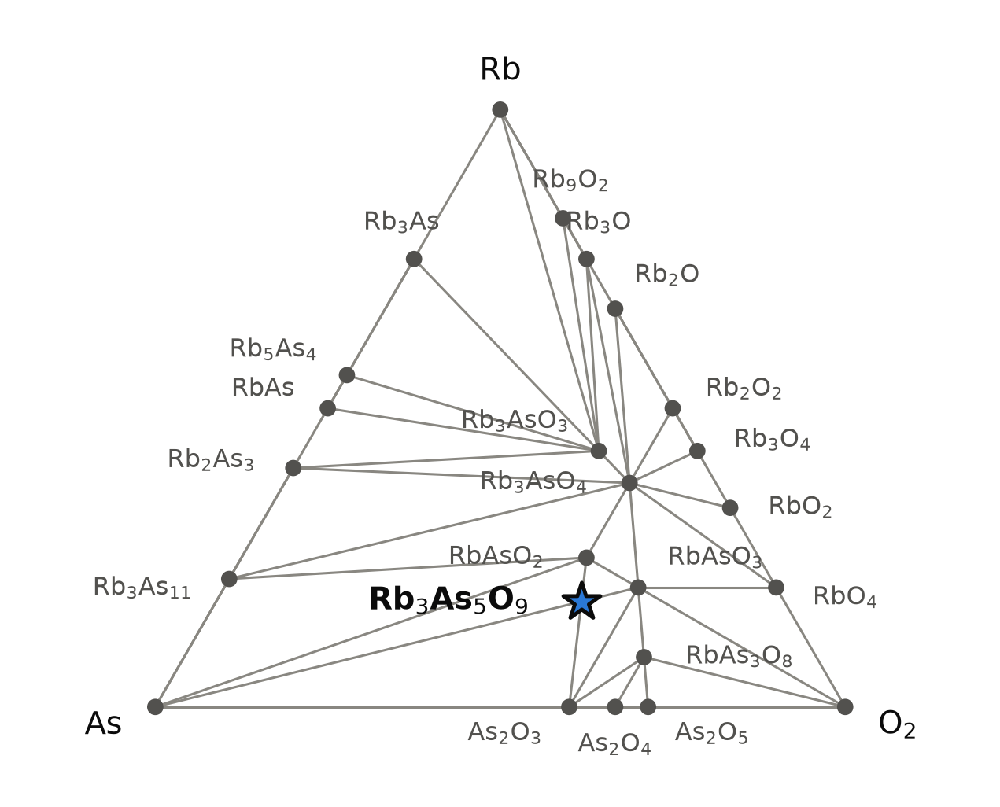
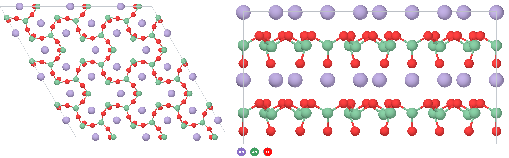

# Rb₃As₅O₉ — a rubidium arsenite(III) with polar [As₅O₉]³⁻ sheets, the rubidium analogue of a known caesium compound

*A Material a Day · entry 19 · 3 November 2026 · status: **predicted, no report found** (its caesium analogue Cs₃As₅O₉ is known, 2003)*

> **In one paragraph.** Rb₃As₅O₉ is an arsenite: every arsenic is As³⁺, bonded to three
> oxygen atoms in a pyramid, with a lone pair pointing away from them. Five such pyramids
> share corners to form a flat honeycomb sheet of formula [As₅O₉]³⁻, and rubidium ions sit
> between the sheets. The same structure is known for caesium. Cs₃As₅O₉ was made in 2003
> from caesium metal and As₂O₃ at 500 °C and its structure solved from single crystals. The
> same study heated rubidium and As₂O₃ in the same 1 : 1 ratio, which is exactly the
> composition of Rb₃As₅O₉ plus arsenic, and reported RbAsO₂. We found no report of
> Rb₃As₅O₉. On the computed hull it is stable, but only **8 meV/atom** below a mixture of
> RbAsO₂ and As₂O₃. The scatter of computed oxide formation energies against experiment is
> 65 meV/atom, so the calculation cannot say whether it exists. Along the series the margin
> shrinks with the alkali: caesium 59 meV/atom below its competitors, rubidium 8,
> potassium 12 *above*. Rubidium sits at the edge, and the one published charge leans
> against it. That charge was heated in an argon-filled corundum crucible, so the excess
> As₂O₃ could escape as vapour. A sealed ampoule, which keeps it in, is the test still to
> be made. Every arsenic compound here is highly toxic.

Computed numbers come from the Alexandria database. Measured numbers carry a reference.

## 1. Identity

| | computed (PBE) |
|---|---|
| Formula | Rb₃As₅O₉ (trirubidium nonaoxopentaarsenate(III)) |
| Alexandria id | `agm008108183` |
| Space group | P31m (no. 157), Z = 1, 17 atoms in the cell |
| a, c (Å) | 8.548, 5.969 |
| Volume (ų) | 377.8 |
| Density (g cm⁻³) | 3.41 |
| Structure type | Cs₃As₅O₉ type [2] (prototype label A3B5C9_hP17_157_c_bc_cd) |
| Formation energy | −1.433 eV/atom (PBE) · −1.797 eV/atom (Materials-Project settings) |
| Magnetism | none (closed shell) |

The CIF is [`Rb3As5O9.cif`](Rb3As5O9.cif). No Wikipedia page on this compound or its
caesium analogue was found.

### How far off the structure is likely to be: calibration on the two known neighbours

Rb₃As₅O₉ has no measured cell. Two neighbours from the same 2003 study do [2, 3], and
the same PBE table holds both. The percentages are our calculation.

| | measured [2, 3] | PBE (this database) | difference |
|---|---|---|---|
| **Cs₃As₅O₉**, P31m: a, c (Å) | 8.455, 6.026 | 8.696, 6.225 | +2.9 %, +3.3 % |
| Cs₃As₅O₉ volume (ų) | 373.1 | 407.7 | **+9.3 %** |
| **RbAsO₂**, Pbcm: a, b, c (Å) | 7.297, 7.752, 5.411 | 7.712, 7.933, 5.607 | +5.7 %, +2.3 %, +3.6 % |
| RbAsO₂ volume (ų) | 306.1 | 343.0 | **+12.1 %** |

The bond lengths show where the volume goes. Measured distances are from [2]; PBE
distances are our calculation on the stored structures.

| bond | measured (Å) [2] | PBE (Å) | difference |
|---|---|---|---|
| Cs₃As₅O₉, As on 2b, 3 × As–O (bridging) | 1.742 | 1.821 | +4.5 % |
| Cs₃As₅O₉, As on 3c, terminal As–O | 1.671 | 1.709 | +2.3 % |
| Cs₃As₅O₉, As on 3c, 2 × bridging As–O | 1.835 | 1.899 | +3.5 % |
| Cs₃As₅O₉, Cs–O (7 neighbours) | 3.06–3.42 | 3.04–3.46 | −1 to +6 % |
| RbAsO₂, terminal As–O | 1.663 | 1.718 | +3.3 % |
| RbAsO₂, 2 × bridging As–O | 1.837 | 1.892 | +3.0 % |
| RbAsO₂, Rb–O (8 neighbours) | 2.81–3.24 | 2.89–3.38 | +3 to +4 % |

- PBE makes both cells 9–12 % too large in volume, far more than the 0.5–2 % it usually
  adds. It is not confined to weak contacts: the As–O bonds themselves are 2–5 % too
  long, and the alkali–O contacts are off by −1 to +6 %. Much of the error therefore sits
  in the AsO₃ pyramids, which the target shares with its competitors, so part of it
  should cancel in the energy difference of section 5. The paper does not state the measurement temperature, so part
  of the gap may be thermal expansion if the data were taken at room temperature.
- The As–O distances in the rubidium compound (PBE) are within 0.002 Å of those in the
  caesium one. The pyramids hardly feel the cation.
- If Rb₃As₅O₉ is off by the same factors as its caesium analogue, its real cell would be
  near a = 8.31 Å, c = 5.78 Å (our scaling, not a calculation). Section 6 uses this to
  read a powder pattern.
- The rubidium cell is smaller than the caesium one in the same table (a 8.548 against
  8.696 Å), as the smaller cation should make it.

## 2. Where it sits

<picture>
  <source media="(prefers-color-scheme: dark)" srcset="phase_diagram_dark.png">
  
</picture>

The Rb–As–O system at 0 K (PBE table). Twenty-four phases are on the hull. The ternary
ones are:

| phase | arsenic oxidation state | formation energy (eV/atom) |
|---|---|---|
| Rb₃AsO₃ | +3 | −1.501 |
| RbAsO₂ (known [2]) | +3 | −1.516 |
| **Rb₃As₅O₉** | **+3** | **−1.433** |
| Rb₃AsO₄ | +5 | −1.664 |
| RbAsO₃ | +5 | −1.517 |
| RbAs₃O₈ | +5 | −1.260 |

Rb₃As₅O₉ shares tie lines with As₂O₃, RbAsO₂, RbAsO₃ and arsenic metal. Its competing
assemblage is **3 RbAsO₂ + As₂O₃**, the alkali-richer arsenite and the binary oxide. The
monoclinic As₂O₃ (P2₁/c) is the lowest of that formula in this table. The tie lines to
arsenic and to RbAsO₃ (As⁵⁺) mean that the comproportionation 3 RbAsO₃ + 2 As lands on
the target too (section 6).

## 3. Structure

*Left, along c: one [As₅O₉]³⁻ sheet seen from above, a honeycomb of corner-sharing AsO₃
pyramids, with rubidium (lilac) between the sheets. Right, along a: the sheets stack
directly on top of each other, one per cell, with every terminal oxygen pointing down.
As green, O red, Rb lilac; only As–O bonds are drawn. Three cells along a and b.*

| site | Wyckoff | neighbours (PBE) |
|---|---|---|
| As1 | 2b | 3 O at 1.822 Å, all bridging (an AsO₃/₂ unit) |
| As2 | 3c | 1 O at 1.709 Å (terminal), 2 O at 1.901 Å (bridging) (an AsOO₂/₂ unit) |
| O1 | 6d | bridging, As1–O–As2 |
| O2 | 3c | terminal, on As2 |
| Rb | 3c | 7 O, 2.860–3.406 Å |

- **The sheet.** Each As1 pyramid shares all three oxygen corners. Each As2 pyramid shares
  two and keeps one, and the terminal oxygen carries the negative charge. As1 sits at the
  nodes of a honeycomb and As2 bridges each pair of neighbouring nodes. So the sheet is a
  net of three-connected AsO₃ units linked by two-connected ones, in the 2:3 ratio the
  formula needs: 2 × AsO₃/₂ + 3 × AsOO₂/₂ = As₅O₉, with three terminal oxygens giving the
  charge 3−. This matches the description of the caesium compound [2], whose sheet
  closes 24-membered rings. The terminal As–O bond is 0.19 Å shorter than the bridging
  ones (0.16 Å measured in the caesium compound [2]), as expected for a non-bridging
  oxygen.
- **Polarity.** All terminal oxygens point the same way along c. The sheets are polar,
  and so is the crystal: P31m has no inversion centre. In the caesium compound the
  terminal oxygens and the lone pairs of the three-connected arsenic point to the same
  side of the sheet, and the structure was refined as acentric (Flack parameter
  0.11(4)) [2].
- **The cations.** Rubidium sits between the sheets with seven oxygen neighbours, as
  caesium does in the measured structure [2]. In RbAsO₂ rubidium has eight [2]. Where
  the lone pairs of arsenic point was not computed here. In the caesium compound the
  2003 study places those of the two-connected arsenic in the channels around the c
  axes, next to the cations [2].
- **The family.** In the PBE table the same prototype label and space group hold four
  compounds: Cs₃As₅O₉ (on the hull, 58.5 meV/atom deep; known [2]), Rb₃As₅O₉ (8.0 deep),
  K₃As₅O₉ (11.9 meV/atom *above*, to KAsO₂ + As₂O₃) and Cs₃Sb₅O₉ (18.3 above, to CsSbO₂ +
  Sb₂O₃). The arsenites AAsO₂ (A = Na, K, Rb) are built from chains, not sheets [2].
- **Polymorphs.** This is the only structure of formula Rb₃As₅O₉ in the PBE table and in
  the table with Materials-Project settings. The PBEsol and SCAN tables do not hold it.

## 4. Computed properties

No measured property exists, because the compound is not reported. Everything below is
computed on the PBE structure, whose volume is probably about 9 % too large (section 1).
That tends to narrow bands and soften moduli.

### Electronic

| gap (eV) | value |
|---|---|
| PBE, indirect / direct | 3.08 / 3.12 |
| graph-network estimate of the PBE gap | 3.13 |
| graph-network estimate of the MBJ gap | 4.23 |

- PBE underestimates gaps. The MBJ number is a machine-learned estimate (typical error
  about 0.2 eV against MBJ itself), not a calculation. The compound should be colourless.
  No gap of Cs₃As₅O₉ was measured; its crystals are described as clear [2].
- No f or open-shell d electrons, so no analogue is needed.

### Dielectric response (PBE, DFPT)

| | value |
|---|---|
| ε∞ (in plane, in plane, along c) | 3.15, 3.15, 2.54 |
| ε∞ (average) | 2.94 |
| refractive index (from ε∞) | 1.72 |
| Born charges (trace/3) | As +2.25 (principal values 1.03 to 2.98), Rb +1.27, O −1.67 |
| clamped-ion piezoelectric tensor, largest component | 0.38 C m⁻² |

- ε∞ is the electronic part only, not the static dielectric constant. It is smaller
  along c, across the sheets, than in their plane.
- The structure is polar, so piezoelectricity and a pyroelectric response are allowed.
  The stored tensor is the clamped-ion part. The ionic part, usually the larger one, was
  not computed by DFT here. With the volume error of section 1 the number is a rough
  guide only.

### Charge transport (rigid bands)

Density-of-states masses: 1.99 (electrons) and 7.55 (holes) free-electron masses. The
heavy holes come from the flat oxygen-lone-pair band at the top of the valence band. The
computed branch point lies 1.53 eV above the valence-band top, in the lower half of the
gap. At 300 K and 10¹⁹ carriers cm⁻³ the Seebeck coefficient is −239 μV K⁻¹ for
electrons and +517 for holes. These numbers describe how the bands would conduct if the
crystal were doped. The crystal is a 3 eV insulator with no known dopant, so large values
here say nothing about a thermoelectric.

### Mechanical (machine-learned)

| bulk modulus | shear modulus | Young's modulus |
|---|---|---|
| 19.2 GPa | 11.0 GPa | 22.5 GPa |

Screening estimates from graph networks on the PBE structure, not calculations. A soft,
layered salt.

### Measured on the caesium analogue

The Raman spectrum of Cs₃As₅O₉ [2] has its highest band at 836 cm⁻¹, assigned to the
stretch of the terminal As–O bond, and its strongest at 765 cm⁻¹, from the bridging
bonds. RbAsO₂ has its highest band at 832 cm⁻¹ [2]. Nothing was computed to compare with
(no phonons, below). The crystals of both are moisture-sensitive and cleave easily into
thin plates, along the sheets for the caesium compound [2].

### Not computed

Phonons ("phonons not computed": neither this structure nor any other of this formula is
among the group's lattice-dynamics calculations); the ionic dielectric and piezoelectric
response by DFT; the position of the lone pairs (an electron-localisation analysis); any
van der Waals–corrected relaxation; spin–orbit coupling; any finite-temperature property.

## 5. Is it stable?

On the hull in both tables that hold it: **8.0 meV/atom** below 3 RbAsO₂ + As₂O₃ in PBE
and **7.9** with Materials-Project settings. The cross-table spread is 0. A graph-network
estimate puts it 4 meV/atom above the hull, the same thing within that model's error.

- **Against the class error.** In the calorimetric survey behind these tools, oxides
  (82 compounds) scatter by 65 meV/atom (mean absolute deviation) against measured
  formation enthalpies, with a bias of +5 and a 90th percentile of 168. **An 8 meV/atom
  margin is far below that scatter. The calculation cannot decide whether Rb₃As₅O₉ is
  stable.** None of the Rb–As–O compounds has a measured formation enthalpy in these
  tables.
- **Errors that cancel and errors that do not.** The margin is a difference between the
  target and RbAsO₂ + As₂O₃, all arsenites with As³⁺ in AsO₃ pyramids, so much of the
  chemistry-specific error should cancel. What may not cancel is the description of weak
  contacts. The volume errors of section 1 show that PBE handles those poorly. As₂O₃ is
  a molecular or layered solid and the target is a layered salt, so the omission need not
  be the same on both sides.
- **The trend along the alkali series** is a stronger argument than the number. The same
  structure is 58.5 meV/atom deep for caesium, 8.0 for rubidium and 11.9 meV/atom
  unstable for potassium. The 2003 study ran the same charge, alkali metal and As₂O₃
  1 : 1, for every alkali [2]. Sodium, potassium and rubidium gave the chain arsenites
  AAsO₂; caesium gave Cs₃As₅O₉, in an attempt to make CsAsO₂. The calculation agrees
  at both ends.
- **The rubidium result is the closest thing to a measurement of the margin.** The
  1 : 1 charge, 3.53 mmol Rb with 3.53 mmol As₂O₃ [2], is 3 Rb + 3 As₂O₃, exactly
  Rb₃As₅O₉ + As. It gave RbAsO₂, which needs only two thirds of that As₂O₃. It counts
  against the target, but not decisively. The charges were heated under argon in
  corundum crucibles at 500 °C, above the 465 °C boiling point of As₂O₃ in our tables,
  and the paper does not say they were sealed. The one phase analysis it reports, for
  sodium, found NaAsO₂ and arsenic and no As₂O₃, though the same 1 : 1 balance leaves
  one As₂O₃ per three NaAsO₂. That excess was evidently lost as vapour or as glass,
  which is our reading, not the paper's. If the rubidium charge lost it too, it ended
  on the RbAsO₂ side of the target whatever the margin. The paper reports no other
  rubidium ratio. The caesium compound, 59 meV/atom deep, held its As₂O₃ under the same
  conditions.
- **No phonons**, so the dynamical stability of the stored structure is unchecked.

## 6. How to make it

Reaction energies at 0 K, meV per atom of the whole charge (Materials-Project-settings
hull). 469 routes leave nothing to separate; R6 ranks by fewest reagents, then least
driving force.

| route | charge | ΔE | product |
|---|---|---|---|
| A (rank 1) | 3 RbAsO₂ + As₂O₃ | −7.9 | Rb₃As₅O₉ (the decomposition run backwards) |
| B (rank 2) | 3 RbAsO₃ + 2 As | −92.9 | Rb₃As₅O₉ (comproportionation, As⁵⁺ + As⁰) |
| C (rank 3) | Rb₃AsO₃ + 2 As₂O₃ | −104.8 | Rb₃As₅O₉ |
| D (rank 4) | 1½ Rb₂O + 2½ As₂O₃ | −306.2 | Rb₃As₅O₉ |
| **E (the 2003 charge [2])** | **3 Rb + 3 As₂O₃** | **−348.9** | **Rb₃As₅O₉ + As** (published: RbAsO₂) |
| F (carbonate) | 1½ Rb₂CO₃ + 2½ As₂O₃ | 0 with the CO₂ kept | no reaction at 0 K; = route D once CO₂ leaves |

- **Route A has a driving force equal to the margin**, 8 meV/atom. It is the real test
  of whether the compound exists, because nothing else is in the charge. With a margin
  this far inside the error, a mixture of RbAsO₂ and As₂O₃ that does not react is as
  likely an outcome as the target.
- **Route E has been run, and gave RbAsO₂** [2]. It is how the caesium compound was
  made: alkali metal and As₂O₃ 1 : 1 under argon in corundum crucibles, heated at
  50 °C h⁻¹ to 500 °C and cooled at 25 °C h⁻¹; cooling at 50 °C h⁻¹ gave a glass instead,
  each time beside arsenic. With rubidium the same charge gave RbAsO₂ crystals, at
  cooling rates of 5 and 50 °C h⁻¹. Part of the As³⁺ is reduced to arsenic metal by the
  alkali, which is a tie-line partner of the target, so the arsenic left over does not
  attack it. The ratio 3 Rb : 3 As₂O₃ gives exactly Rb₃As₅O₉ + As, but only if no As₂O₃
  leaves (section 5).
- **What is left to try** is route E or route A in an evacuated, sealed silica ampoule,
  which keeps the As₂O₃ in the charge (our proposal, not the published set-up), cooled
  slowly or annealed for a long time. Cooling rate mattered for caesium: the faster
  ramp gave a glass [2].
  If the ampoule gives RbAsO₂ + As₂O₃ again, the margin is not real at that temperature.
- **Route F** is the bottled-reagent route. The CO₂ that leaves drives it, which a 0 K
  hull cannot show (R18). The contact table also finds that CO₂ attacks the product
  (−22.7 meV/atom, back to Rb₂CO₃ + As₂O₃). The CO₂ must therefore be pumped away, not
  held in a closed ampoule.
- **The firing window.** As₂O₃ melts at 585 K and boils at 738 K (465 °C) according to
  the tables (one source each). At the 500 °C used in 2003 it is vapour unless the
  vessel is sealed, which is why the published rubidium charge may not have kept its
  composition. Rubidium
  melts at 312 K and boils at 961 K. The bulk-diffusion floor is low, the Tammann
  temperature of As₂O₃ at 293 K. In practice both reagents are mobile, molten or vapour,
  well below 500 °C.
- **Atmosphere.** At 500 °C the target holds against its neighbours (within 25 meV/atom)
  only for μ_O between −2.88 and −2.03 eV. Air at that temperature gives −0.56 eV. In
  the calculation, oxygen turns the product into arsenates(V) (−380 meV/atom, to
  RbAsO₃ + RbAs₃O₈ + As₂O₃), so air must be excluded. An evacuated ampoule is the simple
  choice. As a gas buffer, the tool converts the window into p(H₂O)/p(H₂) between about
  0.03 and 10⁴ at 500 °C. Hydrogen itself reduces the product at 0 K.
- **Metathesis**, tested on four charges:

| charge | ΔE | outcome |
|---|---|---|
| 3 RbF + 3 LiAsO₂ + As₂O₃ | −77.2 | **Rb₃As₅O₉ + 3 LiF, clean** |
| 3 RbCl + 3 NaAsO₂ + As₂O₃ | −2.9 | fails: the chloride is taken up as RbAs₄ClO₆, NaAsO₂ stays |
| 3 RbCl + 3 LiAsO₂ + As₂O₃ | −51.7 | fails: RbAs₄ClO₆ + RbCl + Li₃AsO₄ + As |
| 1½ Rb₂SO₄ + 1½ BaO + 2½ As₂O₃ | −102.6 | fails: Ba₂As₆O₁₁, the sulfate stays |

  The fluoride works because LiF is far more stable than RbF. LiF is also inert to the
  product in the contact table, so the by-product would not attack it. Separating LiF
  from a layered arsenite was not assessed. The chlorides fail for a reason specific to
  arsenic(III): As₂O₃ binds the chloride into the database phase RbAs₄ClO₆, so the
  exchange never happens. Metathesis is viable on paper with fluoride only, and offers
  nothing over a sealed route E.

### What it tolerates

| inert in the calculation | reacts (meV/atom) |
|---|---|
| SiO₂, ZrO₂, BeO | Al₂O₃ (−28.7), MgO (−13.7), CaO (−49.8), Y₂O₃ (−18.9), BN (−92), SiC (−588) |
| Au, Ag, Cu, Ir, Ru | Pt (−0.4, unresolved), Fe (−21), Ni (−13), Mo (−89), W (−99), Ta (−464), Nb (−604) |
| RbCl, LiF, NaF, KF, Li₂CO₃, Na₂CO₃, K₂CO₃, N₂, H₂O (0 K) | O₂ (−380), H₂ (−142), CO₂ (−22.7), C (−16.9), B₂O₃ (−71), NaCl (−31), KCl (−7.4), CsCl (−4.4, swaps Rb for Cs) |

The product is inert to silica, so a sealed silica ampoule is consistent with the
calculation. The rubidium metal of route E is a different matter: whether it attacks
silica before it has reacted was not computed. The 2003 syntheses used corundum, which
the calculation finds attacked by the product (−28.7 meV/atom at 0 K); the paper reports
no reaction with the crucible, and caesium's sheet compound formed in it. Gold and
silver are inert. Tantalum and niobium, the usual metals for
alkali-metal reactions, are oxidised by the product. CsCl exchanges with it towards
Cs₃As₅O₉, which is another sign that caesium is the better fit for this sheet. The
reaction is only −4.4 meV/atom, which is not resolved. The table says that H₂O is inert
at 0 K. It says nothing about dissolution.

### Powder pattern

Computed with Cu Kα on the PBE cell (strongest lines):

| hkl | 100 | 001 | 111 | 201 | 002 | 210 | 300 | 212 |
|---|---|---|---|---|---|---|---|---|
| 2θ (°) | 11.95 | 14.84 | 25.63 | 28.37 | 29.94 | 31.99 | 36.41 | 44.38 |
| I | 10 | 13 | 100 | 35 | 20 | 22 | 21 | 23 |

If the real cell is about 3 % smaller in each direction, as for the caesium compound,
every line sits higher: 100 near 12.3° and 001 near 15.3° (our scaling).

- **RbAsO₂ + an As₂O₃ phase:** the target did not form, or decomposed. Route A gives
  exactly this mixture if the margin is not real. RbAsO₂ is Pbcm, a 7.297, b 7.752,
  c 5.411 Å [2]. RbAsO₂ without As₂O₃ means the oxide escaped, as it may have in 2003.
- **Raman** separates the two: the caesium sheet compound has its strongest band at
  765 cm⁻¹ (bridging As–O), the chain compound RbAsO₂ its highest at 832 cm⁻¹ [2]. A
  rubidium sheet compound should look like the caesium one, but that is our
  expectation, not a calculation.
- **RbAsO₃, Rb₃AsO₄ or RbAs₃O₈:** oxidation to arsenate(V) by air or wet reagents.
- **Grey arsenic** is expected from route E, in the amount of one As per formula unit.
  It is a by-product, not an impurity.
- **Rb₂CO₃:** CO₂ not removed in route F, or uptake from air.

### Hazards

Arsenic(III) oxide and every arsenite here are acutely toxic and carcinogenic. As₂O₃
sublimes at the reaction temperature, so the ampoule must stay closed until cold and be
opened in a fume hood or glove box. Rubidium metal ignites in air and reacts violently
with water. Weigh it under argon. The 2003 crystals were moisture-sensitive and were
mounted under paraffin oil [2]; handle the product dry.

## 7. What it is good for

No use is known; the compound is not reported, and the 2003 paper names no use for its
caesium analogue. As a candidate, it is a polar layered
crystal with a 3 eV gap, a heavy element and stereochemically active lone pairs. Those
ingredients are sought for nonlinear optics and piezoelectrics. Nothing here measures
either property beyond the clamped-ion tensor in section 4. Its main interest is as a
test: a compound on the edge of a well-defined series, where one sealed-ampoule
experiment would say whether a margin of 8 meV/atom is real.

## 8. How this could be wrong

- **The margin is far below the error.** 8 meV/atom against an oxide scatter of
  65 meV/atom. Rb₃As₅O₉ may well not exist. The 2003 charge of its exact composition
  gave RbAsO₂ [2]; our argument that As₂O₃ was lost from it is an inference from the
  set-up, not something the paper reports.
- **PBE describes these crystals poorly.** Volumes are 9–12 % too large on both known
  neighbours. A functional with dispersion could move the target and As₂O₃ by different
  amounts and change the sign of an 8 meV/atom margin.
- **The As₂O₃ reference** is one of several polymorphs within 5 meV/atom of each other
  in this table. Which one PBE puts lowest changes the competitor, and with it the
  margin, by a few meV/atom.
- **No phonons.** A polar layered structure could have soft modes.
- **No search reaches everything.** Older inorganic literature on alkali arsenites, and
  structural databases we did not query, may hold it. A database check by a person is
  owed.
- **The routes are 0 K thermodynamics.** Route E is favourable. At 500 °C it went to
  the sheet compound for caesium and to RbAsO₂ for rubidium [2].

## 9. Literature

**Searched 25 October 2026 (OpenAlex and Crossref unless noted):** "Rb3As5O9" (no hits;
web search: no record); "Cs3As5O9 crystal structure arsenite" (only enzyme structures);
"rubidium arsenite crystal structure" (nothing relevant); "rubidium arsenite RbAsO2
synthesis" (nothing relevant); "rubidium oxoarsenate(III)" (a review of As₂O₃
intercalation compounds with alkali halides, abstract only, not about this compound;
lanthanide oxoarsenates(III)); "alkali metal oxoarsenates(III) layered As5O9 anion"
(nothing); "As5O9 layered arsenite sheets psi-tetrahedra" (nothing); "Rb2O As2O3 system
phase diagram arsenite" (nothing); "alkali metal arsenites(III) polyarsenite crystal
structures Raman spectra" (nothing on this system); "K3As5O9 OR Cs3Sb5O9 alkali
antimonite layered" (nothing); "Die neuen Oxoarsenate(III) AAsO2 Cs3As5O9" and a web
search on the authors found [2]. Wikipedia: no page for Rb3As5O9, rubidium arsenite,
rubidium metaarsenite, Cs3As5O9 or caesium arsenite.

**Result: no report of Rb₃As₅O₉ found.** That is a statement about these searches, not
evidence that the compound is unknown. Its caesium analogue is known [2].

1. Alexandria database, entry `agm008108183` (this structure, in the PBE and
   Materials-Project-settings tables); `agm003221245` (Cs₃As₅O₉) and `agm003120087`
   (RbAsO₂) for the calibration.
2. F. Emmerling, C. Röhr, "Die neuen Oxoarsenate(III) AAsO₂ (A = Na, K, Rb) und
   Cs₃As₅O₉. Darstellung, Kristallstrukturen und Raman-Spektren", *Z. Naturforsch. B* 58,
   620 (2003). doi:10.1515/znb-2003-0704. *Full text read: the syntheses (charges,
   crucibles, temperatures, cooling rates), the cells, atomic coordinates and distances
   of NaAsO₂, KAsO₂, RbAsO₂ and Cs₃As₅O₉, and the Raman bands.*
3. Crystallography Open Database, entries 7222742 (Cs₃As₅O₉) and 7222741 (RbAsO₂),
   deposited from [2]. https://www.crystallography.net/cod/7222742.html and
   https://www.crystallography.net/cod/7222741.html. *Cells read; no measurement
   temperature in the deposits or in the paper.*

## 10. Provenance

- **Data:** Alexandria database, tables `energy_runs_pbe` and `energy_runs_pbe_mp`;
  dielectric and transport tables on the PBE structure. Reaction energies, contact
  reactions and chemical-potential windows come from the hull and reaction table built
  on `pbe_mp`.
- **Tools:** the reaction-route code of this group, pymatgen, POV-Ray; machine-learned
  moduli, gaps and hull distance from graph neural networks.
- **Authorship:** drafted by Claude (Anthropic) from those tools; reviewed by
  Miguel Marques. Corrections are welcome as issues on this repository.
