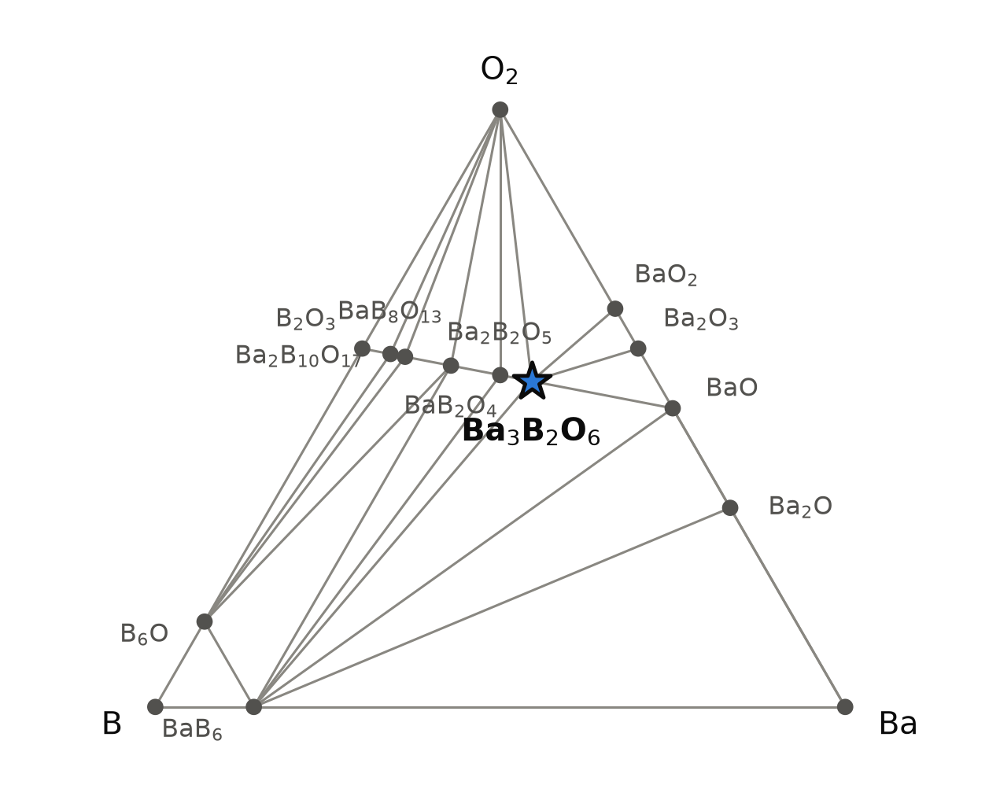
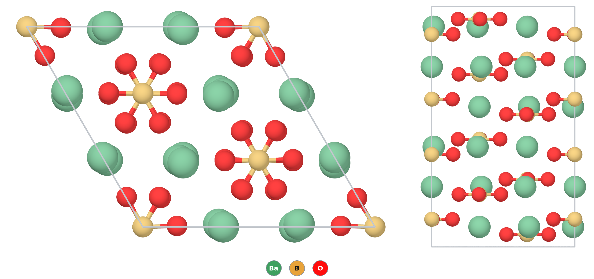

# Ba₃B₂O₆ — barium orthoborate, where the computed structure and the measured one disagree

*A Material a Day · entry 20 · 4 November 2026 · status: **known** (melting point 1949, crystal structure 2018)*

> **In one paragraph.** Ba₃B₂O₆, or Ba₃(BO₃)₂, is the most barium-rich borate: isolated
> planar BO₃³⁻ triangles held together by Ba²⁺. It has been known since at least 1949,
> when a phase study of the BaO–B₂O₃ system found it melting congruently at 1383 °C and
> noted that the powder takes up water and CO₂ from air within hours. Its crystal
> structure was solved only in 2018, on crystals grown slowly from a melt with a little
> excess B₂O₃. The cell is large and orthorhombic (Pbam, 16 formula units), and its
> authors call the structure an "anti-zeolite": a framework of barium and ordered BO₃
> groups, with channels along c that hold the remaining quarter of the BO₃ groups, each
> disordered between two orientations. The paper reports no other form. The database
> describes a different crystal. Its lowest structure of this formula is the rhombohedral
> Ca₃(BO₃)₂ type (R-3c), which the calcium and strontium orthoborates do adopt. The
> measured structure is not in the database at all, so the computed numbers below
> describe a structure nobody has reported for barium. On the computed hull the R-3c
> form is stable, 69 meV/atom below BaO + Ba₂B₂O₅. That margin is about the size of the
> 65 meV/atom scatter of oxide formation energies against experiment, and it is taken
> against a hull that lacks both of the compound's measured neighbours, Ba₄B₂O₇ and
> Ba₅B₄O₁₁, while it includes a Ba₂B₂O₅ that both phase studies failed to find. The usual
> synthesis, BaCO₃ with boric acid sintered in platinum, is also what the hull proposes.

Computed numbers come from the Alexandria database. Measured numbers carry a reference.

## 1. Identity

| | computed (PBE, R-3c) | measured (Pbam) [3] |
|---|---|---|
| Formula | Ba₃(BO₃)₂ (tribarium bis(orthoborate); 3BaO·B₂O₃) | Ba₃B₂O₆ |
| Alexandria id | `agm003228560` | not in the database |
| Space group | R-3c (no. 167), Z = 6 (hexagonal cell) | Pbam (no. 55), Z = 16 |
| Cell (Å) | a 9.524, c 13.895 | a 13.5923, b 13.6702, c 14.8894 |
| Volume per formula unit (ų) | 181.9 | 172.9 |
| Density (g cm⁻³) | 4.83 | 5.086 |
| Structure type | Ca₃(BO₃)₂ type (prototype label A2B3C6_hR66_167_c_e_f) | "anti-zeolite" borate [3] |
| Formation energy | −2.808 eV/atom (PBE) · −3.143 eV/atom (Materials-Project settings) | — |
| Magnetism | none (closed shell) | — |

The CIF is [`Ba3(BO3)2.cif`](Ba3(BO3)2.cif). The measured structure was deposited in
the Crystallography Open Database as entry 1548108 [3], at 293 K. No Wikipedia page on
this compound was found; the page "Barium borate" is about BaB₂O₄.

### How far off the cell is: the calcium and strontium members as calibration

Ba₃B₂O₆ cannot be compared cell for cell, because the two structures differ. Its two
lighter congeners crystallise in the computed type, so they show how PBE does on it.
Measured cells are from the Crystallography Open Database [4, 5]; the percentages are
our calculation.

| R-3c, hexagonal cell | measured | PBE (this database) | difference |
|---|---|---|---|
| Ca₃(BO₃)₂: a, c (Å) | 8.6377, 11.849 [4] | 8.687, 12.033 | +0.6 %, +1.6 % |
| Ca₃(BO₃)₂: V per formula unit (ų) | 127.6 | 131.1 | +2.7 % |
| Sr₃(BO₃)₂: a, c (Å) | 9.0429, 12.5664 [5] | 9.104, 12.859 | +0.7 %, +2.3 % |
| Sr₃(BO₃)₂: V per formula unit (ų) | 148.3 | 153.8 | +3.7 % |
| **Ba₃B₂O₆**: V per formula unit (ų) | 172.9 (Pbam) [3] | 181.9 (R-3c) | +5.2 % |

- In the R-3c type PBE gets *a*, the direction in the plane of the BO₃ triangles, to
  within 1 %. It overestimates *c*, the stacking direction, by 2 %. The volume error
  grows from calcium to strontium.
- Extended to barium, that trend predicts a PBE volume 4–5 % above a measured R-3c
  barium cell. The PBE cell is in fact 5.2 % larger than the measured Pbam one. So the
  two structures have nearly the same density, and the density does not say which one
  is right. The PBEsol relaxation of the same R-3c structure gives 175.3 ų, 1.4 % above
  the measured Pbam volume.

## 2. Where it sits

<picture>
  <source media="(prefers-color-scheme: dark)" srcset="phase_diagram_dark.png">
  
</picture>

The Ba–B–O system at 0 K (PBE table). Fifteen phases are on the hull. Along the
BaO–B₂O₃ line, the computed borates, what the 1949 phase study found [2], and the
phase diagram of 2018, which combines the authors' own measurements between 20 and
50 mol % B₂O₃ with the earlier literature [3]:

| composition | computed (PBE) | 1949 [2] | 2018 [3] |
|---|---|---|---|
| BaB₈O₁₃ (BaO·4B₂O₃) | on the hull, 16.8 meV/atom deep | compound, melts 879 °C | compound, melts 879–889 °C |
| Ba₂B₁₀O₁₇ (2BaO·5B₂O₃) | on the hull, 11.3 deep | not reported | compound, melts 910 °C |
| BaB₄O₇ (BaO·2B₂O₃) | **14.3 above** the hull | compound, melts 900 °C | compound, melts 910 °C |
| BaB₂O₄ (BaO·B₂O₃) | on the hull, 29.0 deep | compound, melts 1095 °C | compound, melts 1100 °C |
| Ba₂B₂O₅ (2BaO·B₂O₃) | on the hull, 12.3 deep | **not a compound**: the composition gave BaB₂O₄ + Ba₃B₂O₆ | **does not exist**; the lines once given to it belong to Ba₅B₄O₁₁ |
| Ba₅B₄O₁₁ (5BaO·2B₂O₃) | **not in the database** | not reported | compound, melts incongruently at 1170 °C |
| **Ba₃B₂O₆** | **on the hull, 69.0 deep** | **compound, melts 1383 °C** | **compound, melts congruently, about 1390 °C** |
| Ba₄B₂O₇ (4BaO·B₂O₃) | **not in the database** | not reported | compound, stable below 1190 °C, where it gives Ba₃B₂O₆ + BaO |

Ba₃B₂O₆ shares tie lines with BaO, Ba₂B₂O₅, BaO₂, Ba₂O₃ and O₂, and with BaB₆ across
the triangle. Its competing assemblage is **BaO + Ba₂B₂O₅**. Ba₃B₂O₆ is the
deepest borate on the line, by more than twice the next. It is also the composition
with the highest melting point, in both phase studies.

Set against the measured diagram, the computed line has three faults:

- **Two measured phases are missing.** Ba₅B₄O₁₁ (Ba₅(BO₃)₂(B₂O₅), P2₁2₁2₁, a structure
  reported in 2006 as cited in [3]) and Ba₄B₂O₇ (structure unknown [3]) are absent from
  the PBE, Materials-Project-settings, PBEsol and SCAN tables. Both lie between Ba₃B₂O₆ and its computed competitors,
  one on each side. Had they been computed and found stable, they would replace BaO and
  Ba₂B₂O₅ as its neighbours, and its depth could only shrink. Below 1190 °C the measured
  neighbour on the barium-rich side is Ba₄B₂O₇, not BaO.
- **One computed phase does not exist.** Ba₂B₂O₅ is on the computed hull, 12.3 meV/atom
  deep, but neither study found it. The 2018 work looked for its reported peritectic
  at 1123 °C and saw no thermal effect.
- **One measured phase is above the hull.** BaB₄O₇, which melts congruently, is computed
  14.3 meV/atom above it.

The margins in the last two, 12–14 meV/atom, are small beside the class error of
section 5. They show the size of error this hull carries in this system, which is the
scale against which the target's 69 meV/atom should be read.

## 3. Structure

*The computed R-3c structure. Left, along c: BO₃ triangles (B gold, O red) lie flat,
with barium (green) between them. Right, along a: the triangles stack in layers
perpendicular to c. One hexagonal cell; only B–O bonds are drawn.*

| site | Wyckoff | neighbours (PBE) |
|---|---|---|
| Ba | 18e | 8 O: 2 × 2.672, 2 × 2.728, 2 × 2.744, 2 × 3.243 Å |
| B | 12c | 3 O at 1.402 Å, a planar triangle |
| O | 36f | 1 B, and barium |

- **The computed structure** is the Ca₃(BO₃)₂ type. Isolated BO₃ triangles all lie
  perpendicular to c, and each barium has six oxygen neighbours at 2.67–2.74 Å and two
  more at 3.24 Å. The computed B–O bond, 1.402 Å, is that of an orthoborate triangle.
- **The measured structure** [3] is a different arrangement of the same units, refined
  from a single crystal (4031 unique reflections, R1 = 0.097). A pseudotetragonal
  cation framework, [Ba₁₂(BO₃)₆]⁶⁺, with eight barium and four boron sites, all fully
  occupied, leaves channels along c built of alternating cubes and anticubes. In the
  anticubes a fully occupied boron carries six half-occupied oxygen sites: the triangle
  is disordered by 180° about the boron. In the cubes two orientations share two
  oxygens, and the boron is split over two half-occupied sites. By our count from the
  site multiplicities, a quarter of the BO₃ groups are in the channels. The authors
  report that the channel triangles all lie perpendicular to c, which keeps the
  structure centrosymmetric. The cell is metrically almost tetragonal: a and b differ
  by about 0.5 %, and the pseudosymmetry is P4₂/mbc. The authors regard the compound as
  the fluorine-free end of a solid solution Ba₃(BO₃)₂₋ₓF₃ₓ, in which fluoride shares
  the channels; the same framework, with [(Li,Na)F₄]³⁻ clusters in the cubes, is found
  in the noncentrosymmetric LiₓNa₁₋ₓBa₁₂(BO₃)₇F₄ [3].
- **Was the R-3c form ever seen?** Not in [3]: the paper reports no other form, and
  before it no one had grown crystals of the compound or solved its structure. The
  paper's Figure 2 sets the 1949 powder pattern beside the pattern simulated from the
  Pbam structure, and by our reading of that figure their main lines coincide. The
  first powder pattern of the compound is consistent with the Pbam form, and nothing
  in either paper points to a rhombohedral one.
- **The family.** In the PBE table the same prototype label and space group hold five
  orthoborates M₃(BO₃)₂, all on the hull: Ca (33.9 meV/atom deep), Sr (61.3), Ba (69.0),
  Eu (36.3) and Hg (43.0). The rest are carbodiimides M₂(CN₂)₃ and three gold
  intermetallics, which share the label but are different chemistry. Measured cells
  and space groups in the Crystallography Open Database index confirm R-3c for
  Ca₃(BO₃)₂ [4], Sr₃(BO₃)₂ [5] and Eu₃(BO₃)₂ (entry 1510680; index only). Barium is the one member whose measured structure departs from the type. Ba²⁺
  is the largest cation of the series, and the framework structure may be how the
  lattice accommodates it. That last point is our reading, not a calculation.
- **Polymorphs in the database.** Three more structures of the formula: C2/m, 30.6
  meV/atom above the R-3c form; Pnnm, 48.2 above; I4/mmm, 860 above. The order is the
  same in the PBE, Materials-Project-settings, PBEsol and SCAN tables, with R-3c lowest in
  all four. None of them is the measured Pbam structure.

## 4. Computed properties

All are computed on the R-3c structure, **which is not the measured one**. For a
closed-shell ionic insulator built from the same BO₃ triangles and Ba–O contacts, the
gap, refractive index and moduli should depend more on those units than on how they are
arranged. That is an expectation, not a check: nothing was computed on the measured
structure.

### Electronic

| gap (eV) | value |
|---|---|
| PBE, indirect / direct | 4.32 / 4.34 |
| PBEsol, indirect | 4.30 |
| SCAN, indirect / direct | 4.83 / 4.86 |
| graph-network estimate of the PBE gap | 4.28 |
| graph-network estimate of the MBJ gap | 6.04 |

- PBE underestimates gaps. The MBJ number is a machine-learned estimate (typical error
  about 0.2 eV against MBJ itself), not a calculation. No measured gap was found. The
  1949 study describes the compound as poorly crystallised grains and gives refractive
  indices but no colour; the boule grown in 2018 is purple in the authors' photograph [3],
  which does not discuss the colour. With a gap above 4 eV in every functional, a tint
  would point to a defect or an impurity. That is our reading, not a measurement.

### Dielectric response (PBE, DFPT)

| | computed | measured [2] |
|---|---|---|
| ε∞ (in plane, in plane, along c) | 3.43, 3.43, 2.85 | — |
| ε∞ (average) | 3.24 | — |
| refractive index | 1.80 (from ε∞) | α 1.756, γ 1.768 |
| Born charges (trace/3) | Ba +2.66, B +1.96 (principal values 0.31 to 2.79), O −1.99 | — |

- **Calibration.** The computed index is 2–2.5 % above the measured ones. The comparison
  is rough in two ways. ε∞ is the long-wavelength limit while the 1949 indices were
  taken in visible light, where dispersion raises n; so PBE's overestimate is somewhat
  larger than the bare 2 %. And the structures differ.
- The response is smaller along c, perpendicular to the BO₃ planes, than in them. The
  small B principal value, 0.31, is presumably the component perpendicular to the
  triangle; the eigenvectors were not inspected.
  The anisotropy belongs to the R-3c stacking, in which every triangle lies
  perpendicular to c. In the measured structure the channel triangles also lie
  perpendicular to c [3], and their disorder is a turn within that plane, so it removes
  none of the anisotropy. Of the framework borons, the two sites on the mirror planes at
  z = 0 and ½ carry triangles perpendicular to c too, but the other two, two thirds of
  the framework groups, are steeply tilted (our reading of the coordinates in [3]). That
  should make the measured crystal less anisotropic than the computed one (our
  expectation). It is weakly birefringent [2].
- R-3c is centrosymmetric, so the piezoelectric tensor is zero. Pbam is centrosymmetric
  too, and the authors tie that to the orientation of the channel triangles [3].

### Charge transport (rigid bands)

Density-of-states masses: 1.36 (electrons) and 13.6 (holes) free-electron masses. The
very heavy holes come from flat oxygen 2p bands at the top of the valence band. The
computed branch point lies 2.48 eV above the valence-band top, a little above mid-gap.
At 300 K and 10¹⁹ carriers cm⁻³ the Seebeck coefficient is −198 μV K⁻¹ for electrons
and +633 for holes. A 4 eV insulator with no known dopant: these say how the bands would
conduct, not that the material would.

### Mechanical (machine-learned)

| bulk modulus | shear modulus | Young's modulus |
|---|---|---|
| 53 GPa | 26 GPa | 57 GPa |

Screening estimates from graph networks on the PBE structure, not calculations. No
measured modulus was found.

### Not computed

Phonons ("phonons not computed": neither this structure nor any other of this formula
is among the group's lattice-dynamics calculations); **any property of the measured
Pbam structure**, which would need an ordered model of its disordered channels; the
ionic dielectric response; spin–orbit coupling; finite-temperature properties beyond the
estimate in section 5.

## 5. Is it stable?

On the hull in both tables: **69.0 meV/atom** below BaO + Ba₂B₂O₅ in PBE, **66.8** with
Materials-Project settings. The cross-table spread is 0. SCAN puts it 170 meV/atom
deep. A graph-network estimate puts it 2 meV/atom above the hull, the same thing within
that model's error.

- **Against the class error.** Oxides (82 compounds in the calorimetric survey behind
  these tools) scatter by 65 meV/atom (mean absolute deviation) against measured
  formation enthalpies, with a bias of +5 and a 90th percentile of 168. **The 69 meV/atom
  margin is about equal to that scatter. On its own it would not settle stability.** It
  does not need to: the compound is known and melts congruently at 1383 °C [2], about
  1390 °C in [3]. The survey has no measured formation enthalpy for any ternary barium
  borate. Its tool sorts borates with the borides, a class with a different error
  (bias −73); we have used the oxide numbers instead. A calorimetric study of Ba₃B₂O₆
  itself exists [8]; we have only its metadata and use no number from it. [3] notes
  that the powder pattern filed from that work carries lines of hydration and
  carbonation products, which would bear on its sample.
- **The margin is taken against an incomplete line.** The neighbours that experiment
  finds, Ba₄B₂O₇ and Ba₅B₄O₁₁ [3], are not in the database (section 2), and the
  computed neighbour Ba₂B₂O₅ has never been made. With them computed the depth could
  only be the same or smaller. How much smaller is not known.
- **One reference is badly off.** B₂O₃ comes out 154 meV/atom more stable in the
  calculation than measured. B₂O₃ is not among Ba₃B₂O₆'s competitors, and BaO, which
  is, is within 23 meV/atom of its measured value. The distortion falls on the
  boron-rich end of the line, where it is spread over less barium. That may be part of
  why BaB₄O₇ and Ba₂B₂O₅ come out as they do (section 2), but we did not test it.
- **At temperature.** With vibrational free energy (a Neumann–Kopp estimate for the
  target; phonons for most competitors) the margin grows: −72.5 meV/atom at 300 K,
  −86.2 at 1273 K, −89.6 at 1500 K, against a vibrational scatter of 18 meV/atom. No
  competitor melts or boils on the way.
- **The polymorph question is open.** The hull above is the R-3c structure's. The
  measured Pbam structure has no computed energy. If it is the real ground state, its
  energy lies below R-3c, and the true margin is larger. If a calculation put it
  above R-3c, either the functional or the disorder model would be at fault, since
  Pbam is what crystallises, both from the melt [3] and, by the powder pattern, in the
  1949 sintering [2, 3].

## 6. How to make it

### How it is made

- **1949** [2]: barium carbonate and boric acid in the 3 : 1 BaO : B₂O₃ ratio, ground
  together for two hours, heated slowly over several hours to about 700 °C, sintered two
  hours, ground and sintered again a little hotter but below the solidus, in platinum
  and in air. The product was analysed chemically each time, because boric acid was lost
  by volatilisation. The compound melts congruently at 1383 ± 5 °C, with eutectics at
  905 °C towards BaB₂O₄ and 1370 °C towards BaO. Mixtures richer in BaO than
  Ba₃B₂O₆ attacked the platinum.
- **2018, powders** [3]: for the phase study, BaCO₃ and H₃BO₃ fired in platinum in
  5 g batches with periodic grinding, a sample counting as equilibrated once its
  powder pattern stayed the same over two further anneals.
- **2018, crystals** [3]: the first crystalline samples, by the authors' account. The
  authors grew them without a solvent, so that no foreign ions would enter the
  channels, and from 70 mol % BaO rather than the stoichiometric 75 %, because their
  furnace could not reach the melting point. About 40 g was heated at 25 °C/h to
  1220 °C in a 40 mm platinum crucible. At the liquidus, 1210 °C, a platinum wire loop
  dipped into the melt surface started crystallisation; the melt was then cooled at
  1.5 °C per day for five days, and the loop with its crystals pulled out and cooled at
  15 °C/h. The product was a purple polycrystalline boule, and the grains picked for
  diffraction were intergrowths of Ba₃B₂O₆ with Ba₅B₄O₁₁, as the starting composition
  lies in the field where the two coexist.

### What the hull proposes

Reaction energies at 0 K, meV per atom of the whole charge (Materials-Project-settings
hull). 65 routes leave nothing to separate. R6 ranks by fewest reagents, then least
driving force.

| route | charge | ΔE | note |
|---|---|---|---|
| A (rank 1) | BaO + Ba₂B₂O₅ | −66.8 | the decomposition run backwards; Ba₂B₂O₅ not known as a reagent [2] |
| B (rank 2) | 2 BaO + BaB₂O₄ | −153.5 | from the known metaborate |
| C (rank 3) | 2½ BaO + ½ BaB₄O₇ | −218.4 | |
| E (rank 5) | **3 BaO + B₂O₃** | **−337.3** | first route with only bottled reagents; = the 1949 route once CO₂ and H₂O leave |
| F | 3 BaCO₃ + B₂O₃, CO₂ kept | −8.2 | gives BaCO₃ + BaB₈O₁₃ + CO₂, not the target |

- **The published route is route E**, entered through BaCO₃ and boric acid. A closed
  0 K hull cannot see the CO₂ leave (R18): with the CO₂ kept, the charge stops at BaCO₃
  and a boron-rich borate. Once it has left, the composition is route E's and the
  target forms. This is a grip result: the hull's first bottled route is what has been
  done since 1949, and what the 2018 phase study used again [3]. The route is not ours.
  The hull has nothing to say about the melt growth of [3]: at those temperatures the
  question is the liquidus, which the 0 K tables do not hold.
- **Which product comes first.** For BaCO₃ with B₂O₃ at 1000 °C the pathway tool finds
  three products within 60 meV/atom of each other: Ba₃B₂O₆ (−317 meV/atom), Ba₂B₂O₅
  (−277) and BaB₂O₄ (−266), on the measured scale. Nucleation decides between them, so
  boron-richer borates are the expected intermediates. That is consistent with the
  repeated grinding and resintering in the 1949 recipe. Since Ba₂B₂O₅ does not exist
  [2, 3], the real intermediate on that side would be Ba₅B₄O₁₁, which the tool
  cannot offer.
- **The firing window.** The bulk-diffusion bracket for BaCO₃ + H₃BO₃ runs from the
  Tammann temperature of boric acid, 222 K, to that of BaCO₃, 817 K (544 °C). Laboratories
  fire such charges near 1089 K (816 °C), ±223 K, which brackets the 1949 sintering at
  700 °C and above. The top is the melting point of the product, 1383 °C [2], or the
  eutectic at 905 °C [2] (910 ± 10 °C [3]) if the charge is boron-rich locally. Below
  1190 °C a charge with excess BaO gives Ba₄B₂O₇ rather than BaO beside the product [3]. In humid air at 1000 °C boric
  oxide loses boron as HBO₂ vapour at about 3 × 10⁻⁴ bar, which the tool rates
  significant. That matches the losses of 1949 [2]. Remedy: a lid, a small excess of
  boric acid, and a check of the composition.
- **Atmosphere.** Oxygen is no problem at firing temperatures. In the
  Materials-Project-settings table the target takes up oxygen towards barium
  peroxides at 0 K. The firing-window tool converts the oxygen potential at which that
  begins into a temperature in air of roughly 350–460 K (80–190 °C). Above that, air is
  safe for the oxide. CO₂ and water attack it (below).
- **Metathesis**, tested on three charges:

| charge | ΔE | outcome |
|---|---|---|
| 3 BaCl₂ + 2 Na₃BO₃ | −79.2 | fails: 5.5 NaCl + ½ BaNaBO₃ + ½ Ba₅B₃ClO₉ (a chloroborate takes the chloride) |
| 3 BaF₂ + 2 Li₃BO₃ | −3.7 | fails: LiF + BaF₂ + BaLiBO₃ |
| 3 BaCl₂ + 2 Li₃BO₃ | 0 | no reaction |

  Barium halides do not exchange cleanly with alkali orthoborates: the halide stays in a
  barium halide borate, or the alkali stays in a mixed borate. Metathesis offers nothing
  here, and the direct route needs no help.

### What it tolerates

| inert in the calculation | reacts (meV/atom) |
|---|---|
| Pt, Au, Ag, Pd, Ni, Rh, Ir, Mo, W, Fe | Ti (−311), Zr (−322), Ta (−159), Nb (−65), Al (−161), Si (−63) |
| MgO, CaO, Y₂O₃, BeO, BN, graphite | SiO₂ (−59.8), Al₂O₃ (−38.7), ZrO₂ (−33.1), TiO₂ (−54.7), SiC (−34.5), Si₃N₄ (−116) |
| N₂, H₂ (0 K) | **CO₂ (−190, to BaCO₃ + BaB₂O₄)**, **H₂O (−21, to Ba hydroxide and a hydroxyborate)**, B₂O₃ (−80) |
| KBr, KI, K₂SO₄, KNO₃, PbO | most chloride, fluoride, carbonate and molybdate fluxes, by small amounts (−3 to −93) |

- **Platinum is inert**, which is what the 1949 work used. There, only the mixtures
  richer in BaO than Ba₃B₂O₆ attacked the platinum [2]; BaO against platinum was not
  computed here. Alumina, silica and zirconia crucibles are attacked in the calculation;
  MgO is not.
- **CO₂ and water.** The calculation says that both attack the product at 0 K. The 1949
  study measured it: overnight in air above 90 % humidity gave a sharp BaCO₃ pattern,
  and at 21 °C and 56 % humidity a sample gained 40.8 % in weight in about 100 hours.
  The mass gain fits complete breakdown to barium hydroxide, boric acid and water, which
  then turned into BaCO₃ and H₃BO₃ [2]. Crystals fare better: grains from the 2018
  boule, left uncoated, showed no reflections of hydration or carbonation products,
  which the authors take as a sign of relative stability in air [3]. How long they were
  exposed is not stated. Store and grind the powder dry and CO₂-free, and cool it in
  dry gas.
- **Fluxes.** Nearly every common flux reacts. The alkali fluxes give mixed borates such
  as BaNaBO₃, and the halides give barium halide borates. Only the potassium salts KBr,
  KI and K₂SO₄ are inert in the table. For crystal growth, the authors of [3] avoided
  fluxes altogether: fluoride and alkali fluoride clusters enter the channels of this
  framework, so a flux would change the crystal it was meant to grow.

### Powder pattern

Computed with Cu Kα on the PBE R-3c cell (strongest lines):

| hkl | 2-1-10 | 2-1-13 | 30-30 | 4-2-23 | 30-36 | 5-1-43 |
|---|---|---|---|---|---|---|
| 2θ (°) | 18.63 | 26.85 | 32.57 | 42.70 | 51.60 | 54.71 |
| I | 23 | 100 | 41 | 43 | 23 | 23 |

**This pattern is the computed R-3c form's, and the real compound is Pbam** [3]. A
product matching the measured Pbam cell (in COD 1548108) is Ba₃B₂O₆. A product matching
this R-3c pattern would itself be a finding. Impurities and what they mean:

- **BaCO₃:** CO₂ uptake from air after firing, or incomplete decomposition of the
  carbonate. The second means the charge was too cool.
- **BaB₂O₄:** boron-rich locally (poor mixing), or the first intermediate not yet
  consumed; regrind and refire.
- **Ba₅B₄O₁₁:** boron-rich overall, as in the 2018 crystal growth [3].
- **BaO, Ba₄B₂O₇ or Ba(OH)₂:** boron lost as vapour; add a lid or a small excess of
  boric acid. Ba₄B₂O₇ is the barium-rich neighbour below 1190 °C [3].
- **Ba(OH)₂ hydrates and H₃BO₃:** the sample stood in moist air [2].
- **A glass or a melt residue:** fired above the 905 °C eutectic on the boron-rich side.

### Hazards

Soluble barium compounds are toxic if swallowed. Ba₃B₂O₆ breaks down in moist air to
barium hydroxide [2], which is soluble, so handle it as a soluble barium salt. Boric
acid is a reproductive toxicant. Barium oxide, if present, is caustic.

## 7. What it is good for

No use of Ba₃B₂O₆ itself was found in the sources read. The 1949 study was a step towards
the BaO–B₂O₃–SiO₂ system, the basis of barium crown optical glasses [2], and the
BaO–B₂O₃ system matters to glass making and to β-BaB₂O₄, a nonlinear optical crystal
[3]. The 2018 authors see the "anti-zeolite" framework as a host: its channels take
borate, fluoride, alkali fluoride clusters and, in work they describe as in
preparation, manganese, and ions may move along them [3]. A member with
lithium–sodium fluoride clusters in the channels, LiₓNa₁₋ₓBa₁₂(BO₃)₇F₄, is linearly
dichroic and has been proposed for polarisation filters (as cited in [3]). These are properties of the family, not of Ba₃B₂O₆. Related
"anti-zeolite" barium borates, with europium in place of part of the cations, are studied
as red phosphors (abstract read) [6]. The fluoride borates of the same family have been
studied as luminescent hosts when doped with rare earths (title only) [7]. The compound's
sensitivity to moist air [2] stands in the way of any use in the open.

## 8. How this could be wrong

- **The computed structure is not the real one.** Every computed property in section 4
  belongs to the R-3c structure, which has not been reported for barium. The measured
  structure is not in the database, and an ordered model of it has not been computed.
- **The hull margin is about equal to the class error.** 69 meV/atom against an oxide
  scatter of 65. The calculation alone would not settle stability; the experiment does.
- **The hull's line is incomplete and partly wrong.** It lacks both measured neighbours
  of the compound, Ba₄B₂O₇ and Ba₅B₄O₁₁, and it holds Ba₂B₂O₅, which two phase studies
  failed to find, and puts BaB₄O₇ above the hull. The depth of 69 meV/atom is measured
  against the wrong neighbours.
- **The measured formation enthalpy was not read** [8]. It is the one number that
  would calibrate the margin directly.
- **No phonons.** The dynamical stability of the R-3c structure was not checked.
- **The routes are 0 K thermodynamics**, apart from the estimates of section 5 and the
  measured decomposition and vapour pressures. The published synthesis is the evidence
  that the route works.

## 9. Literature

**Searched 1 November 2026 (OpenAlex unless noted):** "Ba3B2O6 barium orthoborate crystal
structure" (1 hit, on Ca and Sr borates); "Ba3(BO3)2 orthoborate" (6 hits, including [3]'s
precursor paper on a fluoride borate, 10.1016/j.jallcom.2016.10.119, not opened, no
abstract; and a review of anti-zeolite structures, 10.1134/s002247662112012x, abstract read,
which names Ba₃(BO₃)₂ as one of them); "Ba3(BO3)2-xF3x fluoride borate solid solution
crystal growth" (the same 2016 paper); "Ba3B2O6 phosphor Eu luminescence" ([6]);
"BaO-B2O3 phase diagram barium borates" ([2] and work on glasses); "Ba2B2O5 barium
pyroborate crystal structure" (no hits); "tribarium borate 3BaO·B2O3" (no hits);
"anti-zeolite barium borate Ba3(BO3)2 Bekker Rashchenko" ([6] and a review);
"Ca3(BO3)2 Sr3(BO3)2 crystal structure R-3c orthoborate" (nothing relevant). Wikipedia:
no page for Ba3B2O6, Ba3(BO3)2, barium orthoborate or tribarium borate; "Barium borate" is
about BaB₂O₄.

Also searched (Crossref): "thermochemical properties Ba3B2O6", which found [8] and an
earlier vapour-pressure study of BaBO₂(g) and Ba₃B₂O₆(s) (10.1016/0021-9614(89)90031-1,
not opened, no abstract).

**Result: known compound.** Phase relations and melting point 1949 [2]; crystal
structure and revised phase diagram 2018 [3]. The route the hull ranks first among bottled reagents is the one in
use. The structure the database ranks first is not the one measured.

1. Alexandria database, entry `agm003228560` (this structure, in the PBE,
   Materials-Project-settings, PBEsol and SCAN tables); `agm003228561` (Ca₃(BO₃)₂) and
   `agm003228539` (Sr₃(BO₃)₂) for the calibration.
2. E. M. Levin, H. F. McMurdie, "The system BaO–B₂O₃", *J. Res. Natl. Bur. Stand.* 42,
   131 (1949). doi:10.6028/jres.042.011. *Full text read: preparation, chemical analysis,
   melting points and eutectics, optical properties, the hydration and carbonation
   experiment.*
3. T. B. Bekker, S. V. Rashchenko, Yu. V. Seryotkin, A. E. Kokh, A. V. Davydov,
   P. P. Fedorov, "BaO–B₂O₃ system and its mysterious member Ba₃B₂O₆", *J. Am. Ceram.
   Soc.* 101, 450 (2018). doi:10.1111/jace.15194. *Full text read: review of the
   system, phase study, crystal growth, refinement, atomic sites and occupancies,
   description of the channels. The structure is also deposited as Crystallography Open
   Database entry 1548108 (https://www.crystallography.net/cod/1548108.html). Statements
   about Ba₅B₄O₁₁, Ba₄B₂O₇ and LiₓNa₁₋ₓBa₁₂(BO₃)₇F₄ are taken from its review of the
   earlier work, whose sources we did not read.*
4. A. Vegas, F. H. Cano, S. García-Blanco, "The crystal structure of calcium orthoborate:
   a redetermination", *Acta Cryst. B* (1975). Crystallography Open Database entry
   9007607 (https://www.crystallography.net/cod/9007607.html). *Cell read from the
   database index only.*
5. Z. F. Wei, X. L. Chen, F. M. Wang, W. C. Li, M. He, Y. Zhang, "Phase relations in the
   ternary system SrO–TiO₂–B₂O₃", *J. Alloys Compd.* 327, 10 (2001).
   doi:10.1016/S0925-8388(01)01564-X. Crystallography Open Database entry 1100067. *Cell
   read from the database index only.*
6. R. S. Bubnova, A. P. Shablinskii, A. V. Povolotskiy et al., "… 'anti-zeolite'
   Ba₃Sr₃B₄O₁₂:Eu³⁺ phosphors: crystal structure, optical properties, and
   photoluminescence", *Symmetry* 15, 1399 (2023). doi:10.3390/sym15071399. *Abstract
   read.*
7. T. B. Bekker, A. A. Ryadun, A. V. Davydov et al., "Luminescence properties of
   rare-earth-doped fluoride borate crystals", *J. Alloys Compd.* (2021).
   doi:10.1016/j.jallcom.2021.163343. *Title and metadata only.*
8. E. H. P. Cordfunke, R. J. M. Konings, R. R. van der Laan, "The thermochemical
   properties of Ba₃B₂O₆(s)", *J. Chem. Thermodyn.* 25, 343 (1993).
   doi:10.1006/jcht.1993.1034. *Metadata only; cited in [3].*

## 10. Provenance

- **Data:** Alexandria database, tables `energy_runs_pbe`, `energy_runs_pbe_mp`,
  `energy_runs_ps` and `energy_runs_scan`; dielectric and transport tables on the PBE
  structure. Reaction energies, contact reactions and chemical-potential windows come
  from the hull and reaction table built on `pbe_mp`. Measured thermochemistry for
  decomposition and vapour pressure from the NASA CEA tables.
- **Tools:** the reaction-route code of this group, pymatgen, POV-Ray; machine-learned
  moduli, gaps and hull distance from graph neural networks.
- **Authorship:** drafted by Claude (Anthropic) from those tools; reviewed by
  Miguel Marques. Corrections are welcome as issues on this repository.
