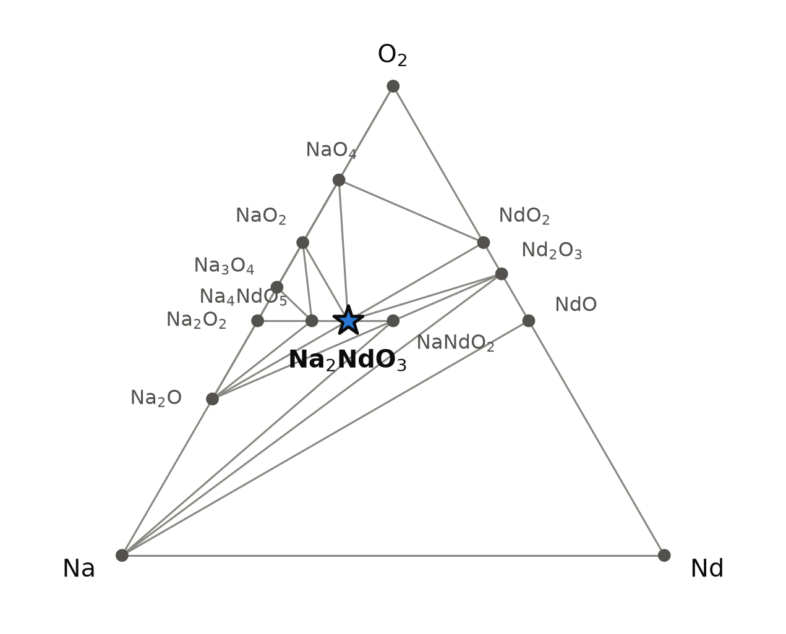
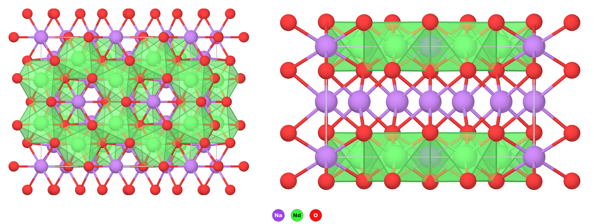

# Na₂NdO₃ — a sodium neodymate(IV) that PBE puts on the hull and the measured chemistry of Nd⁴⁺ does not support

*A Material a Day · entry 21 · 5 November 2026 · status: **artefact** (probable; judged against experiment, not against another functional; no report found)*

> **In one paragraph.** Na₂NdO₃ is written in the layered rock-salt structure of
> Li₂MnO₃ and α-Na₂PrO₃: honeycomb sheets of edge-sharing NdO₆ octahedra with sodium in
> the hexagons and between the sheets. For the charges to balance, neodymium has to be
> Nd⁴⁺. No report of this compound was found. In the database's reference table (PBE
> with the 4f electrons in the valence) it is on the convex hull, 100 meV/atom below its
> competitors. In the table computed with Materials-Project settings it is 128 meV/atom
> *above* the hull, but that table keeps the neodymium 4f shell in the core as Nd³⁺, so
> it cannot form Nd⁴⁺ at all and its answer is fixed before the calculation starts.
> Only the PBE table actually puts the question. It gets the three Na₂LnO₃ that exist
> (Ce, Pr, Tb) on the hull, and it puts Nd, Sm, Dy, Ho, Er and Tm there as well, though
> none of these is known as Ln⁴⁺ in any oxide. Experiment is against Nd: its 3+/4+
> potential is about 1.8 V higher than those of Pr and Tb, and Nd⁴⁺ has been made only
> in a few heptafluorides that need liquid fluorine at 170 bar [3]. We read the entry as a
> probable artefact of PBE for an open 4f shell, which neither table can settle, and
> not as a synthesis target. The real members, Na₂PrO₃ and Na₂TbO₃, calibrate it.

Computed numbers come from the Alexandria database. Measured numbers carry a reference.

## 1. Identity

| | computed (PBE, 4f in valence) |
|---|---|
| Formula | Na₂NdO₃ (disodium neodymium trioxide; would be "sodium neodymate(IV)") |
| Alexandria id | `agm002300984` |
| Space group | C2/m (no. 12), Z = 4 |
| Cell | a 5.995 Å, b 10.355 Å, c 5.890 Å, β 110.25° |
| Volume per formula unit | 85.76 ų |
| Density | 4.61 g cm⁻³ |
| Structure type | Li₂MnO₃ / α-Na₂SnO₃ type, ordered layered rock salt (prototype label AB2C3_mC24_12_g_adh_ij) |
| Mineral name | none |
| Formation energy | −2.289 eV/atom (PBE) · −2.329 eV/atom (Materials-Project settings) |
| Magnetism (PBE) | ferromagnetic, 4.0 μB per cell: 2.39 μB on each Nd, −0.12 to −0.13 μB on each O |

The CIF is [`Na2NdO3.cif`](Na2NdO3.cif). No Wikipedia page about this compound was found.

A second polymorph, `agm002228627` (Cmmm, no. 65, six atoms, Na and Nd in rows rather
than in a honeycomb), is 21 meV/atom higher in PBE. With Materials-Project settings
it is 4 meV/atom *lower* than the C2/m form, and both are about 125 meV/atom above the
hull there.

### How far off the cell is: Na₂PrO₃ as calibration

Na₂NdO₃ has no measured cell. Its neighbour Na₂PrO₃ does exist, with Pr⁴⁺ (4f¹) on the
same kind of honeycomb [1]. Its database cell (`agm002300985`, same C2/m type) can be
set against the measured α-Na₂PrO₃. The measured cell is C2/c with two layers per
repeat; we compare the in-plane axes and the spacing between layers. The percentages
are our arithmetic.

| Na₂PrO₃ | measured, α, C2/c [1] | PBE, C2/m (this database) | difference |
|---|---|---|---|
| a (Å) | 5.9586 | 6.018 | +1.0 % |
| b (Å) | 10.3297 | 10.387 | +0.6 % |
| layer spacing (Å) | 5.512 (= c sin β / 2) | 5.530 (= c sin β) | +0.3 % |
| volume per formula unit (ų) | 84.82 | 86.43 | +1.9 % |

For Na₂PrO₃ the PBE cell is about 2 % too large, which is ordinary for PBE. The
Na₂NdO₃ cell is 0.8 % smaller than the Na₂PrO₃ one, in the direction of the lanthanide
contraction. The geometry looks plausible, so it is not what gives the compound away.
For comparison, the only Nd⁴⁺ compounds known, the cubic heptafluorides A₂A′NdF₇
(A, A′ = Rb, Cs), have lattice constants that fall in sequence from Ce to Pr to Nd to
Tb to Dy, which is how their tetravalent state was first argued; the radius of Nd⁴⁺
itself is not well established [3].

## 2. Where it sits

<picture>
  <source media="(prefers-color-scheme: dark)" srcset="phase_diagram_dark.png">
  
</picture>

The Na–Nd–O triangle on the PBE (`energy_runs_pbe`) hull at 0 K. Fourteen phases are
on it ([`phase_diagram.json`](phase_diagram.json)). Na₂NdO₃ has tie lines to Na₂O,
Na₄NdO₅, NaNdO₂, NaO₂, NaO₄, Nd₂O₃ and NdO₂.

Read this diagram with care, because several of its vertices are as doubtful as the
target:

| phase | PBE (4f in valence) | Materials-Project settings | comment |
|---|---|---|---|
| Na₂NdO₃ (C2/m) | on hull, 99.9 below competitors | 127.7 above (→ NaNdO₂ + Na₂O₂) | this entry |
| NdO₂ (fluorite, Fm-3m) | on hull, 163.5 below competitors, metallic | other NdO₂ structures on hull, gap 3.4 eV | Nd⁴⁺ binary; the only lanthanide dioxides made are CeO₂, PrO₂ and TbO₂ [3] |
| NdO (rock salt) | on hull, 101.9 below, metallic | — | divalent/metallic monoxide |
| Na₄NdO₅ | on hull, 3.2 below, gap 0.58 eV | not within 60 meV/atom | needs Nd⁴⁺ or a peroxide |
| NaNdO₂ (I4₁/amd) | on hull, 105.6 below, gap 0.61 eV | on hull, 90.5 below, gap 3.38 eV | the ordinary Nd³⁺ sodium oxide |
| Nd₂O₃ (bixbyite in both tables) | on hull | on hull | Nd³⁺ |

(meV/atom; "below" is the depth beneath the competing assemblage.) In the PBE table
NdO₂ and Na₂NdO₃ hold each other up: with NdO₂ on the hull, the target's competitors
include another Nd⁴⁺ phase. The PBEsol and SCAN tables do not contain Na₂NdO₃. They put
fluorite NdO₂ 208 and 218 meV/atom above the hull, decomposing to Nd₂O₃ + O₂.

## 3. Structure

<picture>
  <source media="(prefers-color-scheme: dark)" srcset="structure.png">
  
</picture>

Left: one NdO₆ honeycomb layer seen roughly along the stacking direction, with Na in
the centres of the hexagons. Right: the stacking, seen along *a*: [NaNd₂]O₆ layers
(green octahedra) alternate with layers of sodium.

| site | Wyckoff | coordination | distances (Å) |
|---|---|---|---|
| Nd | 4g | 6 O, octahedron | 2.249 ×2, 2.250 ×2, 2.270 ×2 |
| Na1 | 2a (in the honeycomb) | 6 O | 2.484 ×4, 2.503 ×2 |
| Na2 | 2d (interlayer) | 6 O | 2.394 ×2, 2.608 ×4 |
| Na3 | 4h (interlayer) | 6 O | 2.444 ×2, 2.535 ×2, 2.646 ×2 |
| O1 | 8j | 2 Nd + 4 Na | |
| O2 | 4i | 2 Nd + 4 Na | |

- Every cation is octahedral and every oxygen has six cation neighbours. This is a
  rock salt with the cations ordered into layers: one layer is ⅓ Na and ⅔ Nd arranged
  as a honeycomb, the next is all Na. It is the Li₂MnO₃ arrangement, also adopted by
  Na₂SnO₃, Na₂ZrO₃, Na₂HfO₃, Na₂IrO₃ and Na₂RuO₃ in the same table.
- **The Nd–O distance is the clue.** Its mean is 2.256 Å. In NaNdO₂ (`agm003263598`,
  Nd³⁺, same table) the Nd–O distances are 2.385–2.393 Å. In PBE's Na₂PrO₃ the Pr–O
  distances are 2.252–2.275 Å, and the Pr⁴⁺ radius is 0.85 Å [1]. So the calculation
  has made a small, tetravalent-sized Nd ion, as the stoichiometry requires.
- The NdO₆ octahedra share edges within the layer. Sodium octahedra share edges with
  them and with each other across the layers.

### The family in this structure

Na₂LnO₃ across the lanthanides, lowest polymorph in each table (meV/atom above the
hull; 0 means on it, and the number in brackets is the depth below the competitors),
beside the measured chemistry of Ln⁴⁺ from the review [3]. The Ln³⁺/Ln⁴⁺ potential is
in volts against the normal hydrogen electrode: derived from experiment where a value
with an error is given, otherwise calculated from free energies (marked *calc.*).

| Ln | PBE (4f in valence) | Materials-Project settings (4f in core, Ce excepted) | Ln³⁺/⁴⁺ potential (V) [3] | Ln⁴⁺ in the solid state [3] |
|---|---|---|---|---|
| La | 112.9 | 105.3 | — | none (no 4f electron) |
| Ce | 0 (−34.6), gap 2.20 eV | 0 (−34.7), gap 2.22 eV | 1.74 | **Na₂CeO₃ reported**; CeO₂ |
| **Pr** | **0 (−197.8), gap 0.45 eV** | **120.6** | **3.2 ± 0.2** | **Na₂PrO₃ reported [1, 3]**; PrO₂, many fluorides |
| **Nd** | **0 (−99.9), metal** | **123.8** | **5.0 ± 0.4** | **heptafluorides only, made with liquid F₂ at 170 bar; no oxide** |
| Sm | 0 (−72.7), gap 0.13 eV | 110.0 | 5.2 *calc.* | none; named an open challenge |
| Gd | 90.0 | 81.8 | 7.4 *calc.* | none |
| Tb | 0 (−136.7), gap 0.78 eV | 107.1 | 3.1 ± 0.2 | **Na₂TbO₃ reported**; TbO₂, many fluorides |
| Dy | 0 (−109.4), gap 0.54 eV | 105.7 | 5.2 ± 0.4 | heptafluorides only; in oxides unproven |
| Ho | 0 (−35.2), metal | 104.1 | 5.7 *calc.* | none; named an open challenge |
| Er | 0 (−0.3), metal | 102.8 | 5.7 *calc.* | none |
| Tm | 0 (−8.8), gap 0.03 eV | 101.4 | 5.6 *calc.* | none |
| Lu | 108.1 | 102.2 | 8.1 *calc.* | none (full shell) |
| Y | 116.0 | 110.7 | — | none (no 4f electron) |

The pattern is the finding of this entry:

- **The Materials-Project table cannot answer the question.** It treats the 4f shell
  as part of the core, fixed at Ln³⁺ (cerium, which comes out alike in both tables, is
  the exception). A tetravalent Pr, Nd or Tb is therefore impossible in it by
  construction, and every member except Ce sits 100–130 meV/atom above the hull,
  including Na₂PrO₃ and Na₂TbO₃, which exist.
  Its magnetisation for Na₂NdO₃ is 2.0 μB per cell, one hole per formula unit on
  oxygen: the compound is priced as Nd³⁺ with an oxygen hole, the only thing that table
  allows. Its "unstable" is an input, not a result, and we do not use it as evidence.
- **The PBE table, with the 4f shell in the valence, is the only one that puts the
  question, and it gets the known members right.** Na₂CeO₃, Na₂PrO₃ and Na₂TbO₃ are
  on its hull; La, Gd, Lu and Y (an empty, half-filled or full 4f shell, or none) are
  90–116 meV/atom above it.
- **But it does not discriminate.** It puts Nd, Sm, Dy, Ho, Er and Tm on the hull too.
  None of these six is known as Ln⁴⁺ in any oxide, and their 3+/4+ potentials are
  1.8–2.6 V more positive than those of Pr and Tb, the two non-cerium lanthanides
  with real tetravalent oxides [3]. The PBE depths do not follow the potentials: Nd
  (−99.9) and Dy (−109.4) sit as deep as Tb (−136.7). A table that cannot separate
  terbium from erbium cannot be trusted for neodymium.
- The f-free analogues (La, Y, Lu) agree between the two tables to within about
  10 meV/atom. The whole disagreement for Nd therefore comes from the 4f shell.

## 4. Computed properties

All on the PBE structure. Na₂NdO₃ is an open-4f compound, so its PBE band structure is
not physical; per the series rule we also quote the f-free analogue Na₂LuO₃
(`agm002228624`, same structure, 108 meV/atom above the PBE hull).

### Electronic structure

| quantity | Na₂NdO₃ | Na₂LuO₃ (f-free analogue) | Na₂PrO₃ (real, for comparison) |
|---|---|---|---|
| PBE gap (indirect/direct) | 0.000 / 0.0006 eV — metal | 0.000 / 0.0006 eV — metal | 0.448 / 0.449 eV |
| total moment (μB per cell) | 4.0 | 2.0 | 2.0 |
| moment on the metal | 2.39 μB per Nd | −0.01 μB per Lu | 1.17 μB per Pr |
| moment on oxygen | −0.12 to −0.13 μB | +0.24 to +0.30 μB | −0.05 μB |
| Bader charge on the metal | +2.03 | +1.98 | +2.08 |
| DOS at E_F (as stored) | 4.09 | 8.07 | 0.67 |

- In PBE, Nd carries 2.39 μB. That is between 4f³ Nd³⁺ (3.02 μB on Nd in NaNdO₂, same
  table) and the 2 μB of an ideal 4f² Nd⁴⁺. Its Bader charge rises only from +1.91 in
  NaNdO₂ to +2.03. So PBE has removed about two-thirds of an f electron and left a
  partly filled, metallic 4f band at the Fermi level. A fractionally occupied 4f band
  is where PBE's self-interaction error is largest. These tables do not tell us the
  sign or the size of that error for this reaction; the reason to think it favours
  Na₂NdO₃ is the comparison with experiment across the family (section 3), not the
  theory.
- The f-free analogue shows what happens when there is no 4f electron to give. In
  Na₂LuO₃ the hole sits on oxygen (0.24–0.30 μB per O), the compound is a metal, and it
  is 108 meV/atom above the hull. The PBE gap of Na₂NdO₃ is therefore an artefact twice
  over: it is an open-4f PBE gap, and the f-free analogue has no gap to quote either,
  because it is a hole-doped oxide. **No gap for this compound can be quoted from
  these tables.**
- The machine-learned estimates on this structure (tuga-sp): PBE gap 0.002 eV; MBJ gap
  2.48 eV; magnetisation 1.33 μB. The MBJ model reads only the structure. It has
  learned what gap an ordered rock salt of this geometry usually has, not what the 4f
  shell does here. We do not trust it.

### Dielectric response and charge transport

The dielectric table has no entry (it holds insulators only). The stored transport
calculation treats the compound as a metal (300 K Seebeck of 1 μV/K for n = 10²⁰ cm⁻³).
Neither quantity means anything for an artefact metallic state, so we do not tabulate
them; they are in [`properties.json`](properties.json).

### Mechanical (machine-learned)

Bulk modulus 64.7 GPa, shear modulus 36.9 GPa, Young's modulus 102.8 GPa (tuga-sp, from
the structure alone). They describe a hypothetical lattice. Of everything in this
section they are the numbers most likely to be close to what a real Ln⁴⁺ member would
have, because they depend on the geometry more than on the 4f shell.

### Not computed

- Phonons: not computed. The compound is not in the group's PBEsol phonon calculations,
  and there is no other structure of this formula there.
- Magnetic order: only the ferromagnetic state is stored. For a real 4f² ion,
  spin-orbit coupling and crystal-field levels would decide the magnetism; for Pr⁴⁺
  and Tb⁴⁺ the crystal field is at least ten times that of the trivalent ions [3].
  PBE without spin-orbit coupling says nothing useful about either. The measured
  calibration points are α-Na₂PrO₃ (antiferromagnetic below 4.6 K, effective moment
  0.99 μB, Weiss constant −15 K) and Na₂TbO₃ (antiferromagnetic below 38.3 K, 7.90 μB,
  −105 K) [3]; a spin-only PBE moment (1.17 μB on Pr) is not comparable with them. No
  magnetic measurement on any Nd⁴⁺ compound has been reported [3].
- No calculation with a Hubbard U, a hybrid functional or self-interaction correction is
  in the database for this compound. We do not think one would settle it (section 8).

## 5. Is it stable?

| table | distance to hull | depth below competitors | competitors |
|---|---|---|---|
| `energy_runs_pbe` (reference; 4f in valence) | 0 | **+99.9 meV/atom** (stable) | Na₂O, NaNdO₂, NdO₂, Nd₂O₃, Na₄NdO₅, NaO₂, NaO₄ (its tie lines) |
| `energy_runs_pbe_mp` (Materials-Project settings) | **+127.7 meV/atom** (C2/m); +123.8 (Cmmm) | −127.7 | NaNdO₂ + ½ Na₂O₂ |
| `energy_runs_ps`, `energy_runs_scan` | not in the tables | — | — |
| machine-learned (tuga-sp) | 138 meV/atom above | — | — |

- **The two tables disagree by 228 meV/atom.** The calorimetric scatter of oxides is
  65 meV/atom (mean absolute deviation over 82 oxides, `pbe_mp`). A margin of 100 or
  128 meV/atom in either direction would normally count as resolved. Here it is not.
  The Materials-Project number is not a measurement of the Nd⁴⁺ question, because that
  table keeps the 4f shell in the core and cannot form Nd⁴⁺; the PBE number does put
  the question, but its 4f error is not covered by any class scatter, and on the
  family it is wrong at least as often as it is right (section 3).
- No measured formation enthalpy of a ternary Nd⁴⁺ oxide, or of any Nd⁴⁺ compound,
  exists to calibrate against. The measured enthalpies of the tetravalent oxides that
  do exist (CeO₂, PrO₂, TbO₂, and the perovskites SrLnO₃ and BaLnO₃ of Ce, Pr and Tb)
  are collected in [3]; we did not set the PBE table against them here, and that is
  the next calibration to make.
- **The measured chemistry is the evidence.** The Nd³⁺/Nd⁴⁺ potential, about 5.0 V,
  is 1.8 V above those of Pr and Tb [3]. The A₂LnO₃ oxides are known only for Ce,
  Pr and Tb; the sodium ones are made from Na₂O₂ and CeO₂, Pr₆O₁₁ or Tb₄O₇, oxides
  that already contain Ln⁴⁺ [3]. Nd⁴⁺ and Dy⁴⁺ together are known in six pure
  compounds, all heptafluorides A₂A′LnF₇ (A, A′ = Rb, Cs), made by treating the
  chlorides with liquid fluorine at 170 bar and 693 K, and confirmed by X-ray
  absorption [3]. Against that, we do not believe PBE's 100 meV/atom margin for an
  oxide made with Na₂O₂.
- The two bullets below come from the hull and reaction table built on `pbe_mp`, the
  only one with phonons and an oxygen scan. On that hull Nd⁴⁺ cannot form, so they say
  only that heating and oxygen do not rescue the compound *as that table prices it*.
- **At temperature** (Materials-Project hull with phonons, Nd entropy share 0.82): the
  margin above NaNdO₂ + Na₂O₂ falls from 115.1 meV/atom at 300 K to 105.3 at 773 K,
  98.8 at 1073 K and 94.4 at 1273 K (vibrational scatter 8–26 meV/atom). Heating does
  not bring it near the hull.
- **Under oxygen:** the firing-window scan in μ_O on the Materials-Project hull finds no
  oxygen potential at which Na₂NdO₃ comes within 25 meV/atom of the hull. The best
  margin is +123.8 meV/atom at μ_O = −0.71 eV, equivalent to about 910 K in air. More
  oxygen does not help, because the competing assemblage NaNdO₂ + Na₂O₂ already has the
  oxygen. The peroxide simply holds it.

**Verdict.** Neither table can settle whether Nd⁴⁺ is stable here. One cannot form a
+4 lanthanide other than cerium, by construction; the other forms one wherever a 4f
electron can be given, real or not. The verdict therefore rests on experiment: Nd⁴⁺
is far harder to reach than Pr⁴⁺ or Tb⁴⁺, is known only in fluorides made with liquid
fluorine, and is not known in any oxide. We class the entry as a probable artefact of
PBE for the open 4f shell and do not propose it as a target. It is not a proof that
Na₂NdO₃ cannot exist.

## 6. How to make it

We do not expect it can be made by ordinary solid-state chemistry. The route tables
below are on the `pbe_mp` hull, where Nd⁴⁺ cannot form, so they cannot show a route
to it; they show only where the trivalent chemistry goes.

**How the real members are made.** Na₂PrO₃ is made from Na₂O₂ and Pr₆O₁₁ (where
praseodymium is already partly Pr⁴⁺) in an evacuated silica ampoule at 400 °C, then
annealed in silver at 600–800 °C. All handling is under nitrogen, because the product
is moisture sensitive [1]. An earlier route makes Na₂CeO₃, Na₂PrO₃ and Na₂TbO₃ from
Na₂O₂ and CeO₂, Pr₆O₁₁ or Tb₄O₇ in gold tubes at 973 K for 12 hours under flowing
oxygen; the alkali must be supplied as a peroxide or higher oxide, because carbonates
and nitrates do not work with the lanthanides [3]. In each case the lanthanide enters
already partly tetravalent. The neodymium analogue has to start from Nd₂O₃, since no
neodymium oxide beyond Nd³⁺ is available:

| charge (Materials-Project hull) | ΔE (meV/atom of mixture) | what forms |
|---|---|---|
| ½ Nd₂O₃ + ½ Na₂O₂ + ½ Na₂O | −72.4 | NaNdO₂ + ¼ Na₂O₂ |
| 1 NaNdO₂ + ½ Na₂O₂ (exactly the target's composition) | +123.8 uphill | stays NaNdO₂ + Na₂O₂ |

The peroxide is supposed to oxidise the neodymium, and the hull says it will not; it
stays as peroxide. That outcome is built into a table that cannot describe Nd⁴⁺, so
it is not evidence. The evidence is that Na₂O₂ and oxygen suffice for Pr and Tb, whose
oxides already hold Ln⁴⁺, while the only Nd⁴⁺ compounds known needed liquid fluorine
at 170 bar [3]. An attempt worth making would use the strongest oxidising conditions
available for an oxide (high-pressure oxygen, or a chlorate, as was used for PrO₂ [3])
and test the product by Nd L₃-edge absorption, which is how Nd⁴⁺ was confirmed in
the fluorides [3].

**Metathesis (tested, fails).** Three charges that would give Na₂NdO₃ plus a sodium
halide, with Na₂O₂ as the oxidant:

| charge | ΔE (meV/atom) | products |
|---|---|---|
| NdCl₃ + ½ Na₂O₂ + 2 Na₂O | −456.0 | 3 NaCl + NaNdO₂ + ¼ Na₂O₂ |
| NdF₃ + ½ Na₂O₂ + 2 Na₂O | −295.9 | 3 NaF + NaNdO₂ + ¼ Na₂O₂ |
| NdOCl + ½ Na₂O₂ + Na₂O | −209.4 | NaCl + NaNdO₂ + ¼ Na₂O₂ |

All three run strongly downhill, but to NaNdO₂ and the halide, leaving the peroxide
unused. The salt byproduct changes nothing: the margin belongs to the target, not to
the precursors. On this hull that is the only possible outcome (Nd⁴⁺ cannot form); the
point that survives is that Na₂O₂ is the oxidant here, and it is weaker than what Nd⁴⁺
has needed in practice [3].

**Reservoir routes.** With an open oxygen supply the reservoir search ranks only
exotic iodate, nitrate and hydride pairs, all within 65 meV/atom of break-even, and
none of them a chemistry anyone would use. On the same hull the target's margin
under any oxygen potential stays above 120 meV/atom (section 5), with the caveat
stated there.

**Contact.** On the Materials-Project hull Na₂NdO₃ reacts with every crucible material,
gas and ceramic in the screen (for example Al₂O₃ −166, MgO −93, H₂O −138, CO₂ −300
meV/atom), but only because that hull already prices it 124–128 meV/atom above its
decomposition products. The measured guide is better: Na₂PrO₃ decomposes in moist air
[1], and the sodium lanthanide(IV) oxides are fired in gold or silver [1, 3]. A
neodymium analogue, if one existed, would be at least as sensitive.

**What an attempt would look like in the powder pattern.** Strongest computed lines for
Cu Kα: 16.0° (001, 100 %), 37.1° (131, 84 %), 31.8° (13‑1, 47 %), 36.9° (20‑2, 42 %),
18.0° (110, 36 %). Expect NaNdO₂ and Na₂O₂, or after air exposure NaOH, Na₂CO₃ and
Nd(OH)₃. A superstructure peak near 16–20° in a sample that is otherwise NaNdO₂ would
be worth a second look.

**Hazards.** Na₂O₂ is a strong oxidiser and reacts violently with water and organic
matter. Na₂O is caustic. Neodymium compounds have low toxicity.

## 7. What it is good for

Nothing as a material, since it is very probably not one. As a computational object it
is a useful test case: one functional with the 4f shell in the core cannot form the
real members Na₂PrO₃ and Na₂TbO₃ (it does form Na₂CeO₃), and the same functional with the 4f
shell in the valence forms them and also Na₂NdO₃, Na₂SmO₃, Na₂DyO₃, Na₂HoO₃, Na₂ErO₃
and Na₂TmO₃, none of which is reported. Any screen of lanthanide oxides that takes
`energy_runs_pbe` at face value will propose them all, and any screen on `pbe_mp` will
miss every real one but cerium. The honeycomb Na₂PrO₃ itself is
studied as a 4f¹ candidate for bond-dependent (Kitaev-type) magnetism [1, 2].

## 8. How this could be wrong

- **Nd(IV) is rare, not impossible.** It exists in the heptafluorides [3], and NdF₄
  has been seen as a molecule in a cold matrix [3]. Lattice energy can stabilise a
  tetravalent lanthanide in a ternary oxide beyond what its binary would suggest, as
  measured for BaPrO₃ [3]. An Nd⁴⁺ oxide under extreme oxidising conditions is not
  excluded by anything here. The claim of this entry is narrower: the computed
  stability of Na₂NdO₃ is not evidence for it.
- **No calculation in hand settles it, and we do not think DFT+U would.** The energy of
  oxidising a 4f shell in DFT+U depends strongly on U, and U is in practice chosen by
  fitting thermochemistry such as the very oxidation energies in question; a hybrid
  functional has an analogous mixing parameter. A calculation tuned on Pr and Tb and
  then applied to Nd would be an extrapolation, not a test. What would count is an
  experiment (section 6), or a method that, without being fitted to them, puts Na₂CeO₃,
  Na₂PrO₃ and Na₂TbO₃ on the hull and the Sm, Dy, Ho, Er and Tm members off it.
- **Neither table is preferred, and the verdict does not rest on either.** The 4f-in-
  core table cannot form Nd⁴⁺; the 4f-in-valence table forms too many Ln⁴⁺. If PBE
  happened to be right for Nd while wrong for Ho, Er and Tm, this entry would be wrong.
  The measured 3+/4+ potentials make that unlikely but do not exclude it, since the
  lattice terms of the solid are not in them.
- **The search was thin.** It found no report, but the literature on alkali lanthanide
  oxides is old and partly not indexed; a structural-database check by a person is
  still owed.
- **Magnetism.** Only the ferromagnetic PBE state is stored. A different spin
  arrangement would change the PBE energy, by an amount we did not compute. We do not
  expect it to close a 228 meV/atom disagreement, but it adds to the uncertainty of the
  PBE number.

## 9. Literature

Searches (OpenAlex, 1 November 2026), with the number of hits:

- "Na2NdO3" — 0
- "sodium neodymate" — 6, all Nd³⁺ coordination complexes, none relevant
- "sodium neodymium oxide NaNdO2 Na2O Nd2O3 phase" — 0
- "Na2LnO3 lanthanide honeycomb Kitaev candidates first principles Na2NdO3" — 0
- "tetravalent neodymium Nd(IV) solid state compound" — 8; one relevant review [3],
  which lists Na₂CeO₃ and Na₂TbO₃ as reported and no oxide of Nd⁴⁺
- "neodymium dioxide NdO2 existence tetravalent oxidation state lanthanide oxides" — 0
- "Cs3NdF7 neodymium(IV) fluoride" — 0
- "Na2PrO3 tetravalent praseodymium honeycomb structure magnetic" — 4 [1, 2]
- "Na2TbO3 Li2TbO3 crystal structure magnetic properties tetravalent terbium" — 0
- Wikipedia: "Na2NdO3", "sodium neodymate", "sodium neodymium oxide", "neodymium(IV)":
  no page about this compound.

Result: **no report of Na₂NdO₃ found.** Absence from these searches is weak evidence.

1. R. Okuma, K. MacFarquharson, R. Coldea, "Selective synthesis and crystal chemistry
   of candidate rare earth Kitaev materials: honeycomb and hyperhoneycomb Na₂PrO₃",
   arXiv:2410.09171 (2024). doi:10.48550/arXiv.2410.09171. *Full text read (preprint).*
   Source of the measured cells, the Pr⁴⁺ radius and the synthesis.
2. S.-H. Jang, Y. Motome, "Exchange interactions in the rare-earth magnets A₂PrO₃ (A =
   alkali metals)", *Phys. Rev. B* 110, 155124 (2024). doi:10.1103/PhysRevB.110.155124.
   *Abstract read.*
3. T. P. Gompa, A. Ramanathan, N. T. Rice, H. S. La Pierre, "The chemical and physical
   properties of tetravalent lanthanides: Pr, Nd, Tb, and Dy", *Dalton Trans.* 49,
   15945–15987 (2020). doi:10.1039/D0DT01400A. *Full text read.* Source of the list of
   known Ln⁴⁺ solids (from the authors' search of the inorganic structure database),
   the Ln³⁺/⁴⁺ potentials, the Nd⁴⁺ fluorides and how they were made, the sodium
   lanthanide(IV) oxide synthesis, and the measured magnetism of Na₂PrO₃ and Na₂TbO₃.
   These are the review's summaries of the primary papers, which we did not read.

## 10. Provenance

- **Data:** Alexandria database, tables `energy_runs_pbe` (reference), `energy_runs_pbe_mp`,
  `energy_runs_ps` and `energy_runs_scan`. Moments and Bader charges are those stored
  with the PBE structures. Reaction energies, contact reactions, the oxygen window and
  the margins at temperature come from the hull and reaction table built on `pbe_mp`.
- **Tools:** the reaction-route code of this group, pymatgen, POV-Ray. Machine-learned
  moduli, gaps and hull distance come from graph neural networks.
- **Authorship:** drafted by Claude (Anthropic) from those tools; reviewed by
  Miguel Marques. Corrections are welcome as issues on this repository.
