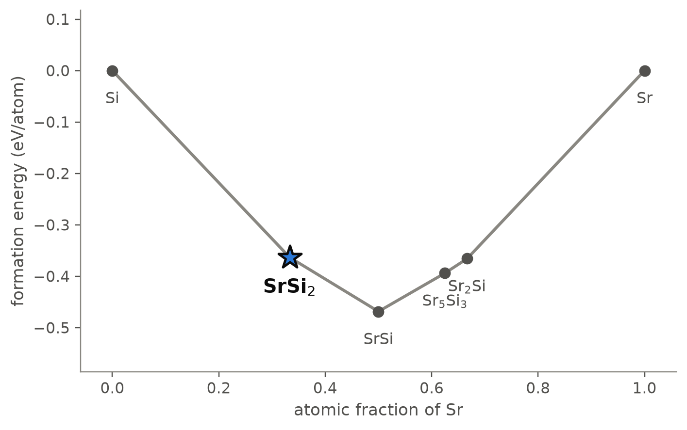
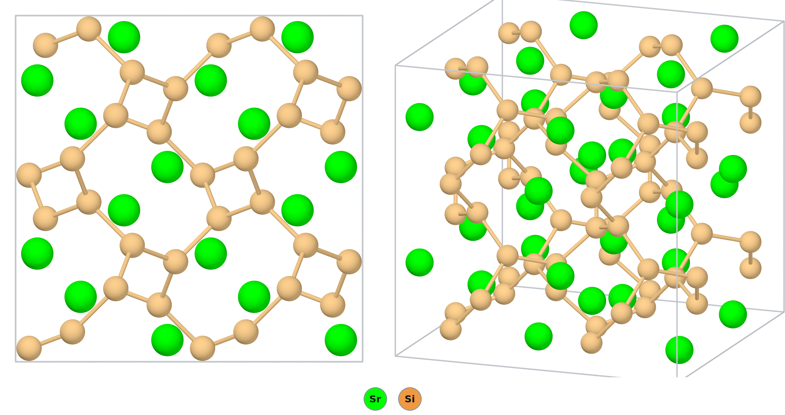
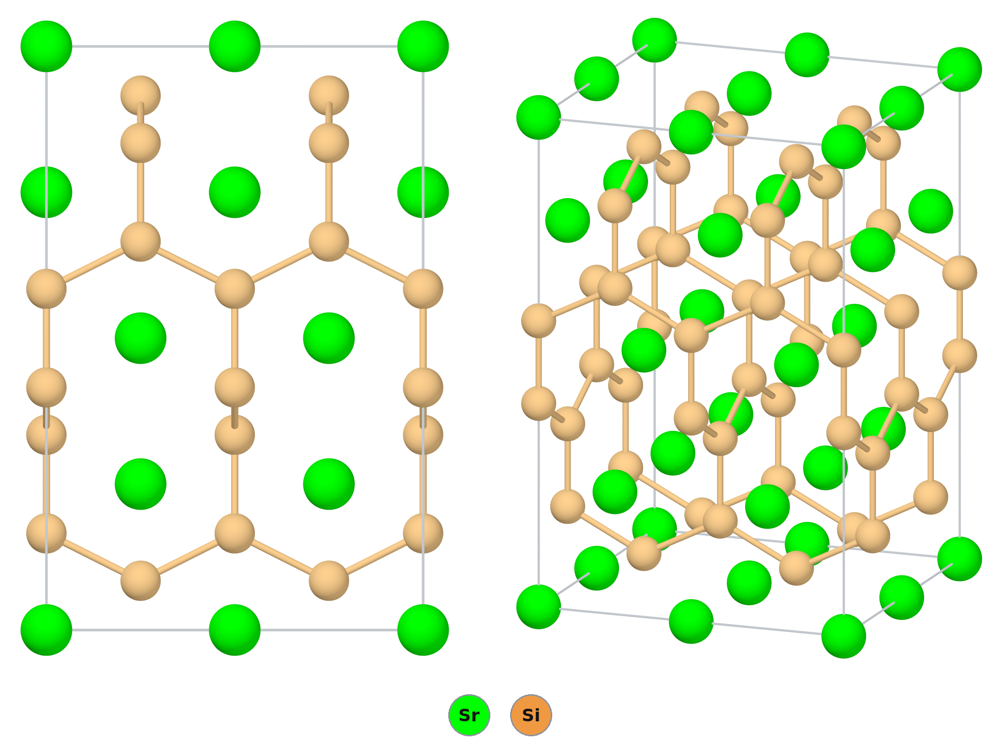

# SrSi₂ — strontium disilicide, where the reference calculation picks the wrong polymorph

*A Material a Day · entry 22 · 6 November 2026 · status: **known** (crystal structure 1960s; thermoelectric and band-topology studies since 2005)*

> **In one paragraph.** SrSi₂ is a narrow-gap silicide of strontium that melts congruently
> near 1120 °C. At ambient pressure it crystallises in its own cubic structure type
> (P4₃32), in which every silicon atom bonds to three others in a chiral three-connected
> net with neither an inversion centre nor a mirror plane. It is made by melting the
> elements under argon, and is studied as a low-temperature thermoelectric and as a
> candidate double-Weyl semimetal. A second, tetragonal α-ThSi₂ form is made at 4 GPa and
> 1000–1500 °C, or by quenching the melt, and survives at room temperature. On heating it
> turns into the cubic form and releases 1.6 ± 0.3 kcal/mol, which puts the cubic form
> 23 ± 4 meV/atom lower. That measurement is the calibration of this entry. The reference
> table of the database ranks the tetragonal form lowest, 3.4 meV/atom below the cubic
> one, so it has the sign wrong and misses by about 27 meV/atom. PBEsol misses by 43.
> SCAN gets the order right and comes within 5 meV/atom. The compound itself is robust:
> every table puts SrSi₂ on the hull, 28–51 meV/atom below SrSi + Si.

Computed numbers come from the Alexandria database. Measured numbers carry a reference.
The entry treats the computed structures as calibration against what has been measured.

## 1. Identity

| | cubic, measured form | tetragonal, the PBE ground state |
|---|---|---|
| Formula | SrSi₂ (strontium disilicide) | SrSi₂ |
| Alexandria id | `agm003211413` (PBE), `agm003211412` (PBEsol, SCAN) | `agm003201892` |
| Space group | P4₁32 (no. 213), Z = 4; measured as P4₃32 (no. 212) [2, 3] and P4₁32 [15], the two hands of one structure | I4₁/amd (no. 141), Z = 4 |
| Cell, PBE (Å) | a 6.566 | a 4.465, c 13.843 |
| Cell, measured (Å) | a 6.515 [2], 6.535 [3, 15], 6.536 [5] | a 4.438, c 13.83 [3, 4]; a 4.439, c 13.838 (powder) and a 4.429, c 13.842 (single crystal) [5] |
| Volume per formula unit, PBE / measured (ų) | 70.76 / 69.78 [3] | 68.99 / 68.10 [3] |
| Density, PBE / X-ray / pycnometric (g cm⁻³) | 3.37 / 3.423 / 3.40 [3] | 3.46 / 3.507 / 3.47 [3] |
| Structure type | SrSi₂ type (prototype label AB2_cP12_213_a_c) | α-ThSi₂ type (AB2_tI12_141_a_e) |
| Formation energy (PBE) | −0.360 eV/atom | −0.363 eV/atom |
| Magnetism | none | none |

Wikipedia: [Strontium disilicide](https://en.wikipedia.org/wiki/Strontium_disilicide).

The measured cells, volumes and densities are those of the papers [3–5] (also deposited
in the Crystallography Open Database, entries 2107402, 1536083, 1542132, 1527358,
1533940); the older cubic value 6.515 Å [2] is the outlier, and Evers notes that his
samples gave 6.535 Å [4]. The CIFs are [`SrSi2.cif`](SrSi2.cif) (tetragonal) and
[`SrSi2_cubic.cif`](SrSi2_cubic.cif) (cubic); the numbers for the tetragonal one are in
[`structure.json`](structure.json).

**How far off the cell is.** For the cubic form PBE is 0.5 % long on *a* against 6.535 Å,
1.4 % on the volume. For the tetragonal form it is 0.6–0.8 % long on *a* and within 0.1 %
on *c*, 1.3 % on the volume. That is the usual PBE overestimate. The measured tetragonal
form is 2.4 % denser than the cubic one [3], and PBE gives 2.5 %; the measured volume
change is 1.0 cm³/mol [3], 0.56 ų per atom, and PBE gives 0.59 (7 % more). So PBE
describes both structures well. The trouble lies in their energy order (section 5).

Alexandria stores the cubic structure as the left-handed P4₁32 variant, and two of the
three deposited measurements are the right-handed P4₃32. The two are mirror images with
the same energy, so the database cannot prefer one hand. Evers gives the space group as
"P4₃32 or P4₁32" [3]: powder data cannot tell the hands apart, and we found no report
that settles it for a SrSi₂ crystal.

## 2. Where it sits

<picture>
  <source media="(prefers-color-scheme: dark)" srcset="phase_diagram_dark.png">
  
</picture>

The Sr–Si binary at 0 K (PBE table). Six phases lie on the hull.

| phase | atomic fraction Sr | formation energy (meV/atom) | notes |
|---|---|---|---|
| Si | 0 | 0 | diamond |
| **SrSi₂** | 0.333 | **−363** | tetragonal in this table; 51 meV/atom below SrSi + Si |
| SrSi | 0.5 | −468 | the deepest phase |
| Sr₅Si₃ | 0.625 | −394 | |
| Sr₂Si | 0.667 | −366 | |
| Sr | 1 | 0 | |

- **Neighbours.** SrSi₂ has tie lines to Si and to SrSi, and its competing assemblage is
  SrSi + Si. It is the silicon-richest computed silicide of strontium. Sr₃Si₄ lies
  8 meV/atom above the hull in this table.
- **The measured diagram agrees on the phases.** Palenzona and Pani, by thermal analysis,
  metallography and diffraction over 0–75 at.% Si, find exactly the four intermediate
  phases of the computed hull [5]:

| phase | measured [5] | structure type [5] |
|---|---|---|
| Sr₂Si | forms peritectically at 1080 °C | PbCl₂ |
| Sr₅Si₃ | melts congruently at 1150 °C | Cr₅B₃ |
| SrSi | melts congruently at 1195 °C, the highest | CrB |
| SrSi₂ | melts congruently at 1120 °C; cubic α (low temperature), tetragonal β (high temperature) | SrSi₂, α-ThSi₂ |

  Eutectics lie at about 3 at.% Si (745 °C), 44 (1110 °C), 61 (1055 °C, SrSi + β-SrSi₂)
  and 74 at.% Si (1045 °C, SrSi₂ + Si). Evers gives 1150 °C for the melting point of the
  cubic form [3]. SrSi, the deepest phase of the computed hull, is also the one that
  melts highest.
- **What the hull does not show.** The tetragonal form has a solid-solution range from
  SrSi₁.₆₅ to SrSi₂ (62.0–66.7 at.% Si); a single crystal refined as SrSi₁.₆₉ with a
  partly empty silicon site [5]. An earlier "Sr₄Si₇" is very likely this phase [5]. A
  hull of ordered stoichiometric structures cannot show it, nor the fact that at SrSi₂
  three structures lie within 3.4 meV/atom of each other in PBE (section 5).
- **Sr₃Si₄ is not reported.** Alloys at 55–60 at.% Si showed a faint thermal effect at
  1025 °C and two unindexed powder lines at d = 8.025 and 4.910 Å [5]. Sr₃Si₄ (57 at.%
  Si) is the computed phase in that range, but its computed pattern has no line near
  either (its first strong line is at 4.65 Å; our calculation on the PBE cell), so it
  does not account for them.

## 3. Structure

The two forms differ only in how the same three-connected silicon net is arranged. In both,
each Si has three Si neighbours, the Zintl count for Si⁻ with Sr²⁺. Only the Si–Si bonds
are drawn.

*The cubic form, measured at ambient pressure (computed cell, 2 × 2 × 2 block). Left, along
a: the silicon net (gold) coils around the four-fold screw axes, and in projection each
helix looks like a square. Right, oblique. Strontium in green.*

| site (cubic, PBE) | Wyckoff | x | neighbours |
|---|---|---|---|
| Sr | 4a | ⅜, ⅜, ⅜ | 8 Si: 6 × 3.271, 2 × 3.381 Å |
| Si | 8c | 0.0777 | 3 Si at 2.403 Å (all equal), 4 Sr at 3.27–3.38 Å |

*The tetragonal α-ThSi₂ form, the PBE ground state (one cell doubled along a and b). Left,
along a; right, oblique.*

| site (tetragonal, PBE) | Wyckoff | z | neighbours |
|---|---|---|---|
| Sr | 4a | 0 | 12 Si: 4 × 3.200, 8 × 3.366 Å |
| Si | 8e | 0.0844 | 3 Si: 1 × 2.337, 2 × 2.499 Å; 6 Sr |

- **Cubic.** All three Si–Si bonds are equal (2.403 Å) and the three Si–Si–Si angles are
  117.8°. They sum to 353°, so the silicon is slightly pyramidal (our calculation from
  the PBE cell). Measured: 2.39 Å and 117.8°, the apex 0.36 Å out of the plane of its
  neighbours [3]; Sr–Si 6 × 3.25 and 2 × 3.37 Å [3, 4], against 3.271 and 3.381 Å in PBE.
  PBE is 0.5 % long on the Si–Si bond and exact on the angle. This chiral cubic
  three-connected net is known as the SrSi₂ topological type, and has since been found
  in coordination polymers too (title only) [16]. Strontium sits in the channels with
  eight Si neighbours. SrSi₂ is the only binary compound known with this net [3].
- **Tetragonal.** The silicon is exactly planar (angles 126.6°, 116.7°, 116.7°, sum
  360°). Chains of Si with 2.50 Å bonds run alternately along a and b, and a short
  2.34 Å bond joins each chain to the next layer. Strontium has twelve Si neighbours.
  Measured on a single crystal: Si–Si 2.324 and 2 × 2.489 Å, Sr–Si 4 × 3.192 and
  8 × 3.341 Å [5]; PBE is 0.4–0.7 % long on each. From powder data the angles are 128.1°
  and 2 × 115.9° [4], against 126.6° and 116.7° in PBE. More neighbours (12 : 6 against
  8 : 4) and a smaller volume make it the denser form, which suits a phase made under
  pressure. Pressure-made samples were reddish brown [4]; in ingots quenched from the
  melt the tetragonal parts were golden and the cubic ones grey [5].
- **The two nets.** SrSi₂ was the first compound found with both of the two simplest
  three-dimensional three-connected nets [3, 4]. Turning one into the other breaks the
  third of the Si–Si bonds that link the helices, so the change is reconstructive [3].
- **Other polymorphs in the database.** The trigonal P-3m1 form (`agm002186575`, AB2_hP3,
  a puckered silicon layer between strontium layers) is 2.3 meV/atom above the tetragonal
  form in PBE and the lowest of all in the Materials-Project-settings table. The next
  ones are 14 meV/atom (R-3m, six atoms) and 28 meV/atom (P6₃/mmc) up. Thin films of
  SrSi₂ have been reported with the cubic phase plus a "metastable layered phase" [13].
  The abstract does not give that phase's structure, so we cannot say whether it is the
  P-3m1 entry.

**The family.** Among the alkaline-earth and europium disilicides and digermanides in the
PBE table: EuSi₂ is on the hull in the α-ThSi₂ type, as is SrGe₂ in the P-3m1 type. BaSi₂
in the SrSi₂ type is 7.3 meV/atom above the hull, and CaSi₂ is about 20 above in both
the α-ThSi₂ and the P-3m1 type. A study of solid solutions (Ca, Eu, Sr)Si₂ with the
α-ThSi₂ structure exists (title only) [17]. Barium-substituted SrSi₂ keeps the cubic
structure up to 13–14 at.% Ba by conventional synthesis and up to 40 % after sintering
at 1 GPa (abstract) [18].

## 4. Computed properties

### Electronic structure

| | cubic | tetragonal | measured (cubic) |
|---|---|---|---|
| PBE gap (eV), indirect / direct | 0 / 0.002 | 0 / 0.047 | — |
| SCAN gap (eV), indirect / direct | 0 / 0.007 | 0 / 0.031 | — |
| PBE gap, Materials-Project settings (eV) | 0.19 | 0 | — |
| graph-network MBJ gap (eV) | 0.29 | 0.01 | — |
| transport gap (eV) | | | 0.035 [7]; 0.0131 [8]; 0.048 [9] |

- **Calibration.** PBE (MatPES settings) and SCAN both make the cubic form a semimetal,
  with the bands touching or overlapping. The measurements on bulk samples give a small
  gap, from 13 to 48 meV depending on sample and analysis [7–9]. A theoretical paper
  notes that some experiments find no gap at all [12]. The Materials-Project-settings
  table gives 0.19 eV on the same structure. We did not find why the two PBE tables
  differ by that much. The k-point sampling, which a gap this small is sensitive to, is
  one candidate we did not check. The machine-learned MBJ estimate, 0.29 eV, overshoots
  the measurements by a factor of six to twenty. Its stated error, 0.17 eV, is larger
  than the measured gap. Early resistivity measurements on SrSi₂ (1974–75) were
  reported as metallic; we have that only from the citation in [5], not from the papers.
- **The double-Weyl prediction.** A PBE calculation with spin–orbit coupling made the
  cubic form a Weyl semimetal, with a pair of Weyl nodes merging into a node of charge 2
  [11]. That rests on the valence and conduction bands overlapping. A hybrid-functional
  study found the overlap small and SrSi₂ close to the boundary with a fully gapped
  state [12]. Another group matched the 13 meV gap with HSE by tuning the fraction of
  exact exchange to 18.7 % [8]. A 2025 paper asks in its title whether SrSi₂ is a
  narrow-gap semiconductor or a Weyl semimetal (title only) [14]. **The measured gap is
  the deciding number. PBE cannot decide it, because a 10–50 meV gap is below the
  precision of any functional used here.**
- The tetragonal form is a metal in every table, consistent with the superconductivity
  reported for it (below).

### Charge transport (cubic, PBE bands, constant relaxation time)

| at 300 K | holes, 10¹⁹ cm⁻³ | holes, 10²⁰ cm⁻³ | electrons, 10²⁰ cm⁻³ | measured |
|---|---|---|---|---|
| Seebeck (μV K⁻¹) | +23 | +27 | +18 | about +130 [6] |

- **Calibration.** The rigid-band PBE number is a fifth of the measured one. With no gap,
  electrons and holes both conduct and their contributions cancel; even the "electron"
  row comes out positive. The measured +130 μV K⁻¹ needs the gap the calculation lacks.
  A semimetal band structure cannot be used to predict thermoelectric performance here.
- Density-of-states masses from the PBE bands: 3.7 (electrons) and 3.8 (holes) free
  electron masses. These are fits across bands that overlap, and we do not interpret them.
- Measured [6, 10]: resistivity about 1 mΩ cm, thermal conductivity 5.25 W m⁻¹ K⁻¹ at room
  temperature [10], power factor 1.19 mW m⁻¹ K⁻² at 331 K and ZT 0.09 at 417 K on
  sintered pellets [10]. Melt-grown crystals reached 2.9 mW m⁻¹ K⁻² at 300 K [9].
  An undoped crystal had a carrier density of 3.58 × 10¹⁹ cm⁻³ at 300 K (abstract) [19].

### Mechanical

| GPa | bulk | shear | Young's |
|---|---|---|---|
| cubic, graph network | 54.7 | 35.1 | 79.4 |
| cubic, EquFlashV2 elastic constants | 57.6 | 30.5 | 77.7 |
| tetragonal, graph network | 52.6 | 35.0 | 85.4 |
| tetragonal, EquFlashV2 elastic constants | 53.9 | 38.7 | 93.7 |

Machine-learned estimates, not DFT. The two methods agree on the bulk modulus to 5 %
and on the shear modulus to 15 %. No measured modulus was found.

### Lattice dynamics and electron–phonon coupling

- **Neither the cubic nor the tetragonal structure** is among the group's DFPT
  calculations. Phonons from the EquFlashV2 potential (machine-learned, on the PBE
  structures) find both dynamically stable: no imaginary mode, lowest mode 59 cm⁻¹ and
  top of the spectrum 401 cm⁻¹ for the cubic form, 80 and 423 cm⁻¹ for the tetragonal
  one.
- **The trigonal P-3m1 polymorph** (`agm002186575`) has a DFPT run (Quantum ESPRESSO,
  PBEsol, on a PBEsol-relaxed cell, a = 3.959, c = 5.014 Å). It is dynamically stable
  and metallic, with λ = 0.26, ω_log = 264 K and an isotropic Allen–Dynes Tc of 0.02 K
  at μ* = 0.10, falling to 0 at μ* = 0.14–0.16. The top of its spectrum is 422 cm⁻¹.
  **This is not the structure of the measured compound.** We quote it only because the
  route tools use this polymorph as SrSi₂'s hull vertex (section 6). Its dispersion is
  not shown for the same reason.
- The graph-network Tc estimates, 1.2 K (cubic) and 2.1 K (tetragonal), are screening
  numbers for metals. The cubic form is a narrow-gap semiconductor in experiment, so its
  estimate has no meaning, and we found no report of superconductivity in it. **The
  tetragonal form is reported to superconduct at 3.1 K**: Palenzona and Pani quote this
  [5] from a 1980 paper by Evers, Oehlinger and Ott [20], of which we have only the
  title. The screening estimate, 2.1 K, is a third low. It is not an Allen–Dynes
  calculation, and no DFPT run of the tetragonal structure exists to compare.

### Not computed

The dielectric response (no entry in the dielectric tables for either form); MBJ or
hybrid band structures; spin–orbit coupling; DFPT phonons of the cubic and tetragonal
forms; any property of the thin-film layered phase.

## 5. Is it stable?

**The compound.** SrSi₂ is on the hull in every table. In PBE (MatPES settings) the
tetragonal form is 51.1 meV/atom below SrSi + Si. In the Materials-Project-settings table
(the hull the route tools use) the trigonal form is 28.1 below, with the tetragonal and
cubic forms 0.1 and 0.6 above it. SCAN puts the cubic form 47.3 below. No calorimetric
error is on file for silicides: the survey behind these tools has no silicide class and no
measured formation enthalpy for any strontium silicide. The measured existence of the
compound, and its congruent melting at 1120 °C [5], settle the question, so the missing
error bar does not matter here.

**The polymorph.** This is the calibration of the entry, and it has a measured number.
Tetragonal SrSi₂ made under pressure turns into the cubic form on heating at ambient
pressure, exothermically and irreversibly. Differential thermal analysis of two samples
gave −1.53 ± 0.31 and −1.66 ± 0.33 kcal/mol, on average −1.6 ± 0.3 kcal/mol [3]: the
cubic form is 23 ± 4 meV/atom lower (our conversion, per three atoms). An estimate of the
equilibrium value from the volume change and the slope of the transition line in the
pressure–temperature plane gave −1.9 ± 0.4 kcal/mol [3], 27 ± 6 meV/atom. Energies of the
three low structures, in meV/atom above the lowest of the three in each row:

| | tetragonal (α-ThSi₂) | trigonal (P-3m1) | cubic (SrSi₂ type) | cubic minus tetragonal, and miss against −23 |
|---|---|---|---|---|
| PBE, MatPES settings (reference) | **0** | 2.3 | 3.4 | +3.4, off by 27 |
| PBE, Materials-Project settings | 0.1 | **0** | 0.6 | +0.4, off by 24 |
| PBEsol | **0** | 17.8 | 19.7 | +19.7, off by 43 |
| SCAN at the PBEsol geometry | 18.5 | 1.8 | **0** | −18.5, off by 5 |
| **measured** | 23 ± 4 [3] | not observed in bulk; thin films? [13] | **0**, the ambient form [2–6] | −23 ± 4 |

- **SCAN is the only table with the right order, and it is close.** It misses the
  measured heat by about 5 meV/atom, roughly the error of the measurement. The two
  PBE tables have the wrong sign and miss by 24–27 meV/atom, which is the size of the
  project's computed-versus-computed tolerance (25 meV/atom); PBEsol misses by 43. A
  PBE margin of a few meV/atom between these polymorphs carried no information, and the
  measurement shows it.
- **What is being compared.** The measured value is the heat released near 600–700 °C by
  a metastable sample that had been quenched from 4 GPa; strain or defects relaxing
  with the transformation would add to it. The computed values are 0 K energy
  differences without vibrations. The two agree to the extent that the equilibrium
  estimate, 27 ± 6, matches the direct one.
- **Pressure.** The tetragonal form is denser by 0.59 ų per atom in PBE (measured 0.56
  [3]), so the cubic form's disadvantage grows by 3.7 meV/atom per GPa. Evers made the
  tetragonal form at 40 kbar (4 GPa) and 1000–1500 °C, 15–30 min in boron nitride in a
  belt press, quenched it and then released the pressure [3, 4]. The equilibrium line
  falls with temperature by 47 bar per kelvin; at 1000 K it lies near 33 kbar [3]. With
  SCAN's 18.5 meV/atom and the PBE volume difference, the two forms would cross near
  5 GPa at 0 K, without vibrations (our arithmetic); PBE puts the crossing below zero
  pressure.
- **Temperature: the calculation and the experiment disagree on the sign of the
  entropy.** The slope of the transition line gives the tetragonal form the higher
  entropy, by 1.1 cal K⁻¹ mol⁻¹ (1.5 J K⁻¹ per mole of atoms) [3]; that slope comes from
  data Evers cites as to be published. The harmonic EquFlashV2 phonons give the cubic
  form the softer lattice: its PBE disadvantage shrinks from 3.4 meV/atom at 0 K to 3.0
  at 300 K and 1.0 at 1000 K. So the machine-learned phonons have the opposite sign to
  the measured entropy, as well as starting from the wrong order.
- **Does the tetragonal form have a field of its own at ambient pressure?** The two
  papers read differently. Evers extrapolates equilibrium at ambient pressure to
  1450 ± 400 °C, above the melting point, so that the cubic form would be stable up to
  melting [3]. Palenzona and Pani call the tetragonal form the high-temperature
  modification: ingots of composition SrSi₂ quenched from the liquid gave it at ambient
  pressure, slowly cooled ones gave pure cubic SrSi₂, but they could not fix a transition
  temperature [5]. Evers's error bar reaches below the melting point, so the two are not
  in contradiction. Once made, the tetragonal form keeps for more than a year at room
  temperature [3]; it reverts between 590 and 690 °C at 20 K min⁻¹ and between 400 and
  450 °C on slow heating in a diffraction camera [3]. The 1977 paper had reported it
  intact at 650 °C [4].
- **Against SrSi + Si at temperature** (Materials-Project-settings hull, trigonal vertex):
  −29.1 meV/atom at 300 K, −30.8 at 900 K, −31.1 at 1200 K, −30.9 at 1400 K, against a
  vibrational scatter of 6–15 meV/atom. Nothing melts or boils among the competitors on
  the way.

## 6. How to make it

### How it is made

- **Induction melting in a cold copper boat** [3, 4]: electronic-grade silicon and
  strontium purified by distillation under ultrahigh vacuum, melted under argon into
  buttons of 250–300 mg. To control the evaporation of strontium the first melt is made
  with about 5 wt% excess Sr; the button is weighed, the missing silicon added, and a
  remelt gives nearly stoichiometric SrSi₂. Samples are handled in an argon glove box
  because SrSi₂ reacts with air and moisture [3].
- **Melting in sealed tantalum** [5]: strontium chips and silicon grains pressed into
  tantalum crucibles, closed by arc welding under argon, melted in an induction furnace
  and shaken; anneals at 700 °C for six days in the same crucibles. Slow cooling gives
  cubic SrSi₂; quenching gives the tetragonal form, often mixed with cubic.
- **Arc melting** [6]: the elements are melted several times under argon in a
  water-cooled copper hearth, with less than 1 % weight loss. The ingots are annealed in
  evacuated sealed quartz at 800 °C for three days and furnace-cooled. X-ray diffraction
  shows the cubic P4₃32 structure.
- **Melt growth** [9]: vertical Bridgman growth from a solid–liquid reaction at 1308 K for
  10 h, then growth at 0.617 K h⁻¹ between 1403 and 1373 K, giving crystals up to
  20 × 20 × 5 mm³. Earlier high-purity crystals were also grown by the vertical Bridgman
  method [8]. The abstracts do not give the crucible or the atmosphere. The growth
  window, 1100–1130 °C, brackets the measured melting point of 1120 °C [5].
- **Sintering**: spark plasma sintering of SrSi₂ powder [10]; films by deposition at
  700 °C [13].
- **The tetragonal form**: 4 GPa, 1000–1500 °C, 15–30 min in boron nitride, quench, then
  release [3, 4]; or quenching the melt at ambient pressure [5].

### What the hull proposes

Routes that leave nothing to separate, Materials-Project-settings hull, meV per atom of the
whole charge, ranked by R6 (fewest reagents, then least driving force):

| rank | charge | ΔE | note |
|---|---|---|---|
| 1 | SrSi + Si | −28.1 | the decomposition run backwards; SrSi is not a bottled reagent |
| 2 | ⅕ Sr₅Si₃ + 1.4 Si | −121.5 | |
| 3 | ½ Sr₂Si + 1.5 Si | −146.2 | |
| 4 | **Sr + 2 Si** | **−316.9** | the only route from bottled reagents; what is done [6, 9] |

- **The practice is route 4.** The first route from bottled reagents is the elements, as
  used in every synthesis read [3–6, 9]. This is a grip result, not a lead.
- **The firing window.** In strontium the target is the phase formed over a band of
  chemical potential 318 meV wide (0 K, 25 meV/atom level), bounded by SrSi on the
  strontium-rich side and by Si on the poor side. In silicon the window is open at the
  top. **A slight excess of silicon is harmless: SrSi₂ and Si form a eutectic at
  74 at.% Si and 1045 °C [5].** On the silicon-poor side the calculation predicts SrSi;
  the measured diagram shows first a tetragonal SrSi₂₋ₓ, down to SrSi₁.₆₅, and SrSi only
  beyond 61 at.% Si [5]. So a silicon shortfall shows up as tetragonal lines before it
  shows up as SrSi. Strontium is the volatile component; Evers handles that by starting
  strontium-rich and topping up silicon after weighing [3].
- **Kinetics.** The Tammann bracket for Sr + Si runs from 525 K (Sr is mobile) to 844 K
  (Si governs bulk diffusion). Laboratories fire such charges near 1210 ± 223 K. The
  published routes go through the melt, at 1120 °C or above, which removes the question.
  To obtain the cubic form, cool slowly from the melt; a quench can leave tetragonal
  SrSi₂ [5].
- **Atmosphere.** Argon or vacuum. In the calculation SrSi₂ reacts with oxygen (to SrSiO₃
  and SiO₂), nitrogen (to Sr₂Si₅N₈), water, CO₂ and hydrogen (to SrH₂ and a silicon
  hydride).
- **Metathesis**, tested on three charges:

| charge | ΔE (meV/atom) | outcome |
|---|---|---|
| SrCl₂ + 2 NaSi | −114.3 | **gives SrSi₂ + 2 NaCl**, and NaCl coexists with SrSi₂ |
| SrCl₂ + CaSi₂ | −0.2 | fails: CaSi + Si + SrCl₂ |
| SrCl₂ + Mg₂Si + Si | 0 | no reaction |

  The sodium route works on paper and its salt would wash out. It needs NaSi, which is
  itself made from the elements and handled under inert gas (our knowledge, not
  retrieved). It offers nothing the direct melt does not, except perhaps a lower
  temperature or a finer powder. The calcium and magnesium silicides do not exchange.
  A reduction, SrO + 2.5 Si, is downhill (−68.9) but leaves Sr₂SiO₄ with the product.

### What it tolerates

| inert in the calculation | reacts (meV/atom) |
|---|---|
| Si, MgO, CaO, BeO, BN, SiC, AlN | SiO₂ (−207, to SrSiO₃ + Si), Al₂O₃ (−47), Y₂O₃ (−4), ZrO₂ (−175), graphite (−82, to SrSi + SiC), Si₃N₄ (−24) |
| NaCl, KCl, RbCl, CsCl, BaCl₂, NaF, NaBr, KBr, NaI, KI | CaCl₂ (−55), MgCl₂ (−189), LiCl, LiF, KF (−15 to −24) |
| | Ta (−241), Nb (−281), Mo (−197), W (−125), Fe (−216), Pt (−739) |

- **Crucibles.** BN, MgO, CaO and SiC are inert in the calculation. Tantalum, niobium and
  molybdenum, the usual choices for reactive metals, are not: each takes silicon to its
  own silicide. Alumina is mildly attacked. **Practice partly agrees.** Molybdenum
  crucibles contaminated alloys above 55 at.% Si, so Palenzona and Pani prepared them in
  tantalum and used molybdenum only for a single thermal-analysis run [5]. They report
  no attack on tantalum, including a six-day anneal at 700 °C, although the calculation
  has tantalum reacting more strongly (−241 against −197 meV/atom). An attack that was
  not reported is not shown to be absent; a silicide skin that slows further reaction is
  one possibility (our reading). Boron nitride, inert in the calculation, is what the
  high-pressure work used [4], and the water-cooled copper boat [3] keeps the melt off
  any hot container.
- **Silica.** The calculation has SrSi₂ reducing silica to SrSiO₃ and Si, but the
  published anneal is done in sealed quartz at 800 °C [6]. Presumably the reaction is
  confined to the contact surface of a solid ingot, but that is our reading. A powder
  in contact with silica for days may pick up silicate.
- **Fluxes.** The heavier alkali halides and BaCl₂ are inert and could serve as a flux or
  wash medium; CaCl₂ and MgCl₂ exchange their cation.

### Powder pattern

Cu Kα, computed on the PBE cells (strongest lines):

| cubic hkl | 110 | 210 | 211 | 311 | 321 | 421 |
|---|---|---|---|---|---|---|
| 2θ (°) | 19.12 | 30.44 | 33.43 | 45.84 | 52.12 | 65.10 |
| I | 10 | 100 | 61 | 19 | 35 | 19 |

| tetragonal hkl | 103 | 112 | 105 | 200 | 215 |
|---|---|---|---|---|---|
| 2θ (°) | 27.80 | 31.14 | 38.25 | 40.40 | 56.85 |
| I | 40 | 100 | 40 | 38 | 25 |

The PBE cells are 0.5–0.8 % too long, so measured lines fall slightly higher in 2θ. The
measured pattern of the tetragonal form [4] has the same strongest line, 112 at
d = 2.851 Å (31.35° in Cu Kα), with 103, 105 and 200 next.

- **SrSi:** strontium-rich locally, or too little silicon weighed in; SrSi is the
  competitor on the strontium side.
- **Si:** silicon excess, harmless within the window.
- **Tetragonal lines (112 at about 31°):** a quench from the melt, or a silicon deficit
  (the tetragonal solid solution reaches SrSi₁.₆₅; its c axis lengthens to about
  13.92–13.95 Å [4, 5]). Slow cooling and a full silicon weight remove it.
- **SrSiO₃ or Sr₂SiO₄:** oxygen or moisture, or reaction with a silica container.

### Hazards

Strontium metal reacts with water and air. Alkaline-earth silicides can release silanes,
which ignite in air, on contact with acids (our knowledge, not retrieved). In the
calculation SrSi₂ reacts with water, and in practice it reacts with air and moisture and
is handled in an argon glove box [3, 5]. Handle and grind it under inert gas. Strontium and
silicon are of low toxicity (our knowledge, not retrieved).

## 7. What it is good for

- **Thermoelectrics near room temperature.** SrSi₂ is made of abundant, non-toxic elements
  and has a large Seebeck coefficient [6]. Work has gone into substitution on both sites
  (Al, Ge, Ca, Ba, Y) [6], into p-type doping with Ga [19], nanostructuring [18], films
  [13] and melt-grown crystals [9]. The best figures read are a power factor of
  2.9 mW m⁻¹ K⁻² at 300 K in undoped crystals [9] and ZT above 0.4 near room temperature
  in films mixing the cubic and layered phases [13]. Sintered bulk polycrystals gave
  ZT 0.09 [10].
- **Band topology.** A theoretical candidate for a double-Weyl semimetal [11, 12],
  depending on whether its bands overlap (section 4). We found no experiment confirming it
  in the sources read.
- **The tetragonal form** is a structural curiosity, the second three-connected silicon
  net in one compound [3, 4], and a reported superconductor at 3.1 K [5, 20]. No use of
  it was found.

## 8. How this could be wrong

- **The reference PBE table has the polymorph order wrong**, by about 27 meV/atom against
  the measured heat of transformation. Every computed property quoted for "SrSi₂" from a
  hull or route tool belongs to the trigonal or the tetragonal structure, not to the
  measured cubic one.
- **The measured heat is a non-equilibrium number.** It is the heat released by a
  pressure-made, metastable sample near 900 K [3]. Relaxing defects would make it
  larger than the true energy difference; we have no estimate of how much. The good
  agreement with SCAN could be partly luck.
- **The two phase-diagram papers differ** on whether the tetragonal form is a
  high-temperature phase at ambient pressure [5] or only a pressure phase that survives
  quenching [3]. Neither measured a transition temperature at ambient pressure.
- **The superconductivity of the tetragonal form is second-hand**: we read it in [5], not
  in the 1980 paper [20].
- **The gap is below the precision of the method.** PBE and SCAN say semimetal, the
  Materials-Project-settings table says 0.19 eV, and experiment says 13–48 meV or none.
  The transport numbers in section 4 are therefore illustrative only.
- **No silicide error bar.** The calorimetric survey has no silicide class. The hull
  margin against SrSi + Si (28–51 meV/atom) has no measured error beside it.
- **Phonons of the measured structure are machine-learned**, not DFPT; the DFPT run is of
  a different polymorph, in PBEsol.
- **Routes are 0 K thermodynamics**, apart from the at-temperature estimates of
  section 5. The evidence that the element route works is the published synthesis.

## 9. Literature

**Searched 1 November 2026 (OpenAlex unless noted):** "SrSi2 strontium disilicide" (15
hits; [6, 7, 10, 11, 12, 13, 14, 15, 18] among them); "SrSi2 Weyl semimetal double Weyl
fermions" ([11, 12] and theory on multi-Weyl transport); "SrSi2 thermoelectric narrow gap
semiconductor Seebeck" ([8, 9, 19] and others); "phase diagram of the Sr-Si system
Palenzona Pani" (OpenAlex: assessments of Sr–Si alloys, not the paper; Crossref: [5]);
"effect of pressure on the structures of divalent metal disilicides CaSi2 EuSi2 SrSi2"
(OpenAlex: no hits; Crossref, by authors: [4, 17]); "Evers transformation of
three-dimensional three-connected silicon nets in SrSi2" (Crossref: [3], [16] and the
companion papers on CaSi₂ and BaSi₂); "trigonal SrSi2 high pressure synthesis
superconductivity" (nothing on SrSi₂); "high-pressure tetragonal α-ThSi2-type SrSi2
superconductivity" (nothing relevant); "SrSi2 melting point congruent Sr-Si binary alloy
phase diagram" (no hits); "Evers Oehlinger superconductivity tetragonal SrSi2 high
pressure" (OpenAlex and Crossref: [20], and abstracts of single-crystal studies of the
high-pressure phases, not read). Wikipedia: "Strontium disilicide" is about this compound.
Papers [3], [4] and [5] were read in full.

**Result: known compound.** The crystal structure dates from the 1960s [15]; the
thermoelectric and band-structure literature is extensive. The route the hull ranks
first among bottled reagents is the one in use. The structure the reference table ranks
first is the tetragonal form, which the measured heat of transformation puts
23 ± 4 meV/atom above the cubic one [3]. SrSi₂ melts congruently at 1120 °C [5].

1. Alexandria database: `agm003211413` / `agm003211412` (cubic), `agm003201892`
   (tetragonal), `agm002186575` (trigonal), in the PBE, Materials-Project-settings,
   PBEsol and SCAN tables; DFPT run `Si2Sr_agm002186575` (PBEsol).
2. G. E. Pringle, "The structure of SrSi₂: a crystal of class O (432)", *Acta Cryst. B*
   28, 2326 (1972). doi:10.1107/s0567740872006053. Crystallography Open Database entry
   2107402. *Cell and space group read from the database index only.*
3. J. Evers, "Transformation of three-dimensional three-connected silicon nets in SrSi₂",
   *J. Solid State Chem.* 24, 199 (1978). doi:10.1016/0022-4596(78)90010-5. COD entry
   1536083. *Full text read: synthesis, cells, densities, bond lengths, the
   transformation temperatures and heat, the entropy estimate, the melting point.*
4. J. Evers, G. Oehlinger, A. Weiss, "Effect of pressure on the structures of divalent
   metal disilicides MSi₂ (M = Ca, Eu, Sr)", *J. Solid State Chem.* 20, 173 (1977).
   doi:10.1016/0022-4596(77)90065-2. COD entry 1527358. *Full text read: high-pressure
   conditions, cells, powder pattern, bond lengths and angles of both forms.*
5. A. Palenzona, M. Pani, "The phase diagram of the Sr–Si system", *J. Alloys Compd.*
   373, 214 (2004). doi:10.1016/j.jallcom.2003.11.003. COD entry 1533940. *Full text
   read: the measured phase diagram, crucibles, cells, the tetragonal solid solution and
   single-crystal refinements; the 3.1 K superconductivity and the early resistivity
   are quoted there from other papers.*
6. Y. K. Kuo, B. Ramachandran, C. S. Lue, "Optimization of thermoelectric performance of
   SrSi₂-based alloys via the modification in band structure and phonon-point-defect
   scattering", *Front. Chem.* 2, 106 (2014). doi:10.3389/fchem.2014.00106. *Full text
   read, pages 1–3: synthesis, structure, the summary of measured gap, Seebeck
   coefficient, resistivity and thermal conductivity, which it attributes to [7, 10] and
   the authors' earlier work.*
7. M. Imai et al., "Electrical properties of polycrystalline SrSi₂", *Appl. Phys. Lett.*
   (2005). doi:10.1063/1.1849423. *Abstract read.*
8. D. Shiojiri et al., "Re-evaluation of the electronic structure and thermoelectric
   properties of narrow-gap semiconducting α-SrSi₂", *J. Appl. Phys.* (2021).
   doi:10.1063/5.0041670. *Abstract read.*
9. H. Kunioka et al., "Melt growth of crystalline α-SrSi₂ by the vertical Bridgman method
   and its thermoelectric characteristics", *J. Cryst. Growth* (2024).
   doi:10.1016/j.jcrysgro.2024.127838. *Abstract read.*
10. K. Hashimoto et al., "Thermoelectric properties of BaSi₂, SrSi₂, and LaSi", *J. Appl.
    Phys.* (2007). doi:10.1063/1.2778747. *Abstract read.*
11. S.-M. Huang et al., "New type of Weyl semimetal with quadratic double Weyl fermions",
    *PNAS* (2016). doi:10.1073/pnas.1514581113. *Full text of the arXiv version
    (arXiv:1503.05868) read, pages 1–6.*
12. B. Singh et al., "Tunable double-Weyl Fermion semimetal state in the SrSi₂ materials
    class", *Sci. Rep.* 8, 10540 (2018). doi:10.1038/s41598-018-28644-y. *Full text read,
    pages 1–3.*
13. K. Aoyama et al., "Enhanced thermoelectric properties of SrSi₂ composite films with
    cubic and layered polymorphs", *ACS Appl. Energy Mater.* (2023).
    doi:10.1021/acsaem.3c00577. *Abstract read.*
14. M. Imai et al., "Strontium disilicide SrSi₂: narrow band gap semiconductor or Weyl
    semimetal?", *J. Alloys Compd.* (2025). doi:10.1016/j.jallcom.2025.181074. *Title
    only.*
15. P. I. Kripyakevich, E. I. Gladyshevskii, "The crystal structure of strontium
    disilicide", *Kristallografiya* 11, 818 (1966); COD entry 1542132. *Cell from the
    database index only.* An earlier structure report: K. H. Janzon, H. Schäfer, A. Weiss,
    "Kristallstruktur von Strontiumdisilicid SrSi₂", *Angew. Chem.* (1965).
    doi:10.1002/ange.19650770605. *Title only.*
16. L. Carlucci, G. Ciani, D. M. Proserpio, "A three-dimensional, three-connected cubic
    network of the SrSi₂ topological type in coordination polymer chemistry", *J. Am.
    Chem. Soc.* (1995). doi:10.1021/ja00156a025. *Title only.*
17. J. Evers, G. Oehlinger, A. Weiss, "Solid solutions of ternary disilicides
    M₁₋ₓM′ₓSi₂ (M, M′ = Ca, Eu, Sr) with the α-ThSi₂ structure type", *J. Less-Common
    Met.* (1978). doi:10.1016/0022-5088(78)90181-9. *Title only.*
18. R. Ghannam et al., "A multiscale approach to enhance the thermoelectric properties of
    α-SrSi₂ through micro-/nano-structuring and Ba substitution", *J. Alloys Compd.*
    (2024). doi:10.1016/j.jallcom.2024.175422. *Abstract read.*
19. H. Kunioka et al., "Investigation of group 13 elements as potential candidates for
    p-type dopants in the narrow-gap thermoelectric semiconductor α-SrSi₂", *J. Mater.
    Sci.* (2024). doi:10.1007/s10853-024-09653-x. *Abstract read.*
20. J. Evers, G. Oehlinger, H. R. Ott, "Superconductivity of SrSi₂ and BaGe₂ with the
    α-ThSi₂-type structure", *J. Less-Common Met.* 69, 389 (1980).
    doi:10.1016/0022-5088(80)90297-0. *Metadata only; volume and page as cited in [5].*

## 10. Provenance

- **Data:** Alexandria database, tables `energy_runs_pbe` (reference), `energy_runs_pbe_mp`,
  `energy_runs_ps` (PBEsol) and `energy_runs_scan`; transport tables on the PBE structures;
  EquFlashV2 phonon and elastic tables; the group's DFPT calculations (Quantum ESPRESSO,
  PBEsol). Reaction energies, contact reactions and chemical-potential windows come from
  the hull and reaction table built on `pbe_mp`. Measured cells, the heat of
  transformation and the phase diagram from the papers [3–5]; cells also from the
  Crystallography Open Database.
- **Tools:** the reaction-route code of this group, pymatgen, POV-Ray; machine-learned
  moduli, gaps and Tc from graph neural networks.
- **Authorship:** drafted by Claude (Anthropic) from those tools; reviewed by
  Miguel Marques. Corrections are welcome as issues on this repository.
