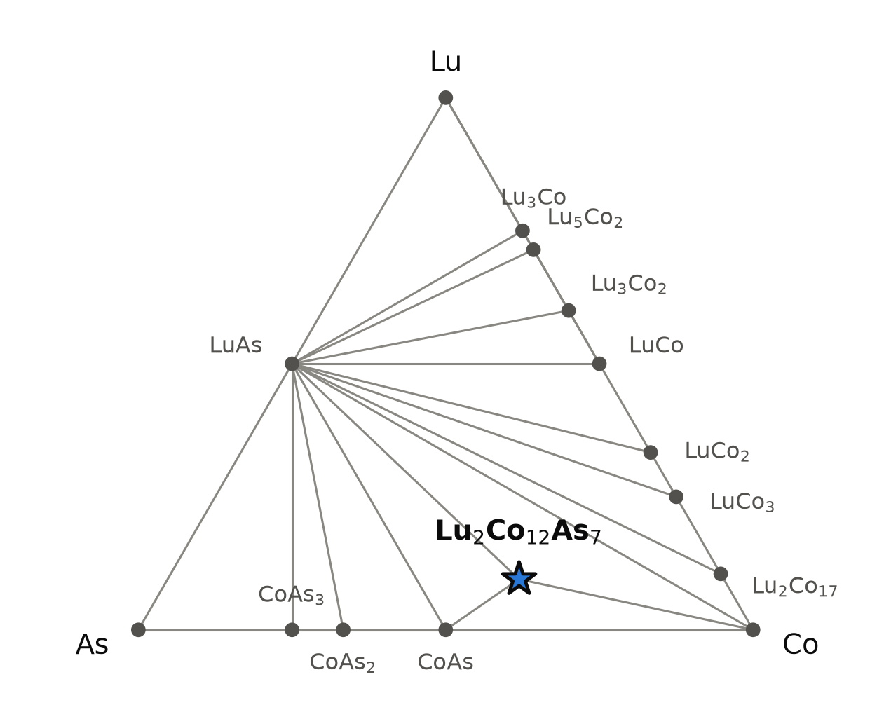
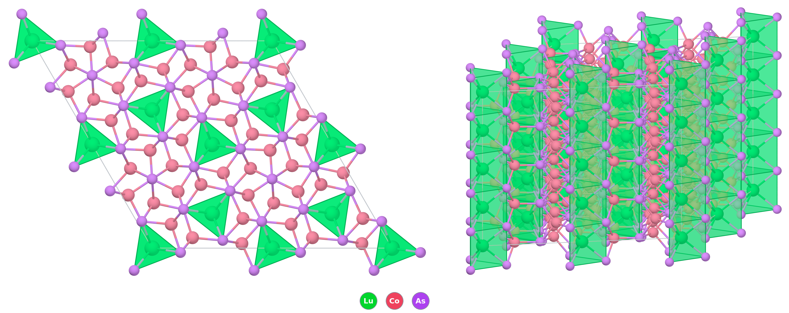

# Lu₂Co₁₂As₇ — a lutetium cobalt arsenide of the Zr₂Fe₁₂P₇ type, computed ferromagnetic

*A Material a Day · entry 23 · 9 November 2026 · status: **predicted, no report found** (Lu₂Ni₁₂As₇ and Lu₂Co₁₂P₇ are known; lanthanoid cobalt arsenides of this type are cited to 1983 conference proceedings we have not seen)*

> **In one paragraph.** Lu₂Co₁₂As₇ is a metallic arsenide in the hexagonal Zr₂Fe₁₂P₇
> structure, a family in which a dozen transition-metal atoms per formula unit sit in
> arsenic or phosphorus tetrahedra and square pyramids around channels that hold the
> large cation. It is the only ternary Lu–Co–As phase on the computed hull, 34 meV/atom
> below LuAs + CoAs + Co in the reference PBE table and 29 meV/atom below in the
> Materials-Project-settings table. Its two nearest relatives are made: the nickel
> arsenide Lu₂Ni₁₂As₇ (1981, from the elements in silica at about 780 °C) and the phosphide
> Lu₂Co₁₂P₇, a ferromagnet below 150 K with cobalt moments of 0.3 and 0.9 μB on the
> tetrahedral and square-pyramidal sites. The thorium and uranium cobalt arsenides were
> made from the elements at 950 °C. A 2010 paper cites lanthanoid cobalt arsenides of this
> type to 1983 conference proceedings that we could not find, so the lutetium member may
> already exist. PBE makes it a ferromagnetic metal with 5.5 μB per formula unit, the
> largest moment again on the square-pyramidal cobalt; for the phosphide the same
> calculation lands within 20 % of the measured magnetisation. The route we would try is
> the published one: the elements, or lutetium with CoAs and cobalt, in an evacuated
> silica ampoule at 800–950 °C for one to two weeks. The main caveat: the 29–34 meV/atom
> margin is smaller than the scatter of DFT formation energies against calorimetry in
> every chemical class surveyed, and no arsenide class has been surveyed at all.

Computed numbers come from the Alexandria database. Measured numbers carry a reference.
No measurement of this compound was found, so the calibration in this entry comes from
its measured relatives: the cell from Lu₂Ni₁₂As₇ and the actinoid arsenides, the
magnetism from Lu₂Co₁₂P₇.

## 1. Identity

| | |
|---|---|
| Formula | Lu₂Co₁₂As₇ (dilutetium dodecacobalt heptaarsenide) |
| Alexandria id | `agm081708447` (PBE and Materials-Project-settings tables) |
| Space group | P-6 (no. 174), Z = 1 |
| Cell, PBE (Å) | a 9.333, c 3.689 |
| Volume per formula unit, PBE | 278.3 ų |
| Density, PBE | 9.44 g cm⁻³ |
| Structure type | Zr₂Fe₁₂P₇ (prototype label A2B7C12_hP21_174_ad_ejk_2j2k) |
| Formation energy (PBE) | −0.454 eV/atom |
| Magnetism (PBE) | ferromagnetic, 5.52 μB per formula unit |
| Mineral name | none |

No Wikipedia page was found for the compound or for the structure type. The CIF is
[`Lu2Co12As7.cif`](Lu2Co12As7.cif); the site table and powder lines are in
[`structure.json`](structure.json).

**How far off the cell is likely to be.** There is no measured cell for this compound.
For five relatives there is one (Guinier powder data, [6] for the lutetium nickel
arsenide, [2] for the rest), and the same PBE table gives:

| compound | a, PBE / measured (Å) | c, PBE / measured (Å) | Δa | Δc |
|---|---|---|---|---|
| Lu₂Ni₁₂As₇ | 9.351 / 9.377 | 3.808 / 3.710 | −0.3 % | +2.6 % |
| U₂Ni₁₂As₇ | 9.391 / 9.359 | 3.833 / 3.835 | +0.3 % | −0.1 % |
| U₂Co₁₂P₇ | 9.011 / 9.043 | 3.605 / 3.639 | −0.4 % | −0.9 % |
| U₂Fe₁₂P₇ | 8.964 / 9.087 | 3.593 / 3.641 | −1.4 % | −1.3 % |
| Th₂Fe₁₂P₇ | 9.032 / 9.173 | 3.705 / 3.722 | −1.5 % | −0.5 % |

- **The lutetium nickel arsenide is the closest check, and its c is the outlier.** The
  measured c of Lu₂Ni₁₂As₇ (3.710 Å, c/a 0.396) is about 0.08 Å shorter than that of
  Tm₂Ni₁₂As₇ (3.786 Å) in the same paper, a far larger step than anywhere else along the
  lanthanoid series there (c/a 0.405–0.413 for Y and Ce to Yb) [6]. PBE puts the lutetium
  compound on the trend instead (c 3.808 Å). Either the real compound has something the
  ideal cell does not, or the 1981 value carries an error; one powder measurement cannot
  say which.
- **The actinoid compounds** come out short in PBE for three of four, where the 5f
  treatment adds its own error, so they transfer to lutetium only roughly.
- **An extrapolation.** Replacing nickel by cobalt in the measured actinoid arsenides
  changes a by +0.2 to +0.4 % and c by −1.5 to −2.0 % ([2]: U₂Co₁₂As₇ a 9.374, c 3.776 Å
  against U₂Ni₁₂As₇ 9.359, 3.835; Th₂Co₁₂As₇ 9.430, 3.835 against Th₂Ni₁₂As₇ 9.388,
  3.912). Applied to measured Lu₂Ni₁₂As₇, that suggests a ≈ 9.39–9.42 Å and c ≈
  3.64–3.65 Å for Lu₂Co₁₂As₇, against the computed 9.333 and 3.689: a 0.6–0.9 % short, c
  1.0–1.4 % long. It inherits the doubt on the lutetium nickel c. We expect the measured
  cell within about 1.5 % of the computed one, in either direction.

## 2. Where it sits

<picture>
  <source media="(prefers-color-scheme: dark)" srcset="phase_diagram_dark.png">
  
</picture>

The Lu–Co–As triangle at 0 K (PBE table). Fifteen phases lie on the hull, and
Lu₂Co₁₂As₇ is the only ternary among them.

| phase | formation energy (meV/atom) | notes |
|---|---|---|
| LuAs | −1464 | rock salt; the deepest phase of the system |
| CoAs | −295 | orthorhombic, Pnma |
| CoAs₂ | −324 | monoclinic, P2₁/c |
| CoAs₃ | −304 | cubic, Im-3 |
| **Lu₂Co₁₂As₇** | **−454** | 34 meV/atom below 2 LuAs + 5 CoAs + 7 Co |
| Lu₂Co₁₇, LuCo₃, LuCo₂, LuCo, Lu₃Co₂, Lu₅Co₂, Lu₃Co | −115 to −290 | the Lu–Co binaries |

- **Neighbours.** The target's triangle is LuAs–CoAs–Co: those three are its competing
  assemblage and the impurities to expect.
- **Near the hull.** LuCo₆As₄ (`agm002263571`, a hexagonal P-6m2 structure with 11 atoms)
  lies 7.5 meV/atom above the hull. It is the only other ternary within 30 meV/atom.
- **Everything else on LuAs.** LuAs has tie lines to every Lu–Co binary. Arsenic binds
  to lutetium so strongly that, outside the cobalt-rich corner, the system reduces to
  LuAs plus cobalt or a lutetium–cobalt compound.

## 3. Structure

*Left, along c: one cell enlarged to 3 × 3 in the plane. Lutetium sits in trigonal
prisms of arsenic (green); cobalt (pink) and arsenic (violet) form the framework between
them. Right, oblique: the prisms stack into columns along the short c axis (3.69 Å).*

| site | Wyckoff | x, y, z | neighbours (PBE) |
|---|---|---|---|
| Lu1 | 1a | 0, 0, 0 | 6 As at 2.898 Å, 6 Co at 3.012 Å |
| Lu2 | 1f | ⅔, ⅓, ½ | 6 As at 2.910 Å, 12 Co at 3.05–3.29 Å |
| Co1 | 3k | 0.056, 0.511, ½ | 4 As at 2.25–2.34 Å (tetrahedron) |
| Co2 | 3j | 0.231, 0.435, 0 | 5 As at 2.37–2.63 Å (square pyramid) |
| Co3 | 3k | 0.274, 0.231, ½ | 4 As at 2.30–2.38 Å (tetrahedron) |
| Co4 | 3j | 0.387, 0.101, 0 | 4 As at 2.32–2.37 Å (tetrahedron) |
| As1 | 3j | 0.926, 0.552, 0 | 7 Co + 2 Lu |
| As2 | 3k | 0.215, 0.958, ½ | 7 Co + 2 Lu |
| As3 | 1d | ⅓, ⅔, ½ | 9 Co (tricapped trigonal prism) |

- **Two layers, alternating.** Every atom sits at z = 0 or z = ½, so the structure is a
  stack of two flat layers repeating every 3.69 Å. All the coordination is between the
  layers.
- **Arsenic in trigonal prisms.** Each arsenic is surrounded by nine metal atoms, a
  tricapped trigonal prism. For As3 on the three-fold axis all nine are cobalt; As1 and
  As2 have seven cobalt and two lutetium. This is the motif that this whole family of
  metal-rich pnictides is built from.
- **Cobalt is four- or five-coordinated by arsenic.** Three of the four cobalt sites are
  tetrahedral and one (Co2) is square-pyramidal. The polyhedra share edges and corners
  into a continuous cobalt–arsenic framework (the left view).
- **Lutetium in the channels.** Both lutetium sites sit on three-fold axes in trigonal
  prisms of arsenic, capped by cobalt. Lu2 has twice as many cobalt neighbours as Lu1.
  The Bader charges are +1.56 on Lu, −0.28 to −0.52 on As and −0.09 to +0.25 on Co.
- **Polymorphs.** The Materials-Project-settings table also holds a trigonal P-3 structure
  of the same composition (`agm105527392`, 21 atoms), 10.3 meV/atom above the P-6 one.
  It is not in the reference table.
- **P-6 or P6₃/m.** The thorium and uranium cobalt phosphides refined better in P6₃/m,
  with the axial phosphorus half-occupying a two-fold site and one cobalt site split;
  the iron phosphides and U₂Ni₁₂As₇ refined cleanly in P-6 with every site full [2].
  The authors argue that the short c axis forbids two neighbouring axial sites from both
  being filled, so the local order is always P-6 and a P6₃/m refinement describes an
  average over P-6 domains; the cobalt phosphides can also be refined in P-6 [2]. The
  ordered P-6 cell computed here is therefore the right local model, and a real sample
  may still diffract as P6₃/m.

**The family.** The Zr₂Fe₁₂P₇ prototype holds 241 entries in the PBE table, 193 of them
on the hull. The cobalt members:

| compound | above (+) or below (−) the competitors, PBE (meV/atom) | moment (μB per formula unit) | reported? |
|---|---|---|---|
| **Lu₂Co₁₂As₇** | **−34** | 5.5 | no report found |
| Gd₂Co₁₂As₇ | −27 | 20.3 | no report found in our searches |
| Y₂Co₁₂As₇ | +5 | 5.9 | no report found in our searches |
| Lu₂Co₁₂P₇ | +2 | 4.9 | ferromagnet, Tc 150 K, magnetisation measured [3] |
| Mg₂Co₁₂P₇, Li₂Co₁₂P₇ | −42, −34 | 0.9, 0.5 | |
| Ca₂Co₁₂P₇ | +1 | 3.2 | |
| U₂Co₁₂P₇ | −13 | 10.1 | cell and structure measured [2] |
| other lanthanoid Co phosphides (Ce–Yb) | −1 to +14 | | Pr, Nd, Ho studied by neutrons [3]; family magnetism [4] (title only) |

The cobalt arsenides of thorium and uranium (made, cells measured [2]) and of calcium and
magnesium (Crystallography Open Database entries 1531395 and 1531390, from [5]) are not
in the database at all. So the arsenide side of the family is sparsely computed. On the
measured side, the 2010 paper states that lanthanoid arsenides Ln₂T₁₂As₇ are known with
T = Ni [6] and T = Co, and cites the cobalt ones to a 1983 conference proceedings volume
(U. Meisen, W. Jeitschko, *Solid State Chemistry 1982*, Elsevier, Studies in Inorganic
Chemistry vol. 3) [2]. We have not seen that volume and do not know which lanthanoids it
covers. The nickel series of 1981 includes lutetium: Lu₂Ni₁₂As₇ was made and its cell
measured, in a series covering every lanthanoid except La, Pm and Eu (the europium
compound did not form in several attempts) [6]. It is computed on
the hull here (a 9.351, c 3.808 Å).

**A point worth noting.** The arsenide is deeper below its competitors than the
phosphide in the same table: −34 against +2 meV/atom. Lu₂Co₁₂P₇ has been made [3] and
sits 2 meV/atom above the PBE hull, which is itself a small calibration: in this family
a made compound can come out slightly above the hull.

## 4. Computed properties

### Electronic structure

| | value |
|---|---|
| PBE gap | 0 (metal) |
| graph-network MBJ gap | 0 |
| density of states at the Fermi level, PBE | 10.7 states eV⁻¹ per 21-atom cell |
| the same, graph-network estimate | 13.1 |

Lutetium has a full 4f shell, so PBE has no open-4f problem here and no analogue is
needed. Being a metal, Lu₂Co₁₂As₇ has no dielectric entry, and its Seebeck table is not
quoted.

### Magnetism

| site | PBE moment (μB) |
|---|---|
| Co2 (3j, square pyramid) | 0.93 |
| Co3 (3k) | 0.45 |
| Co1 (3k) | 0.32 |
| Co4 (3j) | 0.25 |
| Lu, As | below 0.04 in size |
| total | 5.52 per formula unit (0.46 per Co); graph-network estimate 5.80 |

- The stored calculation is collinear and ferromagnetic. No antiferromagnetic or
  ferrimagnetic arrangement was computed, so the calculation does not say which order
  is lowest, and it gives no ordering temperature.
- The cobalt with the most arsenic neighbours (five, square-pyramidal) carries the
  largest moment, and the tetrahedral sites carry much less. That is the computed
  pattern, and a neutron study would test it directly.
- **Calibration against the phosphide twin.** Lu₂Co₁₂P₇ orders ferromagnetically at
  Tc = 150(2) K (SQUID; an earlier Faraday-balance value is 158(2) K, with a paramagnetic
  moment of 1.14 μB per Co) [3]. With lutetium non-magnetic, its magnetisation is the
  cobalt sublattice alone:

  | | measured | PBE (this table) | how far off |
  |---|---|---|---|
  | Lu₂Co₁₂P₇, magnetisation at 5 K, 5.5 T | 4.1(1) μB/f.u., not saturated [3] | 4.85 μB/f.u. | +18 % |
  | Ho₂Co₁₂P₇, cobalt sublattice from neutrons at 2 K | 4.9(2) μB/f.u. [3] | | within 1 % of the Lu value |
  | cobalt, square-pyramidal site (Ln₂Co₁₂P₇, neutrons) | 0.9(1) μB [3] | 0.93 in the arsenide | |
  | cobalt, tetrahedral sites (same) | 0.3(1) μB [3] | 0.25–0.45 in the arsenide | |
  | moment direction | along c (easy axis) [3] | not computed (collinear, no spin–orbit) | |

  PBE overshoots the high-field magnetisation of Lu₂Co₁₂P₇ by 18 %, but that
  magnetisation was still rising with field at 5.5 T, and the neutron value for the
  cobalt sublattice of the holmium phosphide is 4.9 μB, on top of the computed 4.85.
  The computed site pattern of the arsenide, large on the five-coordinated cobalt and
  small on the tetrahedral ones, is the pattern measured in the phosphides; the site
  moments compared here are of different compounds, phosphide against arsenide. The
  calculation gives no Tc; the phosphides of this family order near 136–152 K [3], which
  is the natural first guess for the arsenide and nothing more.

### Mechanical

| GPa | bulk | shear | Young's |
|---|---|---|---|
| graph network, on the PBE structure | 172 | 75 | 181 |

Machine-learned estimates, not DFT, and no measured modulus exists for comparison.

### Superconductivity

The graph-network screen gives λ = 0.26, ω_log = 212 K and Tc = 0.12 K. That model is
trained on non-magnetic electron–phonon calculations, and this compound is a
ferromagnet in PBE, so the number is not meaningful here. We found no report of
superconductivity.

### Not computed

Phonons (the compound is not among the group's DFPT calculations); other magnetic
orderings, spin–orbit coupling and the magnetic anisotropy; the dielectric response;
PBEsol and SCAN energies (the compound is not in those tables).

## 5. Is it stable?

- **Both hulls.** On the hull in both tables: 34.2 meV/atom below 2 LuAs + 5 CoAs + 7 Co
  in PBE (MatPES settings, the reference), and 29.1 below the same assemblage in the
  Materials-Project-settings table that the route tools use. The two agree on the
  assemblage and differ by 5 meV/atom.
- **The error bar.** No arsenide, phosphide or intermetallic class is in the calorimetric
  survey behind these tools, and no measured formation enthalpy is on file for
  Lu₂Co₁₂As₇, LuAs or CoAs. The classes that are surveyed scatter by 65–97 meV/atom
  (median absolute deviation; sulfides 83, nitrides 84, borides 97). **A 29–34 meV/atom
  margin is smaller than any of those, so the margin is not resolved against
  experiment.** Part of the error should cancel, because the competitors are arsenides
  of the same metals, but we cannot say how much.
- **What the family says.** Among the computed cobalt members of this type the
  lutetium arsenide is the deepest arsenide, and the phosphide Lu₂Co₁₂P₇, which has
  been made [3], lies 2 meV/atom above its own hull. That makes a real compound at
  −34 more plausible than not, but it is an argument from neighbours, not a measurement.
- **At temperature.** With phonon free energies (`hull_at_T`), the margin against
  LuAs + CoAs + Co is −24.5 meV/atom at 300 K, −17.0 at 900 K, −13.5 at 1173 K and
  −10.8 at 1373 K (best estimate; range −10.8 to −1.0 at 1373 K). The vibrational
  scatter for magnetic 3d compounds is 11 meV/atom at 900–1173 K and 22 at 1373 K.
  The best estimate assumes the compound keeps cobalt's magnetic entropy, as cobalt
  compounds usually do. If it kept none of it, the margin would be +1.4 meV/atom at
  1173 K and +12.1 at 1373 K, i.e. above the competitors. **At a firing temperature near
  1200 K the margin is about the size of its own error.** Nothing in the assemblage
  melts or boils.
- **Polymorph.** The only other structure of this composition (P-3, Materials-Project
  settings) is 10.3 meV/atom higher.

## 6. How to make it

### What the hull proposes

Routes that leave nothing to separate (Materials-Project-settings hull, 72 found),
ranked by R6 (fewest reagents, then least driving force), meV per atom of the charge:

| rank | charge | ΔE | note |
|---|---|---|---|
| 1 | 2 LuAs + 5 CoAs + 7 Co | −29.1 | the competing assemblage run backwards |
| 2 | 2 LuAs + 2.5 CoAs₂ + 9.5 Co | −53.6 | |
| 3 | 2 LuAs + 1.67 CoAs₃ + 10.3 Co | −72.1 | |
| – | 2 LuAs + 12 Co + 5 As | −166.3 | |
| – | **Lu + 7 CoAs + 5 Co** | **−254.1** | no free arsenic; tested separately |
| – | 2 Lu + 12 Co + 7 As | −446.1 | the elements |

- **Route 1 makes the target from the phases it would decompose into.** It is the most
  selective on paper but has only the target's own margin to drive it, and LuAs, CoAs
  and Co must interdiffuse. LuAs and CoAs are not manufactured reagents and would be made
  first.
- **The route we would try** is lutetium filings with pre-made CoAs and cobalt powder,
  Lu + 7 CoAs + 5 Co. It avoids free arsenic in the charge and still releases a large
  driving force. CoAs is made from the elements in a sealed tube. Reaction of the
  elements in one step is what was actually done for every arsenide of this type we
  could read (next bullet); it needs a slow heat-up, 60 °C h⁻¹ in [2], so the arsenic
  is taken up before it builds pressure.
- **What was done for the nearest relatives** (published practice beside the hull's
  proposal):

  | compound | charge | container | schedule | ref. |
  |---|---|---|---|---|
  | Ln₂Ni₁₂As₇, Lu included | elements, stoichiometric; Ln filings kept under argon, As sublimed | evacuated silica tube | about 1050 K (780 °C) for 2 weeks, cooled over 3 days | [6] |
  | Th₂Co₁₂As₇, U₂Co₁₂As₇ | elements, ideal ratio | alumina crucible sealed in evacuated silica | 60 °C h⁻¹ to 950 °C, 1 week | [2] |
  | Lu₂Co₁₂P₇ | Lu filings, Co, red P in tin, Lu:Co:P:Sn = 2.5:12:7:70 | evacuated silica | 880 °C, 7 days, water quench, tin dissolved in dilute HCl | [3] |

  The nickel arsenides came out as shiny black microcrystalline powders, not sensitive
  to air [6]; the actinoid arsenides grew needle crystals by vapour transport in
  cavities of the product, carried no silicon from the tube, and were stable in air for
  long periods [2]. Arc-melting of pre-reacted binaries lost the pnictogen and gave
  microcrystalline products [2]. Other lanthanoid nickel arsenides (LnNi₂As₂) were made
  the same way at 660–1000 °C [7] (abstract). **So the route the hull ranks highest on
  reagent count is not what was done for any relative; what was done is closer to our
  route, the elements in a sealed tube, and it worked without a liner.**

### The firing window

- **Bottom.** The Tammann temperatures are 962 K for lutetium, 884 K for cobalt and
  about 880 K for CoAs (estimated; no melting point on file), so lutetium governs bulk
  diffusion near 960 K. Laboratories fire a charge of the elements at 1293 ± 223 K.
- **Top.** Arsenic sublimes at 887 K, so any free arsenic needs a sealed, evacuated
  ampoule. Cobalt melts at 1768 K. The melting point of CoAs is not on file.
- **In practice:** 1050–1223 K (780–950 °C) in an evacuated sealed ampoule for one to
  two weeks, with intermediate grinding, which is the range used for the nickel and
  actinoid cobalt arsenides of this type [2, 6]; the lower end sits just above the
  Tammann temperature of lutetium. The margin at the top of the range (section 5) is
  close to its error, so a long anneal near 800 °C is the better bet than a hot one.
- **Chemical-potential window** (0 K, 25 meV/atom level): in arsenic the target is the
  phase formed over 393 meV of chemical potential, bounded on both sides; in lutetium
  over 799 meV; in cobalt the window is open on the cobalt-rich side. **A small cobalt
  excess is harmless (the target coexists with Co). Too much arsenic gives CoAs (and
  arsenic-richer cobalt arsenides), too little leaves LuAs with cobalt or Lu–Co
  intermetallics.** Arsenic is the component lost to the gas, so a sealed tube and an
  exact weighing matter more than an excess.

### Metathesis, tested

| charge | ΔE (meV/atom) | outcome |
|---|---|---|
| 2 LuCl₃ + 2 Li₃As + 5 CoAs + 7 Co | −136.1 | **gives Lu₂Co₁₂As₇ + 6 LiCl** |
| 2 LuCl₃ + Mg₃As₂ + 5 CoAs + 7 Co | −59.9 | **gives Lu₂Co₁₂As₇ + 3 MgCl₂** |
| 2 LuCl₃ + 6 Na + 7 CoAs + 5 Co | −264.4 | **gives Lu₂Co₁₂As₇ + 6 NaCl** (a reduction-metathesis) |

All three work at 0 K, and LiCl, MgCl₂ and NaCl all coexist with the target in the
contact calculation, so the salt would wash out without attacking the product. The
lithium and magnesium arsenides are air-sensitive and toxic and must be made first; they
buy a lower reaction temperature or a finer powder, not selectivity, since the margin
is a property of the target alone (R7).

### What it tolerates

| inert in the calculation | reacts (meV/atom) |
|---|---|
| Co, Cu, Ag, Cr, Ru, Pb; BN, C, MgO, BeO, AlN | SiO₂ (−98, to Co₂Si, Lu₂O₃, CoAs), Al₂O₃ (−27), ZrO₂ (−55), Y₂O₃ (−40), CaO (−33), Si₃N₄ (−9) |
| NaCl, KCl, LiCl, RbCl, CsCl, CaCl₂, MgCl₂, BaCl₂; NaF, LiF, NaBr, KBr, NaI, KI | KF (−21); borates, carbonates, sulfates, nitrates, molybdates and tungstates |
| | Ta (−169), Nb (−169), Mo (−15), W (−1), Fe (−14), Ni (−42), Pt (−121), Au (−24) |
| | oxygen (−710), water (−114), CO₂ (−233), nitrogen (−126), hydrogen (−50) |

- **Container.** BN or graphite is inert in the calculation. Silica is reduced in the
  calculation (to Co₂Si and Lu₂O₃), and alumina mildly. In practice the lanthanoid nickel
  arsenides, Lu₂Ni₁₂As₇ among them, were made in bare silica for two weeks [6], and the
  actinoid cobalt arsenides in alumina crucibles with no silicon or other impurity
  heavier than sodium found by EDX [2]. So the computed contact reactions did not show up
  at those temperatures; an alumina crucible, as in [2], or a BN liner is a cheap
  precaution, not a necessity. Tantalum and niobium, the usual choices for rare-earth
  charges, take arsenic and cobalt to TaCoAs and NbCoAs in the calculation.
- **Atmosphere.** Vacuum or argon for the reaction. In the calculation the compound
  reacts with oxygen, water and CO₂; in practice its relatives are stable in air for long
  periods at room temperature [2, 6], so the computed reaction is not fast.
- **Fluxes.** The alkali and alkaline-earth chlorides are inert and could serve as a flux
  or wash medium. Tin, the flux used for Lu₂Co₁₂P₇ [3] and for YCo₅P₃ (850 °C, 7 days)
  [10], reacts with the arsenide in the calculation (−43, to CoSn and Co₂SnAs); the
  arsenides of this type in [2] and [6] were all made without a flux.

### Powder pattern

Cu Kα, computed on the PBE cell (strongest lines):

| hkl | 20-21 | 30-30 | 3-1-21 | 0002 | 5-1-40 | 4-1-31 | 5-2-31 |
|---|---|---|---|---|---|---|---|
| 2θ (°) | 32.87 | 33.25 | 38.25 | 49.41 | 51.84 | 47.46 | 55.46 |
| I | 16 | 13 | 100 | 22 | 27 | 16 | 15 |

- **LuAs** (rock salt): too little cobalt, or incomplete reaction; LuAs forms first and
  is the most refractory phase in the charge.
- **CoAs:** arsenic excess or incomplete reaction.
- **Co:** cobalt excess, harmless within the window.
- **CoAs₂ or CoAs₃:** arsenic-rich, a sign of uneven mixing.
- **Lu₂O₃ or Co₂Si:** oxygen in the tube, or reaction with silica.

### Hazards

Arsenic and its compounds are toxic and carcinogenic; arsenic vapour forms above about
600 °C and a sealed ampoule under pressure can fail. Cobalt powder is a sensitiser and a
suspected carcinogen. Lithium and magnesium arsenides release arsine with moisture.
(General knowledge, not retrieved.) Work in a fume hood, open ampoules behind a shield.

## 7. What it is good for

A predicted compound with no report found, so only candidates. Its relatives are studied
for their magnetism: in Ln₂Co₁₂P₇ the cobalt sublattice orders ferromagnetically near
150 K with moments along c, and the magnetic lanthanoids order on top of it at lower
temperature, parallel (Ho) or antiparallel (Nd) to the cobalt [3]. With lutetium
non-magnetic, Lu₂Co₁₂As₇ would show the cobalt magnetism alone, as Lu₂Co₁₂P₇ does for
the phosphides, and set how replacing P by As changes it. The 2010 paper adds a practical
note: compounds of this type can turn up as impurities in preparations of iron-pnictide
superconductors [2]. No application of the compound itself has been reported.

## 8. How this could be wrong

- **The margin is not resolved.** 29–34 meV/atom against an unknown, probably larger,
  error for arsenides; at the firing temperature the margin shrinks to about its own
  vibrational scatter.
- **It may already be made.** The 2010 paper [2] states that lanthanoid cobalt arsenides
  Ln₂Co₁₂As₇ are known and cites 1983 conference proceedings (Meisen and Jeitschko,
  *Solid State Chemistry 1982*) that no search found and we have not seen. The lutetium
  member may be among them. The 1981 nickel paper [6] does not mention cobalt arsenides.
  A 1990 Physica B paper on Ln₂Ni₁₂As₇ magnetism [9] was not read. A structural-database
  check by a person is owed, and that proceedings volume would settle it.
- **Magnetism is one calculation.** Collinear ferromagnetic PBE; other orders were not
  tried. For the phosphide twin it lands within 20 % of the measured magnetisation and
  reproduces the measured site pattern [3], so the overestimate often seen for itinerant
  cobalt is small here, as far as one comparison shows.
- **Disorder on the axis.** The related cobalt phosphides refine better in P6₃/m, as an
  average over P-6 domains [2]. A real sample may diffract the same way; the local
  structure would still be the ordered P-6 one computed here.
- **Routes are 0 K thermodynamics.** Favourable is not fast. The 5 meV/atom direct
  driving force on the measured scale at 1173 K for route 1 makes it slow at best.

## 9. Literature

**Searched 1 November 2026** (OpenAlex returned nothing for every query that day,
including ones that should have hits; Crossref unless noted): "Lu2Co12As7" (OpenAlex and
Crossref: 0 hits); "Co12As7" (OpenAlex: 0); "Co12As7 ternary arsenide" (10 hits, none
relevant); "rare earth cobalt arsenides Zr2Fe12P7" (RCo₂As₂ and unrelated);
"lanthanoid cobalt arsenides Ln2Co12As7 Zr2Fe12P7 structure" and "lanthanoid cobalt
arsenides Zr2Fe12P7 type structure" ([2, 4, 6, 7, 8, 9] and other Jeitschko papers, no
lanthanoid cobalt arsenide); "ternary rare earth cobalt arsenides with Zr2Fe12P7 type
structure magnetic" (same set); "rare earth cobalt arsenides R2Co12As7 ferromagnetism"
(Crossref and arXiv: nothing relevant); "Y2Co12As7 OR Gd2Co12As7 OR Lu2Co12P7" (1 hit,
[3]); "lutetium cobalt arsenide" (nothing relevant); "ternary lanthanoid cobalt arsenides
preparation crystal structure Jeitschko" (phosphides and nickel arsenides only);
"Lu-Co-As phase diagram isothermal section arsenide" (nothing relevant). Wikipedia:
"Lu2Co12As7", "lutetium cobalt arsenide", "Zr2Fe12P7": no page. **Added on revision,
after reading [2], [3] and [6] in full:** "Meisen Jeitschko lanthanoid cobalt arsenides
Zr2Fe12P7 Solid State Chemistry 1982 Veldhoven" (OpenAlex and Crossref: other Jeitschko
papers, not the proceedings).

**Result: no report found** of Lu₂Co₁₂As₇. The structure type, the phosphide Lu₂Co₁₂P₇,
the nickel arsenide Lu₂Ni₁₂As₇ and the actinoid cobalt arsenides are all reported, and
lanthanoid cobalt arsenides of this type are cited to 1983 proceedings we could not find
[2].

1. Alexandria database: `agm081708447` (PBE and Materials-Project-settings tables),
   `agm105527392` (P-3 polymorph), family entries as listed in section 3.
2. W. Jeitschko, U. Meisen, J. Albering, "Actinoid transition metal phosphides An₂T₁₂P₇
   (An = Th, U; T = Fe, Co, Ni) and arsenides An₂T₁₂As₇ (An = Th, U; T = Co, Ni) with
   Zr₂Fe₁₂P₇ type structure", *Dalton Trans.* 39, 6067 (2010). doi:10.1039/c000365d.
   *Full text read: synthesis, cells, refinements, the P-6 / P6₃/m discussion, and the
   citation of lanthanoid cobalt arsenides to Meisen and Jeitschko, Solid State
   Chemistry 1982 (Elsevier, 1983), which we have not seen.*
3. M. Reehuis, B. Ouladdiaf, W. Jeitschko, T. Vomhof, B. Zimmer, E. Ressouche,
   "Magnetization and neutron diffraction studies of the magnetic order in the compounds
   Pr₂Co₁₂P₇, Nd₂Co₁₂P₇, Ho₂Co₁₂P₇ and Lu₂Co₁₂P₇", *J. Alloys Compd.* 261, 1 (1997).
   doi:10.1016/s0925-8388(97)00182-5. *Full text read: synthesis, Curie temperatures,
   magnetisation, cobalt site moments.*
4. M. Reehuis, W. Jeitschko, "Magnetic properties of lanthanoid iron and cobalt phosphides
   with Zr₂Fe₁₂P₇ type structure", *J. Phys. Chem. Solids* (1989).
   doi:10.1016/0022-3697(89)90448-4. *Title only.*
5. A. Hellmann, A. Mewis, "Neue Erdalkalimetall-Phosphide und -Arsenide des Cobalts",
   *Z. Anorg. Allg. Chem.* 627, 1357 (2001). Crystallography Open Database entries 1531390
   (Mg₂Co₁₂As₇, Pnma) and 1531395 (Ca₂Co₁₂As₇, P6₃/m). *Title and database index only.*
6. W. Jeitschko, B. Jaberg, "Lanthanoid nickel arsenides with the Zr₂Fe₁₂P₇ structure",
   *J. Less-Common Met.* 79, 311 (1981). doi:10.1016/0022-5088(81)90080-1. *Full text
   read: synthesis and cells of Y₂Ni₁₂As₇ and Ln₂Ni₁₂As₇, Lu included.*
7. W. Jeitschko, W. K. Hofmann, L. J. Terbüchte, "Lanthanoid and uranium nickel arsenides
   with CaBe₂Ge₂- and ThCr₂Si₂-type structures", *J. Less-Common Met.* (1988).
   doi:10.1016/0022-5088(88)90081-1; ChemInform abstract doi:10.1002/chin.198816026.
   *Abstract read.*
8. J. Y. Pivan, R. Guérin, O. Peña, "New quaternary lanthanoid transition metal arsenides
   with Ho₅Ni₁₉P₁₂-type derivative structure", ChemInform abstract (1990).
   doi:10.1002/chin.199043036. *Abstract read.*
9. E. H. El Ghadraoui, J. Y. Pivan, O. Peña, "Magnetic properties of the lanthanoid nickel
   arsenides Ln₂Ni₁₂As₇ with Zr₂Fe₁₂P₇-type structure", *Physica B* (1990).
   doi:10.1016/0921-4526(90)90163-o. *Title only.*
10. U. Meisen, W. Jeitschko, "Preparation and crystal structure of YCo₅P₃ and isotypic
    lanthanoid cobalt phosphides", *J. Less-Common Met.* (1984).
    doi:10.1016/0022-5088(84)90396-5; ChemInform abstract doi:10.1002/chin.198450036.
    *Abstract read (the Sn-flux conditions).*

## 10. Provenance

- **Data:** Alexandria database, tables `energy_runs_pbe` (reference) and
  `energy_runs_pbe_mp`. Reaction energies, contact reactions, chemical-potential windows
  and margins at temperature come from the hull and reaction table built on `pbe_mp`.
- **Tools:** the reaction-route code of this group, pymatgen, POV-Ray; machine-learned
  moduli, magnetisation and Tc from graph neural networks.
- **Authorship:** drafted by Claude (Anthropic) from those tools; reviewed by
  Miguel Marques. Corrections are welcome as issues on this repository.
