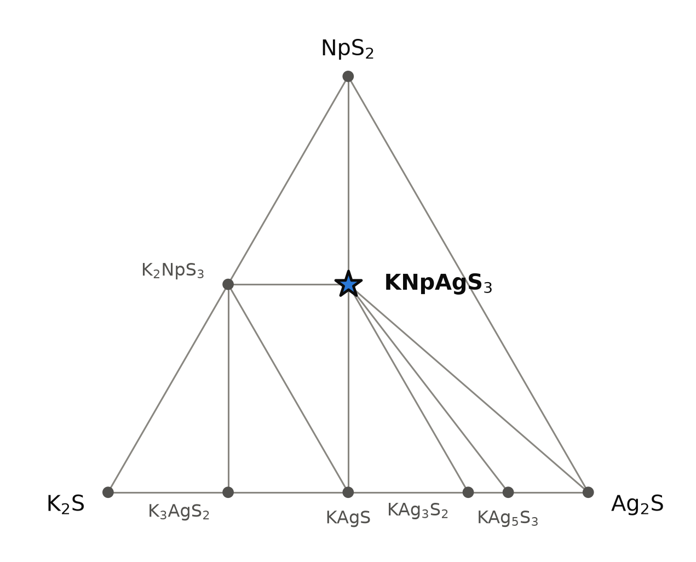
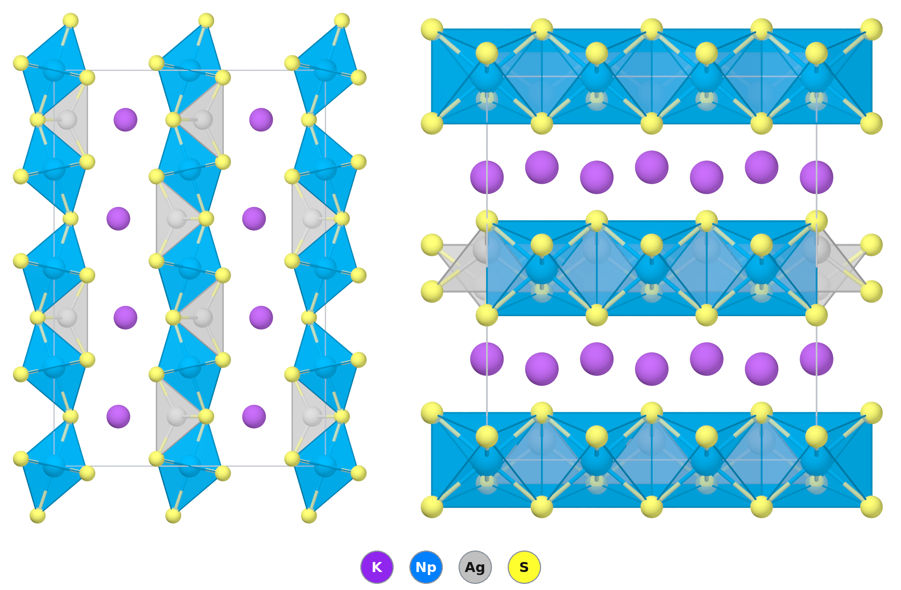

# KAgNpS₃ — a layered neptunium(IV) sulfide, and a test of how PBE handles 5f electrons

*A Material a Day · entry 24 · 10 November 2026 · status: **known***

> **In one paragraph.** KAgNpS₃ is a quaternary sulfide of potassium, silver and
> tetravalent neptunium. It was made in 2009 from neptunium metal, silver, sulfur and
> K₂S, held for six days at 873 K in a sealed carbon-coated silica tube, as black plates
> in about 10 % yield, together with four related compounds [1]. It has the
> KCuZrS₃ structure: layers of NpS₆ octahedra and AgS₄ tetrahedra, with potassium
> between them. Both PBE tables of the database put it on the convex hull, 41–46
> meV/atom below its competitors, and PBEsol and SCAN put it deeper still. Since the
> compound exists, the entry uses it as calibration. The PBE cell is 3.7 % larger in
> volume than the measured one, the PBEsol cell 4.4 % smaller. In PBE the Np–S bonds
> come out within 0.1 % of the measured ones; the excess volume sits in the K–S
> contacts between the layers. PBE leaves a gap of 0.03 eV. The thorium analogue, which
> has no 5f electron, has a PBE gap of 2.6 eV. No gap of KAgNpS₃ has been measured; the
> uranium copper analogues show no absorption edge between 0.47 and 6.2 eV [3], so the
> real gap of these 5f layers is either below 0.5 eV or hidden under 5f–5f lines. The
> published route matches what the hull allows, and a chloride metathesis also comes out
> downhill on paper. Neptunium-237 is radioactive, so any of this work needs a licensed
> radiochemistry laboratory.

Computed numbers come from the Alexandria database. Measured numbers carry a reference.

## 1. Identity

| | computed (PBE) | measured [1] |
|---|---|---|
| Formula | KAgNpS₃ (potassium silver neptunium trisulfide; database spelling KNpAgS₃) | |
| Alexandria id | `agm003211451` | |
| Space group | Cmcm (no. 63), Z = 4 | Cmcm, single crystal (twinned) |
| Cell | a 4.098 Å, b 14.315 Å, c 10.455 Å | a 4.058(2) Å, b 13.989(6) Å, c 10.422(4) Å (296 K) |
| Volume per formula unit | 153.32 ų | 147.90 ų |
| Density | 5.20 g cm⁻³ | 5.391 g cm⁻³ (from the X-ray cell) |
| Structure type | KCuZrS₃ type (prototype label ABCD3_oC24_63_a_c_c_cf) | KCuZrS₃ type |
| Mineral name | none | |
| Formation energy | −1.089 eV/atom (PBE) · −1.320 eV/atom (Materials-Project settings) | not measured |
| Magnetism (PBE) | ferromagnetic as stored, 6.0 μB per cell: 3.25 μB on each Np | not measured in [1] |

The CIF is [`KNpAgS3.cif`](KNpAgS3.cif). No Wikipedia page about this compound was found.

### How far off the cell is

| | measured [1] | PBE | PBE − measured | PBEsol | PBEsol − measured |
|---|---|---|---|---|---|
| a (Å) | 4.058 | 4.0975 | +1.0 % | 4.0129 | −1.1 % |
| b (Å), the stacking axis | 13.989 | 14.315 | +2.3 % | 13.812 | −1.3 % |
| c (Å) | 10.422 | 10.455 | +0.3 % | 10.200 | −2.1 % |
| volume (ų) | 591.6 | 613.3 | +3.7 % | 565.3 | −4.4 % |

The percentages are our arithmetic. The PBEsol cell is that of the same entry in
`energy_runs_ps`. The two functionals bracket the measurement. PBE overestimates the
volume by about the usual amount for a heavy-element sulfide, and most of the excess is
along *b*, the direction in which the layers stack through the potassium. A 4 % volume
underestimate is larger than PBEsol usually gives. Both calculations put the 5f
electrons in the valence without a Hubbard U. One might blame the PBEsol overbinding on
that, but [3] tested it on the sodium copper uranium analogue NaCuUS₃: PBE+U with U
from 1 to 6 eV gave lattice constants no closer to the measured ones than plain PBE,
whose errors in that family stay below 2.6 %. So the missing U is not an obvious
explanation, and we have none to offer for the size of the PBEsol error.

**Bond lengths** (measured: single-crystal X-ray at 296 K [1]; computed: the stored PBE
structure; percentages our arithmetic):

| bond | measured [1] | PBE | PBE − measured |
|---|---|---|---|
| Np–S, ×4 | 2.727(1) | 2.724 | −0.1 % |
| Np–S, ×2 | 2.754(1) | 2.755 | +0.0 % |
| Ag–S, ×2 | 2.473(2) | 2.471 | −0.1 % |
| Ag–S, ×2 | 2.547(2) | 2.573 | +1.0 % |
| K–S, eight contacts | 3.194 ×2, 3.401 ×4, 3.524 ×2 (mean 3.380) | 3.249 ×2, 3.416 ×2, 3.636 ×4 (mean 3.484) | mean +3.1 % |

PBE gets the NpS₆ octahedron essentially right and the AgS₄ tetrahedron nearly so. The
excess volume is in the potassium contacts, which are also distributed differently: in
the measured structure four of the eight lie near 3.40 Å, in PBE four lie at 3.64 Å.
This is the same message as the cell table: the layers are right, the space between
them is too wide. The bond-valence sums of [1] are 0.94 for K, 1.40 for Ag and 3.83 for
Np; the silver site is over-bonded on that scale, as it is in the silver uranium
members of the family.

A second polymorph is stored, `agm002353523` (P2₁/m, no. 11), 17.8 meV/atom above the
Cmcm form in PBE, 18.2 with Materials-Project settings and 130 in SCAN.

## 2. Where it sits

<picture>
  <source media="(prefers-color-scheme: dark)" srcset="phase_diagram_dark.png">
  
</picture>

A section of the K–Ag–Np–S hull (PBE, `energy_runs_pbe`, 0 K) through K₂S, Ag₂S and
NpS₂, in which every metal keeps its usual charge (K⁺, Ag⁺, Np⁴⁺). The quaternary system
has 29 phases on the hull. Nine of them lie in this plane
([`phase_diagram.json`](phase_diagram.json)). KAgNpS₃ has tie lines to Ag₂S, NpS₂,
K₂NpS₃, KAgS, KAg₃S₂ and KAg₅S₃. The K₂NpS₃–NpS₂ line drawn in the section is not a tie
line of the full hull; there the equilibrium leaves the plane.

| phase | formation energy relative to the corners (meV/atom) | comment |
|---|---|---|
| KAgNpS₃ | −147.3 | this entry; on both PBE hulls |
| K₂NpS₃ | −190.0 | on both PBE hulls (Li₂MnO₃-type label, C2/m) |
| KAgS | −154.2 | |
| KAg₃S₂ | −105.1 | |
| K₃AgS₂ | −98.9 | |
| KAg₅S₃ | −84.9 | |
| K₂S, Ag₂S, NpS₂ | 0 (corners) | NpS₂ is fluorite-type in PBE |

Whether each of these neighbours has been made was not checked for this entry. The
NpS₂ corner is probably a computed phase only. The binary neptunium sulfides whose
structures [1] lists are Np₂S₃, Np₃S₅, Np₂S₅ and NpS₃ (besides cubic NpS); NpS₂ is not
among them, and we did not search for it separately. [3], citing older work we have not
read, gives NpS₃ as stable below about 773 K, turning into Np₃S₅ above that and Np₃S₅
into Np₂S₃ near 1173 K. The binary phases on the hull (NpS, Np₂S₃, Np₃S₅, NpS₂, NpS₃,
Np₂S) are otherwise taken as the database gives them.

## 3. Structure

<picture>
  <source media="(prefers-color-scheme: dark)" srcset="structure.png">
  
</picture>

Left: seen along *a*. The [AgNpS₃]⁻ layers run vertically and potassium (violet)
sits between them. Right: seen along *c*, the layers lie horizontally. NpS₆ octahedra are
blue, AgS₄ tetrahedra grey; K–S contacts are not drawn.

| site | Wyckoff | coordination | distances (Å, PBE) |
|---|---|---|---|
| Np | 4a | 6 S, octahedron | 2.724 ×4, 2.755 ×2 |
| Ag | 4c | 4 S, tetrahedron | 2.471 ×2, 2.573 ×2 |
| K | 4c | 8 S, bicapped trigonal prism | 3.249 ×2, 3.416 ×2, 3.636 ×4 |
| S1 | 8f | 2 Np + 1 Ag (+ 3 K) | |
| S2 | 4c | 2 Np + 2 Ag (+ 2 K) | |

- **The layer.** Each NpS₆ octahedron shares edges with its neighbours along *a* (Np–Np
  4.10 Å, the length of *a*) and shares its two apical S2 corners along *c*. The silver
  atoms fill the tetrahedral holes of this sheet and share edges with the octahedra.
  This gives the ²∞[AgNpS₃]⁻ layer described in [1].
- **Between the layers** is potassium only, in a bicapped trigonal prism of eight S [1].
  The layers stack along *b* with a spacing of b/2 = 7.16 Å (PBE) against 6.99 Å
  measured. This is the direction PBE gets most wrong (+2.3 %).
- There is no S–S bond (in the five compounds of [1] the shortest S–S distance is
  3.637 Å), so the formal charges are K⁺, Ag⁺, Np⁴⁺ and S²⁻ [1]. [1] supports Np⁴⁺
  rather than Np³⁺ from the bond lengths: Np–S is shorter than U–S in the matching
  uranium compounds, as the actinide contraction requires, and much shorter than Nd–S in
  Nd³⁺ analogues. The stored calculation agrees: 3.25 μB on neptunium is close to the
  three unpaired electrons of 5f³ Np⁴⁺. The Bader charge on Np is +1.87, against +2.23
  on Th in the thorium analogue; [3] computes +1.83 for Np in NaCuNpS₃ (PBE with
  spin–orbit coupling), so the two calculations agree to 0.04 e.

### The family in this structure

`energy_runs_pbe` holds 4,568 entries with this prototype label in Cmcm, of which 1,063
are on the hull. The members with an alkali metal, Cu or Ag, sulfur and an actinide
(depth below the competing phases in meV/atom; all on the hull in both PBE tables):

| | Th (5f⁰) | U | Np | Pu |
|---|---|---|---|---|
| K–Cu | 56.1, gap 2.02 eV *(made [1, 3])* | 41.1 *(made [1])* | 101.1 **[1]** | 80.9 |
| K–Ag | 25.8, gap 2.57 eV | not in this structure in the database | **45.6 [1], this entry** | 28.7 |
| Rb–Cu | 68.9, gap 2.04 eV *(made [3])* | 88.9 *(made [1])* | 108.9 **[1]** | 86.3 |
| Rb–Ag | 43.5, gap 2.58 eV | 9.5 *(made [1])* | 54.8 | 29.8 |
| Cs–Cu | 82.5, gap 2.03 eV *(made [3])* | 80.8 *(made [1])* | 109.3 **[1]** | 89.2 |
| Cs–Ag | 58.5, gap 2.55 eV | 9.9 *(made [1])* | 55.4 **[1]** | 31.8 |

Bold [1]: the five neptunium compounds reported together in [1]. "Made" marks the Th
and U members whose structures [1] uses in its bond-valence table (taken from earlier
papers we did not read) or whose crystals [3] grew; an unmarked cell means only that
neither paper mentions it. [1] states that in 2009 no plutonium member had been
reported, and [3] adds NaCuNpS₃ and NaCuUS₃ (sodium is not in this table). The U and
Pu members are metallic in PBE (gap 0), and the Np members have PBE gaps of 0–0.03 eV.
Two of the made uranium compounds, RbAgUS₃ and CsAgUS₃, are only 9.5–9.9 meV/atom
deep in PBE, so a shallow depth in this family does not rule a compound out. RbAgNpS₃
is on the hull with the same depth as its K and Cs neighbours. It is not among the
compounds of [1] or [3], and we did not search for it separately. For every alkali
metal and actinide, the copper member lies deeper than the silver one. KUAgS₃ is
stored only in a P2₁/m structure, 22.4 meV/atom above the hull. Nobody has computed it
in this structure.

## 4. Computed properties

KAgNpS₃ has an open 5f shell (5f³). PBE without a Hubbard U or spin–orbit coupling
gives no physical gap for such a compound, just as for open-4f compounds. For the gap,
the dielectric response and transport we therefore also quote the f-free analogue
**KThAgS₃** (`agm022701746`, same structure, on the hull, 25.8 meV/atom deep). Th⁴⁺
has no 5f electron.

### Electronic structure

| quantity | KAgNpS₃ | KThAgS₃ (f-free analogue) |
|---|---|---|
| PBE gap (indirect / direct) | 0.029 / 0.029 eV | 2.571 / 2.592 eV |
| SCAN gap (indirect / direct) | 0.160 / 0.278 eV | — |
| total moment (μB per cell) | 6.0 | 0 |
| DOS at E_F (as stored) | 9.64 | 0 |
| ML estimates (tuga-sp, from the structure) | PBE gap 0.002 eV, MBJ gap 0.28 eV | — |

- **The PBE and SCAN gaps of KAgNpS₃ are not physical.** The three 5f electrons sit in
  a narrow, partly filled band at the Fermi level. Splitting that band needs
  correlation (a U), spin–orbit coupling or both, and the calculation has neither. The
  machine-learned MBJ estimate reads only the structure and inherits no 5f physics, so
  we do not trust it either.
- **KThAgS₃ gives the S 3p → empty-metal gap of the framework, 2.6 eV in PBE.** In
  KAgNpS₃ the occupied 5f levels will sit inside that gap and set the true gap, which
  will be smaller. [3] finds the same picture for the sodium copper members with PBE
  and spin–orbit coupling: NaCuThS₃ (not made) has a direct gap of 1.95 eV, NaCuUS₃
  and NaCuNpS₃ come out metallic and magnetic, with partly filled 5f bands at the Fermi
  level. Adding a U of 1–6 eV to NaCuUS₃ opens a gap whose size depends strongly on U,
  so DFT+U does not settle it either [3].
- **What is measured.** No optical or transport measurement of KAgNpS₃ exists in what we
  read; [1] reports black plates and did not characterise the powder. The nearest
  measurement is diffuse reflectance on ACuUS₃ (A = Na, K, Rb) [3]: sharp 5f–5f lines of
  U⁴⁺ between 0.53 and 0.95 eV and no absorption edge anywhere from 0.47 to 6.2 eV, so
  the gap is either below 0.5 eV or masked by those lines. Their work functions are
  5.0–5.3 eV, nearly independent of the alkali metal. Those crystals are copper and
  uranium, not silver and neptunium, so this is calibration by analogy. It does say
  that the near-zero PBE gap of KAgNpS₃ is not contradicted by anything measured, while
  the 2.6 eV of the f-free framework is far above what any 5f member of the family has
  shown.
- The silver members of the Th family have PBE gaps about 0.5 eV larger than the
  copper ones (2.55–2.58 against 2.02–2.04 eV). The top of the valence band of
  these layers therefore carries coinage-metal d character, as one expects for a Cu⁺ or
  Ag⁺ sulfide.

### Dielectric response and charge transport

There is no dielectric entry for KAgNpS₃ (the table holds insulators only). For KThAgS₃:

| | KThAgS₃ (PBE, DFPT) |
|---|---|
| ε∞ principal values | 3.86, 5.98, 5.98 (mean 5.27) |
| refractive index | 2.30 |
| Born charges, mean of trace/3 | K +1.39, Th +4.70, Ag +0.39, S −2.16 |
| effective masses (DOS) | electrons 2.07, holes 5.17 mₑ |
| branch-point energy | 0.71 eV above the valence-band maximum |

- ε∞ is the electronic (high-frequency) constant, not the static one. The smallest
  principal value, 3.86, lies along the stacking direction. Across the potassium layers
  the response is much weaker than within the [AgThS₃]⁻ sheets. Neptunium has the same
  layers, so we expect the same anisotropy there, but its value of ε∞ would differ.
- The Th Born charge of +4.70 is close to the formal +4. The Ag charge of +0.39 is far
  below +1, so the silver–sulfur bond is largely covalent.
- The branch point lies close to the valence band. On the usual reading the analogue
  would accept p-type doping more easily than n-type. This says nothing direct about the
  neptunium compound, whose band edges the 5f levels set.
- The stored transport calculation for KAgNpS₃ treats it as a 0.02 eV-gap
  semiconductor. Its numbers are in [`properties.json`](properties.json) and are not
  quoted, since the band structure behind them is not physical.

### Mechanical (machine-learned)

Bulk modulus 34.7 GPa, shear modulus 23.0 GPa, Young's modulus 42.7 GPa (tuga-sp, from
the structure alone). The three numbers come from separate models and are not mutually
consistent: an isotropic solid with those B and G would have E ≈ 56 GPa (our
arithmetic). Read them as "a soft layered sulfide", within perhaps 20–30 %. They depend
mostly on the geometry, so of the numbers in this section they are the least affected
by the 5f problem.

### Lattice dynamics, magnetism, what was not computed

- **Phonons: not computed.** The compound is not in the group's PBEsol phonon
  calculations, and neither is any other structure of this formula.
- **Magnetism.** Only a ferromagnetic PBE state is stored. A real Np⁴⁺ ion has strong
  spin–orbit coupling and a crystal-field ground state, and the magnetic order (if any)
  of KAgNpS₃ is not determined by anything here. Neither [1] nor [3] measured a
  susceptibility of any neptunium member.
- No DFT+U, hybrid or spin–orbit calculation is in the database for this compound.

## 5. Is it stable?

| table | distance to hull | depth below competitors |
|---|---|---|
| `energy_runs_pbe` (reference) | 0 | **45.6 meV/atom** |
| `energy_runs_pbe_mp` (Materials-Project settings) | 0 | **41.3 meV/atom** |
| `energy_runs_ps` (PBEsol) | 0 | 83.7 meV/atom |
| `energy_runs_scan` | 0 | 176.5 meV/atom |
| machine-learned (tuga-sp) | 2.6 meV/atom above | — |

- **On both PBE hulls, and they agree to 4 meV/atom.** The tables differ in settings
  but treat the 5f shell the same way, so their agreement does not test the 5f
  treatment. Every table puts the compound on the hull.
- **The class error is larger than the margin.** For sulfides the computed and
  measured formation enthalpies differ by 83 meV/atom (mean absolute deviation, 11
  sulfides, `pbe_mp`, median bias −10). Ag₂S alone comes out 104 meV/atom more bound
  than measured. A depth of 41–46 meV/atom would not settle stability on its own. Here
  the compound has been made [1], so the calculation is being tested, not trusted, and
  it passes: it puts a known compound on the hull.
- **At temperature** (Materials-Project hull with phonons, Np entropy share 0.82): the
  margin against the competing assemblage (NpS₃, KAg₅S₃, K₂NpS₃ and a K–Np sulfide)
  is −40.5 meV/atom at 300 K, −38.9 at 873 K and −38.4 at 1073 K. The vibrational
  scatter for 5f compounds is 17.5 meV/atom. Heating barely moves it.
- **Sulfur potential.** At 0 K the compound is within 25 meV/atom of the hull for
  μ_S between −1.33 and −0.44 eV relative to elemental sulfur, a window 0.89 eV wide.
  With a large excess of sulfur (μ_S near 0) the hull prefers sulfur-richer phases.
  The published charge carried a modest excess (half a sulfur per formula unit, §6)
  and still gave the compound, as crystals from a flux. This too is 0 K
  thermodynamics, with the sulfide error above.

## 6. How to make it

**How it is actually made [1].** 0.084 mmol crushed ²³⁷Np metal, 0.084 mmol Ag, 0.042
mmol K₂S (made beforehand from the elements in liquid ammonia) and 0.253 mmol S, that
is Np : Ag : K₂S : S = 1 : 1 : ½ : 3, half a sulfur per formula unit more than the
compound needs. The charge was loaded under argon into a carbon-coated fused-silica
ampoule, evacuated to about 10⁻⁴ Torr and sealed, with a steel sleeve and a second
silica ampoule as outer containment. It was heated to 873 K in 12 h, held there 144 h,
cooled at about 3 K/h to 473 K and then at 7.33 K/h to room temperature. The product
held thin black rectangular plates in about 10 % yield, picked out by hand; the
remaining powder was not characterised, so the phase purity of the charge is not
known. The crystals were twinned.

**What the hull says about that charge.** The stoichiometric charge (½ K₂S + Np + Ag +
5/2 S) goes straight to KAgNpS₃ with nothing left over (−1013 meV/atom of mixture;
most of that is the formation of sulfides from the elements). The charge as published,
with 3 S, goes at 0 K to 88 % KAgNpS₃ by formula unit, with the extra sulfur held in
NpS₃, a potassium polysulfide (K₃AgS₁₃ in the database) and a little KAg₅S₃ (−972
meV/atom). At 873 K the excess sulfur is more likely in a polysulfide melt, and [3]
gives NpS₃ as unstable above about 773 K, so the 0 K leftovers are not a prediction of
what was in the tube. The published route is consistent with the hull. It is not the route the ranking rule (R6)
puts first among pre-made reagents. That one is KAgS + NpS₂ (−65.1 meV/atom), but it
assumes two reagents whose existence we did not check. Reacting the elements with K₂S
in a sealed tube is the practical route for a radioactive metal, because every
intermediate forms inside the same ampoule.

| charge | ΔE (meV/atom of mixture) | product |
|---|---|---|
| ½ K₂S + Np + Ag + 5/2 S (published reagents, stoichiometric) | −1013.0 | KAgNpS₃ |
| ½ K₂S + Np + Ag + 3 S (published ratio [1]) | −971.7 | 0.88 KAgNpS₃ + 0.12 NpS₃ + K₃AgS₁₃ + KAg₅S₃ |
| KAgS + NpS₂ (first by R6) | −65.1 | KAgNpS₃ |
| ½ K₂NpS₃ + ½ NpS₂ + ½ Ag₂S | −50.1 | KAgNpS₃ |

**Firing window.** The bottom is the kinetic floor. With every solid having to
interdiffuse it is 617 K, set by silver (half its melting point), and nothing moves
below the 194 K of sulfur. The top is the first reagent to change: sulfur boils at
718 K, so the charge must be sealed (evacuated fused silica), and neptunium metal melts
at 910 K. The published 873 K sits inside this window, just below the melting point of
neptunium. K₂S melts only at 1221 K. [1] calls K₂S a reactive flux: with the extra
sulfur it forms potassium polysulfides, which melt far lower than K₂S (general
knowledge; we did not compute it). The six-day dwell and slow cooling of [1] are those
of flux crystal growth.

**Container.** On the 0 K hull KAgNpS₃ coexists with SiO₂, Al₂O₃, BN, carbon, ZrO₂, MgO
and silver, so a silica ampoule (or a carbon-coated one) is compatible; [1] used
carbon-coated silica. It reacts with
copper (−74 meV/atom, giving KCuNpS₃ + Ag), gold, nickel, palladium and the refractory
metals, so none of those makes a liner.

**Metathesis (tested; downhill on paper).** Three charges that give KAgNpS₃ plus KCl:

| charge | ΔE (meV/atom of mixture) | products |
|---|---|---|
| NpCl₄ + 5/2 K₂S + ½ Ag₂S | −430.6 | KAgNpS₃ + 4 KCl |
| NpCl₄ + KAgS + 2 K₂S | −398.1 | KAgNpS₃ + 4 KCl |
| AgCl + K₂S + NpS₂ | −294.4 | KAgNpS₃ + KCl |

All three go cleanly to the target and potassium chloride. KCl coexists with KAgNpS₃ on
the hull, so the byproduct would not attack the product, and NaCl, KBr and KI coexist
with it too. A chloride flux is therefore admissible. The tool's screening rule marks
NpCl₄ as a molecular halide because of its halogen count. NpCl₄ is the usual solid
starting material of neptunium chemistry, but it is hygroscopic and must be handled
dry. Both points are general knowledge, not retrieved. We did not find this route in
the literature we read. A metathesis route has an advantage over the published one: it
starts from a neptunium salt rather than the metal. Washing out KCl would need water or
alcohol. [3] found that NaCuUS₃ takes up about 1.5 H₂O between its layers in air over
four to five days, reversibly; KCuUS₃ hydrates too after more than 12 h in water, and
RbCuUS₃ and CsCuUS₃ decompose after 24 h. NaCuNpS₃, on the other hand, survived
having its flux dissolved in water. So a short wash may be tolerated, but it should be
tested on the potassium silver compound first.

**From the oxide.** NpO₂ + ½ K₂S + Ag + 5/2 S does not give the target on the hull: the
oxide stays (−237 meV/atom to NpO₂ + KS₃ + KAg₅S₃). A boron sink for oxygen, the
approach of [3] for NaCuNpS₃ from NpO₂, changes this. With 4/3 B per NpO₂ the hull gives
⅔ KAgNpS₃, and the boron takes potassium into KB₅O₈ and KBS₂. A boron route to
the potassium compound would need extra K₂S to make up for that. [3] did not work at
the minimum: its NaCuNpS₃ charge was NpO₂ : Cu : Na₂CO₃ : B : S = 3 : 18 : 16 : 144 :
216 (6 mg NpO₂), i.e. 48 B and 72 S per neptunium, with sodium carbonate as the alkali
source, all in a carbon crucible inside sealed silica; the crystals were freed by
dissolving the flux in water. That large excess of alkali and boron is the answer to
the potassium loss computed here. [3] also made KCuThS₃, RbCuThS₃ and CsCuThS₃ the same
way from ThO₂ and the alkali carbonates, so a potassium version of the route has been
run for thorium. The firing profiles are in the supporting information of [3], which we
did not read.

**What the powder pattern should show** (Cu Kα, computed from the PBE cell, which is
2.3 % long along *b*, so measured peaks sit at slightly higher angle): 12.4° (020,
100 %), 28.4° (112, 44 %), 33.5° (132, 40 %), 42.2° (152, 20 %), 34.3° (004, 20 %). The
hull's competitors are the impurity list. Ag₂S or KAg₅S₃ means the charge was short of
neptunium. K₂NpS₃ means it was rich in potassium. NpS₃ or polysulfide means too much
sulfur. NpO₂ means oxygen got in: on the hull the compound reacts strongly with oxygen
(−821 meV/atom, to NpO₂, a potassium polysulfide and KAg₅S₃).

**Hazards.** ²³⁷Np is an alpha and gamma emitter [1] with a half-life of about two
million years. It is a radiological and chemical inhalation hazard, and holding it is
regulated. Work needs a licensed radiochemistry laboratory with gloveboxes (general
knowledge). [1] used double containment for every ampoule (inner carbon-coated silica,
outer steel sleeve and second silica tube) and a furnace with a runaway controller in
a negative-pressure hood. K₂S is corrosive and releases H₂S with moisture or acid. Sulfur in
a sealed tube at 873 K is under pressure; ampoules should be heated slowly.

## 7. What it is good for

No use is reported. KAgNpS₃ was made to study transuranium solid-state chemistry: the
actinide contraction across Th, U and Np in one structure type, and a bond-valence
parameter r₀ for Np⁴⁺–S²⁻. [1] derives r₀ = 2.57 Å as the mean over its five
compounds (2.586 from KAgNpS₃ alone) and applies it to the binary neptunium sulfides,
where it says little about their oxidation states. The motivation [1] gives is
general: neptunium chemistry matters for separating spent nuclear fuel, and actinide
chalcogenides have been considered as fast-reactor fuels; neither claim is about this
compound. The family is studied for how 5f electrons behave among soft ligands [3];
[3] notes that the copper members ACuNpS₃ (A = K, Rb, Cs) were flagged as candidate
topological materials in a computational catalogue (not read by us), a claim that does
not extend to the silver compound and has not been tested by measurement. For this
series it is above all a calibration point: a measured actinide sulfide on which PBE
and PBEsol bracket the volume, by +3.7 % and −4.4 %, and on which PBE reproduces the
Np–S bonds to 0.1 %.

## 8. How this could be wrong

- **The 5f shell.** Every computed electronic property of KAgNpS₃ here is from PBE (or
  SCAN) with the 5f electrons itinerant and no spin–orbit coupling. The gap, the
  magnetic state and the 5f contribution to bonding are not reliable. The hull depth is
  more robust, because the competing phases carry the same error, but by how much is
  not known. Unlike the 4f case, the database has no 5f-in-core table to compare
  against.
- **The margin is below the class error.** 41–46 meV/atom against 83 meV/atom of
  scatter for sulfides. Here we know from experiment that the compound exists. The
  same depth for an unreported member (RbAgNpS₃, the plutonium compounds) would not be
  enough on its own.
- **The cell comparison is at different temperatures.** The measurement is at 296 K,
  the calculations at 0 K without zero-point motion, which accounts for a few tenths of
  a percent of volume.
- **Only the structure has been measured.** [1] reports the crystal structure and
  nothing else: no gap, magnetism, transport or phase purity (yield about 10 %, powder
  not characterised). Every comparison of electronic properties here goes through the
  uranium copper analogues of [3], a different coinage metal and actinide.
- **Some neighbours are computed phases.** NpS₂ (fluorite) is not among the neptunium
  sulfides with known structures listed in [1], and several potassium silver sulfides
  on the hull were not checked against the literature. The first-ranked pre-made route
  (KAgS + NpS₂) depends on two of them.

## 9. Literature

Searches (OpenAlex, 1 November 2026), with the number of hits:

- "KAgNpS3": 2 (the paper [1] and its ChemInform abstract)
- "potassium silver neptunium sulfide": 10, none relevant
- "alkali metal copper silver neptunium trisulfide AMNpS3": 0
- "quaternary neptunium chalcogenides magnetic susceptibility KCuZrS3 structure type": 0
- "neptunium sulfide magnetic properties Np(IV)": 10; one relevant [3]
- "neptunium sulfides NpS3 Np3S5 Np2S3 crystal structure": 0
- "KCuUS3 KAgUS3 uranium sulfide KCuZrS3 type synthesis": 0
- "CsCuUS3 uranium copper sulfide layered structure": 0
- "actinide chalcogenides AMAnQ3 thorium uranium neptunium KCuZrS3 review": 0
- "KThAgS3 thorium silver sulfide": 10, none relevant
- Wikipedia: "KAgNpS3", "KNpAgS3", "potassium silver neptunium sulfide", "neptunium
  potassium silver trisulfide": no page about this compound.

Result: **known**, one primary report [1] with a deposited crystal structure [2]. [3]
cites [1] and does not report KAgNpS₃ again.

1. D. M. Wells, G. B. Jin, S. Skanthakumar, R. G. Haire, L. Soderholm, J. A. Ibers,
   "Quaternary neptunium compounds: syntheses and characterization of KCuNpS₃, RbCuNpS₃,
   CsCuNpS₃, KAgNpS₃, and CsAgNpS₃", *Inorg. Chem.* 48, 11513–11517 (2009).
   doi:10.1021/ic901229d. *Full text read* (supporting CIFs not read). Source of the
   reagent amounts, container, heating schedule, yield, cell, bond lengths,
   bond-valence sums and oxidation states.
2. Crystallography Open Database, entry 4303825 (KAgNpS₃, Cmcm, 296 K), deposited from
   [1]. http://www.crystallography.net/cod/4303825.html. *Index record read: cell,
   space group, temperature.*
3. A. A. Berseneva, V. V. Klepov, K. Pal, K. Seeley, D. Koury, J. Schaeperkoetter,
   J. T. Wright, S. T. Misture, M. G. Kanatzidis, C. Wolverton, A. V. Gelis,
   H.-C. zur Loye, "Transuranium sulfide via the boron chalcogen mixture method and
   reversible water uptake in the NaCuTS₃ family", *J. Am. Chem. Soc.* 144,
   13773–13786 (2022). doi:10.1021/jacs.2c04783. *Full text read* (supporting
   information not read). Source of the reflectance and work-function measurements on
   ACuUS₃, the PBE and PBE+U results on NaCuTS₃, the boron route and the water uptake.

## 10. Provenance

- **Data:** Alexandria database, tables `energy_runs_pbe` (reference), `energy_runs_pbe_mp`,
  `energy_runs_ps` (PBEsol) and `energy_runs_scan`. Moments and Bader charges are those
  stored with the PBE structure. Dielectric and transport numbers are those stored for
  KThAgS₃. Reaction energies, contact reactions, the sulfur window and the margins at
  temperature come from the hull and reaction table built on `pbe_mp`.
- **Tools:** the reaction-route code of this group, pymatgen, POV-Ray. Machine-learned
  moduli, gaps and hull distance come from graph neural networks.
- **Authorship:** drafted by Claude (Anthropic) from those tools; reviewed by
  Miguel Marques. Corrections are welcome as issues on this repository.
