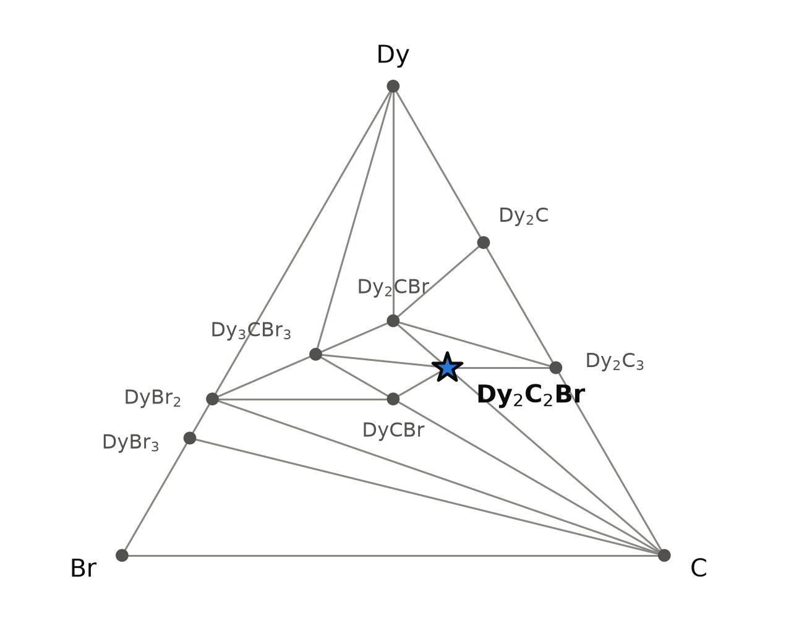
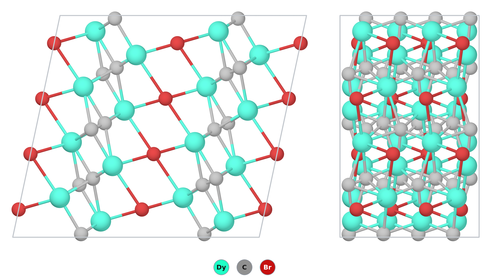

# Dy₂C₂Br — a dysprosium dicarbide bromide that is on the hull only in the table that mistreats one of its competitors

*A Material a Day · entry 25 · 11 November 2026 · status: **predicted, no report found** (probably metastable: on the hull in one of three tables)*

> **In one paragraph.** Dy₂C₂Br is written in a monoclinic C2/c structure in which
> C₂ pairs (C–C 1.35 Å) sit in cages of dysprosium atoms, and bromide ions, each with
> six dysprosium neighbours, link the Dy–C₂ columns into a framework. It belongs to the
> rare-earth carbide halides. Gd₂C₂Br₂ and Gd₂CBr₂ are reported in this family [1].
> The 2:2:1 composition was found only once, as a chloride: Dy₂ClC₂, made in a
> laser-heated diamond anvil cell and measured at 76 GPa [2]. Its structure differs from
> the one computed here: it is orthorhombic (Cmmm, Mn₂AlB₂ type) and its carbon forms
> zigzag chains (C–C 1.55 Å), not C₂ pairs. We found no report of Dy₂C₂Br. The reference
> table of the database (PBE, with the 4f electrons in the valence) puts it on the
> convex hull, 33 meV/atom below its competitors. The Materials-Project table puts it
> 17 meV/atom *above* the hull, and SCAN 3 meV/atom above. We side with "above".
> In the reference table the competitor that matters, Dy₂CBr₂, sits 92 meV/atom above
> the hull. The same structure is on the hull for Y, Lu and Sc in both tables, and it
> is the structure of the reported Gd₂CBr₂ [1]. The f-free analogue Y₂C₂Br is 30–39
> meV/atom above the hull in all three tables. No closed route reaches the compound,
> metathesis included. All three numbers are smaller than the error that carbide
> chemistry carries, so none of them settles the question.

Computed numbers come from the Alexandria database. Measured numbers carry a reference.

## 1. Identity

| | computed (PBE, 4f in valence) |
|---|---|
| Formula | Dy₂C₂Br (didysprosium dicarbide bromide; Dy₂Br(C₂) in cluster notation) |
| Alexandria id | `agm002201807` |
| Space group | C2/c (no. 15), Z = 4 |
| Cell | a 14.543 Å, b 4.102 Å, c 6.694 Å, β 102.04° |
| Volume per formula unit | 97.63 ų |
| Density | 7.30 g cm⁻³ |
| Structure type | prototype label AB2C2_mC20_15_e_f_f (Dy 8f, C 8f, Br 4e). The label also covers unrelated intermetallics such as Ca₂GaPt₂. Here it means the R₂C₂X carbide halides below. |
| Mineral name | none |
| Formation energy | −0.790 eV/atom (PBE) · −0.884 eV/atom (Materials-Project settings) |
| Magnetism (PBE) | ferromagnetic, 18.05 μB per 10-atom primitive cell, about 4.4–4.5 μB per Dy |

The CIF is [`Dy2C2Br.cif`](Dy2C2Br.cif). No Wikipedia page about this compound was found.

The cell changes with the treatment of the 4f shell. With Materials-Project settings
the same entry relaxes to a 14.942 Å, b 3.984 Å, c 6.540 Å, β 102.5°. That is
a 2.7 % longer and b 2.9 % shorter than in the reference table. The f-free Y₂C₂Br
(`agm002201818`) has a 14.957 Å, b 3.973 Å, c 6.586 Å, β 102.6°, close to the
Materials-Project cell of Dy₂C₂Br.

### How far off a cell is: Gd₂C₂Br₂ as calibration

No cell of Dy₂C₂Br has been measured. The one measured cell at this composition, that
of Dy₂ClC₂ [2], cannot serve as calibration. It belongs to another structure type and
was measured at 76 GPa, and its lattice parameters are given in the supporting
information, which we did not read. Its family neighbour Gd₂C₂Br₂ has a cell, from
single-crystal X-ray diffraction [1]. Its database entry (`agm003201981`, GdCBr,
C2/m) can be set against it. The percentages are our arithmetic.

| Gd₂C₂Br₂ | measured [1] | PBE (this database) | difference |
|---|---|---|---|
| a (Å) | 7.025 | 7.118 | +1.3 % |
| b (Å) | 3.836 | 3.871 | +0.9 % |
| c (Å) | 9.868 | 10.617 | +7.6 % |
| β (°) | 94.47 | 94.6 | |

The in-plane axes are 1 % too long, which is ordinary for PBE. The stacking axis is
8 % too long. In Gd₂C₂Br₂ that axis runs across bromide layers held together by weak
forces, and plain PBE describes such forces poorly. Dy₂C₂Br has no such gap between
layers: its bromide joins the framework in three dimensions. We therefore expect its
PBE cell to be 1–2 % too large, not 8 %. This is an expectation, not a measurement.

## 2. Where it sits

<picture>
  <source media="(prefers-color-scheme: dark)" srcset="phase_diagram_dark.png">
  
</picture>

The Dy–C–Br triangle in the reference table (`energy_runs_pbe`) has 11 hull phases.
Dy₂C₂Br is one of them, joined by tie lines to C, Dy₂C₃, Dy₂CBr, Dy₃CBr₃ and DyCBr.

| phase on the PBE hull | formation energy (meV/atom) | note |
|---|---|---|
| DyBr₃ | −1799 | |
| DyBr₂ | −1832 | |
| Dy₃CBr₃ | −1324 | |
| DyCBr (= Dy₂C₂Br₂) | −1074 | the Gd₂C₂Br₂ type [1] |
| Dy₂CBr | −907 | |
| **Dy₂C₂Br** | **−790** | this entry |
| Dy₂C₃ | −257 | |
| Dy₂C | −156 | |

The table with Materials-Project settings (`energy_runs_pbe_mp`) draws a different
triangle, with 26 entries. Dy₂CBr₂, Dy₄CBr₅, Dy₅C₂Br₉, Dy₇C₂Br₁₀, Dy₃C₂Br and DyC₂
are on its hull, and Dy₂C₂Br is not. It would come apart as

  Dy₂C₂Br → ½ Dy₂CBr₂ + ¼ Dy₃C₄ + ¼ DyC₂  (16.6 meV/atom downhill).

The two tables disagree on the competitors, not only on the target. Section 5 sorts
this out.

## 3. Structure

<picture>
  <source media="(prefers-color-scheme: dark)" srcset="structure.png">
  
</picture>

*Left: one cell viewed along b (2 × 2 cells along b and c). Right: the same block viewed along a. Dy turquoise, C grey, Br red. Bonds are drawn for C–C up to 1.5 Å, Dy–C up to 2.75 Å and Dy–Br up to 3.2 Å.*

| site | Wyckoff | coordination (PBE) |
|---|---|---|
| Dy | 8f | 5 C (2.307, 2.307, 2.500, 2.579, 2.684 Å) + 3 Br (3.096, 3.096, 3.122 Å) |
| C | 8f | 1 C at 1.346 Å + 5 Dy (2.31–2.68 Å) |
| Br | 4e | 6 Dy (4 × 3.096, 2 × 3.122 Å), a distorted octahedron |

- **C₂ pairs.** Carbon is present only as C₂ pairs, 1.346 Å long. Each pair sits in a cage
  of dysprosium atoms, and each carbon has five Dy neighbours. In the view along b the
  pairs line up in double columns running along b.
- **Bromide.** Each bromide has six Dy neighbours in a distorted octahedron. The bromides
  share Dy atoms with the Dy–C₂ columns and link them in all three directions. The
  compound is a framework, not a stack of layers. This is the main structural
  difference from Gd₂C₂Br₂ (Ln₂C₂X₂), in which slabs of Ln₂C₂ lie between halide layers [1, 4].
- **Charge count.** With Dy³⁺ and Br⁻, the C₂ pair would have to carry five negative
  charges. In a metal that count means some electrons sit in Dy 5d bands, not that C₂
  is a 5− ion. The C–C distance is about that of a double bond. We did not compute the
  bond order.
- **Polymorphs.** The database holds only one Dy₂C₂Br structure.
- **The measured chloride is another structure.** Dy₂ClC₂ [2], with its Sm and Gd
  analogues, is orthorhombic, Cmmm, Z = 2 (oC10, Mn₂AlB₂ type; Dy 4j, Cl 2a, C 4i).
  Its carbon forms zigzag chains along a, with C–C 1.549(14) Å and a C–C–C angle of
  123.9(19)°. In the computed Dy₂C₂Br the carbon forms isolated pairs, 1.346 Å long.
  The chloride is layered: sheets of edge-sharing Dy₂Cl₄ octahedra alternate with
  sheets of carbon chains [2]. At 76 GPa each Dy has 4 Cl at 2.641 Å and 6 C at 2.307
  and 2.365 Å. The computed Dy₂C₂Br at zero pressure has 3 Br and 5 C. The database
  has no entry of the Mn₂AlB₂ type for Dy₂C₂Br or Dy₂C₂Cl, at zero pressure or in its
  50–100 GPa tables. We therefore do not know which of the two structures is lower in
  energy, at either pressure. The computed chloride Dy₂C₂Cl (`agm002139403`) has the
  same C2/c structure as the bromide and is on the PBE hull.
- **The family.** We searched `energy_runs_pbe` for prototype AB2C2_mC20_15_e_f_f and
  space group 15, with carbon and a halogen. That gives 73 R₂C₂X entries for the
  rare earths, actinides, alkaline earths and some transition metals. Distance above
  the PBE hull, in meV/atom (0 = on the hull; the depth below the competitors in
  brackets):

| R | Cl | Br | I |
|---|---|---|---|
| Y (f-free) | 45 | 30 | 8 |
| La (f⁰) | 0 (90) | 0 (83) | 0 (109) |
| Gd (f⁷) | 0 (12) | 0 (27) | — |
| Tb | — | 0 (27) | 0 (38) |
| **Dy** | 0 (30) | **0 (33)** | 0 (43) |
| Ho | 0 (17) | 0 (27) | 0 (47) |
| Er | 0 (7) | 0 (21) | 0 (38) |
| Tm | 0 (11) | 0 (17) | 0 (29) |
| Lu (f¹⁴) | 132 | 122 | 80 |
| Sc | 125 | 94 | 72 |

  In the reference table, every lanthanide with a partly filled 4f shell is on the hull
  in this structure. The f-free Y, Lu and Sc members are all above it. That split is the
  first warning sign.

## 4. Computed properties

All the quantities below are PBE unless stated. Dy has a partly filled 4f shell (4f⁹),
and PBE places 4f states at the Fermi level. The electronic numbers of the f-free
analogue Y₂C₂Br, in the same structure, are quoted beside them, and the text says
which is which.

**Electronic structure.** Both are metals. Dy₂C₂Br: PBE gap 0 (direct 0.002 eV), SCAN
gap 0. Y₂C₂Br: PBE 0 (direct 0.006 eV), SCAN 0. The density of states at the Fermi level
stored in the database is 33.3 for Dy₂C₂Br and 2.75 for Y₂C₂Br, in the database's
units, per 10-atom cell. The Dy value is dominated by 4f states and should not be read
as a property of the real compound. The Y value is the one to use for the carriers.
The machine-learned gap is 0.001 eV (PBE model) and 0.03 eV (MBJ model) for Dy₂C₂Br,
and 0.0006 and 0.007 eV for Y₂C₂Br: metallic either way.

**Dielectric response and transport.** Not quotable. There is no dielectric entry for
either compound, and for a metal ε∞ and a Seebeck table mean little.

**Mechanical (machine-learned, tuga-sp, from the structure).**

| | Dy₂C₂Br | Y₂C₂Br |
|---|---|---|
| bulk modulus (GPa) | 72 | 68 |
| shear modulus (GPa) | 17 | 13 |
| Young's modulus (GPa) | 99 | 60 |

The three models are independent and do not agree with each other. For an isotropic
solid, a bulk modulus of 72 and a shear modulus of 17 GPa give a Young's modulus near 48 GPa, not 99
(our arithmetic). Read the numbers as "a soft solid with a low shear modulus" and no
more precisely than that.

**Superconductivity (screening estimate).** For Y₂C₂Br the tuga-sp models give λ = 0.29,
ω_log = 261 K and Tc = 0.26 K. Dy₂C₂Br gives similar numbers, but a model trained on
non-magnetic data has no meaning for a compound whose Dy moments will order. The
related Y₂C₂Br₂ and Y₂C₂I₂ are measured superconductors [4, 5]. The 2:2:1 composition
has no measurement to compare with.

**Magnetism.** PBE gives a ferromagnet with about 4.4–4.5 μB per Dy. No other magnetic
order was computed, and neither was an ordering temperature. Dy³⁺ compounds generally
order at low temperature. A ferromagnet here is the starting guess of the calculation,
not a prediction.

**Lattice dynamics.** Not computed. Neither Dy₂C₂Br nor Y₂C₂Br is among the group's
DFPT phonon calculations.

## 5. Is it stable?

| table | Dy₂C₂Br | Y₂C₂Br (f-free) | Gd₂C₂Br | Lu₂C₂Br |
|---|---|---|---|---|
| `energy_runs_pbe` (reference, 4f in valence) | **0 (33 below its competitors)** | +30.0 | 0 (27 below) | +122 |
| `energy_runs_pbe_mp` (Materials-Project settings) | **+16.6** | +29.8 | 0 (24 below) | +119 |
| `energy_runs_scan` (SCAN at the PBEsol geometry) | **+2.6** | +38.9 | — | +109 |

*meV/atom above the hull; a "below" figure is the depth under the competing assemblage.*

The three tables disagree by 49 meV/atom on Dy₂C₂Br, much more than they disagree on
Y₂C₂Br (9) or Lu₂C₂Br (14). By the series rule, a spread this large means the number
is not yet a hull distance. The spread comes from a competitor:

| Ln₂CBr₂, trigonal (P-3m1) | PBE (4f in valence) | Materials-Project settings |
|---|---|---|
| Y | 0 | 0 |
| Sc | 0 | 0 |
| Lu | 0 | 0 |
| Gd | +11 | +14 |
| Tb | +21 | 0 |
| **Dy** | **+92** | **0** |
| Ho | +89 | 0 |
| Er | +121 | 0 |
| Tm | +182 | 0 |
| Sm | +292 | +36 |

*meV/atom above the hull of each table. This is the structure of the reported Gd₂CBr₂ [1].*

In the reference table, the heavy lanthanides with partly filled 4f shells (Dy, Ho,
Er, Tm) put this phase 90–180 meV/atom above the hull. The f-free and f-full members
(Y, Sc, Lu) and Gd (f⁷) put it on or near the hull, in both tables. A ten-fold jump
from Gd to Dy, in a structure that one of them is known to adopt, is far more
likely an error in the calculation than a fact about dysprosium. In the reference
calculation Dy carries 5.0 μB in Dy₂CBr₂ and about 4.4–4.5 μB in Dy₂C₂Br, so the two
calculations may have ended in different 4f states. We did not check this further.
With Dy₂CBr₂ pushed off the hull, Dy₂C₂Br competes against a weaker assemblage, and
its 33 meV/atom depth is mostly that error. The Materials-Project table treats the Dy
4f shell differently, keeps Dy₂CBr₂ on the hull and puts Dy₂C₂Br 17 meV/atom above it.
SCAN puts it 3 above.

**Our reading:** Dy₂C₂Br is probably above the hull, by somewhere between a few and
about 20 meV/atom. The f-free analogue agrees: Y₂C₂Br is 30–39 meV/atom above in all
three tables, and Y and Dy have nearly the same ionic radius. Gd₂C₂Br is the one member
that stays on the hull in both tables, by 24–27 meV/atom, and it is the more promising
test case for the family.

**Error bars.** The calorimetric survey behind the reaction tools gives a median
DFT-minus-experiment difference of −155 meV/atom for carbides (mean absolute deviation
70) and +1 for halides (27). Errors largely cancel between carbide halides, but how
much they cancel is not known. The 17 and 33 meV/atom margins are both **smaller than
the carbide scatter**, so neither margin is resolved. These statistics were measured
against the Materials-Project table.

**At temperature.** On the Materials-Project hull with harmonic phonons, the margin
grows slightly as the sample is heated: +18.0 meV/atom at 300 K, +19.9 at 1000 K,
+20.6 at 1200 K and +21.6 at 1400 K above the competing assemblage (DyCBr, Dy₂CBr₂,
Dy₄C₅). The estimated vibrational scatter is 17.5–26 meV/atom. Heating does not help.

**Off-stoichiometry.** On the Materials-Project hull, a vacancy would need a formation
energy of −830 meV per vacancy at 10 % concentration to bring the compound onto the
hull. That is implausible.

## 6. How to make it

All routes in this section are priced on the Materials-Project hull (`energy_runs_pbe_mp`),
the one the reaction tools use. On that hull the target is 16.6 meV/atom above its
competitors. A margin belongs to the target alone (rule R7), so no choice of precursor
changes it.

| charge | ΔE (meV/atom of mixture) | what forms on that hull |
|---|---|---|
| ⅓ DyBr₃ + 5⁄3 Dy + 2 C (the direct route) | −291 | ½ Dy₂CBr₂ + ¼ Dy₃C₄ + ¼ DyC₂ |
| DyBr₃ + Dy + CaC₂ (metathesis) | −325 | CaBr₂ + ½ Dy₂CBr₂ + ¼ Dy₃C₄ + ¼ DyC₂ |
| DyBr₃ + Dy + Li₂C₂ (metathesis) | −298 | 2 LiBr + ½ Dy₂CBr₂ + ¼ Dy₃C₄ + ¼ DyC₂ |

**Metathesis was tested and fails** for the same reason as the direct route. The
target is above the hull, so every charge ends in Dy₂CBr₂ and carbides. The salt
by-product changes how fast the reaction might go, not where it ends. Of the
exact-composition pairs from phases near the hull, the mildest downhill ones are
½ Dy₂CBr₂ + Dy₂C₃ and Dy₂CBr + C (0.0 and −3.3 meV/atom). Both are the decomposition
read backwards, and neither makes the target on this hull.

**If someone tries anyway.** The chemistry of the family suggests the experiment. The
published carbide halides of gadolinium were made from the trihalide, the metal and
carbon: Gd₂C₂Br₂ at 1170–1320 K [1], and Gd₅Cl₉C₂ in welded tantalum capsules at
970 K [3]. A charge of ⅓ DyBr₃ + 5⁄3 Dy + 2 C in a sealed metal ampoule near 1200 K
tests the question directly.

**How the chloride was made.** Dy₂ClC₂ was not made by any route like the ones above
[2]. A piece of Dy metal was placed directly on a diamond anvil, covered with dry NaCl
and laser-heated to 2500–2800 K. Over all the runs the pressure ranged from 39 to
127 GPa. NaCl supplied the chlorine and the anvil the carbon. The product was a mixture
of phases, and single grains were identified by synchrotron single-crystal diffraction
in situ. Dy₂ClC₂ was characterised at 76(3) GPa. The paper does not report whether it
survives release to ambient pressure, and the phases could not be separated. That
result therefore says nothing about the ambient-pressure bromide.

- *Firing window.* The kinetic floor is set by the reagents: the Tammann temperature
  of Dy is 840 K and that of carbon 1900 K. There is no measured melting point of
  DyBr₃ on file, so the top of the window is open. Laboratories fire charges like
  this one at about 1445 ± 223 K. Scanning the chemical potential of Dy, C or Br on
  the Materials-Project hull gives no window in which the target is stable: the best
  margin is +16.7 meV/atom at every potential.
- *Container.* The contact calculation, on that hull, has tantalum reacting with the
  target (−203 meV/atom, to Dy₂Ta₃C₄ + Dy₂CBr₂ + Dy₂CBr), and niobium (−176),
  molybdenum (−98) and tungsten (−92) as well. Some of each number is just the target's
  own instability. Sealed tantalum is what the published gadolinium work used [3], so
  the computed reaction is either slow in practice or a real limit. A blank firing
  would tell which.
- *Atmosphere.* Water, oxygen and nitrogen all react with it in the calculation (water:
  −523 meV/atom, to DyH₂ + DyOBr + C). Handle it under dry argon.
- *What the powder pattern says.* The strongest computed lines (Cu Kα) are at 30.15°
  (31-1, 100 %), 32.41° (202, 44 %), 33.62° (311, 40 %), 46.38° (11-3, 35 %) and
  27.07° (111, 32 %), with a weak low-angle 200 line at 12.45°. A line pattern of
  Dy₂C₂Br₂ (DyCBr type) together with a carbide means the expected decomposition took
  place. Dy₂CBr₂ means too little carbon or too hot. DyOBr means the ampoule or the
  argon leaked.

**Hazards.** Dysprosium and its bromide are of low toxicity. Rare-earth carbides
release hydrocarbon gases with water, so the product should be opened and handled dry. The compound is not radioactive.

## 7. What it is good for

Nothing is known; the compound has not been reported. The paper on the chloride
reports a structure and no properties or uses [2]. As a candidate, it would be a
magnetic metal with C₂ units. Its relatives Y₂C₂Br₂ and Y₂C₂I₂ are superconductors
whose transition temperature responds to pressure and to doping with magnetic
lanthanides, Dy among them [5, 6]. In a framework compound with dense Dy, magnetism
is more likely than superconductivity.

## 8. How this could be wrong

- **The hull position rests on a competitor.** We argue that Dy₂CBr₂ is mis-computed
  in the reference table, from the jump between Gd and Dy and from the f-free members.
  Nothing here proves it. If Dy₂CBr₂ really is 92 meV/atom above the hull, then
  Dy₂C₂Br is stable. Recomputing Dy₂CBr₂ and Dy₂C₂Br with the same, controlled 4f
  occupation would decide it.
- **The Materials-Project table has its own 4f approximation.** It treats the 4f shell
  as fixed, and that choice sets which phases it can describe. Its +16.6 is an answer
  under that assumption.
- **The margins are below the error bars.** 3, 17 and 33 meV/atom are all smaller than
  the carbide scatter (70 meV/atom mean absolute deviation).
- **The structure was not searched.** The database has one structure for this
  composition, enumerated from a prototype. The only measured 2:2:1 carbide halide,
  Dy₂ClC₂ at 76 GPa, has another one, with carbon chains instead of C₂ pairs [2]. A
  Mn₂AlB₂-type Dy₂C₂Br was not computed. If it is lower in energy at zero pressure,
  every hull distance above refers to the wrong structure.
- **Magnetism.** Only a ferromagnet was computed. Another magnetic order would change
  the energies by a few meV/atom, which is the size of the SCAN margin.
- **Favourable is not fast.** Every reaction energy here is a 0 K thermodynamic number.

## 9. Literature

**Queries** (OpenAlex; Crossref where marked), with the number of hits:

| query | hits | relevant |
|---|---|---|
| Dy2C2Br rare earth carbide halide C2 units | 0 | — |
| Gd2XC2 X = Cl, Br, I layered carbide halides | 0 | — |
| Ln2XC2 carbide halide Simon Mattausch | 0 | — |
| Gd2C2Br (+Crossref) | 0 | — |
| Dy2ClC2 (+Crossref) | 0 | — |
| rare earth carbide halides dicarbide layers gadolinium bromide carbide | 3 | none |
| rare earth carbide halides C2 dumbbells (+Crossref) | 20 | [4, 5, 7] |
| dysprosium carbide bromide (+Crossref) | 20 | [2, 8]; no Dy–C–Br ternary |
| Ln2X2C2 superconductivity Y2C2Br2 Y2C2I2 (+Crossref) | 10 | [6] |
| Gd2ClC2 Gd2BrC2 Gd2IC2 crystal structure carbide halide gadolinium (+Crossref) | 10 | Gd₃CCl₃ only |
| Schwanitz-Schüller Simon Gd2XC2 Zeitschrift für Naturforschung (+Crossref) | 10 | [1] |
| Gd2BrC2 Gd2ClC2 Gd2IC2 metal-rich carbide halides C2 octahedra double chains (+Crossref) | 10 | [3] |
| Y2BrC2 Tb2BrC2 rare earth carbide bromide crystal structure (+Crossref) | 10 | none |
| Selten-Erd-Carbidhalogenide C2-Gruppen Oktaeder Ketten Ln2XC2 (+Crossref) | 10 | none |
| lanthanum carbide iodide La2IC2 La2BrC2 structure (+Crossref) | 10 | none of this composition |
| rare-earth carbide halide R2XC2 structure type C2/c ethanide double layers (+Crossref) | 10 | none |

We also looked through the inorganic part of the Crystallography Open Database
for every rare-earth carbide halide. It holds 20, including Gd₂CCl₂, Gd₄C₂Br₃ and
Dy₁₀Br₁₈(C₂)₂, but no R₂C₂X compound.

**Result.** We found no report of Dy₂C₂Br, nor of a rare-earth carbide bromide of this
composition. The nearest report is the chloride Dy₂ClC₂ from a diamond anvil cell,
which has a different (Mn₂AlB₂-type) structure [2].
A failed search is not evidence that the compound is unknown. Much of this chemistry
was published in German in the 1980s and 1990s and is poorly indexed. A check of the
structural databases (ICSD, Pearson) by a person is still owed.

**References**

1. U. Schwanitz-Schüller, A. Simon, "Neue Gadoliniumcarbidbromide: Gd₂C₂Br₂ und Gd₂CBr₂", *Z. Naturforsch. B* (1985). doi:[10.1515/znb-1985-0602](https://doi.org/10.1515/znb-1985-0602). *Abstract read*: synthesis from GdBr₃, Gd and C at 1170–1320 K; Gd₂C₂Br₂ C2/m, a 702.5, b 383.61, c 986.8 pm, β 94.47°; Gd₂CBr₂ trigonal.
2. F. I. Akbar et al., "High-Pressure Synthesis and Structural Studies of La, Sm, Gd, and Dy Chlorides and Chloride Carbides", *ACS Omega* (2026). doi:[10.1021/acsomega.5c09373](https://doi.org/10.1021/acsomega.5c09373). *Full text read* (supporting information not read): Dy₂ClC₂ (with Sm₂ClC₂ and Gd₂ClC₂) from Dy, NaCl and carbon from the anvil in laser-heated diamond anvil cells, 39–127 GPa, 2500–2800 K; oC10, Cmmm, Mn₂AlB₂ type, zigzag C chains with C–C 1.549(14) Å, at 76(3) GPa; Dy–Cl 2.6412(8) Å, Dy–C 2.307(7) and 2.365(11) Å; analysed in situ, recovery to ambient not reported.
3. A. Simon, E. Warkentin, R. Masse, ChemInform abstract of the Gd₅Cl₉C₂ paper (1982). doi:[10.1002/chin.198214009](https://doi.org/10.1002/chin.198214009). *Abstract read* (German): made by electrolysis in a graphite crucible, or from Gd₂Cl₃ + GdCl₃ + C in welded Ta capsules at 970 K.
4. A. Simon, H. Mattausch, R. Eger et al., "Superconductivity in Layered Structures of Rare-Earth Carbide Halides", *Angew. Chem. Int. Ed. Engl.* (1991). doi:[10.1002/anie.199111881](https://doi.org/10.1002/anie.199111881). *Abstract read*: M₂C₂X₂ (M = Y, La, Lu) with C₂ in octahedral holes of metal double layers, between halogen layers; superconducting.
5. K. Ahn, R. K. Kremer, A. Simon et al., "Influence of pressure on the structure and electronic properties of the layered superconductor Y₂C₂I₂", *J. Phys.: Condens. Matter* (2005). doi:[10.1088/0953-8984/17/40/015](https://doi.org/10.1088/0953-8984/17/40/015). *Abstract read*: Tc rises with pressure and saturates towards 2 GPa.
6. R. W. Henn, R. K. Kremer, A. Simon, "Magnetic Susceptibility Investigations on the Layered Superconductors Y₂C₂Br₂:RE (RE = Gd, Dy, Er)", *J. Supercond.* (2000). doi:[10.1023/a:1007771529474](https://doi.org/10.1023/a:1007771529474). *Metadata only.*
7. R. W. Henn, T. Strach, R. K. Kremer, "Neutron diffraction and micro-Raman scattering studies on rare-earth carbide halides", *Phys. Rev. B* (1998). doi:[10.1103/physrevb.58.14364](https://doi.org/10.1103/physrevb.58.14364). *Metadata only.*
8. F. I. Akbar et al., "High-pressure dysprosium carbides containing carbon dimers, trimers, chains, and ribbons", *Carbon* (2024). doi:[10.1016/j.carbon.2024.119374](https://doi.org/10.1016/j.carbon.2024.119374). *Abstract read*: binary Dy carbides from Dy + C up to 95 GPa; no halide.

## 10. Provenance

- **Data.** Alexandria database (Schmidt et al., *Sci. Data* 2022, doi:[10.1038/s41597-022-01177-w](https://doi.org/10.1038/s41597-022-01177-w)): `energy_runs_pbe` (selection, cell, hull), `energy_runs_pbe_mp` (the hull of the reaction tools), and `energy_runs_scan` (SCAN single points at PBEsol geometries). Entries `agm002201807` (Dy₂C₂Br), `agm002201818` (Y₂C₂Br), `agm003201981` (Gd₂C₂Br₂), `agm002202291` (Dy₂CBr₂).
- **Tools.** The group's reaction-graph tools (`resolve_target`, `metastable_routes`, `reaction`, `hull_at_T`, `firing_window`, `contact`, `calorimetry`, `kinetic_floor`, `offstoichiometry`); tuga-sp machine-learned property models; this repository's `structure.py`, `picture.py`, `phase_diagram.py`, `properties.py`, `phonons.py`.
- **Not computed.** Phonons; Dy₂C₂Br in the Mn₂AlB₂ structure of the measured chloride; magnetic orders other than ferromagnetic; a structure search at this composition; a calculation with a controlled 4f occupation.
- **Authorship.** Drafted by Claude (Anthropic) from the tool outputs and the references above; reviewed by a person before publication.
