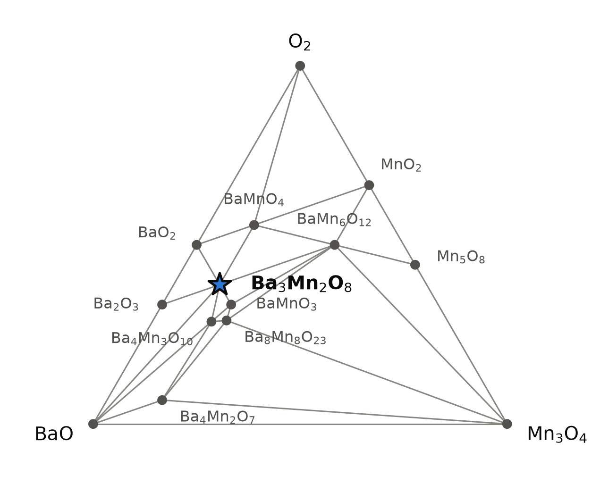
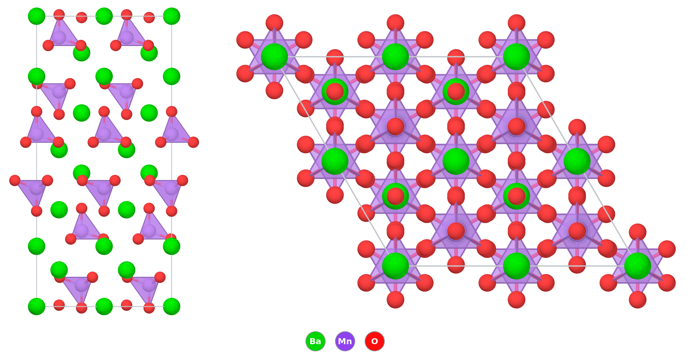

# Ba₃Mn₂O₈ — barium manganate(V), a lattice of S = 1 spin dimers

*A Material a Day · entry 26 · 12 November 2026 · status: **known** (structure 1999, magnetism 2001 onwards)*

> **In one paragraph.** Ba₃Mn₂O₈, or Ba₃(MnO₄)₂, holds manganese in the unusual +5
> oxidation state, as isolated MnO₄³⁻ tetrahedra between barium ions. The tetrahedra
> sit in pairs along the c axis, and each pair of d² Mn⁵⁺ ions, spin 1 each, couples
> antiferromagnetically into a singlet. The ground state is non-magnetic with a spin gap
> of about 1 meV (11 K). Fields above about 9 T close the gap and drive the dimers into
> ordered phases, which made the compound a standard test case for field-induced order
> in quantum magnets. It is known: the structure was refined from neutron powder data in
> 1999, and green powders are made from barium carbonate and a manganese oxide at
> 900–1000 °C in air or flowing oxygen, with crystals grown from molten NaOH. The database
> reproduces the measured cell to 1 %, the dimer bond to 0.5 % and the Mn–O bonds to
> 1 %, though its tetrahedron is a little less distorted than the measured one. It puts the compound
> on the hull in every table, but how deep varies by a factor of almost five: 90 meV/atom
> in PBE, 19 with Materials-Project settings. The smaller number is well inside the
> 65 meV/atom scatter of computed oxide energies, so the calculation alone would not
> establish stability; the synthesis does. The computed magnetic state is ferromagnetic,
> not the measured singlet, and the computed gap is a PBE gap of a Mn d² compound,
> which is not to be trusted.

Computed numbers come from the Alexandria database. Measured numbers carry a reference.

## 1. Identity

| | computed (PBE) | measured |
|---|---|---|
| Formula | Ba₃Mn₂O₈ = Ba₃(MnO₄)₂, tribarium bis(tetraoxidomanganate(V)) | |
| Alexandria id | `agm003274752` | |
| Space group | R-3m (no. 166), Z = 3 (hexagonal cell) | R-3m [2] |
| Cell (Å), hexagonal | a 5.769, c 21.535 | a 5.7107, c 21.4438 at 295 K [2] |
| Volume per formula unit (ų) | 206.9 | 201.9 [2] |
| Density (g cm⁻³) | 5.22 | 5.35 (our calculation from the cell) |
| Structure type | Ba₃(PO₄)₂ type (prototype label A2B3C8_hR39_166_c_ac_ch) | |
| Formation energy | −2.342 eV/atom (PBE) · −2.406 eV/atom (Materials-Project settings) | — |
| Magnetism | ferromagnetic, 2 μB per Mn (4 μB per formula unit) | singlet ground state of antiferromagnetic S = 1 dimers [3, 4] |
| Colour | — | bright to dark green [2, 3, 4] |

The CIF is [`Ba3Mn2O8.cif`](Ba3Mn2O8.cif). The refined structure is Crystallography Open
Database entry 2008132 [2]. No Wikipedia page on this compound was found; the page
"Hypomanganate" is about the MnO₄³⁻ ion, and "Barium manganate" is about BaMnO₄.

### How far off the structure is

| | measured | PBE | difference |
|---|---|---|---|
| a (Å) | 5.7107 [2] | 5.769 | +1.0 % |
| c (Å) | 21.4438 [2] | 21.535 | +0.4 % |
| volume per formula unit (ų) | 201.9 | 206.9 | +2.5 % |
| Mn–Mn within a dimer (Å) | 3.985 [4] | 4.006 | +0.5 % |
| Mn–Mn between bilayers (J₁ path, Å) | 4.569 [4] | 4.600 | +0.7 % |
| Mn–Mn in the plane (J₂ path, Å) | 5.711 [4] | 5.769 | +1.0 % |
| Mn–Mn, J₃ path (Å) | 6.964 [4] | 7.024 | +0.9 % |
| Mn–O, apex along c (Å) | 1.671(3) [2] | 1.688 | +1.0 % |
| Mn–O, three basal (Å) | 1.7055(13) [2] | 1.713 | +0.4 % |
| Ba1–O, 6 near / 6 far (Å) | 2.7563 / 3.2983 [2] | 2.771 / 3.332 | +0.5 % / +1.0 % |
| Ba2–O, apex O / 3 below / 6 in plane (Å) | 2.621 / 2.8304 / 2.9062 [2] | 2.610 / 2.870 / 2.935 | −0.4 % / +1.4 % / +1.0 % |

| atom | site | measured (x, y, z) [2] | PBE (x, y, z) |
|---|---|---|---|
| Ba1 | 3a | 0, 0, 0 | 0, 0, 0 |
| Ba2 | 6c | 0, 0, 0.20692 | 0, 0, 0.20744 |
| Mn | 6c | 0, 0, 0.40708 | 0, 0, 0.40700 |
| O1 | 18h | 0.16175, 0.3235, 0.56538 | 0.1611, 0.3222, 0.5659 |
| O2 (apex) | 6c | 0, 0, 0.32914 | 0, 0, 0.32863 |

PBE runs long, as it usually does, and more in the plane than along c. The measured
distances are at room temperature (295 K in [2]), and the lattice contracts by only
0.3 % in a and 0.06 % in c on cooling to 1.4 K [4], so thermal expansion does not
explain the difference. The fractional coordinates agree to 0.0005 in z and 0.001 in x,
so almost all of the error is in the cell, not in the positions. The one qualitative
difference is the tetrahedron: measured, the apical bond is 0.035 Å shorter than the
basal ones; in PBE, 0.025 Å. The computed apex bond is the one that is 1 % long. The
only bond PBE makes shorter than measured is Ba2 to the apical oxygen, by 0.4 %.

## 2. Where it sits

<picture>
  <source media="(prefers-color-scheme: dark)" srcset="phase_diagram_dark.png">
  
</picture>

The oxide part of the Ba–Mn–O triangle at 0 K (PBE table), cut at BaO, Mn₃O₄ and O₂.
Seventeen phases are on the hull of the whole system. Ba₃Mn₂O₈ shares tie lines with
BaO, BaO₂, Ba₂O₃, BaMnO₃, Ba₄Mn₃O₁₀, BaMnO₄ and BaMn₆O₁₂. It is the only Mn(V) phase;
everything else on the hull is Mn(IV) or lower, except BaMnO₄, which is Mn(VI).

The two hulls disagree on more than the depth:

| | PBE (`energy_runs_pbe`) | Materials-Project settings (`energy_runs_pbe_mp`) |
|---|---|---|
| Ba₃Mn₂O₈ | on the hull, **90.4 meV/atom** deep | on the hull, **19.2 meV/atom** deep |
| competing assemblage | (neighbours above) | 0.2 BaO₂ + 0.4 Ba₆Mn₅O₁₆ + 0.4 BaO₃ |
| Ba₆Mn₅O₁₆ | **not in the table** | on the hull |
| BaO₃ | 11.2 meV/atom above | on the hull |
| Ba₂O₃ | on the hull | 45.7 above |

- The Materials-Project table applies a Hubbard U to manganese and its oxide
  corrections; the PBE table does neither. That alone moves Mn oxides by tens of
  meV/atom.
- The main competitor on the Materials-Project hull, Ba₆Mn₅O₁₆, has no PBE entry, so
  the PBE depth is taken against a different and smaller set of phases. That is part of
  why PBE finds Ba₃Mn₂O₈ deeper.
- Both hulls carry a barium oxide of unusual stoichiometry (Ba₂O₃ in one, BaO₃ in the
  other). We found no report of either as a bulk phase in the sources read and did not
  search for them; we treat them as suspect references, and they touch the target in
  both tables.

## 3. Structure

*The PBE structure. Left, along a: MnO₄ tetrahedra (purple, O red) between barium
(green), in pairs along c. Right, along c. Two cells by two; only Mn–O bonds are drawn.*

| site | Wyckoff | neighbours (PBE) |
|---|---|---|
| Ba1 | 3a | 12 O: 6 × 2.771, 6 × 3.332 Å |
| Ba2 | 6c | 10 O: 1 × 2.610, 3 × 2.870, 6 × 2.935 Å |
| Mn | 6c | 4 O: 1 × 1.688 (apex, along c), 3 × 1.713 Å; O–Mn–O 109–110° |
| O1 | 18h | 1 Mn (basal) |
| O2 | 6c | 1 Mn (apex) |

Site labels follow [2]; measured distances are in section 1.

- **Isolated tetrahedra.** No oxygen is shared between two manganese ions; the MnO₄
  groups are held together only by barium. The tetrahedron is nearly regular, with the
  bond along c 0.025 Å shorter than the other three (0.035 Å measured [2]). The two
  barium sites alternate along c. Ba2 is ten-coordinate: a hexagon of oxygens in its
  own plane, one apical oxygen above and three below [2]. Ba1 has six near oxygens in a
  trigonal antiprism and six more 0.54 Å further out, so it counts as six- or
  twelve-coordinate depending on the cut-off [2]; [4] counts twelve. The two kinds of
  polyhedra share faces [2].
- **The dimers.** Each MnO₄ has a partner directly above or below it along c, at
  4.006 Å (3.985 Å measured [4]), with the two tetrahedra pointing their apices away from
  each other. The pairs form triangular bilayers, stacked with a three-fold period
  along c [3]. This pair is the magnetic dimer; the exchange runs through the two
  tetrahedra's oxygens and the barium between them, not through a shared oxygen.
- **The family.** The PBE table holds 53 oxides with this prototype label and space
  group. On the hull, besides Ba₃Mn₂O₈, are Ba₃(PO₄)₂ (132.6 meV/atom deep),
  Ba₃(AsO₄)₂ (132.8), Ba₃V₂O₈ (112.3), Sr₃(AsO₄)₂ (86.3), Sr₃V₂O₈ (78.6), Ba₃Cr₂O₈
  (38.9), Sr₃(PO₄)₂ (18.1) and Ba₃Nb₂O₈ (2.1), and a set of alkali salts A₃(MO₄)₂ of Tc,
  Re, Ru, Os and Mn. Ca₃(PO₄)₂ is 12.3 above. Ba₃Cr₂O₈ is the Cr⁵⁺ (d¹, S = ½) analogue.
  Its strontium sibling Sr₃Cr₂O₈ is a known spin-dimer compound that distorts from
  hexagonal to monoclinic on cooling, an orbital ordering of the d¹ ion (abstract read)
  [7]; in the database it is stored in triclinic cells, not in this type. Ba₃Mn₂O₈ shows
  no structural transition between 1.4 and 160 K [4]. Sr₃Mn₂O₈ is not in the PBE table.
- **Polymorphs.** The PBE and SCAN tables hold only this structure. The
  Materials-Project table also holds a 91-atom P3 cell, 7.3 meV/atom above, ferrimagnetic
  (28 μB per cell); we did not inspect it.

## 4. Computed properties

The magnetic order in every calculation is ferromagnetic, while the real ground state is
a singlet of antiferromagnetic dimers. The energy between the two is set by an exchange
of about 1.6 meV [4], small beside every number below; but the electronic structure of a
ferromagnet is not that of a singlet, and the gap and dielectric response are affected.

### Electronic

| gap (eV) | value |
|---|---|
| PBE, indirect / direct | 1.12 / 1.18 |
| Materials-Project settings (PBE+U), indirect | 1.62 |
| PBEsol, indirect | 0.92 |
| SCAN, indirect / direct | 1.76 / 1.83 |
| graph-network estimate of the PBE gap | 1.68 |
| graph-network estimate of the MBJ gap | 3.13 |

- These gaps lie between filled and empty Mn 3d states of the d² ion. Plain PBE handles
  such states poorly and the spread from 0.9 to 1.8 eV between functionals shows it.
  None of these is a measured number, and the MBJ value is a machine-learned estimate,
  not a calculation.
- **Calibration.** No measured gap was found. The compound is green [2, 3, 4], so it absorbs
  in the visible; for a d² tetrahedral ion that colour is usually ascribed to d–d
  transitions, which a band gap does not describe (general knowledge, not retrieved).

### Dielectric response (PBE, DFPT, ferromagnetic)

| | value |
|---|---|
| ε∞ (in plane, in plane, along c) | 4.45, 4.45, 4.31 |
| ε∞ (average) | 4.40 |
| refractive index | 2.10 (from ε∞) |
| Born charges (trace/3) | Ba +3.02 (principal values 2.25 to 3.63), Mn +3.16, O −1.92 (−3.23 to −1.01) |

- PBE's small gap inflates ε∞, so 4.4 is probably an upper estimate. No measured index
  was found. R-3m is centrosymmetric and the piezoelectric tensor is zero.

### Charge transport (rigid bands, PBE)

Density-of-states masses 5.7 (electrons) and 6.7 (holes) free-electron masses, both
heavy, from narrow Mn d bands. The branch point lies 0.28 eV above the valence-band top.
At 300 K and 10¹⁹ carriers cm⁻³ the Seebeck coefficient is −477 μV K⁻¹ for electrons and
+530 for holes. These describe flat bands in a ferromagnetic calculation, not a
conductor anyone has made.

### Mechanical (machine-learned)

| bulk modulus | shear modulus | Young's modulus |
|---|---|---|
| 64 GPa | 29 GPa | 75 GPa |

Screening estimates from graph networks on the PBE structure. No measured modulus was found.

### Magnetism, measured

The point of the compound, and nothing the database computes:

| | measured |
|---|---|
| ground state | spin singlet [3] |
| spin gap | 11.2 K from the first critical field, 8.4 T [3]; 1.05 meV from the neutron dispersion [4] |
| intradimer exchange J₀ | 1.61(3) meV [4]; 9.2 K in the convention H = Σ 2J S·S [3], i.e. the same |
| interdimer exchange | J₁ = −0.062 meV, J₂ = 0.112 meV [4] |
| Curie–Weiss temperature | −43.2 K (150–350 K) [4] |
| critical fields | 8.4, 25.7 and 32.5 T, with a plateau at half saturation between the last two [3] |
| field-induced phases | one ordered phase for H ∥ c, two for H ⊥ c, above about 8.7 T [5] |

The 2 μB per Mn of the calculation is the moment of an S = 1 ion, consistent with Mn⁵⁺
d². The calculation does not test the dimer: it would need the antiferromagnetic
arrangement of each pair, which is not in the database.

### Not computed

Phonons ("phonons not computed": the compound is not among the group's lattice-dynamics
calculations); the antiferromagnetic singlet state; exchange constants; d–d optical
spectra; spin–orbit coupling and single-ion anisotropy.

## 5. Is it stable?

On the hull in every table: **90.4 meV/atom** deep in PBE, **19.2** with
Materials-Project settings, 67.7 in SCAN, 115.1 in PBEsol. A graph-network estimate puts
it 6 meV/atom above the hull, the same within that model's error.

- **Against the class error.** Oxides (82 compounds in the calorimetric survey behind
  these tools) scatter by 65 meV/atom (mean absolute deviation) against measured
  formation enthalpies, with a bias of +5 and a 90th percentile of 168. That survey was
  made on the Materials-Project table. There the margin is **19 meV/atom, well inside
  the 65 meV/atom scatter: the calculation does not settle stability.** The PBE margin,
  90, is larger than the scatter, but no error survey exists for that table, and it is
  measured against a set of phases that lacks Ba₆Mn₅O₁₆ (section 2). The compound is made
  routinely at 900–1000 °C [3, 4], and that is the evidence for its stability.
- **The references.** The binary oxides of the system are close to their measured
  formation enthalpies in the Materials-Project table: BaO −23, MnO₂ −20, Mn₂O₃ +8,
  Mn₃O₄ −30 meV/atom (computed minus measured). No measured formation enthalpy of
  Ba₃Mn₂O₈ itself was found.
- **At temperature** (Materials-Project hull, vibrational free energy from a
  Neumann–Kopp estimate for the target and for Ba₆Mn₅O₁₆): −17.4 meV/atom at 300 K,
  −12.8 at 1000 K, −11.0 at 1273 K, −9.5 at 1500 K, against a vibrational scatter of
  11–22 meV/atom. The margin shrinks on heating but does not change sign.
- **Magnetism.** All tables use a ferromagnetic state. The singlet lies lower by an
  amount of order J₀ ≈ 1.6 meV per dimer [4], about 0.1 meV/atom, which does not matter
  here.

## 6. How to make it

### How it is made

- **Powder, air, from Mn₂O₃** [2]: BaCO₃ and Mn₂O₃ in the stoichiometric ratio, ground
  together under acetone, heated in an alumina crucible in air at 900 °C (1173 K) for
  24 hours. The product was bright green and, by X-ray diffraction, single phase; it is
  the sample of the neutron refinement. A vibrational spectrum with Mn–O bands at 822
  and 758 cm⁻¹ was taken as confirming MnO₄³⁻ and Mn⁵⁺ [2]. This is the shortest of
  the published firings and the one that starts furthest from Mn(V): manganese goes
  from +3 to +5 by taking oxygen from the air.
- **Powder, air** [3]: BaCO₃ and MnO₂ in the stoichiometric ratio, calcined at 900 °C for
  30 hours in air, following 3 BaCO₃ + 2 MnO₂ + ½ O₂ → Ba₃Mn₂O₈ + 3 CO₂, which oxidises
  Mn⁴⁺ to Mn⁵⁺. The product was greenish, but the X-ray pattern showed impurity peaks and
  the susceptibility a small ferromagnetic impurity with a transition at 43 K; the
  authors measured a purified sample (the purification step was not in the passages we
  read).
- **Powder, oxygen** [4]: BaCO₃ and Mn₂O₃, calcined under flowing oxygen at 900 °C for
  30 hours, reground and sintered at 900–1000 °C under flowing oxygen for about seven
  days. Green powder, with no impurity seen by X-ray diffraction or magnetisation; 76 g
  from five batches went into the neutron experiment. Weak elastic peaks were still
  ascribed to Mn₂O₃ or Mn₃O₄.
- **Crystals** [5]: a precursor from MnO and BaCO₃ sintered at up to 1000 °C for
  100 hours with regrinding, then mixed 1 : 19 (molar) with anhydrous NaOH, which the
  authors chose as a strongly oxidising flux. In a capped alumina crucible it was heated
  to 700 °C over 24 hours, held 5 hours and cooled slowly to 300 °C; the flux washes off
  in water and leaves hexagonal tablets of up to 100 mg.

### What the hull proposes

Reaction energies at 0 K, meV per atom of the whole charge (Materials-Project-settings
hull). 442 routes leave nothing to separate; R6 ranks them by fewest reagents, then
least driving force.

| route | charge | ΔE | note |
|---|---|---|---|
| A (rank 1) | BaO₂ + 2 BaMnO₃ | −22.1 | BaMnO₃ is not a stock reagent |
| B (rank 2, first from bottled reagents) | 3 BaO₂ + 2 MnO | −320.2 | barium peroxide supplies the oxygen |
| — | 2 BaO + BaO₂ + 2 MnO₂ | −222.8 | gives Ba₃Mn₂O₈ alone |
| — | 3 BaO + 2 MnO₂, closed | −245.8 | gives BaO + Ba₄Mn₃O₁₀: one oxygen short |
| — | 3 BaCO₃ + 2 MnO₂, CO₂ kept | 0 | no reaction at 0 K |

- **The published routes need oxygen from the gas.** With BaCO₃ and MnO₂ the charge,
  once CO₂ has left, is BaO + MnO₂, which is one oxygen atom short of Ba₃Mn₂O₈ and in a
  closed crucible gives the Mn(IV) phase Ba₄Mn₃O₁₀ beside BaO. With Mn₂O₃, as in [2]
  and [4], it is two oxygen atoms short (3 BaCO₃ + Mn₂O₃ + O₂ → Ba₃Mn₂O₈ + 3 CO₂). The
  missing oxygen comes from the air of [2, 3] or the oxygen flow of [4]. The closed-system way to supply it is
  barium peroxide, route B or the BaO/BaO₂/MnO₂ charge; we found no report of either.
  In the sense of R6 the hull's first route does not match practice, but it is the same
  chemistry with the oxygen carried by a solid.
- **The firing window.** In oxygen potential, the target is the stable phase down to
  an oxygen partial pressure of 6 × 10⁻⁴ bar at 900 °C and 0.03 bar at 1100 °C (every
  phase priced at that temperature). Air, at 0.21 bar, is inside the window at both,
  with a narrowing margin at 1100 °C; the 0 K estimate places the loss of oxygen in air
  at about 1250 K (980 °C). Flowing oxygen widens the margin. All the published firings,
  900 °C in air [2, 3] and 900–1000 °C in oxygen [4], sit inside it. Below the window the charge
  falls to Mn(IV) phases.
- **Which product comes first.** For BaCO₃ with MnO₂ in air at 900 °C the pathway tool
  finds five products within 60 meV/atom of each other on the measured scale, all
  manganites with Mn at +4 or below: Ba₆Mn₅O₁₆ (−247 meV/atom), Ba₅Mn₅O₁₄ (−222),
  Ba₅Mn₄O₁₂ (−202), Ba₉Mn₇O₂₁ (−193) and BaMnO₃ (−191). Ba₃Mn₂O₈ comes next, at −182,
  just outside. Nucleation decides, so barium manganites(IV) are the
  expected intermediates, and the firing has to last long enough to turn them into the
  Mn(V) phase. How long varies between laboratories: 24 hours from Mn₂O₃ gave a
  single-phase product by X-ray diffraction in [2], 30 hours from MnO₂ left impurities in
  [3], and [4] fired for about a week in oxygen. The papers do not say why.
- **Temperatures.** The bulk-diffusion bracket for BaCO₃ + MnO₂ runs from 404 K (MnO₂)
  to 817 K (BaCO₃, from its decomposition at 1633 K). Laboratories fire such charges near
  1156 K (883 °C), ±223 K, which brackets the published 900 °C.
- **Metathesis**, tested on three charges:

| charge | ΔE | outcome |
|---|---|---|
| 3 BaCl₂ + 2 K₃MnO₄ | −111.4 | **clean**: Ba₃Mn₂O₈ + 6 KCl |
| 3 BaCl₂ + 2 Na₃MnO₄ | −53.6 | **clean**: Ba₃Mn₂O₈ + 6 NaCl |
| 3 BaF₂ + 2 Li₃MnO₄ | −32.8 | fails: BaO₂ + LiF + BaF₂ + Li₂MnO₃ (lithium takes the manganese as Mn(IV)) |

  Both clean exchanges keep manganese at +5 throughout and need no gas, and KCl and NaCl
  are inert towards the product in the contact calculation, so the salt can be washed
  out. K₃MnO₄ and Na₃MnO₄ are on the Materials-Project hull. Whether they are practical
  reagents, and how they behave in moist air, we did not check. We found no report of
  this route.
- **Excess BaCl₂** reacts with the product by a hair (−0.9 meV/atom) to Ba₅Mn₃ClO₁₂, a
  chloride of the same Mn(V) family: weigh barium chloride exactly or slightly short.

### What it tolerates

| inert in the calculation | reacts (meV/atom) |
|---|---|
| MgO, BeO, Y₂O₃ | Pt (−83, to BaPtO₃ and others), Au (−51), Ag (−27), Pd (−76), Ni (−97) |
| H₂O (0 K) | **CO₂ (−166, to BaCO₃ + MnO₂ + O₂)**, H₂ (−326), N₂ (−70) |
| NaCl, KCl, RbCl, CsCl, NaBr, KBr, Na₂SO₄, K₂SO₄, Na₂CO₃, NaNO₃, KNO₃, Na₂MoO₄ | Al₂O₃ (−23), ZrO₂ (−16), SiO₂ (−45), TiO₂ (−36), CaO (−1) |
| | LiCl (−91), LiF (−30), B₂O₃ (−76), PbO (−58), KF (−25), NaF (−18), K₂CO₃ (−19) |

- **Crucible.** MgO, BeO and Y₂O₃ are inert; alumina and zirconia react a little.
  Platinum, gold and silver are attacked in the calculation, since the product is an
  oxidant. Alumina is what was used: [2] fired in alumina at 900 °C for 24 hours and
  reports a single-phase product, so the −23 meV/atom contact reaction is either slow
  or confined to the surface, and [5] used alumina for the NaOH flux at 700 °C. The
  crucibles of [3, 4] are not stated in the passages read.
- **Fluxes.** The alkali chlorides, bromides, sulfates and nitrates are inert, and so is
  Na₂CO₃. Lithium salts take manganese as Li₂MnO₃. NaOH was not in the contact set.
- **CO₂** attacks the product at 0 K, back to the carbonate. Cool in dry, CO₂-free gas
  and store dry; how fast the reaction runs at room temperature is not known to us.

### Powder pattern

Computed with Cu Kα on the PBE cell (strongest lines):

| hkl | 10-15 | 2-1-10 | 20-25 | 3-1-25 | 10-110 | 30-30 |
|---|---|---|---|---|---|---|
| 2θ (°) | 27.34 | 31.00 | 41.80 | 52.94 | 45.89 | 55.15 |
| I | 100 | 87 | 41 | 30 | 25 | 16 |

The PBE cell is 0.4–1 % too long, so measured lines fall about 0.1–0.3° higher in 2θ.
Impurities and what they mean:

- **BaMnO₃ or another barium manganite(IV)** (Ba₆Mn₅O₁₆, Ba₄Mn₃O₁₀): too little oxygen
  (fire in O₂), too hot (above the window), or not fired long enough.
- **Mn₂O₃ or Mn₃O₄**: unreacted manganese oxide or a manganese-rich charge; the 43 K
  ferromagnetic signal in [3] and the extra elastic peaks in [4] were ascribed to these.
- **BaCO₃**: carbonate not fully decomposed, or CO₂ taken up on cooling.
- **BaMnO₄** (Mn(VI)): too much oxygen at low temperature.
- **Ba₅Mn₃ClO₁₂, KCl, NaCl**: a metathesis charge with excess chloride or incomplete
  washing.

### Hazards

Soluble barium compounds are toxic if swallowed. Mn(V) is an oxidant. Manganese
compounds are harmful by chronic inhalation of dust. NaOH flux is corrosive. (General
knowledge.)

## 7. What it is good for

- **Quantum magnetism.** Ba₃Mn₂O₈ is a model S = 1 dimer system: a singlet ground state
  with a spin gap [3], dispersive triplet excitations and thermally excited quintets seen
  by neutrons [4], and ordered phases in fields above about 9 T whose number depends on
  the field direction [5]. Its frustrated triangular geometry and small single-ion
  anisotropy are why it has been studied up to 32 T and down to 20 mK [5, 6]. Uchida et
  al. point to the description of such field-induced order as a Bose–Einstein
  condensation of magnons [3]. These
  are research uses.
- **Pigment.** One source describes the historical pigment "manganese blue" as
  Ba₃(MnO₄)₂·nBaSO₄·mBaO, a barium manganate(V) in a sulfate matrix (full text read,
  quoting a source we did not read) [8]; another gives Colour Index PB33 as
  "BaMnO₄·BaSO₄" and states that the original pigment has not been sold since the 1990s
  (full text read) [9]. The two disagree on the formula, and we have not settled which
  is right. The same Kazan group made a related blue-to-green Mn(V) barium manganate
  sulfate from MnO₂, Ba(NO₃)₂ and BaSO₄ at 700 °C and tested it as an anticorrosion
  pigment for steel [8]. These are uses of related compositions, not of pure Ba₃Mn₂O₈.
  The structure paper names the intense colour, and the rarity of a stable Mn(V) oxide,
  as its reasons for interest [2].
- **Mn⁵⁺ in the same structure.** [2] notes that Ba₃V₂O₈ and Sr₃V₂O₈, the vanadium
  members of this family, were studied as phosphor hosts and that Mn⁵⁺ doped into them
  was reported to show laser action (two papers cited there, which we did not read).
  That is a use of dilute Mn⁵⁺ in a host, not of the manganate itself.

## 8. How this could be wrong

- **The magnetic state is wrong in the calculation.** Every computed property is for a
  ferromagnet; the real compound is a singlet of antiferromagnetic dimers. Energies are
  barely affected; gaps, ε∞ and transport may be.
- **The PBE gap of a Mn d² compound is unreliable**, and the functionals spread from
  0.9 to 1.8 eV. No measured gap exists to calibrate it.
- **The two hulls disagree by a factor of almost five** in depth (90 against
  19 meV/atom), partly from the Hubbard U and partly because Ba₆Mn₅O₁₆ is missing from
  the PBE table. The Materials-Project margin is well inside the oxide scatter; the PBE
  margin has no error survey of its own.
- **Suspect references touch the target**: Ba₂O₃ on the PBE hull and BaO₃ on the
  Materials-Project hull.
- **No phonons.** The dynamical stability of the stored structure was not checked.
- **The routes are 0 K thermodynamics**, apart from the temperature-dependent window and
  the pathway estimate. The metathesis routes are calculations only.

## 9. Literature

**Searched 8 November 2026 (OpenAlex):** "Ba3Mn2O8 neutron powder diffraction structure"
(10 hits; [2], [3], [4], [5], [7] and an abstract on high-pressure synthesis of
high-valence oxides, 10.1142/s1793604711002123, which lists Ba₃Mn₂O₈ among the families
that group prepared and studied; abstract read, it does not say how Ba₃Mn₂O₈ was made);
"Ba3Mn2O8 spin dimer singlet ground state magnetization" (10 hits; [3], [4], [5], [6],
and studies of Cr-doped Ba₃Mn₂O₈ and of critical properties by NMR, abstracts or titles
only); "Ba3Mn2O8 single crystal growth flux" (4 hits; [5] and a single-crystal neutron
study, 10.1103/physrevlett.100.237201, abstract read); "barium manganate(V) Ba3(MnO4)2
synthesis" (4 hits; [8]); "Ba3Mn2O8 thermal decomposition oxygen BaMnO3 stability
temperature" (no hits); "manganese blue pigment barium manganate(V) sulfate" (10 hits;
[9], [8]'s earlier paper); "Ba3Mn2O8 optical absorption Mn5+ tetrahedral d-d
transitions" (no hits); "Ba3(VO4)2 Ba3Mn2O8 solid solution" (no hits). Wikipedia: no
page for Ba3Mn2O8, Ba3(MnO4)2, barium manganate(V), barium hypomanganate or manganese
blue.

**Result: known compound.** Synthesis and structure 1999 [2]; magnetism from 2001 [3–6].
The published powder routes take their oxygen from the furnace gas; the hull's first
closed route supplies it from barium peroxide instead. No measured gap, modulus,
formation enthalpy or decomposition temperature was found.

1. Alexandria database, entry `agm003274752` (PBE, Materials-Project-settings, PBEsol
   and SCAN tables).
2. M. T. Weller, S. J. Skinner, "Ba₃Mn₂O₈ determined from neutron powder diffraction",
   *Acta Cryst. C* 55, 154 (1999). doi:10.1107/S0108270198011871. *Full text read:
   synthesis, cell, atomic positions, bond lengths. The refined structure is also
   Crystallography Open Database entry 2008132
   (https://www.crystallography.net/cod/2008132.html).*
3. M. Uchida, H. Tanaka, M. I. Bartashevich, T. Goto, "Singlet ground state and
   magnetization plateaus in Ba₃Mn₂O₈", *J. Phys. Soc. Jpn.* 70, 1790 (2001).
   doi:10.1143/jpsj.70.1790. *Full text read (arXiv cond-mat/0102026), except the
   purification step.*
4. M. B. Stone, M. D. Lumsden, Y. Qiu, E. C. Samulon, C. D. Batista, I. R. Fisher,
   "Dispersive magnetic excitations in the S = 1 antiferromagnet Ba₃Mn₂O₈", *Phys. Rev. B*
   77, 134406 (2008). doi:10.1103/physrevb.77.134406. *Full text read (arXiv 0801.2332).*
5. E. C. Samulon, Y.-J. Jo, P. Sengupta, C. D. Batista, M. Jaime, L. Balicas,
   I. R. Fisher, "Ordered magnetic phases of the frustrated spin-dimer compound
   Ba₃Mn₂O₈", *Phys. Rev. B* 77, 214441 (2008). doi:10.1103/physrevb.77.214441. *Full
   text read (arXiv 0803.3830): crystal growth, phase diagram.*
6. H. Tsujii, B. Andraka, M. Uchida et al., "Specific heat of the S = 1
   spin-dimer antiferromagnet Ba₃Mn₂O₈ in high magnetic fields", *Phys. Rev. B* 72,
   214434 (2005). doi:10.1103/physrevb.72.214434. *Abstract read.*
7. D. L. Quintero-Castro, B. Lake, E. M. Wheeler et al., "Magnetic excitations of the
   gapped quantum spin dimer antiferromagnet Sr₃Cr₂O₈", *Phys. Rev. B* 81, 014415 (2010).
   doi:10.1103/physrevb.81.014415. *Abstract read.*
8. E. A. Nurislamova, M. R. Ziganshina, S. N. Stepin, V. A. Mendelson, "Anticorrosion
   properties of manganese-containing complex oxides, obtained by stoneware method",
   *IOP Conf. Ser.: Mater. Sci. Eng.* 905, 012051 (2020).
   doi:10.1088/1757-899x/905/1/012051. *Full text read; its composition of manganese
   blue is quoted from a source we did not read.*
9. A. Cioponea, G. Vlase, A. Pahomi et al., "Study of common blue pigments used in
   paintings: insights from thermal, spectroscopic, and microscopic analysis", *npj
   Heritage Sci.* (2026). doi:10.1038/s40494-026-02941-6. *Full text read (article in
   press); the pigment it studied turned out to contain no manganese.*

## 10. Provenance

- **Data:** Alexandria database, tables `energy_runs_pbe`, `energy_runs_pbe_mp`,
  `energy_runs_ps` and `energy_runs_scan`; dielectric and transport tables on the PBE
  structure. Reaction energies, contact reactions and chemical-potential windows come
  from the hull and reaction table built on `pbe_mp`. Measured thermochemistry for the
  window at temperature from the NASA CEA tables.
- **Tools:** the reaction-route code of this group, pymatgen, POV-Ray; machine-learned
  moduli, gaps and hull distance from graph neural networks.
- **Authorship:** drafted by Claude (Anthropic) from those tools; reviewed by
  Miguel Marques. Corrections are welcome as issues on this repository.
