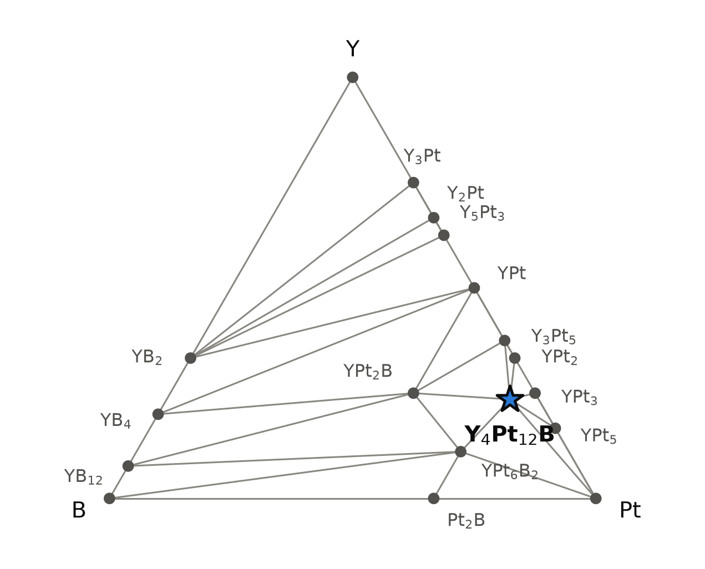
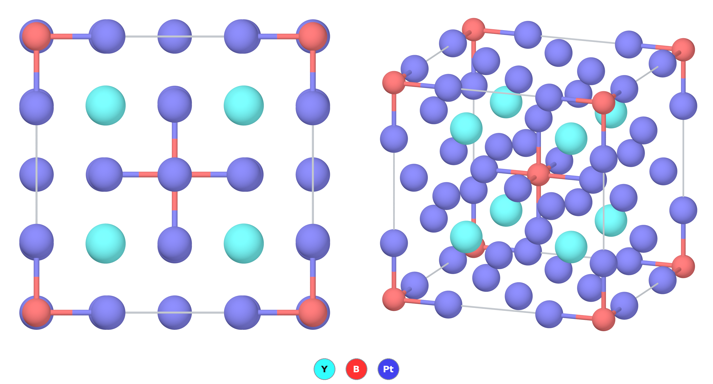

# Y₄Pt₁₂B — YPt₃ with boron ordered in a quarter of its octahedral holes

*A Material a Day · entry 27 · 13 November 2026 · status: **predicted, no report found** (as an ordered compound; the composition lies inside a reported cubic YPt₃Bₓ solid solution, x up to about 0.4 at 780 °C, with boron refined as disordered)*

> **In one paragraph.** Y₄Pt₁₂B is a platinum-rich boride of yttrium. Take YPt₃, a
> cubic AuCu₃-type intermetallic in which every yttrium sits in a cuboctahedron of twelve
> platinum atoms and every cube centre is an empty octahedron of six platinum atoms. Put
> boron into one octahedral hole in four, in an ordered body-centred pattern, and the cell
> doubles along each edge: that is the computed structure, space group Im-3m, a metal.
> In the Alexandria database it lies on the convex hull of Y–Pt–B with both functionals
> used here, 79 meV/atom below its competitors in PBE and 68 with Materials-Project
> settings. We found no report of the ordered compound. A 2026 preprint from Vienna
> reports the same platinum lattice with boron at random: a cubic YPt₃Bₓ that runs from
> YPt₃ up to x ≈ 0.4 in samples arc-melted from the elements and annealed at 780 °C,
> so x = 0.25 falls inside a measured single-phase range. Its X-ray refinement at
> x = 0.4 uses the small cubic cell and reports no superstructure. The open question is
> therefore not whether a phase of this composition forms but whether its boron orders,
> and X-rays will barely tell: the reflections that mark the order are below half a
> percent of the strongest line. The depth is smaller than the scatter of computed
> boride energies.

Computed numbers come from the Alexandria database. Measured numbers carry a reference.

## 1. Identity

| | computed (PBE) | measured |
|---|---|---|
| Formula | Y₄Pt₁₂B (database spelling Y4BPt12), i.e. YPt₃B₀.₂₅ | — |
| Alexandria id | `agm023344463` | — |
| Space group | Im-3m (no. 229), Z = 2 | — |
| Cell (Å) | a 8.3245, cubic (= 2 × 4.1623) | — |
| Volume per formula unit (ų) | 288.4 | — |
| Density (g cm⁻³) | 15.59 | — |
| Structure type | prototype label AB4C12_cI34_229_a_c_de: Y on 8c, B on 2a, Pt on 12d and 12e; a 2 × 2 × 2 superstructure of AuCu₃-type YPt₃ with boron in a quarter of the Pt₆ octahedra | — |
| Formation energy | −1.035 eV/atom (PBE) · −1.005 eV/atom (Materials-Project settings) | — |
| Magnetism | none (Y is f-free; total moment 0) | — |

The CIF is [`Y4BPt12.cif`](Y4BPt12.cif). No Wikipedia page on this compound was found.

### The nearest measured compounds

The ordered compound has not been reported as far as we found, so the calibration is
against its neighbours on the YPt₃–YPt₃B line, from [2] (single-crystal X-ray for the
cubic phase, powder Rietveld refinement for YPt₃B):

| | measured [2] | computed (PBE) | difference |
|---|---|---|---|
| YPt₃B₀.₄, cubic Pm-3m (B about 40 % on 1b), a (Å) | 4.1695(15) | 4.1623 at x = 0.25 (half the Y₄Pt₁₂B cell); about 4.187 at x = 0.4 by linear interpolation from YPt₃ (our arithmetic) | +0.4 % at equal x (interpolated) |
| YPt₃B₀.₄, Y–Pt (Å) | 2.948 | 2.943–2.944 at x = 0.25 | −0.2 % |
| YPt₃B₀.₄, B–Pt (Å) | 2.085 (average position) | 2.159 (ordered, Pt pushed out) | +3.6 %, see below |
| YPt₃B, CePt₃B type, P4mm: a (Å) | 3.9450(1) | 3.976 (database I4mm cell, `agm068540962`) | +0.8 % |
| YPt₃B, c (Å) | 4.9987(1) | 5.093 (half of 10.186, I4mm cell) | +1.9 % |
| YPt₃ (no boron), a (Å) | not given in [2] | 4.121 (`agm002384315`) | — |

- Boron expands the YPt₃ lattice in the calculation: from 4.121 Å with no boron to
  4.162 Å at x = 0.25. Carried linearly to x = 0.4 that is about 4.187 Å, 0.4 % above
  the measured 4.1695 Å, inside the 0.5–2 % by which PBE usually runs long.
- **The B–Pt distance is not a like-for-like comparison.** In a disordered crystal the
  refined platinum position averages over filled and empty octahedra, so the measured
  2.085 Å is half the averaged cell edge. In the ordered cell the platinum atoms next to
  a boron move 0.08 Å outwards; the X-ray model in [2] has no room for that.
- **The measured YPt₃B is not in the database.** [2] gives the CePt₃B type, P4mm, five
  atoms per cell. Neither the PBE nor the Materials-Project table holds a P4mm YPt₃B; the
  closest entry is a ten-atom I4mm cell with c doubled, 15 meV/atom above the PBE hull
  (12.6 with Materials-Project settings). It reproduces a to 0.8 % and c to 1.9 %. [2]
  relaxed the P4mm cell in PBEsol and got a 3.925 Å and c 4.980 Å (−0.5 % and −0.4 %).
  We relaxed the measured P4mm structure with the group's machine-learned potential
  (TugaFF, PBE-trained): a 3.972 Å (+0.7 %), c 5.100 Å (+2.0 %), and 10.6 meV/atom
  below the stored I4mm cell relaxed the same way. That difference is about the size of
  the potential's error (9 meV/atom), but if it held in PBE, P4mm YPt₃B would sit about
  5 meV/atom above the PBE hull: close to it, as a measured phase should be.
- **A second measured neighbour is missing.** [2] puts YPt₃B₀.₄ in equilibrium with
  YPt₃B and with a YPt₅B₂ at 780 °C (structure not given there). Neither table holds any
  entry of composition YPt₅B₂.

## 2. Where it sits

<picture>
  <source media="(prefers-color-scheme: dark)" srcset="phase_diagram_dark.png">
  
</picture>

The Y–B–Pt triangle at 0 K (PBE table). Eighteen phases are on the hull of the system.
Y₄Pt₁₂B shares tie lines with Pt, YPt₅, YPt₃, YPt₂, Y₃Pt₅, YPt₂B and YPt₆B₂.

| | PBE (`energy_runs_pbe`) | Materials-Project settings (`energy_runs_pbe_mp`) |
|---|---|---|
| Y₄Pt₁₂B | on the hull, **79.1 meV/atom** deep | on the hull, **68.2 meV/atom** deep |
| competing assemblage | — | 0.6 YPt₂B + 3.2 YPt₃ + 0.2 YPt₆B₂ |
| other polymorphs | none stored | two P4/mmm cells, 23.0 and 65.7 meV/atom above |

- **The ternary phases on the hull** besides Y₄Pt₁₂B are YPt₂B (P6₄22) and YPt₆B₂
  (P6/mmm). Y₂Pt₆B (R-3m) is 4.3 meV/atom above, the I4mm YPt₃B 15.1 above, and the
  fully filled cubic antiperovskite YPt₃B 174 above. Filling every octahedral hole in
  the cubic lattice costs a great deal; filling a quarter of them is the lowest point.
- **The platinum reference.** The Materials-Project table's platinum is one of the
  elemental references this project suspects (47 meV/atom below the next Pt entry). Pt
  metal is not in the competing assemblage of Y₄Pt₁₂B, so its depth is not affected; the
  two tables agree within 11 meV/atom.
- **Against the measured neighbour.** The reaction 3 YPt₃ + YPt₃B → Y₄Pt₁₂B is
  −67.6 meV/atom with the stored I4mm YPt₃B. For the missing P4mm structure to remove
  Y₄Pt₁₂B from the hull it would have to lie about 230 meV/atom below the stored cell,
  far more than any polymorph difference seen here; the machine-learned estimate above
  puts the P4mm cell about 11 meV/atom below it. The missing structure changes the
  hull near YPt₃B, not the standing of Y₄Pt₁₂B.
- **Against the measured phase diagram.** At 780 °C [2] finds the cubic YPt₃Bₓ range,
  ending near x = 0.4, in equilibrium with YPt₃B and YPt₅B₂. The computed triangle has
  Y₄Pt₁₂B in equilibrium with YPt₂B and YPt₆B₂ instead, because the measured YPt₃B is
  stored only in a wrong cell above the hull and YPt₅B₂ is not stored at all. The
  computed boron-rich tie lines of Y₄Pt₁₂B are therefore not to be trusted; the
  platinum-rich ones (Pt, YPt₅, YPt₃) are not contradicted by anything we read.

## 3. Structure

*The PBE structure, one conventional cell. Left, along a; right, an oblique view. Y
cyan, Pt blue, B red; only the B–Pt bonds are drawn, so each boron shows as the centre of
a Pt₆ octahedron, at the corners and the body centre of the cell.*

| site | Wyckoff | neighbours (PBE) |
|---|---|---|
| Y | 8c | 12 Pt at 2.943–2.944 Å (cuboctahedron) |
| B | 2a | 6 Pt at 2.159 Å (octahedron) |
| Pt1 | 12e | 1 B at 2.159 Å, 4 Y at 2.944 Å |
| Pt2 | 12d | 4 Y at 2.943 Å, no boron |

- **The parent.** In AuCu₃-type YPt₃ each yttrium sits in a cuboctahedron of twelve
  platinum atoms, and the centre of each small cube is an octahedral hole bounded by six
  platinum atoms at the face centres. Doubling the cell along each edge gives eight such
  holes per cell; in Y₄Pt₁₂B two of them, at the corner and the body centre, hold boron.
  The occupied octahedra share no corners: each is surrounded by empty ones.
- **How the lattice responds.** The yttrium cuboctahedron is left almost exactly regular
  (2.943 against 2.944 Å). The platinum atoms that bond to boron (12e) move 0.08 Å
  away from it, from x = 0.25 to 0.2594, opening the octahedron from 2.08 Å (the ideal
  position) to a B–Pt distance of 2.159 Å; the platinum atoms with no boron neighbour
  (12d) stay on their ideal sites.
  It is the arrangement of the antiperovskite (an "inverse perovskite" with B at the
  centre of a Pt₆ octahedron and Y in the cuboctahedral site) diluted to one filled
  octahedron in four.
- **The family.** The PBE table holds 350 entries with this prototype label in Im-3m,
  277 of them on the hull. Most are gallides and aluminides R₄TGa₁₂ and R₄TAl₁₂ with the
  same sites decorated the other way round (a transition metal T on 2a, Ga or Al on 12d
  and 12e). Thirty-eight are borides, 33 on the hull. Among the platinum and palladium
  borides R₄BPt₁₂ and R₄BPd₁₂, Y₄Pt₁₂B is one of the deepest: Er₄BPt₁₂ (87.4 meV/atom),
  Y₄BPt₁₂ (79.1), Tb₄BPt₁₂ (48.5), Ho₄BPt₁₂ (37.5), Tm₄BPt₁₂ (13.3), Sc₄BPt₁₂ (11.6)
  and Dy₄BPt₁₂ (3.4) are on the hull, while Nd₄BPt₁₂ (+15.7), Pm₄BPt₁₂ (+4.5) and
  Sm₄BPt₁₂ (+54.5) are above it: the platinum series favours the small rare earths.
  Every R₄BPd₁₂ stored (La, Pr to Tm, Sc, Y, Ac, Pu) is on the hull, with Er₄BPd₁₂
  (166.8) and Y₄BPd₁₂ (76.9) the deepest. Among the
  Y–Pt compounds with a non-boron filler, Y₄SiPt₁₂ (10.3) and Y₄GePt₁₂ (13.0) are on
  the hull but much shallower. The magnetic lanthanide members carry open 4f shells and
  their depths are less certain.
- **Related cubic borides.** A zirconium–iridium boride Zr₂Ir₆B has been described as
  an eightfold superstructure of a cubic perovskite-like ZrIr₃B₀.₅ (title read only) [5],
  the same idea at half filling. The introduction of [2] lists more: Ti₂Rh₆B and Zr₂Ir₆B
  (K₂PtCl₆ type, Fm-3m), and boron ordering seen by electron diffraction and
  high-resolution microscopy in CeRh₃B₀.₄–₀.₅ (tetragonal, I4/mmm) and ScRh₃B₀.₅–₀.₇₅.
  Partial boron filling of a Pt-metal AuCu₃ lattice that orders on a scale X-rays miss
  is therefore a known pattern in neighbouring systems. The 1985 review [3] already
  suspected that the boron-deficient platinum-metal borides hide an ordered
  boron/vacancy arrangement that X-ray diffraction cannot resolve.

## 4. Computed properties

### Electronic

A metal in every calculation (PBE gap 0; the graph-network gap estimate 0.0006 eV).
No magnetic moment. The stored density of states at the Fermi level is 3.72 in the PBE
table and 8.97 in the Materials-Project table (per cell, units as stored), and a
graph-network estimate gives 9.33; we have not resolved why the PBE value differs from
the other two by a factor of about 2.4. [2] computes (PBEsol, with and without
spin–orbit coupling) a metallic band structure for the cubic phase, with a sharp
density-of-states peak about 0.25 eV below the Fermi level; its cubic calculation is for
an ordered, fully filled cell, not x = 0.25, so it cannot settle our factor of 2.4.

**Measured** [2]: YPt₃B₀.₄ is a metal from 300 K down to 0.6 K, with a residual
resistivity of 54.9 μΩ cm, about eleven times that of tetragonal YPt₃B (4.84 μΩ cm).
The authors put the difference down to the half-empty boron sites, which is what a
disordered boron sublattice would do. A Bloch–Grüneisen fit gives a characteristic
temperature of 165 K. The machine-learned logarithmic phonon average of Y₄Pt₁₂B,
123 cm⁻¹ (177 K), is a different average of the spectrum, so the two agree in scale but
are not a test of each other.

There is no dielectric response for a metal. The rigid-band Seebeck coefficient at
300 K is +10 μV K⁻¹ (electrons, 10²⁰ cm⁻³ added) and +4 to +6 μV K⁻¹ (holes): metallic
values of no interest for thermoelectrics.

### Mechanical

| | machine-learned potential (EquFlashV2, relaxed-ion tensor) | graph network (tuga-sp) |
|---|---|---|
| C₁₁, C₁₂, C₄₄ (GPa) | 252.6, 137.4, 76.1 | — |
| bulk modulus (GPa) | 175.8 | 171.6 |
| shear modulus (GPa) | 68.1 | 47.7 |
| Young's modulus (GPa) | 180.9 | 2.5 (see below) |
| Poisson's ratio | 0.33 | — |

- The two bulk moduli agree. The shear moduli differ by 30 %, and the graph network's
  Young's modulus of 2.5 GPa is inconsistent with its own bulk and shear moduli (which
  give about 131 GPa through E = 9BG/(3B+G)); we discard it.
- For comparison, the same potential gives YPt₃ a bulk modulus of 171.9 GPa and a shear
  modulus of 73.0 GPa. A quarter of a boron per formula unit leaves the stiffness of the
  platinum lattice nearly unchanged.
- No measured modulus was read for any Y–Pt–B compound. A high-pressure X-ray study of
  YPt₃B exists [8] but was seen as metadata only.

### Lattice dynamics

| | machine-learned potential (EquFlashV2, harmonic, PBE-trained) |
|---|---|
| dynamically stable | yes; lowest frequency at the commensurate q-points 49.9 cm⁻¹, no imaginary modes |
| highest frequency | 510 cm⁻¹ |
| logarithmic average frequency | 123 cm⁻¹ |
| zero-point energy | 26.6 meV/atom |
| vibrational entropy at 300 K | 4.67 k_B/atom |

- The top of the spectrum, 510 cm⁻¹, belongs to boron vibrating in its Pt₆ cage: YPt₃
  without boron stops at 196 cm⁻¹ in the same model. The heavy platinum lattice and the
  light boron are well separated in frequency.
- These are machine-learned phonons, not DFT. The group's DFPT calculations (Quantum
  ESPRESSO, PBEsol) do not include this compound or any other of this composition:
  phonons from DFT and electron–phonon coupling were not computed.

### Superconductivity (screening estimate only)

The graph network gives λ = 0.21, ω_log = 142 K and Tc ≈ 0.001 K: weak coupling, no
superconductivity to speak of. [2] measured no transition in either YPt₃B or YPt₃B₀.₄
down to 0.6 K. These two statements agree, but the estimate is a
graph network trained on isotropic Allen–Dynes numbers and is not a calculation.

### Not computed

Phonons and electron–phonon coupling from DFT; spin–orbit coupling, which matters for
the platinum bands near the Fermi level and was not included in any table here; the
energy of the disordered boron arrangement (see section 5).

## 5. Is it stable?

On the hull in both tables: **79.1 meV/atom** below its competitors in PBE, **68.2**
with Materials-Project settings. It is not in the PBEsol or SCAN tables.

- **Against the class error.** Borides (9 compounds in the calorimetric survey behind
  these tools) scatter by 97 meV/atom (mean absolute deviation) against measured
  formation enthalpies, with a bias of −73 (computed more negative) and a 90th
  percentile of 173. **Both margins, 68 and 79 meV/atom, are smaller than that
  scatter.** No platinum boride or Y–Pt intermetallic of the system has a measured
  formation enthalpy in the survey, so the error of this chemistry is not known
  directly. The competing phases are themselves borides and platinides, so much of the
  error should cancel; the survey cannot say how much.
- **At temperature** (harmonic phonons for every phase): −67.7 meV/atom at 300 K,
  −66.1 at 1000 K, −65.3 at 1373 K, −64.8 at 1600 K, against a vibrational scatter of
  0–18 meV/atom for borides. The margin barely moves on heating.
- **Ordered or disordered.** The hull compares ordered structures. The competitor that
  matters at a firing temperature is the same YPt₃ lattice with boron spread at random,
  which is what [2] reports at x = 0.4, as the boron-rich end of a solid solution that
  starts at YPt₃ in samples annealed at 780 °C. So at 780 °C the composition x = 0.25 is
  a single cubic phase by X-ray; the measurement does not say whether its boron is
  ordered on a scale X-rays cannot see. An ideal random arrangement of one boron per four
  holes gains 0.13 k_B/atom of configurational entropy, about 16 meV/atom at 1373 K
  (our arithmetic for ideal mixing, not a database number). Whether the ordered
  arrangement is lower than the random one by more than that is not in any table here;
  it needs a cluster expansion or a set of supercells, and it decides whether Y₄Pt₁₂B
  exists as an ordered phase or only as a composition within a disordered YPt₃Bₓ.
- **Dynamically**, the stored structure is stable in the machine-learned harmonic
  calculation (section 4).

## 6. How to make it

### What was done

No synthesis of the ordered compound was found. The cubic YPt₃Bₓ phase that contains
its composition was made as follows [2]: about 1 g of platinum foil, yttrium and
crystalline boron arc-melted under argon and remelted several times; pieces wrapped in
molybdenum foil, sealed in evacuated silica, annealed for 10 days at 780 °C and quenched
in cold water. Single crystals were picked from the crushed alloy of nominal composition
Y₂₂.₇Pt₆₈.₂B₉.₁ (YPt₃B₀.₄). YPt₃B was made the same way from Y₂₀Pt₆₀B₂₀.

This is the route proposed below, with the details the hull leaves open filled in: the
molybdenum wrap is one of the metals the calculation finds inert, and it keeps the
alloy off the silica, which reacts on paper. The anneal at 780 °C (1053 K) lies below the
1162–1175 K bracket for bulk diffusion in YPt₃ + B, but after a melt the boron is
already mixed in; what the anneal sets is the arrangement of the boron, not whether it
enters the lattice. Ten days at 780 °C gave a cubic cell with no superstructure reported
at x = 0.4; a sample at x = 0.25 annealed lower or longer is the experiment the
calculation asks for.

### What the hull proposes

Reaction energies at 0 K, meV per atom of the whole charge (Materials-Project-settings
hull). 129 routes leave nothing to separate; R6 ranks them by fewest reagents, then
least driving force.

| route | charge | ΔE | note |
|---|---|---|---|
| rank 1 | 4 YPt₃ + B | −98.0 | YPt₃ made first, e.g. by arc-melting |
| rank 2 | 0.6 YPt₂B + 3.2 YPt₃ + 0.2 YPt₆B₂ | −68.2 | the competing assemblage read backwards |
| first from elements | 4 Y + 12 Pt + B | −1005 | the arc-melting charge |
| neighbour | 3 YPt₃ + YPt₃B (I4mm) | −67.6 | boron redistributed within the YPt₃ lattice |

- **The route in practice.** Arc-melt yttrium, platinum and boron in the ratio
  4 : 12 : 1 under argon, turn and remelt for homogeneity, then anneal. For YPt₃ with
  boron the pathway tool finds Y₄Pt₁₂B itself as the first product at 1373 K, with no
  intermediate in the way (−110 meV/atom on the measured scale). The bulk-diffusion
  bracket for YPt₃ + B is 1162–1175 K (Tammann temperatures of YPt₃ and boron), and
  laboratories fire charges of such refractory reagents near 1565 ± 223 K; an arc melt
  goes through the liquid and skips the question. The annealing temperature is the
  real variable: if the boron order exists, it is more likely to form on a long anneal
  well below the melting point, and a quench from the melt will probably keep the boron
  disordered (general expectation, not computed). [2] annealed at 780 °C and saw no
  order by X-ray at x = 0.4.
- **The firing window** (0 K, 25 meV/atom level). In boron chemical potential the
  compound is the stable phase over 1.98 eV, from 2.09 to 0.11 eV below elemental boron:
  more boron than that gives YPt₂B and YPt₆B₂. In platinum it is stable up to platinum
  metal (it shares a tie line with Pt), so platinum excess is harmless and leaves Pt;
  an yttrium potential higher than 1.63 eV below Y metal gives the yttrium-richer
  platinides.
- **Atmosphere.** It is oxidised by O₂ (−770 meV/atom, to YPt₅, YBO₃, Y₂O₃ and Pt), by
  water (−66) and by CO₂ (−368) at 0 K, and N₂ takes the boron as BN (−62). Melt and
  anneal under purified argon or in vacuum.
- **Metathesis**, tested on three charges:

| charge | ΔE | outcome |
|---|---|---|
| 4 YCl₃ + 12 Li + 12 Pt + B | −595.2 | **clean on paper**: Y₄Pt₁₂B + 12 LiCl |
| 4 YCl₃ + 5.5 Mg + 0.5 MgB₂ + 12 Pt | −394.1 | **clean on paper**: Y₄Pt₁₂B + 6 MgCl₂ |
| 2 Y₂O₃ + 12 Pt + 5 B (borothermal reduction) | −246.8 | fails: YBO₃ + YPt₆B₂ + Pt and only 0.14 Y₄Pt₁₂B; boron takes the oxygen as YBO₃ rather than B₂O₃ |

  LiCl and MgCl₂ are inert towards the product in the contact calculation, so the salt
  could be washed out. But in the lithium charge lithium and platinum react first, to
  LiPt (−514 meV/atom on the measured scale), and a lithium platinum boride LiPt₃B is
  known, made from the elements at 1000 °C (abstract read) [6]: lithium would compete
  for the platinum and the boron. Reducing with magnesium avoids that particular trap.
  None of this is reported, and arc-melting the elements is simpler.

### What it tolerates

| inert in the calculation | reacts (meV/atom) |
|---|---|
| Pt, Au, Ag, Pd, Rh, Ir, Ru, Ni, Co, Fe, Cu, W, Mo, Cr | Ta (−114, to TaB + TaPt₂), Nb (−96), Ti (−194), Zr (−177) |
| BN, C, Y₂O₃, MgO, CaO, BeO | Al₂O₃ (−38), SiO₂ (−58), ZrO₂ (−92), TiO₂ (−128), SiC (−131), Si₃N₄ (−39), AlN (−5) |
| H₂; alkali halides, CaCl₂, MgCl₂, BaCl₂ | O₂ (−770), CO₂ (−368), H₂O (−66), N₂ (−62); B₂O₃ (−53), carbonates, sulfates, nitrates |

- **Crucible.** Y₂O₃, BN or a tungsten or molybdenum support are inert; tantalum and
  niobium, the usual sealed-tube metals, take the boron. Silica ampoules react
  (−58 meV/atom).

### Powder pattern

Computed with Cu Kα on the PBE cell (strongest lines, indices of the doubled cell):

| hkl | 222 | 400 | 440 | 200 | 220 | 420 | 422 |
|---|---|---|---|---|---|---|---|
| 2θ (°) | 37.42 | 43.48 | 63.18 | 21.35 | 30.37 | 48.93 | 53.96 |
| I | 100 | 50 | 33 | 7.3 | 5.5 | 3.4 | 2.6 |

- The lines with all indices even (222, 400, 440, and the AuCu₃ superstructure lines 200,
  220, 420, 422) are those of a simple cubic YPt₃-type cell of half the edge. **The
  lines that show the boron order** are those with odd indices in the doubled cell:
  110 (0.2 % of the strongest), 321 (0.2), 330 (0.3), 332 (0.4), 510, 521, 530. Boron
  scatters X-rays weakly beside platinum, and these lines come mostly from the small
  platinum displacement. A laboratory pattern will look like cubic YPt₃Bₓ whether the
  boron is ordered or not. Neutron diffraction on ¹¹B or electron diffraction would see
  the order; electron diffraction is how boron order was found in CeRh₃B₀.₄–₀.₅ and
  ScRh₃B₀.₅–₀.₇₅ (as cited in [2]). [2] reports a primitive cubic cell from single-crystal
  data at x = 0.4 and does not say whether weak superstructure reflections were looked
  for.
- The PBE cell is probably slightly too long (about 0.4 % at equal boron content, from
  the comparison in section 1), so measured lines fall a little higher in 2θ.

Impurities and what they mean:

- **YPt₃B or YPt₅B₂** (the measured neighbours at 780 °C [2]), or YPt₂B and YPt₆B₂ (the
  computed ones): too much boron, or boron lost unevenly in the melt.
- **YPt₅ or Pt**: platinum-rich, or yttrium lost by evaporation or oxidation.
- **YPt₂, Y₃Pt₅**: yttrium-rich.
- **Y₂O₃, YBO₃**: oxygen in the argon or on the yttrium.
- **TaB, TaPt₂**: the charge was held in tantalum.

### Hazards

Yttrium and boron powders are flammable; fine platinum is a catalyst for the ignition
of hydrogen and solvent vapours; platinum salts are sensitisers, but the metal and its
intermetallics are not known to be. In the metathesis charges lithium reacts with water
and YCl₃ is hygroscopic. (General knowledge.) Platinum makes up 86 % of the mass, so a
1 g sample costs what 0.86 g of platinum costs.

## 7. What it is good for

Nothing reported, for the ordered compound or for the cubic YPt₃Bₓ around it: [2] is a
study of structure, bonding and resistivity and names no application. As a computed
compound it has no uses, only candidates, and we do not see a strong one: it is a metal
with weak electron–phonon coupling, no magnetism, no superconductivity down to 0.6 K in
its disordered relative, and a price set by its platinum. Its interest is structural. Interstitial boron in a
close-packed platinum lattice is a known motif (the CePt₃B type, and the cubic
YPt₃B₀.₄ of [2]); whether such boron orders at a simple fraction is a question a single
sample and a neutron or electron diffraction experiment can answer.

## 8. How this could be wrong

- **The boron may not order.** The hull compares the ordered structure with other
  ordered structures. A disordered YPt₃Bₓ, which is what [2] reports from x = 0 to
  about 0.4 at 780 °C, gains
  configurational entropy that no table here includes, about 16 meV/atom at 1373 K for
  ideal mixing. The ordering energy itself was not computed.
- **The margin is smaller than the error.** 68–79 meV/atom against a 97 meV/atom scatter
  of computed boride energies, with no measured formation enthalpy in the system to
  calibrate.
- **The database misses two measured neighbours**: the P4mm structure of YPt₃B and any
  YPt₅B₂. We estimate that the first cannot remove Y₄Pt₁₂B from the hull (section 2);
  YPt₅B₂ was not tested, since no structure for it is in either paper. Both show that
  the computed tie lines on the boron-rich side cannot be relied on.
- **Spin–orbit coupling** is absent from every calculation; for a compound that is
  86 % platinum by mass, it may shift the relative energies of the Pt-rich phases.
- **Phonons are machine-learned**, not DFT; the Tc is a graph-network estimate.
- **The routes are 0 K thermodynamics.** Favourable is not fast, and the metathesis
  routes are calculations only.
- **The literature search was limited.** The main index (OpenAlex) refused every query
  with a rate limit, so the searches ran on Crossref and arXiv. The two papers that
  bear most directly on the composition [2, 3] were read in full; the earlier papers on
  the Y–Pt–B phase diagram that [2] cites as its own groundwork were not retrieved.

## 9. Literature

**Searched 8 November 2026** (OpenAlex refused every query with HTTP 429; Crossref and
arXiv answered): "Y4Pt12B boride" (10 hits, none on Y–Pt–B); "ternary rare earth
platinum borides R-Pt-B crystal structure cubic" (10 hits; [3], [4] as titles, and
unrelated Co borides); "YPt3 boron interstitial YPt3Bx" (10 hits, none relevant);
"R4Pd12B Im-3m ordered boron Pd3 rare earth" (10 hits, none relevant); "yttrium
platinum boride superconductivity" (20 hits, none on Y–Pt–B); "Y-Pt-B ternary system
phase equilibria isothermal section" (10 hits, none on Y–Pt–B); "boron-filled AuCu3
superstructure Pt3 rare earth cubic boride 2a" (20 hits; [5] as a title, and a paper on
filled AuCu₃-type Ti–M–Al phases, 10.1016/j.intermet.2004.02.002, title only);
"perovskite-like borides RPt3B rare earth platinum boron" (20 hits; [7] as a title, and
an abstract on rare-earth rhodium borides with the perovskite structure grown from a Cu
flux, 10.1002/chin.198418037); "Y4Pt12B" (no answer, rate limit); "YPt3B YPt2B ternary
yttrium platinum borides crystal structure" (10 hits; [2], [6]). The group's wiki had
nothing on Y–Pt–B. Wikipedia: no page for Y4Pt12B, Y4BPt12, YPt3B or "yttrium platinum
boride".

A later search (9 November 2026, Crossref; OpenAlex again refused): "compression
behavior antiperovskites CePt3Si CePt3B YPt3B X-ray diffraction density functional
theory" found [8], a high-pressure study of YPt₃B, as metadata only (no abstract).

**Result: no report found of ordered Y₄Pt₁₂B.** The 2026 preprint [2], read in full,
reports tetragonal YPt₃B and a cubic YPt₃Bₓ with boron refined as disordered, running
from YPt₃ to x ≈ 0.4 at 780 °C; the composition of Y₄Pt₁₂B lies inside that range. It
reports no superstructure and does not say whether one was looked for. The 1985 review
[3], read in full, lists no Y–Pt–B compound and says that practically no phase-diagram
data then existed for rare-earth–platinum-metal borides. The other older papers [4, 7]
were not read. A failed search is not evidence that the ordered compound is unknown,
and a structural-database check by a person is owed.

1. Alexandria database, entry `agm023344463` (PBE and Materials-Project-settings
   tables); `agm002384315` (YPt₃), `agm068540962` (YPt₃B, I4mm).
2. L. Salamakha, O. Sologub, B. Stöger, A. P. Gonçalves, N. Barišić, H. Michor,
   P. F. Rogl, E. Bauer, "Electronic structure, bonding and electrical resistivity of
   AuCu₃-type-related borides, YPt₃B and YPt₃Bₓ", preprint, SSRN (2026), not peer
   reviewed. doi:10.2139/ssrn.6592781. *Full text read.*
3. P. Rogl, "Structural chemistry and phase equilibria of ternary rare earth–platinum
   metal borides", *J. Less-Common Met.* 110, 283–294 (1985).
   doi:10.1016/0022-5088(85)90334-0. *Full text read.*
4. R. N. Shelton, "Superconductivity and crystal structure of a new class of ternary
   platinum borides", *J. Less-Common Met.* (1978). doi:10.1016/0022-5088(78)90031-0.
   *Metadata only.*
5. M. Hermus, B. P. T. Fokwa, "Zr₂Ir₆B with an eightfold superstructure of the cubic
   perovskite-like boride ZrIr₃B₀.₅: synthesis, crystal structure and bonding analysis",
   *J. Solid State Chem.* (2010). doi:10.1016/j.jssc.2010.01.026. *Title and metadata
   only.*
6. R. Mirgel, W. Jung, "The ternary alkali metal platinum borides LiPt₃B, NaPt₃B₁₊ₓ and
   Na₃Pt₉B₅ — new structure variants of the CeCo₃B₂ type", ChemInform abstract (1989).
   doi:10.1002/chin.198902007. *Abstract read.*
7. P. Rogl, H. Nowotny, "Structural chemistry of ternary metal borides: rare earth
   metal–noble metal–boron", in *The Rare Earths in Modern Science and Technology*
   (1980). doi:10.1007/978-1-4613-3054-7_31. *Metadata only.*
8. E. Ehrenreich-Petersen, M. B. Nielsen, D. Ceresoli et al., "Comparing the
   compression behavior of the antiperovskites CePt₃Si, CePt₃B, and YPt₃B from combined
   X-ray diffraction experiments and density functional theory", *J. Alloys Compd.*
   (2025). doi:10.1016/j.jallcom.2024.177204. *Metadata only*; it may hold a measured
   bulk modulus for YPt₃B to set beside the computed ones.

## 10. Provenance

- **Data:** Alexandria database, tables `energy_runs_pbe` and `energy_runs_pbe_mp`;
  transport tables on the PBE structure; `elastic_pbe_equflashv2` and
  `phonons_pbe_equflashv2` (machine-learned potential on the PBE structure). Reaction
  energies, contact reactions and chemical-potential windows come from the hull and
  reaction table built on `pbe_mp`.
- **Tools:** the reaction-route code of this group, pymatgen, POV-Ray; machine-learned
  moduli, gap and Tc from graph neural networks; the TugaFF machine-learned potential
  for the relaxation of the measured P4mm YPt₃B beside the stored I4mm cell.
- **Authorship:** drafted by Claude (Anthropic) from those tools; reviewed by
  Miguel Marques. Corrections are welcome as issues on this repository.
