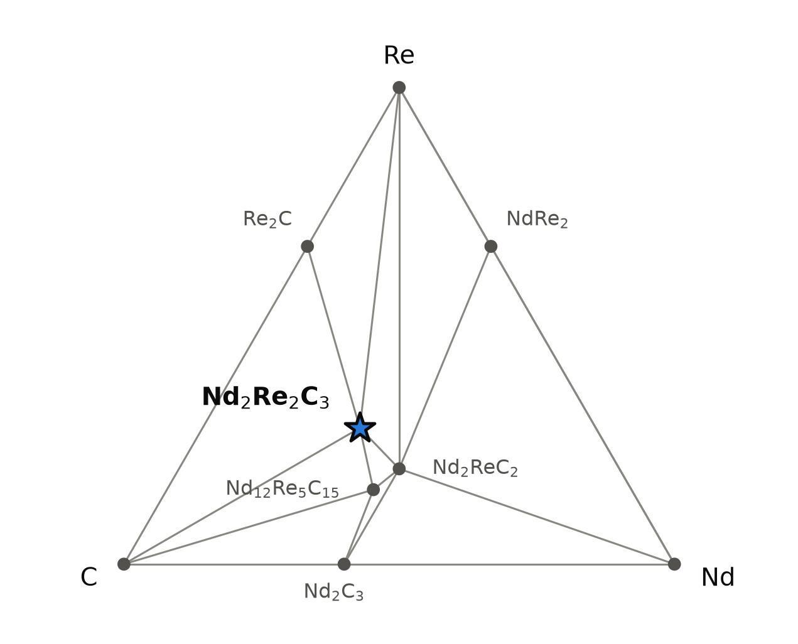
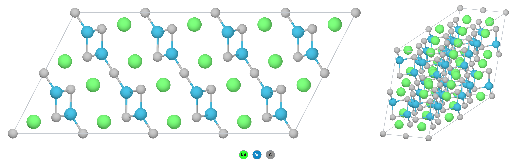

# Nd₂Re₂C₃ — a rhenium member of the Er₂Mo₂C₃-type carbides, computed but not reported

*A Material a Day · entry 28 · 16 November 2026 · status: **predicted, no report found***

> **In one paragraph.** Nd₂Re₂C₃ is a ternary carbide of neodymium and rhenium. In the
> Alexandria database it takes the monoclinic Er₂Mo₂C₃ structure (C2/m): ReC₄ tetrahedra
> share edges into chains, the chains share corners into [Re₂C₃] layers, and layers of
> neodymium separate them. The type is reported for molybdenum (R₂Mo₂C₃ with R = Ce,
> Gd–Tm, Lu); the closely related Ho₂Cr₂C₃ type is reported for the chromium carbides and
> Sm₂Mo₂C₃. The rhenium carbides reported for the rare earths, Nd₂ReC₂ among them, have a
> different composition and structure. We found no report of a rhenium member of either
> type, or of Nd₂Re₂C₃ itself. The two PBE tables used here disagree in sign: with the
> series' reference settings it lies on the Nd–Re–C hull, 26 meV/atom below its
> competitors; with Materials-Project settings it is 5 meV/atom above them. Both numbers
> are far smaller than the ~70 meV/atom scatter of computed carbide energies against
> calorimetry, so the calculation cannot say whether it forms. For the measured neighbour
> Nd₂ReC₂ the computed cell is within 0.5 % of experiment. If the compound forms, the
> route used for its relatives applies directly: arc-melt the elements under argon, then
> anneal (850–900 °C for the chromium carbides and for R₂ReC₂, 1450 °C for Gd₂Mo₂C₃). Two
> alternative structures were not computed with DFT for this composition: the Ho₂Cr₂C₃
> type, which lies 24 and 33 meV/atom higher for the La and Pm analogues, and the P2₁/c type
> of Pr₂Mo₂C₃. The computed compound is a magnetic metal.

Computed numbers come from the Alexandria database unless another tool is named.
Measured numbers carry a reference.

## 1. Identity

| | computed (PBE) | measured |
|---|---|---|
| Formula | Nd₂Re₂C₃ (database spelling the same) | — |
| Alexandria id | `agm003305506` | — |
| Space group | C2/m (no. 12), Z = 2 | — |
| Cell (Å, °) | a 12.121, b 3.321, c 5.873, β 117.21 | — |
| Volume per formula unit (ų) | 105.1 | — |
| Density (g cm⁻³) | 11.01 | — |
| Structure type | Er₂Mo₂C₃ type; prototype label A2B2C3_mC14_12_i_i_ai (Nd 4i, Re 4i, C 2a + 4i), a label the Ho₂Cr₂C₃ type shares | — |
| Formation energy | −0.234 eV/atom (PBE) · −0.194 eV/atom (Materials-Project settings) | — |
| Magnetism | ferromagnetic in the calculation, 3.06 μB on each Nd, −0.09 μB on Re | — |

The CIF is [`Nd2Re2C3.cif`](Nd2Re2C3.cif). No Wikipedia page on this compound or its
structure type was found.

**Why "Er₂Mo₂C₃ type".** The review of these carbides [7] (full text) separates two
closely related C2/m types of composition A₂T₂C₃: Ho₂Cr₂C₃ and Er₂Mo₂C₃. They have the same
order of the rare-earth and transition-metal atoms, but one of the carbon positions of
the molybdenum compounds is empty in Ho₂Cr₂C₃. The database files both under one prototype label,
so the label does not decide. In the stored structures the difference shows directly:
the lone carbon sits on 2c in Ho₂Cr₂C₃ (`agm003258571`) and on 2a in Ho₂Mo₂C₃
(`agm003258375`). We compared Nd₂Re₂C₃ with both by structure matching, with the elements
made anonymous: it matches the Ho₂Mo₂C₃ entry and not the Ho₂Cr₂C₃ one. Its carbon is on
2a and its β angle of 117° is close to the 111–113° of the molybdenum compounds, far from
the 106° of the chromium ones. In both types the transition metal has four carbon
neighbours, and one carbon sits linearly between two transition-metal atoms.

What is reported in each type, according to [7]: Ho₂Cr₂C₃ type, R₂Cr₂C₃ with R = Y, Gd–Lu,
and Sm₂Mo₂C₃; Er₂Mo₂C₃ type, R₂Mo₂C₃ with R = Ce, Gd–Tm, Lu; Pr₂Mo₂C₃, a third type of its
own (space group no. 14). No Nd₂Mo₂C₃ is listed, and no rhenium compound of composition
A₂T₂C₃ appears in any of the review's types. The rhenium carbides of the rare earths it
lists are R₂ReC₂ (R = Y, Ce–Nd, Sm, Gd–Tm, Lu), in the orthorhombic Pr₂ReC₂ type [1, 7].

### The nearest measured compounds

Nd₂Re₂C₃ has no measured data. The calibration is therefore against its relatives in
both A₂T₂C₃ types and against Nd₂ReC₂, the measured carbide of the same three elements:

| compound | measured a, b, c (Å), β (°) | computed (PBE), same order | difference |
|---|---|---|---|
| Nd₂ReC₂, Pnma [1] | 6.651(1), 5.305(1), 10.146(2) | 6.623, 5.334, 10.121 (`agm003226711`) | −0.4, +0.5, −0.2 %; volume −0.1 % |
| Gd₂Mo₂C₃, Er₂Mo₂C₃ type [6] | 11.870(2), 3.3575(6), 5.756(1), 113.11(1) | 11.881, 3.366, 5.773, 113.4 (`agm003258566`) | +0.1, +0.3, +0.3 %, +0.3° |
| Ho₂Mo₂C₃, Er₂Mo₂C₃ type [4] (COD 1521828) | 11.616, 3.3203, 5.6613, 111.603 | 11.663, 3.323, 5.712, 112.2 (`agm003258375`) | +0.4, +0.1, +0.9 %, +0.6° |
| Er₂Mo₂C₃, Er₂Mo₂C₃ type [7] | 11.559, 3.309, 5.637, 111.3 | 11.631, 3.314, 5.711, 112.2 (`agm003258374`) | +0.6, +0.2, +1.3 %, +0.9° |
| Ho₂Cr₂C₃, Ho₂Cr₂C₃ type [7] | 10.470, 3.365, 5.540, 106.3 | 10.342, 3.400, 5.558, 105.6 (`agm003258571`) | −1.2, +1.0, +0.3 %, −0.7° |
| Y₂Cr₂C₃, Ho₂Cr₂C₃ type [7] | 10.472, 3.392, 5.549, 106.27 | 10.396, 3.391, 5.559, 105.9 (`agm003258563`) | −0.7, 0.0, +0.2 %, −0.4° |
| Yb₂Cr₂C₃, Ho₂Cr₂C₃ type [3] | 10.493(8), 3.307(3), 5.483(4), 106.96(7) | 10.244, 3.451, 5.505, 106.0 (`agm003258574`) | −2.4, +4.4, +0.4 %, −1.0° |
| Pr₂Mo₂C₃, own type, no. 14 [5] | 5.9799, 6.6515, 11.856, 111.631 | 5.968, 6.616, 11.627, 110.5 (`agm005270643`) | −0.2, −0.5, −1.9 %, −1.1° |

- **Nd₂ReC₂ is the closest test, and it passes.** All three axes are within 0.5 % and the
  volume within 0.1 %, in a compound with the same Nd 4f shell and Re–C bonds as the
  target.
- **The Er₂Mo₂C₃-type molybdenum carbides** come out within 1.3 %, usually a little long,
  as PBE does. **The chromium carbides** are within 1.2 %, except Yb₂Cr₂C₃: its b axis
  comes out 4.4 % long. Its measured effective moment, 3.5 μB, is well below the 4.54 μB
  of Yb³⁺, which the authors of [3] take as a hint of intermediate valence, although its
  cell volume shows no anomaly; the stored calculation does not capture either.
- **The right type, where both are stored.** For three molybdenum carbides the database
  holds both A₂T₂C₃ types, and PBE puts the measured one lower each time: Er₂Mo₂C₃ type
  for Er₂Mo₂C₃ (by 21 meV/atom) and Ce₂Mo₂C₃ (by 36), Ho₂Cr₂C₃ type for Sm₂Mo₂C₃ (by 18).
  Ce and Sm both carry the 4f caveat. For Pr₂Mo₂C₃, the third type that experiment
  finds and the Er₂Mo₂C₃ type are within 0.1 meV/atom of each other in PBE.
- **The light rare earth breaks the pattern.** Pr₂Mo₂C₃ is not C2/m: [5, 7] report a
  third monoclinic structure, with Z = 4, in which tetramers of MoC₄ tetrahedra build a
  three-dimensional framework instead of layers. Its computed cell comes out up to 1.9 %
  short, which is unusual for PBE and points to the treatment of the open 4f shell of Pr.
  Nd sits next to Pr, so this bears directly on Nd₂Re₂C₃ (section 8). The Nd₂ReC₂ result
  shows that the same 4f treatment can still give the right cell.

## 2. Where it sits

<picture>
  <source media="(prefers-color-scheme: dark)" srcset="phase_diagram_dark.png">
  
</picture>

The Nd–Re–C triangle at 0 K (PBE table). Nine phases are on the hull of the system:
the three elements, Nd₂C₃, NdRe₂, Re₂C and three ternaries, Nd₂ReC₂, Nd₁₂Re₅C₁₅
(database spelling Nd12(ReC3)5) and Nd₂Re₂C₃. Nd₂Re₂C₃ shares tie lines with graphite,
Re, Re₂C, Nd₂ReC₂ and Nd₁₂Re₅C₁₅.

| | PBE (`energy_runs_pbe`) | Materials-Project settings (`energy_runs_pbe_mp`) |
|---|---|---|
| Nd₂Re₂C₃ | on the hull, **26.5 meV/atom** below its competitors | **5.2 meV/atom above** the hull |
| competing assemblage | — | 0.571 Re₂C + 0.143 Nd₂ReC₂ + 0.143 Nd₁₂Re₅C₁₅ (per 7 atoms) |
| other polymorphs | none stored | none stored |
| carbide scatter against calorimetry | median offset −155 meV/atom, median absolute deviation 70 meV/atom, n = 12 (survey on this table) | — |

**The two tables disagree in sign, and the disagreement is smaller than the error.** The
reaction tools used for routes in section 6 work on the Materials-Project table, where
Nd₂Re₂C₃ is 5 meV/atom above its competitors; every route there ends in that
competing assemblage rather than in the target, by exactly that margin. No SCAN or
PBEsol entry exists for it.

**Neighbours that are known.** Nd₂ReC₂ is a reported compound: [2] (abstract) gives
its magnetic order, antiferromagnetic with T_N = 42 ± 2 K, in the orthorhombic
Pr₂ReC₂ type [1]. Nd₂C₃ and the binary Nd and Re phases are textbook compounds. We did
not search for Nd₁₂Re₅C₁₅ and make no claim about it.

## 3. Structure

*Left: two by two cells viewed along the short b axis (3.32 Å). Right: an oblique view.
Nd green, Re blue, C grey. Only Re–C bonds shorter than 2.2 Å are drawn.*

| site | Wyckoff | x, y, z | neighbours (Å) |
|---|---|---|---|
| Nd | 4i | 0.606, 0, 0.805 | 5 C: 2.476, 2.585 ×2, 2.657 ×2; then 3 Re at 3.25, 3 Nd at 3.32 |
| Re | 4i | 0.841, 0, 0.680 | 4 C: 1.987 (C1), 2.088 ×2, 2.146 (C2); 2 Re at 2.792 |
| C1 | 2a | 0, 0, 0 | 2 Re at 1.987 (linear) + 4 Nd at 2.657: an octahedron |
| C2 | 4i | 0.750, 0, 0.269 | 3 Re (2.088 ×2, 2.146) + 3 Nd (2.476, 2.585 ×2): a distorted octahedron |

- **Rhenium has four carbon neighbours** in a strongly flattened tetrahedron: five
  C–Re–C angles between 97° and 105° and one of 147°. Two of the four carbons lie
  half a b-translation above and below, so each ReC₄ unit shares edges with the next
  one along b.
- **[Re₂C₃] layers.** Two Re atoms and two C2 atoms form a rhomb (Re–Re 2.79 Å across
  it); these rhombs stack along b into chains of edge-sharing ReC₄ tetrahedra. The C1
  atom sits on an inversion centre and joins neighbouring chains through two collinear
  Re–C bonds of 1.99 Å, the shortest in the structure. With a Re–C cutoff of 2.25 Å the
  connected network is two-dimensional: layers, seen edge-on along b as the zig-zag
  strings in the picture, separated by layers of neodymium. This is how [7] describes
  the polyanionic layers of the Ho₂Cr₂C₃ and Er₂Mo₂C₃ types.
- **Every carbon is isolated.** The shortest C–C distance is 3.17 Å: there are no C₂
  pairs, unlike NdC₂ or Nd₂C₃. Counting Nd³⁺ and C⁴⁻ leaves rhenium as Re(III), so the
  layers can be written as a carbometalate anion [Re₂C₃]⁶⁻. The review [7] writes the
  chromium and molybdenum members the same way, Ho₂[Cr₂C₃] and Er₂[Mo₂C₃] with T(III).
- **Rhenium in an unusual place.** In the carbometalates collected in [7], rhenium has
  five carbon neighbours (UReC₂, U₅Re₃C₈), four in a square (U₅Re₃C₈), or three in a
  flattened triangle in R₂ReC₂, where it is formally Re(II), with Re–C bonds of
  1.93–2.03 Å measured in Er₂ReC₂ [1], against 1.99–2.15 Å computed here. Tetrahedral
  TC₄ in A₂T₂C₃ layers is known only for Cr and Mo. The review notes that, among the A₂TC₂ carbides,
  the carbon coordination number and the dimensionality of the polyanion fall as the
  transition metal gets more d electrons (Mo → Re → Ir). A tetrahedral Re(III) layer
  would run against that trend. The Re–Re distance of 2.79 Å compares with Cr–Cr 2.65 Å
  in Y₂Cr₂C₃ [7]; the review finds T–T bonding in these anions when T has fewer than five
  d electrons left, which Re(III), d⁴, satisfies.
- **Charges.** Bader charges are +1.38 (Nd), +0.60 (Re) and −1.33 (C); DDEC6 gives
  +1.11, +0.33 and −0.96. Rhenium is far from +3 in either partition, as usual for
  a carbide in which the metal–carbon bonds are covalent.
- **Calculated powder lines** (Cu Kα, strongest): 35.01° (111, 100 %), 35.46° (31-1, 79),
  33.24° (400, 37), 34.34° (002, 34), 54.42° (31-3, 32), 30.94° (11-1, 32). The 20-1
  line at 17.42° (16 %) is the lowest-angle one and a quick fingerprint of the
  monoclinic cell.

**The family in the database.** Under this prototype label the PBE table holds R₂Re₂C₃
for 22 metals. On the PBE hull, with the depth of the lowest entry below competitors in
meV/atom: Ce 57, Np 56, Pa 56, Pr 46, Er 43, Pu 42, Tb 38, Dy 34, Ho 34, Yb 33, Pm 28,
Th 27, Nd 26, Lu 26, Tm 24, Y 22, Sm 15, U 8, Sc 3. Above it: La 15, Zr 42, Ac 68. With
Materials-Project settings the same nineteen are on the hull except Pr (15 above) and Nd
(5 above). So the light lanthanides are where the two tables part, and where the
measured molybdenum series changes structure. For Ce, Pr, Sm and Yb a single table is
not enough because of their 4f treatment; we did not run the cross-table check on them.
We classified the lowest entry for La, Pr, Nd, Sm and Y: all are of the Er₂Mo₂C₃ type.
For six rare earths the table also holds R₂Re₂C₃ in the Ho₂Cr₂C₃ type, and it is always
higher: La by 24, Sm 20, Pm 33, Dy 58, Ho 64, Er 68 meV/atom. For Nd that structure
is not stored.

## 4. Computed properties

Neodymium has an open 4f shell, which PBE handles badly. For the electronic response we
quote the f-free La analogue, La₂Re₂C₃ in the same structure (`agm003305506` vs
`agm003305505`), and say which is which. Y₂Re₂C₃ (`agm003307754`) is given where it
helps.

**Electronic structure.** A metal in every calculation: PBE gap zero for Nd₂Re₂C₃ and for
La₂Re₂C₃ and Y₂Re₂C₃; the machine-learned TB-mBJ gap (tuga-sp) is 0.01 eV for the Nd
compound and 0.13 eV for the La one, i.e. zero within its error. The density of states
at the Fermi level stored in the database is 3.83 for Nd₂Re₂C₃, 2.35 for La₂Re₂C₃ and
3.03 for Y₂Re₂C₃ (as stored, in the database's units). The Nd value includes
4f states placed by PBE and should not be read as an itinerant density of states; the La
and Y values are the better guide. Gap, dielectric and Seebeck quantities do not apply
to a metal and are not quoted.

**Magnetism.** The stored calculation is ferromagnetic with 3.06 μB per Nd and a small
opposite moment on Re (−0.09 μB), close to the spin moment of three 4f electrons. Only
that one arrangement was computed. The measured relatives point the other way. Nd₂ReC₂
orders antiferromagnetically at 42 K [2]. In the chromium carbides of the Ho₂Cr₂C₃ type
[3] (full text) the Cr atoms carry no moment: Y₂Cr₂C₃ and Lu₂Cr₂C₃ are Pauli
paramagnets. The rare-earth members have effective moments slightly below those of the free R³⁺ ions,
and those with R = Gd–Er order antiferromagnetically, with Néel temperatures of 48 (Gd),
50 (Tb), 23 (Dy), 10 (Ho) and 7 K (Er); Tb to Er show metamagnetism. The stored Ho₂Cr₂C₃
calculation has the same pattern as this one, a ferromagnet with 3.6 μB on Ho and
−0.11 μB on Cr. The small transition-metal moment agrees with experiment; the
ferromagnetic order does not. For Nd₂Re₂C₃, a ferromagnetic ground state should
therefore not be assumed.

**Mechanical (machine-learned, tuga-sp, from the stored structure).**

| | Nd₂Re₂C₃ | La₂Re₂C₃ (analogue) |
|---|---|---|
| Bulk modulus (GPa) | 146 | 131 |
| Shear modulus (GPa) | 86 | 89 |
| Young's modulus (GPa) | 214 | 206 |

Screening estimates from a graph network, not DFT elastic constants. A carbide of this
kind is stiff but well below the hard transition-metal carbides; the ratio of shear to
bulk modulus (0.59) is on the brittle side of the usual 0.57 dividing line.

**Electron–phonon coupling (machine-learned, screening only).** tuga-sp gives λ ≈ 0.46,
ω_log ≈ 217 K and Tc ≈ 0.1 K for Nd₂Re₂C₃, and λ ≈ 0.50, ω_log ≈ 219 K, Tc ≈ 0.3 K for
La₂Re₂C₃. Read as "no superconductivity worth looking for above a fraction of a
kelvin"; the Nd number also ignores the 4f moments, which would suppress it further.
For comparison, the rhenium carbides Y₂ReC₂ and Lu₂ReC₂ showed no superconducting
transition down to 2 K [1].

**Not computed.** Phonons and electron–phonon coupling with DFT (no entry for this
compound, or for La₂Re₂C₃, in the group's DFPT calculations); dielectric and transport
tables (metal); any magnetic order other than the stored ferromagnet; spin–orbit
coupling, which matters for rhenium.

## 5. Is it stable?

| | value | how to read it |
|---|---|---|
| depth below competitors, PBE | 26.5 meV/atom | on the hull |
| distance above hull, Materials-Project settings | 5.2 meV/atom | just above |
| carbide scatter (DFT vs calorimetry, Materials-Project table) | median offset −155, MAD 70, 90th percentile 254 meV/atom (n = 12) | the error bar for any carbide margin |
| margin at 1300 K, Materials-Project scale | 20.8 meV/atom above competitors (range 20.7–20.8), phonon scatter 26 | heating does not help on that scale |

- **Not resolved.** Both margins, +26 and −5 meV/atom, are smaller than the 70 meV/atom
  scatter of the carbide class. Neither table can say whether Nd₂Re₂C₃ forms. No
  measured formation enthalpy exists for any phase of the Nd–Re–C system in the
  survey, so the class number is the only error bar available.
- **The class offset does not help in a known direction.** Carbides carry a median
  offset of about 155 meV/atom between computed and measured formation enthalpies, but
  the competitors here (Re₂C, Nd₂ReC₂, Nd₁₂Re₅C₁₅) are carbides too, and an offset
  common to all of them cancels in the margin. What does not cancel is unknown.
- **At temperature** (`hull_at_T`, Materials-Project scale only): 7.5 meV/atom above the
  competitors at 300 K, 16.8 at 1000 K, 20.8 at 1300 K, 25.4 at 1600 K, with a
  vibrational scatter of 17–26 meV/atom for 4f compounds. The competing assemblage
  changes from 0 K to Re + Re₂C + Nd₁₂Re₅C₁₅. On this scale the target does not come
  down with temperature. The same calculation is not available on the PBE table.
- **Phonons not computed**, so dynamical stability of the stored structure is not
  known.
- **The family.** Nineteen R₂Re₂C₃ in this structure are on the PBE hull, most of them
  deeper than Nd₂Re₂C₃ (section 3). That a whole column is on the hull is at least
  consistent with a real structure type, and the type is real for Mo.

## 6. How to make it

**Routes on the hull (Materials-Project table, R6 order: fewest reagents, then least
driving force).** Because the target sits 5.2 meV/atom above that hull, every route
below runs downhill to the competing assemblage, not to Nd₂Re₂C₃; the energies are to
the target composition.

| route | ΔE (meV/atom of mixture) | note |
|---|---|---|
| 2 Re + Nd₂C₃ | −75.9 | rank 1, two reagents |
| 0.5 Re₂C + NdC | −96.9 | pair from slightly metastable phases; uses a competitor |
| 2 Nd + 2 Re + 3 C | −194.1 | the elements: what arc melting does |
| Re + C + Nd₂ReC₂ | −5.3 | starts from a competitor |

**In practice.** Every measured relative was made from the elements by arc melting,
followed by an anneal at temperatures that differ by 600 K:

| compound | published preparation |
|---|---|
| R₂ReC₂, including Nd₂ReC₂ [1] | cold-pressed pellets of the elements arc-melted under argon; wrapped in Ta foil and annealed 1–3 weeks at 900 °C in evacuated silica tubes. Single crystals of Er₂ReC₂ came from an arc-melted ingot annealed just below its melting point in a high-frequency furnace |
| R₂Cr₂C₃, R = Y, Gd–Tm, Lu [3] | same arc melting; Ta foil, evacuated silica, 2 weeks at 850 °C |
| Yb₂Cr₂C₃ [3] | not by arc melting (Yb evaporates); from the elements in a lithium flux, Yb : Cr : C : Li = 2 : 2 : 3 : 30, sealed in iron under argon, 24 h at 800 °C, cooled at 8 K/h, Li dissolved in ethanol |
| Gd₂Mo₂C₃ [6] | arc melting under argon; 72 h at 1723 K (1450 °C) under flowing argon, cooled at 150 K/h |
| Pr₂Mo₂C₃ [5] | arc melting; anneal in sealed Mo ampoules at 1500 °C |

The same procedure for Nd₂Re₂C₃ is the obvious first try: 2 Nd : 2 Re : 3 C, arc-melted
on a water-cooled copper hearth under argon, turned and remelted, then annealed. The
Nd₂ReC₂ recipe (900 °C) and the Gd₂Mo₂C₃ recipe (1450 °C) bracket the anneal. The
lithium-flux route is a second option, at a much lower temperature, if Nd is lost in the arc.

**What the Nd–Re–C samples of [1] showed.** Samples weighed out as R : Re : C = 3 : 2 : 3
gave R₂ReC₂ with elemental rhenium and occasionally the rare-earth subcarbides R₃Cₓ
(x ≈ 1) as second and third phases; energy-dispersive analysis of the ternary carbide
agreed with R₂ReC₂. No rhenium-richer ternary carbide is reported. That composition lies on
the line from Re to Nd₂ReC₂, so it does not test Nd₂Re₂C₃ (2 : 2 : 3), which sits on the
carbon-rich side of that line.

- **Window, low end.** Tammann temperatures (half the melting point): Nd 649 K, Re
  1730 K, graphite 1900 K. Laboratories fire charges with these melting points at about
  1755 ± 223 K. A solid-state reaction of Re with Nd₂C₃ powders would need the Re
  lattice to move, i.e. above ~1730 K; Nd₂C₃ has no melting point on file.
- **Window, high end.** Nd melts at 1297 K (twice its Tammann temperature), so in a
  powder route the Nd-bearing reagent is liquid long before rhenium reacts; arc melting
  sidesteps this by melting everything. The published anneals, 1173 K for Nd₂ReC₂ [1]
  and 1723 K for Gd₂Mo₂C₃ [6], span the range to try. The lower one is below the
  Tammann temperature of Re: after arc melting, the anneal only has to order a solid
  that is already mixed.
- **Composition window** (0 K, Materials-Project table, within 25 meV/atom of the best
  margin): carbon and rhenium may be in excess (open on the rich side; graphite and Re
  share tie lines with the target in PBE), but Nd is bounded on both sides, within a
  265 meV-wide window of its chemical potential. Neodymium lost by evaporation during
  arc melting is the likely way to miss.
- **Container and atmosphere.** Nd₂Re₂C₃ reacts with oxygen (−737 meV/atom), CO₂
  (−647), water (−364) and nitrogen (−308 meV/atom, to NdN), so everything is done
  under argon. Among crucible metals, Ta (−140), Nb (−127) and W (−27) take carbon from
  it, and so does Mo (−25 meV/atom, to Mo₂C + Re₂C + Nd₂ReC₂): the sealed Mo ampoule
  used for Pr₂Mo₂C₃ [5] would be attacked slowly. In practice the R₂ReC₂ and R₂Cr₂C₃
  ingots were annealed wrapped in Ta foil at 850–900 °C [1, 3], and neither paper
  reports a reaction with the foil, so at those temperatures the computed driving force
  is evidently slow to act. MgO, CaO, Y₂O₃ and copper come out
  at −3 to −5 meV/atom, which is the target's own 5 meV/atom margin above the hull on
  this table: effectively inert. Al₂O₃ (−139), SiO₂ (−313), ZrO₂ (−194) and BN (−28) react.
- **Metathesis, tested and failing on this table.**
  2 NdCl₃ + 6 Li + 2 Re + 3 C → 6 LiCl + (Re₂C + Nd₂ReC₂ + Nd₁₂Re₅C₁₅), −265 meV/atom;
  2 NdF₃ + 3 Ca + 2 Re + 3 C → 3 CaF₂ + the same assemblage, −249 meV/atom;
  2 NdCl₃ + 3 CaC₂ + 2 Re → 3 CaCl₂ + Re₂C + Nd₁₂Re₅C₁₅ + 2.9 C, −253 meV/atom.
  The first two are clean salt-plus-target compositions and the salts coexist with the
  products (LiCl, CaF₂), so they fail only by the target's 5 meV/atom margin on this
  table; on the PBE table they would end in Nd₂Re₂C₃. The CaC₂ charge carries too much
  carbon. None offers anything arc melting does not, and the salt would be a further
  impurity.
- **Reservoir routes** were not run: closed routes exist.
- **Reading the powder pattern.** Re₂C or Re lines mean the charge lost neodymium;
  Nd₂ReC₂ (orthorhombic, a 6.651, b 5.305, c 10.146 Å [1]) or an unindexed Nd-rich
  carbide (the computed Nd₁₂Re₅C₁₅) means too much neodymium or the target decomposing;
  graphite means excess carbon, which the target tolerates; Nd₂O₃ means oxygen got in.
  A C2/m cell with β near 105° rather than 117° would be the Ho₂Cr₂C₃ type (computed for
  the La and Pm analogues with a ≈ 11.1 Å); a cell like that of Pr₂Mo₂C₃ (strongest lines
  not at 35.0° and 35.5°) would be the third type. For both, see section 8.
- **Handling.** Ingots of R₂ReC₂ deteriorate slowly in air and their powders within a
  few hours [1]; among the chromium carbides only Yb₂Cr₂C₃ was reported to be sensitive
  to moist air [3]. Treat Nd₂Re₂C₃ powder as air-sensitive and store it under argon or
  vacuum.
- **Hazards.** Neodymium metal and fine rhenium powder burn in air; rare-earth carbides
  hydrolyse in moist air, releasing hydrocarbons. Rhenium is not regarded as
  significantly toxic. Nothing here is radioactive.

## 7. What it is good for

Nothing has been reported, so this is about what the compound could be used to study:

- **A step from group 6 to group 7** in the A₂T₂C₃ carbometalates. These are known
  only for Cr and Mo [7]; rhenium so far forms R₂ReC₂, with three carbon neighbours
  [1]. If it can be made, Nd₂Re₂C₃ would show whether tetrahedral [T₂C₃] layers survive
  one more d electron at the same formal oxidation state.
- **A gap in the molybdenum series.** No Nd₂Mo₂C₃ is listed in [7], although Ce, Pr and
  Sm members are; the PBE table puts Er₂Mo₂C₃-type Nd₂Mo₂C₃ on its hull by 16 meV/atom.
  The neodymium compounds of both metals are open questions of the same kind.
- **Magnetism of a rare-earth sublattice in a metallic carbide.** The chromium members
  order antiferromagnetically with a non-magnetic Cr sublattice [3], and the Ho and Er
  molybdenum members have published magnetic structures [4] (title read). A Nd member
  would add a light lanthanide.

No application is claimed.

## 8. How this could be wrong

1. **The margin is below the error.** +26 and −5 meV/atom against a carbide scatter
   of 70 meV/atom (section 5). Either answer is consistent with the calculation.
2. **Two competing structures were not computed with DFT for this composition.** The
   Ho₂Cr₂C₃ type, which Sm₂Mo₂C₃ adopts [7], is not stored for Nd₂Re₂C₃. For the
   neighbours on either side it lies 24 (La) and 33 meV/atom (Pm) above the Er₂Mo₂C₃ type,
   and PBE picked the measured one of these two types in all three molybdenum cases
   where both are stored (section 1). That is the weaker of the two worries. The
   light-rare-earth molybdenum member Pr₂Mo₂C₃ takes a third structure (no. 14, not C2/m)
   [5, 7], and PBE puts it and the Er₂Mo₂C₃ type within 0.1 meV/atom of each other.
   Nd₂Re₂C₃ in that structure is not in the database. We relaxed both structures with the group's machine-learned potential
   (TugaFF, trained on PBE): for Nd₂Re₂C₃ the C2/m cell came out 11.6 meV/atom lower
   than the P2₁/c one. The same potential puts C2/m Pr₂Mo₂C₃ 4.9 meV/atom below the
   P2₁/c structure that experiment finds, so it misorders the measured case by about
   5 meV/atom, and its stated error is about 9 meV/atom. The ordering for Nd₂Re₂C₃ is
   therefore suggestive, not settled; a PBE relaxation of the P2₁/c structure is the
   cheapest next check.
3. **The 4f shell and the magnetic order.** PBE treats the Nd 4f electrons as band
   states and only a ferromagnetic arrangement was computed, while the measured Nd₂ReC₂
   and the R₂Cr₂C₃ carbides are antiferromagnetic. The computed Pr₂Mo₂C₃ cell is 1.9 %
   short along c, which may be the same 4f problem; the Nd₂ReC₂ cell, by contrast, is
   right to 0.5 %.
4. **Unknown competitors.** The hull holds only what was computed; a reported Nd–Re–C
   phase missing from the database, or Nd₁₂Re₅C₁₅ (a computed phase we did not check
   against the literature) being wrong, would move the margin either way.
5. **Phonons not computed.** The stored C2/m structure may be dynamically unstable.
6. **Favourable is not fast.** Every energy is 0 K thermodynamics, and the margin at
   1300 K on the Materials-Project scale is worse than at 0 K.
7. **Literature.** The 1990 survey of rare-earth rhenium carbides [1] and the 2007
   review of carbometalates [7], read in full, report no A₂Re₂C₃ and no Nd–Re–C carbide
   other than Nd₂ReC₂. The review is a snapshot of 2007; for later work there are only
   the searches of section 9. A structural-database check by a person is owed.

## 9. Literature

**Searches** (OpenAlex, Crossref, arXiv; OpenAlex refused most queries with a rate
limit, so most results are from Crossref):

| query | hits | relevant |
|---|---|---|
| Nd2Re2C3 | 0 | — |
| Nd2Re2C3 carbide | 8 | none |
| Ln2Re2C3 | 0 | — |
| rare earth rhenium carbides Ln2Re2C3 crystal structure | 10 | [1], [2] (other compounds) |
| ternary rare earth rhenium carbides R2Re2C3 monoclinic | 10 | [1] |
| neodymium rhenium carbide | 10 | Nd–Re binary data; Er₂ReC₂ bonding [8] |
| Y2Re2C3 OR U2Re2C3 OR Th2Re2C3 carbide crystal structure | 9 | none |
| uranium rhenium carbide U2Re2C3 phase | 8 | none |
| rhenium carbide rare earth Ln2Re2C3 carbometalate | 10 | none |
| Nd-Re-C ternary system phase equilibria carbides | 8 | none |
| Ho2Cr2C3 type structure ternary carbides | 10 | [3] |
| rare earth molybdenum carbides Ln2Mo2C3 | 8 | none |
| Jeitschko Behrens ternary carbides Ho2Cr2C3 UCr4C4 | 6 | U–Re–C: U₅Re₃C₈ (other compound) |
| titles of [4], [5], [6], [7] | — | found |

We also searched the COD for every ternary of a rare earth or actinide with Cr, Mo, W or
Re and carbon. It holds Ho₂Mo₂C₃, Er₂Mo₂C₃, Gd₂Mo₂C₃ and Pr₂Mo₂C₃, among others, and
no R₂Re₂C₃.

**Result.** No report of Nd₂Re₂C₃, or of any rhenium carbide in the Er₂Mo₂C₃ or Ho₂Cr₂C₃
type, was found. The 2007 review [7], which tabulates the known ternary rare-earth and
actinide carbides with isolated carbon by structure type, lists no rhenium member of
composition A₂T₂C₃. The 1990 study of the R–Re–C systems [1] reports only R₂ReC₂ as a
ternary phase. That is a statement about these sources and searches; the older
German-language literature on ternary carbides is only partly indexed, and later work
was covered by searches alone.

**References**

1. W. Jeitschko, G. Block, G. E. Kahnert, R. K. Behrens, *Pr₂ReC₂ and other ternary rare
   earth metal rhenium carbides with filled PbCl₂ (Co₂Si) structure*, J. Solid State Chem.
   89, 191 (1990).
   https://doi.org/10.1016/0022-4596(90)90311-k. *Full text read.*
2. M. H. Gerdes, W. Jeitschko, K. H. Wachtmann, *Gd₂OsC₂, a soft ferromagnet with a
   surprisingly high Curie temperature and other rare-earth osmium and rhenium carbides
   with Pr₂ReC₂ type structure*, J. Mater. Chem. (1997).
   https://doi.org/10.1039/a703759g. *Abstract read* (Nd₂ReC₂: T_N = 42 ± 2 K).
3. K. Zeppenfeld, R. Pöttgen, M. Reehuis et al., *Preparation of Yb₂Cr₂C₃ and magnetic
   properties of the carbides R₂Cr₂C₃ (R = Y, Gd–Lu) with Ho₂Cr₂C₃-type structure*,
   J. Phys. Chem. Solids 54, 257 (1993). https://doi.org/10.1016/0022-3697(93)90317-k.
   *Full text read.*
4. M. Reehuis, M. H. Gerdes, B. Ouladdiaf, W. Jeitschko, N. Stüsser, *Crystal and
   magnetic structures of the ternary carbides Ho₂Mo₂C₃ and Er₂Mo₂C₃*, J. Magn. Magn.
   Mater. 195, 657 (1999). https://doi.org/10.1016/s0304-8853(99)00155-9.
   *Metadata only*; measured cells from its COD records 1521828 and 1521829
   (http://www.crystallography.net/cod/1521828.html).
5. E. Dashjav, G. Kreiner, W. Schnelle, F. R. Wagner, R. Kniep, *Carbomolybdate(III):
   Zur Kenntnis von Pr₂[Mo₂C₃] sowie Strukturbeziehungen zu Er₂Mo₂C₃*, Z. Anorg. Allg.
   Chem. 630, 2277 (2004). https://doi.org/10.1002/zaac.200400282. *Abstract read*
   (synthesis, P2₁/c cell, Mo(III) in tetrahedral carbon coordination); COD 1536264.
6. E. Dashjav, W. Schnelle, G. Kreiner, R. Kniep, *Crystal structure of digadolinium
   tricarbomolybdate(III), Gd₂[Mo₂C₃]*, Z. Kristallogr. NCS 220 (2005).
   https://doi.org/10.1524/ncrs.2005.220.14.139. *Abstract read*, including the
   preparation (COD 8102897).
7. E. Dashjav, G. Kreiner, W. Schnelle et al., *Ternary rare earth and actinoid
   transition metal carbides viewed as carbometalates*, J. Solid State Chem. 180, 636 (2007).
   https://doi.org/10.1016/j.jssc.2006.11.019. *Full text read.*
8. H. Deng, R. Hoffmann, *Rhenium–carbon bonding in erbium rhenium carbide (Er₂ReC₂),
   an organometallic polymer in the solid state*, Inorg. Chem. (1993).
   https://doi.org/10.1021/ic00062a019. *Metadata only.*

## 10. Provenance

- Structure, energies, charges and densities of states: Alexandria database,
  `energy_runs_pbe` (PBE, MatPES settings) and `energy_runs_pbe_mp` (PBE,
  Materials-Project settings).
- Routes, contact, firing window, margins at temperature, calorimetric scatter: the
  group's reaction-graph tools, which work on the `energy_runs_pbe_mp` hull.
- Elastic moduli, machine-learned gap and electron–phonon numbers: tuga-sp. Structure
  comparison of C2/m and P2₁/c: TugaFF relaxations.
- Pictures: POV-Ray from the stored structure; phase diagram from the PBE hull.
- Drafted by Claude (Anthropic) and reviewed by a person before publication.
