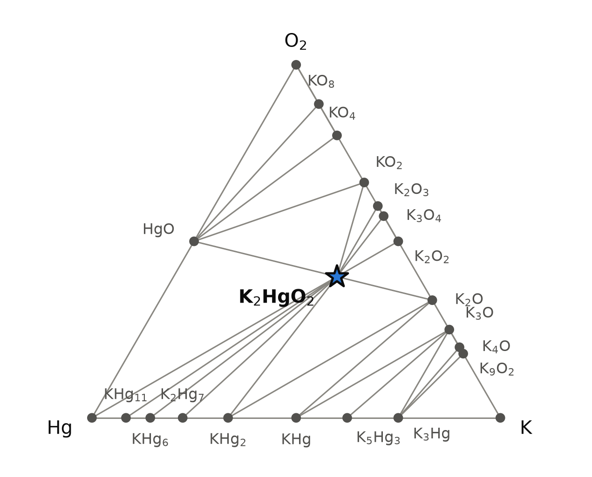
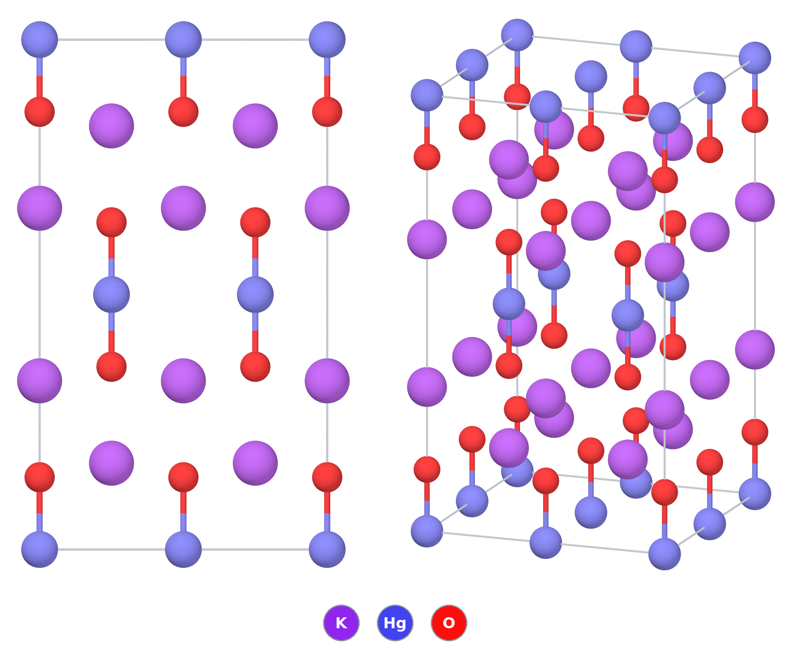
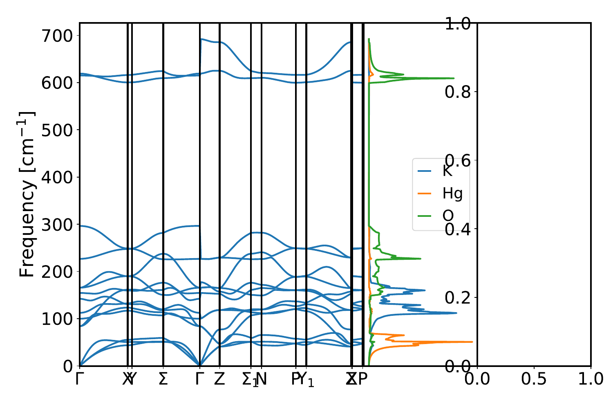

# K₂HgO₂ — potassium oxomercurate(II), linear O–Hg–O units between potassium ions

*A Material a Day · entry 29 · 17 November 2026 · status: **known** (prepared 1962–1964, structure re-refined 1988)*

> **In one paragraph.** K₂HgO₂ is a colourless, extremely moisture-sensitive potassium
> mercury oxide first reported by Hoppe and Röhrborn in 1962–1964 and re-refined on a single
> crystal in 1988. Mercury sits in a linear O–Hg–O dumbbell, the [HgO₂]²⁻ anion, and the
> dumbbells stand parallel to c in a body-centred tetragonal cell (Na₂HgO₂ type) held together
> by potassium. Every table of the Alexandria database puts it on the convex hull, 220 to 300
> meV/atom below its competitors, potassium peroxide and liquid mercury; that is more than the
> scatter of computed energies for mercury compounds. It is a calibration case: PBE makes the
> cell 5 % too large and the Hg–O bond 2.5 % too long, PBEsol gets the bond within 0.3 %. It
> was made by heating HgO with a slightly oxygen-rich potassium oxide (KO₀.₆₃–KO₀.₆₅) at
> 500 °C in a corundum crucible sealed under argon in a glass ampoule; that is the second of
> the routes the hull ranks, K₂O + HgO, not the first. No gap or vibrational spectrum of
> K₂HgO₂ has been published; the lithium member has an optical gap of 3.7 eV. It is a toxic
> mercury compound and is destroyed by water and by carbon dioxide.

Everything below is computed unless a reference is given. Read
[How this could be wrong](#8-how-this-could-be-wrong) before using any of it.

## 1. Identity

| | computed (PBE) | measured |
|---|---|---|
| Formula | K₂HgO₂ (K₂[HgO₂]) | |
| Alexandria id | `agm003194197` (PBE table; the same id in all tables) | |
| Space group | I4/mmm (no. 139), Z = 2 | I4/mmm, Z = 2 [3] |
| Cell | a = 3.994 Å, c = 14.147 Å | a = 3.920(1) Å, c = 13.974(3) Å [3]; a = 3.928, c = 13.88 Å [1]; a = 3.92, c = 13.94 Å [2] |
| Volume, density | 112.8 ų per formula unit, 4.58 g cm⁻³ | 107.4 ų, 4.81 g cm⁻³ (X-ray density [3]; a pycnometric density failed because the powder reacted with the liquid [2]) |
| Structure type | Na₂HgO₂ type | Na₂HgO₂ type [3] |
| Colour | gap 2.10 eV (PBE, a lower bound) | colourless; turns yellowish in air [2, 3] |
| Composition | K 25.23, Hg 64.57 wt % (formula) | K 25.4, 25.8; Hg 64.4, 65.0 wt % (two analyses [2]) |
| Formation energy | −1.068 eV/atom (PBE); −1.333 eV/atom (Materials-Project settings) | not found |

There is no Wikipedia page for K₂HgO₂ or for the alkali oxomercurates.
The CIF is [`K2HgO2.cif`](K2HgO2.cif); all numbers are in [`structure.json`](structure.json).
Mercury is 64.5 % of the mass.

## 2. Where it sits

<picture>
  <source media="(prefers-color-scheme: dark)" srcset="phase_diagram_dark.png">
  
</picture>

The computed K–Hg–O triangle at 0 K (PBE table). K₂HgO₂ is the **only ternary phase on
the hull**. It lies on the line from K₂O₂ to Hg and on the line from K₂O to HgO, and it has
tie lines to eleven phases: Hg, HgO, K₂O, K₂O₂, K₂O₃, K₃O₄, KO₂ and the amalgams KHg₂, K₂Hg₇,
KHg₆ and KHg₁₁.

| competing assemblage | PBE (`energy_runs_pbe`) | PBE, Materials-Project settings (`energy_runs_pbe_mp`) | SCAN at the PBEsol cell |
|---|---|---|---|
| K₂O₂ + Hg | **221.7** meV/atom below | **302.4** meV/atom below | 228.7 meV/atom below |

- **Both hulls agree** on the competitors, potassium peroxide and mercury. A mixture of
  K₂O and HgO is much higher in energy than K₂O₂ + Hg: mercury(II) oxide is weakly bound,
  and the oxygen prefers the peroxide.
- **The superoxide side.** Towards oxygen the neighbours are K₂O₃, K₃O₄, KO₂ and HgO. With
  more oxygen than K₂HgO₂ holds, the mercury goes back to HgO and the potassium to KO₂.
- **The amalgam side.** With less oxygen, the tie lines run to the potassium amalgams. The
  database's K–Hg edge (KHg₂, K₂Hg₇, KHg₆, KHg₁₁, KHg, K₅Hg₃, K₃Hg) was not checked phase
  by phase against the measured diagram.
- **The mercury(0) oxides are missing from the hull.** A 2026 paper reports Rb₂HgO and
  Cs₂HgO, with a [HgO]²⁻ anion and mercury formally at zero, made from the alkali metal
  and HgO in arc-welded tantalum crucibles at 300–325 °C [4]. Both take a monoclinic
  type the paper names after Rb₂HgO (C2/m, Z = 4; Rb₂HgO a = 13.684, b = 4.214, c = 9.146 Å, β = 108.5°), with an
  Hg–O bond of 2.21–2.24 Å, against 1.955 Å in K₂HgO₂. Cs₂HgO melts incongruently below
  315 °C to Cs₈Hg₈O [4]. Pure K₂HgO was not made: potassium enters only as a partial
  substitute, Rb₁.₈₁K₀.₁₉HgO (same monoclinic type) and Cs₁.₇₈K₀.₂₂HgO (an
  orthorhombic type of its own, Pnma) [4]. The database does not hold the measured structures: its
  lowest Rb₂HgO is a Cm cell of different shape (9.87, 4.14, 7.03 Å, β = 104.4°), 39
  meV/atom above the hull, and its lowest Cs₂HgO is rhombohedral, 53 meV/atom above (PBE).
  Its lowest K₂HgO is 70 meV/atom above. These numbers say only that the structures in
  the database are above the hull; the measured ones were not computed here.

## 3. Structure

*Left: along a. Right: an oblique view of 2 × 2 × 1 cells. Hg blue, O red, K purple; only
the Hg–O bonds are drawn.*

| site | Wyckoff | x, y, z (PBE) | measured z [3] | coordination (PBE) | measured [3] |
|---|---|---|---|---|---|
| Hg | 2a | 0, 0, 0 | — | 2 O at 2.003 Å, linear | 2 O at 1.955(13) Å [3]; 1.93 Å [2] |
| O | 4e | 0, 0, 0.1416 | 0.1399(9) [3]; 0.138 [2] | 1 Hg + 5 K | |
| K | 4e | 0, 0, 0.3307 | 0.3302(3) [3]; 0.331 [2] | 1 O at 2.676 Å + 4 O at 2.851 Å (square pyramid) | 2.66 + 4 × 2.80 Å [3]; 2.69 + 4 × 2.80 Å [2] |

The 1988 refinement is a four-circle diffractometer data set (121 independent reflections,
R = 2.7 %) on a crystal grown in the preparation; the 1964 structure came from
Weissenberg films of the 0kl layer (62 reflections, R = 7.7 %) [2, 3]. The 1964 Hg–O
distance is 1.3 % shorter than the 1988 one; the 1964 authors already called their
potassium value the less certain one [2].

| distance | PBE | PBEsol | measured [3] | PBE error |
|---|---|---|---|---|
| Hg–O | 2.003 Å | 1.960 Å | 1.955 Å | +2.5 % |
| K–O (apical) | 2.676 Å | 2.620 Å | 2.66 Å | +0.6 % |
| K–O (4 ×) | 2.851 Å | 2.776 Å | 2.80 Å | +1.8 % |
| Hg–K (8 ×) | 3.702 Å | | 3.647 Å | +1.5 % |
| Hg–Hg (= a) | 3.994 Å | 3.888 Å | 3.920 Å | +1.9 % |

- **The [HgO₂]²⁻ dumbbell.** Mercury has two oxygen neighbours at 180°, along c. The next
  atoms are eight potassium ions at 3.70 Å (3.647 Å measured [3]); the nearest mercury is 3.99 Å away (= a). Two-fold linear coordination is the habit of
  Hg²⁺; it is also the coordination in HgO itself, where the O–Hg–O units link into zigzag
  chains. In K₂HgO₂ the dumbbells are isolated: each oxygen has no second mercury.
- **Potassium** caps each dumbbell end. Every K⁺ sits over a square of four oxygens of one
  layer and has a fifth oxygen straight below or above it, a square pyramid. Five is a low
  coordination number for potassium, and the four long K–O contacts are where the lattice is
  soft (section 4, mechanical).
- **How the units stack.** The dumbbells form square nets at z = 0 and ½, offset by the body
  centring. Between two Hg layers there is a double layer of K⁺, so the structure can also
  be read as [HgO₂]²⁻ rods in the holes of a potassium framework.
- **Structure type.** The 1988 paper assigns it to the Na₂HgO₂ type [3]. In the database the
  same anonymous site set (AB₂C₂, tI10, I4/mmm, Wyckoff 2a, 4e, 4e) holds 200 or more
  entries, from oxides with linear anions to intermetallics with no dumbbell at all. Those
  with a chemically comparable linear unit include K₂NiO₂, Rb₂NiO₂ (assigned to the Na₂HgO₂
  type in [3]), K₂ZnO₂, Rb₂ZnO₂, Cs₂ZnO₂, K₂PtO₂, Cs₂PtO₂ and the nitride Ca₂ZnN₂. We did
  not check the intermetallic members one by one.

**The family, A₂HgO₂.** All four heavier alkali members are on the hull in the PBE table,
in the same structure. The lithium compound takes another arrangement (Li on 4d, in
flattened tetrahedra). Hoppe and Röhrborn had already proposed that site from the cell
alone [2]; the 2026 Rietveld refinement confirms it (I4/mmm, O at z = 0.1864, Li–O
1.912 Å, Hg–O 2.09(2) Å) and treats it as a structure type of its own [4]. The database's
Li₂HgO₂ has the same site set, but its oxygen sits closer to mercury: z = 0.177, Hg–O
2.00 Å and Li–O 1.98 Å (PBE). PBE runs long everywhere else in this family, so a PBE
bond 4 % *shorter* than the measured one is out of pattern. The 2026 oxygen position comes
from powder data on a compound dominated by mercury scattering, and the paper itself
notes that this Hg–O bond is one of the longest known for an isolated dumbbell [4];
which of the two is off we cannot say.

| A | depth below competitors, PBE (meV/atom) | a, c computed (Å) | a, c measured (Å) | Δa, Δc |
|---|---|---|---|---|
| Li | on hull (other type) | 3.601, 11.312 | 3.5428, 11.185 [4]; 3.55, 11.23 [2] | +1.6 %, +1.1 % |
| Na | 209.3 | 3.467, 13.500 | 3.42, 13.32 [2] | +1.4 %, +1.4 % |
| K | 221.7 | 3.994, 14.147 | 3.920, 13.974 [3] | +1.9 %, +1.2 % |
| Rb | 228.8 | 4.238, 14.410 | 4.139, 14.239 [3] | +2.4 %, +1.2 % |
| Cs | 207.6 | 4.539, 14.620 | 4.35, 14.51 [2] | +4.3 %, +0.8 % |

PBE runs long in every member. The error grows with the size of the alkali ion in the
a direction, which is set by the A–O contacts, while c, which is dominated by the stiff
Hg–O bonds, stays near 1 %. The 1964 cells are rounded to 0.01 Å [2].

**PBEsol.** The group's phonon calculation relaxed the cell with PBEsol: a = 3.888 Å,
c = 13.860 Å (−0.8 % and −0.8 % against 1988), volume −2.5 %, Hg–O 1.960 Å (+0.3 %), K–O
2.620 and 4 × 2.776 Å. PBEsol is the better geometry here, as it usually is for ionic
oxides; PBE overestimates the volume by 5 %.

## 4. Computed properties

All numbers are in [`properties.json`](properties.json) and [`phonons.json`](phonons.json).

### Electronic structure

| | value | comment |
|---|---|---|
| Band gap, PBE | 2.10 eV, direct | PBE underestimates gaps |
| Band gap, SCAN at the PBEsol cell | 2.47 eV (indirect), 2.66 eV (direct) | |
| Band gap, machine-learned MBJ estimate | 3.23 eV | a screening estimate from the structure alone |
| Measured | colourless crystals [2, 3] | no measured gap of K₂HgO₂ was found |
| Li₂HgO₂, for calibration | PBE 2.54 eV (this database); 2.5 eV (PBE, [4]) | optical gap 3.7 eV from a diffuse-reflectance UV–vis spectrum [4] |

A colourless crystal does not absorb visible light, which places the gap above about
3 eV. The machine-learned MBJ estimate (3.2 eV) is consistent with that; the PBE and SCAN
gaps are not, and should be read as lower bounds. The lithium member, the only one with a
measured gap, calibrates the error: PBE is 1.2 eV (31 %) below its optical gap. The same
shortfall would put K₂HgO₂ near 3.3 eV; that is an analogy, not a measurement. Mercury is a heavy element and these
calculations do not include spin–orbit coupling, which can move the conduction band of a
6s-derived state by a few tenths of an eV.

### Dielectric response (PBE)

| | in the ab plane | along c (the dumbbell axis) | average |
|---|---|---|---|
| Electronic dielectric constant ε∞ | 2.77 | 3.58 | 3.04 |
| Refractive index √ε∞ | 1.67 | 1.89 | 1.75 |

| Born effective charge | K | Hg | O |
|---|---|---|---|
| nominal | +1 | +2 | −2 |
| in the ab plane | +1.16 to +1.31 (range of principal values) | **+0.01** | −1.16 |
| along c | (included in the range) | **+2.22** | −2.42 |

- **Strongly uniaxial.** Light polarised along the dumbbells sees a refractive index about
  0.23 higher than light polarised across them. The polarisable direction is the Hg–O bond.
- **The mercury charge is almost entirely along the bond.** Moving Hg along c, along the
  dumbbell, gives a Born charge of +2.22; moving it sideways gives +0.01, essentially
  nothing. The two oxygens follow the same pattern (−2.42 along, −1.16 across). This is
  the computed signature of a covalent, directional O–Hg–O unit rather than a Hg²⁺ ion
  sitting between O²⁻ ions; it fits the 2026 analysis of [HgO₂]²⁻ in Li₂HgO₂, which
  finds predominantly covalent σ bonding from Hg 5d, 6s and 6p states, and no alkali
  states in the valence band [4]. (The tensors are diagonal by symmetry, so the
  unique principal value is the c component.)
- PBE overestimates ε∞, so the measured indices should be slightly lower. The structure is
  centrosymmetric, so there is no piezoelectric response. ε∞ is not the static dielectric
  constant, which needs the lattice part.

### Charge transport (PBE, constant relaxation time)

| | electrons | holes |
|---|---|---|
| Density-of-states mass (mₑ) | 1.0 | 8.7 |
| Conductivity mass at 300 K (mₑ) | 0.85 | 5.1 |
| Seebeck coefficient at 300 K, 10¹⁹ cm⁻³ (μV/K) | −284 | +573 |
| Seebeck coefficient at 300 K, 10²⁰ cm⁻³ (μV/K) | −123 | +375 |

- **Light electrons, heavy holes.** The conduction band is dispersive (about one electron
  mass); the valence band, built from oxygen p states, is flat. The branch-point energy is
  1.17 eV above the valence-band maximum, in the middle of the 2.10 eV PBE gap.
- The compound reacts with water and carbon dioxide (section 6) and is colourless, so none
  of this is a recommendation for electronics; it describes the band edges.

### Mechanical (machine-learned)

| bulk modulus | shear modulus | Young's modulus |
|---|---|---|
| 22 GPa | 9 GPa | 26 GPa |

Screening estimates from a graph neural network on the PBE structure, not elastic-constant
calculations. A soft salt, about as compressible as NaCl; the stiff Hg–O bonds do not hold
the lattice together, the long K–O contacts do.

### Lattice dynamics (PBEsol)

<picture>
  <source media="(prefers-color-scheme: dark)" srcset="phonons_dark.png">
  
</picture>

- **Dynamically stable.** The group's density-functional perturbation calculation (Quantum
  ESPRESSO, PBEsol, on the PBEsol-relaxed cell) finds no imaginary frequency.
- **Two separate bands.** Everything below 300 cm⁻¹ is potassium motion, O–Hg–O bending
  and the motion of the dumbbells as rigid units (the projected density of states puts
  mercury mostly below 80 cm⁻¹ and oxygen in both bands). Then nothing up to about 600 cm⁻¹, and
  a narrow band of the two Hg–O stretching modes at 616 and 620 cm⁻¹ at Γ, rising to
  689 cm⁻¹ at the top of the spectrum. The empty window is the isolation of the dumbbell:
  its internal stretch does not mix with the lattice.
- These are PBEsol numbers on a PBEsol cell; the rest of the entry is PBE. By symmetry
  one of the two stretches is Raman-active (symmetric) and the other IR-active
  (antisymmetric); our data do not say which is which.
- **No measured spectrum of K₂HgO₂ was found.** The 1988 paper points to Raman and
  IR work on these oxides in a K₂NiO₂ paper [9] and in a study it calls unpublished
  [3]; the title of [9] names only the nickel compound.
- **Calibration on Li₂HgO₂** [4]: the symmetric stretch is measured at 643 cm⁻¹ (Raman),
  the antisymmetric at 649 cm⁻¹ (IR) and the bend at 151 and 161 cm⁻¹; the authors'
  PBE perturbation calculation gives 614, 602 and 151 cm⁻¹, 4–7 % low on the stretches.
  If our PBEsol stretches for K₂HgO₂ err the same way, the measured bands would lie near
  650 cm⁻¹; that is an analogy, not a prediction we tested.
- It is an insulator, so there is no electron-phonon coupling to report.

### Not computed

Spin–orbit coupling, a hybrid-functional or GW gap, elastic constants by DFT, the static
dielectric constant, optical spectra, defect energies.

## 5. Is it stable?

| calculation | K₂HgO₂ against K₂O₂ + Hg |
|---|---|
| PBE (`energy_runs_pbe`) | on the hull, **221.7 meV/atom below** |
| PBE, Materials-Project settings (`energy_runs_pbe_mp`) | on the hull, **302.4 meV/atom below** |
| SCAN at the PBEsol geometry | on the hull, 228.7 meV/atom below |

- **The error bar for mercury.** Computed formation enthalpies of heavy p-block and noble
  metal compounds on the Materials-Project-settings table scatter by 116 meV/atom (median
  absolute deviation, nine compounds) about a bias of +332 meV/atom against calorimetry.
  The margin, 220–300 meV/atom, is about twice the scatter.
- **HgO, measured.** The standard formation enthalpy of red HgO is −90.79 kJ/mol [8]. The
  Materials-Project-settings table overbinds it by 128 meV/atom; the PBE table, which has no
  oxide correction, underbinds it by 198 meV/atom (−52.6 kJ/mol). The two calculations err
  in opposite directions on mercury–oxygen bonds, and K₂HgO₂ is more than 200 meV/atom below
  its competitors in both. The margin is resolved; and the compound has been made [1–3].
- **The mercury reference.** The Materials-Project-settings table carries a mercury
  reference about 52 meV/atom too low (a known artefact of that table). Mercury is one atom
  in five of the competing assemblage, so this moves the margin by about 10 meV/atom.
- **At temperature.** With phonons and the measured free energy of mercury, the margin
  shrinks slowly: −289 meV/atom at 300 K, −276 at 600 K, −263 at 900 K, with a phonon error
  for the class of 4–11 meV/atom. Above about 630 K the mercury of the competing assemblage
  is a vapour, so this holds only in a closed vessel; in an open system, losing mercury
  vapour drives decomposition, at a temperature we did not compute. The first synthesis
  paper reports exactly this: heated in a stream of oxygen, the charges lose mercury and
  the products are not pure [2].
- **In air, at room temperature,** the 0 K calculation says K₂HgO₂ should take up oxygen
  (to HgO + KO₂, −137 meV/atom), water (to KOH hydrate + HgO, −44) and carbon dioxide (to
  K₂Hg(CO₃)₂, −234). The first is likely slow; the reaction with moisture is the one the
  papers report: the crystals are extremely sensitive to moisture and turn into yellowish
  products in air [2, 3]; for the sodium member, water gives alkali hydroxide solution and
  yellow HgO at once [2], the products the calculation predicts.

## 6. How to make it

**How it was made** [2, 3].

| | 1964 [2] | 1988 [3] |
|---|---|---|
| Charge | HgO + 2 KO₀.₆₃ | 1 HgO + 2.1 KO₀.₆₅ |
| Potassium oxide | the metal, twice distilled in high vacuum, oxidised with dried oxygen | the metal, purified by liquation, oxidised under control |
| Container | a sintered-corundum finger crucible inside a glass or silica ampoule filled with dry argon and sealed | a corundum crucible sealed into an argon-filled glass ampoule |
| Firing | as for Na₂HgO₂: 10 h at 500 °C, then 3 days at 350 °C | 500 °C for 10 days |
| Product | colourless crystalline powder; K and Hg contents within 0.6 wt % of the formula | colourless single crystals, picked under dry argon with a polarising microscope |

The potassium oxide is between K₂O and K₂O₂ in oxygen content, so the charge carries a
little more oxygen (and in 1988 5 % more potassium) than the formula needs. The authors
rejected the usual route of the time for ternary alkali oxides, slow oxidation of an
intermetallic, because the sodium amalgams melt too low [2]. The lithium member is made
the same way from Li₂O + HgO (10 h at 500 °C, cooled at 5 K h⁻¹ to 350 °C and held 72 h)
[4]; rubidium needed 550 °C for 14 days [3].

**Beside the hull.** The published charge is route B below (K₂O + HgO), second by rank,
not the first-ranked route A (K₂O₂ + Hg). The firing temperature, 500 °C, is above the
250–450 °C we proposed and 36 K below the temperature at which HgO decomposes in air: the
sealed ampoule holds the decomposition back, as assumed. The crucible is the point where
the calculation and practice disagree: corundum, which the contact check below finds
reactive towards the product (−58 meV/atom), was used in both preparations with no wall
reaction reported. The reaction is slow at 500 °C, or it does not happen; the check
overstates the risk here.

**What the hull proposes.** Energies are 0 K reaction energies per atom of the whole
charge, Materials-Project-settings scale, ranked fewest reagents first and then least
driving force.

| route | charge | ΔE (meV/atom) | comment |
|---|---|---|---|
| **A** | K₂O₂ + Hg | −302 | first by rank; an internal redox: the peroxide oxidises the mercury |
| **B** | K₂O + HgO | −343 | the obvious acid–base route; the target forms first in the pathway check |
| C | ½ KHg₂ + ½ K₃O₄ | −384 | an amalgam and a superoxide; no advantage |
| D | KHg + KO₂ | −586 | likewise |

- **Pathway.** For both A (at 573 K) and B (at 673 K), K₂HgO₂ is the first product of the
  reagent pair, with no competing intermediate within 300 meV/atom (−305 and −317 meV/atom
  on the measured scale).
- **Route B in practice (the computed window, beside the published route).**
  - *Charge:* K₂O : HgO = 1 : 1, ground together in an argon glovebox (published: a
    slightly oxygen-rich potassium oxide, above).
  - *Container:* the calculation finds Au, Ag, Ni, Rh, MgO, CaO, BeO and Y₂O₃ inert
    towards the product. Silica (−102 meV/atom, to K₂Si₂O₅ + HgO), alumina (−58), zirconia,
    carbon, BN, Pt and Pd all react, and so do Fe, Mo, Nb and Ta. Practice used corundum
    inside glass and did not report an attack; a nickel or silver tube is the computed
    alternative, untested for this compound (nickel crucibles were used for the niccolates
    in the same 1988 work [3]).
  - *Bottom of the window:* the Tammann temperature of K₂O, 507 K (234 °C, from a melting
    point of 1013 K). HgO has no melting point on file; an estimate gives about 430 K.
  - *Top of the window:* HgO decomposes to Hg + O₂ at 809 K in air (536 °C, measured
    thermochemistry); mercury boils at 630 K (357 °C). In a sealed tube the decomposition
    is held back, but the tube carries mercury and oxygen pressure. We proposed about
    250–450 °C, sealed; the published 500 °C shows the sealed upper limit is higher. The fitted "typical" firing temperature for such a
    charge, 1052 ± 223 K, is above the top of the window and should not be used.
  - *Atmosphere:* none inside a sealed tube; dry argon for handling. The oxygen window is
    wide (2.6 eV in the oxygen chemical potential), so oxygen pressure is not what limits
    this synthesis; water and CO₂ are.
- **Route A** needs liquid mercury and potassium peroxide, a strong oxidiser, in a sealed
  vessel. It avoids handling HgO and leaves nothing to separate. The 2026 paper's
  oxidomercurates(0) A₂HgO are made from the other side, alkali metal + HgO [4]; an excess
  of mercury or a shortage of oxygen in route A pushes towards those, or towards amalgams.
- **Metathesis, tested.**

  | charge | computed outcome |
  |---|---|
  | HgCl₂ + 2 K₂O | K₂HgO₂ + 2 KCl, −580 meV/atom. KCl is inert towards the target, so the reaction is clean, but KCl cannot be washed out: water destroys K₂HgO₂. A mixture, not a product |
  | HgO + 2 KOH | a third of the HgO left over, with K₂HgO₂ and KOH hydrate (−22 meV/atom) in a closed vessel. The released water attacks the product; the route would need the water pumped off as it forms, below the temperature at which HgO decomposes |
  | HgO + K₂CO₃ | no reaction. The reverse is downhill: K₂HgO₂ takes up CO₂ to K₂Hg(CO₃)₂ |

  Salts of other alkali metals exchange with it (NaCl, NaBr, NaI and Na₂CO₃ all give
  Na₂HgO₂; LiCl and LiF give Li₂HgO₂), so a flux, if one is used, should be a potassium
  salt: KCl, KBr, KI, KF, K₂SO₄, K₂CO₃ and KNO₃ are all inert towards the target. KNO₃ and
  K₂CO₃ release gases when heated and are not advised.

**Reading the powder pattern.** Strongest computed lines (PBE cell, Cu Kα):

| 2θ (°) | 12.51 | 23.14 | 29.31 | 31.69 | 34.19 | 45.42 | 50.42 | 54.98 |
|---|---|---|---|---|---|---|---|---|
| hkl | 002 | 101 | 103 | 110 | 112 | 200 | 116 | 213 |
| I | 57 | 92 | 100 | 65 | 24 | 23 | 31 | 35 |

With the measured cell the lines move to higher angle: 002 at 12.66° and 103 at 29.76°.
The published Guinier pattern [3] puts them at 12.70° and 29.80° and orders the strong
lines as computed: 103 strongest, then 101, then 110 and 002.

- **Mercury droplets and K₂O₂ or KO₂ lines:** oxygen balance wrong or the charge too hot;
  the target fell back to its competing assemblage.
- **Red or yellow HgO:** unreacted; the charge was too cold or not mixed.
- **KOH, K₂CO₃ or KHCO₃ lines, or a sticky product:** air got in.
- **Amalgam lines (KHg₂ and others):** too little oxygen; reducing conditions.

**Hazards.** Mercury and its compounds are acutely and chronically toxic, and mercury
vapour is the main exposure route. HgO decomposes to mercury vapour on heating; a sealed
tube containing it is under pressure and must be opened cold, in a fume hood. K₂O and K₂O₂
are corrosive; K₂O₂ is a strong oxidiser and reacts violently with water. The product
hydrolyses to KOH (corrosive) and HgO. All residues are mercury waste.

## 7. What it is good for

We found no application of K₂HgO₂, and none of the three papers proposes one. What it
offers is scientific: a clean example of an isolated linear d¹⁰ [HgO₂]²⁻ unit. Hoppe and
Röhrborn made the series to ask why Hg²⁺ keeps two-fold coordination where an ion of its
size would take six [2]; the 2026 paper uses the same anion, and the mercury(0) anion
[HgO]²⁻, as small models for the Hg–O bonding of solid HgO [4]. For calculations it is a calibration point for mercury–oxygen
bonding, where the two PBE tables err in opposite directions on HgO (section 5). Its
toxicity and its sensitivity to air rule out any use in the open.

## 8. How this could be wrong

- **The hull's first route is not the one used.** Practice is K₂O + HgO, the second-ranked
  route; the first, K₂O₂ + Hg, has not been reported for this compound, and nothing here
  shows that it works. The contact check called corundum reactive, and corundum is what was
  used: its container verdicts are 0 K energies, not observed attack.
- **The gap and phonon estimates lean on the lithium member.** The corrections in section 4
  carry over from Li₂HgO₂, a different structure with tetrahedral lithium, and its own
  Hg–O distance is in question (section 3).
- **No spin–orbit coupling.** Mercury is heavy; the gaps and possibly the Hg–O energetics
  shift with it.
- **The mercury error is large and structured.** The class scatter (116 meV/atom) is less
  than the margin, but the class bias (+332) is larger, and the two tables disagree on HgO
  by 330 meV/atom between them. The conclusion "stable" rests on the experiment, not on
  either table alone.
- **The hull is incomplete on the mercury-rich side.** The measured structures of Rb₂HgO and
  Cs₂HgO are not in the database, whose versions of them sit 39 and 53 meV/atom above the
  hull. The K–Hg–O triangle may lack phases too (potassium enters these oxides at least
  partly), which would move the boundaries of the firing window, though not K₂HgO₂'s own
  stability.
- **Decomposition in an open system was not computed.** The temperature at which K₂HgO₂ loses
  mercury under flowing gas is unknown here; the 1964 paper reports only that mercury is
  lost under flowing oxygen [2].
- **The literature search can miss things.** See below; most of the work on this compound is
  in German journals from the 1960s.

## 9. Literature

**Searched 13 November 2026 (Crossref, arXiv; OpenAlex refused most queries with a rate
limit):** "Oxomercurate Na2HgO2 K2HgO2" (10 hits: [1], [2], the 1963 short note [5], and
alkaline-earth and lanthanoid oxomercurates); "Zum Aufbau von A2HgO2 (A = K, Rb), Rb2NiO2"
(10 hits, [3] the only relevant one); "potassium mercury oxide K2HgO2 crystal structure"
(10 hits, none about K₂HgO₂; the HgO structure, 10.1107/s0365110x56001881, title only);
"K2HgO2" (1 hit, [1]); "alkali metal oxomercurates linear O-Hg-O" (20 hits, [4] the only
relevant one); "Na2HgO2 type structure I4/mmm A2MO2 dumbbell oxometallate" (10 hits: the
structure-type entry [6]); "potassium mercurate(II) oxide synthesis HgO K2O" (8 hits, none:
the "potassium mercurates" found are halide and cyanide complexes); "oxidomercurate HgO2
dumbbell Raman spectra alkali" (8 hits, none). Wikipedia: no page for K2HgO2, potassium
mercurate, potassium oxomercurate or dipotassium dioxomercurate. **Added 9 November 2026:**
the full texts of [2], [3] and [4]; "Hitchman Stratemeier Hoppe electronic spectrum Raman
K2NiO2 linear d8 1988" (OpenAlex and Crossref, 5 hits: [9] and its abstract-service
copy), to follow the spectroscopy reference in [3].

**Result: known compound.** Prepared and structurally characterised in 1962–1964 [1, 2],
re-refined on single crystals in 1988 [3]. The 2026 paper [4] did not remake it; it lists
its Hg–O distance, 1.955(13) Å, among the known isolated dumbbells. No measured gap,
vibrational spectrum, formation enthalpy or decomposition temperature of K₂HgO₂ was found.

1. R. Hoppe, H.-J. Röhrborn, "Über Oxomercurate(II): Na₂HgO₂ und K₂HgO₂",
   *Naturwissenschaften* 49, 419 (1962). doi:10.1007/bf00624409. *Metadata only; its cell
   and coordinates are Crystallography Open Database entry 1537420
   (https://www.crystallography.net/cod/1537420.cif), which was read.*
2. R. Hoppe, H.-J. Röhrborn, "Oxomercurate(II) der Alkalimetalle, M₂HgO₂", *Z. anorg.
   allg. Chem.* 329, 110 (1964). doi:10.1002/zaac.19643290115. *Full text read: reagents,
   containers and firing, chemical analyses, cells of the Li to Cs compounds, single-crystal
   structures of the Na and K compounds, the proposed Li site.*
3. R. Hoppe, R. Baier, W. Carl, H. Untenecker, H. Glaum, "Zum Aufbau von A₂[HgO₂]
   (A = K, Rb), Rb₂[NiO₂] und Rb₁.₄K₀.₆[NiO₂]", *Z. anorg. allg. Chem.* 567, 69 (1988).
   doi:10.1002/zaac.19885670108. *Full text read: preparation,
   Guinier powder data, four-circle refinement, distances. Cell and coordinates also read
   from Crystallography Open Database entry 1540108
   (https://www.crystallography.net/cod/1540108.cif).*
4. L. Nusser, S. Feldl, L.-V. Pietsch, M.-T. Butt, A. Schulz, C. Hoch, "Crystal Structures
   and Covalent Hg–O Bonding in Alkali Metal Oxidomercurates: Linking Hg(II) and Hg(0)",
   *J. Am. Chem. Soc.* 148, 40482 (2026). doi:10.1021/jacs.6c15268. *Full text read; the
   Supporting Information was not.*
5. R. Hoppe, H. J. Röhrborn, "Oxomercurate(II) der Alkalimetalle", *Angew. Chem.* 75
   (1963). doi:10.1002/ange.19630751431. *Metadata only.*
6. P. Villars, K. Cenzual, J. Daams, "Na₂HgO₂", in *Landolt-Börnstein III/43A10, Structure
   Types* (2011). doi:10.1007/978-3-642-19662-1_140. *Metadata only.*
7. Alexandria database, entry `agm003194197` (PBE, Materials-Project-settings and SCAN
   tables); the PBEsol phonon calculation of the group (Quantum ESPRESSO).
8. Mercury(II) oxide, standard formation enthalpy −90.79 ± 0.12 kJ/mol (CODATA 1984), as
   given by the NIST Chemistry WebBook,
   https://webbook.nist.gov/cgi/cbook.cgi?ID=C21908532&Mask=2. *Page read.*
9. M. A. Hitchman, H. Stratemeier, R. Hoppe, "Electronic and Raman spectra of the linear
   dioxonickelate(2−) ion in dipotassium dioxonickelate(2−)", *Inorg. Chem.* 27 (1988).
   doi:10.1021/ic00287a026. *Metadata only.*

## 10. Provenance

- **Data:** Alexandria database, tables `energy_runs_pbe` (structure, properties, hull),
  `energy_runs_pbe_mp` (reaction energies, competing phases) and `energy_runs_scan`; the
  group's DFPT phonon calculations (Quantum ESPRESSO, PBEsol).
- **Tools:** the reaction-route code of this group (hull, reaction table, contact,
  calorimetric error, finite-temperature margin), a graph-neural-network property model for
  the moduli and the MBJ estimate, pymatgen for symmetry, distances and the powder pattern,
  POV-Ray for the pictures.
- **Authorship:** drafted by Claude (Anthropic) from those tools; reviewed by
  Miguel Marques. Corrections are welcome as issues on this repository.
