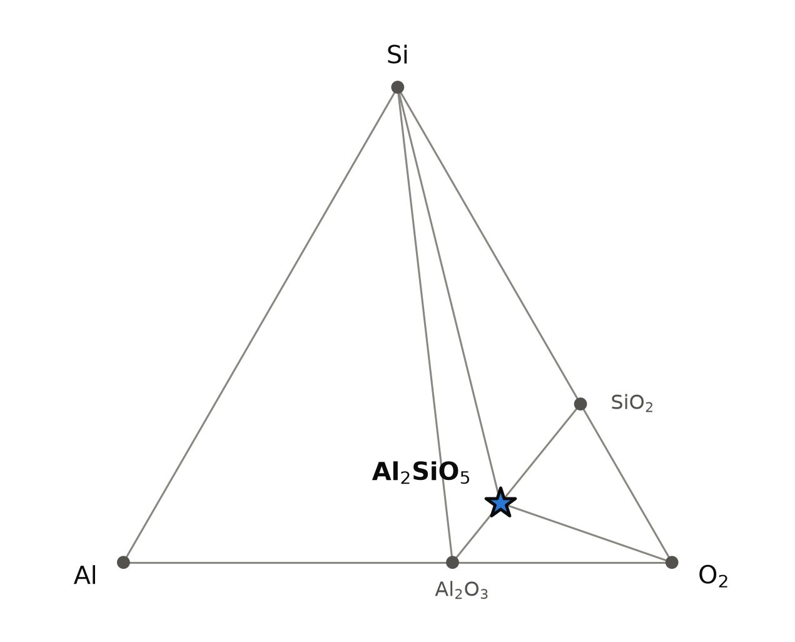
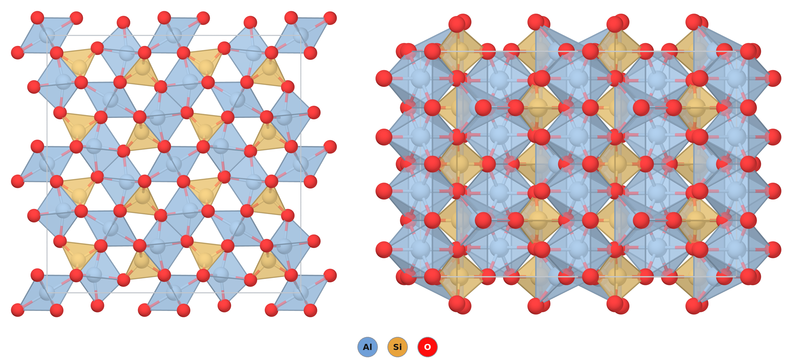

# Al₂SiO₅ (andalusite) — an aluminosilicate mineral that PBE puts in the wrong place among its polymorphs

*A Material a Day · entry 30 · 18 November 2026 · status: **known** (mineral; structure first solved in 1929)*

> **In one paragraph.** Andalusite is one of the three natural polymorphs of Al₂SiO₅,
> beside kyanite and sillimanite, and a common mineral of low-pressure metamorphic
> rocks. Its structure has chains of edge-sharing AlO₆ octahedra along c, cross-linked
> by isolated SiO₄ tetrahedra and by aluminium in five-fold coordination. It is mined
> and used as a refractory raw material; above about 1200 °C it turns into mullite and
> silica glass. The calculation gets the cell right to 1 % and the bulk modulus to a few
> per cent, and its formation energy from Al₂O₃ and SiO₂ (−8.0 meV/atom) falls between
> the two calorimetric values (−4.7 and −7.2). Yet it gets the polymorph order wrong. In
> PBE andalusite is the only Al₂SiO₅ phase on the hull, sillimanite is 7 meV/atom above
> it and kyanite 19 above. Calorimetry puts kyanite 3 to 5 meV/atom *below* andalusite,
> and kyanite is the stable form at room temperature and pressure. The error, about
> 22–25 meV/atom, falls on the densest polymorph, and it is larger than every energy
> difference in this system. A published comparison of functionals [11] finds the same
> kind of error with PBEsol and PBE0, while LDA gets the kyanite–sillimanite difference
> to within 1 meV/atom. Andalusite cannot be made by firing alumina with silica: at
> the temperatures where those react, the product is mullite. Laboratory andalusite has
> been grown hydrothermally from alumina–silica gels.

Computed numbers come from the Alexandria database. Measured numbers carry a reference.

## 1. Identity

| | computed (PBE) | measured |
|---|---|---|
| Formula | Al₂SiO₅ = Al₂O(SiO₄), andalusite | |
| Alexandria id | `agm005225700` (PBE table) | |
| Space group | Pnnm (no. 58), Z = 4 | Pnnm [1, 2] |
| Cell | a = 7.871, b = 7.976, c = 5.610 Å | a = 7.7930, b = 7.8973, c = 5.5558 Å [1] |
| Volume per formula unit | 88.04 ų | 85.48 ų [1] |
| Density | 3.056 g cm⁻³ | 3.148 g cm⁻³ (from the measured cell) |
| Structure type | andalusite (its own prototype, `AB2C5_oP32_58_g_eg_3gh`) | |
| Mineral name | andalusite; chiastolite is a variety with graphite inclusions | |
| Formation energy | −2.937 eV/atom (PBE) | |

Wikipedia: [Andalusite](https://en.wikipedia.org/wiki/Andalusite)

The CIF is [`Al2SiO5.cif`](Al2SiO5.cif); all numbers are in [`structure.json`](structure.json).

### How far off the structure is

| | PBE | measured [1] | difference |
|---|---|---|---|
| a (Å) | 7.871 | 7.793 | +1.0 % |
| b (Å) | 7.976 | 7.897 | +1.0 % |
| c (Å) | 5.610 | 5.556 | +1.0 % |
| V (ų) | 352.2 | 341.9 | +3.0 % |

The expansion is the usual PBE one and almost perfectly isotropic. The Winter–Ghose
room-temperature cell (a = 7.798, b = 7.903, c = 5.557 Å [2]) gives the same picture.
The same holds for the two other polymorphs: the PBE volume is 3.3 % above the
measured one for sillimanite [1] and 3.1 % above for kyanite [3].

## 2. Where it sits

<picture>
  <source media="(prefers-color-scheme: dark)" srcset="phase_diagram_dark.png">
  
</picture>

In the Al–Si–O triangle the PBE hull has only three oxides: Al₂O₃, SiO₂ and Al₂SiO₅.
Andalusite lies on the Al₂O₃–SiO₂ join and has tie lines to Al₂O₃, SiO₂, O₂ and Si.

| phase (PBE table) | space group | height above the hull (meV/atom) | note |
|---|---|---|---|
| **andalusite** | Pnnm | 0 (7.97 below Al₂O₃ + SiO₂) | the only Al₂SiO₅ vertex |
| sillimanite | Pnma (= Pbnm) | 7.4 | `agm005239659` |
| kyanite | P1̄ | 19.3 | `agm005228930` |
| Al₂Si₂O₇ | C2/c | 19.6 | no known counterpart checked |
| Al₁₀Si₂O₁₉ | Pm | 53.5 | an ordered approximant on the alumina-rich side |

- **Mullite is missing.** The one aluminosilicate that forms when Al₂O₃ and SiO₂ are
  fired at ambient pressure, 3Al₂O₃·2SiO₂ [5], is not in the table as such. It has
  disordered oxygen vacancies, and the nearest ordered structures in the database
  (Al₁₀Si₂O₁₉, Al₈SiO₁₄) are 50–80 meV/atom above the hull. Any statement below about
  what is stable when hot leaves mullite out, and in practice mullite is the phase
  andalusite turns into.
- The Materials-Project-settings table (`pbe_mp`) gives the same picture: andalusite on
  the hull 7.95 meV/atom below Al₂O₃ + SiO₂, sillimanite +7.6, kyanite +19.4.

## 3. Structure

*Left, down c: the AlO₆ chains seen end-on (blue), with SiO₄ tetrahedra (orange) and
the five-coordinate Al between them. Right, down b: the chains run vertically.*

| site | Wyckoff | x, y, z (PBE) | coordination (PBE, Å) |
|---|---|---|---|
| Al1 | 4e | 0, 0, 0.2418 | 6 O: 2 × 1.843, 2 × 1.908, 2 × 2.107 (octahedron) |
| Al2 | 4g | 0.1294, 0.6391, 0 | 5 O: 2 × 1.829, 1.833, 1.853, 1.914 (trigonal bipyramid) |
| Si | 4g | 0.2458, 0.2522, 0 | 4 O: 1.635, 2 × 1.646, 1.661 (tetrahedron) |
| O1 | 8h | 0.2307, 0.1341, 0.2397 | Si + 2 Al |
| O2 | 4g | 0.0758, 0.8635, ½ | Si + 2 Al |
| O3 | 4g | 0.0761, 0.8628, 0 | 3 Al, no Si |
| O4 | 4g | 0.1026, 0.4007, 0 | Si + 2 Al |

- **Chains.** The Al1 octahedra share edges and form straight chains along c, the
  motif all three Al₂SiO₅ polymorphs share.
- **The cross-links decide the polymorph.** In andalusite the chains are joined by
  SiO₄ tetrahedra and by Al2 in five-fold coordination. Sillimanite joins them with
  AlO₄ and SiO₄ tetrahedra, kyanite with more octahedra. Aluminium is four-, five- and
  six-coordinated in sillimanite, andalusite and kyanite respectively [4]. Five-fold
  Al is rare in oxides, and andalusite is the standard example.
- **O3 is the oxygen not bonded to silicon,** shared by three Al. It is what makes the
  formula Al₂O(SiO₄) a nesosilicate with one extra oxide ion.
- **Polymorphs in the database.** Besides the three minerals, the PBE table holds
  Al₂SiO₅ in Pm (+51.5), C2/c (+99.9) and Cmcm (+108.9 meV/atom). None was checked
  against a known phase.

## 4. Computed properties

### Electronic

| property | value | comment |
|---|---|---|
| Band gap, PBE | 4.85 eV (direct) | PBE underestimates gaps; a lower bound |
| Band gap, machine-learned PBE / MBJ estimate | 4.78 / 6.77 eV | screening estimates from the structure |
| Kyanite, PBE | 5.44 eV indirect, 5.53 direct | for comparison |

No measured band gap was retrieved. Andalusite is a wide-gap insulator either way; its
colours in nature come from impurities (Fe, Mn) and inclusions.

### Dielectric response (PBE, DFPT)

| | ε∞ principal values | ε∞ average | n = √ε∞ |
|---|---|---|---|
| andalusite | 2.77, 2.80, 2.83 | 2.80 | 1.67 |
| kyanite (for comparison) | 3.06, 3.09, 3.11 | 3.09 | 1.76 |

Born effective charges (trace/3): Al +2.93 (principal values 2.63 to 3.17), Si +3.19,
O −1.81. The structure is centrosymmetric, so there is no piezoelectric response. The
denser kyanite has the higher index, as expected. No measured index was retrieved for
comparison, and ε∞ is not the static dielectric constant.

### Charge transport (PBE, rigid bands)

Electron density-of-states mass 0.78 mₑ, hole mass 6.1 mₑ: a light conduction band and
flat O 2p valence bands. The branch-point energy lies 0.68 eV above the valence-band
maximum. With a gap near 5 eV and no known dopant, these numbers describe an
insulator, not a semiconductor, and the Seebeck table in
[`properties.json`](properties.json) is not quoted.

### Mechanical

| | bulk modulus | shear modulus | Young's modulus |
|---|---|---|---|
| machine-learned (tuga-sp) | 138 GPa | 94 GPa | 219 GPa |
| MLIP elastic tensor (EquFlashV2, PBE structure) | 141 GPa | 88 GPa | 219 GPa |
| measured, isothermal [1] | 144.2(7) GPa | — | — |

- The computed bulk modulus is 2–4 % below the measured one, which fits a cell 3 % too
  large.
- **Anisotropy.** The MLIP stiffnesses are C₁₁ = 200, C₂₂ = 263, C₃₃ = 329 GPa, so c is
  the stiffest axis and a the softest. The measured axial moduli have the same order:
  K_a = 99.6, K_b = 152.2, K_c = 236 GPa [1]. The stiff c axis is the direction of the
  octahedral chains.

### Lattice dynamics

The group's DFPT calculations do not include andalusite (phonons not computed with
DFT). The machine-learned harmonic phonons in Alexandria (EquFlashV2 potential, on the
PBE structure) find it dynamically stable: no imaginary modes, top of the spectrum
1071 cm⁻¹. They also give a vibrational entropy that can be checked against
calorimetry:

| S at 300 K (J mol⁻¹ K⁻¹) | andalusite | kyanite | sillimanite |
|---|---|---|---|
| MLIP harmonic (PBE structure) | 100.3 | 91.1 | 102.6 |
| LDA, DFPT phonons, 298 K [11] | 89.9 | 82.8 | 93.6 |
| measured, 298 K (JANAF) [6] | 93.2 | 83.8 | 96.2 |
| reference data set (Holland–Powell 2011, as quoted in [11]) | 92.7 | 83.5 | 95.4 |

Every MLIP value on the PBE structure is 6–7 J mol⁻¹ K⁻¹ too high, as expected for a
lattice that is slightly too soft; the LDA values of [11], on a lattice that is
slightly too stiff, are 1–3 J mol⁻¹ K⁻¹ too low. The MLIP differences between
polymorphs are right to within 1 J mol⁻¹ K⁻¹, the LDA ones to within about 2. The error that
moves the polymorph order is in the energy, not in the entropy.

### Not computed

Phonons by DFPT, the static dielectric constant, optical spectra, defect energies,
Al/Si disorder.

## 5. Is it stable?

| calculation | andalusite against its competitors |
|---|---|
| PBE table (`energy_runs_pbe`) | on the hull, **7.97 meV/atom below** Al₂O₃ + SiO₂ |
| PBE, Materials-Project settings (`energy_runs_pbe_mp`) | on the hull, **7.95 meV/atom below** Al₂O₃ + SiO₂ |
| the same at 300 / 1273 / 1600 K (phonons, `pbe_mp`) | 7.9 / 8.2 / 8.3 below; phonon scatter for the class up to 15 meV/atom |

The two tables agree. The class error is far larger than the margin: computed
formation energies of oxides scatter by 65 meV/atom (median absolute deviation) against
calorimetry on the `pbe_mp` hull, and in this case Al₂O₃ is 59 meV/atom too weakly
bound and SiO₂ 113 meV/atom too strongly. Read on that basis alone, the margin is not
resolved. This compound has the measurements to test it, though:

| meV/atom, relative to Al₂O₃ + SiO₂ (quartz) | PBE | measured, JANAF [6] | measured, NBS [7] |
|---|---|---|---|
| andalusite | −7.97 | −7.2 | −4.7 |
| sillimanite | −0.52 | −3.3 | −1.5 |
| kyanite | **+11.4** | **−10.1** | **−9.9** |

| relative to andalusite | PBE | measured [6] / [7] |
|---|---|---|
| sillimanite | +7.4 | +3.9 / +3.3 |
| kyanite | **+19.3** | **−2.9 / −5.2** |

- **Andalusite and sillimanite are right** to within 1–3 meV/atom, a cancellation of
  errors that the class scatter would not have promised.
- **Kyanite is wrong by about 21 meV/atom against the oxides and 22–25 against
  andalusite.** PBE puts it above Al₂O₃ + SiO₂, so that kyanite should not form at all.
  Calorimetry puts it lowest of the three, and in the Gibbs energies at 298 K it is
  still lowest, by 1.2 kJ/mol (1.6 meV/atom) [7]. Kyanite is the lowest-energy
  polymorph at room pressure and temperature [4].
- **Why kyanite.** It is the densest polymorph (73.4 ų per formula unit against 85.5
  for andalusite [1, 3]), with all aluminium octahedral. PBE overestimates volumes, and
  that penalises the denser structure. The volume cannot be the whole story, though: in
  [11] the hybrid functionals were evaluated on LDA cells and still put kyanite far too
  high (next table). The measured enthalpy differences between the three are no more
  than about 4 kJ/mol (5 meV/atom) [4]. An error of 20 meV/atom is therefore enough to
  reverse the diagram, which is what the database shows.
- **What this means for the entry.** "On the hull" is correct for the composition: the
  Al₂SiO₅ formula is stable against the oxides. It is not correct for the andalusite
  structure, which in reality has its own field at low pressure and moderate
  temperature, between kyanite and sillimanite. Where that triple point lies has been
  argued over for decades [4, 8], and it cannot be taken from these calculations.

### Other functionals

Benisek and Dachs [11] computed the three polymorphs with CASTEP (norm-conserving
pseudopotentials, LDA geometries) and compared several functionals at 0 K. Converted
to meV/atom (8 atoms per formula unit):

| meV/atom, 0 K | Al₂O₃ + SiO₂ → kyanite | Al₂O₃ + SiO₂ → sillimanite | sillimanite − kyanite |
|---|---|---|---|
| reference (JANAF oxides, Holland–Powell polymorphs) [11] | −7.0 | +0.3 | **+7.3** |
| LDA [11] | −22.3 | −15.7 | **+6.6** |
| PBEsol [11] | −11.4 | −16.7 | **−5.3** |
| B3LYP (on LDA cell) [11] | +4.4 | — | — |
| PBE0 (on LDA cell) [11] | −3.3 | −25.3 | **−22.0** |
| PBE, this database | +11.4 | −0.5 | **−11.9** |

- **Only LDA gets the order.** It reproduces the kyanite–sillimanite difference to
  0.7 meV/atom, and all three transitions among the polymorphs to within 1.8 kJ/mol
  (2.3 meV/atom) of the reference data set [11]. PBEsol, PBE0 and the database's PBE
  all put sillimanite below kyanite, by 5 to 22 meV/atom. The paper gives no PBE
  numbers for this system, so the database's PBE cannot be checked against it
  directly; it falls between PBEsol and PBE0. B3LYP, like PBE here, puts kyanite above
  the oxides.
- **No functional gets the formation from the oxides.** LDA binds all three polymorphs
  too strongly against the oxides, by 11.7 to 13.5 kJ/mol in the standard enthalpy
  (15–18 meV/atom), so its good polymorph differences are a cancellation of equal
  errors [11]. For kyanite → corundum + quartz the LDA reaction enthalpy is 18.75 kJ/mol
  against 6.98 measured, which moves that breakdown to about 2000 °C [11]. PBE errs the
  other way and has kyanite unstable against the oxides at 0 K. The authors put the
  uncertainty of such DFT enthalpies at about 10 kJ/mol (13 meV/atom here).
- **The LDA phase diagram.** With LDA enthalpies, entropies and heat capacities, the
  Al₂SiO₅ triple point moves to slightly higher temperature and lower pressure than in
  the Holland–Powell data set, and the slopes of the boundaries differ [11].
- **Size of the error.** Against the reference, sillimanite − kyanite is off by
  0.7 meV/atom in LDA, 12.5 in PBEsol, 19.2 in the database's PBE and 29.3 in PBE0.
  Every one of these except LDA is larger than any measured energy difference among
  the polymorphs.

## 6. How to make it

### How it is actually obtained

- **Mined.** Andalusite used in industry is a natural mineral. The deposits named in
  [5] are in South Africa, France and Peru, with newer ones in Iran, Brazil, India and
  Australia.
- **Hydrothermal growth from gels.** Hemingway [8] summarises synthesis experiments
  with hydrous alumina–silica gel as the starting material. In them andalusite
  nucleates and grows faster than kyanite and sillimanite over a range up to about
  9 kbar at 663 K and 4.4 kbar at 865 K, even inside the fields where the other
  polymorphs are stable. At higher temperature and lower pressure, mullite plus quartz
  forms instead. The polymorphs convert by dissolution and reprecipitation, so kinetics,
  and the silica activity of the fluid, decide what grows [8]. Papers titled
  "hydrothermal synthesis of andalusite" (D. M. Roy, 1954) and "synthesis fields of some
  aluminium silicates" [9] were found, but only their metadata.

### What the hull proposes, and why it fails

| route | charge | ΔE (meV/atom, `pbe_mp`) | comment |
|---|---|---|---|
| A. Oxides (the only closed route) | Al₂O₃ + SiO₂ | −7.9 | R6 rank 1 |

- **Firing window, both ends.** The bottom is the Tammann temperature of the more
  refractory reagent, Al₂O₃: 1150 K (877 °C). Laboratories fire a charge like this at
  about 1494 ± 223 K (1220 °C). The top is where andalusite stops being andalusite at
  ambient pressure: it converts to 3:2 mullite and silica between 1200 and about
  1500 °C [5], and refractory bricks fired at 1300–1600 °C are mullitized [10]. **The
  two ends overlap.** By the time alumina and silica interdiffuse, the product is
  mullite, which this hull does not contain. The tool's ARROWS-style check calls
  andalusite the first product of Al₂O₃ + SiO₂ at 1573 K, but only because mullite is
  not among its candidates. The route is thermodynamically allowed and practically
  closed.
- **No gas window.** The window scan in Al, Si and O finds the target held only by
  its composition (no gas or solid buffer in play), as expected for a fully oxidised
  phase. Air is fine; strongly reducing conditions are not.
- **Metathesis**, tested on three charges:

| charge | computed outcome | ΔE (meV/atom) |
|---|---|---|
| 2 AlCl₃ + 3 Na₂SiO₃ | Al₂SiO₅ + 2 SiO₂ + 6 NaCl | −292.6 |
| 2 AlCl₃ + 3 CaSiO₃ | Al₂SiO₅ + 2 SiO₂ + 3 CaCl₂ | −190.9 |
| 2 AlF₃ + 3 Na₂SiO₃ | NaF + albite + cryolite + a sodium aluminosilicate fluoride; no Al₂SiO₅ | −115.6 |

  The chloride charges give andalusite on paper, with silica left over and a salt
  that the calculation finds inert towards the product (NaCl, CaCl₂). The fluoride
  fails, because fluoride and sodium both stay in aluminosilicates. Whether a chloride
  metathesis would give andalusite rather than mullite or an amorphous gel is a
  kinetic question the calculation cannot answer. The structure the product
  crystallises in is likely to depend on temperature and on water, as in the gel
  syntheses. This route was not searched for in the literature.
- **Water.** At 0 K, Al₂SiO₅ + H₂O → 2 AlOOH + SiO₂ is downhill (−11.7 meV/atom). At low
  temperature the hydrous phases win, which is why the gel syntheses need several
  hundred kelvin.

### What it tolerates (`pbe_mp`, 0 K)

- **Inert:** Pt, Au, Ag, Pd, Ni, Mo, W, Fe; Al₂O₃, SiO₂, TiO₂, BN, SiC, graphite;
  O₂, N₂, CO₂; NaCl, KCl, CaCl₂, MgCl₂, Na₂SO₄, K₂SO₄, NaNO₃.
- **Reacts:** Ti, Zr, Al, Nb, Ta (reduce the silica); Y₂O₃, CaO, MgO, BeO and, barely,
  ZrO₂ (−4.1, to zircon + Al₂O₃); alkali carbonates, fluorides, borates, PbO and B₂O₃.
  The basic oxides and alkali fluxes are the calculation's version of slag attack.

### Powder pattern

Strongest computed lines, Cu Kα (measured lines sit about 0.3 % higher in angle,
since the PBE cell is 1 % long):

| 2θ (°) | 15.82 | 19.34 | 19.43 | 22.43 | 25.03 | 31.95 | 35.80 | 39.27 | 41.19 | 61.76 |
|---|---|---|---|---|---|---|---|---|---|---|
| hkl | 110 | 011 | 101 | 111 | 120 | 220 | 112 | 022 | 320 | 242 |
| I | 98 | 70 | 100 | 54 | 31 | 73 | 34 | 38 | 34 | 57 |

- **Mullite and cristobalite lines:** fired too hot, or held too long.
- **Corundum and quartz lines:** unreacted oxides; the charge never got hot enough.
- **Kyanite or sillimanite lines:** another polymorph grew; in a hydrothermal run,
  pressure, temperature or silica activity was off.

### Hazards

Andalusite itself is inert. Grinding it makes respirable dust, and firing it above
about 1200 °C produces silica that can crystallise as cristobalite, a respirable
crystalline silica hazard. AlCl₃ reacts violently with water and releases HCl.

## 7. What it is good for

- **Refractories.** Andalusite is a raw material for refractories in the steel and
  iron industry, and for bricks and castables in the aluminium, glass and cement
  industries [5]. It can be used in fired refractories without calcining first. It
  expands slightly as it mullitizes, which offsets shrinkage on sintering, and it
  resists penetration by alkaline slags [5]. In service each grain turns into a mullite
  crystal threaded by silica-rich glass, most of which stays trapped in the grain [10].
- **Geothermometry.** Which Al₂SiO₅ polymorph a metamorphic rock contains is used to
  bracket the pressure and temperature it saw [4, 8]. That use depends on exactly the
  energy differences that PBE gets wrong here. LDA data for the three polymorphs have
  been used to redraw the diagram, with a triple point close to the tabulated one [11].
- **Gemstone.** Clear andalusite is cut as a gem (general knowledge; not retrieved).

## 8. How this could be wrong

- **The polymorph energies are wrong in the database,** by 20–25 meV/atom for kyanite.
  Every statement here that compares polymorphs relies on calorimetry, not on the hull.
  The published comparison [11] shows that the sign of the kyanite–sillimanite
  difference depends on the functional, and that the one functional that gets it
  right (LDA) does so by cancelling errors of 15–18 meV/atom.
- **Mullite is not in the hull.** All route and window statements at high temperature
  miss the one phase that matters there.
- **Natural andalusite is impure.** The measured cell, modulus and mullitization range
  are for natural crystals with minor Fe and Mn. Such impurities are known to shift the
  phase boundaries [4].
- **The good agreement with calorimetry for andalusite is partly luck.** The errors of
  Al₂O₃ and SiO₂ are both large and of opposite sign, and they cancel in this
  composition.
- **The two calorimetric tabulations differ** by 2.5 kJ/mol for andalusite. The
  measured margin is −4.7 or −7.2 meV/atom depending on which is used.

## 9. Literature

**Searched (OpenAlex, Crossref), 15 November 2026:** "Al2SiO5 triple point kyanite
andalusite sillimanite experimental determination"; "andalusite single-crystal elastic
constants Brillouin"; "first-principles Al2SiO5 polymorphs relative stability density
functional kyanite andalusite"; "andalusite hydrothermal synthesis"; "Holdaway
stability of andalusite and the aluminum silicate phase diagram"; "Pattison stability
of andalusite and sillimanite and the Al2SiO5 triple point"; "andalusite refractory
mullitization firing"; "Vaughan Weidner elasticity of the Al2SiO5 polymorphs";
"Winter Ghose thermal expansion Al2SiO5 polymorphs".

**Result:** a well-known mineral with a large literature. A DFT study of the enthalpies
and entropies of all three polymorphs [11], read in full, is compared with the database
in section 5.

1. J. B. Burt, N. L. Ross, R. J. Angel, M. Koch, "Equations of state and structures of
   andalusite to 9.8 GPa and sillimanite to 8.5 GPa", *Am. Mineral.* 91, 319–326
   (2006). doi:10.2138/am.2006.1875. *Abstract read* (bulk and axial moduli); the
   ambient cells are from its COD deposits 9003990 (andalusite) and 9003985
   (sillimanite), https://www.crystallography.net/cod/9003990.html.
2. J. K. Winter, S. Ghose, "Thermal expansion and high-temperature crystal chemistry
   of the Al₂SiO₅ polymorphs", *Am. Mineral.* 64, 573–586 (1979). *Cell from the COD
   record only*, https://www.crystallography.net/cod/9000715.html.
3. The same paper, kyanite at 25 °C: a = 7.1262, b = 7.852, c = 5.5724 Å,
   α = 89.99°, β = 101.11°, γ = 106.03°, V = 293.60 ų.
   https://www.crystallography.net/cod/9000720.html. *COD record only.*
4. J. B. Burt, "A study of the crystal chemistry, electron density distributions, and
   hydrogen incorporation in the Al₂SiO₅ polymorphs", PhD thesis, Virginia Tech (2006).
   https://vtechworks.lib.vt.edu/bitstreams/1c9f69ea-f3a0-4e21-9526-fabbf7fe0e0c/download.
   *Introduction read in full*: Al coordination in the three polymorphs, kyanite the
   lowest-energy phase at room conditions, enthalpy differences no more than about
   4190 J/mol, the triple-point controversy, impurity effects.
5. M. Mouiya, A. Arib, Y. Taha et al., "Characterization of a chiastolite-type
   andalusite: structure and physicochemical properties related to mullite
   transformation", *Mater. Res. Express* 9, 074002 (2022).
   doi:10.1088/2053-1591/ac81a2. *Introduction and methods read* (uses, mining,
   mullitization 1200 to about 1500 °C).
6. NIST-JANAF Thermochemical Tables, https://janaf.nist.gov: andalusite, kyanite,
   sillimanite, α-Al₂O₃, quartz. *Values as compiled in the group's reaction tools.*
7. NBS tables of chemical thermodynamic properties (1982), as compiled in the group's
   reaction tools: ΔH_f and ΔG_f of the three polymorphs, Al₂O₃, quartz. *Compiled values
   only; the tables themselves were not opened.*
8. B. S. Hemingway, "On the Al₂SiO₅ triple point and the natural occurrence of two
   Al₂SiO₅ polymorphs under the same P-T conditions", USGS Open-File Report 92-298
   (1992). doi:10.3133/ofr92298. *Read in part (pages 1–6)*: synthesis from gels,
   dissolution–precipitation kinetics, the disagreement between phase diagrams.
9. R. M. Carr, W. S. Fyfe, "Synthesis fields of some aluminium silicates", *Geochim.
   Cosmochim. Acta* (1960). doi:10.1016/s0016-7037(60)80005-1. *Metadata only.*
10. J. P. Ildefonse, V. Gabis, F. P. Cesbron, "Mullitization of andalusite in
    refractory bricks", *Key Eng. Mater.* 132–136, 1798 (1997).
    doi:10.4028/www.scientific.net/kem.132-136.1798. *Abstract read.*
11. A. Benisek, E. Dachs, "The accuracy of standard enthalpies and entropies for phases
    of petrological interest derived from density-functional calculations", *Contrib.
    Mineral. Petrol.* 173, 90 (2018). doi:10.1007/s00410-018-1514-x. *Full text read*
    (Tables 4 and 6, Fig. 3: LDA enthalpies and entropies, functional comparison,
    Al₂SiO₅ phase diagram).

## 10. Provenance

- **Data:** Alexandria database, tables `energy_runs_pbe` (structure, properties,
  hull) and `energy_runs_pbe_mp` (reaction energies, competing phases); dielectric and
  transport tables; the EquFlashV2 machine-learned phonon and elastic tables on the PBE
  structures. Measured thermochemistry from the JANAF and NBS compilations in the
  group's reaction tools.
- **Tools:** the reaction-route code of this group (hull, routes, contact, windows,
  phonon free energies), pymatgen, POV-Ray; machine-learned moduli and gaps from graph
  neural networks.
- **Authorship:** drafted by Claude (Anthropic) from those tools; reviewed by
  Miguel Marques. Corrections are welcome as issues on this repository.
