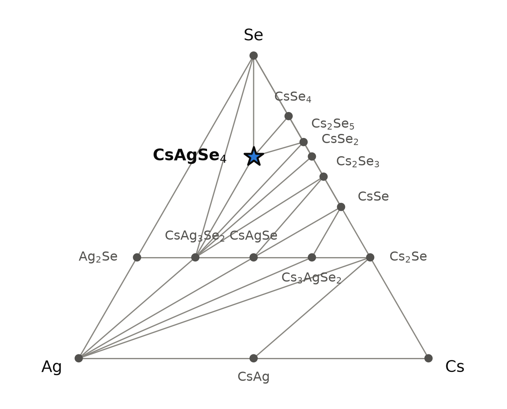
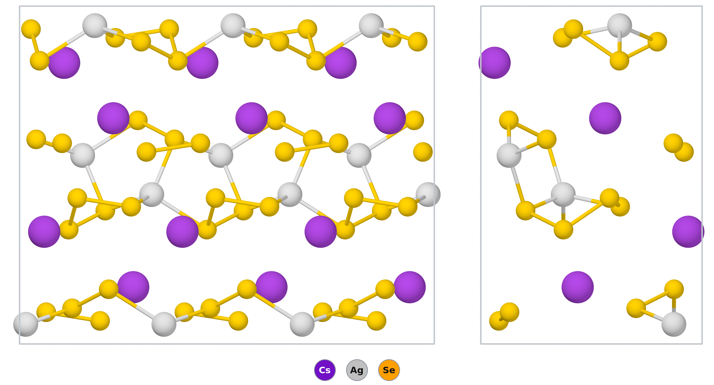

# CsAgSe₄ — a caesium silver polyselenide in which tetraselenide ions link silver into chains

*A Material a Day · entry 31 · 19 November 2026 · status: **known (route differs)***

> **In one paragraph.** CsAgSe₄ is a polyselenide: the selenium is present as
> zig-zag Se₄²⁻ ions, Se–Se–Se–Se, and not as isolated Se²⁻. Each Se₄ ion closes a
> five-membered AgSe₄ ring by binding one silver through both of its ends, and each silver
> takes two more selenium atoms from neighbouring ions. The result is an [AgSe₄]⁻ chain along
> the short a axis, with caesium between the chains. The compound has been made: red needles
> grew from caesium carbonate, silver and selenium in ethylenediamine at 300 °C, and the
> structure and an optical gap of 1.63 eV were reported in 1998 together with the rubidium
> analogue [1]. The computed structure reproduces the measured one atom for atom (cell axes
> 1–4 % long). In the PBE table it lies on the convex hull, 4 meV/atom below its competitors
> (SCAN: 16 meV/atom). That is far inside the error of computed chalcogenide energies, so
> the margin is not resolved. The PBE gap is 1.32 eV, 0.31 eV below the measured one. The
> main caveat is a database one. With Materials-Project settings the compound appears
> 293 meV/atom above the hull, the number the route tools see. That table applies its
> selenide energy correction to CsSe₃, AgSe₂ and CsAg₃Se₂ but not to CsAgSe₄. On a
> consistent footing every simple charge of Cs₂Seₓ, Ag₂Se and Se goes to the compound,
> provided selenium is kept in excess in a sealed tube. The published synthesis took a
> different path: a solvent at 300 °C and a charge short of selenium.

Computed numbers come from the Alexandria database unless another tool is named.
Measured numbers carry a reference.

## 1. Identity

| | computed (PBE) | measured [1] | difference |
|---|---|---|---|
| Formula | CsAgSe₄ = Cs⁺ Ag⁺ (Se₄)²⁻ | CsAgSe₄ | — |
| Alexandria id | `agm003232993` | — | — |
| Space group | P2₁2₁2₁ (no. 19), Z = 4 | P2₁2₁2₁, Z = 4 | same |
| a (Å) | 5.913 | 5.855(2) | +1.0 % |
| b (Å) | 9.473 | 9.090(3) | +4.2 % |
| c (Å) | 14.486 | 13.885(4) | +4.3 % |
| Volume per formula unit (ų) | 202.8 | 184.75(10) | +9.8 % |
| Density (g cm⁻³) | 4.56 | 5.003 (calculated from the cell) | −8.9 % |
| Appearance | — | red needles | — |
| Structure type | prototype label ABC4_oP24_19_a_a_4a; isostructural with RbAgSe₄ [1] | — | — |
| Formation energy | −0.407 eV/atom (PBE) · −0.352 eV/atom (Materials-Project settings, no selenide correction applied; see section 5) | — | — |
| Magnetism | none | — | — |

The measured cell is from single-crystal X-ray diffraction at 298 K (Mo Kα, R = 0.021) [1];
the structure is also deposited in COD (1509283). The CIF is [`CsAgSe4.cif`](CsAgSe4.cif). No Wikipedia page
on this compound was found.

**The cell is long across the chains and right along them.** a, the chain axis, is held
by Ag–Se and Se–Se bonds and comes out 1 % long, as PBE usually does. b and c are 4 % long.
Those directions are held by Cs–Se contacts and by dispersion between the chains, which PBE without
a van der Waals term underbinds. The density is therefore 9 % low. The measured cell is at
room temperature and the computed one is static, so thermal expansion, if anything, hides
part of the PBE excess.

## 2. Where it sits

<picture>
  <source media="(prefers-color-scheme: dark)" srcset="phase_diagram_dark.png">
  
</picture>

The Cs–Ag–Se triangle at 0 K (PBE table), with 15 phases on the hull. CsAgSe₄ sits in
the selenium-rich corner. It shares tie lines with Se, CsSe₄, Cs₂Se₅ and CsAg₃Se₂, and it
is the only ternary on the selenium-rich side of the Ag₂Se–Cs₂Se line. The other ternaries on the hull are CsAg₃Se₂,
CsAgSe and Cs₃AgSe₂, all on that line, with selenium as Se²⁻.

| | PBE (`energy_runs_pbe`) | SCAN (`energy_runs_scan`) | Materials-Project settings (`energy_runs_pbe_mp`) |
|---|---|---|---|
| CsAgSe₄ | on the hull, **4.4 meV/atom** below its competitors | on the hull, **15.9 meV/atom** below | **293.5 meV/atom above** the hull |
| competing assemblage | CsSe₄ + CsAg₃Se₂ + Se | — | CsAg₃Se₂ + AgSe₂ + CsSe₃ |
| other polymorphs | P2₁ (`agm131553505`), 25.9 meV/atom above | none | P2₁, 319.9 above |

The PBE and SCAN tables agree. The Materials-Project-settings table does not, for a reason
that has nothing to do with this compound (section 5).

## 3. Structure

*Left: three cells along a, viewed along b; the [AgSe₄]⁻ chains run left to right.
Right: one cell viewed along a, down the chains. Only Ag–Se bonds up to 2.85 Å and Se–Se
bonds are drawn. Cs violet, Ag grey, Se yellow.*

| site | Wyckoff | x, y, z (PBE) | neighbours, computed (Å) | measured [1] (Å) |
|---|---|---|---|---|
| Cs | 4a | 0.322, 0.562, 0.668 | 9 Se 3.73–3.93, 2 Se 4.15–4.26 | 9 Se 3.62–3.90, 2 Se 4.03–4.04 |
| Ag | 4a | 0.544, 0.128, 0.558 | Se 2.642, 2.648, 2.655; 1 Se 2.801 | 2.632, 2.619, 2.614; 2.940 |
| Se1, chain end bonded to 2 Ag | 4a | 0.880, 0.298, 0.605 | Se 2.398; Ag 2.648, 2.655 | Se 2.369 |
| Se2, chain middle | 4a | 0.145, 0.127, 0.662 | Se 2.398, 2.423; Ag 2.801 | Se 2.369, 2.376 |
| Se3, chain end bonded to 1 Ag | 4a | 0.808, 0.130, 0.094 | Se 2.379; Ag 2.642 | Se 2.353 |
| Se4, chain middle | 4a | 0.418, 0.082, 0.068 | Se 2.379, 2.423 | Se 2.353, 2.376 |

The measured distances are those tabulated in [1] (298 K, uncertainties 0.002 Å), mapped
onto our site labels; [1] numbers the selenium atoms along the ion, so our Se3, Se4, Se2,
Se1 are its Se(1) to Se(4). They match the computed structure site for site.

- **Discrete Se₄²⁻ ions.** Each Se₄ unit is an unbranched, zig-zag chain of four atoms with
  Se–Se bonds of 2.38–2.42 Å (measured 2.35–2.38 Å) and Se–Se–Se angles near 103° in
  [1]. The next Se–Se distance is 3.66 Å (3.63 Å from the measured coordinates), so the
  ions are isolated. The charge count, Cs⁺ + Ag⁺ + Se₄²⁻, closes without any other
  assumption, and the bond-valence sums in [1] (Ag 0.98, Cs 1.37) agree with it.
- **Silver held by three ions.** Each Se₄ ion binds one silver through both of its ends
  (2.64 and 2.65 Å; measured 2.63 and 2.62 Å), closing a five-membered AgSe₄ ring. The same
  silver takes the end atom of the next ion along the 2₁ screw (2.66 Å, measured 2.61 Å) and,
  more weakly, an inner atom of the ion one cell further along a (2.80 Å, measured 2.94 Å).
  One end of every Se₄ ion therefore bridges two silver atoms, and the distorted silver
  tetrahedron (angles 100–121° measured) is completed by three different ions.
- **[AgSe₄]⁻ chains.** Following only the Ag–Se and Se–Se bonds, the framework breaks into
  one-dimensional chains along a, rings linked through silver, two per cell. Caesium sits
  between them with eleven selenium neighbours at 3.73–4.26 Å. The chain topology does not
  depend on the long 2.80 Å contact.
- **The long contact depends on the cation.** [1] measures it at 2.865 Å in RbAgSe₄ and
  2.940 Å in CsAgSe₄, and notes that with the bulky Ph₄P⁺ cation it opens to about 3.74 Å
  and silver becomes three-coordinate: a larger cation stretches the chain and pulls the
  fourth selenium away.
- **What PBE gets less right.** Bond lengths are reproduced to 0.4–2 %, except the long
  Ag–Se contact, which PBE makes 0.14 Å (5 %) shorter, shorter even than the measured one
  in the rubidium compound. That is the soft direction of the silver tetrahedron, and its
  error is in the opposite direction to the cell's.
- **The family.** Four more compounds carry the same prototype label and space group:

  | | RbAgSe₄ | CsCuSe₄ | RbCuSe₄ | CsCuS₄ |
  |---|---|---|---|---|
  | id | `agm003232957` | `agm003232529` | `agm003232854` | `agm005223351` |
  | depth below competitors, PBE (meV/atom) | 2.0 | 14.1 | 10.2 | 2.8 |
  | PBE gap (eV) | 1.22 | 1.09 | 1.00 | 1.77 |

  The rubidium compound has the same atomic coordinates within 0.01 and is the one
  reported in [1]: black needles, a = 5.809, b = 8.927, c = 13.435 Å at 298 K, optical gap
  1.58 eV. Its PBE gap is 0.36 eV (23 %) below that, the same error as for the caesium
  compound. [1] also cites the copper analogues RbCuSe₄ and CsCuSe₄ as approximately
  isostructural. The three copper compounds share the label and the cell shape, but we did not
  compare them site by site, and we did not retrieve their own papers. The label also
  covers unrelated salts such as NaAlCl₄, so it is not a structure type by itself.

## 4. Computed properties

### Electronic structure, beside the measured gap

| | value | against the measured 1.63 eV |
|---|---|---|
| PBE gap, indirect / direct | 1.32 / 1.34 eV | −0.31 eV (−19 %) |
| SCAN gap, indirect / direct | 1.42 / 1.45 eV | −0.21 eV (−13 %) |
| mBJ gap, machine-learned (tuga-sp) | 1.05 eV | −0.58 eV |
| PBE gap, machine-learned (tuga-sp) | 1.34 eV | — |
| measured, optical diffuse reflectance at room temperature [1] | 1.63 eV | — |

[1] took the gap from the inflection point of the derivative of the diffuse reflectance
(200–2500 nm, Kubelka–Munk). Both direct and indirect fits of the absorption edge were
roughly linear, so the measurement does not say which kind of gap it is; the computed
direct and indirect gaps differ by only 0.02 eV, which fits that ambiguity. The same
database of measured gaps that first pointed us to the value [3] quotes it correctly.
PBE underestimates it by 0.3 eV and SCAN by 0.2 eV, the usual direction and a modest size
for a selenide. For comparison, [1] reports 3.2 eV for the Ph₄P⁺ salt of the same chain and
attributes the smaller gaps of the alkali compounds to their more compact chains. The machine-learned mBJ value is further off than PBE. The model
has seen few polyselenides, and its estimate should not be preferred here. The density-of-states masses are
3.2 mₑ for electrons and 7.2 mₑ for holes. The heavy holes are what a top valence band
made of non-bonding lone pairs on the Se₄ ions would look like.

### Dielectric response

ε∞ = 6.22 on average, with principal values 4.53, 6.53 and 7.61, and a refractive index of
2.50 (PBE). The response is strongly anisotropic, as expected for a chain structure; the
tables do not say which principal value lies along which axis. Average Born effective
charges: Cs +1.49, Ag +0.57, Se −0.52, with the selenium tensor ranging from −2.02 to
+1.72. The silver charge is far below its formal +1, which fits the covalent Ag–Se
bonding. P2₁2₁2₁ has no centre of symmetry, so a piezoelectric response is allowed: the
largest clamped-ion component is 0.15 C m⁻². ε∞ is the electronic dielectric constant,
not the static one. A PBE gap 0.3 eV too small makes ε∞ somewhat too large.

### Charge transport (PBE)

The branch-point energy lies 0.39 eV above the valence-band maximum, low in a gap of 1.26
eV, so the compound should take holes more easily than electrons. At 300 K and 10¹⁹ cm⁻³
the Seebeck coefficient is −366 μV/K (n) and +497 μV/K (p); at 10²⁰ cm⁻³ it is −181 and
+300 μV/K. These are band-structure numbers for a 1.3 eV semiconductor at constant
relaxation time. They are not a thermoelectric claim.

### Mechanical (machine-learned, tuga-sp)

Bulk modulus 7.9 GPa, shear modulus 5.7 GPa, Young's modulus 12.7 GPa. These are very low,
in line with a molecular-ion salt with soft caesium contacts. They are screening estimates
on the stored PBE cell, which is itself 10 % too large. The real moduli are probably
higher, and none has been measured.

### Not computed

Phonons: the compound is not in the group's DFPT set. Elastic constants by DFT. The
direction of each principal dielectric value. Any calculation with a dispersion correction,
which section 1 suggests is needed for the cell.

## 5. Is it stable?

- **On the PBE and SCAN hulls**: 4.4 meV/atom (PBE) and 15.9 meV/atom (SCAN) below the
  competing assemblage CsSe₄ + CsAg₃Se₂ + Se. Two of the four tie-line partners, CsSe₄ and
  Cs₂Se₅, are computed phases that we did not look up.
- **Against the error of its class**: the calorimetric survey puts the scatter of computed
  chalcogenide formation energies at a median 83 meV/atom (n = 11). Silver compounds fall in
  a class that is offset by +332 meV/atom with a scatter of 116 (n = 9). Both surveys
  were done on the Materials-Project-settings table. A 4–16 meV/atom margin between
  chemically similar phases cancels much of that error, but we cannot say how much.
  **The margin is not resolved.** Since the compound has been made, the computed margin is not what
  decides that it exists. The useful result is that the calculation puts it on the hull at all.
- **Why the third table puts it 293 meV/atom above the hull.** With Materials-Project
  settings an energy correction of −0.472 eV per selenium atom is added to most selenides.
  In the stored entries it is applied to CsSe₃, AgSe₂, CsAgSe₃ and CsAg₃Se₂. It is not
  applied to CsAgSe₄, its polymorph, Cs₂Se₅ or CsSe₄. The competing assemblage on that table
  is made of corrected phases and the target is uncorrected, so the target is pushed up by
  about 4 × 0.472 / 6 = 0.31 eV/atom. With the same correction applied to CsAgSe₄ it would
  fall about 21 meV/atom below that assemblage. That is an indication, not a hull distance,
  because the uncorrected Cs₂Se₅ and CsSe₄ would move as well. The pattern is general.
  Among selenides with no other anion, 19 lie on the PBE hull but carry no correction in
  the Materials-Project-settings table. All 19 sit more than 100 meV/atom above that
  table's hull. All are selenium-rich, most of them polyselenides, among them RbAgSe₄,
  Cs₂Se₅, K₂Se₅ and K₃AuSe₁₃. We did not determine why the correction is skipped for them.
- **At temperature.** The temperature-dependent margin is computed on the
  Materials-Project-settings hull and inherits the same offset: +299 meV/atom at 300 K and
  +302 at 600 K. The 3 meV/atom shift between those temperatures is the only usable part.

## 6. How to make it

### How it was made

[1] grew the crystals solvothermally. Cs₂CO₃ (0.095 mmol), silver powder (0.19 mmol) and
selenium powder (0.57 mmol) were sealed with ethylenediamine in a silica tube, the tube was
placed in an autoclave counterpressured to 2400 psi (about 165 bar) of argon, and the
assembly was held at 300 °C for 6 days. The product was red needles; no yield and no
by-products are reported for the caesium compound. The rubidium analogue was made the same
way from Rb₂CO₃ in supercritical ammonia at 172 °C for 4 days, in about 40 % yield.

**Beside what the hull proposes.** The two agree on a sealed vessel, no excess silver and a
temperature below the boiling point of selenium. They differ in two ways.
- *Medium.* [1] works in a solvent at 573 K, a route it describes as reaching lower
  temperatures and sometimes kinetic products; the hull routes below are solvent-free reactions of solid selenides with
  a selenium melt. The hull says nothing about a solution route.
- *Selenium.* The published charge has Cs : Ag : Se = 1 : 1 : 3, one selenium per formula
  unit short of CsAgSe₄, while the hull asks for selenium in excess. Treated as a closed
  Cs–Ag–Se mixture on the PBE hull, a 1 : 1 : 3 charge would put only 40 % of the silver
  into CsAgSe₄, with Cs₂Se₅ and CsAg₃Se₂ beside it. The amine solution and the carbonate
  make the real system open to other products, and [1] reports only the crystals that were
  picked, so the paper does not test this prediction.

### Routes the hull proposes

The group's route tools price reactions on the Materials-Project-settings hull, where
CsAgSe₄ is 293 meV/atom too high. On that hull every charge below goes to AgSe₂ + CsSe₃ +
CsAg₃Se₂ and never to the target. We therefore priced the same charges on the PBE table,
where no selenide correction is applied to any phase, with pymatgen's phase diagram built from
the stored PBE hull phases.

| charge (PBE table) | dE (meV/atom of mixture) | equilibrium products |
|---|---|---|
| Cs₂Se₅ + Ag₂Se + 2 Se | −21.3 | 2 CsAgSe₄ |
| Cs₂Se₃ + Ag₂Se + 4 Se | −36.4 | 2 CsAgSe₄ |
| Cs₂Se + Ag₂Se + 6 Se | −115.8 | 2 CsAgSe₄ |
| Cs₂Se + 2 Ag + 7 Se | −139.8 | 2 CsAgSe₄ |

All four go to the compound alone. By the fewest-reagents-then-least-driving-force rule the first
ranks highest. The calorimetric error of these energies is tens to hundreds of
meV/atom (section 5), larger than the spread between the routes.

### One route in practice

- **Charge**: Cs₂Se (or Cs₂Seₓ), Ag₂Se or silver powder, and selenium, with selenium in
  excess of CsAgSe₄. Weigh in an argon glovebox: caesium selenides react with air and moisture.
- **Atmosphere and container**: an evacuated, sealed silica tube. SiO₂ coexists with the
  product on the PBE hull. The tube is needed anyway, because selenium boils at 958 K.
- **Keep selenium in excess.** The compound is stable only over 19 meV of selenium
  chemical potential, from pure selenium downwards. Below that it gives up selenium to
  Cs₂Se₅ + CsAg₃Se₂. Excess selenium pins the potential at the safe end and can be removed afterwards.
- **Temperature**: no melting or decomposition point of the product is known to us; the
  crystals of [1] survived 6 days at 573 K in solution. The
  Tammann rule puts bulk diffusion in the charge at about 410 K (estimated melting points
  for Ag₂Se and the caesium selenides). Selenium melts at 494 K, so a selenium-rich melt is
  available well below typical solid-state temperatures. Laboratories fire charges of this
  kind at 960 ± 220 K. That is a habit, and it lies above the boiling point of the selenium
  this route depends on.
- **Not silver**: silver metal reduces the product to CsAg₃Se₂ + Se (−32 meV/atom), so
  neither a silver container nor an excess of silver powder is safe.

### Metathesis, tested

| charge (PBE table) | dE (meV/atom) | products |
|---|---|---|
| Cs₂Se₅ + AgCl | −126.2 | CsAgSe₄ + CsCl + Se |
| 2 CsCl + Na₂Se + Ag₂Se + 6 Se | −47.9 | 2 CsAgSe₄ + 2 NaCl |
| 2 CsCl + K₂Se + Ag₂Se + 6 Se | −78.5 | 2 CsAgSe₄ + 2 KCl |

**Metathesis works on the PBE hull.** CsCl, NaCl and KCl all coexist with the product, so
the salt formed can be washed out without attacking it. Cs₂Se₅ also coexists with it,
which makes a caesium polyselenide melt a possible reaction medium. On the
Materials-Project-settings hull the first charge goes to CsCl + AgSe₂ + CsSe₃ instead
(−367 meV/atom). That table also places AgCl and CsCl themselves 91 and −181 meV/atom away
from calorimetry.

### Powder pattern (Cu Kα, computed)

| 2θ (°) | hkl | I |
|---|---|---|
| 11.16 | 011 | 40 |
| 12.22 | 002 | 36 |
| 24.07 | 120 | 56 |
| 24.58 | 004 | 55 |
| 26.35 | 014 | 93 |
| 27.08 | 122 | 100 |
| 28.91 | 104 | 66 |
| 30.45 | 123 | 88 |
| 32.32 | 211 | 97 |

The computed b and c are 4 % too long, so lines with large k or l will appear about 4 %
higher in 2θ in a measured pattern. Read the pattern against the measured cell rather than
against this table. Impurities and what they mean (strongest computed lines):
- trigonal Se (22.7°, 28.9°): the excess selenium, expected; remove it.
- Cs₂Se₅ (27.9°, 25.3°) together with CsAg₃Se₂ (21.4°): too little selenium, or selenium lost from
  the tube.
- CsAg₃Se₂ alone, or Ag₂Se (19.4°): silver in excess, or contact with silver metal.
- CsSe₄ (25.7°): caesium in excess.

### Hazards

Selenium and its compounds are toxic. Caesium metal and caesium selenides react
violently with water. Selenides release hydrogen selenide, a very toxic gas, on contact with acid. Sealed
tubes holding selenium can burst if heated past its boiling point too quickly.

## 7. What it is good for

We found no report of a use, and [1] proposes none. The compound is a 1.6 eV semiconductor
(measured [1]) without a centre of symmetry, so second-order optical and piezoelectric responses are
allowed by symmetry. Its value so far is structural: it shows how Se₄²⁻ ions can bridge a
soft metal ion into chains, and it is a well-defined calibration point for computed
polyselenides.

## 8. How this could be wrong

- **One measurement of each property.** The cell, the bond lengths and the gap come from a
  single 1998 paper [1], and the gap from one reflectance spectrum whose direct or indirect
  nature was left open. The Cs–Se distances tabulated in [1] (3.62–4.04 Å) are not
  reproduced by its printed caesium coordinates, which give 3.49–4.20 Å; the silver and
  selenium coordinates do reproduce the tabulated Ag–Se and Se–Se bonds. We quote the table.
- **The margin is not resolved.** 4 (PBE) to 16 (SCAN) meV/atom against a chalcogenide
  scatter of about 83 meV/atom.
- **Routes priced by hand.** The route table uses the PBE table and pymatgen rather than
  the group's tools, because those tools see the artefact of section 5. The PBE hull
  carries no anion correction at all, which is consistent but not necessarily accurate for
  reaction energies with Se metal.
- **The cell.** PBE leaves the inter-chain directions 4 % long. A van der Waals correction
  would change the cell, and the soft moduli, more than the hull distance.
- **The family.** The three copper analogues were not checked atom by atom or in the
  literature.
- **Favourable is not fast.** Every reaction energy here is 0 K thermodynamics.

## 9. Literature

Searches (OpenAlex unless noted), 15 November 2026:

| query | hits | relevant |
|---|---|---|
| CsAgSe4 | 1 | none (a computed phonon dataset) |
| Synthesis and characterisation of MAgSe4 (M = Rb, Cs) (Crossref, OpenAlex) | 5 | [1] |
| cesium silver polyselenide | 10 | [2] |
| RbAgSe4 tetraselenide silver chain | 0 | — |
| alkali silver polyselenide [AgSe4] Se4 2- chains crystal structure | 0 | — |
| Emirdag Kolis silver selenide supercritical ammonia | 1 | none |
| CsAgSe4 band gap optical (OpenAlex, arXiv, Crossref) | 10 | none |
| polyselenide flux synthesis silver cesium selenide Kanatzidis | 2 | none |
| cesium tetraselenoargentate OR "Cs[AgSe4]" | 5 | none |
| web search "CsAgSe4" | 10 | the structure deposit of [1], [3], computed database entries |

**Result: known; the published route differs from the one the hull proposes.** The compound
was made and its structure solved in 1998 [1]. We found no later experimental work on it.
The open question is a property one, not an existence one: the only measured property we
found besides the structure is the gap.

References:

1. M. Emirdag, G. L. Schimek, J. W. Kolis, "Synthesis and characterization of MAgSe₄
   (M = Rb, Cs)", *J. Chem. Crystallogr.* **28**, 705–711 (1998).
   [doi:10.1023/A:1021704302492](https://doi.org/10.1023/A:1021704302492). Full text read:
   synthesis, crystal data, coordinates, bond lengths, bond-valence sums and optical gaps.
   The structure is also deposited in
   [COD 1509283](https://www.crystallography.net/cod/1509283.html).
2. C. Graf, A. Assoud, O. Mayasree, H. Kleinke, "Solid state polyselenides and
   polytellurides: a large variety of Se–Se and Te–Te interactions", *Molecules* **14**,
   3115 (2009). [doi:10.3390/molecules14093115](https://doi.org/10.3390/molecules14093115).
   Abstract only. Background on Seₙ²⁻ chains in alkali-metal polyselenides.
3. Materials data entry "CsAgSe₄", Ruhr-Universität Bochum,
   [demo.mdi.ruhr-uni-bochum.de/object/csagse4-5131](https://demo.mdi.ruhr-uni-bochum.de/object/csagse4-5131).
   Read in full. Lists Eg = 1.63 (optical diffuse reflectance) as experimental, citing [1];
   the value agrees with [1].

## 10. Provenance

- Structure, energies, gaps, charges: Alexandria database, tables `energy_runs_pbe`
  (PBE, MatPES settings), `energy_runs_scan` and `energy_runs_pbe_mp` (PBE,
  Materials-Project settings).
- Route energies and the selenium window: pymatgen phase diagrams built from the
  `energy_runs_pbe` hull phases. Margin at temperature, calorimetric error, kinetic
  estimates and reagent data: the group's reaction-graph tools, which use
  `energy_runs_pbe_mp`.
- Dielectric and transport tables: Alexandria property tables.
- Elastic moduli and machine-learned gaps: tuga-sp.
- Measured cell, bond lengths, synthesis and gaps: [1], Tables 1–4 and text.
- Pictures: POV-Ray via `tools/picture.py`; phase diagram via `tools/phase_diagram.py`.
- Drafted by Claude (Anthropic) and reviewed by a person before publication.
