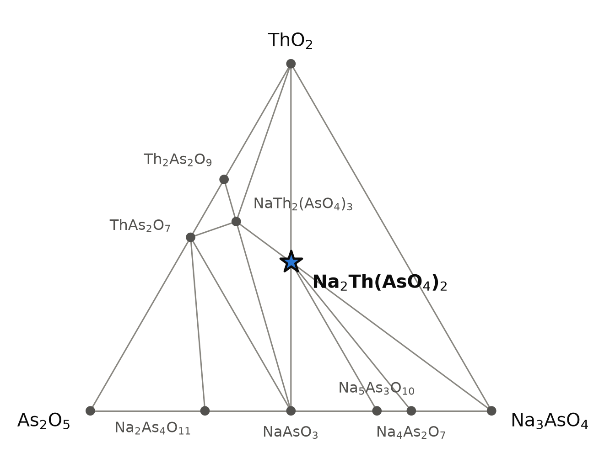
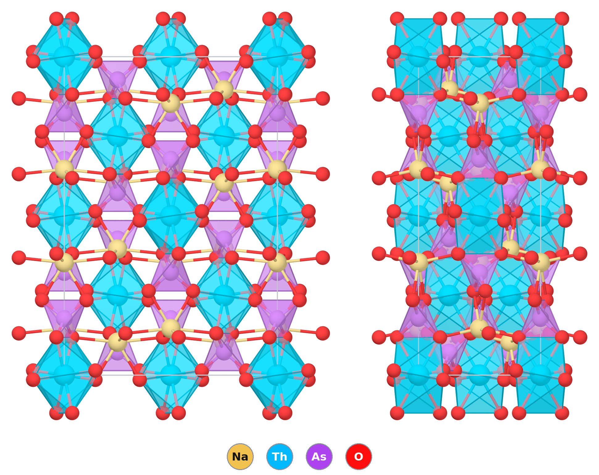

# Na₂Th(AsO₄)₂ — sodium thorium arsenate, a framework of ThO₈ and AsO₄ with sodium in the channels

*A Material a Day · entry 32 · 20 November 2026 · status: **known** (single-crystal structure, 2014)*

> **In one paragraph.** Na₂Th(AsO₄)₂ is a sodium thorium(IV) arsenate whose structure was
> solved on single crystals in 2014, as one member of the series A₂Th(AsO₄)₂ with A = Li,
> Na, K, Rb and Cs. It is orthorhombic (Fddd): each thorium has eight oxygen neighbours,
> the ThO₈ polyhedra are tied into a three-dimensional framework by AsO₄ tetrahedra, and
> sodium sits in its channels. It was made from thorium nitrate, ammonium dihydrogen
> arsenate and sodium nitrate: a phase-pure powder from the stoichiometric mixture at 993 K,
> and crystals from an arsenate-rich melt in platinum at 1273 K. It melts at 1383 K and
> then decomposes. All three
> tables of the Alexandria database put it on the convex hull, 18 to 26 meV/atom below its
> competitors; the scatter of computed oxide energies against calorimetry is larger than
> that, so the calculation alone could not settle its stability, and the experiment does.
> PBE makes the cell 4 % too large, mostly through the As–O bond. Of the five alkali
> members, it is the only one with this structure. It contains a radioactive element
> (thorium) and a toxic one (arsenic).

Everything below is computed unless a reference is given. Read
[How this could be wrong](#8-how-this-could-be-wrong) before using any of it.

## 1. Identity

| | computed (PBE) | measured |
|---|---|---|
| Formula | Na₂Th(AsO₄)₂ (database: Na₂ThAs₂O₈) | |
| Alexandria id | `agm003234204` (the same id in all tables) | |
| Space group | Fddd (no. 70), Z = 8 | Fddd, Z = 8 [1] |
| Cell | a = 7.122 Å, b = 12.428 Å, c = 18.584 Å | a = 7.0425(3) Å, b = 12.3268(4) Å, c = 18.2185(5) Å, 293 K [1] |
| Volume | 205.6 ų per formula unit | 197.7 ų per formula unit [1] |
| Density | 4.49 g cm⁻³ | 4.669 g cm⁻³ [1] |
| Melting | not computed | onset 1383(3) K, followed by decomposition with mass loss (DSC and TG in air) [1]; the methods of [1] give the thermal-analysis range as room temperature to 1273 K, so this value lies outside the stated range and is quoted as printed |
| Structure type | its own type in the database (label AB2C2D8_oF104_70_a_e_e_2h), shared only with Na₂Th(PO₄)₂ | |
| Formation energy | −2.077 eV/atom (PBE); −2.501 eV/atom (Materials-Project settings) | not found |

There is no Wikipedia page for this compound or for the thorium arsenates.
The CIF is [`Na2Th(AsO4)2.cif`](Na2Th(AsO4)2.cif); all numbers are in [`structure.json`](structure.json).

## 2. Where it sits

<picture>
  <source media="(prefers-color-scheme: dark)" srcset="phase_diagram_dark.png">
  
</picture>

A section through the four-element Na–Th–As–O system with corners ThO₂, As₂O₅ and Na₃AsO₄
(PBE table, 0 K): every phase with sodium, thorium and arsenic in their highest oxidation
states lies in this triangle. Na₂Th(AsO₄)₂ is on the hull and has tie lines to ThO₂,
NaAsO₃, Na₅As₃O₁₀, Na₄As₂O₇, Na₃AsO₄ and NaTh₂(AsO₄)₃. It sits on the line from ThO₂ to
NaAsO₃: one ThO₂ and two NaAsO₃ have exactly its composition.

| competing assemblage | PBE (`energy_runs_pbe`) | PBE, Materials-Project settings (`energy_runs_pbe_mp`) | SCAN at the PBEsol cell (`energy_runs_scan`) |
|---|---|---|---|
| 0.4 Na₄As₂O₇ + 0.2 ThO₂ + 0.4 NaTh₂(AsO₄)₃ (Materials-Project-settings hull) | **18.3** meV/atom below | **17.8** meV/atom below | 25.5 meV/atom below |

- **The other Na–Th arsenates.** Two more quaternary phases are on the computed hull:
  NaTh₂(AsO₄)₃ (R-3c) in both tables, and Na₄Th(As₂O₇)₂ (P4/ncc), a pyroarsenate,
  only in the Materials-Project-settings table; the PBE table has no entry for it. Three
  sodium thorium arsenates, Na₅Th₄(AsO₄)₇, Na₅Th(AsO₄)₃ and Na₄Th(As₂O₇)₂, were reported
  in 2020 [3]. The first two are in neither table. Both lie on lines through Na₂Th(AsO₄)₂'s
  neighbourhood (Na₅Th(AsO₄)₃ = Na₂Th(AsO₄)₂ + Na₃AsO₄), so the computed hull around it
  is incomplete; whether either would cut it was not computed.
- **The thorium arsenates** on the ThO₂–As₂O₅ edge of the PBE hull are Th₂As₂O₉, ThAs₂O₇
  and Th(As₄O₉)₂.

## 3. Structure

*Left: along a. Right: along b. One conventional cell. ThO₈ blue, AsO₄ purple, Na yellow
spheres with their Na–O bonds, O red.*

| site | Wyckoff | coordination (PBE) | measured [1] | PBE error |
|---|---|---|---|---|
| Th | 8a | 4 O at 2.330 Å + 4 O at 2.577 Å | 4 × 2.321 Å + 4 × 2.545 Å | +0.4 %, +1.2 % |
| As | 16g | 2 O at 1.716 Å + 2 O at 1.725 Å | 2 × 1.673 Å + 2 × 1.687 Å | +2.6 %, +2.2 % |
| Na | 16g | 2 O at 2.411 Å + 2 at 2.570 Å + 2 at 2.716 Å | 2 × 2.367 + 2 × 2.577 + 2 × 2.721 Å | +1.9 %, −0.3 %, −0.2 % |
| O1 | 32h | 1 As, 1 Th, 2 Na | | |
| O2 | 32h | 1 As, 1 Th, 1 Na | | |

The measured distances are those of the deposited single-crystal structure of [1]
(Crystallography Open Database entry 4341195) and agree with the ranges given in the paper
(Th–O 2.3211–2.5453 Å, As–O 1.6729 and 1.6872 Å). The shortest Na–Na distance is 3.668 Å
in PBE against 3.6061(4) Å measured, +1.7 %.

- **Thorium** has eight oxygens, four at 2.33 Å and four at 2.58 Å, on a site of 222
  symmetry. Every oxygen of the structure belongs to one ThO₈ polyhedron and one AsO₄
  tetrahedron; no oxygen is shared between two thorium atoms.
- **How the units connect.** Each ThO₈ shares an edge with two AsO₄ tetrahedra on opposite
  sides along c (Th–As 3.30 Å) and a corner with four more (Th–As 3.83 Å). Each AsO₄
  therefore touches three thorium atoms, one by an edge and two by corners. The result is
  a three-dimensional [Th(AsO₄)₂]²⁻ framework. [1] classifies its underlying net, with Th
  and As as nodes, as the anatase (ant) net, the same for the Na, K, Rb and Cs members
  despite their different symmetries. In the sodium and caesium members the two
  edge-sharing arsenates sit on opposite sides of thorium (trans), in the potassium and
  rubidium members on the same side (cis).
- **Sodium** sits in cages of the framework, which form chains, with six oxygens between
  2.41 and 2.72 Å; the sodium atoms run in zigzag chains [1].
- **Where PBE goes wrong.** The cell is 1.1, 0.8 and 2.0 % too long in a, b and c, and
  4.0 % too large in volume. The thorium and sodium distances are within 2 %, and three
  of the five are within 0.4 %; the As–O bond is 2.2–2.6 % too long, the largest error in
  the structure. PBE is generally known to lengthen short covalent bonds of this kind;
  we did not test whether the As–O error is the same in other arsenates.

**The family A₂Th(AsO₄)₂** [1]. The five alkali members take four structures; the paper
calls this morphotropy.

| A | measured structure [1] | lowest in the PBE table | depth below competitors, PBE (meV/atom) | volume per formula unit, PBE / measured (ų) | ΔV |
|---|---|---|---|---|---|
| Li | P2₁/c, layers [Th(AsO₄)₂]²⁻ with Li between | P2₁/c | **13.6 above** the hull | 175.0 / 170.5 | +2.6 % |
| Na | Fddd | Fddd | 18.3 | 205.6 / 197.7 | +4.0 % |
| K | P2₁/n | P2₁/c (same space group, other setting) | 10.8 | 207.6 / 195.4 | +6.2 % |
| Rb | P2₁/n, isotypic with K | I4₁/amd (the Cs type); the monoclinic form 0.3 meV/atom above | 22.7 | 218.3 / 207.5 (monoclinic) | +5.2 % |
| Cs | I4₁/amd | I4₁/amd | 6.6 | 259.6 / 249.5 | +4.1 % |

Measured cells are from the deposited structures of [1] (COD 4341195–4341199).

- The database reproduces the measured structure for Li, Na, K and Cs. For Rb it puts the
  tetragonal Cs type 0.3 meV/atom below the measured monoclinic form, a difference far
  below any error bar; the two are a tie. The tetragonal form it prefers is 15 % less
  dense. On heating [1], Rb₂Th(AsO₄)₂ goes reversibly from its monoclinic cell to a
  tetragonal one at 749 K (DSC onset 779 K on heating, 669 K on cooling), and K₂Th(AsO₄)₂
  to an orthorhombic cell at 1088 K and a tetragonal one at 1150–1200 K. The cells of these
  high-temperature forms resemble those of the sodium and caesium members, but their
  patterns could not be refined with either structure, so what they are is open. The
  near-tie the database finds for the rubidium member is at least consistent with a
  tetragonal form lying close in energy.
- Na₂Th(AsO₄)₂ itself shows no transition: its DSC curve has a single endothermic peak, the
  melting at 1383 K [1].
- Li₂Th(AsO₄)₂ has been made [1] but sits 13.6 meV/atom above the PBE hull: a reminder of
  the size of the error at stake in section 5. It is the one layered member, with
  nine-coordinate thorium, and melts at 1324 K [1].
- **The phosphate is a miss.** Na₂Th(PO₄)₂ is in the PBE table only in this Fddd structure,
  on the hull, 27.8 meV/atom below its competitors. But [1] states that Na₂Th(PO₄)₂ is
  reported in P2₁/c, with a = 7.055(4) Å, b = 21.66(1) Å, c = 9.095(5) Å, β = 111.56(2)°,
  a structure in which half the thorium atoms have trans and half cis edge-sharing
  phosphates; it cites two earlier papers (1984 and 2002) that we did not retrieve. The
  Materials-Project-settings table has a P2₁/c entry (`agm005287270`) whose cell matches
  that one within 2.4 % (7.082, 22.129, 9.316 Å, 112.1°), and puts it 22.7 meV/atom above
  the Fddd form. If the reported structure is the ground state, the calculation misranks
  the phosphate by more than the arsenate's own margin of 18 meV/atom. Whether the Fddd
  phosphate has ever been made was not searched.

## 4. Computed properties

All numbers are in [`properties.json`](properties.json). Thorium(IV) has no f electrons,
so no f-free analogue is needed.

### Electronic structure

| | value | comment |
|---|---|---|
| Band gap, PBE | 3.66 eV (indirect), 3.72 eV (direct) | PBE underestimates gaps |
| Band gap, SCAN at the PBEsol cell | 4.26 eV (indirect), 4.30 eV (direct) | |
| Band gap, machine-learned PBE estimate | 3.76 eV | agrees with the PBE value |
| Band gap, machine-learned MBJ estimate | 5.8 eV | a screening estimate from the structure alone |
| Measured | none found | [1] reports vibrational spectra, not optical absorption; the crystals are colourless |

A wide-gap insulator by every estimate, consistent with the colourless crystals [1]. Which states form the band edges was not
analysed. The MBJ estimate is the one to use as a guess for the optical gap.

### Dielectric response (PBE)

| | principal values | average |
|---|---|---|
| Electronic dielectric constant ε∞ | 2.66, 3.18, 3.23 | 3.02 |
| Refractive index √ε∞ | | 1.74 |

| Born effective charge (trace/3) | Na | Th | As | O |
|---|---|---|---|---|
| nominal | +1 | +4 | +5 | −2 |
| computed | +1.16 | **+5.45** | +3.32 | −1.80 |

- **Thorium carries more than its nominal charge** (+5.45 on average, principal values
  4.12 to 6.57): moving it changes the polarisation of its Th–O bonds strongly. Arsenic
  carries less than its nominal +5, as expected for the covalent As–O bond.
- One axis is less polarisable than the other two (2.66 against 3.2). ε∞ is not the static
  dielectric constant, which needs the lattice part. The structure is centrosymmetric, so
  there is no piezoelectric response.

### Charge transport (PBE, constant relaxation time)

| | electrons | holes |
|---|---|---|
| Density-of-states mass (mₑ) | 0.85 | 7.9 |
| Conductivity mass at 300 K, 10¹⁹ cm⁻³ (mₑ) | 0.57 | 5.9 |
| Seebeck coefficient at 300 K, 10¹⁹ cm⁻³ (μV/K) | −216 | +545 |
| Seebeck coefficient at 300 K, 10²⁰ cm⁻³ (μV/K) | −78 | +348 |

Light electrons and heavy, flat oxygen-derived hole bands. The branch-point energy is 1.87
eV above the valence-band maximum, about half way across the PBE gap. These numbers
describe the band edges of an insulator that nobody has doped; they are not a
thermoelectric or electronic recommendation.

### Mechanical (machine-learned)

| bulk modulus | shear modulus | Young's modulus |
|---|---|---|
| 69 GPa | 37 GPa | 75 GPa |

Screening estimates from a graph neural network on the PBE structure, not elastic-constant
calculations; no measured moduli were found.

### Vibrations (machine-learned) beside Raman

The database's harmonic phonons from a machine-learned potential (EquFlashV2) on the PBE
structure have no imaginary frequency. Their zone-centre modes fall in two groups, which
the Raman spectrum of [1] also shows:

| | computed, Γ (cm⁻¹) | measured Raman [1] (cm⁻¹) |
|---|---|---|
| As–O stretching (ν₁, ν₃) | 16 modes, 733–884 | 803, 824, 837, **888** (strongest) |
| O–As–O bending (ν₄ and below) | up to 460 | 374, 419, 443, 458, 495 |

The highest computed stretching mode, 884 cm⁻¹, is 0.5 % below the strongest measured band;
the bending group ends at 460 cm⁻¹ against a highest measured bending band of 495 cm⁻¹.
That is a comparison of ranges, not of assigned modes: which computed modes are Raman
active was not worked out, and the potential is not DFT. [1] notes that the frequency of
the strongest band falls as the mean As–O bond lengthens across the five members (888
cm⁻¹ at 1.680 Å for sodium, 851 cm⁻¹ at 1.689 Å for rubidium).

### Not computed

DFT phonons (the compound is not in the group's phonon calculations), Raman activities
and intensities, spin–orbit coupling, a hybrid-functional or GW gap, elastic constants by
DFT, the static dielectric constant, defect energies.

## 5. Is it stable?

| calculation | Na₂Th(AsO₄)₂ against its competing assemblage |
|---|---|
| PBE (`energy_runs_pbe`) | on the hull, **18.3 meV/atom below** |
| PBE, Materials-Project settings (`energy_runs_pbe_mp`) | on the hull, **17.8 meV/atom below** |
| SCAN at the PBEsol geometry | on the hull, 25.5 meV/atom below |

- **The three tables agree** within 8 meV/atom; the spread is zero in the sense the reaction
  tools use (all three put it on the hull).
- **The error bar is larger than the margin.** For oxides, computed formation enthalpies
  on the Materials-Project-settings table scatter by 65 meV/atom (median absolute
  deviation over 82 compounds) about a bias of +5 meV/atom against calorimetry. The
  margin, 18 meV/atom, is less than a third of that scatter. The competitors here are
  themselves sodium and thorium arsenates and ThO₂, chemically close to the target, so
  much of the error should cancel; but that is an argument, not a number. **The
  calculation does not resolve the stability of Na₂Th(AsO₄)₂; the experiment shows it
  exists** [1]. The lithium member, made in the same work, sits 13.6 meV/atom
  *above* the PBE hull, which is the size of error the margin has to survive.
- **At temperature.** With harmonic phonons the margin barely moves: −16.1 meV/atom at
  300 K, −14.2 at 900 K, −13.7 at 1123 K and −13.4 at 1273 K, against a phonon error for
  the class of 7–18 meV/atom. Within these errors it stays stable up to the growth
  temperature. The measurement agrees: a phase-pure powder forms at 993 K, crystals grow
  at 1273 K, and the compound shows no transition until it melts at 1383 K, after which it
  loses mass and decomposes [1]. The calculation says nothing about the melting.
- **Air and water.** The calculation finds it inert towards O₂, N₂, H₂O and CO₂ at 0 K,
  and reduced by hydrogen (to NaAsO₂ + ThO₂ + H₂O, −181 meV/atom).

## 6. How to make it

**How it was made** [1]. Reagents: Th(NO₃)₄·5H₂O, NH₄H₂AsO₄ and NaNO₃, used as received.

- *Phase-pure powder:* Th(NO₃)₄·5H₂O : NH₄H₂AsO₄ : NaNO₃ = 1 : 2 : 2, ground, heated in air
  at 300 K/h to 723 K and held there 30 h, then reground and heated in steps (50 K up to
  873 K, 20 K above) with a powder pattern after each, until it matched the single-crystal
  structure. For sodium that was at 993 K.
- *Single crystals:* the same reagents in the ratio 1 : 10 : 3, five times the
  stoichiometric arsenate and one and a half times the sodium, in a platinum crucible, heated to 1273 K in 1 h, cooled at 5 K/h to 673 K, then
  furnace-cooled. The crystals are colourless blocks grown from the melt that the excess
  arsenate forms. Whether the crucible was covered is not stated.

Once water, nitrogen oxides and ammonia are gone, the powder charge has the composition
ThO₂ + Na₂O + As₂O₅, which is also exactly route D below, ThO₂ + 2 NaAsO₃. From the three
oxides the target is 331 meV/atom downhill at 0 K; from ThO₂ + 2 NaAsO₃, 39 meV/atom.
Which of these intermediates the nitrate and ammonium arsenate pass through was not
computed.

**What the hull proposes.** Energies are 0 K reaction energies per atom of the whole
charge, Materials-Project-settings scale, ranked fewest reagents first and then least
driving force. All 73 routes leave nothing to separate.

| route | charge | ΔE (meV/atom) | comment |
|---|---|---|---|
| A | ½ ThO₂ + ½ Na₄Th(As₂O₇)₂ | −18.0 | first by rank; the pyroarsenate is itself a phase someone has to make first [3] |
| B | ½ Na₃AsO₄ + ½ NaTh₂(AsO₄)₃ | −22.5 | two ternary or quaternary arsenates |
| C | ½ Na₄As₂O₇ + ½ Th₂As₂O₉ | −25.1 | |
| **D** | ThO₂ + 2 NaAsO₃ | −39.4 | the first route from a commercial thorium source; the target forms first |
| — | ThO₂ + Na₂O + As₂O₅ (what the published nitrate charge becomes) | −331 | three reagents, large driving force |

- **Beside practice.** The published powder route, nitrates plus ammonium arsenate, has
  the overall composition of route D, not of the first-ranked route A, and its reagents
  start far above both. The pathway check says why it still works: in a ThO₂ + Na₂CO₃ + As₂O₅ charge
  at 1173 K, ThO₂ and Na₂CO₃ do not react with each other, while As₂O₅ reacts with each of
  them, making sodium arsenates (Na₄As₂O₇, Na₅As₃O₁₀ or Na₃AsO₄, within 60 meV/atom of each
  other) and thorium arsenates (Th₂As₂O₉, ThAs₂O₇). These are all phases of the section
  in section 2, and the sodium arsenates are direct neighbours of the target. The check
  did not return how much driving force is left once they have formed, so it does not
  say the three-oxide charge is a good one; it says only that the first products are
  arsenates, not something off the section.
- **Route D in practice (computed, not tested).**
  - *Charge:* ThO₂ : NaAsO₃ = 1 : 2. NaAsO₃ can be made from Na₂CO₃ and As₂O₅ or NH₄H₂AsO₄.
  - *Pathway:* for this pair at 1173 K the target is the first product (−33.9 meV/atom on
    the measured scale), with no competing intermediate; Na₄Th(As₂O₇)₂ is the only other
    candidate and is not downhill.
  - *Bottom of the window:* nothing in the charge moves below 439 K, the Tammann
    temperature of NaAsO₃. Bulk diffusion in ThO₂ needs its own Tammann temperature, 1662
    K. But NaAsO₃ melts at 878 K, so above that the ThO₂ sits in molten sodium
    metaarsenate, which is a self-flux. The published phase-pure powder formed at 993 K
    [1], above that melting point and 670 K below ThO₂'s Tammann temperature, which fits
    the picture without proving it. The fitted "typical" firing temperature for such a
    charge, 1479 ± 223 K, is 490 K higher than what was needed.
  - *Top of the window:* the compound melts at 1383 K and then loses mass [1]. As₂O₅ alone
    decomposes to lower arsenic oxides and O₂ at 977 K in air (measured thermochemistry),
    and arsenic oxides are volatile. In NaAsO₃ the arsenic is bound to sodium and should be
    less volatile, but we could not compute that; the published 993 K for the powder and
    1273 K for crystals in excess arsenate both stay below the melting.
  - *Container:* platinum, gold, silver, palladium, alumina, zirconia and silica are all
    computed inert towards the product. Platinum is what was used [1]. Carbon, silicon
    carbide, BN, Ti, Zr, Ta, Nb, Mo, W, Fe and Ni reduce it; MgO, CaO and Y₂O₃ take the
    arsenate away from thorium.
  - *Atmosphere:* air. The oxygen window is wide: the lower end, where the arsenate is
    reduced, corresponds to air above 2400 K in the 0 K estimate, so ordinary air is far
    inside it. Hydrogen or a reducing gas would reduce As(V).
- **Metathesis, tested.**

  | charge | computed outcome |
  |---|---|
  | ThCl₄ + 2 Na₃AsO₄ | Na₂Th(AsO₄)₂ + 4 NaCl, −162 meV/atom (−262 per atom of target). NaCl is inert towards the target. ThCl₄ is a hygroscopic molecular chloride that boils at 1194 K, so it is an awkward reagent |
  | ThF₄ + 2 Na₃AsO₄ | Na₂Th(AsO₄)₂ + 4 NaF, −38.5 meV/atom. NaF is inert towards the target |
  | ThCl₄ + 2 NaAsO₃ + 2 Na₂O | Na₂Th(AsO₄)₂ + 4 NaCl, −410 meV/atom |

  All three are clean on paper, and the salt byproduct coexists with the target, so a
  chloride or fluoride melt is also a possible medium. Whether the salt can be washed
  out without attacking the arsenate was not computed. Lithium and potassium salts are
  not inert: LiCl and LiF exchange lithium into the product, KF and K₂CO₃ give
  K₂Th(AsO₄)₂. A flux, if any, should be a sodium salt (NaCl, NaF, NaBr, NaI, Na₂SO₄,
  Na₂CO₃, NaNO₃, Na₂MoO₄, Na₂WO₄ are all computed inert).

**Reading the powder pattern.** Strongest computed lines (PBE cell, Cu Kα):

| 2θ (°) | 15.11 | 25.33 | 28.02 | 28.73 | 28.90 | 32.29 | 38.52 | 48.76 |
|---|---|---|---|---|---|---|---|---|
| hkl | 111 | 131 | 115 | 040 | 220 | 026 | 206 | 246 |
| I | 100 | 29 | 36 | 22 | 42 | 26 | 16 | 23 |

With the measured cell every line moves to slightly higher angle (the computed cell is
about 1.3 % too long on average).

- **ThO₂ lines:** unreacted thoria, too cold or too short, or arsenic lost to the vapour.
- **NaTh₂(AsO₄)₃ lines:** sodium-poor; sodium lost, or too little in the charge.
- **Na₄As₂O₇, Na₅As₃O₁₀ or Na₃AsO₄ lines:** sodium-rich; the other side of the same tie lines.
- **Na₄Th(As₂O₇)₂, Na₅Th(AsO₄)₃ or Na₅Th₄(AsO₄)₇ lines:** the other sodium thorium
  arsenates [3]; the arsenic or sodium balance is off.
- **NaAsO₂ lines:** As(V) reduced, a reducing atmosphere or a carbon contact.

**Hazards.** Thorium-232 is a weak alpha emitter with radioactive daughters; thorium
compounds need radiological handling rules and their dust must not be inhaled. Arsenates
and arsenic oxides are acutely toxic and carcinogenic, and arsenic oxides volatilise on
heating: fire in a fume hood or a closed vessel. Thorium nitrate and sodium nitrate are
oxidisers. All residues are radioactive and arsenic-bearing waste.

## 7. What it is good for

We found no application of Na₂Th(AsO₄)₂, and [1] proposes none. It was made to map the
crystal chemistry of tetravalent actinides with oxo-anions of group 15 [1, 3]: how one
framework changes symmetry as the alkali ion grows. [1] gives two reasons for the work:
Th(IV) has a coordination chemistry close to that of Np(IV) and Pu(IV) and is far less
radioactive, so it stands in for them; and arsenates are a point of comparison for the
actinide phosphates, one of which, a thorium phosphate–diphosphate, has been proposed as
a host for uranium and plutonium. The results bear on actinide migration and on phosphate
ceramics [6]; the potassium, rubidium and caesium thorium phosphates
decompose to ThO₂ only after 30 h at 1673 K in air [4]. For calculations it is a
calibration point: a known framework, correctly ranked, with the As–O bond as the main
source of PBE's geometry error.

## 8. How this could be wrong

- **The margin is smaller than the error.** 18 meV/atom against 65 of oxide scatter: the
  hull alone cannot say this compound is stable, and in the same family it puts a
  compound that exists (Li₂Th(AsO₄)₂) 13.6 meV/atom above the hull. Its stability rests
  on the experiment.
- **The hull around it is incomplete.** Two of the three sodium thorium arsenates reported
  in 2020 are in neither table, and the third is missing from the PBE table. They could
  change the tie lines, the competing assemblage and the impurity list above.
- **The same calculation misranks the phosphate.** For Na₂Th(PO₄)₂ the database puts this
  Fddd structure 22.7 meV/atom below a P2₁/c entry whose cell matches the reported one
  (section 3). The arsenate's ranking agrees with experiment; the phosphate's, if the
  reported structure is its ground state, does not, by a margin of the same size.
- **Thorium's empty 5f states.** Th(IV) is formally f⁰, so the open-4f problem of the
  lanthanides does not arise; but empty actinide 5f states may lie near the
  conduction-band edge, and their position is not reliably given by the functionals used
  here. We did not analyse the band edges, and spin–orbit coupling was not included.
- **No DFT phonons.** The machine-learned phonons find the stored structure dynamically
  stable, but that potential is not DFT, and the Raman comparison is by range only.
- **The melting point is a single reading.** [1] gives 1383 K for the onset but states a
  thermal-analysis range ending at 1273 K; the number has not been checked elsewhere.
- **Volatility of arsenic** in the charge was not computed; the window's top end is an
  argument from As₂O₅, not a number for NaAsO₃.
- **The literature search can miss things.** See below.

## 9. Literature

**Searched 15 November 2026 (OpenAlex unless noted):** "Na2Th(AsO4)2 sodium thorium
arsenate" (0 hits); "alkali thorium arsenate structure Alekseev" (10 hits: [3], [4], [6], and unrelated work); a web search for the full text of [6]
(nothing); "A2Th(AsO4)2
morphotropy polymorphism" (OpenAlex and Crossref, 7 hits: [1], its abstract-service copy
[2], unrelated rare-earth fluoride papers); "sodium thorium phosphate Na2Th(PO4)2"
(OpenAlex and Crossref, 6 hits, none on Na₂Th(PO₄)₂, though [1] cites two reports of it);
"thorium arsenate solid state synthesis ThO2 arsenic pentoxide" (0 hits). Wikipedia: no
page for Na2Th(AsO4)2, sodium thorium arsenate, disodium thorium diarsenate or thorium
arsenate. The full text of [1] was supplied and read on 15 November 2026.

**Result: known compound.** Structure solved on single crystals in 2014 [1], as part of
the A₂Th(AsO₄)₂ series, with a phase-pure powder, Raman spectra and a melting onset of
1383 K. No measured gap or formation enthalpy was found for it.

1. N. Yu, V. V. Klepov, G. Modolo, D. Bosbach, E. V. Suleimanov, T. M. Gesing, L. Robben,
   E. V. Alekseev, "Morphotropy and Temperature-Driven Polymorphism in A₂Th(AsO₄)₂ (A = Li,
   Na, K, Rb, Cs) Series", *Inorg. Chem.* 53, 11231–11241 (2014). doi:10.1021/ic5018246.
   *Full text read; the supporting information was not. Synthesis, cell, distances,
   thermal analysis and Raman bands from the paper; the coordinates and the distances of
   the table in section 3 from the deposited structure, Crystallography Open Database entry
   4341195 (https://www.crystallography.net/cod/4341195.cif), and the cells of the other
   members from entries 4341196–4341199.*
2. The same work, *ChemInform* abstract (2014). doi:10.1002/chin.201452003. *Abstract
   read; superseded by the full text of [1].*
3. Y. Hao, E. V. Alekseev, V. V. Klepov et al., "Structural Variations in Complex Sodium
   Thorium Arsenates", *Eur. J. Inorg. Chem.* (2020). doi:10.1002/ejic.202000492.
   *Abstract read.*
4. G. R. Patkare, M. Shafeeq, A. Sengupta et al., "Investigation of the Thermal Properties
   of Alkali Metal Thorium Phosphates and Their Application for the Sorption of Uranyl Ion
   from Acidic Medium", *Eur. J. Inorg. Chem.* (2023). doi:10.1002/ejic.202300140.
   *Abstract read.*
5. Alexandria database, entry `agm003234204` (PBE, Materials-Project-settings and SCAN
   tables).
6. N. Yu, doctoral thesis on thorium and uranium oxo-arsenic(III/V) and oxo-phosphate(V)
   crystal chemistry, Forschungszentrum Jülich (2016), http://juser.fz-juelich.de/record/826222.
   *Abstract read (as returned by the search).*

## 10. Provenance

- **Data:** Alexandria database, tables `energy_runs_pbe` (structure, properties, hull),
  `energy_runs_pbe_mp` (reaction energies, competing phases, the phosphate polymorphs),
  `energy_runs_scan` and `phonons_pbe_equflashv2` (machine-learned harmonic phonons).
- **Tools:** the reaction-route code of this group (hull, reaction table, contact,
  calorimetric error, finite-temperature margin, pathway), a graph-neural-network property
  model for the moduli and the gap estimates, pymatgen for symmetry, distances and the
  powder pattern, POV-Ray for the pictures.
- **Authorship:** drafted by Claude (Anthropic) from those tools; reviewed by
  Miguel Marques. Corrections are welcome as issues on this repository.
