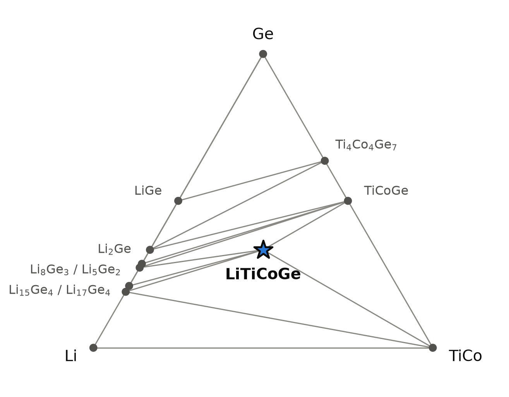
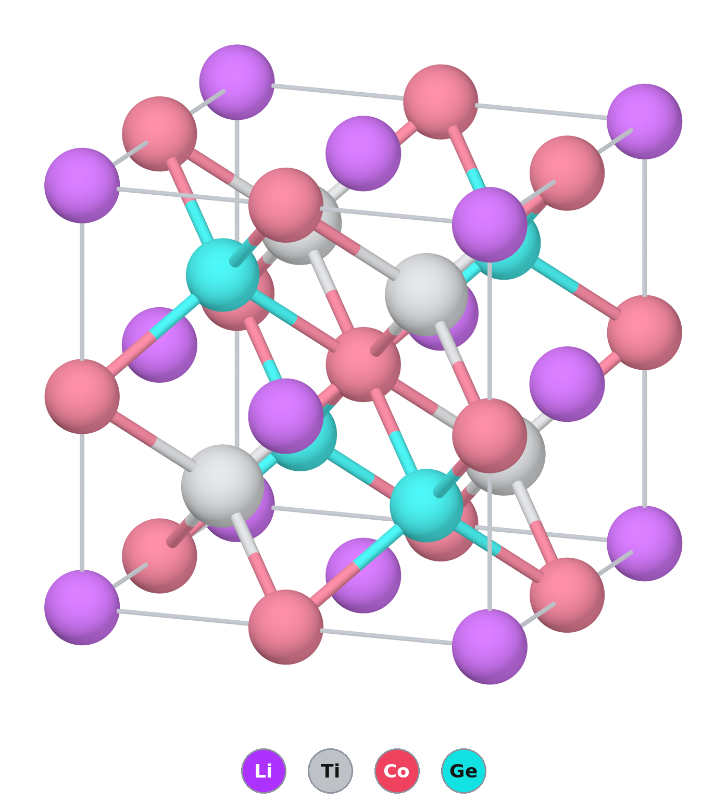
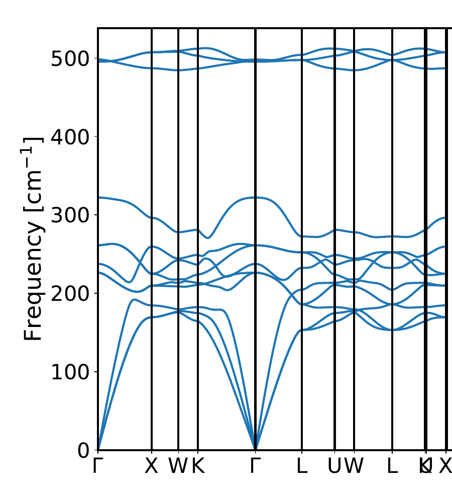

# LiTiCoGe — a half-Heusler with lithium in the empty site, computed to be a semiconductor

*A Material a Day · entry 33 · 23 November 2026 · status: **predicted, no report found***

> **In one paragraph.** LiTiCoGe is a computed intermetallic compound from the Alexandria
> database. It is a quaternary Heusler compound (LiMgPdSn type): a titanium–germanium
> rock-salt lattice with cobalt in half of the tetrahedral holes, as in the half-Heusler
> TiCoSb, and lithium in the other half. Lithium supplies the eighteenth valence
> electron, and the calculation gives a non-magnetic semiconductor with a PBE gap of
> 1.2 eV. It sits on the computed convex hull in both PBE tables, 45–47 meV/atom below
> its competitors (TiCoGe, TiCo and a lithium germanide); the two lithium-free
> competitors are measured to coexist from 973 to 1273 K. The compound has been
> studied by calculation: it belongs to a family of lithium-filled Heuslers proposed in
> 2018, and its properties were computed in 2021. **We found no report of its
> synthesis.** The main caveat is temperature: the free-energy estimate puts the margin
> at zero near 970 K, so it would have to be made at moderate temperature, from TiCoGe and
> lithium metal in a molybdenum or tungsten container under argon, below about 900 K.

Everything below is computed unless a reference is given. Read the section
[How this could be wrong](#8-how-this-could-be-wrong) before using any of it.

## 1. Identity

| | |
|---|---|
| Formula | LiTiCoGe |
| Alexandria id | `agm001284084` (PBE table) |
| Space group | F4̄3m (no. 216), Z = 4 |
| Cell (PBE) | a = 5.830 Å (cubic); PBEsol cell of the phonon run a = 5.759 Å |
| Volume, density | 49.55 ų per formula unit, 6.25 g cm⁻³ |
| Structure type | LiMgPdSn (quaternary or "Y-type" Heusler), database label `ABCD_cF16_216_a_b_c_d` |
| Formation energy | −0.541 eV/atom (PBE); −0.534 eV/atom (PBE, Materials-Project settings) |
| Valence electrons | 1 (Li) + 4 (Ti) + 9 (Co) + 4 (Ge) = 18 per formula unit |

PBE cells run slightly long. The one calibration available here is the isoelectronic
half-Heusler TiCoSb: the same database gives a = 5.891 Å, and a recent powder refinement
gives 5.880 Å [5], 0.2 % shorter. The Ti–Co–Ge ternaries give the same picture. Their
cells, as tabulated by Hu et al. [6] from the standard handbook, against the PBE table:

| compound | measured (Å) [6] | PBE (Å) | PBE − measured |
|---|---|---|---|
| TiCo₂Ge (full Heusler, Fm3̄m) | a 5.831 | 5.843 | +0.2 % |
| Ti₄Co₇Ge₆ (Im3̄m) | a 7.673 | 7.658 | −0.2 % |
| Ti₄Co₄Ge₇ (I4/mmm) | a 12.869, c 5.084 | 12.878, 5.094 | +0.1 %, +0.2 % |
| TiCoGe₂ (Pbam) | 9.869, 8.841, 7.733 | 9.931, 8.856, 7.751 | +0.6 %, +0.2 %, +0.2 % |
| TiCo₆Ge₆ (P6/mmm) | a 5.033, c 7.764 | 5.028, 7.711 | −0.1 %, −0.7 % |
| Ti₆Co₁₆Ge₇ (Fm3̄m) | a 11.47 | 11.307 | −1.4 % |
| TiCoGe (P6̄2m) | a 6.222, c 3.727 | 6.161, 3.766 (`pbe_mp` table) | −1.0 %, +1.0 % |

Five of the seven are within 0.7 %; TiCoGe, which is only in the other PBE table, is
off by 1.0 % in each axis, and Ti₆Co₁₆Ge₇ is 1.4 % short. The closest analogue, the cubic Heusler TiCo₂Ge, is 0.2 %
long. If the same holds for LiTiCoGe, its measured cell would be close to 5.82 Å. The CIF is [`LiTiCoGe.cif`](LiTiCoGe.cif); all numbers are in
[`structure.json`](structure.json) and [`properties.json`](properties.json).

## 2. Where it sits

<picture>
  <source media="(prefers-color-scheme: dark)" srcset="phase_diagram_dark.png">
  
</picture>

The compound has four elements. The section drawn is the plane Li–TiCo–Ge of the
tetrahedron, in which LiTiCoGe is the centre point (Li + TiCo + Ge). All its neighbours lie
in this plane. Three tie lines along the Li–Ge edge (Ge–Li₂Ge, Li₁₇Ge₄–Li₈Ge₃,
Li₂Ge–Li₈Ge₃) are not tie lines of the full four-element hull; none of them touches the
target. Energies are below the three corners, PBE table:

| phase | Li : TiCo : Ge | energy below the corners (meV/atom) |
|---|---|---|
| Li₁₇Ge₄ | 17 : 0 : 4 | 312 |
| Li₁₅Ge₄ | 15 : 0 : 4 | 334 |
| Li₈Ge₃ | 8 : 0 : 3 | 368 |
| Li₅Ge₂ | 5 : 0 : 2 | 366 |
| Li₂Ge | 2 : 0 : 1 | 350 |
| LiGe | 1 : 0 : 1 | 289 |
| TiCoGe (orthorhombic, Pnma, computed lowest) | 0 : 1 : 1 | 342 |
| Ti₄Co₄Ge₇ | 0 : 4 : 7 | 296 |
| **LiTiCoGe** | 1 : 1 : 1 | 341 |

- **Neighbours.** LiTiCoGe has tie lines to TiCoGe, TiCo, Li₁₅Ge₄, Li₁₇Ge₄ and Li₈Ge₃. It is
  the only phase inside the triangle.
- **The competing assemblage** is 15 LiTiCoGe → 11 TiCoGe + 4 TiCo + Li₁₅Ge₄: a
  lithium-free titanium cobalt germanide, the intermetallic TiCo and a lithium-rich
  germanide. The compound is held together against a mixture in which lithium has gone
  entirely to germanium.
- **The half-Heusler without lithium**, TiCoGe in F4̄3m, is in the database 118 meV/atom
  above the hull and metallic. The lowest computed TiCoGe is orthorhombic (Pnma, 12 atoms
  per cell); the measured one is hexagonal (below).

**Checked against the measured Ti–Co–Ge diagram.** Hu et al. measured isothermal sections
at 973, 1173 and 1273 K on arc-melted alloys annealed for 120, 60 and 45 days [6]. On the
lithium-free edge of this section:

- **TiCoGe exists at all three temperatures**, and TiCoGe and TiCo coexist in a measured
  three-phase equilibrium at each of them, with Ti₅Ge₃ or Ti₂Co₃Ge as the third phase
  (five alloys in all). The tie line the
  competing assemblage rests on is therefore real. Across all the measured alloys TiCoGe
  spans 24–37 at.% Ti and 32–43 at.% Co, the widest spread at 973 K: it is a phase with a
  homogeneity range, not a line compound.
- **The structure differs.** The paper lists TiCoGe as hexagonal (Fe₂P type, P6̄2m,
  a = 6.222 Å, c = 3.727 Å, taken from the standard handbook, not refined there) [6]. That
  form is absent from the `energy_runs_pbe` table; in `energy_runs_pbe_mp` it lies
  14.7 meV/atom above the Pnma form, which has no reported counterpart. TiCoGe makes up
  55 % of the atoms of the competing assemblage, so for each meV/atom by which real TiCoGe
  lies below the computed Pnma form, the margin of LiTiCoGe falls by 0.55 meV/atom. If the
  hexagonal form is truly the lower one, the margin loses at least 8 meV/atom (from 45 to
  about 37 on the `pbe_mp` scale). The measurements start at 973 K, so they do not exclude
  a different form at lower temperature.
- **Ti₄Co₄Ge₇ and TiCoGe₂**, the other ternaries on the TiCo–Ge line, are both measured
  phases [6]. The calculation has Ti₄Co₄Ge₇ on the hull and TiCoGe₂ 6–7 meV/atom above it;
  neither touches LiTiCoGe.
- **Off this section**, Ti₂Co₃Ge (MgZn₂ type), measured at all three temperatures and in
  equilibrium with both TiCo and TiCoGe [6], is 12.4 meV/atom above the `pbe_mp` hull, and
  its measured structure is not in the `energy_runs_pbe` table. Ti₂Co₅Ge, on the computed
  hull, is not among the ternaries the paper lists.

## 3. Structure

<picture>
  <source media="(prefers-color-scheme: dark)" srcset="structure.png">
  
</picture>

*One conventional cell, oblique view. Only the Co–Ti and Co–Ge bonds are drawn; lithium
(purple) sits in the cubic holes of that framework.*

| site | Wyckoff | x, y, z | nearest neighbours |
|---|---|---|---|
| Li | 4a | 0, 0, 0 | 4 Ti + 4 Ge at 2.525 Å (cube) |
| Co | 4b | ½, 0, 0 | 4 Ti + 4 Ge at 2.525 Å (cube); 6 Li at 2.915 Å |
| Ge | 4c | ¼, ¼, ¼ | 4 Co + 4 Li at 2.525 Å |
| Ti | 4d | ¼, ¼, ¾ | 4 Co + 4 Li at 2.525 Å |

- **How to read it.** Ti and Ge together form a rock-salt lattice (Ti–Ge 2.915 Å). Its
  tetrahedral holes come in two sets. Cobalt fills one set, which by itself would give the
  half-Heusler "TiCoGe" of the TiCoSb type; lithium fills the other. Each Co and each Li is
  thus at the centre of a cube of four Ti and four Ge, and Li and Co together form a second
  rock-salt lattice.
- **Why lithium.** The half-Heusler TiCoGe has 17 valence electrons and is a metal in the
  calculation; TiCoSb, with 18, is a semiconductor. Lithium gives up one electron and
  completes the count at 18, which is the design rule of He et al. [1]: fill the empty site
  of a 17-electron half-Heusler with a small electropositive atom. The site preference
  computed here (Li and the late transition metal on one rock-salt lattice, the early
  transition metal and the p-block element on the other) is the one reported for the whole
  family in [1].
- **Ordering.** There are three distinct ways of placing four elements on the four sites
  of this structure [1]; the database holds one LiTiCoGe structure, this one. He et al. report that for the
  family the disordered arrangement costs about 100 meV/atom [1], which would make site
  disorder unlikely; for this compound it was not computed.

**The family.** In `energy_runs_pbe` the same prototype and space group hold 16,894
lithium-containing entries, of which 254 are on the hull and 103 of those have a PBE gap.
The neighbours of LiTiCoGe:

| compound | depth (+) / height (−) vs hull, meV/atom | PBE gap (eV) | a (Å) |
|---|---|---|---|
| LiTiCoSi | 14.7 | 1.33 | 5.739 |
| **LiTiCoGe** | **47.2** | **1.24** | **5.830** |
| LiTiCoSn | 28.8 | 1.01 | 6.109 |
| LiZrCoGe | −3.2 | 1.18 | 6.050 |
| LiHfCoGe | −23.0 | 1.24 | — |
| LiTiNiGe (19 electrons) | −146.7 | 0 (metal) | — |
| TiCoSb (half-Heusler, for comparison) | 296.8 | 1.06 | 5.891 |

The Ti–Co series is on the hull for Si, Ge and Sn, with germanium deepest; replacing Co by
Ni adds a nineteenth electron and the compound falls 147 meV/atom off the hull. The
deepest members of the whole family in this table are around 115 meV/atom (LiTiGeIr,
LiZrSnIr). The half-Heusler TiCoSb is six times deeper than LiTiCoGe: filling the empty
site with lithium gives a compound that is stable, but far less so than an ordinary
18-electron half-Heusler.

## 4. Computed properties

### Electronic structure

| property | value | comment |
|---|---|---|
| Band gap, PBE (eV) | 1.24 (indirect), 1.64 (direct) | |
| Band gap, TB-mBJ (eV) | 1.21 (indirect), 1.60 (direct) | Almost the same as PBE |
| Band gap, machine-learned (eV) | 1.20 (PBE model), 1.21 (mBJ model) | Screening estimates; agree with the DFT tables |
| Magnetic moment | 0 | Non-magnetic, as the 18-electron count implies |

- That mBJ does not open the gap beyond PBE is unusual for a semiconductor. A plausible
  reading (not computed here) is that both band edges are transition-metal d states, as He
  et al. describe for the family [1]. In that paper the hybrid functional HSE06 gives
  larger gaps: 1.99 eV for LiTiCoSi [1], against 1.33 eV in PBE here. The real gap of
  LiTiCoGe is probably above 1.2 eV, by an amount we cannot fix.
- Singh et al. computed 1.09 eV for LiTiCoGe [2] (abstract only; the functional is not
  stated there).

### Dielectric response

| property | value |
|---|---|
| Electronic dielectric constant ε∞ | 22.1 (cubic, isotropic) |
| Refractive index n = √ε∞ | 4.70 |

| Born effective charge | Li | Ti | Co | Ge |
|---|---|---|---|---|
| computed (isotropic) | +1.06 | +2.77 | **−5.56** | +1.72 |

- **Cobalt carries the negative charge.** The largest Born charge in the compound is on
  cobalt and it is negative; germanium is positive. In the dynamical sense cobalt is the
  anion of this structure. This is a statement about how charge moves when Co is
  displaced, not about a static oxidation state.
- **ε∞ is large**, about twice that of silicon (11.2 in the same paper's calculation [1]).
  Values of 16–24 are reported there for other members of the family [1]. PBE tends to
  overestimate ε∞, so the true value should be somewhat lower.
- This is ε∞ only; the lattice contribution was not computed.
- The structure lacks an inversion centre, so it is piezoelectric by symmetry. The largest
  clamped-ion component is 0.30 C m⁻²; the ionic-relaxation part was not computed.

### Charge transport (PBE, constant relaxation time)

| | electrons | holes |
|---|---|---|
| Density-of-states mass (mₑ) | 11.2 | 7.4 |
| Conductivity mass, 300 K, 10¹⁹ cm⁻³ (mₑ) | 5.0 | 1.6 |
| Seebeck coefficient, 300 K, 10¹⁹ cm⁻³ (μV/K) | −623 | +539 |
| Seebeck coefficient, 300 K, 10²⁰ cm⁻³ (μV/K) | −421 | +343 |

- The large density-of-states masses with much smaller conductivity masses are the
  signature of many degenerate band valleys, the usual situation in Heusler compounds.
  Holes are the lighter carriers.
- **Branch-point energy:** 0.62 eV above the valence-band maximum, in mid-gap. The
  calculation does not favour one doping type.
- These are what any semiconductor with this band structure gives. The thermoelectric
  promise reported in [2] rests on the same kind of calculation; it is not a measurement,
  and no thermal conductivity was computed here.

### Mechanical (machine-learned)

| bulk modulus | shear modulus | Young's modulus |
|---|---|---|
| 129 GPa | 55 GPa | 164 GPa |

Screening estimates from a graph network, not elastic-constant calculations. For scale,
the TiCoSb paper [5] reports a computed bulk modulus of 139 GPa for that compound; we found
no measured modulus for comparison.

### Lattice dynamics (PBEsol)

<picture>
  <source media="(prefers-color-scheme: dark)" srcset="phonons_dark.png">
  
</picture>

*Phonon dispersion, density-functional perturbation theory, PBEsol functional on a PBEsol
cell (a = 5.759 Å, 1.2 % smaller than the PBE cell).*

- **No imaginary modes:** the stored structure is dynamically stable in the harmonic
  approximation.
- The spectrum tops out at 513 cm⁻¹. The three highest branches, 485–513 cm⁻¹, are
  lithium vibrations, separated by a gap from everything else (below 322 cm⁻¹). Light Li
  rattling in its cube of Ti and Ge is the expected picture.
- From the same run: zero-point energy 52.6 meV/atom, Debye temperature (from the second
  moment of the phonon density of states) 580 K.
- An insulator, so no electron–phonon coupling was computed.

### Not computed

Hybrid-functional gap, the lattice part of the dielectric constant, elastic constants,
lattice thermal conductivity, defect and antisite energies, the other two site orderings.

## 5. Is it stable?

| calculation | LiTiCoGe against its competitors |
|---|---|
| PBE table (`energy_runs_pbe`) | on the hull, **47.2 meV/atom below** them |
| PBE, Materials-Project settings (`energy_runs_pbe_mp`) | on the hull, **45.3 meV/atom below** 11/15 TiCoGe + 4/15 TiCo + 1/15 Li₁₅Ge₄ |
| machine-learned hull distance (tuga-sp) | −2 meV/atom (on the hull) |

The two tables agree to 2 meV/atom. The calorimetric comparison that this project uses for
error bars has no class for intermetallic compounds and no measured enthalpy for any phase
here, so **there is no class error to put beside the 45–47 meV/atom margin.** For
comparison only, the classes it does cover scatter by 27 (halides) to 97 (borides)
meV/atom; against those, the margin is a clear but not a large one. The family paper finds
the lithium-filled Heuslers on the hull of a different database (OQMD) as well [1]; we did
not check whether LiTiCoGe is on its list. A second, specific uncertainty comes from the
competitor: the database's TiCoGe is not the structure reported for it, and taking the
reported one as the ground state would cut the margin by at least 8 meV/atom (section 2).

**At temperature.** The margin is 0 K. With phonon free energies for every phase:

| T (K) | 300 | 600 | 800 | 950 | 1000 | 1100 | 1300 |
|---|---|---|---|---|---|---|---|
| margin (meV/atom, − = stable) | −29.4 | −16.5 | −7.4 | −0.5 | +1.8 | +6.5 | +15.8 |
| scatter of the estimate (meV/atom) | 0.05 | 3.8 | 3.8 | 11 | 11 | 11 | 22 |

The competitors gain more vibrational free energy than the ordered compound, and the margin
crosses zero near 970 K. With the stated scatter the crossing could lie anywhere from about
750 K to 1200 K. Above 1100 K the competitor is TiCoGe plus liquid lithium. Read literally,
LiTiCoGe is a low-temperature phase that would decompose on heating, and a synthesis
should stay below about 900 K. That is an estimate with an error bar the size of the
effect.

## 6. How to make it

Energies are 0 K reaction energies in meV per atom of the whole charge, on the
`pbe_mp` scale. They say what is downhill, not what is fast.

| route | charge | ΔE | comment |
|---|---|---|---|
| **A. Lithiation of TiCoGe** | TiCoGe + Li | −78 | Rank 1 by fewest reagents, then least driving force. TiCoGe is made first |
| B. Two binaries | LiGe + TiCo | −192 | Both reagents have to be made; LiGe is air-sensitive |
| C. Ti into LiCoGe | Ti + LiCoGe | −303 | LiCoGe has to be made |
| D. The elements | Li + Ti + Co + Ge | −534 | Ti and Ge form Ti₅Ge₃ first, a deep sink (below) |
| (E. The competitors) | 11 TiCoGe + 4 TiCo + Li₁₅Ge₄ | −45 | The decomposition read backwards; listed because it is the equilibrium the compound must win |

**Route A in practice (a proposal, not a tested procedure).**

- **Step 1, TiCoGe.** Arc-melt Ti, Co and Ge 1 : 1 : 1 under argon and anneal. This is how
  Hu et al. made their Ti–Co–Ge alloys: arc melting under purified argon with a titanium
  getter, three remeltings, then annealing in evacuated quartz at 973–1273 K and quenching
  in ice water [6]. TiCoGe formed in those alloys at every temperature, but the paper did
  not set out to make it single-phase, and it needed 45–120 days of annealing to reach
  equilibrium; one alloy was still out of equilibrium after 120 days at 973 K.
- **The framework has to rebuild.** The TiCoGe that forms is hexagonal (or orthorhombic in
  the calculation); neither is the cubic Ti–Co–Ge framework of LiTiCoGe. Lithiation is
  therefore a reconstruction, not a simple insertion into a ready-made lattice, and the
  annealing times above show how slowly this system moves even at 973 K.
- **Step 2.** Powdered TiCoGe with lithium metal (1 : 1, with a few per cent excess Li),
  loaded in an argon glovebox.
- **Container:** molybdenum or tungsten. In the calculation Mo, W, Cu and Cr metal and
  MgO, CaO, Y₂O₃ and BeO are inert towards LiTiCoGe. Silica (−146 meV/atom), alumina
  (−72), zirconia (−70), boron nitride (−78), graphite (−81) and nickel (−128) react; so do
  tantalum (−47) and niobium (−20), the usual containers for lithium, mildly; iron only
  slightly (−8). Seal the Mo crucible inside a welded steel or tantalum jacket so that the
  jacket never touches the charge.
- **Atmosphere:** argon. Oxygen, water, nitrogen, hydrogen and CO₂ all react with the
  compound in the calculation (nitrogen to nitrides, hydrogen to TiH₂).
- **Temperature, both ends:**
  - *Bottom:* lithium melts at 454 K and its Tammann temperature is 227 K, so the lithium
    is mobile from the start. TiCoGe has no melting point on file; the estimate is
    1827 ± 322 K, so its own lattice diffuses from roughly 900 K. Below that the reaction
    depends on lithium diffusing into TiCoGe.
  - *Top:* the free-energy estimate in section 5 turns against the compound near 970 K.
  - The practical window is therefore narrow: about 750–900 K, for a long anneal. A typical
    laboratory firing temperature for a charge of these melting points would be about
    1130 K, which is above the window.
- **Off-stoichiometry.** The 0 K window in lithium chemical potential is 0.37 eV wide
  (−0.41 to −0.04 eV against lithium metal, 25 meV/atom level): the compound tolerates a
  lithium-rich environment but not lithium metal itself at full activity. Excess lithium
  should end up as a lithium germanide (Li₁₅Ge₄ or Li₁₇Ge₄).

**Why not from the elements.** The calculation of first products at 873 K finds Ti₅Ge₃ or
Ti₅Ge₄ forming from Ti and Ge (about −700 meV per atom of product), TiCo or Ti₉Co₁₁ from Ti and
Co, and a lithium germanide from Li and Ge, each under kinetic control. Ti₅Ge₃ in particular
spends much of the driving force; starting from pre-made TiCoGe avoids it.

**Metathesis (tested).**

| charge | computed outcome | ΔE |
|---|---|---|
| CoCl₂ + 3 Li + Ti + Ge | LiTiCoGe + 2 LiCl | −971 |
| TiCl₄ + 5 Li + Co + Ge | LiTiCoGe + 4 LiCl | −736 |
| LiCl + TiCoGe + Na | LiTiCoGe + NaCl | −44 |

All three are clean on paper, and the salt they throw off does not attack the product:
LiCl, NaCl, KCl, RbCl, CsCl, LiF and CaCl₂ are inert towards LiTiCoGe in the calculation
(NaF, KF and MgCl₂ take its lithium and leave TiCoGe). The first is the practical one: LiCl
melts at 883 K and would act as a flux at the top of the window; a lower-melting
LiCl–KCl mixture would bring it into the window (general knowledge, not computed). TiCl₄
is a volatile liquid and not a reagent to weigh out. Removing the LiCl afterwards is the
open point: the compound reacts with water in the calculation (−251 meV/atom, to CoGe and
lithium titanates), so washing in water may damage it. Whether it survives a quick wash or
needs an anhydrous solvent was not computed.

**Reading the powder pattern.** Strongest computed lines, Cu Kα (PBE cell; measured lines
should sit at slightly higher angle):

| 2θ (°) | 26.48 | 30.67 | 43.92 | 52.02 | 54.52 | 63.86 |
|---|---|---|---|---|---|---|
| hkl | 111 | 200 | 220 | 311 | 222 | 400 |
| I | 30 | 12 | 100 | 14 | 3 | 15 |

- **Lithium is nearly invisible to X-rays.** The pattern of LiTiCoGe and that of a
  lithium-free half-Heusler TiCoGe would differ mostly in the cell: 5.83 Å against 5.67 Å in
  PBE. The lattice parameter is the quick test; neutron diffraction or a chemical analysis
  is needed to establish the lithium content (general knowledge).
- **Beware the full Heusler TiCo₂Ge.** It is a known phase with a wide composition range
  (5–27 at.% Ti between 973 and 1273 K) and a measured cell of 5.831 Å [6], the same as the
  PBE cell of LiTiCoGe. At that cell its 220 and 400 lines fall at the same angles
  (43.92°, 63.85°). What separates the two is the odd and the 200 lines: computed
  intensities 111 : 200 : 311 of 30 : 12 : 14 for LiTiCoGe against 3 : 0 : 2 for TiCo₂Ge.
  A cubic pattern near 5.83 Å with weak 111 and no 200 is TiCo₂Ge, and a cobalt-rich
  starting mixture would make it.
- **Hexagonal TiCoGe lines** (or orthorhombic, if the calculated form appears): lithium was
  lost, or the anneal was too hot (section 5).
- **TiCo (CsCl type) together with lithium germanide lines:** the competing assemblage; the
  compound decomposed or never formed.
- **Ti₅Ge₃ lines:** the elements were used and titanium germanide formed first.
- **TiO₂, Li₂TiO₃ or CoGe:** air or moisture got in.

**Hazards.** Lithium metal reacts with water and burns in air; cobalt compounds are
sensitisers and suspected carcinogens, CoCl₂ included (general knowledge).

## 7. What it might be good for

Nothing here is an existing application; we found no report that the compound has been
made.

- **Thermoelectric semiconductor.** Heusler semiconductors are an established
  thermoelectric family, and computed figures of merit for LiTiCoGe have been published [2].
  Those are calculations with an assumed relaxation time. Half-Heuslers usually have high
  lattice thermal conductivity, which was not computed here.
- **Light absorber.** He et al. propose the family for photovoltaics because their band
  edges are d states with strong absorption and large ε∞ [1]. LiTiCoGe's gap (above 1.2 eV,
  probably) would be in the useful range.
- **A test of the design rule.** The main interest may be the rule itself: if lithium can
  be put into the empty site of a 17-electron half-Heusler, a large family of computed
  semiconductors opens. We found no synthesis of any member.
- **What counts against it:** lithium makes it air- and moisture-sensitive in the
  calculation, cobalt is costly, and the synthesis window is narrow.

## 8. How this could be wrong

- **No error bar for the class.** The margin of 45–47 meV/atom cannot be read against a
  measured scatter for intermetallic compounds, because the calorimetric survey has none.
- **Temperature.** The margin closes near 970 K in an estimate with ±11 meV/atom of scatter;
  if the crossing is lower, there may be no temperature at which the compound both forms
  and is stable.
- **The competitor TiCoGe has the wrong structure in the database.** The measured
  Ti–Co–Ge diagram [6] confirms that TiCoGe and TiCo coexist, but lists TiCoGe as
  hexagonal, which the calculation puts 14.7 meV/atom above its own orthorhombic form. If
  the real compound is the lower, the margin falls to about 37 meV/atom or less (section 2).
  Ti₂Co₃Ge, measured beside TiCo and TiCoGe, is also above the computed hull; it was not
  tested whether a correctly placed Ti₂Co₃Ge would enter the competing assemblage.
- **Lithium content and order.** A real sample may be Li-deficient (Li₁₋ₓTiCoGe, a
  vacancy-filled Heusler of the kind reviewed in [3]) or have Li/Co antisite disorder. Neither
  was computed for this compound.
- **The gap.** PBE and mBJ agree at 1.2 eV, but HSE06 values for related members are larger
  [1]; the gap is uncertain by several tenths of an eV.
- **Phonons and the rest are different functionals.** The phonon run is PBEsol; the
  energies and gaps are PBE.
- **The literature search can miss things.** See below.

## 9. Literature

**Searched (OpenAlex, Crossref, arXiv), 15 November 2026:** `LiTiCoGe` (OpenAlex: 1
relevant hit [2]; Crossref and arXiv: 0); "LiTiCoGe quaternary Heusler"; "lithium-based
quaternary Heusler compounds 18 valence electron semiconductors LiTiCoX"; "lithium titanium
cobalt germanide synthesis" (0 relevant); "lithium filled half-Heusler vacancy site Li
insertion TiCoSb-type semiconductor experimental" (0 relevant); "synthesis of Li-containing
quaternary Heusler semiconductor LiZrCoSn LiHfCoSn experimental X-ray" (0); "LiMgPdSn
crystal structure lithium magnesium palladium stannide" (0); "LiMgPdSn quaternary Heusler"
(only computational papers); "TiCoGe crystal structure TiNiSi type germanide" (0 relevant);
"Ti-Co-Ge system isothermal section" [6] (full text read); "TiCoSb half-Heusler lattice parameter measured
band gap synthesis" [5]. Wikipedia: no page about the compound.

**Result:** LiTiCoGe has been studied by calculation [1, 2]; no report of its synthesis or
of any measured property was found, and none for any lithium-filled 18-electron Heusler of
this family. A failed search is not proof that it has not been made; intermetallic
chemistry has a large literature in phase-diagram journals that is poorly indexed by
formula. **A check against ICSD or Pearson's by a person is still owed.**

1. J. He, S. S. Naghavi, V. I. Hegde, M. Amsler, C. Wolverton, *Chem. Mater.* **30**, 4978
   (2018). doi:10.1021/acs.chemmater.8b01096 — *full text of the arXiv version
   (arXiv:1802.04875) read for the design rule, site preference, ordering energy, HSE06 gaps
   and ε∞ table; the supplement was not opened.*
2. J. Singh, K. Kaur, S. A. Khandy *et al.*, "Structural, electronic, mechanical, and
   thermoelectric properties of LiTiCoX (X = Si, Ge) compounds", *Int. J. Energy Res.*
   (2021). doi:10.1002/er.6851 — *abstract only:* computed gap 1.09 eV, room-temperature
   Seebeck coefficient 1799 μV/K and zT 0.14 at 700 K (p-type) for LiTiCoGe; reported
   mechanically and dynamically stable.
3. Y. Zhang, D. Ke, Z. Dong, J. Luo, "Comprehensive landscape and simple rules for
   transition-metal Heusler semiconductors", *Phys. Rev. B* (2025). doi:10.1103/b5gy-nc6y —
   *arXiv version (arXiv:2503.12079), introduction and references read:* reviews
   vacancy-filled Heuslers and cites [1] as the lithium-doped case.
4. K. Özdoğan, E. Şaşıoğlu, I. Galanakis, "Slater-Pauling behavior in LiMgPdSn-type
   multifunctional quaternary Heusler materials", *J. Appl. Phys.* **113** (2013).
   doi:10.1063/1.4805063 — *abstract only;* the structure-type name.
5. P. Sardar, S. Mahakal, S. Pal *et al.*, "Favorable half-Heusler structure of synthesized
   TiCoSb alloy: a theoretical and experimental study", *J. Alloys Compd.* (2026).
   doi:10.1016/j.jallcom.2026.188908 — *arXiv version (arXiv:2604.09223), methods and
   Table 5 read:* TiCoSb arc-melted and annealed at 1173 K, a = 5.880 Å from Rietveld
   refinement; computed bulk modulus 139 GPa.
6. K. Hu, S. Dong, C. Shen *et al.*, "Measurement of phase equilibria in Ti-Co-Ge ternary
   system", *J. Alloys Compd.* **793**, 653 (2019). doi:10.1016/j.jallcom.2019.04.223 —
   *full text read:* isothermal sections at 973, 1173 and 1273 K by EPMA and XRD on
   arc-melted, annealed alloys; eight ternary phases, among them TiCoGe at all three
   temperatures in equilibrium with TiCo; the cells of Table 1 are compiled from the
   Villars–Calvert handbook. Nothing on lithium.

Other computational papers on the family were seen in the searches (LiZrCoX, LiHfIrZ,
LiMPtTl); none reports a synthesis.

## 10. Provenance

- **Data:** Alexandria database, tables `energy_runs_pbe` (selection, structure,
  properties, family) and `energy_runs_pbe_mp` (reaction energies, competing phases); the
  group's DFPT phonon calculations (Quantum ESPRESSO, PBEsol).
- **Tools:** the reaction-route code of this group (convex hull, reaction table, contact,
  firing window, free energies at temperature), the tuga-sp property models, pymatgen for
  symmetry and the powder pattern.
- **Authorship:** drafted by Claude (Anthropic) from those tools; reviewed by
  Miguel Marques. Corrections are welcome as issues on this repository.
