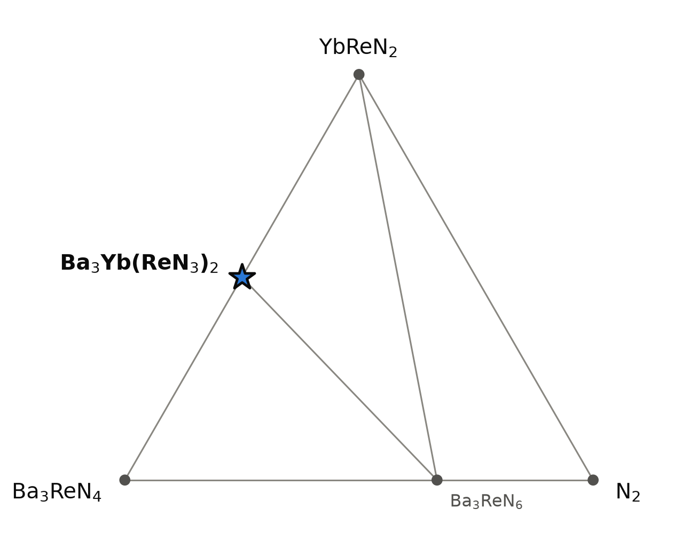
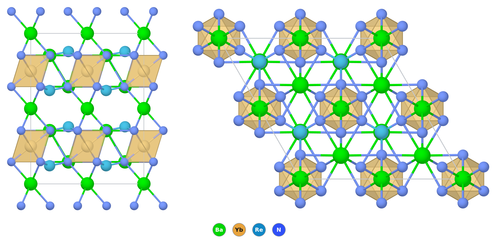

# Ba₃Yb(ReN₃)₂ — a barium ytterbium nitridorhenate built from isolated ReN₃ units, computed but not reported

*A Material a Day · entry 34 · 24 November 2026 · status: **predicted, no report found***

> **In one paragraph.** Ba₃Yb(ReN₃)₂ (database spelling the same; Ba₃YbRe₂N₆) is a
> quaternary nitride. In the Alexandria database it is trigonal (P‑3m1, 12 atoms): each
> rhenium has three nitrogen neighbours at 1.81 Å, forming an isolated ReN₃ unit, and the
> ReN₃ units share their corners with YbN₆ octahedra in layers held apart by barium. It
> lies on the Ba–Yb–Re–N hull in both PBE tables, 78 and 88 meV/atom below its
> competitors. That is about the size of the ~84 meV/atom scatter of computed nitride
> energies against calorimetry, so the margin is not resolved. We found no report of the compound or of any
> member of its family. The closest compound that has been made is the oxide nitride
> (Ba₆O)(ReN₃)₂, which also contains trigonal ReN₃ units. It formed from barium and
> rhenium under flowing nitrogen at 850 °C, and it contains oxygen although none was
> weighed in [1]. A barium nitridorhenate with no oxygen in its analysed formula,
> Ba₉Re₃N₁₀, was made in 1966 from barium nitride and rhenium under nitrogen at
> 700–850 °C [6], so the oxygen does not seem forced by the chemistry. That route, with ytterbium nitride added, is what the hull suggests
> here: under 1 bar N₂ the compound is the stable phase from about 600 K to well above
> any furnace temperature. The main open
> question is the valence of ytterbium. The calculation leaves it between Yb²⁺ and Yb³⁺,
> and PBE cannot settle it. If ytterbium is divalent the unit is the Re(V) anion
> [ReN₃]⁴⁻, measured in Na₄ReN₃ as a flattened pyramid with Re–N 1.80 Å [4]. PBE
> reproduces that bond to 0.013 Å, and the computed unit here has the same length and
> a similar shape.

Computed numbers come from the Alexandria database unless another tool is named.
Measured numbers carry a reference.

## 1. Identity

| | computed (PBE) | measured |
|---|---|---|
| Formula | Ba₃Yb(ReN₃)₂ = Ba₃YbRe₂N₆ | — |
| Alexandria id | `agm093167039` | — |
| Space group | P‑3m1 (no. 164), Z = 1 | — |
| Cell (Å) | a 6.282, c 7.242 | — |
| Volume per formula unit (ų) | 247.5 | — |
| Density (g cm⁻³) | 6.99 | — |
| Structure type | prototype label AB2C3D6_hP12_164_a_d_bd_i (Yb 1b, Re 2d, Ba 1a + 2d, N 6i); a label the database also gives to orthoborates and arsenites such as Rb₃Lu(BO₃)₂ and K₃Lu(AsO₃)₂ | — |
| Formation energy | −0.800 eV/atom (PBE) · −0.946 eV/atom (Materials-Project settings) | — |
| Magnetism | non-magnetic in PBE (no moment on any site); 0.23 μB on Yb with Materials-Project settings | — |

The CIF is [`Ba3Yb(ReN3)2.cif`](Ba3Yb(ReN3)2.cif). No Wikipedia page on this compound was found.

### The nearest measured compound

Ba₃Yb(ReN₃)₂ has no measured data. The closest made compound with the same building
unit is (Ba₆O)(ReN₃)₂ [1], which is in the database as `agm003217302` (on the hull,
36 meV/atom below its competitors, Materials-Project settings):

| (Ba₆O)(ReN₃)₂, R‑3 | measured [1] | computed (PBE) | difference |
|---|---|---|---|
| a (Å) | 8.1178(2) | 8.153 | +0.4 % |
| c (Å) | 17.5651(4) | 17.513 | −0.3 % |
| Re–N (Å) | 1.91(2) (table; the abstract gives 1.94) | 1.828 | −0.08 Å (−4 %) |
| N–Re–N | 120°, planar | — | — |

The cell is reproduced to 0.4 %. The computed Re–N bond is 0.08 Å shorter than the
measured one. The measured value comes from laboratory powder data, where nitrogen is
located beside heavy barium and rhenium, and the paper itself quotes two values. It is
also shorter than PBE usually gives. The second calibration below points to the powder
value rather than to PBE.

The anion the target carries if ytterbium is divalent, [ReN₃]⁴⁻, has been measured by
single-crystal diffraction in Na₄ReN₃ [4]. Its Cc space group was confirmed by second-harmonic
generation; in C2/c the same data give a disordered nitrogen site. The compound is in
the database as `agm003220181` (on the PBE hull):

| Na₄ReN₃, Cc | measured [4] | computed (PBE) | difference |
|---|---|---|---|
| a (Å) | 10.903(2) | 10.989 | +0.8 % |
| b (Å) | 6.022(1) | 6.074 | +0.9 % |
| c (Å) | 8.944(2) | 8.917 | −0.3 % |
| β | 115.57(3)° | 114.78° | −0.8° |
| volume per formula unit (ų) | 132.4 | 135.1 | +2.0 % |
| Re–N (Å) | 1.78, 1.80, 1.83 (±0.01); mean 1.80 | 1.81, 1.82, 1.83; mean 1.816 | +0.013 Å (+0.7 %) |
| N–Re–N | 108.3°, 122.8°, 123.0°; sum 354° | 114.8°, 120.9°, 121.5°; sum 357° | flatter by 3° in the sum |
| Re out of the N₃ plane (Å) | 0.26 (from the published coordinates) | 0.18 | −0.08 |
| colour, gap | orange crystals; no gap measured | PBE gap 2.46 eV | — |

The cell is reproduced to within 1 % on each axis, and the Re–N bond to 0.013 Å, about
the measured uncertainty. The computed pyramid is a little flatter than the measured
one. The authors read the pyramid as a Re(V) centre with a lone pair, and assign a
strong Raman band at 936 cm⁻¹ to the Re=N double bond [4]. Section 3 uses this to read
the 1.807 Å of the target.

## 2. Where it sits

<picture>
  <source media="(prefers-color-scheme: dark)" srcset="phase_diagram_dark.png">
  
</picture>

A section through the four-element hull at 0 K (PBE table), with corners Ba₃ReN₄, YbReN₂
and N₂. Ba₃Yb(ReN₃)₂ lies on the Ba₃ReN₄–YbReN₂ edge, because Ba₃ReN₄ + YbReN₂ has
exactly its composition. It shares a tie line with Ba₃ReN₆. The system has 18 phases
on the hull. The ternaries in it are Ba₃ReN₃, Ba₃ReN₄, Ba₃ReN₆, BaReN₃, YbReN₂ and Yb₄ReN₅,
and Ba₃Yb(ReN₃)₂ is the only quaternary.

| | PBE (`energy_runs_pbe`) | Materials-Project settings (`energy_runs_pbe_mp`) |
|---|---|---|
| Ba₃Yb(ReN₃)₂ | on the hull, **78.2 meV/atom** below its competitors | on the hull, **88.2 meV/atom** below its competitors |
| competing assemblage (0 K) | — | 0.75 Re + 0.625 Ba₃ReN₄ + 0.375 Ba₃ReN₆ + 0.25 Yb₄ReN₅ |
| other polymorphs | none stored | none stored |
| nitride scatter against calorimetry | median offset +35 meV/atom, median absolute deviation 84 meV/atom, 90th percentile 188, n = 14 (survey on the Materials-Project table) | — |

**The two tables agree; the error is as large as the margin.** Both put the compound
on the hull, 10 meV/atom apart. No SCAN or PBEsol entry exists, so the cross-table check
that ytterbium calls for covers two tables, not three.

**The Ba–Re–N neighbours against the 1966 report.** Patterson and Ward heated barium
nitride with rhenium powder under 1 atm N₂ [6]. They isolated one thermally stable
phase, Ba₉Re₃N₁₀, and saw one unstable intermediate. Neither is stored in the database,
and none of the computed ternaries Ba₃ReN₃, Ba₃ReN₄, Ba₃ReN₆ and BaReN₃ was reported:

| phase in [6] | measured | nearest computed (PBE) | comparison |
|---|---|---|---|
| Ba₉Re₃N₁₀ = Ba₃ReN₃.₃₃ (Re⁴⁺), black | orthorhombic from powder data, a 10.94, b 8.09, c 30.40 Å, Z = 6; 7.05 g cm⁻³ measured, 7.15 from the cell; 49.8 ų per Ba; a good electrical conductor | ⅔ Ba₃ReN₃ (P6₃/m) + ⅓ Ba₃ReN₄ (Pmn2₁), both metals in PBE | the computed mixture has 57.7 ų per Ba and 6.2 g cm⁻³: 16 % more volume than the measured phase |
| Ba:Re ≈ 3.5 (from N₂ uptake), deep red-brown, written by the authors as about Ba₇Re₂N₉ (Re⁶⁺/Re⁷⁺) | hexagonal, a 10.56, c 11.83 Å, diffuse pattern; turns into Ba₉Re₃N₁₀ on heating in vacuum at 850 °C | Ba₃ReN₄ (Re⁶⁺) is nearest in composition | the computed phase is orthorhombic; no stored phase matches |

PBE usually makes cells longer, not shorter, so a 16 % deficit is not the functional's
error: the measured phase has a denser structure than either computed neighbour. The
authors suggest triangles of Re⁴⁺ held by metal–metal bonds, from a low moment of about
0.5 μB per Re [6]; the structure was never solved in that paper. A made phase missing
from the hull can only lower the hull, so in this respect the 78–88 meV/atom are an
upper bound. Whether Ba₉Re₃N₁₀ enters the competing assemblage of the target, and by how
much, is not computed.

## 3. Structure

*Two by two by two cells. Left: along a, with c vertical. Right: along c. Ba green,
Yb orange (YbN₆ octahedra drawn), Re blue, N violet.*

| site | Wyckoff | x, y, z | neighbours (Å) |
|---|---|---|---|
| Ba1 | 1a | 0, 0, 0 | 6 N at 2.814: an octahedron |
| Ba2 | 2d | ⅓, ⅔, 0.292 | 6 N at 3.141, 3 N at 3.492; 2 Re at 3.38 |
| Yb | 1b | 0, 0, ½ | 6 N at 2.392: an octahedron |
| Re | 2d | ⅓, ⅔, 0.759 | 3 N at 1.807 |
| N | 6i | 0.171, 0.341, 0.708 | 1 Re 1.807, 1 Yb 2.392, 1 Ba1 2.814, 2 Ba2 3.141 |

- **Isolated ReN₃ units.** Each rhenium has three nitrogen atoms at 1.807 Å and no other
  neighbour closer than 3.38 Å. The unit is not quite flat. Rhenium sits 0.37 Å out of
  the plane of its three nitrogen atoms, on the side away from ytterbium, and the
  N–Re–N angle is 116°. In (Ba₆O)(ReN₃)₂ the unit is planar within error [1]. In
  Na₄ReN₃ the [ReN₃]⁴⁻ unit is pyramidal, with Re 0.26 Å out of the plane and a mean
  angle of 118° [4].
- **[Yb(ReN₃)₂] layers.** Every nitrogen bonds to exactly one rhenium and one ytterbium.
  Each YbN₆ octahedron therefore shares its six corners with six ReN₃ units, and each
  ReN₃ unit links three octahedra. The result is a layer of formula Yb(ReN₃)₂ normal to c.
  The Ba2 atoms sit in the hexagonal cavities of this layer, and Ba1 sits in an
  octahedron of nitrogen between layers.
- **Charge count.** With Ba²⁺, the [ReN₃] unit carries 4− if ytterbium is Yb²⁺, which is
  Re(V), the anion of Na₄ReN₃ [4]. It carries 4.5− if ytterbium is Yb³⁺. In
  (Ba₆O)(ReN₃)₂ it is [ReN₃]⁵⁻, Re(IV) [1]. The computed Re–N bond (1.807 Å) is shorter
  than in the computed (Ba₆O)(ReN₃)₂ (1.828 Å), as a higher rhenium charge would make it,
  and equal to the measured mean in Na₄ReN₃ (1.80 Å) [4]. The shape does not decide the
  valence, though. Across the family, computed with the same method:

  | | Ba₃Ca(ReN₃)₂ (Yb²⁺ picture) | Ba₃Yb(ReN₃)₂ | Ba₃Lu(ReN₃)₂ (Yb³⁺ picture) | Na₄ReN₃, measured [4] |
  |---|---|---|---|---|
  | Re–N (Å) | 1.801 | 1.807 | 1.816 | 1.80 (mean) |
  | N–Re–N | 117.1° | 116.0° | 115.2° | 118.0° (mean) |
  | Re out of plane (Å) | 0.31 | 0.37 | 0.40 | 0.26 |

  The ytterbium compound again falls between the two. The bond lengths differ by
  0.015 Å, about the uncertainty of a good single-crystal measurement, so a measured
  Re–N would not separate the pictures; the a axis would (section 4).
- **The family.** Twelve compounds of the form A₃M(ReN₃)₂ are stored in this structure.
  All twelve lie on the PBE hull:

  | A₃M | Yb | Ca | Mg | Sm | Pm | Nd | Gd | Lu | Pr | Tb | Sr₃Mg | Sr₃Ca |
  |---|---|---|---|---|---|---|---|---|---|---|---|---|
  | depth (meV/atom) | 78 | 62 | 55 | 36 | 35 | 21 | 21 | 16 | 16 | 9 | 24 | 10 |
  | PBE gap (eV) | 0.05 | 1.49 | 1.19 | 0 | 0 | 0 | 0 | 0 | 0 | 0 | 1.19 | 1.76 |

  The divalent M (Ca, Mg) give the deeper compounds and the insulators. The trivalent M
  give shallower compounds and metals. Ytterbium is deepest of all and nearly gapped, which places it
  with the divalent group (section 4).

## 4. Computed properties

### Electronic structure and the valence of ytterbium

| | Ba₃Yb(ReN₃)₂ | Ba₃Ca(ReN₃)₂ (`agm004667345`) | Ba₃Lu(ReN₃)₂ (`agm120140836`) |
|---|---|---|---|
| a, c (Å) | 6.282, 7.242 | 6.335, 7.251 | 6.211, 7.238 |
| PBE gap (eV), indirect / direct | 0.045 / 0.071 | 1.485 / 1.485 | 0 (metal) |
| Materials-Project-settings gap (eV) | 0.154 | 1.387 | 0 |
| Bader charge of M | +1.70 | +1.50 | +1.91 |
| moment on M | 0 (PBE), 0.23 μB (MP settings) | 0 | 0 |

Ytterbium is the one lanthanide that is often divalent, and Yb²⁺ (4f¹⁴) is close in size
to Ca²⁺. The calculation places it between the two simple pictures. The cell axis a,
the Bader charge and the gap all fall between the calcium compound (Yb²⁺-like) and the
lutetium one (Yb³⁺-like). The top of the valence band is very flat (density-of-states
hole mass 20 mₑ, against 2.5 mₑ for the calcium compound), which is what filled 4f
states at the band edge look like in PBE. Semilocal DFT is known to misplace 4f levels,
so the stored gap and the stored valence are not predictions. **We quote the calcium
compound as the f-free analogue for the Yb²⁺ picture and the lutetium one for the Yb³⁺
picture.** A measured a axis would tell them apart: about 6.33 Å for Yb²⁺, about 6.21 Å for
Yb³⁺ (both PBE, so read the difference rather than the values).

The machine-learned predictor tuga-sp, on the stored structure, gives a PBE gap of
0.22 eV and an mBJ gap of 0.97 eV. Neither model was trained to handle a 4f level at the
band edge.

### Dielectric response and transport (calcium analogue)

No dielectric calculation exists for the ytterbium compound. For Ba₃Ca(ReN₃)₂:
ε∞ = 5.46 (5.24 along one principal axis, 5.56 along the other two), refractive index
2.34. Average Born effective charges: Ba +2.76, Ca +3.38, N −2.04. The rhenium charge
is strongly anisotropic, from −2.56 to +1.70, with a mean of +0.28. The piezoelectric
tensor is zero, as the centrosymmetric space group requires. The DOS effective masses
are 3.0 mₑ for electrons and 2.5 mₑ for holes. At 300 K the
Seebeck coefficient is −412 μV/K (n) and +355 μV/K (p) at 10¹⁹ cm⁻³. These are numbers for a
1.5 eV PBE insulator. They are not a thermoelectric claim. ε∞ is the electronic
dielectric constant, not the static one.

### Mechanical (machine-learned, tuga-sp)

Bulk modulus 58 GPa, shear modulus 28 GPa, Young's modulus 88 GPa. G/B = 0.48. These
are screening estimates on the stored structure.

### Lattice dynamics and superconductivity

Phonons were not computed: the compound is not in the group's DFPT set. tuga-sp returns
λ = 0.45, ω_log = 238 K and Tc = 1.8 K. That model assumes a metal, and on the evidence
above the compound is more likely an insulator or a very small-gap semiconductor. We do
not take the Tc as meaningful.

### Not computed

Phonons; any DFT+U or hybrid calculation that would decide the ytterbium valence;
magnetic order beyond the single stored solution; the dielectric response of the
ytterbium compound itself.

## 5. Is it stable?

- **On both hulls**: 78.2 meV/atom (PBE) and 88.2 meV/atom (Materials-Project settings)
  below the competing assemblage Re + Ba₃ReN₄ + Ba₃ReN₆ + Yb₄ReN₅.
- **Against the error of its class**: computed nitride formation energies scatter by a
  median 84 meV/atom against calorimetry (n = 14), with a median offset of +35. The margin
  and the scatter are the same size. **The margin is not resolved.**
- **At temperature** (phonon and measured-element corrections, Materials-Project table):
  −90 meV/atom at 300 K, −86 at 900 K, −84 at 1100 K and −81 at 1300 K, with
  vibrational scatter 17–30 meV/atom. The ytterbium share of the 4f entropy is taken as
  zero because the stored calculation puts no moment on Yb. The two bracketing columns
  differ by less than 1 meV/atom, because the competitors hold ytterbium in a nitride
  and not as the metal, so this assumption does not matter here. Above 900 K the competing
  assemblage becomes Re + Ba₃ReN₃ + Ba₃ReN₆ + Yb₄ReN₅.
- **The family supports a real compound.** All twelve stored A₃M(ReN₃)₂ members lie on
  the PBE hull. The calcium member, which has no 4f question, is 62 meV/atom deep.
- **A made neighbour is missing.** Ba₉Re₃N₁₀ [6] is not in the database (section 2).
  Adding it could only lower the competitors, by an amount not computed.
- **The ytterbium question cuts both ways.** If PBE puts the 4f band in the wrong place,
  the 78–88 meV/atom moves by an amount we cannot estimate here.

## 6. How to make it

### Routes the hull proposes

| route (Materials-Project table) | dE (meV/atom of mixture) | note |
|---|---|---|
| Ba₃ReN₄ + YbReN₂ | −88.2 | rank 1 by R6; both reagents computed phases, neither searched |
| Ba₃ReN₃ + YbReN₃ | −176.9 | |
| Re + YbN₂ + Ba₃ReN₄ | −154.1 | |
| ReN + Ba₃ReN₄ + YbN | −174.5 | |
| 2 Re + 3 BaN₂ + Yb | −377.1 | |

There are 14 closed routes. None is made of reagents that can be bought. ReN in
particular is a computed phase: rhenium does not combine directly with nitrogen to
give a binary nitride under the conditions of [6]. With nitrogen
from the gas, the open-system routes under 1 bar N₂ at 1273 K include Ba₃ReN₃ + YbReN₂ +
½ N₂ (−106 meV/atom) and Ba₃ReN₆ + YbReN₂ − N₂ (−85 meV/atom).

### One route in practice

Two routes have worked for this chemistry. The oxygen-free one is from barium nitride.
Patterson and Ward made the nitride from barium metal in dry, oxygen-free N₂ at
600 °C, mixed it with HCl-washed rhenium powder, pelleted the mixture and heated it in
molybdenum-foil boats inside a silica tube under 1 atm N₂ [6]. Nitrogen uptake began at
about 700 °C. A charge with Ba:Re = 3.5 held 24 h at 700 °C, reground, 8 h more, then
24 h at 750 °C, gave the red-brown intermediate (8.2 % N); 24 h at 850 °C under
continuous evacuation turned it into black Ba₉Re₃N₁₀. The reactions were slow, and the
thermal instability of the products held them to 700–850 °C. An excess of barium
nitride improved crystallinity and was removed afterwards, by sublimation in vacuum at
750–850 °C or by liquid ammonia with 0.2–0.4 % NH₄NO₃. The analysis matched
Ba₉Re₃N₁₀ to 1.3 % on Ba and within 0.01 % on Re and N [6].

The other route is the metals with flowing nitrogen. (Ba₆O)(ReN₃)₂ formed from Ba + Re (3:1) at 850 °C under flowing N₂ for
50 h, with three regrindings. Ba₂N was seen as an intermediate [1]. LiBa₂[ReN₄] and
LiSr₂[ReN₄] formed from the metals under flowing nitrogen at 850–900 °C [2]. The one
published route to the Re(V) anion is different: Na₄ReN₃ formed from rhenium powder and
sodium amide (molar ratio 1 : 3.5 to 1 : 10) in a sealed autoclave at 773 K for 6 days,
as orange crystals in a matrix of sodium metal, which was then washed out with liquid
ammonia at about 210 K [4]. We do not propose an amide route here, because on the hull
hydrogen attacks the target (below). For Ba₃Yb(ReN₃)₂:

- **Charge**: barium nitride + YbN + Re powder (Ba : Yb : Re = 3 : 1 : 2), as in [6],
  weighed in an argon glovebox. The metals 3 : 1 : 2 are the alternative of [1]. A small
  excess of barium nitride can be removed afterwards as in [6]; whether liquid
  ammonia with NH₄NO₃ leaves the target intact is not known.
- **Atmosphere**: flowing dry N₂, oxygen-free. Under 1 bar N₂ the compound is the stable
  phase for μ_N between −1.86 and −0.30 eV at 0 K. That range corresponds to about
  600 K to 2170 K. N₂ gives μ_N = −0.87 eV at 1173 K and −0.97 eV at 1273 K, inside the
  window. Below ~600 K the nitrogen-rich side wins (YbN₂ + BaReN₃ + Ba₃ReN₆), which is
  irrelevant kinetically. Hydrogen attacks the compound (−154 meV/atom), so ammonia and
  forming gas are excluded.
- **Temperature**: 750–850 °C (1020–1120 K) under N₂, with regrinding, as for the
  barium nitridorhenates [6]; (Ba₆O)(ReN₃)₂ formed at 850 °C [1]. The Tammann rule puts
  rhenium's bulk diffusion at 1730 K. The relatives reacted below 1120 K anyway, through
  barium nitride and barium as the mobile phases [1, 6]. Laboratories fire such a charge
  at 1400 ± 220 K, but the top of the practical window is set by the relatives, not by
  the hull: the higher-valent Ba–Re–N phase lost nitrogen and changed at 850 °C in
  vacuum [6], and (Ba₆O)(ReN₃)₂ loses mass above 1050 °C under argon [1]. Anneal under
  N₂, not in vacuum.
- **Container**: the hull puts Ta (−319 meV/atom), Nb, Mo and W on the list of metals that
  react with the product, yet (Ba₆O)(ReN₃)₂ was made in a Ta tube [1]. Ni, Fe, Cu and Ag
  coexist with the product, as do BN, MgO, AlN and Y₂O₃. Al₂O₃ (−98) and SiO₂ (−152) do not. BN or
  a Ni or Fe liner is the cautious choice. That table speaks for the product only:
  molten barium attacks most of these. The Ba–Re–N nitrides of [6] were made in
  molybdenum-foil boats, and the paper reports no attack on them. The same paper
  reports, though, that molybdenum and tungsten powders form ternary nitrides
  (rock-salt-like, not isolated pure) when heated with barium or strontium nitride
  under N₂. That agrees with the hull, which lists Mo (−86 meV/atom) and W (−75) as
  reacting. A foil boat under a pellet is not a powder mixture, and Mo is not the
  cautious choice.
- **Flux**: BaCl₂, NaCl, KCl, CsCl, NaBr, KBr and the iodides coexist with the product.
  LiCl, LiF, NaF, KF, CaCl₂ and MgCl₂ attack it.

### Oxygen is the main risk

The authors of [1] write that the osmium analogue (Ba₆O)(OsN₃)₂ took up oxygen without
intent, gettering traces from purified nitrogen. They made the rhenium compound from Ba
and Re alone, without saying where its oxygen came from. They explain the oxygen uptake
by the ability of Os and Re to reach higher oxidation states. Oxygen looks
avoidable, though: Ba₉Re₃N₁₀ and Ba₉Os₃N₁₀ were made from barium nitride with all
handling in dry nitrogen, and their analyses fit the oxygen-free formulas (totals
98.7 % and 99.5 %) [6]. For the rhenium compound all three elements were analysed
(N by Kjeldahl). For the osmium compound the nitrogen figure was taken from the N₂
taken up during synthesis, assuming the formula, so that total is not independent.
Oxygen was not analysed directly. On the hull, oxygen reacts
strongly with Ba₃Yb(ReN₃)₂ (−934 meV/atom per O), and so do water (−163) and CO₂
(−411). Barium oxide is an exception: the product coexists with BaO. Yb₂O₃ in the charge
gives YbO + Re + Ba₃ReN₆ beside the product. A reaction train with an oxygen getter (Ti
or Zr sponge upstream) is advisable.

### Metathesis, tested

| charge | dE (meV/atom) | products |
|---|---|---|
| 3 BaCl₂ + YbCl₃ + 6 Li₃N + 2 Re | −147 | Li₅ReN₄ + LiCl + BaCl₂ + Yb₂NCl + Re + Li |
| 3 BaCl₂ + YbN + 2 Li₃N + 2 ReN | −184 | Li₅ReN₄ + BaCl₂ + Yb₂NCl + Re + Ba |
| 2 Li₅ReN₄ + 3 BaCl₂ + YbCl₃ | −72 | Li₅ReN₄ + LiCl + BaCl₂ + YbCl₂ + YbReN₃ + N |

**Metathesis fails** on all three charges. Lithium keeps the rhenium as Li₅ReN₄, a known
compound [5], and barium stays as its chloride. Barium chloride coexists with the product, so the
exchange has no driving force on the barium side. The salt route would need a barium
source less stable than BaCl₂.

### Powder pattern (Cu Kα, computed)

| 2θ (°) | hkl | I |
|---|---|---|
| 12.22 | 0001 | 4 |
| 20.42 | 10‑11 | 8 |
| 24.59 | 0002 | 8 |
| 28.42 | 2‑1‑10 | 100 |
| 29.64 | 10‑12 | 80 |
| 41.52 | 20‑22 | 38 |
| 50.32 | 30‑30 | 21 |
| 51.08 | 3‑1‑22 | 35 |

PBE cells run 0.5–2 % long, so the measured lines should sit a little higher in 2θ.
Impurities and what they mean:
- Re and Ba₂N: incomplete reaction, regrind and reheat (both seen in [1]).
- (Ba₆O)(ReN₃)₂: oxygen in the gas or on the metals.
- YbN, Yb₄ReN₅, Ba₃ReN₃: nitrogen-poor or too hot.
- Ba₉Re₃N₁₀ (strongest measured lines at d = 3.25, 2.74 and 2.93 Å [6]): ytterbium
  not taken up.
- YbN₂, BaReN₃, Ba₃ReN₆: nitrogen-rich side.

### Hazards

Barium and ytterbium metals and their nitrides react with air and water. Soluble barium
compounds are toxic. Fine rhenium and ytterbium powders can burn. The product will
probably hydrolyse in moist air, as (Ba₆O)(ReN₃)₂ [1] and the barium nitridorhenates
of [6] do, and give off ammonia.
Na₄ReN₃, the measured compound with the same anion, is strongly sensitive to air and
water, and decomposes slowly in liquid ammonia at room temperature, depositing rhenium
[4]. Handle the product under argon.

## 7. What it is good for

Nothing is established, since the compound is not reported. If it forms and is an
insulator, it would be a model system for a lanthanide on the edge of divalence in a
nitride: the valence could be read from the cell, from magnetic susceptibility or from
Yb L₃-edge spectroscopy. Raman spectroscopy would identify the ReN₃ unit: in Na₄ReN₃
the Re=N stretch is a strong band at 936 cm⁻¹ [4]. We do not propose an application.

## 8. How this could be wrong

- **The valence of ytterbium.** PBE without a Hubbard correction misplaces 4f levels.
  The stored result, intermediate between Yb²⁺ and Yb³⁺, may be an artefact. Both the
  hull depth and the gap depend on it.
- **The margin and the error are the same size.** 78–88 meV/atom against a nitride
  scatter of 84 meV/atom.
- **Only two tables.** There is no SCAN or PBEsol entry for a cross-check, which
  ytterbium calls for.
- **Oxygen.** The Ba + Re + N₂ reaction gave (Ba₆O)(ReN₃)₂ in [1], not an oxygen-free
  nitride. The same can happen here. The barium nitride route of [6] gave Ba₉Re₃N₁₀
  with an analysis that fits no oxygen, which argues for it.
- **A missing neighbour.** Ba₉Re₃N₁₀, made and analysed [6], is not in the database,
  and its measured cell holds 16 % less volume than the computed phases around its
  composition. The computed Ba–Re–N side of the hull is incomplete, and the depth of the
  target is an upper bound in that respect.
- **The ReN₃ geometry.** This risk is smaller than first thought. In (Ba₆O)(ReN₃)₂ the
  computed Re–N comes out 4 % shorter than the powder value, but in Na₄ReN₃, measured on
  a single crystal, PBE gets the Re–N of [ReN₃]⁴⁻ to 0.013 Å and its pyramidal shape to
  within 0.08 Å of rhenium displacement [4]. The pyramid comes out slightly too flat, so
  the 116° of the target may, if anything, be a little too open.
- **Structure search.** No other structure of this composition is stored, so the P‑3m1
  arrangement is the only one compared.
- **Favourable is not fast.** Every reaction energy here is 0 K thermodynamics, with a
  temperature correction where stated.

## 9. Literature

Searches (OpenAlex unless noted), 15 November 2026:

| query | hits | relevant |
|---|---|---|
| Ba3Yb(ReN3)2 nitridorhenate | 0 | — |
| nitridorhenate trigonal planar ReN3 barium | 0 | — |
| Sr3Ca(ReN3)2 OR Ba3Ca[ReN3]2 nitridometalate rhenium | 0 | — |
| Sr3Ca(ReN3)2 (OpenAlex, Crossref) | 10 | none |
| ytterbium barium rhenium nitride | 10 | none |
| ternary rhenium nitride synthesis alkaline earth | 10 | none on this family |
| nitridorhenates (OpenAlex, Crossref) | 10 | [2], [4], [5] and other Li, Na, K nitridorhenates |
| computational prediction ternary nitrides rhenium stable | 10 | none |
| Na4ReN3 alkali metal nitridorhenate(V) | 5 | [4] |
| barium nitridorhenate crystal structure | 0 | — |
| ytterbium nitridometalate Yb(II) nitride rhenium OR tungsten OR molybdenum | 0 | — |
| trigonal planar [ReN3] anion nitride | 9 | [1] |
| (Ba6O)(OsN3)2 nitride oxide osmium | 1 | [3] |
| Patterson Ward strontium barium nitridorhenate 1966 (OpenAlex, Crossref) | 5 | [6], found through the reference list of [4]; it reports Ba₉Re₃N₁₀, Sr₉Re₃N₁₀, Sr₂₇Re₅N₂₈ and Ba₉Os₃N₁₀, and no compound with a lanthanide |
| Ba3[FeN3] OR Ba3CoN3 trigonal planar nitridometalate barium | 2 | none on Re |

**Result: no report found** of Ba₃Yb(ReN₃)₂ or of any A₃M(ReN₃)₂ compound. A failed
search is not evidence that the compound is unknown, and a check of the structural
databases by a person is still owed. Nitride literature from before 1990 is poorly
indexed.

References:

1. C. L. Schmidt, R. E. Dinnebier, M. Jansen, "(Ba₆O)(ReN₃)₂: synthesis, crystal
   structure and physical properties", *Z. Anorg. Allg. Chem.* **636**, 2529 (2010).
   [doi:10.1002/zaac.201000293](https://doi.org/10.1002/zaac.201000293). Read in full
   (accepted manuscript, open copy at [HAL hal-00599886](https://hal.science/hal-00599886)).
2. O. Hochrein, H. Borrmann, R. Kniep, "LiSr₂[ReN₄] und LiBa₂[ReN₄] – isotype
   Nitridorhenate(VII)", *Z. Anorg. Allg. Chem.* **627**, 37 (2001).
   [doi:10.1002/1521-3749(200101)627:1<37::AID-ZAAC37>3.0.CO;2-V](https://doi.org/10.1002/1521-3749(200101)627:1%3C37::AID-ZAAC37%3E3.0.CO;2-V). Abstract.
3. C. L. Schmidt, U. Wedig, R. E. Dinnebier, M. Jansen, "Synthesis, crystal structure,
   bonding, and properties of (Ba₆O)(OsN₃)₂", *Chem. Asian J.* (2008).
   [doi:10.1002/asia.200800232](https://doi.org/10.1002/asia.200800232). Abstract.
4. A. Chaushli, C. Wickleder, H. Jacobs, "Na₄ReN₃, das erste
   Alkalimetall-Nitridorhenat(V)", *Z. Anorg. Allg. Chem.* **626**, 892 (2000).
   [doi:10.1002/(SICI)1521-3749(200004)626:4<892::AID-ZAAC892>3.0.CO;2-F](https://doi.org/10.1002/(SICI)1521-3749(200004)626:4%3C892::AID-ZAAC892%3E3.0.CO;2-F).
   Read in full.
5. A. Chaushli, H. Jacobs, U. Weisser, "Li₅ReN₄, ein Lithium-Nitridorhenat(VII) mit
   anti-Flußspat-Überstruktur", *Z. Anorg. Allg. Chem.* **626**, 1909 (2000).
   [doi:10.1002/1521-3749(200009)626:9<1909::AID-ZAAC1909>3.0.CO;2-T](https://doi.org/10.1002/1521-3749(200009)626:9%3C1909::AID-ZAAC1909%3E3.0.CO;2-T).
   Title and bibliographic data only.
6. F. K. Patterson, R. Ward, "The preparation and properties of some ternary nitrides of
   strontium and barium with rhenium and osmium", *Inorg. Chem.* **5**, 1312 (1966).
   [doi:10.1021/ic50042a003](https://doi.org/10.1021/ic50042a003). Read in full.

## 10. Provenance

- Structure, energies, gaps, charges: Alexandria database, tables `energy_runs_pbe`
  (PBE, MatPES settings) and `energy_runs_pbe_mp` (PBE, Materials-Project settings).
- Hull distances at temperature, routes, firing window, contact, calorimetric error:
  the group's reaction-graph tools (hull and reaction tables built on
  `energy_runs_pbe_mp`).
- Dielectric and transport tables of the calcium analogue: Alexandria property tables.
- Volumes and densities of the computed Ba₃ReN₃ (`agm003215990`) and Ba₃ReN₄
  (`agm003558326`) beside Ba₉Re₃N₁₀: from the stored cells; the measured cell and
  analysis from [6].
- ReN₃ bond lengths, angles and out-of-plane distances: computed from the stored
  coordinates of the target, the Ca and Lu analogues and Na₄ReN₃ (`agm003220181`), and
  from the published coordinates of Na₄ReN₃ [4].
- Elastic moduli, machine-learned gaps and the Tc screen: tuga-sp.
- Pictures: POV-Ray via `tools/picture.py`; phase diagram via `tools/phase_diagram.py`.
- Drafted by Claude (Anthropic) and reviewed by a person before publication.
