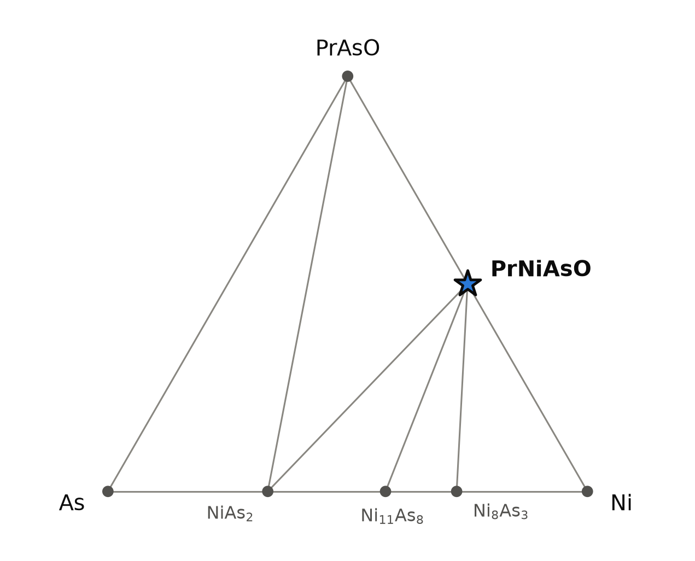
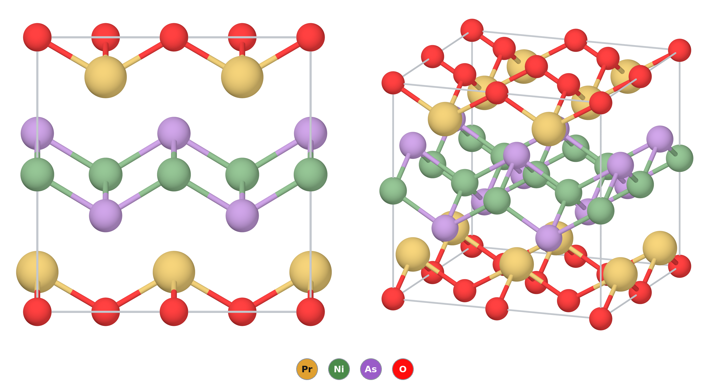

# PrNiAsO — a layered nickel arsenide oxide, superconducting below 1 K

*A Material a Day · entry 35 · 25 November 2026 · status: **known***

> **In one paragraph.** PrNiAsO is a known compound. It has the ZrCuSiAs ("1111") structure
> of the iron-arsenide superconductors: layers of PrO alternate with layers of NiAs. It was
> made in 2012 at 2 GPa and in 2014 at ambient pressure in a sealed silica tube at 1450 K.
> It is a metal and a weak-coupling superconductor, with Tc = 0.93 K, or 1.6 K in the
> high-pressure sample. The two tables of computed energies disagree about it by
> 473 meV/atom. The PBE table puts it on the convex hull, 33 meV/atom below its
> competitors. The Materials-Project-settings table puts it 473 meV/atom above the hull,
> which would make it impossible to make. The same offset appears for every nickel member
> of the family, including LaNiAsO, which has been made many times, and a smaller one for
> iron and cobalt. It is a fault of that table, not of the compound. The computed cell is
> 1 % short in *a* where the lanthanum analogue is right, so treat PBE's description of
> the Pr 4f electrons with caution.

Everything below is computed unless a reference is given. Read
[How this could be wrong](#8-how-this-could-be-wrong) before using any of it.

## 1. Identity

| | |
|---|---|
| Formula | PrNiAsO (also written PrNiOAs) |
| Alexandria id | `agm002231428` (PBE table) |
| Space group | P4/nmm (no. 129), Z = 2 |
| Cell (PBE) | a = 4.029 Å, c = 8.101 Å |
| Cell (measured, room temperature) | a = 4.0677 Å, c = 8.0823 Å [1]; a = 4.0711 Å, c = 8.0733 Å [2] |
| Volume, density (PBE) | 65.74 ų per formula unit, 7.34 g cm⁻³ |
| Structure type | ZrCuSiAs ("1111"), the type of LaFeAsO |
| Formation energy | −1.864 eV/atom (PBE) |

**Calibration of the cell.** PBE makes *a* 1.0 % too short and *c* 0.2 % too long; the
volume is 1.7 % too small. For LaNiAsO (`agm002177570`), computed in the same way, PBE
gives a = 4.127 Å and c = 8.261 Å against 4.1230 Å and 8.1864 Å measured [1]: +0.1 % and
+0.9 %, a volume 1.1 % too large, which is the usual PBE behaviour. The 2.8 % swing in
volume between the two compounds is not the lanthanide contraction (the measured volumes
differ by 3.9 %, the computed ones by 6.6 %). The likely cause is the treatment of
the two 4f electrons of Pr³⁺ as itinerant band electrons in PBE (section 4).

No Wikipedia page about this compound was found.

The CIF is [`PrNiAsO.cif`](PrNiAsO.cif); all structural numbers are in
[`structure.json`](structure.json).

## 2. Where it sits

<picture>
  <source media="(prefers-color-scheme: dark)" srcset="phase_diagram_dark.png">
  
</picture>

Four elements make a tetrahedron. The figure is the section As–Ni–PrAsO through it, the
plane chosen automatically. PrAsO is a computed phase on the PBE hull (P2₁/m, a metal);
I did not look for it in the literature, so treat that corner as a computational
reference point, not a known compound. One tie line in the figure, Ni–PrNiAsO, is not a
tie line of the full hull: PrNiAsO plus nickel goes to PrNi₅As₃ + Pr₂O₃ (by 2 meV/atom).

**The two hulls.**

| table | position of PrNiAsO | competing phases |
|---|---|---|
| PBE (`energy_runs_pbe`) | **33 meV/atom below** its competitors | Pr₂O₃, PrNi₂As₂, Ni₁₁As₈ and the computed PrAsO |
| PBE with Materials-Project settings (`energy_runs_pbe_mp`) | **473 meV/atom above** the hull | PrNi₂As₂, Pr₂O₃, NiAs₂, Ni₁₁As₈ |

PBEsol and SCAN tables do not contain PrNiAsO or LaNiAsO.

**The disagreement is systematic.** It runs through the whole family of nickel 1111
compounds (computed hull distances, PBE / MP settings, meV/atom):

| compound | PBE | MP settings | made? |
|---|---|---|---|
| LaNiAsO | 0 | 454 | yes [1, 2, 3] |
| CeNiAsO | 0 | 447 | yes [1, 2] |
| **PrNiAsO** | **0** | **473** | **yes [1, 2]** |
| NdNiAsO | 0 | 481 | yes [1, 2] |
| SmNiAsO | 0 | 491 | yes [1]; failed at 2 GPa [2] |
| TbNiAsO | 0 | 508 | not made as of 2014 [1] |
| YNiAsO | 29 | 527 | not searched |
| LaNiPO | 0 | 476 | yes (cited in [3]) |

Across the La 1111 arsenide oxides the offset depends on the transition metal: Ni 454,
Co 245, Fe 245, Cr 68, Mn 1, and 0 for Cu, Zn, Cd, Rh, Pd and Ir (all on the PBE hull).
The metals that carry the offset are among those that receive a Hubbard U in an oxide
under the Materials-Project scheme; Mn, which also receives one, does not show it. That
points to the mixing of plain-PBE and PBE+U energies for a compound that contains oxygen
but whose transition metal is bonded only to arsenic. I did not inspect the run settings,
so this cause is a hypothesis. The experimental record settles the question for this
compound: five members of the family have been made, so the 450–500 meV/atom is an
artefact of that table.

**Consequence.** The route, contact and window tools of this series price compounds on
the Materials-Project-settings hull. For PrNiAsO they return nothing usable: every
charge, including the one used in practice, comes back as PrNi₂As₂ + Pr₂O₃ + nickel
arsenides. The routes in section 6 were therefore recomputed by hand on the PBE table.
The machine-learned hull model (trained on the same table) also gives 0.54 eV/atom above
the hull for PrNiAsO and 0.55 for LaNiAsO.

## 3. Structure

*Left: along a; right: oblique. Pr gold, Ni green, As violet, O red. Only Ni–As and
Pr–O bonds are drawn.*

| site | Wyckoff | z (PBE) | z (measured [1]) | coordination (PBE) |
|---|---|---|---|---|
| Pr | 2c | 0.1448 | 0.1441 | 4 O at 2.331 Å, 4 As at 3.299 Å |
| Ni | 2b | ½ | ½ | 4 As at 2.352 Å (flattened tetrahedron) |
| As | 2c | 0.6498 | 0.6454 | 4 Ni, 4 Pr |
| O | 2a | 0 | 0 | 4 Pr (tetrahedron) |

(The As coordinate is given in the setting of [1]; the CIF has the equivalent 0.3502.)

- **Two layers.** A PrO layer of edge-sharing OPr₄ tetrahedra, as in the fluorite
  structure, and a NiAs layer of edge-sharing NiAs₄ tetrahedra, as in the iron-arsenide
  superconductors. Pr bonds to O on one side and to four As of the next layer on the
  other, which holds the stack together.
- **Bond lengths are right, the shape is not.** The Ni–As bond computed (2.352 Å) and
  measured (2.349 Å, from the cell and z of [1]) agree to 0.1 %, and Pr–O to 0.6 %
  (2.331 against 2.344 Å). The error is in the shape of the NiAs₄ tetrahedron: PBE puts
  As 1.21 Å above the Ni plane against 1.18 Å measured, and the As–Ni–As angle is 117.9°
  against 119.9(8)° measured [1]. For LaNiAsO the computed angle is 122.3° against
  122.4° [1]. The shorter *a* of the Pr compound follows from this.
- **The family.** ZrCuSiAs-type compounds are a large family (pnictide oxides,
  chalcogenide oxides and fluorides, silicide hydrides) [4]. In the PBE table, the
  nickel arsenide oxides of La, Ce, Pr, Nd, Sm, Tb and Tm are on the hull, those of Y,
  Dy, Ho, Er and Yb 6–49 meV/atom above it, and those of Ca, Sr, Mg and Zn 280–580
  above, as expected for a divalent cation that cannot balance the charge.

## 4. Computed properties

Pr³⁺ has two 4f electrons, which PBE treats as band electrons. Where that spoils a number,
the f-free analogue LaNiAsO (`agm002177570`) is quoted instead. The full tables are in
[`properties.json`](properties.json).

### Electronic structure and magnetism

| property | PrNiAsO | LaNiAsO | measured |
|---|---|---|---|
| Band gap (PBE) | 0, metal | 0, metal | metallic resistivity [1, 3] |
| Band gap (machine-learned, MBJ) | 0 | 0.12 eV | — |
| Density of states at E_F (PBE, states/eV per formula unit) | 8.5 | 1.45 | — |
| Band-structure Sommerfeld coefficient (mJ mol⁻¹ K⁻²) | (20, not meaningful) | 3.4 | 13.1 (Pr) [1]; 3.0 (La) [1] |
| Spin moment (PBE) | 1.92 μB per Pr, 0.06 per Ni, ferromagnetic | 0 | Pr³⁺ 3.57 μB effective, no order above 0.4 K [1] |

- **A metal, and the nickel layer is non-magnetic**, in the calculation (0.06 μB per Ni)
  and in experiment [1].
- **The Pr numbers are 4f artefacts.** PBE puts partly filled 4f bands at the Fermi
  level, which gives the large density of states and a ferromagnetic spin moment of
  1.9 μB per Pr. In the real compound the 4f electrons are localised: the crystal field
  splits the J = 4 multiplet of Pr³⁺ into a non-magnetic singlet ground state with the
  next levels about 40 and 50 K above it [1], so there is no ordered moment. A
  calculation with the 4f electrons in the core, or with a Hubbard U on Pr, would be
  needed. The PBE ferromagnet is not a prediction.
- **LaNiAsO calibrates the band part.** Its computed band Sommerfeld coefficient,
  3.4 mJ mol⁻¹ K⁻², is close to the 3.0 measured [1]. Electron–phonon coupling should
  make the measured value the larger of the two; that it is not shows the uncertainty of
  both numbers.

### Mechanical (machine-learned, from the PBE structure)

| | PrNiAsO | LaNiAsO |
|---|---|---|
| Bulk modulus (GPa) | 109 | 97 |
| Shear modulus (GPa) | 51 | 47 |
| Young's modulus (GPa) | 127 | 109 |

These are screening estimates from the structure alone; no measured moduli were found.
The Pr value is computed on a cell that is 1.7 % too small, which stiffens it.

### Superconductivity

| | PrNiAsO | LaNiAsO |
|---|---|---|
| Tc, machine-learned screening estimate | 0.95 K | 1.3 K |
| λ, machine-learned | 0.50 | 0.47 |
| ω_log, machine-learned | 202 K | 202 K |
| **Tc measured** | **0.93 K** [1]; 1.6 K at 2 GPa-synthesised, probably H-substituted [2] | **2.4–2.75 K** [1, 2, 3] |
| λ from experiment | ≈ 0.41 (McMillan, from Tc and Θ_D = 226 K) [1] | — |

- The machine-learned Tc matches the measured 0.93 K for PrNiAsO almost exactly and
  is a factor of two low for LaNiAsO. At this level a factor of two in Tc is a small
  change in λ, so both are good agreement, and the PrNiAsO match is partly luck.
- The measured superconductivity is conventional: a specific-heat jump
  ΔC/γT_c = 1.42, close to the weak-coupling BCS value 1.43, and an upper critical field
  of 0.092 T, far below the Pauli limit [1].
- Li et al. observe superconductivity only in the La and Pr members, the two whose
  rare-earth ion has a non-magnetic ground state, and none in Ce, Nd or Sm above 0.4 K [1].
  The calculation knows nothing of this: its estimate is the same kind of number for all.
- **Phonons not computed.** Neither PrNiAsO nor LaNiAsO is in the group's DFPT set.

### Not computed

Dielectric response (a metal), transport tables (Seebeck coefficients of a metal are not
informative), phonons and the electron–phonon coupling from first principles, any
calculation with localised 4f electrons.

## 5. Is it stable?

- **PBE table: on the hull, 33 meV/atom below** Pr₂O₃ + PrNi₂As₂ + Ni₁₁As₈ + PrAsO.
- **Materials-Project-settings table: 473 meV/atom above**, an artefact shared by the
  whole nickel family (section 2).
- **Error bar.** Oxides carry a scatter of 65 meV/atom against calorimetry in this
  project's survey; arsenides are not in it. The 33 meV/atom depth is smaller than that,
  so the PBE number alone does not settle stability. Experiment does: it has been made
  at ambient pressure [1].
- **The 4f caveat** applies here too: the PBE energy of PrNiAsO and of its Pr-bearing
  competitors carries the itinerant-4f error. It largely cancels when all of them
  contain Pr³⁺, but not entirely.
- **The family supports the result.** The PBE table puts the La, Ce, Pr, Nd and Sm
  members on the hull, and all five have been made [1].

## 6. How to make it

**How it has been made.**

| | reagents | conditions | result |
|---|---|---|---|
| Li et al. 2014 [1] | PrAs (from Pr + As, 1073 K, 72 h), NiAs (Ni + As, 973 K, 10 h), Ni, praseodymium oxide and Pr metal | pellet pressed at 600 MPa, alumina crucible in evacuated silica, **1450 K, 40 h** | single phase by XRD |
| Matsuishi et al. 2012 [2] | PrAs + Ni₂As + NiAs + Pr₂O₃ | BN capsule, **2 GPa, 1273–1373 K, 30 min** | main phase, minor Pr₂O₃ and NiAs; oxygen-deficient with hydrogen |
| For comparison, LaNiAsO [3] | LaAs + NiO | pellet, evacuated silica, 1273 K, 1 day | 99 wt % |

**What the PBE hull proposes.** Computed by hand on `energy_runs_pbe`, because the route
tools use the other table (section 2). Energies are per atom of the whole charge.

| charge | product on the PBE hull | ΔE (meV/atom) |
|---|---|---|
| PrAs + NiO | PrNiAsO | −685 |
| Pr₂O₃ + PrAs + Ni + 2 NiAs | 3 PrNiAsO | −92 |
| same charges on the MP-settings hull | PrNi₂As₂ + Pr₂O₃ + nickel arsenides | −667, −48 |

The two-reagent route, PrAs + NiO, is the first by the rule this series uses (fewest
reagents). It is the route used for LaNiAsO [3], not the one used for PrNiAsO [1, 2].
Its driving force is overstated: PBE without U underbinds NiO by about 390 meV/atom
against its measured enthalpy, which inflates the reaction energy by roughly
200 meV/atom of the charge. It is still strongly downhill.

**One route in practice.** PrAs and NiO, 1 : 1, ground and pressed in a glove box, in an
alumina or BN liner inside an evacuated silica ampoule, fired at 1270–1450 K for one to
two days with an intermediate regrinding.
- **Bottom of the window**: about 980 K, the Tammann temperature of NiO; PrAs has no
  melting point on file (estimated 1830 ± 650 K). The typical firing temperature for such
  a charge is 1400 ± 220 K, and both published routes are inside that.
- **Top of the window**: the container, not the compound. On the PBE hull PrNiAsO reacts
  with silica (−39 meV/atom, to praseodymium silicates and nickel silicide), barely with
  alumina (−0.4) and not at all with BN, which is why the published routes use an
  alumina crucible or a BN capsule. It reacts with tantalum (−91).
- **Atmosphere.** A closed ampoule. On the PBE hull the compound is stable over an
  oxygen chemical potential window about 0.75 eV wide (−4.15 to −3.40 eV against the
  table's own O₂ reference; that reference is uncorrected, so do not convert these to a
  furnace gas). Below it the products are PrNi₂As₂ + Pr₂O₃; above it Pr₇O₁₂ + Ni₁₁As₈ +
  NiAs₂. Oxygen cannot be fixed by a gas here; it is fixed by the weighed-out charge.

**Metathesis.** Tested on the PBE table; all go to PrNiAsO plus the salt.

| charge | products | ΔE (meV/atom) |
|---|---|---|
| PrOCl + NiAs + Na | PrNiAsO + NaCl | −209 |
| PrOCl + Ni + NaAs | PrNiAsO + NaCl | −173 |
| PrOCl + NiAs + Li | PrNiAsO + LiCl | −221 |
| PrCl₃ + NiO + Na₃As | PrNiAsO + 3 NaCl | −569 |
| PrCl₃ + NiO + Li₃As | PrNiAsO + 3 LiCl | −468 |

On the Materials-Project-settings hull the first charge goes instead to PrNi₂As₂ + Pr₂O₃
+ NaCl (−180), for the reason in section 2. Metathesis is not needed for a compound that
forms directly at 1450 K; it could matter for a low-temperature route to a fine powder.
A reservoir route was not needed: closed routes exist on the PBE hull.

**Powder lines** (Cu Kα, computed from the PBE cell; the measured cell moves *hk*0 lines
to lower angle by about 1 %): 31.3° (102, strongest), 31.4° (110), 45.0° (200), 55.7°
(114), 55.9° (212), 38.6° (112). What an impurity means:
- Pr₂O₃ and NiAs: unreacted reagents, the impurities of the 2 GPa samples [2]. Regrind and refire.
- PrNi₂As₂ with Pr₂O₃: oxygen-poor.
- Pr₇O₁₂ (or Pr₆O₁₁) with NiAs₂ or Ni₁₁As₈: oxygen-rich, for example from a higher
  praseodymium oxide used as the oxygen source.
- PrNi₅As₃: nickel in excess. NiAs₂ and PrAsO: arsenic in excess.
- Praseodymium silicates: the silica tube was attacked; use a liner.

**Hazards.** Arsenic and its compounds are toxic and carcinogenic, and so are nickel
compounds such as NiO. Arsenic must be handled in a sealed ampoule; an ampoule holding
free arsenic can burst on heating. Metal arsenides such as PrAs can release arsine with
moisture or acid. Work in a glove box and a fume hood.

## 7. What it is good for

No application was found. PrNiAsO is a research compound. It matters for the comparison
of nickel and iron 1111 compounds: the nickel compounds are conventional,
weak-coupling superconductors with Tc below 4 K, while LnFeAsO becomes a superconductor
up to tens of kelvin only when doped [1, 2, 3]. Here it is a calibration point for an
open-4f compound in this family.

## 8. How this could be wrong

- **The 473 meV/atom offset is diagnosed, not explained.** I attribute it to the
  treatment of the transition metal in a compound that contains oxygen, from the pattern
  across the family. Mn does not fit the pattern, and I did not read the run settings.
- **The 4f electrons.** PBE gives a ferromagnetic metal with 4f states at the Fermi
  level; the real compound has localised 4f electrons in a non-magnetic singlet. The
  1 % error in *a* and the 2° error in the As–Ni–As angle probably come from this. Every
  Pr-dependent number (density of states, moment, the moduli, the depth below the hull)
  carries it.
- **33 meV/atom is less than the class error.** The PBE stability alone would not be
  convincing; experiment is.
- **Route energies are 0 K thermodynamics** and say nothing about rate. NiO is
  underbound in PBE without U, which flatters the PrAs + NiO route.
- **The hand-built hull** used the PBE phases within 2 meV/atom of the hull of their own
  system; a phase slightly above it could change a competing assemblage.
- **The high-pressure sample is not stoichiometric** [2]; its Tc of 1.6 K should not be
  compared with a calculation for PrNiAsO.
- **Machine-learned Tc and moduli** are screening estimates; phonons were not computed.

## 9. Literature

Searches (OpenAlex): "PrNiAsO" (4 hits, references 1 and 2); "PrNiOAs" (1 hit, not
relevant); "praseodymium nickel oxyarsenide superconductor" (1 hit, not relevant);
"praseodymium nickel arsenide oxide ZrCuSiAs" (1 hit, reference 4); "LnNiAsO rare earth
nickel oxyarsenide superconductivity" (0 hits); "nickel-based layered superconductor
LaNiOAs Watanabe Hosono" (reference 3). Wikipedia was searched under PrNiAsO, PrNiOAs,
the systematic name, ZrCuSiAs and LaNiAsO; no page on this compound exists.

1. Y. Li, Y. Luo, L. Li, B. Chen, X. Xu, J. Dai, X. Yang, L. Zhang, G. Cao, Z.-A. Xu,
   *Kramers non-magnetic superconductivity in LnNiAsO superconductors*, J. Phys.:
   Condens. Matter **26**, 425701 (2014).
   [doi:10.1088/0953-8984/26/42/425701](https://doi.org/10.1088/0953-8984/26/42/425701).
   **Full text read.** Ambient-pressure synthesis, refined cells of the La–Sm series, Tc,
   specific heat, crystal-field analysis.
2. S. Matsuishi, A. Nakamura, Y. Muraba, H. Hosono, *Hydrogen substitution effect on the
   superconductivity of LnNiAsO (Ln = La–Nd)*, Supercond. Sci. Technol. **25**, 084017
   (2012). [doi:10.1088/0953-2048/25/8/084017](https://doi.org/10.1088/0953-2048/25/8/084017).
   **Full text read.** High-pressure synthesis, cell, Tc = 1.6 K, oxygen deficiency.
3. T. Watanabe, H. Yanagi, Y. Kamihara, T. Kamiya, M. Hirano, H. Hosono,
   *Nickel-based layered superconductor, LaNiOAs*, J. Solid State Chem. **181**, 2117
   (2008). [doi:10.1016/j.jssc.2008.04.033](https://doi.org/10.1016/j.jssc.2008.04.033).
   **Full text read** (arXiv:0805.4340 preprint). LaAs + NiO route, Tc = 2.4 K.
4. R. Pöttgen, D. Johrendt, *Materials with ZrCuSiAs-type structure*, Z. Naturforsch. B
   (2008). [doi:10.1515/znb-2008-1001](https://doi.org/10.1515/znb-2008-1001).
   **Abstract only.** The structure type and its family.

## 10. Provenance

- **Data.** Alexandria database: `energy_runs_pbe` (selection, structure, hull, the
  hand-built routes, contact and window), `energy_runs_pbe_mp` (the second hull and the
  family comparison). Measured values from references 1–3.
- **Tools.** The group's reaction-graph tools (routes and kinetic floor on the
  Materials-Project-settings hull, which fails here, see section 2), pymatgen for the PBE
  hull, tuga-sp property models, POV-Ray.
- **Authorship.** Drafted by Claude (Anthropic) and reviewed by a person before
  publication. Corrections are welcome.
