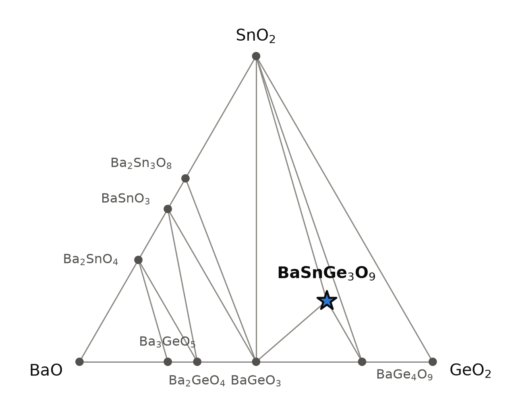
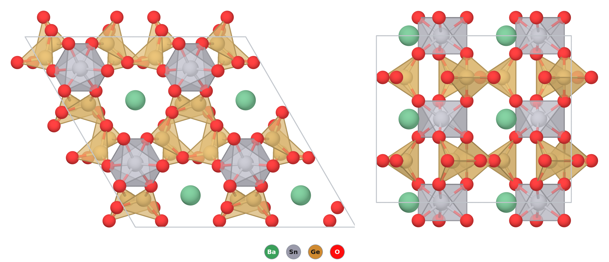

# BaSnGe₃O₉ — a barium tin germanate with the benitoite structure

*A Material a Day · entry 36 · 26 November 2026 · status: **known (route differs)***

> **In one paragraph.** BaSnGe₃O₉ is a known compound. It was made in 1972 by firing
> BaCO₃, SnO₂ and GeO₂ together in air at 1220 °C, and its structure was refined from
> powder X-ray intensities [1, 2]: it is the germanium analogue of the gem mineral benitoite (BaTiSi₃O₉), with
> rings of three GeO₄ tetrahedra held together by SnO₆ octahedra and Ba in the channels
> between them. PBE puts it on the convex hull, but only 5.7 meV/atom below the three
> phases it would otherwise split into (BaGeO₃, BaGe₄O₉ and SnO₂); the
> Materials-Project-settings table gives 7.3 meV/atom below, and SCAN puts it 8.7 meV/atom
> *above*. All three numbers are far inside the 65 meV/atom scatter of oxides against
> calorimetry, so the calculation does not decide whether it is stable; the 1972 sample
> does. Computed vibrational entropy deepens the margin to about 30 meV/atom at 1273 K,
> which suggests that it is favoured at firing temperatures. The hull's first route is
> BaSnO₃ + 3 GeO₂; the published one-pot firing of the three commodity reagents, 105 K
> above the melting point of GeO₂, also worked, with no loss of mass beyond CO₂. The
> computed cell is 1.5–1.7 % too long, the usual PBE error; the Sn–O bond is 5 % longer
> than the one refined in 1972, more than the cell error.

Everything below is computed unless a reference is given. Read
[How this could be wrong](#8-how-this-could-be-wrong) before using any of it.

## 1. Identity

| | |
|---|---|
| Formula | BaSnGe₃O₉ (stored as BaSn(GeO₃)₃; also written BaSn[Ge₃O₉], a cyclotrigermanate) |
| Alexandria id | `agm003237387` (PBE table) |
| Space group | P-6c2 (no. 188), Z = 2 |
| Cell (PBE) | a = 7.000 Å, c = 10.405 Å |
| Cell (measured, powder X-ray) | a = 6.894(5) Å, c = 10.233(5) Å [1, 2] |
| Volume, density (PBE) | 220.8 ų per formula unit, 4.65 g cm⁻³ |
| Density from the measured cell | 4.87 g cm⁻³ |
| Structure type | benitoite (BaTiSi₃O₉), prototype `ABC3D9_hP28_188_a_c_k_kl` |
| Formation energy | −1.899 eV/atom (PBE) |

**Calibration of the cell.** PBE makes *a* 1.5 % and *c* 1.7 % too long, and the volume
4.8 % too large (441.6 ų against 421.2 ų per cell). This is the usual direction and
size of the PBE error for an oxide. The same table does the same to the neighbouring
BaGe₄O₉: a = 11.759 Å and c = 4.824 Å computed against 11.61 Å and 4.74 Å measured from
powder data [3], +1.3 % and +1.8 %, and to the silicate BaSnSi₃O₉: a = 6.814 Å and
c = 9.983 Å computed against 6.728 Å and 9.838 Å measured [1], +1.3 % and +1.5 %.

**Calibration of the atomic positions.** The 1972 structure was refined from the
intensities of X-ray powder lines, with the thermal factors fixed, to R = 0.085 on
intensities and 0.076 on structure factors [1]. PBE reproduces the Ge position to 0.001
in x and y; the oxygens differ by up to 0.017 in fractional coordinates (about 0.1 Å).

| | measured [1] (computed from the published coordinates and cell) | PBE | PBE − measured |
|---|---|---|---|
| Sn–O | 1.972 Å | 2.077 Å | +5.3 % |
| Ge–O, to Sn | 1.722 Å | 1.755 Å | +1.9 % |
| Ge–O, in the ring | 1.716, 1.751 Å | 1.779, 1.796 Å | +3.7 %, +2.6 % |
| Ba–O, nearest six | 2.858 Å | 2.810 Å | −1.7 % |
| Ge–O–Ge in the ring | 132.9° | 128.1° | −4.8° |
| Ge–O–Sn | 135.9° | 130.7° | −5.2° |

The Ge–O bonds are 2–4 % long, somewhat more than the cell. The Sn–O bond is 5 % long,
three times the cell error; scaled to the measured cell it would still be 2.045 Å, 3.7 %
longer than the 1972 value. The paper gives the coordinates to three decimals without
uncertainties; with fixed thermal factors and powder data, the oxygen positions are the
least certain part of the refinement, and a shift of 0.005 in x moves an oxygen by about
0.035 Å. Which side is wrong about the Sn–O bond cannot be decided from these two
numbers alone; a modern refinement would settle it.

No Wikipedia page about this compound was found.

The CIF is [`BaSn(GeO3)3.cif`](BaSn(GeO3)3.cif); all structural numbers are in
[`structure.json`](structure.json).

## 2. Where it sits

<picture>
  <source media="(prefers-color-scheme: dark)" srcset="phase_diagram_dark.png">
  
</picture>

Four elements make a tetrahedron; the figure is the section BaO–GeO₂–SnO₂ through it,
which holds every phase with Sn⁴⁺ and Ge⁴⁺. BaSnGe₃O₉ is the only phase inside the
triangle in the PBE table; all the others lie on its edges. It has tie lines to BaGeO₃,
BaGe₄O₉ and SnO₂, and lies inside the small triangle those three would form without it.

| table | position of BaSnGe₃O₉ | competing phases |
|---|---|---|
| PBE (`energy_runs_pbe`) | **5.7 meV/atom below** its competitors | BaGeO₃ + BaGe₄O₉ + SnO₂ |
| PBE with Materials-Project settings (`energy_runs_pbe_mp`) | **7.3 meV/atom below** | the same |
| SCAN (`energy_runs_scan`) | **8.7 meV/atom above** | the same |

The three tables agree on the competitors and disagree on the sign, with a spread of
16 meV/atom. That spread is itself the result: it is the size of the margin.

**Neighbours on the BaO–GeO₂ edge.** BaGeO₃, BaGe₄O₉, Ba₂GeO₄ and Ba₃GeO₅ are on the PBE
hull. BaGe₄O₉ is a close relative of the target: it has the same Ge₃O₉ rings joined by
octahedra, with Ge in the octahedra instead of Sn, in a different space group [3, 4]. It
melts congruently at 1665 K (1392 ± 5 °C) [3]. On the BaO–SnO₂ edge, BaSnO₃, Ba₂SnO₄ and
Ba₂Sn₃O₈ are on the hull. GeO₂ and SnO₂ have no compound between them.

## 3. Structure

*Left: along c, 2 × 2 × 1 cells. Right: along a. Ba green, SnO₆ octahedra grey, GeO₄
tetrahedra amber, O red. In the left view each triangle of three amber tetrahedra is one
Ge₃O₉ ring.*

| site | Wyckoff | coordination (PBE) |
|---|---|---|
| Ba | 2e | 6 O at 2.810 Å; the next 6 O at 3.575 Å |
| Sn | 2c | 6 O at 2.077 Å (octahedron) |
| Ge | 6k | 4 O: 2 at 1.755 Å (to Sn), 1.779 and 1.796 Å (in the ring) |
| O1 | 6k | bridges two Ge in a ring, Ge–O–Ge 128.1° |
| O2 | 12l | bridges Ge and Sn, Ge–O–Sn 130.7°, and touches Ba |

- **Rings and octahedra.** Three GeO₄ tetrahedra share corners to form a flat Ge₃O₉ ring
  lying in the mirror planes at z = ¼ and ¾. Each tetrahedron has two oxygens in the
  ring and two pointing up and down, to SnO₆ octahedra above and below. Every oxygen
  bridges two framework cations (Ge–Ge or Ge–Sn), so the framework is fully
  corner-connected, with no edge or face sharing.
- **Barium in the channels.** Ba sits in the cavities between the rings and octahedra,
  with six close oxygens, at the corners of a distorted octahedron [1], and six far ones.
  Successive ring layers are rotated against each other, which is why the c axis holds
  two of them (as described for benitoite in [3]). The 1972 paper notes that the ring
  hardly changes across the family, with M–O–M near 133° in every member it refined [1];
  PBE gives 128° here.
- **The family.** The benitoite structure is a large family in the PBE table: 44 entries
  share the prototype, all in P-6c2. Silicates BaTiSi₃O₉ (benitoite), BaZrSi₃O₉,
  BaHfSi₃O₉ and BaSnSi₃O₉; germanates BaZrGe₃O₉, BaHfGe₃O₉, KTaGe₃O₉, RbNbGe₃O₉;
  cyclophosphates such as KMg(PO₃)₃; and fluoroberyllates such as KBe₃ZnF₉. Among the
  Ba germanates the depths below the competitors are 12.8 (Hf), 6.8 (Zr) and 5.7 (Sn)
  meV/atom; BaTiGe₃O₉ is 5.5 meV/atom above. The tin silicate BaSnSi₃O₉ (the tin end
  of the mineral pabstite, Ba(Sn₀.₇₇Ti₀.₂₃)Si₃O₉ [1]) is 20.5 below. The 1972 paper made
  the complete series BaSn(Ge₃₋ᵧSiᵧ)O₉, 0 ≤ y ≤ 3, with both a and c shrinking as Si
  replaces Ge (to a = 6.728 Å, c = 9.838 Å at y = 3) [1].
- **A warning from the titanium analogue.** BaTiGe₃O₉ has the benitoite structure only
  between about 1405 and 1528 K; at room temperature it is a distorted superstructure
  with a three-times larger cell (a = 11.73 Å, Z = 6) [3]. That superstructure is not in
  the database, which holds only the benitoite form. For BaSnGe₃O₉ the 1972 refinement
  is in the benitoite cell [1, 2], and no second form was reported. The paper explains
  the difference by the ratio of the octahedral to the tetrahedral radius: about 1.75
  for Sn/Ge, where only the benitoite form is seen, 1.53 for Ti/Ge, where two forms
  exist, and 1.35 for Ge/Ge, the BaGe₄O₉ structure [1]. Attempts to make Sr benitoites
  failed, which it takes to mean that a large A cation is also needed [1].

## 4. Computed properties

No open-shell ions; all numbers are for the compound itself. The full tables are in
[`properties.json`](properties.json).

### Electronic structure

| property | value | how far to trust it |
|---|---|---|
| Band gap, PBE | 2.78 eV indirect, 2.88 eV direct | PBE underestimates oxide gaps, often by 30–50 % |
| Band gap, SCAN | 3.55 eV indirect, 3.67 eV direct | still a lower bound |
| Band gap, machine-learned MBJ estimate | 4.25 eV | screening estimate; MBJ is usually closest to experiment |
| Measured gap | none found | — |

A colourless or white insulator is expected from all three; no measured optical data
were found, and the 1972 paper gives none.

### Dielectric response (PBE, DFPT)

| | |
|---|---|
| ε∞ (principal values) | 3.25, 3.26, 3.26; mean 3.26 |
| Refractive index from ε∞ | 1.81 |
| Born effective charges (trace/3) | Ba +2.79, Sn +4.18, Ge +3.28, O −1.87 |
| Largest clamped-ion piezoelectric coefficient | 0.066 C m⁻² |

ε∞ is the electronic part only, not the static dielectric constant. PBE usually
overestimates ε∞ a little, so the index is more likely high than low. The space group
has no inversion centre, so piezoelectricity is allowed by symmetry; the clamped-ion
number above excludes the ionic relaxation and is small. The Born charges are close to
the nominal +2, +4, +4, −2, as in an ordinary ionic oxide.

### Charge transport (PBE band structure, constant relaxation time)

Electrons are light (conductivity mass 0.34–0.39 mₑ) and holes heavy (density-of-states
mass 7.2 mₑ, conductivity mass 5.4–5.5 mₑ), as usual for an oxide whose valence band is
O 2p. The branch-point energy is 0.44 eV above the valence-band maximum. Seebeck
coefficients at 300 K: −169 μV K⁻¹ for electrons at 10¹⁹ cm⁻³, +500 μV K⁻¹ for holes at
10¹⁹ cm⁻³. These are numbers for a hypothetically doped crystal; nothing says the
compound can be doped, and a large Seebeck coefficient in a 3–4 eV insulator does not
make a thermoelectric.

### Mechanical (machine-learned, from the PBE structure)

| | |
|---|---|
| Bulk modulus | 91 GPa |
| Shear modulus | 44 GPa |
| Young's modulus (model) | 89 GPa |
| Young's modulus from B and G (isotropic) | 113 GPa |

The three models are separate and the Young's modulus predicted directly is not
consistent with the other two: B and G give 113 GPa. Trust B and G more, but all three
are screening estimates with no measurement to compare.

### Not computed

Phonons: BaSnGe₃O₉ is not in the group's DFPT set (no structure of this composition).
A harmonic phonon calculation on the Materials-Project structure of this compound is
listed in a public phonon database [6]; it was not read. Measured Raman spectra exist for
the silicate members BaTiSi₃O₉, BaZrSi₃O₉, BaSnSi₃O₉ and for BaGe₄O₉ [4], not for this
compound. Magnetism: none (closed shells).

## 5. Is it stable?

- **PBE: on the hull, 5.7 meV/atom below** BaGeO₃ + BaGe₄O₉ + SnO₂.
- **Materials-Project settings: 7.3 meV/atom below** the same three.
- **SCAN: 8.7 meV/atom above** the same three.
- **Error bar.** Oxides scatter by 65 meV/atom (mean absolute deviation) against
  calorimetry in this project's survey, with a median bias of +5. The margin is about a
  tenth of the error, in either direction. The calculation cannot say whether the
  compound is stable at 0 K; it says only that it is close to the hull.
- **At temperature.** With harmonic phonons for every phase, the margin grows to
  12 meV/atom below at 300 K, 25 at 1000 K, 31 at 1273 K and 34 at 1473 K (phonon
  scatter for this class 6–15 meV/atom). The framework of corner-linked rings is softer
  than the competing assemblage, so heating helps. This is a consistent sign but not a
  large number, and it rests on the PBE depth at 0 K.
- **Experiment settles existence**: it was made and its structure refined [1, 2]. The
  machine-learned hull model puts it 0.8 meV/atom above the hull, also inconclusive.

## 6. How to make it

**How it has been made.** The only report found is the 1972 paper [1]. BaCO₃, SnO₂
and GeO₂ in the ratio 1 : 1 : 3 were ground together in an agate mortar and heated in
air, in platinum crucibles or in Pythagoras (porcelain) boats, at 1220 °C (1493 K) for
this compound; the duration is not given. The authors checked that the mass was
conserved apart from the CO₂ lost. The same one-pot firing with SiO₂ in place of part or
all of the GeO₂ gave the whole series up to BaSnSi₃O₉, which needed 1330 °C and longer
anneals because silica reacts slowly. The related BaGe₄O₉ and BaTiGe₃O₉ were made in 1961
from BaCO₃, TiO₂ and quartz-form GeO₂, pressed, calcined in platinum at 1000 °C three
times, and heated in sealed platinum capsules above that [3].

**What the hull proposes** (Materials-Project-settings table, which the route tools
use; it agrees with PBE on the competitors). Energies per atom of the whole charge.

| rank | charge | ΔE (meV/atom) | note |
|---|---|---|---|
| 1 | BaSnO₃ + 3 GeO₂ | −88.9 | fewest reagents; the target is the first product of this pair |
| 2 | ⅓ BaGeO₃ + SnO₂ + ⅔ BaGe₄O₉ | −7.3 | the decomposition read backwards: no driving force to speak of |
| — | BaO + SnO₂ + 3 GeO₂ (BaCO₃ after CO₂ is lost) | −157.8 | the three commodity oxides: the published route [1] |

**Beside the published route.** The hull's first route and the published one differ:
the hull prefers BaSnO₃ + 3 GeO₂, the fewest reagents, while the 1972 synthesis fires
the carbonate and the two oxides together. Both end at the target, and the published
charge has the larger driving force.

**What happens in a one-pot charge.** The pairwise analysis at 1273 K says
BaCO₃ + GeO₂ goes first to Ba₂GeO₄ (it leads by 89 meV/atom), and BaCO₃ + SnO₂ to one of
BaSnO₃, Ba₄Sn₃O₁₀ or Ba₃Sn₂O₇ (within 6 meV/atom of each other); SnO₂ and GeO₂ do not
react. A barium germanate formed first then has to be taken apart again to take up tin.
Pre-reacting BaCO₃ with SnO₂ to BaSnO₃, and then firing that with GeO₂, avoids it: for
the pair BaSnO₃ + GeO₂ the target is the only product, 140 meV/atom of target downhill at
1273 K. The 1972 one-pot firing at 1493 K gave the target all the same [1], so at that
temperature any barium germanate formed on the way does not block the reaction; the
paper does not say what forms first.

**One route in practice.** The published one: BaCO₃ + SnO₂ + 3 GeO₂, ground in agate,
fired in air in platinum at 1220 °C (1493 K) [1], with intermediate regrinding if the
first firing leaves BaSnO₃ or GeO₂. The two-step route through BaSnO₃ above is an
alternative the hull favours, not a tested one.
- **Bottom of the window**: about 950–1010 K, the Tammann temperature of SnO₂ (952 K)
  or of BaSnO₃ (1009 K, from an estimated melting point). Laboratories fire such charges
  at 1310–1330 ± 220 K; the published 1493 K is near the top of that range.
- **Top of the window**: the melting point of GeO₂, 1388 K, is not the limit it might
  seem: the published firing was 105 K above it and conserved its mass [1]. BaGe₄O₉, the Ge-rich competitor, melts at 1665 K [3]. The
  melting point of BaSnGe₃O₉ itself is not on file.
- **Volatility**: GeO₂ loses germanium as GeO(g) at about 10⁻⁶ bar at 1373 K in air
  (computed). The 1972 authors found no loss of mass beyond CO₂ at 1100–1330 °C [1], so
  in practice the loss is small; a lid costs nothing.
- **Atmosphere**: air or oxygen. A reducing gas reduces Sn⁴⁺: with hydrogen the target
  goes to BaGe₄O₉ + BaSn₂Ge₂O₇ (−47 meV/atom). The oxygen window is open on the oxygen-rich
  side; its lower end corresponds to H₂O/H₂ ≈ 0.06, far from any oxidising furnace.
- **Container**: platinum or gold (inert). It reacts slightly with alumina (−16.8
  meV/atom, to BaAl₂Ge₂O₈ + GeO₂ + SnO₂) and barely with silica (−0.3), so a platinum
  crucible is the safe choice, as in [1, 3]. The 1972 authors also used porcelain boats
  and mention no attack, though they do not say which container served for which firing [1].

**Metathesis** (tested; all go to the target plus the salt):

| charge | products | ΔE (meV/atom) |
|---|---|---|
| BaCl₂ + Na₂SnO₃ + 3 GeO₂ | BaSnGe₃O₉ + 2 NaCl | −71.3 |
| BaCl₂ + K₂SnO₃ + 3 GeO₂ | BaSnGe₃O₉ + 2 KCl | −141.5 |
| BaCl₂ + Na₂GeO₃ + SnO₂ + 2 GeO₂ | BaSnGe₃O₉ + 2 NaCl | −44.9 |

The target shares a tie line with NaCl and KCl, so the salt does not attack it and can
be washed out. It does react with KF, K₂CO₃ and K₂SO₄ (to K₂SnGe₃O₉), so those fluxes are
not suitable. Metathesis is not needed for a compound the oxides make directly; it could
give a lower-temperature route or a fine powder. A reservoir route was not needed.

**Powder lines** (Cu Kα, from the PBE cell; the measured cell moves them to angles about
1.5 % higher, about half a degree near 30°): 30.8° (112, strongest), 22.5° (102),
29.5° (200), 26.9° (111), 34.5° (004), 14.6° (100). What an impurity means:
- BaGeO₃ with SnO₂: germanium lost (too hot, no lid).
- BaGe₄O₉ with SnO₂: barium-poor, or GeO₂ in excess.
- BaSnO₃ and GeO₂: unreacted; regrind and refire.
- Ba₂GeO₄: the one-pot route with BaCO₃ went through a barium germanate first.
- BaSn₂Ge₂O₇ or tin metal: reducing conditions.
- BaAl₂Ge₂O₈: attack on an alumina crucible.

**Hazards.** Soluble barium compounds, including BaCO₃ and BaCl₂, are toxic if
swallowed. GeO₂ and SnO₂ dusts should not be breathed. Nothing in the route is
radioactive or needs a sealed tube.

## 7. What it is good for

No application of BaSnGe₃O₉ was found; the 1972 paper is a study of synthesis and
structure and proposes none. Members of the family are studied for
luminescence (benitoite itself shows blue and red photoluminescence, as reviewed in
[4]) and, as hexagonal crystals without an inversion centre, for spin-split bands:
KTaGe₃O₉, of this structure type, was calculated to have a persistent spin texture in
its valence band [5]. For BaSnGe₃O₉ these are candidates only. Here it is a calibration point
for a near-degenerate margin: three tables, three answers, and a compound that exists.

## 8. How this could be wrong

- **The margin is smaller than every error bar.** 5.7, 7.3 and −8.7 meV/atom against
  65 meV/atom of oxide scatter. No conclusion about stability at 0 K rests on these
  numbers, only on the fact that it was made.
- **Germanium dioxide is wrong in PBE.** The PBE table's lowest GeO₂ is a tetragonal
  I-42d form, with the rutile form 8.5 meV/atom above; SCAN puts rutile lowest, and
  rutile-type GeO₂ is the stable form at room temperature (general knowledge, not
  retrieved). GeO₂ is not in the competing assemblage, so the hull distance is not
  affected directly, but it is a reagent in every route, so the route energies carry
  this error.
- **The temperature trend is computed** with harmonic phonons and the PBE 0 K energies.
  It is the right sign for a softer framework but its size (25 meV/atom) is no larger
  than the errors.
- **A low-temperature distortion was not tested.** The titanium analogue distorts below
  about 1400 K into a larger cell [3]; no phonons were computed here to see whether the
  tin compound has a soft mode. The 1972 refinement in the benitoite cell and the
  radius-ratio argument of that paper argue against it [1]; a powder pattern indexed in
  the small cell would still miss weak superstructure lines.
- **The 1972 structure is a powder refinement** with fixed thermal factors and no
  uncertainties on the coordinates; the 5 % disagreement on the Sn–O bond may be on
  either side.
- **The temperature limits are estimates.** Melting of GeO₂ would suggest an upper limit
  at 1388 K; the published firing went above it without loss of mass [1].
- **Gaps and moduli** are PBE, SCAN or machine-learned estimates with nothing measured to
  compare; the Young's modulus model contradicts the other two.
- **Route energies are 0 K thermodynamics** and say nothing about rate.

## 9. Literature

Searches (OpenAlex unless stated): "BaSnGe3O9 benitoite germanate" (0 hits); "barium tin
germanate BaSnGe3O9" (0); "BaSn(GeO3)3" (OpenAlex and Crossref, 12 hits: reference 6,
the rest unrelated); "cyclotrigermanate barium tin benitoite structure" (0); "benitoite
type BaSnGe3O9 Raman luminescence germanate tin barium" (0); "Sur de nouveaux germanates
et silicates de type benitoite" (3 hits: references 1 and 5 and an unrelated germanate);
"benitoite-type germanate synthesis" (OpenAlex and Crossref, 20 hits, among them
reference 3 and the 1966 structure of BaGe₄O₉, abstract seen, not cited); "benitoite structure germanates BaTiGe3O9 BaZrGe3O9 Ge3O9
rings" (0); "BaTiGe3O9 benitoite polymorph" (0); "pabstite BaSnSi3O9 benitoite group
mineral" (1 hit, reference 4); "BaO SnO2 GeO2 system phase relations" (10 hits, none
relevant). Wikipedia was searched under BaSnGe3O9, BaSn(GeO3)3, barium tin germanate,
barium tin trigermanate and barium stannogermanate; no page on this compound exists.

1. J. Choisnet, A. Deschanvres, B. Raveau, *Sur de nouveaux germanates et silicates de
   type benitoïte*, J. Solid State Chem. **4**, 209–218 (1972).
   [doi:10.1016/0022-4596(72)90107-7](https://doi.org/10.1016/0022-4596(72)90107-7).
   **Full text read.** The synthesis (BaCO₃ + SnO₂ + 3 GeO₂ in air, 1220 °C), the cell,
   atomic positions and reliability factors from powder intensities, the series
   BaSn(Ge₃₋ᵧSiᵧ)O₉, and the radius-ratio discussion of benitoite stability.
2. Crystallography Open Database, entry 1001078, *Barium tin(IV) cyclo-trigermanate*,
   from reference 1. [cod/1001078](https://www.crystallography.net/cod/1001078.html).
   **Index record read**: space group, cell with uncertainties, R factor. Coordinates not read.
3. C. R. Robbins, E. M. Levin, *Tetragermanates of strontium, lead, and barium of
   formula type AB₄O₉*, J. Res. Natl. Bur. Stand. **65A**, 127 (1961).
   [doi:10.6028/jres.065a.016](https://doi.org/10.6028/jres.065a.016).
   **Full text read** (pages 1–5). BaGe₄O₉ cell and melting point, the high-temperature
   benitoite form of BaTiGe₃O₉, the synthesis in platinum.
4. Y. Takahashi, K. Iwasaki, H. Masai, T. Fujiwara, *Raman spectroscopic study of
   benitoite-type compounds*, J. Ceram. Soc. Jpn. **116**, 1139 (2008).
   [doi:10.2109/jcersj2.116.1139](https://doi.org/10.2109/jcersj2.116.1139).
   **Full text read.** The family, Raman spectra of the silicates and BaGe₄O₉.
5. S. Sheoran, P. Bhumla, S. Bhattacharya, *Emergence of cubic ordered full-plane
   persistent spin textures in lead-free materials*, Phys. Rev. Materials **6**, 094602
   (2022). [doi:10.1103/PhysRevMaterials.6.094602](https://doi.org/10.1103/PhysRevMaterials.6.094602).
   **Parts of the arXiv full text read** (arXiv:2203.05978, passages on the P-6c2
   germanates). Calculations on KTaGe₃O₉ and related compounds; BaSnGe₃O₉ is not among them.
6. A. Togo, *Ab-initio phonon calculation for BaSn(GeO₃)₃ / P-6c2 (188)*, NIMS Materials
   Data Repository.
   [mdr.nims.go.jp](https://mdr.nims.go.jp/filesets/f29e568b-f156-4a36-9316-4be73e169934/download).
   **Metadata only.**

## 10. Provenance

- **Data.** Alexandria database: `energy_runs_pbe` (selection, structure, properties,
  hull, family), `energy_runs_pbe_mp` (second hull; routes, contact, window and
  temperature tools), `energy_runs_scan` (third hull). Measured values from references
  1, 2 and 3; the measured bond lengths and angles were computed here from the
  coordinates and cell published in [1].
- **Tools.** The group's reaction-graph tools (routes, pathway, window, contact,
  metathesis, hull at temperature, calorimetric error), tuga-sp property models,
  pymatgen, POV-Ray.
- **Authorship.** Drafted by Claude (Anthropic) and reviewed by a person before
  publication. Corrections are welcome.
