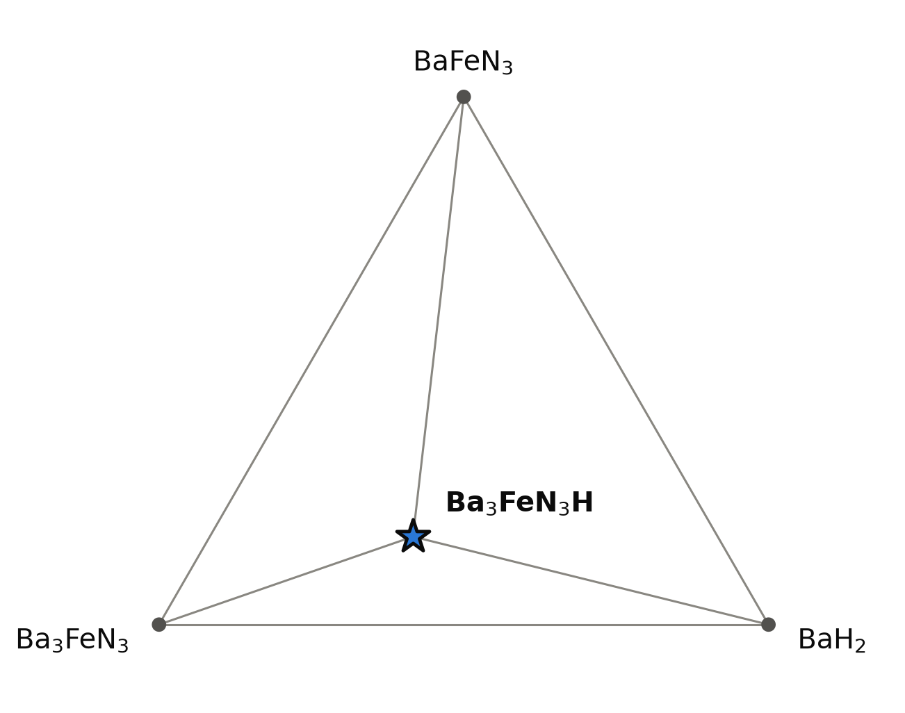
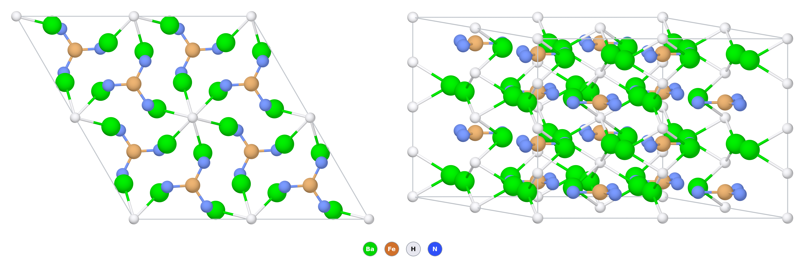

# Ba₃FeN₃H — a barium nitridoferrate hydride, the iron member of the Ba₃CrN₃H structure

*A Material a Day · entry 37 · 27 November 2026 · status: **predicted, no synthesis report found***

> **In one paragraph.** Ba₃FeN₃H is the iron analogue of the nitride hydride Ba₃CrN₃H,
> whose crystals were reported in 2019 [1]. In the database it is hexagonal (P6₃/m):
> planar [FeN₃] triangles sit between barium atoms, and the hydride ions fill the channels
> of the structure, each inside an octahedron of six barium atoms, the octahedra sharing
> faces in chains along c. Counting H⁻, N³⁻ and Ba²⁺ puts the iron at +4. It is on the
> convex hull of both PBE tables of the Alexandria database, 45 and 31 meV/atom below its
> competitors; the scatter of computed nitride energies against calorimetry (84 meV/atom)
> is larger than either margin, so the calculation does not settle whether it is stable.
> We found no report of its synthesis, but it is not unknown to the literature: the
> Ba₃CrN₃H paper computed it and suggested that the compound reported in 1991 as Ba₃FeN₃
> [4], made from barium metal and nitrogen in an iron crucible, may in fact be Ba₃FeN₃H
> [1]. The measured cell of that compound lies between the computed cells of Ba₃FeN₃ and
> Ba₃FeN₃H, and X-rays cannot see the hydrogen, so the question is open; we found no
> later work that tested it. The calculation proposes the obvious route: heat Ba₃FeN₃ in
> hydrogen, as Ca₃CrN₃ is turned into Ca₃CrN₃H in 1 bar of H₂ at 673 K [3]. PBE makes
> Ba₃FeN₃H a magnetic semiconductor with a 0.52 eV gap and 2 μB per iron, the spin of the
> low-spin Fe(IV) measured in the same [FeN₃]⁵⁻ anion in Ca₄FeN₄. It is sensitive to air
> and water, and barium compounds are toxic.

Everything below is computed unless a reference is given. Read
[How this could be wrong](#8-how-this-could-be-wrong) before using any of it.

## 1. Identity

| | computed (PBE) | measured |
|---|---|---|
| Formula | Ba₃FeN₃H (database: Ba₃FeHN₃) | not reported as such; computed in [1], which suggests the reported Ba₃FeN₃ [4] may be this compound |
| Alexandria id | `agm073033103` (the same id in both PBE tables; not in the SCAN or PBEsol tables) | |
| Space group | P6₃/m (no. 176), Z = 2 | "Ba₃FeN₃": P6₃/m, Z = 2 [4] |
| Cell | a = 7.918 Å, c = 5.729 Å | "Ba₃FeN₃": a = 8.014(1) Å, c = 5.608(1) Å [4] (−1.2 %, +2.2 % from this cell) |
| Volume | 155.5 ų per formula unit | "Ba₃FeN₃": 156.0 ų (−0.3 %) |
| Density | 5.46 g cm⁻³ | "Ba₃FeN₃": 5.42 g cm⁻³ (X-ray, for the hydrogen-free formula) [4] |
| Structure type | the Ba₃CrN₃H type (database label ABC3D3_hP16_176_b_c_h_h): the Ba₃FeN₃ structure with H⁻ in its channels | Ba₃CrN₃H, P6₃/m, Z = 2 [1] |
| Formation energy | −0.631 eV/atom (PBE); −0.717 eV/atom (Materials-Project settings) | not found |
| Magnetic moment | 4.0 μB per cell, 2.0 μB per iron (ferromagnetic arrangement as stored) | |

The CIF is [`Ba3FeHN3.cif`](Ba3FeHN3.cif); all numbers are in [`structure.json`](structure.json).

## 2. Where it sits

<picture>
  <source media="(prefers-color-scheme: dark)" srcset="phase_diagram_dark.png">
  
</picture>

A section through the four-element Ba–Fe–N–H system with corners Ba₃FeN₃, BaH₂ and BaFeN₃
(PBE table, 0 K). Ba₃FeN₃H lies inside it (0.75 Ba₃FeN₃ + 0.5 BaH₂ + 0.25 BaFeN₃ has its
composition) and is 66 meV/atom below that mixture in the PBE table. The section is a
picture of the neighbourhood, not the whole hull: the Ba₃FeN₃–BaH₂ and BaFeN₃–BaH₂ lines of
the triangle are not tie lines of the full hull, where the equilibrium leaves the plane.

| what it is measured against | PBE (`energy_runs_pbe`) | PBE, Materials-Project settings (`energy_runs_pbe_mp`) |
|---|---|---|
| depth below the competing phases of the full hull | **44.9** meV/atom | **30.8** meV/atom |
| competing assemblage (Materials-Project-settings hull) | | 0.083 Ba₂FeH₆ + 0.021 BaFeN₃ + 0.896 Ba₃FeN₃ + 0.125 Ba(NH₂)₂ |
| 0.75 Ba₃FeN₃ + 0.5 BaH₂ + 0.25 BaFeN₃ | 66.5 meV/atom below | 37.0 meV/atom below |

The two competing assemblages of the Materials-Project-settings hull (the one above and the
three phases of the section) are within a fraction of a meV/atom of each other; the
temperature tool switches between them (section 5). The SCAN and PBEsol tables have no
entry for this compound, so only the two PBE tables can be compared; they agree that it is
on the hull and differ by 14 meV/atom in depth.

**The other phases of the system** on the PBE hull are Ba₃FeN₃, BaFeN₃, Ba₂Fe₂N₃, Ba₂FeH₆,
the barium nitrides Ba₂N, Ba₃N and BaN₂, the hydride BaH₂, the imides BaHN and Ba₂HN, the
amide Ba(NH₂)₂, BaFeH₈, Fe₃N, FeN and NH₃.

## 3. Structure

*Left: along c, one cell repeated twice in a and b. Right: an oblique side view of the same
block, two cells high. Fe orange with its three Fe–N bonds, N blue, Ba green, H white with
its Ba–H bonds.*

| site | Wyckoff | coordination (PBE) |
|---|---|---|
| Ba | 6h | 5 N at 2.79–2.94 Å (2.79, 2.89, 2.94, 2 × 2.94), 2 H at 2.87 Å |
| Fe | 2c | 3 N at 1.717 Å, trigonal planar |
| H | 2b | 6 Ba at 2.867 Å, octahedral |
| N | 6h | 1 Fe at 1.717 Å, 5 Ba at 2.79–2.94 Å |

- **The anions.** Iron has three nitrogen neighbours in a plane, at 1.717 Å: an isolated
  [FeN₃] triangle, the shape of a carbonate ion. Hydrogen sits on a site of its own whose
  first shell is six barium atoms at 2.87 Å, with no bond to nitrogen: it is a hydride
  (H⁻), not part of an NH group. The structure therefore reads as Ba₃[FeN₃]H, with the charge count
  3 × (+2) = 3 × 3 + 1 − 4 putting iron at +4.
- **How the units connect.** The HBa₆ octahedra share faces and form straight chains along
  c, with H–H 2.864 Å (half the c axis). The [FeN₃] triangles lie in the mirror planes
  between, and each barium belongs to two neighbouring octahedra of one chain and has five
  nitrogen neighbours. This is the arrangement reported for Ba₃CrN₃H, which [1] describes as
  [CrN₃]⁵⁻ triangles and [HBa₆]¹¹⁺ octahedra, and for the hexagonal Ca₃CrN₃H [2, 3],
  where the face-sharing octahedra are described as the chain motif of a hexagonal
  antiperovskite.
- **What the hydrogen does to the cell.** The parent nitride Ba₃FeN₃ (computed here in
  the same space group, `agm003215885`) has the same barium and iron framework with the 2b
  channel site empty. Adding hydrogen shrinks a from 8.132 to 7.918 Å (−2.6 %), lengthens
  c from 5.573 to 5.729 Å (+2.8 %), reduces the volume by 2.6 % and shortens Fe–N from
  1.730 to 1.717 Å, as expected when Fe(III) becomes Fe(IV). In the PBE density of the
  hydrogen-free Ba₃FeN₃ there is a small maximum of 0.09 electrons on the empty channel
  axis, away from any atom: the channel that hydrogen fills here is the one in which the
  hexagonal A₃MN₃ nitrides are discussed as one-dimensional electrides [3, 9], and into
  which hydride has been computed to enter in Sr₃CrN₃ [10]. The measured Fe(IV)–N bonds
  of the [FeN₃]⁵⁻ anion in Ca₄FeN₄ are 1.731, 1.731 and 1.758 Å [5], 1–2 % longer than
  the PBE value here; that is a different compound and the comparison is only a sanity
  check.

**Is the reported Ba₃FeN₃ really Ba₃FeN₃H?** Ba₃FeN₃ was reported in 1991 from a
single-crystal X-ray structure: P6₃/m, a = 8.014(1) Å, c = 5.608(1) Å, Fe–N 1.730(12) Å,
the [FeN₃] triangles isolated and planar, the channel site not occupied in the model [4].
The Ba₃CrN₃H paper [1] noticed that this cell is close to its own (c/a 0.70 for both)
and that bond-valence sums put the barium of the reported Ba₃FeN₃ underbonded (1.6) and
the iron near +4 (4.2), as they had found for the hydrogen-free model of the chromium
compound, and wrote that it is conceivable that Ba₃FeN₃ is actually Ba₃FeN₃H. The Ba₃CrN₃H
authors also report that barium metal as received seems to carry hydrogen: crystals of
BaH₂ appeared in their barium fluxes when no hydride was added [1]. The 1991 sample was
made from barium metal (99.5 %) and nitrogen [4]. How the computed cells compare:

| measured "Ba₃FeN₃" [4] | a (Å) | c (Å) | c/a | V per formula unit (ų) |
|---|---|---|---|---|
| measured | 8.014 | 5.608 | 0.700 | 156.0 |
| PBE Ba₃FeN₃ (`agm003215885`) | 8.132 (+1.5 %) | 5.573 (−0.6 %) | 0.685 | 159.6 (+2.3 %) |
| PBE Ba₃FeN₃H (this entry) | 7.918 (−1.2 %) | 5.729 (+2.2 %) | 0.724 | 155.5 (−0.3 %) |
| PBE in [1], Ba₃FeN₃ | 8.19 | 5.48 | 0.669 | 159.2 |
| PBE in [1], Ba₃FeN₃H | 7.96 | 5.65 | 0.710 | 155.0 |

The measured volume is what PBE gives with hydrogen, and 2.3 % smaller than without it;
the measured c/a lies between the two. Neither decides it: PBE overestimates the volume
of these nitrides by 0 to 2 % (next table), so the hydrogen-free cell is not excluded, and
a partly filled channel would give an intermediate c/a (in Ca₃CrN₃Hₓ c/a falls as hydrogen
leaves [3]). The Fe–N distance, 1.730(12) Å, does not discriminate either (PBE 1.730
without and 1.717 Å with hydrogen). For strontium the measured Sr₃FeN₃ cell matches the
hydrogen-free PBE cell to 0.3 % and is 1.1 % off the hydrogen-filled one (7.543, 5.388 Å),
so that compound looks hydrogen-free. Our cell of Ba₃FeN₃H differs from the PBE cell of
[1] by −0.5 % in a and +1.4 % in c; ours is ferromagnetic with 2 μB per iron, and [1]
does not state the magnetic arrangement it used. What would settle it is a measurement on
Ba₃FeN₃ made as in [4]: neutron diffraction, ¹H NMR (as for Ba₃CrN₃H [1]), or hydrogen
released on heating (as for Ca₃CrN₃H [3]).

**Calibration.** No cell has been measured on a sample known to contain hydrogen. Related
comparisons:

| compound | computed a, c (Å) | measured a, c (Å) | error |
|---|---|---|---|
| Sr₃FeN₃ (PBE, `agm003215887`) | 7.651, 5.312 | 7.630(1), 5.327(2), 295 K [6] | +0.3 %, −0.3 % (volume +0.3 %) |
| Ba₃CrN₃H (machine-learned potential, see below) | 8.013, 5.697 | 8.0270(2), 5.6240(1), 200 K [1] | −0.2 %, +1.3 % (volume +0.9 %) |
| Ba₃CrN₃H (PBE in [1]) | 8.08, 5.67 | same | +0.7 %, +0.8 % (volume +2.2 %) |

Ba₃CrN₃H, the one member of this structure whose hydrogen was confirmed, is **not in the
database**: the PBE table holds only a half-filled ordering, Ba₆Cr₂HN₆ (P-3, 0.1 meV/atom
above the hull), and the hydrogen-free Ba₃CrN₃. We therefore relaxed Ba₃CrN₃H (iron
replaced by chromium in this structure) and Ba₃FeN₃H with the group's machine-learned
potential TugaFF (trained on PBE): it reproduces the measured chromium cell within 1.3 %,
and for iron gives a = 7.895 Å, c = 5.728 Å, within 0.3 % of the PBE cell. The PBE
calculation of [1] reproduces the chromium cell within 0.8 %, and only with hydrogen
(without it: a = 8.44, c = 5.44 Å) [1]. That is indirect evidence that the PBE cell of the
iron compound is good to one or two per cent, about the size of the difference between
the filled and the empty channel.

**The family in this structure** (PBE table, same prototype and space group):

| compound | depth below competitors, PBE (meV/atom) | PBE gap (eV) | moment (μB per cell) |
|---|---|---|---|
| **Ba₃FeN₃H** | **44.9** | 0.52 | 4.0 |
| Ba₃MnN₃H | 46.2 | 0 (metal) | 2.0 |
| Sr₃FeN₃H | 35.1 | 0.63 | 4.0 |
| Ba₃OsN₃H | 20.1 | 0 | 2.8 |
| Sr₃OsN₃H | 5.5 | 0 | 3.9 |
| Sr₃VN₃H | 100.7 above | 0.66 | 2.0 |
| Ba₃NbN₃H, Ba₃TaN₃H | 165, 200 above | | |
| Ba₃CrN₃H | not in the database; made [1] | | |

The same prototype also holds carbonate fluorides (Tl₃CO₃F, K₃CO₃F and others), which
share the arrangement of a planar anion and a monatomic one, and ordered H-poor variants
exist in other prototypes: Ba₆Fe₂HN₆ (half the hydrogen, P-3) is 8.8 meV/atom above the PBE
hull, so the calculation prefers the full channel. For Ca₃CrN₃H made in hydrogen, the
first report estimated 0.70 hydrogen per formula from the gas released on heating and 0.85
from the X-ray refinement [3]; neutron scattering later found the hydride sites at least
95 % occupied [2]. In Ba₃CrN₃H, DFT puts hydrogen on the barium-coordinated 2b site with a
binding enthalpy of −168 kJ per mol H₂, and finds the other candidate site, between the
chromium atoms along c, unfavourable relative to H₂ gas [1].

## 4. Computed properties

All numbers are in [`properties.json`](properties.json). Iron has no f electrons; no
f-free analogue is needed. The compound is magnetic in the calculation, and every number
below belongs to the ferromagnetic arrangement stored in the database.

### Electronic structure and magnetism

| | value | comment |
|---|---|---|
| Band gap, PBE (ferromagnetic) | 0.52 eV (indirect), 0.63 eV (direct) | PBE underestimates gaps; no +U |
| Band gap, machine-learned PBE estimate | 0.75 eV | |
| Band gap, machine-learned MBJ estimate | 0.84 eV | a screening estimate from the structure alone |
| Moment | 2.0 μB per Fe | |
| PBE in [1] | metallic | magnetic arrangement not stated |
| Measured | none; crystals of "Ba₃FeN₃" are black and lustrous [4] | black fits a small gap or a metal; it does not decide between them |

- **The moment matches a measured Fe(IV) nitride.** In Ca₄FeN₄, the [FeN₃]⁵⁻ anion holds
  low-spin Fe(IV) with spin S = 1: a paramagnetic moment of 3.08 μB, an ordered moment of
  1.92(10) μB, and antiferromagnetic order below 25 K [5]. The 2.0 μB per iron here is the
  moment of the same spin. In Ba₃CrN₃H the two d electrons of Cr(IV) pair in the
  nonbonding d_z² orbital: the measured moment is below 10⁻³ μB per chromium from 1.8 to
  320 K, and DFT gives an insulator with a gap of 1.4 eV (PBE) or 2.1 eV (mBJ) [1]. With
  two more d electrons, iron cannot be nonmagnetic in the same way. No magnetic
  measurement of Ba₃FeN₃ was found; [1] names one as a way to fix the valence of its iron.
- **What was not computed:** the magnetic ground state. Only the ferromagnetic arrangement
  is in the database, and Ca₄FeN₄ orders antiferromagnetically [5]. Another arrangement
  would change the energy, by an amount we did not compute, and probably the gap.
- **Is it a semiconductor?** PBE says yes, narrowly. A gap of half an electronvolt in a
  spin-polarised PBE calculation of a 3d compound, without +U, is not a reliable statement
  about the real gap; the MBJ estimate (0.84 eV) is from a model, not a calculation.

### Dielectric response (PBE, ferromagnetic)

| | principal values | average |
|---|---|---|
| Electronic dielectric constant ε∞ | 6.60, 6.91, 6.91 | 6.81 |
| Refractive index √ε∞ | | 2.61 |

| Born effective charge (trace/3) | Ba | Fe | H | N |
|---|---|---|---|---|
| nominal | +2 | +4 | −1 | −3 |
| computed | +2.69 | **+0.03** | −1.19 | −2.30 |

The large ε∞ goes with the small gap. Hydrogen carries close to its nominal −1, barium
more than its +2. The iron charge averages to almost zero (principal values −2.81 to
+1.45): moving the iron does not move charge the way an Fe⁴⁺ ion would. We did not analyse
why; in a small-gap magnetic compound computed without +U this is the least reliable
number of the table. The structure is centrosymmetric: no piezoelectric response.

### Charge transport (PBE, constant relaxation time)

| | electrons | holes |
|---|---|---|
| Density-of-states mass (mₑ) | 8.0 | 3.0 |
| Conductivity mass at 300 K, 10¹⁹ cm⁻³ (mₑ) | 2.2 | 1.8 |
| Seebeck coefficient at 300 K, 10¹⁹ cm⁻³ (μV/K) | −464 | +380 |
| Seebeck coefficient at 300 K, 10²⁰ cm⁻³ (μV/K) | −280 | +182 |

Both carriers are heavy, the electrons more so (flat iron d bands). The branch-point
energy lies 0.09 eV above the valence-band maximum, which in this simple picture means the
material would be easier to dope with holes than with electrons. These numbers describe
the band edges of the ferromagnetic PBE calculation; they are not a thermoelectric
recommendation.

### Mechanical (machine-learned)

| bulk modulus | shear modulus | Young's modulus |
|---|---|---|
| 47 GPa | 24 GPa | 67 GPa |

Screening estimates from a graph neural network on the PBE structure, not elastic-constant
calculations. No measured moduli exist.

### Vibrations (machine-learned)

The database's harmonic phonons from a machine-learned potential (EquFlashV2) on the PBE
structure have **no imaginary frequency**; the spectrum ends at 791 cm⁻¹ (98 meV), against
737 cm⁻¹ for Ba₃FeN₃, which has no hydrogen. Which modes are hydrogen vibrations was not
worked out. For comparison only, in Ca₃CrN₃H the hydride vibrations were measured by
inelastic neutron scattering as a broad band between 80 and 130 meV [2]. For the reported
Ba₃FeN₃, the asymmetric Fe–N stretching mode of the [FeN₃] triangle was measured at
618 cm⁻¹ [4]; we did not identify that mode in the computed spectra.

### Not computed

DFT phonons (the compound is not in the group's phonon calculations), the magnetic ground
state, DFT+U or hybrid gaps, spin–orbit coupling, elastic constants by DFT, the static
dielectric constant, hydride-ion migration, defect energies.

## 5. Is it stable?

| calculation | Ba₃FeN₃H against its competing assemblage |
|---|---|
| PBE (`energy_runs_pbe`) | on the hull, **44.9 meV/atom below** |
| PBE, Materials-Project settings (`energy_runs_pbe_mp`) | on the hull, **30.8 meV/atom below** |
| SCAN, PBEsol | no entry |

- **The two tables agree that it is on the hull**; they differ by 14 meV/atom in depth.
- **The error bar is larger than the margin.** For nitrides, computed formation enthalpies
  on the Materials-Project-settings table scatter by 84 meV/atom (median absolute deviation
  over 14 compounds) about a bias of +35 meV/atom against calorimetry. Neither margin, 31 or
  45 meV/atom, exceeds that scatter. No compound of this system has a measured formation
  enthalpy on file, so the error cannot be narrowed. The competitors are themselves barium
  nitridoferrates, BaH₂ and barium amide, chemically close to the target, which should
  cancel part of the error; that is an argument, not a number. **The calculation does not
  resolve whether Ba₃FeN₃H is stable.** What supports it is the family: the chromium member
  exists [1], and in the same table the barium–iron, barium–manganese and strontium–iron
  members are all 35–46 meV/atom below their competitors. The DFT of [1] also finds
  Ba₃FeN₃H more stable than Ba₃FeN₃ (no number given for iron).
- **At temperature.** With harmonic phonons the margin barely moves: −37.6 meV/atom at
  300 K, −36.8 at 673 K, −36.5 at 873 K, −35.2 at 1073 K and −33.7 at 1273 K, against a
  phonon error for nitrides of 5 meV/atom at 673 K, 15 at 873–1073 K and 30 at 1273 K.
  The margin is on the Materials-Project-settings scale.
- **The hydrogen and nitrogen potentials matter more than temperature** (section 6): with
  too much hydrogen it turns into Ba₂FeH₆, barium amide and ammonia, with too much nitrogen
  into BaFeN₃, BaN₂ and barium amide, and with too little hydrogen it loses its hydrogen
  and returns to Ba₃FeN₃.
- **Air and water.** It reacts with oxygen, water and CO₂ at 0 K (with water,
  −238 meV/atom, to BaO, ammonia and iron nitrides). Handle under argon.

## 6. How to make it

No synthesis of Ba₃FeN₃H has been reported as such. Three published syntheses bear on it:

| compound | how it was made | ref. |
|---|---|---|
| "Ba₃FeN₃" (possibly Ba₃FeN₃H, section 3) | barium metal (99.5 %) in an iron crucible inside a silica tube, under argon heated at 100 K/h to 1273 K, 24 h in flowing N₂ (about 5 L/h), cooled at 10 K/h; single phase by powder X-ray diffraction, Ba : Fe = 3 : 1; the iron comes from the crucible; black hexagonal prisms | [4] |
| Ba₃CrN₃H | flux: Ba 27, Mg 3, BaH₂ 1 and CrN 2 mmol, welded in stainless steel and sealed in evacuated silica, 1273 K for 24 h, cooled at 1 K/h to 1123 K, flux spun off while molten; green hexagonal prisms | [1] |
| Ca₃CrN₃H | orthorhombic Ca₃CrN₃ in pure H₂ at 0.1 MPa and 673 K for 12 h (in situ: 713 K); hydrogen leaves near 600 K under argon, and the hydrogen-free hexagonal phase, made at 1073 K in vacuum, takes hydrogen back at 703 K | [3] |

The second is a direct route to the iron compound that the calculation did not model:
the same flux with an iron source in place of CrN. The first matters because, if [1] is
right about it, the reported precursor already holds hydrogen.

**What the hull proposes.** Energies are 0 K reaction energies per atom of the whole
charge, Materials-Project-settings scale, ranked fewest reagents first and then least
driving force. All 11 closed routes need three reagents and leave nothing to separate.

| route | charge | ΔE (meV/atom) | comment |
|---|---|---|---|
| A | 0.75 Ba₃FeN₃ + 0.5 BaH₂ + 0.25 BaFeN₃ | −37.0 | first by rank; BaFeN₃ is a computed phase whose charge balance needs an N–N bonded anion, and we did not search for a report of it |
| B | ⅔ Ba₃FeN₃ + BaNH + ⅓ Fe | −39.2 | from the parent, barium imide and iron powder |
| C | 0.75 Ba₃FeN₃ + 0.75 BaNH + 0.25 FeH | −47.9 | FeH is not a practical reagent |
| **R** | **Ba₃FeN₃ + ½ H₂ (gas)** | **−46.5 at 873 K and 1 bar H₂** | the open-system route; target forms directly from the parent |

**Route R in practice (computed, not tested).** It is what was done for the calcium–
chromium compound: orthorhombic Ca₃CrN₃ in 1 bar of pure H₂ at 673 K for 12 h gives
hexagonal Ca₃CrN₃H [3]; a later preparation used 723 K for 2 h in H₂, then 673 K for 24 h
in N₂/H₂/Ar (22.5 : 67.5 : 10) [2]. There the hydrogen also rotates the framework from
orthorhombic to hexagonal [3]. Here the parent Ba₃FeN₃ already has the hexagonal
structure and an empty channel site, so hydrogen only has to fill it.

- *Charge:* Ba₃FeN₃ made as in [4] (barium and N₂ in an iron crucible at 1273 K), ground
  and handled under argon; the related Sr₈[FeN₃]₂[FeN₂] was made from Sr₂N and iron powder
  under flowing N₂ at 1223 K in iron crucibles [7]. Whether this charge is free of
  hydrogen should be checked first (section 3): barium metal may carry some [1].
- *Gas and temperature (the window at temperature, every phase priced at T):*

  | T | hydrogen window (p_H₂, bar) | nitrogen limit (p_N₂, bar) |
  |---|---|---|
  | 673 K | 2 × 10⁻⁹ to 0.50, best near 0.05 | below 0.0017 |
  | 873 K | 6 × 10⁻⁶ to 11, best near 2.7 | below 0.43 |

  So at 673 K pure hydrogen at 1 bar is already beyond the hydrogen-rich end (the target
  would go on to Ba₂FeH₆, barium amide and ammonia), and a dilute mixture such as 5 % H₂ in
  argon sits at the computed optimum. At 873 K, 1 bar of pure hydrogen is inside the
  window. Nitrogen in the gas is not needed and, at 673 K, even a little is too much
  (BaFeN₃ and BaN₂ form on the nitrogen-rich side) — unlike the Ca₃CrN₃H recipe, which
  used an N₂/H₂ mixture [2]. In practice Ca₃CrN₃ took up hydrogen in pure H₂ at 1 bar and
  673 K without being over-hydrogenated [3], a different system but a hint that the
  computed hydrogen-rich end is too strict. These ends rest on energies with the
  84 meV/atom scatter of section 5, and a shift of that size in a chemical potential moves
  a pressure limit by orders of magnitude: read the ends as directions, not settings.
- *Bottom of the window:* no melting point is on file for any phase of the system.
  Estimated Tammann temperatures are 640 K for Ba₃FeN₃ and 565 K for BaH₂, each uncertain
  by about 200 K. A topochemical uptake of hydrogen into an existing channel need not wait
  for bulk diffusion of barium or iron; Ca₃CrN₃ took up hydrogen at 673–723 K [2, 3].
- *Top of the window:* the hydrogen leaves again at low hydrogen pressure (below 6 × 10⁻⁶
  bar at 873 K): cool in the same gas. Ca₃CrN₃H loses hydrogen near 600 K under argon [3].
- *Container:* iron, copper, silver, cobalt and ruthenium, MgO, CaO and AlN are computed
  inert towards the product; iron is what is used for nitridoferrates [4, 7], and
  stainless steel for Ba₃CrN₃H [1]. Alumina, silica,
  zirconia, BN (−16 meV/atom), platinum, gold, nickel, molybdenum, tungsten, tantalum and
  niobium all react.
- *Metathesis, tested.*

  | charge | computed outcome |
  |---|---|
  | FeCl₂ + 3 BaNH | fails: BaFeN₃ + BaHCl + BaCl₂ + Fe + Ba(NH₂)₂, −407 meV/atom; the charge has too much hydrogen |
  | FeCl₂ + BaNH + Ba₂N + ½ BaN₂ + ½ Ba | Ba₃FeN₃H + BaCl₂, −577 meV/atom; BaCl₂ is inert towards the target |
  | FeF₂ + BaNH + Ba₂N + ½ BaN₂ + ½ Ba | Ba₃FeN₃H + BaF₂, −521 meV/atom |

  The exchange works on paper only when the charge is built to the exact balance from five
  reagents, among them a barium subnitride and barium metal; the simple two-reagent charge
  fails. It is not a practical route. Of the halide fluxes, NaCl, KCl, alkali halides and
  BaCl₂ are computed inert towards the product, and LiCl is not (it gives Li₅FeN₃);
  the Ba/Mg metal flux with BaH₂ used for Ba₃CrN₃H crystals [1] was not modelled.
- *Pathway check.* For route B at 873 K the pathway tool, which prices the phases on the
  measured scale (measured values where they exist, DFT plus a class correction elsewhere),
  finds the charge **uphill** by 235 meV/atom to the target, while the hull puts it 39
  meV/atom downhill. The two scales disagree by more than the margin; we did not resolve
  why, and treat the routes from BaNH as unconfirmed.

**Reading the powder pattern.** Strongest computed lines (PBE cell, Cu Kα):

| 2θ (°) | 22.46 | 25.99 | 27.38 | 30.38 | 31.23 | 34.61 | 47.30 | 58.23 |
|---|---|---|---|---|---|---|---|---|
| hkl | 110 | 200 | 111 | 201 | 002 | 210 | 212 | 312 |
| I | 18 | 22 | 99 | 100 | 55 | 44 | 34 | 27 |

The parent Ba₃FeN₃ has the same lines at slightly different angles (computed 111 at
27.15°, 201 at 30.02°, 002 at 32.12°): hydrogen uptake moves 002 to **lower** angle (c
longer) and the hk0 lines to **higher** angle (a shorter). X-rays barely see hydrogen
(the patterns of Ca₃CrN₃H and of hexagonal Ca₃CrN₃ barely differ [2]; in Ba₃CrN₃H the
hydrogen was placed with the help of DFT [1]), so the lattice parameters, not extra lines,
are the X-ray test, and only when compared on the same sample before and after the
treatment: the shift is 2–3 %, PBE errs by up to 2 %, and the 1991 cell sits between the
two computed ones (section 3). Neutron diffraction, ¹H NMR as used for Ba₃CrN₃H [1], or the
hydrogen released on heating, as measured for Ca₃CrN₃H [3], would show the hydride
directly.

- **Ba₃FeN₃ lines at their own cell:** no or incomplete uptake: too cold, too short, or too
  little hydrogen.
- **Ba₂FeH₆ or barium amide:** too much hydrogen (too cold for the hydrogen pressure).
- **BaFeN₃ or BaN₂:** nitrogen in the gas.
- **BaO, Ba(OH)₂, BaCO₃:** air or moisture.

**Hazards.** Soluble barium compounds are toxic. The product, its parent and BaH₂ react
with water and air (computed above); Ba₃FeN₃ releases ammonia at once on contact with
water [4], and Ba₃CrN₃H crystals decompose within a short time in air [1]; expect ammonia
and hydrogen on contact with moisture.
Hydrogen at temperature is a fire and explosion hazard. Work in a glovebox and in a
furnace rated for hydrogen.

## 7. What it is good for

Nothing yet: it has not been made knowingly. Its closest relatives are studied for two
reasons. The hexagonal Ca₃CrN₃H is an ammonia-synthesis catalyst: about 3800 μmol of NH₃
per gram per hour at 5 MPa and 673 K, steady over 120 h, without ruthenium or iron [3],
and the hydride ions in its channels are thought to take part [2, 3]. And Fe(IV) in a
nitride is rare: [5] made Ca₄FeN₄ at high pressure with an azide, stating that high
oxidation states are difficult to reach in nitrides. If Ba₃FeN₃H forms from Ba₃FeN₃ and
hydrogen at ambient pressure, or if the 1991 compound already is Ba₃FeN₃H, it would be a
lower-pressure way to an Fe(IV) nitride. Any catalytic or magnetic use is speculation
until the hydrogen content of a real sample is known.

## 8. How this could be wrong

- **The margin is smaller than the error.** 31–45 meV/atom against 84 of nitride scatter,
  with no measured enthalpy anywhere in the system. The hull alone cannot say it is stable.
- **Only one magnetic arrangement was computed.** Fe(IV) with S = 1, as here, orders
  antiferromagnetically in Ca₄FeN₄ [5]. The energy, the gap, the Born charges and the
  transport numbers all belong to a ferromagnetic PBE calculation without +U, and
  correlation on iron could change the picture, including the oxidation-state assignment.
- **The hull around it is incomplete.** Ba₃CrN₃H, which exists, is missing from the
  database, and so is Ca₄FeN₄. Other barium iron nitride hydrides, if any exist, would not
  be in the competition either. BaFeN₃, a neighbour and the first-ranked reagent, is a
  computed phase we did not check against the literature.
- **The parent may not be what the database assumes.** If the reported Ba₃FeN₃ contains
  hydrogen [1], the hydrogen-free Ba₃FeN₃ of the database (124 meV/atom below its
  competitors in the PBE table) has no measured counterpart, and route R starts from a
  compound that may already be the target. Conversely, if Ba₃FeN₃ is hydrogen-free as
  reported, its cell sits 1–2 % from both computed ones and does not test the hydride.
- **The two energy scales disagree** on whether the imide route is downhill (section 6).
- **No DFT phonons.** The machine-learned phonons find the stored structure dynamically
  stable, but that potential is not DFT.
- **Partial hydrogen.** Ca₃CrN₃Hₓ was reported with x between 0.7 and 1 [2, 3]; a real
  Ba₃FeN₃Hₓ could be non-stoichiometric, with iron between +3 and +4.
- **The literature search can miss things.** See below; a structural-database check by a
  person is still owed.

## 9. Literature

**Searched 22 November 2026 (OpenAlex, with Crossref and arXiv where noted):**
"Ba3FeN3H nitride hydride" (0 hits); "Ba3FeN3H" (OpenAlex and Crossref, 0); "barium
nitridoferrate hydride" (OpenAlex and Crossref, 11 hits, none on this compound);
"nitridoferrate hydride barium iron(IV) trigonal planar FeN3" (8 hits: [1], [5], unrelated
work); "nitride hydride iron alkaline earth Sr3FeN3H hydrogen intercalation" (8 hits, none
relevant); "Ba3MnN3H OR Sr3FeN3H OR Ba3FeN3H hydride nitride manganese iron" (OpenAlex,
Crossref and arXiv, 16 hits, none on a member of this family other than Ca₃CrN₃H);
"A3MN3H nitride hydrides hexagonal P63/m ..." (0); "Ba3CrN3H nitride hydride chromium" (6
hits: [1] and its preprint, [2]); "Ca3CrN3H nitride hydride ammonia synthesis catalyst" (14
hits: [2], [3] and others on the same compound); "Ba3[FeN3] nitridoferrate(III) crystal
structure" (10 hits: [4], [6], [7] and related nitridoferrates); "computational prediction
nitride hydrides stability high-throughput mixed-anion hydride nitride" (8 hits, none on
this structure). Wikipedia: no page for Ba₃FeN₃H, Ba₃FeHN₃, barium nitridoferrate hydride
or Ba₃FeN₃. **Searched 22 November 2026, after reading [1]:** "Ba3FeN3 hydrogen nitride
hydride iron(IV) neutron diffraction" (OpenAlex and Crossref, from 2019; 11 hits, none on
this compound); "hexagonal A3MN3 nitridometalate hydride electride Ba3FeN3 Sr3CrN3"
(OpenAlex, Crossref and arXiv, from 2019; 20 hits: [9], [10] and work on Sr₃CrN₃ and
Ba₃CrN₃ as electrides, none on Ba₃FeN₃ or its hydrogen content).

**Result: no report of a synthesis of Ba₃FeN₃H found.** The compound is named and
computed in the body of [1], which suggests that the reported Ba₃FeN₃ [4] may be
Ba₃FeN₃H; we found no work that tested this. The chromium member of the structure is
known [1], and so is the reported parent Ba₃FeN₃ [4]. A failed search is not evidence
that the compound is unknown: the database check by a person is owed.

1. N. W. Falb, J. N. Neu, T. Besara, J. B. Whalen, D. J. Singh, T. Siegrist, the report
   of Ba₃CrN₃H, *Inorg. Chem.* 58, 3302–3307 (2019). doi:10.1021/acs.inorgchem.8b03367;
   preprint doi:10.26434/chemrxiv.7418429.v1. *Full text read (synthesis, structure, NMR,
   magnetisation, DFT, and the discussion of Ba₃FeN₃).*
2. L. Fine, R. Lavén, Z. Wei, T. Tsumori, H. Kageyama, R. Kajimoto, M. Jiménez-Ruiz,
   M. M. Koza, M. Karlsson, "Configuration and Dynamics of Hydride Ions in the
   Nitride-Hydride Catalyst Ca₃CrN₃H", *Chem. Mater.* 37, 489–496 (2025).
   doi:10.1021/acs.chemmater.4c02897. *Full text read in part (open copy from the Chalmers
   repository): synthesis, cell, occupancy and vibration results; supporting information
   not read.*
3. Y. Cao, M. A. Kirsanova, M. Ochi et al., "Topochemical Synthesis of Ca₃CrN₃H Involving
   a Rotational Structural Transformation for Catalytic Ammonia Synthesis", *Angew. Chem.
   Int. Ed.* 61, e202209187 (2022). doi:10.1002/anie.202209187. *Full text read;
   supporting information not read.*
4. P. Höhn, R. Kniep, A. Rabenau, the report of Ba₃[FeN₃] (in German), *Z. Kristallogr.*
   196, 153–158 (1991). doi:10.1524/zkri.1991.196.14.153. *Full text read.*
5. S. D. Kloß, A. Haffner, P. Manuel, M. Goto, Y. Shimakawa, J. P. Attfield, "Preparation
   of iron(IV) nitridoferrate Ca₄FeN₄ through azide-mediated oxidation under high-pressure
   conditions", *Nat. Commun.* (2021). doi:10.1038/s41467-020-20881-y. *Full text
   read in part (structure, magnetism, Mössbauer); supplementary information not read.*
6. J. K. Bendyna, P. Höhn, R. Kniep, "Crystal structure of tristrontium
   trinitridoferrate(III), Sr₃[FeN₃]", *Z. Kristallogr. NCS* 223 (2008).
   doi:10.1524/ncrs.2008.0046. *Abstract read (cell).*
7. J. K. Bendyna, P. Höhn, R. Kniep, "Crystal structure of octastrontium
   bistrinitridoferrate(III) dinitridoferrate(II), Sr₈[FeN₃]₂[FeN₂]", *Z. Kristallogr. NCS*
   223 (2008). doi:10.1524/ncrs.2008.0075. *Abstract read (synthesis).*
8. Alexandria database, entry `agm073033103` (PBE and Materials-Project-settings tables).
9. P. Chanhom, K. E. Fritz, L. A. Burton et al., the report of Sr₃CrN₃ as an electride
   with a partly filled d shell, *J. Am. Chem. Soc.* 141, 10595–10598 (2019).
   doi:10.1021/jacs.9b03472. *Abstract read.*
10. M. Xu, C. Wang, B. J. Morgan et al., "Hydride ion intercalation and conduction in the
    electride Sr₃CrN₃", *J. Mater. Chem. C* (2022). doi:10.1039/d1tc05850a. *Abstract read.*

## 10. Provenance

- **Data:** Alexandria database, tables `energy_runs_pbe` (structure, properties, hull,
  family), `energy_runs_pbe_mp` (reaction energies, competing phases) and
  `phonons_pbe_equflashv2` (machine-learned harmonic phonons).
- **Tools:** the reaction-route code of this group (hull, reaction table, open-system
  routes, firing window at temperature, contact, calorimetric error, finite-temperature
  margin, pathway), the machine-learned potential TugaFF for the cell checks, a
  graph-neural-network property model for the moduli and the gap estimates, pymatgen for
  symmetry, distances and the powder pattern, POV-Ray for the pictures.
- **Authorship:** drafted by Claude (Anthropic) from those tools; reviewed by
  Miguel Marques. Corrections are welcome as issues on this repository.
